## About this lecture

In *ATAC-seq: Tn5, fragment sizes, nucleosome ladder* you saw what the assay measures. This lecture turns the reads into the things every downstream analysis starts from: **peaks** and a **consensus peak set**.

- **Reads to a clean BAM**: trimming Nextera adapters, alignment with long fragments allowed, and five filters, each with a reason.
- **Tn5 insertion sites**: the +4/−5 shift, and when to think in fragments or in cut sites.
- **Peak calling**: what MACS3 computes (a local Poisson background), and the two ways to run it on ATAC-seq.
- **Replicates**: naive overlap vs rank consistency (IDR) and pseudoreplicates.
- **Consensus peaks** across samples, **FRiP**, comparison with ENCODE, and where the peaks sit.

::: notes
The running example is real: ENCODE GM12878 ATAC-seq (experiment ENCSR095QNB), two biological replicates, paired-end 2 × 101 bp, restricted to the reads that ENCODE aligned to chromosome 21 or the mitochondrial genome. The reads are untouched, adapters and all, so every step in this lecture is one students run in the exercise, and every number on the slides comes from that run. The analysis continues in *Differential accessibility*, which starts from a count matrix over fixed-width 500-bp peaks: the consensus procedure at the end of this lecture is how such a matrix is built.
:::

## The ATAC-seq pipeline, end to end {.smaller}

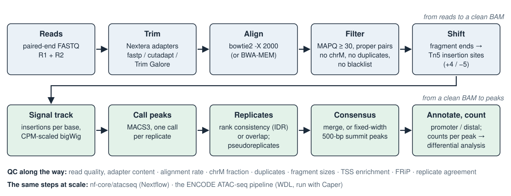{width="92%" fig-align="center"}

- Ten steps; each one answers a specific problem with the raw data. We go through them in order.
- Production pipelines do exactly this: **nf-core/atacseq** (Nextflow) and the **ENCODE ATAC-seq pipeline** (WDL). Learn the steps on one sample by hand, then run the pipeline on all of them.

::: notes
Top row: from FASTQ to a filtered BAM; bottom row: from the BAM to peaks and a peak set that can be counted. The QC line at the bottom lists what to look at along the way; the fragment-size distribution and TSS enrichment belong to the previous unit, FRiP and replicate agreement to this one. The two production pipelines differ in details (nf-core uses BWA by default and calls broad peaks on fragments by default; ENCODE uses Bowtie2, shifts reads, calls narrow peaks on insertion sites and runs IDR), but the logic is the same. nf-core is the easiest to run on an HPC cluster with SLURM; it is a single command with a sample sheet once Nextflow and a container engine are available. Point out the arrow from Shift to Signal track: most of the downstream work uses insertion sites rather than reads.
:::

## Trim the adapters first {.smaller}

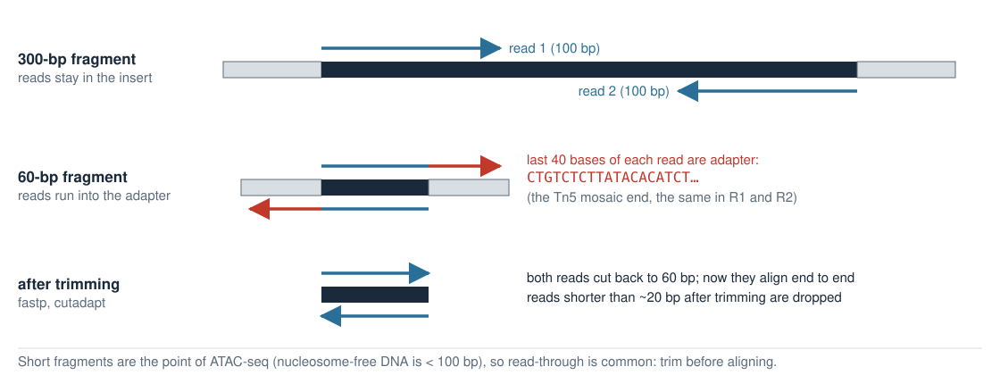{width="88%" fig-align="center"}

- Tn5 loads the **Nextera** adapters. Both reads of a short fragment run into the adapter: `CTGTCTCTTATACACATCT…`.
- ATAC-seq is *made* of short fragments: in our data fastp trimmed adapter bases from **38%** of the reads.
- Untrimmed, these reads fail to align end to end or align with mismatches at the ends; trim with **fastp**, **cutadapt** or **Trim Galore**.

::: notes
The sequence CTGTCTCTTATACACATCT is the reverse complement of the 19-bp Tn5 mosaic end; it is the same at both ends of every fragment, so R1 and R2 read into the same adapter sequence. In RNA-seq with TruSeq libraries and 300-bp inserts you could almost ignore adapters; in ATAC-seq the nucleosome-free fragments are often shorter than the read. fastp also detects adapters automatically from the overlap of R1 and R2, which works well for paired-end data; we give it the sequence explicitly to be sure. A minimum length (we use 20 bp) removes reads that are too short to align uniquely. The fraction quoted on the slide comes from the fastp report of replicate 1 (4.67 M of 12.18 M reads; replicate 2: 40%). fastp also reports an "insert size peak" of 42 bp for replicate 1: it can only estimate the insert size from pairs whose reads overlap, i.e. short fragments, so this is not the fragment-size mode.
:::

## Align with room for long fragments

```bash
bowtie2 -p 8 --very-sensitive -X 2000 -x hg38_chr21_chrM \
        -1 rep1_R1.trim.fq.gz -2 rep1_R2.trim.fq.gz 2> rep1.bowtie2.log \
  | samtools fixmate -m -u - - | samtools sort -o rep1.raw.bam
```

- `-X 2000`: pairs up to 2 kb count as **concordant**. The default (500) makes di- and tri-nucleosome fragments "improper".
- `fixmate -m` adds the mate tags that `samtools markdup` needs later.
- Reference: **chr21 + chrM** only, an honest shortcut (see notes).

::: notes
Bowtie2 in end-to-end mode is what the ENCODE pipeline uses (bowtie2 -X2000 --mm); nf-core/atacseq uses BWA-MEM by default. --very-sensitive is a common choice for short ATAC reads. Our reference is chr21 + chrM only: reads from other chromosomes are absent by construction, and with the whole genome you would also see reads that mis-align from elsewhere. The fragment-length ceiling matters because the next filter keeps only proper pairs (flag 0x2): with the default ceiling, every fragment longer than 500 bp would be thrown away, and with it the di-nucleosome peak of the ladder. In the exercise the alignment of one replicate takes a few minutes on 8 threads. Our reads are the ones ENCODE aligned to chr21 or chrM in the full genome, so almost all of them align again (99.6% overall, 98.9% of pairs concordantly with -X 2000; without -X 2000 only 94.7% of pairs are concordant, about 250 000 pairs fewer); a real sample aligned to the full genome typically aligns at over 95%.
:::

## Five filters, five reasons {.smaller}

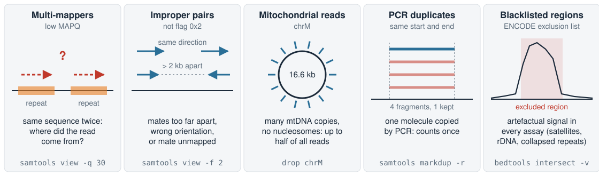{width="95%" fig-align="center"}

- Keep a pair only if **both mates** pass: unique (MAPQ ≥ 30), properly paired, not chrM, not a duplicate.
- **Blacklisted regions** (Amemiya et al. 2019) are removed from the insertion sites and from the peaks.

::: notes
Each filter has a reason. Multi-mappers (low MAPQ) cannot be placed, and in repeats they create false peaks. Improper pairs are mostly artefacts (chimeras, rearrangements, a mate in another chromosome). Mitochondrial DNA has no nucleosomes and many copies per cell, so Tn5 loves it: chrM reads are often 20–50% of an ATAC library and would dominate every normalisation; the Omni-ATAC protocol reduced this, but it is still checked. Duplicates in ATAC-seq: a pair with the same start and the same end as another pair is almost always a PCR copy, because two independent Tn5 events would have to hit both exact ends. For paired-end data this is reliable; for single-end data it removes some real reads at very strong sites. The blacklist (ENCODE exclusion list) marks regions with artefactual high signal in every assay; ENCODE removes peaks there, nf-core removes reads. We filter reads by flags, then remove blacklisted insertion sites and peaks.
:::

## Real data: reads through the pipeline {.smaller}

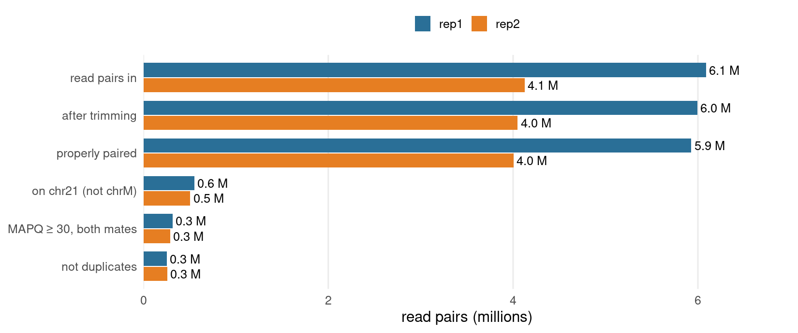{width="90%" fig-align="center"}

- GM12878 replicate 1: 6.1 M read pairs in, **0.25 M** usable fragments on chr21 out.
- Biggest losses: **chrM** (91% of our pairs; 14% of the whole library), **MAPQ** (43% of the chr21 pairs) and **duplicates** (20%).

::: notes
Numbers from make-atacanalysis-figs.R (and the exercise). Our FASTQ files contain only the reads that ENCODE placed on chr21 or chrM: 6.09 M of the 38.2 M read pairs of the replicate-1 library. So 91% chrM is the fraction in our subset; in the whole library chrM is about 5.4 M of 38.2 M pairs, 14%, which is typical. The MAPQ filter removes 43% of the chr21 pairs: chr21 contains repeats and segments present twice in the reference, where a read cannot be placed uniquely (we come back to this when comparing with ENCODE). Duplicates: 63 852 of 316 329 filtered pairs (20%); the duplicate rate depends on library complexity and depth, and rises as you sequence deeper. ENCODE asks for 25 million non-duplicate, non-mitochondrial fragments per replicate genome-wide; chr21 is about 1.5% of the genome, so our 0.25 M chr21 fragments correspond to a library of roughly that size. Replicate 2: 4.1 M pairs in, 0.26 M fragments out.
:::

## Tn5 cuts the two strands 9 bp apart {.smaller}

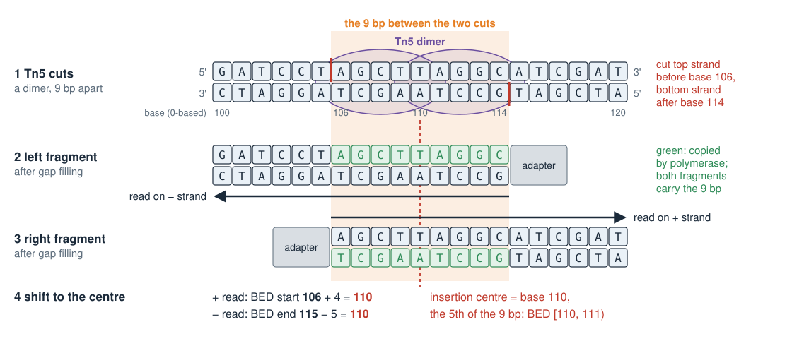{width="95%" fig-align="center"}

- The Tn5 dimer joins adapters to the two strands **9 bp apart**. Gap filling copies those 9 bp, so **both fragments** carry them.
- The insertion "point" is the centre of the 9-bp duplication: **+4** from a + read's start, **−5** from a − read's end (BED coordinates).

::: notes
Walk through the three rows. Row 1: the transposase dimer cuts the top strand before base 106 and the bottom strand after base 114 (0-based), a 9-bp stagger. Row 2 and 3: each piece gets an adapter on one 5' end and has a 9-nt single-stranded gap on the other strand, which the polymerase fills in during the first PCR cycle (the 72 °C step). So the 9 bp 106–114 are now present on both fragments. A read on the right fragment starts at 106 on the + strand; a read on the left fragment ends at 114 on the − strand. The centre of the 9 bp is base 110: start + 4 for the + read, and BED end (115) − 5 for the − read. In 1-based coordinates the same rule is +4 and −4 (115 − 4 = 111, the 1-based number of base 110): the asymmetric −5 is only the half-open BED end. Buenrostro et al. 2013 introduced the +4/−5 offsets. The shift moves positions by only a few bases: it does not matter for 500-bp peaks, but it matters for TF footprints, where a few bp are the signal.
:::

## From a read pair to two insertion sites {.smaller}

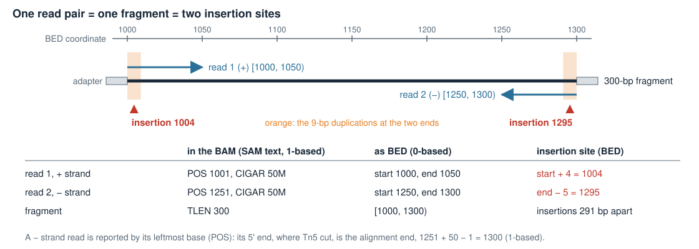{width="92%" fig-align="center"}

- Every properly paired fragment gives **two** insertion sites, one at each end.
- In BED: + read `start + 4`, − read `end − 5`. Tools: `awk` on a BEDPE file, or `alignmentSieve --ATACshift` (deepTools).

::: notes
A − strand read is stored in BAM by its leftmost base, but its 5' end, where Tn5 cut, is its rightmost base: POS + aligned length − 1 in 1-based, which equals the BED end. This is the most common bug when people shift reads by hand: shifting the − strand read's start instead of its end puts the insertion 100 bp off for a 100-bp read. In the exercise we convert the BAM to BEDPE with bedtools bamtobed -bedpe (one line per pair), take the leftmost start and the rightmost end, and apply +4 and −5. Single-cell ATAC "fragment files" (Cell Ranger ATAC, ArchR, Signac) store exactly such shifted fragments; their exact off-by-one conventions differ slightly between tools, which again only matters for footprinting.
:::

## Fragments or insertion sites? {.smaller}

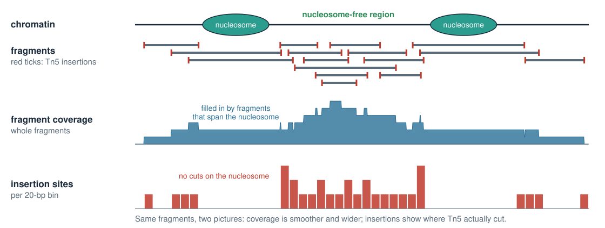{width="88%" fig-align="center"}

- **Fragment coverage** counts the DNA between two cuts: smooth, but fragments that span a nucleosome fill it in.
- **Insertion sites** count only where Tn5 cut: sharper, closer to "accessibility" in the strict sense.
- Peaks, signal tracks and counts can use either. Be explicit about which.

::: notes
Fragment coverage is what you would get from a ChIP-seq-style pileup; it answers "where was DNA released?". Insertion counts answer "where could Tn5 reach the DNA?", which is the definition of accessibility. Long fragments are the clearest case: a 350-bp fragment spanning a nucleosome is evidence of two accessible linkers, not of an accessible nucleosome. Most ATAC-specific tools (ENCODE pipeline, ArchR, chromVAR counting, footprinting) work on insertions; nf-core/atacseq and many papers call peaks on fragments. Both find the same strong peaks; they differ in peak width and in the weak, broad stuff.
:::

## Real data: insertions vs fragment coverage {.smaller}

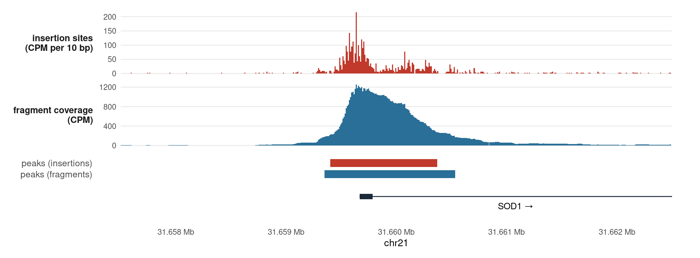{width="95%" fig-align="center"}

- GM12878 replicate 1 at the **SOD1** promoter (chr21). Same reads, two tracks, both CPM.
- Insertions concentrate at the open sites; fragment coverage is broader and also covers the flanking nucleosomes.

::: notes
At the SOD1 promoter the insertions are concentrated in a few hundred bp just upstream of the TSS, with the highest bins at the nucleosome-free region; the fragment coverage is a broad hump that extends about 1 kb into the gene, because fragments starting in the open region end in the flanking linkers. MACS3 calls a somewhat wider peak on fragments here (1183 vs 970 bp); across chr21 the median peak width is 611 bp with fragments and 290 bp with insertions. Both tracks are CPM-scaled (per million fragments or insertions), the same normalisation as the bigWigs students make.
:::

## Signal tracks for the browser

```bash
# insertion sites (one line per cut), sorted, as bedGraph -> bigWig, CPM-scaled
sort -k1,1 -k2,2n rep1.ins.bed > rep1.ins.sorted.bed
n=$(wc -l < rep1.ins.sorted.bed)
bedtools genomecov -i rep1.ins.sorted.bed -g chrom.sizes -bg -scale $(echo "1000000 / $n" | bc -l) \
  > rep1.ins.cpm.bedGraph
bedGraphToBigWig rep1.ins.cpm.bedGraph chrom.sizes rep1.ins.cpm.bw

# or from the BAM with deepTools: fragment coverage, CPM
bamCoverage -b rep1.dedup.bam -o rep1.frag.cpm.bw --extendReads --normalizeUsing CPM -bs 10
```

- **CPM** (counts per million) makes samples of different depth comparable on screen. It is a display normalisation, not the one for differential tests.

::: notes
genomecov on a BED of single-base insertions gives the count of insertions per base; -scale multiplies by 10^6 / total insertions. Many people smooth insertions (for example a 150-bp window, like the MACS3 pileup) before display, otherwise the track is spiky at base resolution; IGV smooths automatically when zoomed out. bamCoverage with --extendReads on paired-end data fills in the whole fragment between the mates, which is the fragment-coverage track. bamCoverage also has --Offset and alignmentSieve has --ATACshift for insertion-based tracks. In Differential accessibility we come back to normalisation: CPM assumes the total amount of accessible chromatin is the same in all samples.
:::

## What a peak caller does {.smaller}

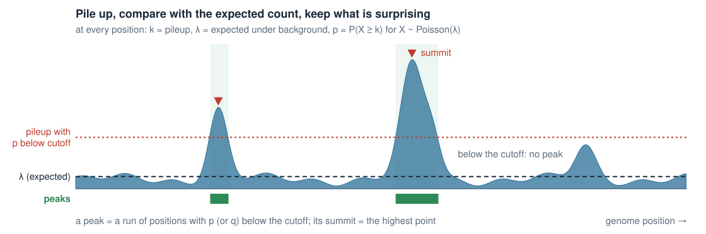{width="92%" fig-align="center"}

- **Pile up** the reads (or insertion windows) along the genome.
- At each position compare the pileup $k$ with the **expected** count $\lambda$ under background: $p = P(X \ge k)$, $X \sim \text{Poisson}(\lambda)$.
- A **peak** is a run of positions below the cutoff; its **summit** is the highest point.

::: notes
This is the MACS model (Zhang et al. 2008), which students will meet again in the ChIP-seq unit. A Poisson model for the number of reads landing in a window is reasonable if reads fall independently and uniformly under background; the real background is not uniform, which is why λ is estimated locally (next slide). MACS computes the p-value at every position of the pileup, joins adjacent positions passing the cutoff into peaks (gaps shorter than a small distance are bridged), and reports the summit. The narrowPeak columns are the peak's fold enrichment at the summit, −log10 p and −log10 q at the summit, and the summit offset (see *Genomic intervals*).
:::

## The local λ: background is not uniform {.smaller}

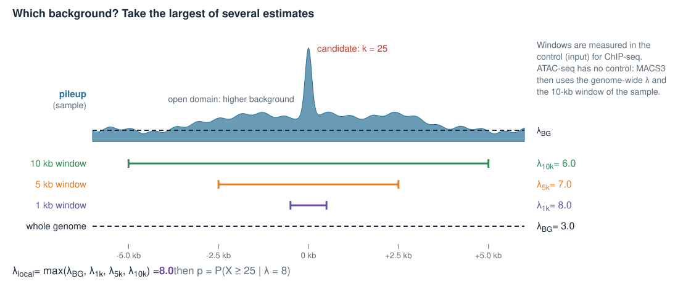{width="92%" fig-align="center"}

- $\lambda_\text{BG}$ = total reads × window / genome size. But open domains, copy-number gains and mappability make background vary.
- With a control, MACS2/3 use $\lambda_\text{local} = \max(\lambda_\text{BG}, \lambda_d, \lambda_\text{1k}, \lambda_\text{10k})$, the windows measured in the control: the **largest** estimate, the conservative choice. (The 2008 paper used 1, 5 and 10 kb.)
- Without a control (ATAC-seq), MACS3 uses $\lambda_\text{BG}$ and the sample's own **10-kb** window.

::: notes
All λ values are expected counts in a window of the same size as the one in which k is counted (MACS scales each window's count to that size). In the original 2008 paper, the 1k, 5k and 10k windows were measured in the control (input DNA), and λBG from the genome-wide average; MACS2 and MACS3 use the control's pileup over the fragment width d, and its 1-kb and 10-kb windows (the *Peak calling* unit of the ChIP-seq block goes through this with real data). Taking the maximum protects against local biases: a region with high background everywhere does not get peaks just for being high. In MACS3 the defaults are --slocal 1000 and --llocal 10000. With no control, using the 1-kb window of the sample itself would include the peak and swallow it, so MACS3 skips it and uses only the 10-kb window and the genome background. Worked example in the figure (2008-style windows): λBG = 3, λ1k = 8, λ5k = 7, λ10k = 6, so λlocal = 8, and the candidate with 25 reads gets p = P(X ≥ 25 | 8) ≈ 1.2 × 10⁻⁶ instead of 3 × 10⁻¹⁵ against the genome average. The exercise has a similar calculation by hand.
:::

## From counts to p-values and q-values {.smaller}

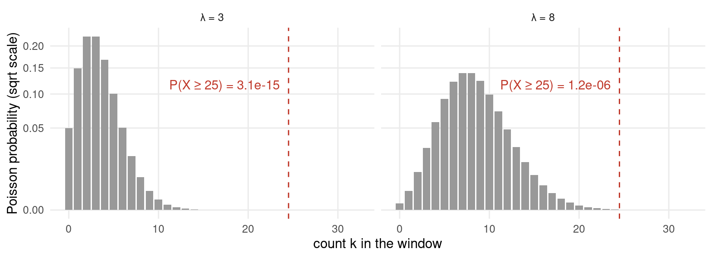{width="85%" fig-align="center"}

- The same 25 reads are extremely surprising against $\lambda = 3$ and much less so against $\lambda = 8$.
- Millions of positions are tested, so MACS converts p to **q-values** (Benjamini–Hochberg FDR). `-q 0.01`: expect about 1% of called peaks to be false.

::: notes
Read the figure: bars are the Poisson probabilities of each count under the two λ values; the shaded tail is P(X ≥ 25). Against the genome-wide background the tail is 3 × 10⁻¹⁵; against the local background 1.2 × 10⁻⁶. Students know the Benjamini–Hochberg procedure from RNA-seq; MACS applies it to the p-scores of the pileup. Two caveats worth saying: the Poisson model ignores overdispersion, so MACS p-values are too small in absolute terms and are best used to rank peaks; and the q-value is computed per position, not strictly per peak. That is one reason replicate-based methods (IDR) are used to choose the final number of peaks.
:::

## Two ways to run MACS3 on ATAC-seq {.smaller}

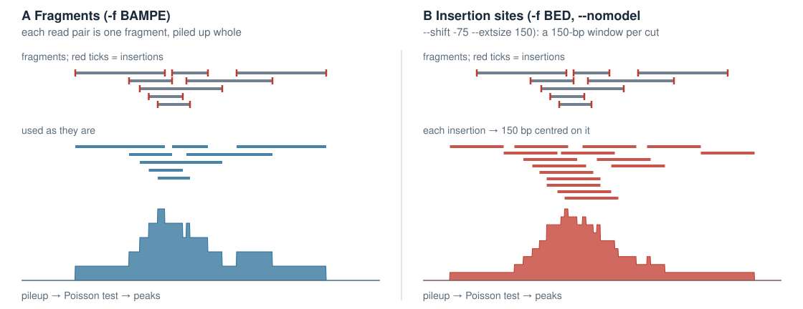{width="92%" fig-align="center"}

- **A. `-f BAMPE`**: the pileup is the real fragments, no model, no shift. Simple; nucleosome-spanning fragments widen the peaks.
- **B. Insertion sites as BED**, `--nomodel --shift -75 --extsize 150`: every cut becomes a 150-bp window centred on it. Used by ENCODE and Corces et al. 2018.

::: notes
MACS was written for ChIP-seq single-end reads, where it estimates the fragment size d from the shift between + and − strand peaks (the "model") and extends each read by d. For ATAC-seq that model makes no sense, so it is always switched off (--nomodel). Mode A uses the fragments as measured. Mode B uses each insertion independently: --shift -75 moves the 5' end 75 bp upstream and --extsize 150 extends it to 150 bp, so the window is centred on the cut. Our insertion BED has one line per cut with the strand set to +, so MACS treats the start as the 5' end. Mode B counts both ends of every fragment and ignores what lies between them; this matches "insertion sites" in the previous slides. Other callers: Genrich (has an ATAC mode with replicates built in) and HMMRATAC (MACS3 hmmratac subcommand, models nucleosome-free and nucleosomal fragments with an HMM); neither is needed in this course.
:::

## MACS3 in practice

```bash
# A: fragments
macs3 callpeak -t rep1.dedup.bam -f BAMPE -g 4.0e7 --keep-dup all -q 0.01 -n rep1_frag
# B: insertion sites
macs3 callpeak -t rep1.ins.bed -f BED --nomodel --shift -75 --extsize 150 \
               -g 4.0e7 --keep-dup all -q 0.01 -n rep1_cuts
```

- `-g`: effective genome size, sets λ<sub>BG</sub> (`hs` ≈ 2.7e9; here chr21 only, 4.0e7).
- `-q` / `-p`: the cutoff; a lenient `-p 0.01` when IDR chooses the final set.
- `--keep-dup all`: duplicates were already removed. `--call-summits`: several summits per broad peak.

::: notes
Flags are not examined; the logic is. -g matters here because our data come from one chromosome: telling MACS3 the genome is 2.7 Gb would make λBG about 70 times too small. It would not change the result much, because λlocal = max(...) is then dominated by the 10-kb window, but it is the kind of mistake that hides in a methods section. The default --keep-dup 1 keeps one read per position; after samtools markdup that is no longer needed, and for insertions it would wrongly collapse independent cuts at the same base. Outputs: _peaks.narrowPeak (the peaks), _summits.bed (one line per summit), _peaks.xls (a tab-separated table with a header of settings). On our chr21 data one MACS3 call takes about a second; on a full genome a few minutes.
:::

## Real data: how many peaks? {.smaller}

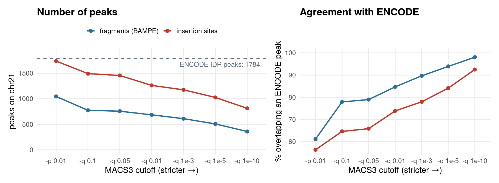{width="90%" fig-align="center"}

- Replicate 1, chr21, q < 0.01: **685** peaks with fragments (`BAMPE`), **1262** with insertion sites. ENCODE's IDR set has 1784.
- The number of peaks depends smoothly on the cutoff: there is **no natural threshold**. Weak peaks are a continuum, not a separate class.

::: notes
Left: from p < 0.01 to q < 1e-10 the number of insertion-mode peaks falls from 1739 to 812, smoothly, without a plateau. Fragment mode gives about half as many, wider peaks at every cutoff: the pileup of whole fragments is smoother, and nearby sites merge into one peak. Right: the stricter the cutoff, the larger the fraction of peaks that ENCODE also has (insertion mode: 56% at p < 0.01, 74% at q < 0.01, 92% at q < 1e-10). Strict cutoffs give few, reliable peaks; lax cutoffs give more peaks and more noise. ENCODE has more peaks than we do at any cutoff partly because its pipeline pools deeper data and keeps multi-mapping reads (later slide). The point: "the number of peaks" is a choice, so two papers with different cutoffs report different numbers for the same cells, and replicates are the principled way to choose.
:::

## Replicates: overlap vs rank consistency {.smaller}

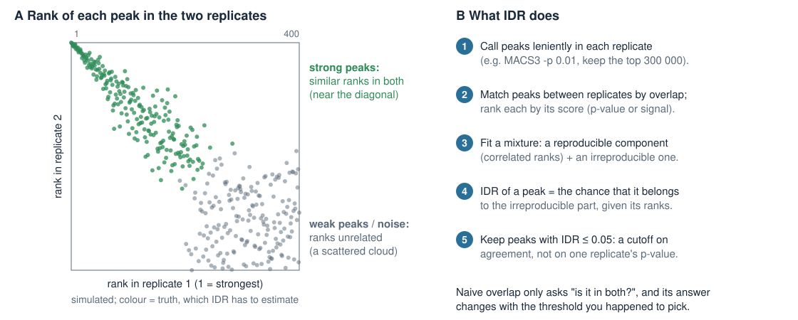{width="92%" fig-align="center"}

- Naive: call peaks in each replicate, keep those found in both. The answer depends on the cutoff, and a lax cutoff lets noise in.
- **IDR** (Li et al. 2011) uses the **ranks**: real peaks rank similarly in both replicates, noise does not. It finds where the agreement breaks down.

::: notes
IDR is to replicates what a q-value is to a single sample: a per-peak measure, estimated from the data, that lets you set a cutoff in terms of a rate. The model is a two-component copula mixture: a reproducible component in which the ranks are correlated and an irreproducible one in which they are independent. IDR needs many peaks including noise, so it is run on lenient calls (ENCODE: MACS2 -p 0.01, top 300 000 peaks per replicate), never on already-thresholded peaks. The output is the set of peaks with IDR below a threshold (ENCODE ATAC: 0.05). In the exercise we do not run the idr package; we plot the rank consistency ourselves, which shows the same thing.
:::

## Pseudoreplicates and ENCODE's peak sets {.smaller}

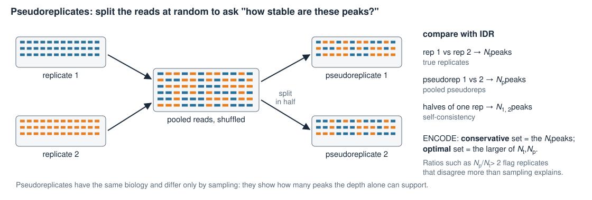{width="92%" fig-align="center"}

- Pool the replicates, shuffle the reads, split in two: **pseudoreplicates** differ only by sampling.
- If true replicates agree much less than pseudoreplicates (ratio > 2), the replicates differ in biology or quality, not just depth.

::: notes
Pseudoreplicates answer: how many peaks would be reproducible if the two replicates were perfect copies of each other? Np (pooled pseudoreplicates) is usually somewhat larger than Nt (true replicates), because biological replicates also differ biologically. ENCODE reports both, the "rescue ratio" max(Np, Nt)/min(Np, Nt) and the "self-consistency ratio" between the two replicates' self-pseudoreplicate counts N1 and N2; an experiment passes if both are below 2. Pseudoreplicates are also the way to get a reproducibility-filtered peak set from a single replicate, with the obvious caveat that they say nothing about biological variation. The file we compare with (gm12878_atac_peaks.bed.gz) is ENCODE's IDR thresholded peak set from replicates 1 and 2.
:::

## Real data: do the replicates agree? {.smaller}

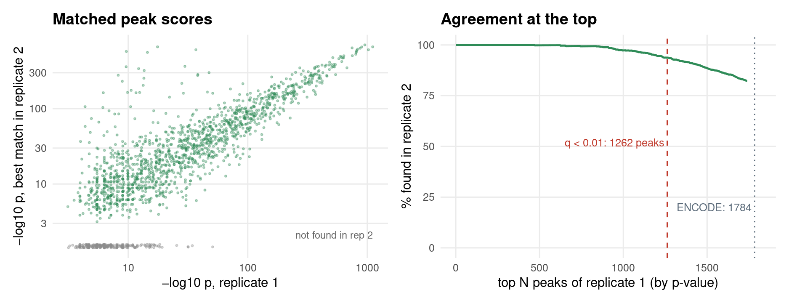{width="92%" fig-align="center"}

- Left: −log10 p of matched peaks in replicate 1 vs 2. Right: of the top *N* peaks of replicate 1, the fraction also found in replicate 2.
- The top 750 peaks: 99% found in replicate 2. Agreement stays ≥ 90% up to about 1450 peaks, then falls (82% for all 1739).

::: notes
Peaks were called with a lenient cutoff (-p 0.01) in each replicate, as for IDR: 1739 and 1909 peaks. Matching is by overlap; unmatched peaks are drawn at the bottom of the left panel, and they are almost all weak. The Spearman correlation of matched scores is 0.82. The right panel is a "correspondence at the top" curve, the simple cousin of IDR: it stays flat while we add real peaks and bends down when we start adding noise, here somewhere around 1300–1500 peaks, close to the 1262 peaks at q < 0.01. ENCODE's IDR set on chr21 is larger (1784) because it was made from deeper, pooled data and keeps multi-mapping reads.
:::

## Real data: our peaks and ENCODE's {.smaller}

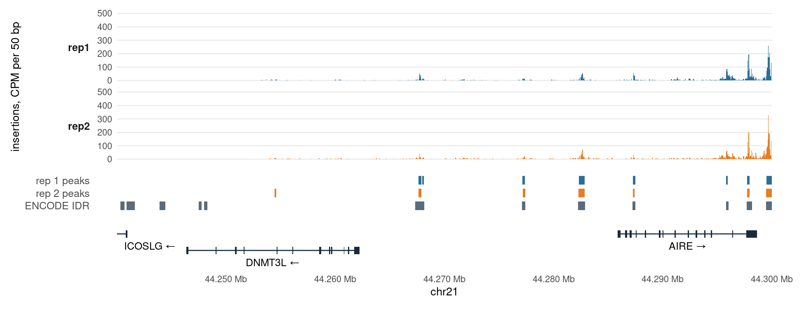{width="95%" fig-align="center"}

- 74% of our 1262 replicate-1 peaks are in ENCODE's set; 89% of ENCODE's 1784 chr21 peaks are in ours.
- Left: 1680 read pairs but only 7 with MAPQ ≥ 30 (sequence present twice). We drop them; ENCODE keeps multi-mappers.

::: notes
Locus: DNMT3L and AIRE (chr21:44.24–44.30 Mb). Where both replicates have signal, the three peak sets agree. On the left there are ENCODE peaks and no reads at all in our tracks: the reads are there in the raw BAM, but they align equally well to another place on chr21 (MAPQ ≈ 1), so our MAPQ ≥ 30 filter removes them. GRCh38 is known to contain falsely duplicated segments on chr21. The ENCODE ATAC-seq pipeline keeps reads with up to 4 alignments and assigns each to one of them at random (its multimapping = 4 setting), so it calls peaks in both copies. Most of the ENCODE peaks we miss are in such regions (43–44 Mb and 5–8 Mb). Neither choice is wrong: unique reads are conservative; random assignment recovers signal in duplicated regions at the price of not knowing which copy it came from. The other direction: 26% of our peaks are not in the ENCODE set; they are mostly weak peaks below ENCODE's IDR threshold. Discussion: which set would you use for a motif analysis, and which for a differential analysis?
:::

## A consensus peak set across samples {.smaller}

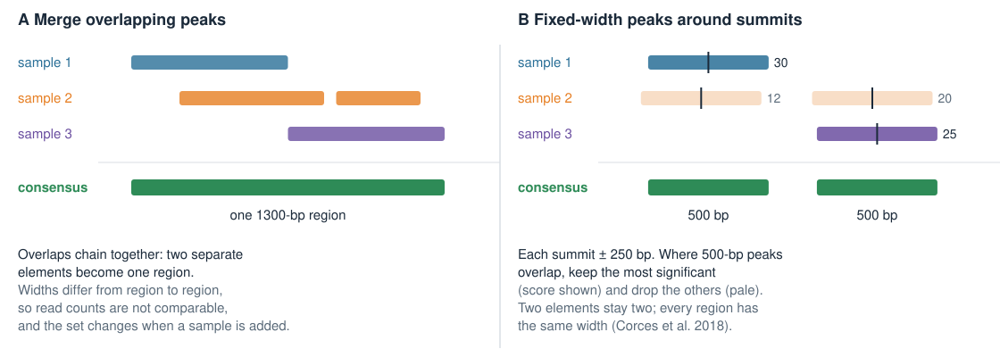{width="95%" fig-align="center"}

- To count reads per peak in many samples (*Differential accessibility*), every sample needs the **same regions**.
- **Merge** (`bedtools merge`): simple, but overlaps chain into wide regions of very different widths.
- **Fixed width**: summit ± 250 bp, overlaps resolved by significance. Every region is 500 bp, centred on a summit.

::: notes
This is the step where ATAC-seq analysis differs most from RNA-seq: there the genes are given, here we make the features. nf-core/atacseq builds its consensus by merging the peaks of all samples (and requires a peak to be present in a minimum number of samples); DiffBind does something similar by default. Fixed-width peaks were introduced for large ATAC-seq atlases (Corces et al. 2016 and 2018; ArchR uses the same idea). Advantages: equal widths make counts comparable between regions (GC content, length effects), and adding a sample does not merge two elements into one. The 500-bp peaks of the Corces 2016 haematopoiesis count matrix used in *Differential accessibility* were built this way. On our data, with only two replicates, merging is harmless: 1442 merged regions, median 289 bp, the longest 1820 bp. The chaining problem grows with the number of samples, which is where fixed-width peaks pay off.
:::

## Iterative overlap removal {.smaller}

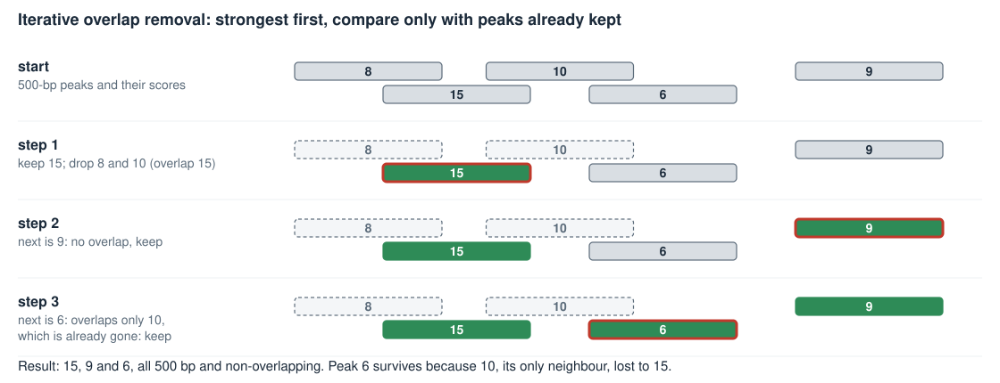{width="92%" fig-align="center"}

- Sort the 500-bp peaks by significance; keep the best; drop the peaks that **overlap it**; repeat with the next best that is left.
- Across samples, first make the scores comparable (e.g. −log10 p divided by the sample's total, "score per million"), then run the same procedure on all peaks together.

::: notes
The subtle point is in step 3: peak 6 overlaps peak 10, but 10 was already removed by 15, so 6 is compared only with peaks that were kept and survives. The procedure therefore keeps local maxima of significance and removes their overlapping neighbours, without chaining. In Corces et al. 2018 this was done per sample, then on all samples together after normalising the peak scores to a score per million, and peaks had to be reproducible in at least two samples. In R it is a short loop over findOverlaps, which students write in the exercise. On our chr21 data: 1262 and 1323 peaks become 1116 and 1123 non-overlapping 500-bp peaks per replicate, 1286 in the joint consensus, and 958 of these are supported by both replicates.
:::

## FRiP: fraction of reads in peaks {.smaller}

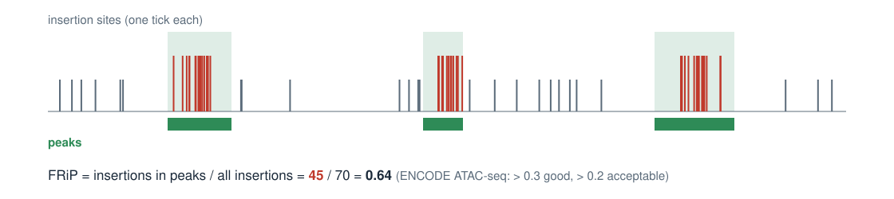{width="92%" fig-align="center"}

- FRiP = insertions (or reads) in peaks / all. A signal-to-noise measure: how much of the library is in accessible sites?
- Ours: **0.57** (replicate 1) and **0.48** (replicate 2), insertions in own q < 0.01 peaks. ENCODE standard for ATAC-seq: > 0.3, > 0.2 acceptable.

::: notes
FRiP depends on the peak set: more lenient peaks give a higher FRiP, so compare FRiP between samples only with comparable peak calling (or with a fixed reference peak set). It is also lower in cell types with less open chromatin. In ATAC-seq a low FRiP usually means many reads from closed chromatin: over-digestion, dead cells (naked DNA), or too little nuclei clean-up. TSS enrichment, from the previous unit, is the other main signal-to-noise measure and does not need peaks at all. With ENCODE's peaks instead of our own, replicate 1's FRiP is 0.58.
:::

## Where are the peaks? {.smaller}

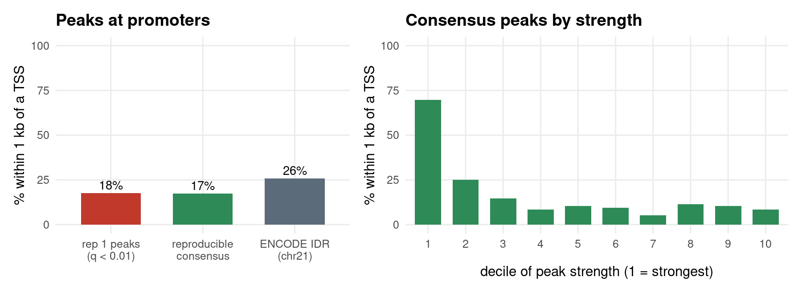{width="90%" fig-align="center"}

- Fraction of peaks within 1 kb of a protein-coding TSS, by peak strength (*Genomic intervals*).
- Strongest 10% of consensus peaks: **70%** at a promoter; the other deciles: 5–25%. Overall 17% (ours) and 26% (ENCODE).
- Most peaks are **distal**: candidate enhancers and insulators.

::: notes
The reproducible consensus has 958 peaks on chr21; 59% of the 602 distinct protein-coding TSS positions on chr21 have one within 1 kb, plausible since many genes are not expressed in a B-cell line. ENCODE's set has a higher promoter fraction (26%) than ours because it reaches further into weak peaks in duplicated, gene-dense regions and because IDR keeps a different set of weak peaks. This is the same overlap logic as the genomic-intervals exercise, applied to our own peaks. The promoter fraction is a useful sanity check: an ATAC-seq peak set with very few promoter peaks suggests a problem, and a set with almost only promoter peaks suggests low sensitivity (only the strongest sites were found). The distal peaks are where cell-type-specific regulation lives, and the starting point for motif analysis (*Motifs, motif enrichment and TF footprinting*).
:::

## Pitfalls {.smaller}

| pitfall | what happens | fix |
|---|---|---|
| chrM left in | 8 peaks on the 16.6-kb chrM; 91% of the reads; fewer real peaks | drop chrM reads |
| no blacklist | peaks in satellite repeats, also in "differential" lists | remove blacklisted peaks and insertions |
| wrong `-g` | λ<sub>BG</sub> wrong by orders of magnitude | effective size of what you aligned to |
| `--keep-dup 1` on insertions | independent cuts at the same base collapsed | `--keep-dup all` after deduplication |
| too lax a cutoff | many peaks, low reproducibility, inflated FRiP | IDR or rank consistency to choose |
| −strand read not shifted from its end | insertions off by a read length | shift BED end, not start |

::: notes
Each row is something that has happened in published analyses. The chrM numbers come from calling peaks on the unfiltered replicate-1 BAM in make-atacanalysis-figs.R: 590 peaks, 8 of them on chrM (two among the top 20) and 7 in blacklisted regions, and fewer peaks on chr21 (582 vs 685), because the 5 M chrM fragments inflate the genome-wide background λ. A good habit: after peak calling, look at the number of peaks per chromosome and at the top 20 peaks in a browser; artefacts are usually at the top of the list.
:::

## Summary {.smaller}

| step | key idea |
|---|---|
| trim | Nextera adapter `CTGTCTCTTATACACATCT`; short fragments read through |
| align | `-X 2000` so nucleosome-spanning pairs stay proper |
| filter | MAPQ, proper pairs, chrM, duplicates (same both ends), blacklist |
| shift | insertion = centre of the 9-bp duplication: + start +4, − end −5 (BED) |
| represent | fragments (smooth) or insertion sites (where Tn5 cut) |
| peaks | Poisson test against $\lambda_\text{local}$ = the largest background estimate (with no control: $\max(\lambda_\text{BG}, \lambda_\text{10k})$); q-values by BH |
| MACS3 for ATAC | `BAMPE`, or insertions with `--nomodel --shift -75 --extsize 150` |
| replicates | rank consistency (IDR) beats naive overlap; pseudoreplicates for depth |
| consensus | fixed 500-bp summit peaks, iterative overlap removal |
| QC | FRiP > 0.3; promoter fraction; agreement with a reference set |

::: notes
Students should leave able to: shift a read pair to insertion sites by hand, choose λlocal and compute a Poisson p-value, explain the two MACS3 modes and when each is used, explain why IDR uses ranks, build a fixed-width consensus set by hand on a small example, and compute FRiP. Next: *Differential accessibility*, which starts from a count matrix over such a consensus set.
:::

## Key papers (optional further reading) {.smaller}

*Not required reading and not examined. For those who want the primary literature.*

- Buenrostro et al. 2013, *Nat Methods*. [Transposition of native chromatin for fast and sensitive epigenomic profiling of open chromatin, DNA-binding proteins and nucleosome position](https://doi.org/10.1038/nmeth.2688). The assay, and the +4/−5 shift.
- Zhang et al. 2008, *Genome Biol*. [Model-based Analysis of ChIP-Seq (MACS)](https://doi.org/10.1186/gb-2008-9-9-r137). The local-λ Poisson peak caller.
- Li et al. 2011, *Ann Appl Stat*. [Measuring reproducibility of high-throughput experiments](https://doi.org/10.1214/11-AOAS466). IDR.
- Corces et al. 2018, *Science*. [The chromatin accessibility landscape of primary human cancers](https://doi.org/10.1126/science.aav1898). Fixed-width peaks and iterative overlap removal at scale.
- Yan et al. 2020, *Genome Biol*. [From reads to insight: a hitchhiker's guide to ATAC-seq data analysis](https://doi.org/10.1186/s13059-020-1929-3). A review of every step and the tools.
- Ewels et al. 2020, *Nat Biotechnol*. [The nf-core framework for community-curated bioinformatics pipelines](https://doi.org/10.1038/s41587-020-0439-x). The pipeline framework behind nf-core/atacseq.
