## About this lecture

In *What is epigenetics?* we saw that active promoters and enhancers are **nucleosome-depleted**: the DNA there is open. ATAC-seq maps that open DNA genome-wide, from a few thousand cells, in an afternoon. It is the most used chromatin assay today, and its data carry more than peaks: the lengths of the fragments tell you where the nucleosomes are.

- Why measure **accessibility**, and how it was done before ATAC-seq (DNase-seq, FAIRE, MNase-seq).
- The **Tn5 transposase**: cutting and adding adapters in one step, and what that does to the library.
- The **fragment-length distribution** and the nucleosome ladder, down to the 10-bp helical period.
- ATAC-specific QC: **mitochondrial reads**, **TSS enrichment**, and what a bad library looks like.
- Protocol variants and experimental design.

::: notes
This is the first unit of the ATAC-seq block. Students already know nucleosomes, NDRs and the MNase ladder from What is epigenetics?, and the generic steps of alignment, duplicates and blacklists from From reads to coverage and Experimental design and QC. Here the focus is what is special about ATAC-seq: the enzyme, the fragments it makes, and the QC that follows from that. The following unit, ATAC-seq processing and peak calling, does the Tn5 shift in detail, peak calling and consensus peaks. All real-data figures in this lecture come from ENCODE GM12878 ATAC-seq replicate 1 (ENCSR095QNB), reads from chr21 and chrM, processed with exactly the commands of the exercise.
:::

## Open chromatin marks regulatory DNA {.smaller}

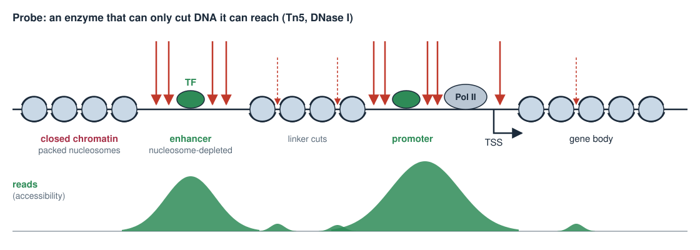{width="95%" fig-align="center"}

- Promoters and enhancers that are in use have a **nucleosome-depleted region** where transcription factors bind. Elsewhere the DNA is wrapped in nucleosomes.
- An enzyme added to nuclei cuts, or tags, mostly where it **can reach** the DNA. Count where it acted, and the pile-ups are the accessible regions.
- Accessibility is **mark-free**: no antibody, no prior choice of protein. One assay finds promoters, enhancers and insulators (CTCF sites) at once.

::: notes
The logic of every accessibility assay: use a large enzyme as a probe for access. Nucleosomes protect the DNA wrapped on them; linkers are partly accessible; NDRs are very accessible. A peak of accessibility does not tell you which factor is bound or whether the element is active or poised; that is what histone marks and TF ChIP add. But it is the best single map of "where the regulatory DNA of this cell type is". About 1–3% of the genome is accessible in a given cell type; across all cell types studied by ENCODE, millions of distinct accessible sites have been found (Thurman et al. 2012). The weak cuts in linkers in the figure come back later: they make the nucleosome ladder.
:::

## Before ATAC-seq: four ways to find open DNA {.smaller}

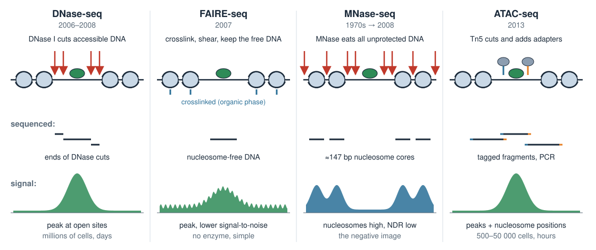{width="95%" fig-align="center"}

- **DNase I hypersensitive sites** (1970s–80s, Southern blots): active genes are more sensitive to DNase I. **DNase-seq** (Boyle et al. 2008; Hesselberth et al. 2009) maps them genome-wide.
- **FAIRE**: crosslink, shear, and keep the DNA that is not bound to proteins. **MNase-seq** does the opposite: digest everything unprotected and sequence the nucleosome cores.
- **ATAC-seq** (Buenrostro et al. 2013) gives the DNase-seq answer, plus nucleosome positions, from far fewer cells.

::: notes
DNase I hypersensitivity is the classic marker of regulatory DNA: Weintraub and Groudine showed in 1976 that active globin genes are more DNase-sensitive, and individual hypersensitive sites at enhancers and the beta-globin LCR were mapped by Southern blot in the 1980s. DNase-seq turned that into a genome-wide map and was the main ENCODE accessibility assay; Thurman et al. 2012 is the landmark paper. It needs millions of cells and careful titration of the enzyme. FAIRE (Giresi et al. 2007) is simple but has low signal-to-noise. MNase-seq gives a negative image: nucleosomes, with the NDR as a gap. ATAC-seq won because it is fast, works on 500–50 000 cells, and its fragments contain both kinds of information. DNase-seq is still used, and single-hit DNase protocols give very clean footprints.
:::

## ATAC-seq in one picture {.smaller}

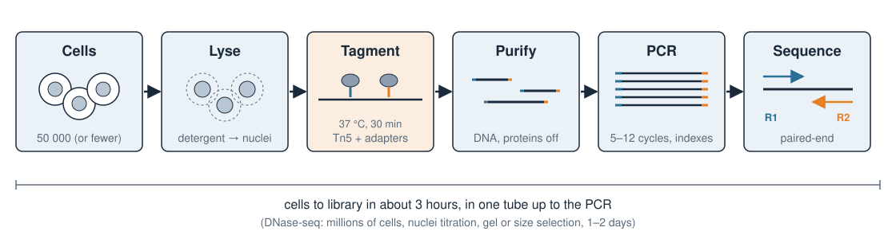{width="95%" fig-align="center"}

- **A**ssay for **T**ransposase-**A**ccessible **C**hromatin: lyse cells gently, add the Tn5 transposase loaded with sequencing adapters to the nuclei, purify the DNA and amplify by PCR.
- Tn5 inserts its adapters into accessible DNA **in the nucleus**, so the library is made where the chromatin is intact.
- No size selection is needed, and the whole protocol takes about three hours.

::: notes
The original protocol (Buenrostro et al. 2013) used 50 000 cells, a lysis buffer with NP-40, 30 minutes of transposition at 37 °C, a column cleanup and PCR with barcoded primers. The number of PCR cycles is chosen by qPCR on a small aliquot to avoid over-amplification. Because transposition and library construction are the same step, there is no fragmentation, end repair or ligation: this is why it needs so little material. The price is that the library structure is set by the enzyme, which is what the next slides are about.
:::

## Tn5: cut and paste in one step {.smaller}

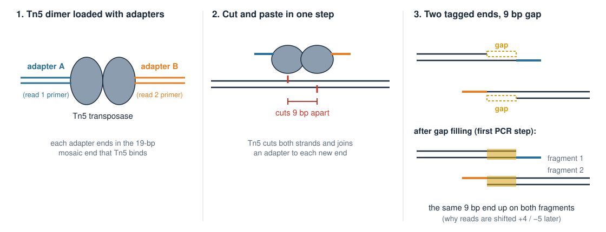{width="95%" fig-align="center"}

- Tn5 is a bacterial transposase. A **hyperactive mutant** is loaded with two kinds of short DNA adapters, each ending in the 19-bp **mosaic end** it recognises.
- A Tn5 dimer cuts both strands of the target DNA and joins an adapter to each new end: **tagmentation** (tagging + fragmentation).
- The two cuts are **9 bp apart**. Filling the gaps copies those 9 bp onto both fragments. Read ends must therefore be shifted (+4 / −5 bp) to mark the centre of the insertion; *ATAC-seq processing and peak calling* does this.

::: notes
Adey et al. 2010 developed in vitro tagmentation with hyperactive Tn5 for making sequencing libraries (Nextera); Buenrostro's insight was to do it on native chromatin. The transposase stays bound to the DNA after insertion and is removed during purification (SDS or the column). The 9-bp staggered cut leaves a 9-nt single-stranded gap on each fragment; the first step of the PCR (5 minutes at 72 °C) fills it. So the 9 bp next to every insertion appear on both neighbouring fragments. For peaks of hundreds of bp the shift does not matter; for footprinting and for the precise position of insertions it does. Here we only need to remember that each read's 5' end is (within a few bp) a Tn5 insertion.
:::

## Two adapters: only half the fragments can be sequenced {.smaller}

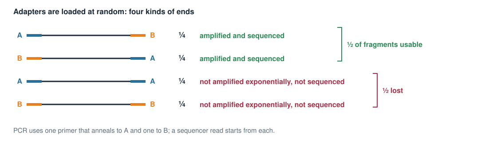{width="90%" fig-align="center"}

- Tn5 is loaded with adapter **A** and adapter **B** at random. A fragment gets one adapter at each end: A–B, B–A, A–A or B–B, each with probability ¼.
- The PCR uses one primer for A and one for B, and the sequencer reads from A (read 1) and B (read 2). Only **A–B and B–A** fragments are amplified and sequenced: $2 \times \tfrac{1}{2} \times \tfrac{1}{2} = 50\%$.
- Fragments longer than about 1 kb are also lost: they amplify and cluster poorly. Reads come mostly from fragments shorter than ~600 bp.

::: notes
This is a property of the Nextera chemistry. A–A and B–B fragments can only be copied linearly (one primer) and in addition fold back into hairpins (suppression PCR), so they are effectively absent. For bulk ATAC-seq this costs half the material but does not bias which regions are seen. It matters for single-cell ATAC-seq: each cell has two copies of each site, and losing half of the fragments is one reason scATAC data are so sparse. Long fragments are lost because two insertions far apart are needed, and long molecules amplify and form clusters less efficiently on the flow cell. This size limit is why ATAC is mostly blind to the inside of closed chromatin: fragments from there are too long.
:::

## A read pair is a fragment, and a fragment is two insertions {.smaller}

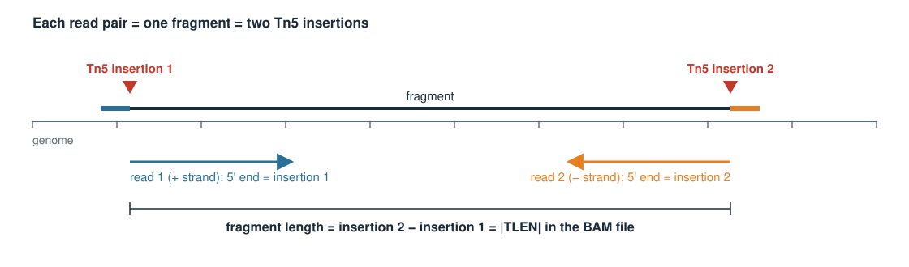{width="90%" fig-align="center"}

- Paired-end sequencing reads both ends of each fragment. The **5' end of each read** sits at a Tn5 insertion site.
- The aligner reports the **fragment length** (template length, `TLEN`, column 9 of SAM): positive for the leftmost mate, negative for the other.
- This is why ATAC-seq is sequenced **paired-end**: it gives two insertion sites and the length between them, and the length carries information.

::: notes
Students met TLEN in From reads to coverage. Here it gets a meaning: it is the distance between two Tn5 insertions, and the distribution of these distances is the next slide. With 2×100 bp reads and fragments shorter than 100 bp, both reads run through the whole fragment into the adapter on the other side, which is why adapters must be trimmed before alignment (the read would otherwise not align end-to-end). In the exercise we trim with fastp. Single-end ATAC-seq exists but loses the fragment lengths and half the insertion sites.
:::

## Why fragment lengths come in steps {.smaller}

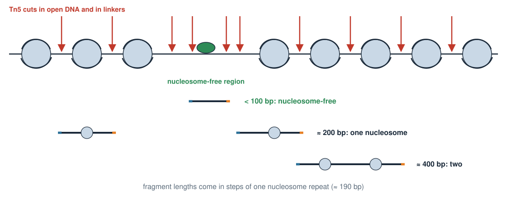{width="95%" fig-align="center"}

- Two insertions in the same **open region** (or the same linker) give a short, **nucleosome-free** fragment, under ~100 bp.
- Two insertions in linkers on either side of **one nucleosome** give a fragment of about 180–250 bp; around two nucleosomes ~350–450 bp, and so on.
- So the fragment-length histogram is a **nucleosome ladder**, the same one as in the MNase experiment of *What is epigenetics?*

::: notes
The key idea of the lecture. Tn5 cannot insert into DNA wrapped on a nucleosome (with a few exceptions at the edges), so any fragment that contains a nucleosome is at least 147 bp plus whatever linker on either side. The mono-nucleosome fragments are mostly from just outside open regions and from accessible linkers in otherwise ordinary chromatin. This is how one ATAC-seq library contains both maps: short fragments mark the open sites, nucleosome-sized fragments mark the positioned nucleosomes around them (NucleoATAC and similar tools exploit this). The repeat in human cells is about 190 bp.
:::

## Real data: the nucleosome ladder {.smaller}

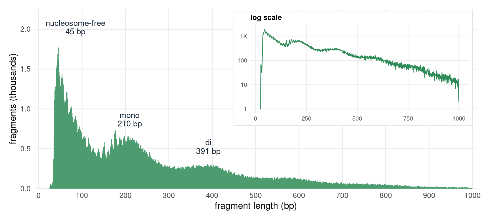{width="85%" fig-align="center"}

- GM12878, ENCODE ATAC-seq replicate 1, 252 213 fragments on chr21 after filtering.
- A large nucleosome-free peak (mode 45 bp), then mono- (210 bp) and di-nucleosome (391 bp) peaks. On a log scale (inset) a weak tri-nucleosome shoulder near 550–600 bp is visible too.

::: notes
This is the plot to make for every ATAC-seq library, first. 28.7% of the fragments are shorter than 100 bp, 16.1% are 180–250 bp. The step between the mono and di peaks, about 180 bp, is close to the nucleosome repeat length (~190 bp). The peaks are broad because linker lengths vary and Tn5 does not always cut in the middle of a linker. The spikes on the mono peak (e.g. 167, 177, 187 bp) are the same 10-bp periodicity as on the next slide, continuing into nucleosomal fragments; with only 250 000 fragments on one chromosome the curve is also noisy. The sharp drop below about 35 bp is not biology: the shortest fragments are lost in the cleanup, and reads that short fail the length filter after trimming. Notice the small ripples on the nucleosome-free peak: next slide. ENCODE requires that the nucleosome-free and mono-nucleosome peaks are both present.
:::

## The 10.5-bp ripple: DNA's helical turn {.smaller}

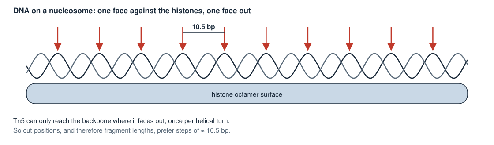{width="78%" fig-align="center"}

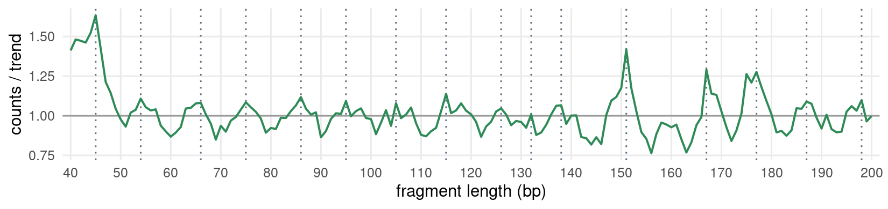{width="70%" fig-align="center"}

- DNA on a nucleosome (and DNA lying on any surface) exposes its backbone once per helical turn, about **10.5 bp**. Tn5 cuts where it can reach, so fragment lengths prefer steps of ~10.5 bp.
- Bottom: fragment counts divided by a smooth trend. The peaks are 10.2 bp apart on average.

::: notes
Buenrostro et al. 2013 showed this periodicity in the first ATAC-seq paper; it is a sign that the fragments really come from chromatinised DNA. The detrending is done in the figure script: divide the counts by a running mean over 31 bp so that only the short-range wiggle remains. The ripple is clearest between 40 and 200 bp. A library made from naked DNA (or a very over-tagmented one) loses both the ladder and the ripple. Not every pipeline checks the periodicity, but it is a nice sanity check that costs nothing.
:::

## Tn5 is not a perfectly random cutter {.smaller}

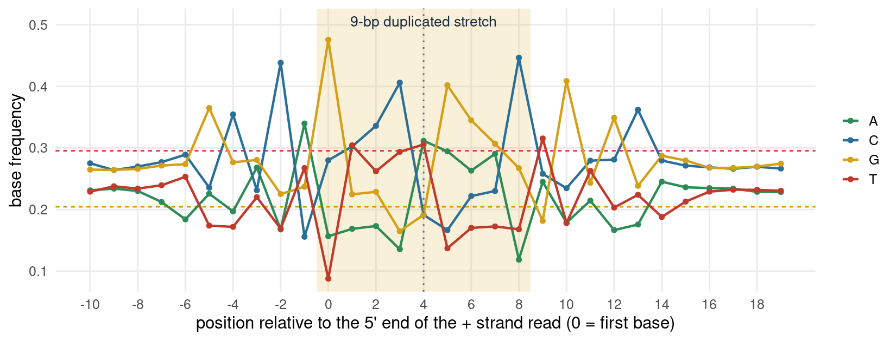{width="88%" fig-align="center"}

- Base composition of the genome around **200 000 insertion sites** (5' ends of + strand reads, chr21). Random cutting would give flat lines at the genome average.
- Tn5 has a weak, **symmetric sequence preference** centred on the 9-bp duplicated stretch, and prefers GC-rich DNA.
- The bias is small per site but matters for **footprinting** and for comparing regions of different sequence. *Motifs, motif enrichment and TF footprinting* corrects for it.

::: notes
Every enzyme-based assay has a sequence bias: DNase I and MNase too (MNase strongly prefers AT-rich DNA). For Tn5 the preference is a palindromic, roughly symmetric pattern, because the enzyme acts as a dimer. In the figure, position 0 is the first base of the + strand read, so the 9-bp duplicated stretch runs from 0 to +8 and its centre is at +4; the pattern is mirror-symmetric around that centre, which is the reason for the +4 / −5 shift. For peak calling the bias averages out. For TF footprints, where you look for a dip of a few bp in the insertion profile, the enzyme's preference alone can create or hide a "footprint". Tools such as TOBIAS model and remove it.
:::

## Mitochondrial DNA soaks up Tn5 {.smaller}

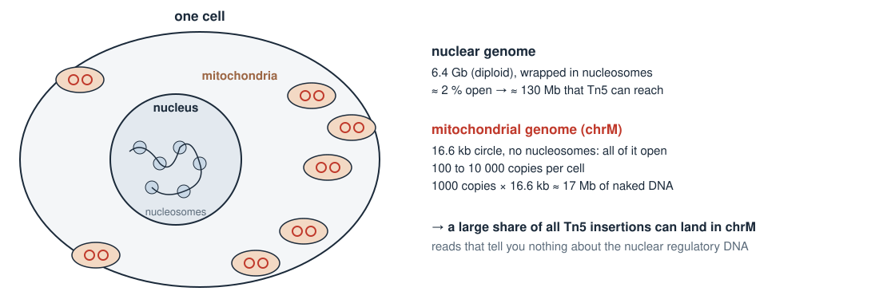{width="92%" fig-align="center"}

- mtDNA is a 16.6-kb circle **without nucleosomes**, present in hundreds to thousands of copies per cell. All of it is accessible.
- In the original protocol, often **20–50%** of reads come from chrM. They cost sequencing but carry no information about nuclear chromatin.
- Remove chrM reads before peak calling and before computing other QC metrics; report the **chrM fraction** as a QC number.

::: notes
The arithmetic in the figure is an order-of-magnitude argument: about 130 Mb of open nuclear DNA against tens of Mb of naked mtDNA, so a large share of insertions can land in chrM if Tn5 gets into the mitochondria. The lysis detergent permeabilises the mitochondrial membranes as well. The fraction varies enormously by cell type: cells with many mitochondria (heart, muscle, liver) are worst. Omni-ATAC (Corces et al. 2017) changes the lysis and washes away much of the cytoplasm, which typically brings chrM down to a few percent. Note also that nuclear mitochondrial DNA segments (NUMTs) in the nuclear genome attract chrM-like reads; that is one reason blacklists exist.
:::

## Real data: the chrM fraction {.smaller}

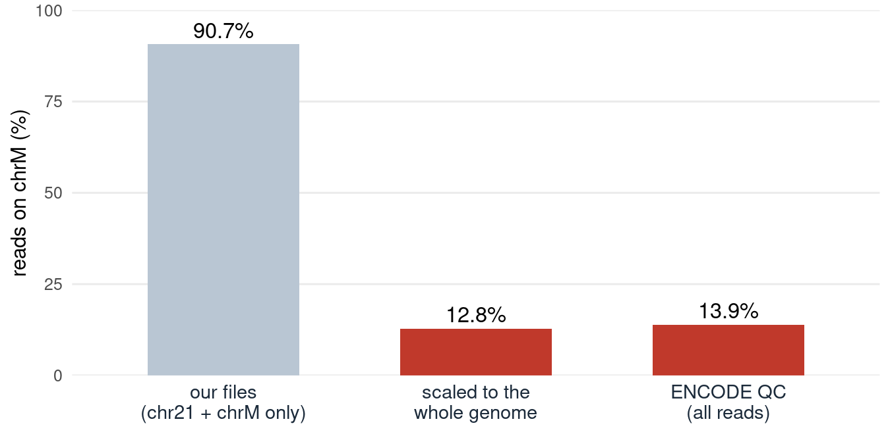{width="85%" fig-align="center"}

- In our chr21 + chrM read set, **90.7%** of the aligned reads are on chrM. That number is **not** the library's chrM fraction: chr21 is only 1.5% of the genome.
- Scale chr21 up to the whole genome: chrM ≈ **12.8%** of all reads. ENCODE's own QC of the full library reports **13.9%**.

::: notes
An honest-simplification moment (principle 10). We only have reads that ENCODE aligned to chr21 or chrM, so the chrM share in our files is grossly inflated. The estimate: if chr21 holds about f = 1.5% of the nuclear reads (its share of the genome length, roughly), the whole library had chr21_reads / f nuclear reads, and chrM fraction = chrM / (chrM + chr21 / f). The estimate (12.8%) is close to ENCODE's value computed from all reads (13.9%; 11.7 M of 83.7 M mapped reads), so the shortcut works. In the exercise students compute this with samtools idxstats. For a standard-protocol library from a cell line, 14% is good; Omni-ATAC libraries are often below 5%.
:::

## The TSS enrichment score {.smaller}

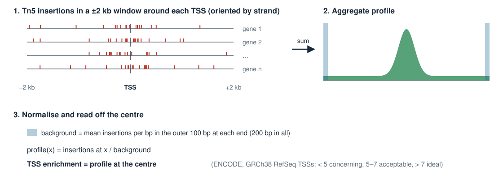{width="95%" fig-align="center"}

- Active promoters are the most reliably open sites in every cell type, so a good library has many **insertions at TSSs** relative to the DNA a few kb away.
- ENCODE definition: aggregate insertions in ±2 kb around all TSSs, divide by the mean of the outer **100 bp at each end**, and take the value at the centre (ENCODE's pipeline: the maximum of the profile in 10-bp bins).
- A **signal-to-noise** measure that needs no peak calling and works on any library, even a shallow one.

::: notes
TSS enrichment has largely replaced FRiP as the headline QC number for ATAC-seq, because FRiP depends on the peak caller and the depth while TSS enrichment does not. The flanks at ±1.9–2 kb are mostly closed chromatin, so they measure background: insertions anywhere, from naked DNA of dead cells and from random tagmentation. Thresholds depend on the TSS annotation: ENCODE uses RefSeq TSSs, with < 5 concerning, 5–7 acceptable and > 7 ideal on GRCh38 (6 and 10 on hg19). Strand matters: each TSS window is flipped for − strand genes so downstream is always to the right. The ENCODE pipeline actually computes read coverage (not 5' ends) in 400 bins of 10 bp, and reports the maximum of the mean profile; the exact numbers therefore differ a little between tools.
:::

## Real data: TSS enrichment {.smaller}

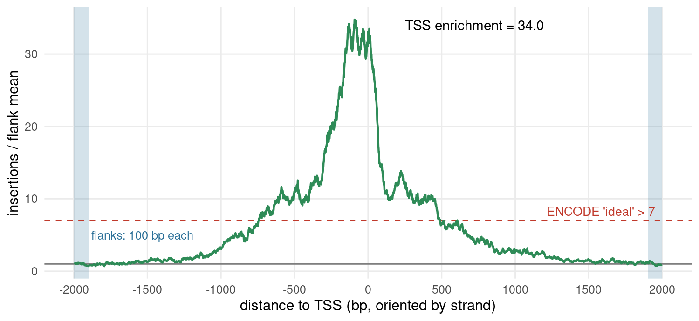{width="80%" fig-align="center"}

- 602 protein-coding TSSs on chr21 (GENCODE), insertions from 252 213 fragments. TSS enrichment = **34.0**.
- Far above ENCODE's "ideal" threshold of 7. ENCODE's genome-wide value for this library: **29.6**.
- The profile is asymmetric: the maximum is **upstream** of the TSS (around −140 to −90 bp), in the NDR; the sharp drop just downstream is the **+1 nucleosome**.

::: notes
Our number uses protein-coding TSSs of chr21 only, GENCODE rather than RefSeq, and insertion sites rather than read coverage, so it is not identical to ENCODE's; it should be in the same range. Many TSSs on chr21 are of genes not expressed in B cells, and they contribute flat profiles: the score is an average over active and inactive promoters. That is why the score also depends on the cell type and annotation, and why thresholds are rough. A score of 3 would mean the library is mostly background; a score of 30 means a very clean library.
:::

## Short and long fragments see different things {.smaller}

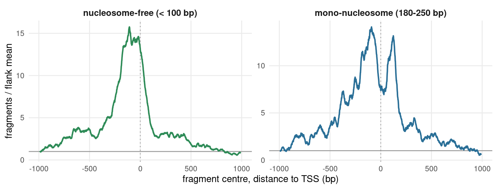{width="85%" fig-align="center"}

- Split the fragments by length: **nucleosome-free** (< 100 bp) and **mono-nucleosome** (180–250 bp). Plot fragment centres around TSSs.
- Nucleosome-free fragments pile up just **upstream of the TSS** (the NDR). Mono-nucleosome fragments dip at the TSS and peak on both sides: the **+1 nucleosome** at +124 bp, and upstream a peak at −91 bp.

::: notes
This is the nucleosome map hidden in an ATAC-seq library, made with nothing more than a length filter. The +1 nucleosome (fragment centres peak at +124 bp here) is the best-positioned nucleosome of an active promoter. The upstream peak (−91 bp) is less clean: in a very accessible promoter, two insertions on either side of the whole NDR also give a 180–250 bp fragment, so not every 'mono-nucleosome-sized' fragment contains a nucleosome. The nucleosome-free fragments peak at about −100 bp, in the NDR just upstream of the TSS. Peak callers for ATAC usually use all fragments or just the nucleosome-free ones; the choice is part of the next unit. Each curve is divided by its own flank mean, so shapes are compared, not absolute numbers; with 600 TSSs on one chromosome the curves are noisy. Tools such as NucleoATAC do this properly genome-wide.
:::

## Real data: ATAC-seq next to histone marks {.smaller}

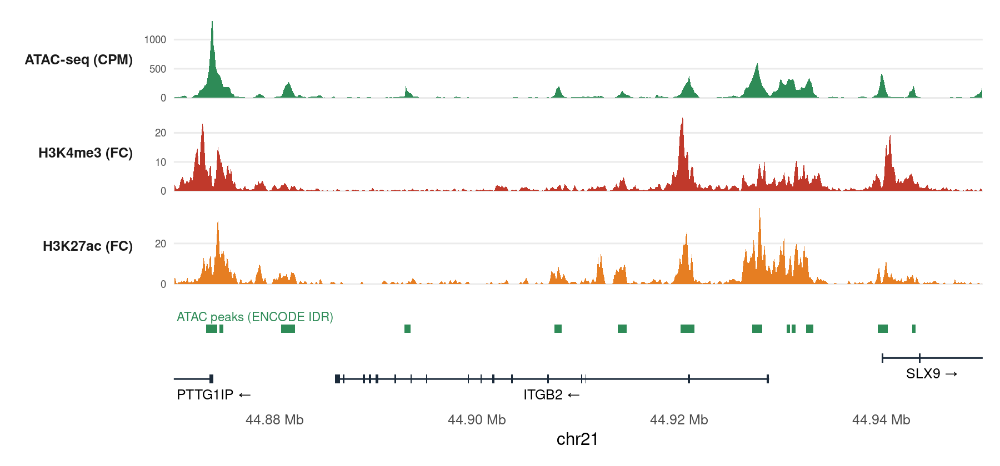{width="95%" fig-align="center"}

- GM12878 at *ITGB2* (chr21), the β2 integrin (CD18) of white blood cells, strongly expressed in B-lymphoblastoid cells. Our ATAC coverage, ENCODE ATAC peaks, and ENCODE H3K4me3 and H3K27ac (fold change over input).
- ATAC peaks sit at **promoters** (with H3K4me3) and **enhancers** (H3K27ac without H3K4me3). The ATAC peak is narrow, in the NDR; the histone marks are on the **flanking** nucleosomes.

::: notes
ITGB2 is on the − strand, so it is transcribed right to left. Most of its GENCODE transcripts start at 44.921 Mb (strong H3K4me3, an ATAC peak in the middle of it); others start at an upstream promoter at 44.929 Mb, inside a broad H3K27ac region with several ATAC peaks (promoter plus candidate enhancers). The ATAC peaks in the gene body with H3K27ac but little H3K4me3 (44.91 Mb) are candidate intronic enhancers. On the left is the promoter of PTTG1IP, the strongest ATAC peak in the window. The ATAC track is coverage from our own chr21 alignment (fragments, counts per million), the histone tracks are ENCODE fold-change bigWigs from chromatin-intro. Point out that ATAC and H3K27ac do not have the same shape: the histone mark is on nucleosomes, so it is often highest on either side of the ATAC peak, with a dip where the nucleosomes are missing. Also point out the small ATAC peak at 44.893 Mb without either histone mark: it sits on a CTCF peak (ENCODE GM12878 CTCF), so accessibility finds insulators too.
:::

## What a bad library looks like {.smaller}

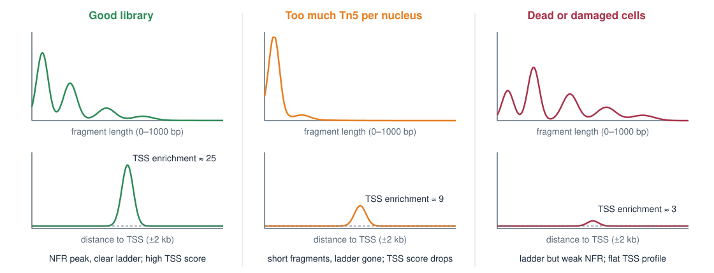{width="95%" fig-align="center"}

- **Too much Tn5 per nucleus** (too few cells): almost all fragments short, the ladder disappears, background rises. **Too little** (too many cells): long fragments dominate, the nucleosome-free peak is weak.
- **Dead or damaged cells**: naked or degraded DNA is tagmented everywhere. The ladder may even look strong, but the TSS profile is flat.
- Always look at **both** plots: the fragment lengths say how the reaction went, the TSS profile says whether the result has signal.

::: notes
These are schematic curves, not real data, drawn to show the typical patterns (the Grandi et al. 2022 protocol paper has real examples). The Tn5-to-nuclei ratio is the main knob of the reaction, which is why cell counts matter. Dead cells are the most common problem with primary samples: apoptotic DNA is cleaved between nucleosomes and gives a strong ladder by itself, and necrotic DNA is accessible everywhere. Both reduce the TSS score. Remedies: dead-cell removal, DNase treatment of the culture before harvesting (Omni-ATAC), sorting live cells. A third failure: too much PCR, which shows up as a high duplicate rate (From reads to coverage).
:::

## ATAC-seq QC at a glance {.smaller}

| metric | what it measures | ENCODE standard | GM12878 rep1 |
|---|---|---|---|
| fragment-length distribution | the reaction worked, nucleosomes present | NFR and mono-nucleosome peaks present | both present (ladder slide) |
| chrM fraction | wasted reads | (no threshold; Omni-ATAC: a few %) | 13.9% |
| TSS enrichment | signal-to-noise | > 7 ideal, 5–7 acceptable (GRCh38, RefSeq) | 29.6 |
| FRiP | signal-to-noise, needs peaks | > 0.3 (> 0.2 acceptable) | *ATAC-seq processing and peak calling* |
| non-duplicate, non-chrM fragments | depth | ≥ 25 M per replicate | 72 M non-chrM reads, 29% duplicates |
| NRF, PBC1, PBC2 | library complexity | > 0.9, > 0.9, > 3 | 0.80, 0.81, 5.2 |
| replicates | reproducibility | ≥ 2, IDR on peaks | 2 |

::: notes
The right-hand column comes from the ENCODE quality-metric records of this experiment (replicate 1), except where it says otherwise; our own chr21 numbers agree in range. Note that this library would fail the strict complexity standards (NRF 0.80 < 0.9) while being excellent on TSS enrichment: real data rarely pass every box, and ENCODE flags such issues rather than discarding the data. The generic metrics (duplicates, complexity, FRiP, replicates, IDR) are taught in Experimental design and QC; what is ATAC-specific is the first three rows. Do not memorise the thresholds; know what each metric measures and in which direction "bad" lies.
:::

## Protocol variants {.smaller}

| protocol | change | why |
|---|---|---|
| **standard** (Buenrostro 2013) | NP-40 lysis, 50 000 cells | the original |
| **Fast-ATAC** (Corces 2016) | digitonin, lysis and tagmentation together | blood cells; fewer chrM reads |
| **Omni-ATAC** (Corces 2017) | NP-40 + Tween-20 + digitonin, wash, PBS in the reaction | less chrM, better signal-to-noise; works on **frozen tissue** |
| **single-cell ATAC** | tagment nuclei in bulk, then barcode each nucleus (droplets or combinatorial indexing) | cell types in a mixture; a later unit |
| **multiome** | scATAC + scRNA from the same nucleus | links accessibility to expression |

- The chemistry is the same Tn5 everywhere, so the fragment ladder, TSS enrichment and chrM logic apply to all of them.

::: notes
Omni-ATAC is now the default for most labs: the detergent mix permeabilises the nuclear membrane while the wash removes much of the mitochondria, and the PBS and detergents in the transposition mix improve signal-to-noise. Corces et al. 2017 showed it works on cryosections of frozen tissue. Fast-ATAC was designed for haematopoietic cells. Single-cell ATAC is mentioned only as a pointer: it has its own analysis problems (sparsity, cell calling, doublets) and its own unit. CUT&Tag also uses Tn5, but tethered to an antibody: that is in the ChIP-seq block.
:::

## Designing an ATAC-seq experiment {.smaller}

- **Cells and nuclei**: count them. The Tn5-to-nuclei ratio sets the fragment sizes; 50 000 cells is the classic amount, Omni-ATAC works from fewer. Start from **viable** cells (> 80–90% alive) or clean nuclei.
- **Fresh, cryopreserved or frozen**: viably frozen cells (DMSO) work well; snap-frozen tissue needs nuclei isolation (Omni-ATAC). Fixed cells are not suitable for standard ATAC.
- **Replicates**: at least two biological replicates per condition, processed together. Accessibility differs with cell type composition: in tissue, a "difference" can just be a different mix of cells.
- **Sequencing**: paired-end; ≥ 25 M usable fragments per sample for peaks, more for footprinting.

::: notes
Practical points students will meet when they read or plan a study. Processing replicates together matters because the tagmentation step varies from day to day; a batch of samples done on one day and controls on another confounds condition with batch (the design and QC unit). Formaldehyde fixation blocks Tn5 access, though fixed-cell protocols exist. Tissue heterogeneity is the biggest interpretation problem in bulk ATAC-seq of tissues and the reason single-cell ATAC exists. The 25 M number is the ENCODE standard for peak calling; footprinting needs 100 M or more.
:::

## Aligning ATAC-seq reads: the short version

```bash
# 1. trim the Nextera adapter that reads run into when the fragment is short
fastp -i R1.fastq.gz -I R2.fastq.gz -o trim_R1.fastq.gz -O trim_R2.fastq.gz \
      --adapter_sequence CTGTCTCTTATACACATCT --adapter_sequence_r2 CTGTCTCTTATACACATCT

# 2. align pairs; allow fragments up to 2 kb (default is 500)
bowtie2 --very-sensitive -X 2000 -x hg38_chr21_chrM -1 trim_R1.fastq.gz -2 trim_R2.fastq.gz \
  | samtools fixmate -m - - | samtools sort -o all.bam
samtools markdup -r all.bam dedup.bam

# 3. QC on all reads, then keep good pairs off chrM
samtools idxstats all.bam                                       # chrM fraction
samtools view -b -f 2 -F 1804 -q 30 dedup.bam chr21 > rep1.bam  # proper pairs, MAPQ>=30
```

- The same steps as in *From reads to coverage*, with two ATAC details: **trim adapters** and **`-X 2000`** so that nucleosomal fragments are not thrown out as discordant.

::: notes
The exercise runs exactly this (with paths and threads). Adapter trimming matters more than in ChIP-seq because ATAC fragments are often shorter than the reads. CTGTCTCTTATACACATCT is the reverse complement of the Tn5 mosaic end; fastp can also find it from the overlap of the two reads. The -X 2000 is the maximum fragment length for a concordant pair; with the default 500 bp, tri-nucleosome fragments would be flagged as not properly paired and removed. -F 1804 removes unmapped, mate-unmapped, secondary, QC-failed and duplicate reads. Production pipelines (ENCODE ATAC pipeline, nf-core/atacseq) do the same, plus the Tn5 shift, which is in the next unit.
:::

## What ATAC-seq does not tell you {.smaller}

- **Which protein** is bound: an ATAC peak is an NDR. Motifs, footprints or ChIP are needed to name the factor (*Motifs, motif enrichment and TF footprinting*).
- **Whether the element is active**: poised enhancers and bivalent promoters are accessible too. Combine with H3K27ac or expression.
- **What a change means**: in bulk tissue, more accessibility can mean more cells of one type. And accessibility is a snapshot, mostly maintained by TFs, not an inherited "epigenetic" state.
- **Long-range closed chromatin**: heterochromatin gives few, long fragments; ATAC is not the assay for H3K9me3 or Polycomb domains.

::: notes
A critical-reading slide. Claims like "the epigenetic landscape is remodelled" in an ATAC-seq paper usually mean "the accessible sites differ between conditions", which can be explained by TF levels, cell composition, or cell cycle. Accessibility at most sites is lost within hours when the TF that maintains it is removed: it is a readout of TF activity, which is the basis of chromVAR and similar methods in the motifs unit. None of this makes ATAC less useful; it tells you what question it answers.
:::

## Summary {.smaller}

| idea | key fact |
|---|---|
| accessibility | NDRs at active promoters, enhancers, insulators; ~1–3% of the genome |
| history | DNase hypersensitivity → DNase-seq; FAIRE; MNase-seq (nucleosomes) |
| Tn5 | cuts and adds adapters in one step (tagmentation); 9-bp duplication → +4 / −5 shift |
| two adapters | only A–B fragments are sequenced: 50% of fragments usable |
| fragment length | = distance between two insertions = TLEN; nucleosome ladder (< 100, ~200, ~400 bp) and 10.5-bp ripple |
| bias | weak, symmetric sequence preference; matters for footprinting |
| chrM | naked, many copies: often 10–50% of reads; Omni-ATAC reduces it |
| TSS enrichment | insertions at TSSs / mean of outer 100 bp at ±2 kb; > 7 ideal (ENCODE, GRCh38) |
| bad libraries | over-/under-tagmentation (fragment sizes), dead cells (flat TSS profile) |

::: notes
Students should leave able to explain why fragment lengths come in nucleosome steps, compute a fragment length and a chrM fraction from read positions and counts, compute a TSS enrichment from counts, and judge a library from its fragment-length and TSS plots. Next: ATAC-seq processing and peak calling, where the reads become shifted insertion sites and peaks.
:::

## Key papers (optional further reading) {.smaller}

*Not required reading and not examined. For those who want the primary literature.*

- Boyle et al. 2008, *Cell*. [High-resolution mapping and characterization of open chromatin across the genome](https://doi.org/10.1016/j.cell.2007.12.014). DNase-seq: the first genome-wide map of DNase hypersensitive sites.
- Thurman et al. 2012, *Nature*. [The accessible chromatin landscape of the human genome](https://doi.org/10.1038/nature11232). ENCODE's DNase map of 125 cell types: what accessible DNA is and how it differs between cells.
- Adey et al. 2010, *Genome Biol*. [Rapid, low-input, low-bias construction of shotgun fragment libraries by high-density in vitro transposition](https://doi.org/10.1186/gb-2010-11-12-r119). Tn5 tagmentation for sequencing libraries (the chemistry behind Nextera).
- Buenrostro et al. 2013, *Nat Methods*. [Transposition of native chromatin for fast and sensitive epigenomic profiling of open chromatin, DNA-binding proteins and nucleosome position](https://doi.org/10.1038/nmeth.2688). ATAC-seq: the fragment ladder, the 10.5-bp period and footprints, all in the first paper.
- Corces et al. 2017, *Nat Methods*. [An improved ATAC-seq protocol reduces background and enables interrogation of frozen tissues](https://doi.org/10.1038/nmeth.4396). Omni-ATAC.
- Grandi et al. 2022, *Nat Protoc*. [Chromatin accessibility profiling by ATAC-seq](https://doi.org/10.1038/s41596-022-00692-9). A modern protocol with QC examples of good and bad libraries.
