## About this lecture

Cancer is the disease where the epigenome has been studied most, and where epigenetics reaches the clinic: as **drug targets** and as **diagnostic tests**. The running example is real: **TCGA colon cancer** and **lower-grade glioma** methylation arrays.

- The cancer methylome: **global loss, focal gain** at CpG islands.
- Silencing tumour suppressors: **MLH1 and microsatellite instability**; the **CpG island methylator phenotype** (CIMP).
- **Mutated epigenetic regulators**: IDH, DNMT3A/TET2, EZH2, oncohistones, SWI/SNF.
- **Epigenetic drugs** and how they work.
- **Methylation as a diagnostic**: tumour classification and cell-free DNA.

::: notes
Students know DNA methylation chemistry, CpG islands and the main histone marks from *What is epigenetics?* and *DNA methylation biology*; the 450k/EPIC array and beta values are covered in *Methylation arrays*. This lecture applies them to disease. Cancer is the main example because it is where the evidence is deepest, but the same ideas (methylation as a stable cell-identity record, regulators as drug targets) apply to haematological and developmental disorders. The exercise analyses the same TCGA data shown in the figures: about 37 600 CpGs, 297 colon tumours and 38 normal colon samples, and 513 gliomas.
:::

## The cancer methylome in one picture {.smaller}

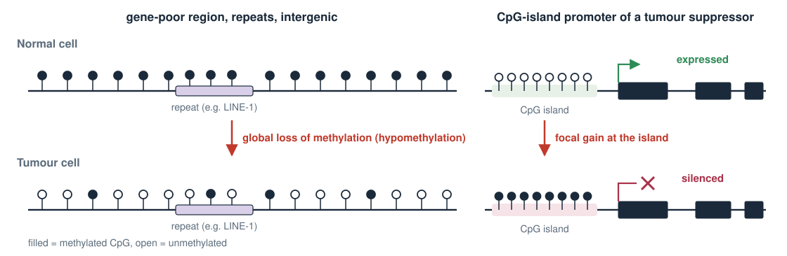{width="92%" fig-align="center"}

- **Global hypomethylation:** CpGs that are normally methylated (repeats, gene-poor regions, gene bodies) lose methylation (Feinberg & Vogelstein 1983).
- **Focal hypermethylation:** some CpG-island promoters, normally unmethylated, become methylated and their genes are silenced.
- Both happen in the same tumour, and both are detectable in early lesions.

::: notes
These two changes were the first epigenetic alterations found in cancer. Feinberg and Vogelstein measured less methylation at specific genes in colon cancers than in matched normal mucosa in 1983. CpG-island hypermethylation of tumour suppressors (RB1, VHL, CDKN2A, MLH1, BRCA1) was established in the 1990s, largely by the Baylin, Jones, Herman and Issa groups. The figure is a cartoon; the next slide shows the real data. Keep in mind the "cause or consequence" question from *What is epigenetics?*: a change found in tumours may drive growth, or may be a by-product of the many divisions and the altered state of a cancer cell.
:::

## Real data: global loss, focal gain {.smaller}

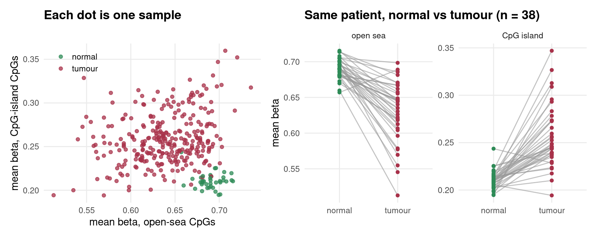{width="92%" fig-align="center"}

- TCGA colon adenocarcinoma, Illumina 450k: **open-sea** CpGs median beta **0.69** in normal colon vs **0.64** in tumours; **CpG-island** CpGs **0.21** vs **0.25**.
- In 38 patients with both samples, the tumour has lower open-sea methylation in **37** and higher island methylation in **36**.
- Tumours are much more **variable** than normal tissue.

::: notes
Each dot in the left panel is one sample; normal colon samples form a tight cluster, tumours spread in both directions. The paired comparison (right) removes differences between people: almost every tumour has lost open-sea methylation and gained island methylation relative to the patient's own normal colon. The global change looks small (0.05) because the 450k array mostly measures CpGs in and near genes; whole-genome bisulfite sequencing shows that the loss is concentrated in large domains (next slide), where it can be 0.2–0.3. Purity also matters: a tumour sample with 60% cancer cells shows only 60% of the cancer cells' change. Students compute this in the exercise.
:::

## Where methylation is lost {.smaller}

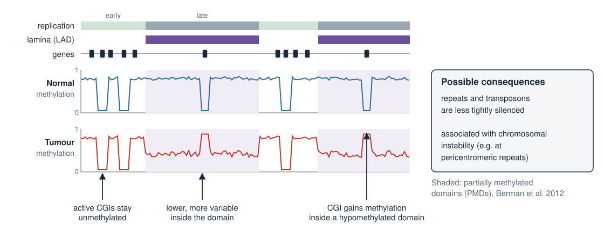{width="92%" fig-align="center"}

- Loss is concentrated in **partially methylated domains** (PMDs): large, late-replicating, lamina-associated, gene-poor regions (Berman et al. 2012).
- Many focal CGI gains lie **inside** these domains.
- Proposed consequences: less tightly silenced **repeats and transposons**, **chromosomal instability**; effects on gene expression are modest.

::: notes
PMDs were first seen in cultured fibroblasts and then in cancers. They coincide with late replication, the nuclear lamina and the B compartment of Hi-C (*3D genome organisation*), and they tend to lose methylation in dividing cells, perhaps because maintenance methylation has less time to finish in late-replicating DNA. The loss is therefore partly a record of how many times a cell has divided, which links it to epigenetic clocks. Be cautious about causal claims: hypomethylation of repeats and pericentromeric satellites is associated with chromosomal instability (mouse models with low DNMT1 develop tumours), but for most human tumours we cannot say which consequences matter.
:::

## Which CpG islands gain methylation? {.smaller}

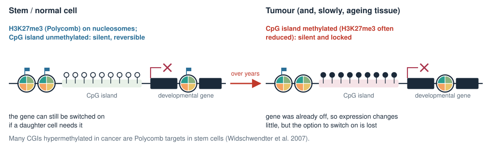{width="92%" fig-align="center"}

- Many CGIs hypermethylated in cancer are **Polycomb (H3K27me3) targets in stem cells**: developmental genes that were already off (Widschwendter et al. 2007).
- In the tumour the silent-but-plastic Polycomb state is replaced by **DNA methylation**: a more stable lock.
- The same switch happens slowly in **ageing** normal tissue.

::: notes
This was a key insight from three papers in 2007 (Widschwendter, Ohm, Schlesinger): the genes that are methylated in tumours are not a random set, nor mainly tumour suppressors, but Polycomb targets in embryonic stem cells. These genes are usually silent already in the cell of origin, so their methylation changes little in expression; what it changes is the ability to switch them on again during differentiation. That is one model for how epigenetic changes lock a cell in a stem-like state. It also explains why the same CGIs gain methylation with age in normal tissue, and why they are useful biomarkers: they are reliably unmethylated in normal cells and methylated in tumours, regardless of whether they drive anything.
:::

## Real data: single CpG islands {.smaller}

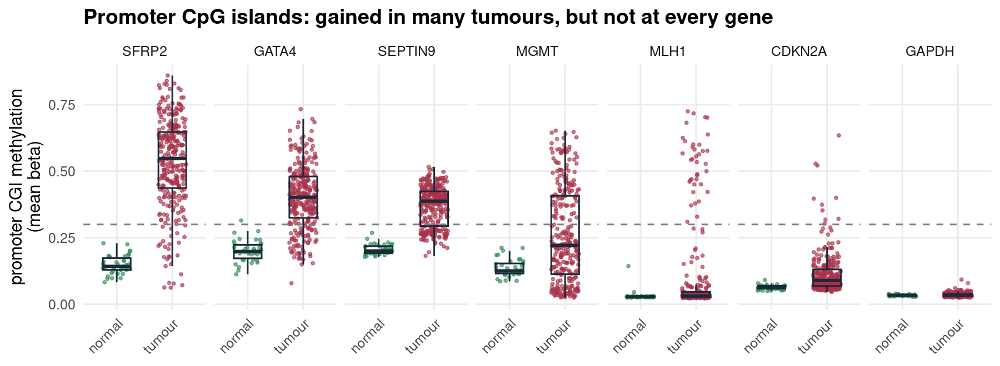{width="95%" fig-align="center"}

- **SFRP2, GATA4, SEPTIN9:** methylated (beta > 0.3) in **91%, 81%, 74%** of colon tumours, low in every normal sample.
- **MGMT** in 37%, **MLH1** in 13%, **CDKN2A** only in 3% on this array; **GAPDH** (a housekeeping gene) never.
- Methylated *SEPTIN9* in plasma DNA is the basis of an approved blood test for colorectal cancer.

::: notes
Each panel is the mean beta over the promoter CGI probes of one gene (19 to 38 probes; CDKN2A has only 5 on the subset in the exercise). SFRP2 and GATA4 are typical Polycomb-target CGIs: methylated in almost every tumour, so excellent markers, but their methylation does not separate tumours into groups. MLH1 is different: methylated in a minority, and then strongly (beta 0.4–0.7): that is a functional, selected event, next slide. The CDKN2A number is low because the array probes average over the p16 and p14ARF promoters and because purity dilutes the signal; reported frequencies of p16 methylation in colon cancer by methylation-specific PCR are higher. The SEPTIN9 test (Epi proColon) detects methylated SEPTIN9 DNA in plasma; it is less sensitive than colonoscopy, a point we return to with cell-free DNA.
:::

## Silencing a tumour suppressor: the epigenetic hit {.smaller}

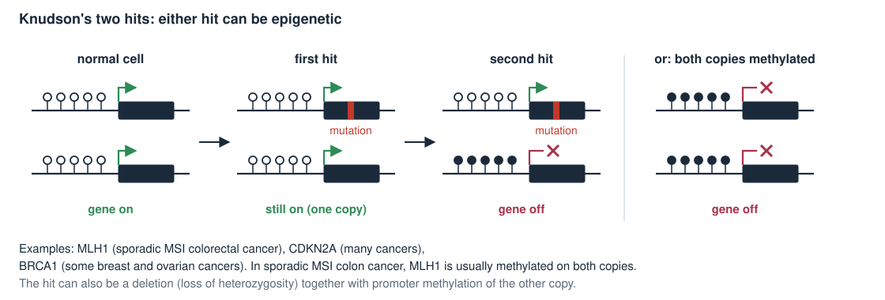{width="95%" fig-align="center"}

- Knudson's two hits can be **genetic or epigenetic**: a mutation plus promoter methylation, a deletion plus methylation, or methylation of both copies.
- Classic examples: **MLH1** (sporadic MSI colon cancer), **CDKN2A**, **BRCA1** (some breast and ovarian cancers), **VHL** (some renal cancers).
- **MGMT** methylation in glioblastoma is a **predictive biomarker**: the tumour cannot repair the damage made by temozolomide (Hegi et al. 2005).

::: notes
Promoter CGI methylation is a heritable, clonal silencing event, so it can act like a mutation in tumour evolution. The evidence that it is functional rather than incidental comes from cases where it replaces a genetic hit: in tumours with a BRCA1 promoter methylation, BRCA1 is usually not mutated, and the tumours behave like BRCA1-mutant tumours (for example in their response to PARP inhibitors, an active clinical question). MGMT is a DNA repair enzyme that removes the O6-methylguanine lesion made by alkylating drugs. Hegi et al. 2005 showed that glioblastoma patients with a methylated MGMT promoter benefit from temozolomide, and MGMT methylation testing is now routine in neuro-oncology.
:::

## Real data: MLH1 methylation causes microsatellite instability {.smaller}

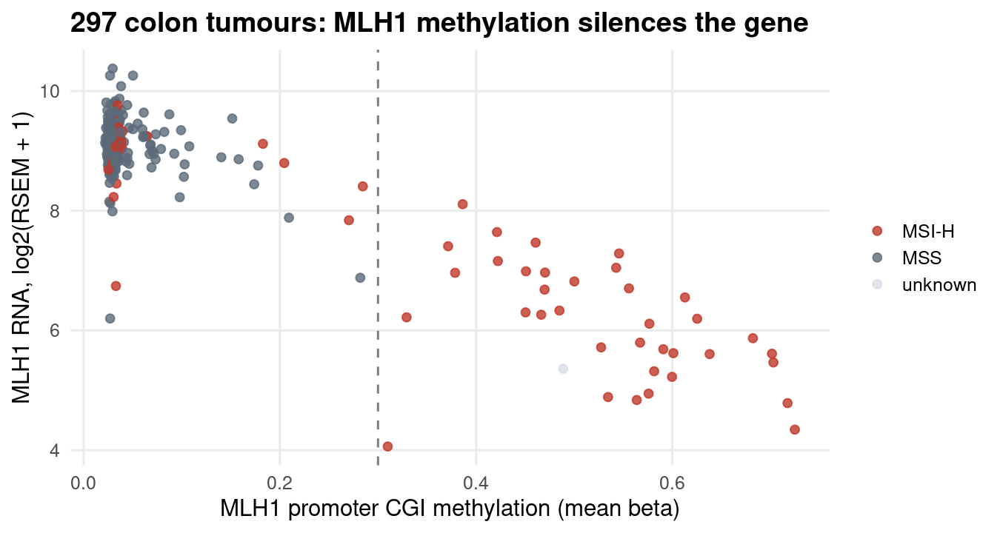{width="78%" fig-align="center"}

- **37** of 297 colon tumours have a methylated MLH1 promoter; **36** of them are MSI-high, and their MLH1 RNA is about **8-fold lower** (log2 6.2 vs 9.1).
- **25** MSI-high tumours have an unmethylated MLH1: mostly **inherited (Lynch syndrome)** or somatic mutations in mismatch-repair genes.
- Clinically, MLH1 methylation testing helps separate sporadic MSI cancers from Lynch syndrome.

::: notes
MLH1 is a mismatch-repair gene. When both copies are silenced, replication errors in repetitive DNA are not corrected and microsatellites change length: microsatellite instability (MSI), with a very high mutation burden. Herman et al. 1998 showed that sporadic MSI colon cancers have methylated MLH1, and that demethylation with 5-aza-deoxycytidine restores expression. Here MSI status comes from the MANTIS score (above 0.4 = MSI-high), computed from the exome sequences. The point to stress: a methylation change completely explains a genetic phenotype. Clinically, an MSI-high or MLH1-negative tumour triggers testing for Lynch syndrome, which is inherited; tumour MLH1 methylation (often with BRAF V600E) usually supports a sporadic origin, but does not exclude inherited or constitutional predisposition. Early onset, multiple primary tumours or a strong family history can still warrant germline and constitutional MLH1 epimutation evaluation; see [GeneReviews: Lynch syndrome](https://www.ncbi.nlm.nih.gov/books/NBK1211/). MSI-high tumours also respond well to immune checkpoint inhibitors.
:::

## The CpG island methylator phenotype (CIMP) {.smaller}

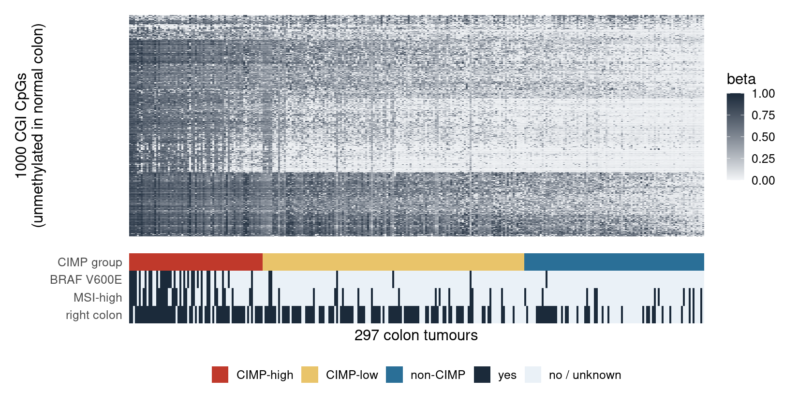{width="85%" fig-align="center"}

- Select 1000 CGI CpGs that are **unmethylated in normal colon** and **variable in tumours**, cluster the 297 tumours: a group of **69 (23%)** methylates many of them at once: **CIMP-high**.
- First proposed by Toyota et al. (1999); confirmed with a marker panel by Weisenberger et al. (2006).

::: notes
Walk through the heatmap: rows are CpGs, columns are tumours, dark is methylated. CIMP-high tumours (left, red bar) have many of these islands methylated; CIMP-low an intermediate set; non-CIMP few. The bars below already show the associations of the next slide. The selection step matters: we use only CpGs unmethylated in normal colon, so the clusters reflect gains in the tumour rather than differences in normal tissue or in contaminating cells. The number of groups is a choice (we cut the tree at three; TCGA described four groups). The existence of CIMP was debated for years because early studies used few markers; Weisenberger et al. 2006 screened 195 markers in 295 tumours and showed that CIMP-positive tumours form a distinct subset.
:::

## What goes with CIMP-high {.smaller}

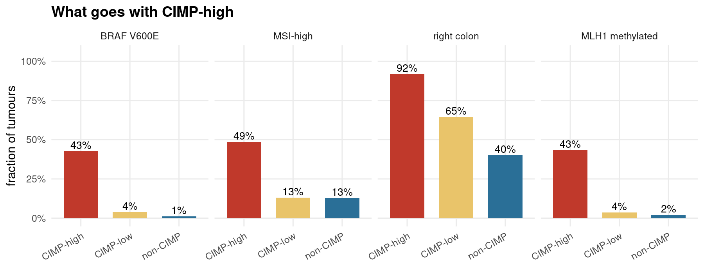{width="92%" fig-align="center"}

- CIMP-high tumours: **43% BRAF V600E** (vs 1–4% in the others), **49% MSI-high**, **92% right-sided**, and almost all MLH1-methylated tumours.
- CIMP is a **subtype** with its own origin (serrated precursor lesions), not a random accumulation.

::: notes
Numbers from make-cancer-figs.R: of 68 CIMP-high tumours with mutation data, 29 have BRAF V600E; of 35 BRAF V600E tumours overall, 29 are CIMP-high. Weisenberger et al. reported an odds ratio of 203 for BRAF mutation in CIMP-positive tumours. 30 of the 37 MLH1-methylated tumours are CIMP-high: MLH1 is one of the islands that gets methylated in this phenotype, and when it does, the tumour becomes MSI. Right-sided (proximal) location reflects a different precursor, the sessile serrated lesion. Whether BRAF mutation causes the hypermethylation, or a hypermethylating cell state favours BRAF-mutant clones, is still debated; experiments suggest BRAF V600E can promote CIMP-like methylation through transcriptional repressors, but this is not settled.
:::

## Driver or passenger? {.smaller}

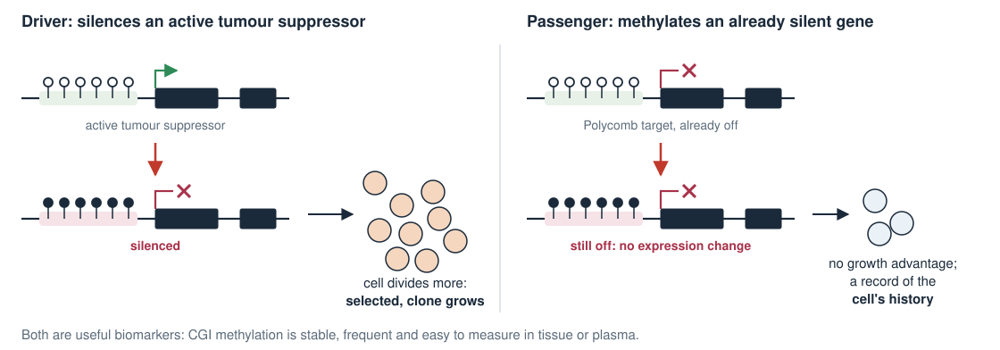{width="92%" fig-align="center"}

- **Driver:** silences an expressed tumour suppressor (MLH1, CDKN2A, BRCA1): selected because it gives a growth advantage.
- **Passenger:** methylates a gene that was already silent (most Polycomb targets): no advantage, but a stable **record** of the tumour's history.
- For diagnostics both are useful; for biology and therapy, only drivers matter.

::: notes
A useful way to classify any methylation change in cancer. Tests for driver status: is the gene expressed in the normal cell of origin, is it silenced in the tumour, does restoring it slow growth, does methylation substitute for a mutation (mutually exclusive), and is it clonal? Most of the hundreds of hypermethylated CGIs in a CIMP tumour fail these tests: they are passengers carried along with a cell state. That does not make them useless: their sheer number and stability make them the best markers for detecting and classifying tumours, the topic of the last part of the lecture.
:::

## Mutated epigenetic regulators {.smaller}

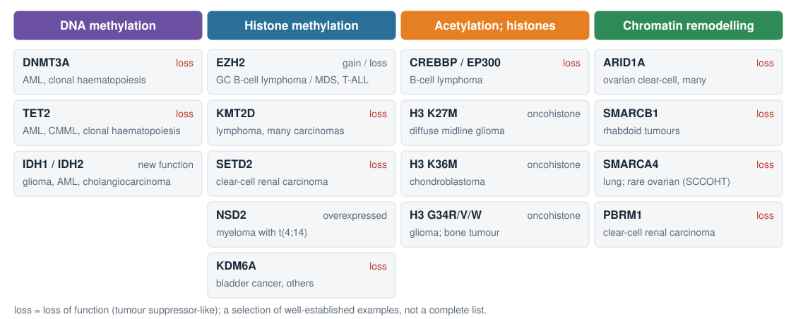{width="95%" fig-align="center"}

- Tumour sequencing found frequent mutations in **writers, erasers, readers and remodellers**, and even in **histones**.
- Most are **loss of function**; some create a **new function** (mutant IDH, oncohistones).

::: notes
Before about 2010, epigenetic changes in cancer were thought of as secondary to genetic ones. Large sequencing projects changed that: chromatin regulators are among the most frequently mutated genes in human cancer. The grid groups the examples of this lecture by what the protein does. Note the tissue specificity: EZH2 gain-of-function in germinal-centre lymphoma, loss in myeloid disease; SETD2 and PBRM1 in clear-cell renal carcinoma; SMARCB1 in rhabdoid tumours. The following slides take the clearest cases one by one. This is a selection, not a complete list.
:::

## IDH mutations: an oncometabolite blocks demethylation {.smaller}

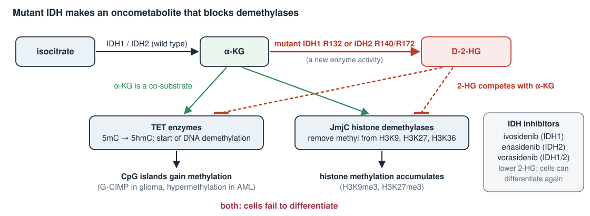{width="95%" fig-align="center"}

- Mutant **IDH1 (R132)** or **IDH2 (R140, R172)** converts alpha-ketoglutarate (α-KG) into **D-2-hydroxyglutarate** (Dang et al. 2009).
- 2-HG **competitively inhibits** α-KG-dependent dioxygenases: **TET** enzymes and **JmjC histone demethylases** (Xu et al. 2011).
- Result: CGI hypermethylation, more H3K9/H3K27 methylation, blocked differentiation (Figueroa et al. 2010; Lu et al. 2012).

::: notes
This is the clearest link between metabolism and the epigenome. IDH1/2 mutations are heterozygous point mutations at one arginine in the active site, found in most lower-grade gliomas, about 20% of AML, cholangiocarcinoma and chondrosarcoma. The mutant enzyme gains a new activity and makes millimolar amounts of 2-HG. TET2 loss and IDH mutation are mutually exclusive in AML and give similar methylation profiles (Figueroa 2010), which is genetic evidence that they act in the same pathway. Turcan et al. 2012 showed that introducing mutant IDH1 into astrocytes is sufficient to create the glioma hypermethylator phenotype. Hypermethylation at CTCF sites can also disrupt insulators and let enhancers activate oncogenes such as PDGFRA (Flavahan et al. 2016).
:::

## Real data: G-CIMP in IDH-mutant glioma {.smaller}

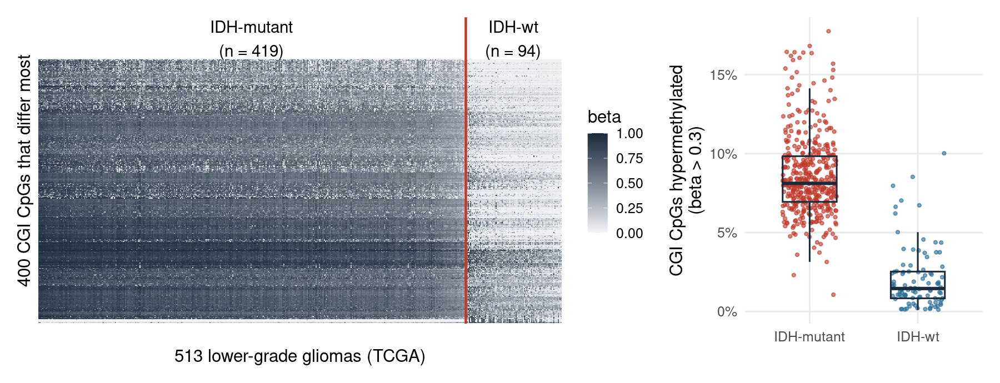{width="95%" fig-align="center"}

- 513 TCGA lower-grade gliomas: **419 IDH-mutant**, 94 IDH-wild-type.
- Of CGI CpGs unmethylated in IDH-wt tumours, a median **8.1%** are methylated (beta > 0.3) in IDH-mutant tumours vs **1.5%** in IDH-wt; **751** island CpGs are > 0.2 higher, only **21** lower.
- The glioma CpG island methylator phenotype (**G-CIMP**, Noushmehr et al. 2010) is a readout of the IDH mutation.

::: notes
The heatmap shows the 400 island CpGs that differ most between the groups; the IDH-mutant block is uniformly methylated, so in practice the methylation profile alone predicts IDH status very accurately. This is an example of a driver that acts through the epigenome: the hypermethylation is the mechanism of the mutation, not a passenger. Clinically, IDH status defines the WHO glioma classes (IDH-mutant astrocytoma, IDH-mutant 1p/19q-codeleted oligodendroglioma, IDH-wild-type glioblastoma), and methylation arrays are now used to make that call (classifier slide). In the exercise students compute these numbers.
:::

## DNMT3A and TET2: clonal haematopoiesis {.smaller}

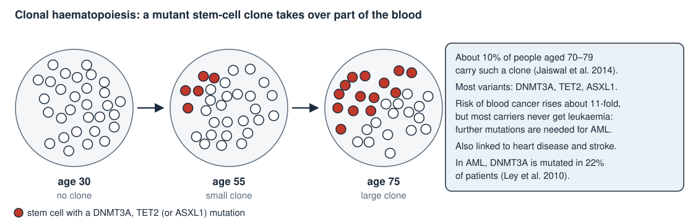{width="95%" fig-align="center"}

- **DNMT3A** and **TET2** loss-of-function mutations let a blood stem cell clone expand.
- Such clones are found in about **10%** of people aged 70–79 (Jaiswal et al. 2014): **clonal haematopoiesis**.
- DNMT3A is mutated in **22%** of AML (Ley et al. 2010); the clone is a first step, more mutations are needed.

::: notes
DNMT3A is the de novo methyltransferase; TET2 starts active demethylation. Losing either changes the methylation of haematopoietic stem cells and favours self-renewal over differentiation, so the clone grows slowly over decades. Jaiswal et al. 2014 sequenced blood exomes of 17 182 people: clonal mutations were rare below 40 and found in 9.5% at 70–79; carriers had an 11-fold higher risk of blood cancer, though the absolute risk stays low, and a higher risk of cardiovascular disease, probably through inflammatory macrophages. Ley et al. 2010 found DNMT3A mutations in 62 of 281 AML patients, most at R882. This is a good example of an epigenetic regulator acting early: mutations in DNMT3A are often the first in the leukaemic lineage.
:::

## EZH2: oncogene or tumour suppressor {.smaller}

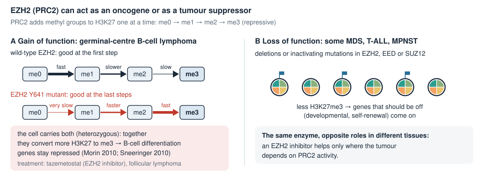{width="95%" fig-align="center"}

- **Gain:** EZH2 **Y641** mutations in germinal-centre lymphoma; with wild-type EZH2, they raise H3K27me3 (Morin 2010; Sneeringer 2010).
- **Loss:** PRC2 components deleted or inactivated in some MDS, T-ALL and MPNST.
- Same enzyme, opposite roles: an **EZH2 inhibitor** helps only where the tumour depends on PRC2.

::: notes
The Y641 story is a lesson in reading biochemistry. Morin et al. found the mutation and reported that it reduced activity on an unmethylated peptide, which looked like loss of function. Sneeringer et al. showed that the mutant is poor at the first methylation but better than wild type at converting me2 to me3, so the heterozygous cell makes more H3K27me3 overall. That locks germinal-centre B cells in a proliferative state by repressing differentiation genes. In myeloid malignancies and T-ALL, PRC2 behaves as a tumour suppressor instead. Tazemetostat, an EZH2 inhibitor, received accelerated FDA approvals for follicular lymphoma and epithelioid sarcoma in 2020, but those approvals were withdrawn in June 2026 after an increased rate of second primary malignancies in the confirmatory trial ([FDA withdrawal notice](https://www.govinfo.gov/content/pkg/FR-2026-06-22/pdf/2026-12367.pdf)).
:::

## Oncohistones {.smaller}

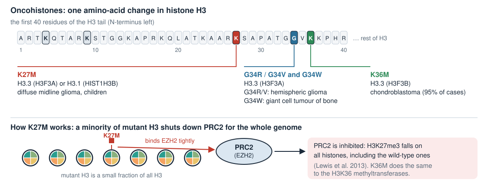{width="95%" fig-align="center"}

- **H3K27M** in diffuse midline glioma of children: 78% of DIPGs (Wu et al. 2012; Schwartzentruber et al. 2012).
- The mutant histone is a **small fraction** of all H3 but binds EZH2 and **inhibits PRC2**: H3K27me3 falls genome-wide (Lewis et al. 2013).
- **H3K36M** in 95% of chondroblastomas; **H3G34W** in giant cell tumour of bone (Behjati et al. 2013).

::: notes
Histone genes were not expected to be cancer genes: there are many copies, so one mutant allele makes only a few percent of the H3 in a cell. The K27M mutant is dominant because methionine at position 27 sits in the EZH2 active site and blocks the enzyme, so PRC2 cannot methylate the wild-type histones either. Lewis et al. 2013 also showed that K-to-M mutations at K9 and K36 inhibit the matching methyltransferases. The H3.3 genes are H3F3A and H3F3B (new names H3-3A and H3-3B); H3.1 K27M is in HIST1H3B. These tumours are now diagnosed by the mutation and by their methylation profile, and the loss of H3K27me3 is visible by immunohistochemistry.
:::

## SWI/SNF: remodellers as tumour suppressors {.smaller}

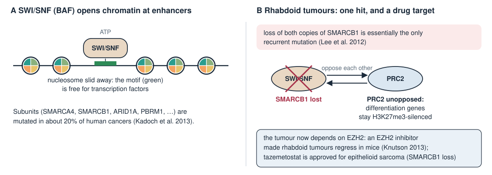{width="95%" fig-align="center"}

- SWI/SNF (BAF) subunits are mutated in about **20%** of human cancers (Kadoch et al. 2013).
- Rhabdoid tumours: biallelic **SMARCB1** loss is essentially the only recurrent event (Lee et al. 2012).
- Loss leaves PRC2 unopposed, creating a **dependency on EZH2** (Knutson et al. 2013).

::: notes
SWI/SNF complexes slide and evict nucleosomes at enhancers, so loss of a subunit changes which enhancers are accessible. In rhabdoid tumours exome sequencing found almost no other recurrent mutations, which shows that disrupting a chromatin regulator can be enough to drive a cancer. SWI/SNF and Polycomb oppose each other at many genes; without SMARCB1, PRC2 keeps differentiation genes silent, and the tumour cells depend on EZH2. Knutson et al. 2013 showed regression of rhabdoid xenografts with an EZH2 inhibitor; tazemetostat was approved for epithelioid sarcoma, a tumour that also lacks SMARCB1 (INI1), before its FDA approvals were withdrawn in June 2026 (see the EZH2 slide). A synthetic dependency of this kind is the logic behind many epigenetic drugs.
:::

## Epigenetic drugs: the targets {.smaller}

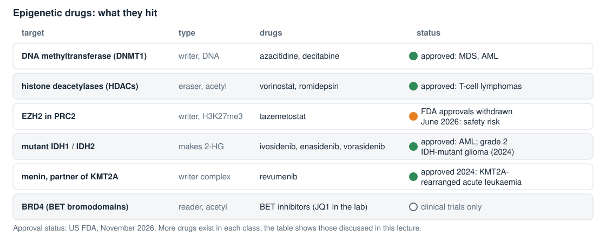{width="92%" fig-align="center"}

- Approved drugs hit **DNMT1**, **HDACs**, **mutant IDH1/2** and **menin–KMT2A**; **BET** bromodomain inhibitors remain in trials.
- **EZH2:** tazemetostat is a historical example; its FDA approvals were withdrawn in **June 2026** because of second primary malignancy risk.
- Most work best in **blood cancers** or in tumours defined by a **specific mutation**.

::: notes
Go through the table from top to bottom and connect each row to the writer/reader/eraser vocabulary of *What is epigenetics?*. Azacitidine and decitabine are the oldest, used in myelodysplastic syndromes and AML. HDAC inhibitors are approved for T-cell lymphomas. Tazemetostat (approved 2020, FDA approvals withdrawn June 2026) targets EZH2. IDH inhibitors are the best example of precision epigenetic therapy: ivosidenib and enasidenib for IDH-mutant AML, and vorasidenib (2024) for IDH-mutant grade 2 glioma. Revumenib (2024) blocks the menin–KMT2A interaction in KMT2A-rearranged leukaemia. BET inhibitors such as JQ1 displace BRD4 from acetylated chromatin and showed strong effects in models, but toxicity and modest efficacy have so far kept them out of routine use. Approval status here is for the US FDA, checked November 2026; the [June 2026 FDA notice](https://www.govinfo.gov/content/pkg/FR-2026-06-22/pdf/2026-12367.pdf) documents the tazemetostat withdrawal.
:::

## Hypomethylating drugs {.smaller}

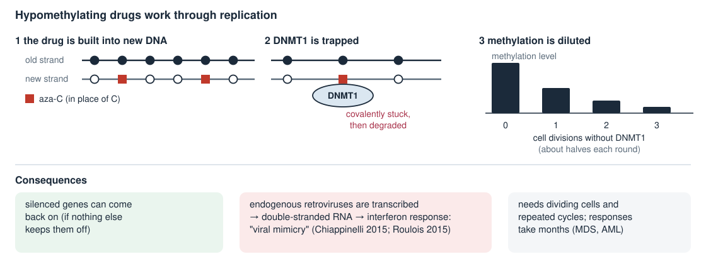{width="95%" fig-align="center"}

- Azacitidine and decitabine are **cytidine analogues** built into DNA during replication; they **trap and deplete DNMT1**.
- Methylation is then **diluted** with each division; silenced genes and **endogenous retroviruses** come back on.
- dsRNA from retroviruses triggers an interferon response: **viral mimicry** (Chiappinelli et al. 2015; Roulois et al. 2015).

::: notes
The drugs need dividing cells, act slowly and are given in repeated cycles; responses in MDS typically take several cycles. Fenaux et al. 2009 showed a survival benefit of azacitidine over conventional care in higher-risk MDS. Azacitidine is a ribonucleoside and is mostly built into RNA; decitabine is a deoxyribonucleoside and goes only into DNA. How the drugs work in patients is still debated: re-expression of tumour suppressors, differentiation, and the immune response through viral mimicry may all contribute. The viral-mimicry idea motivates combining them with immune checkpoint inhibitors.
:::

## Methylation-based tumour classification {.smaller}

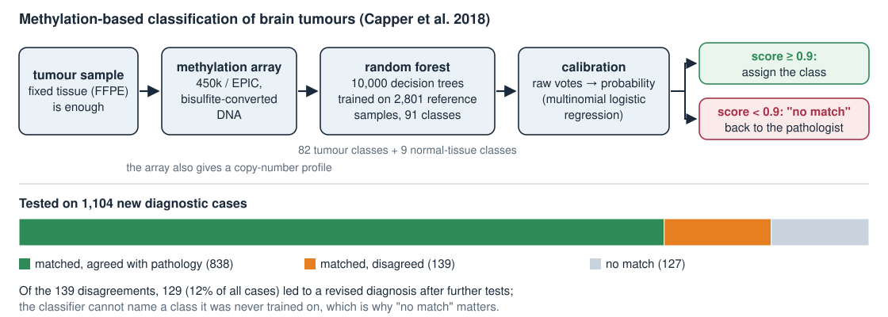{width="95%" fig-align="center"}

- Capper et al. (2018): a **random forest** trained on 2 801 reference samples in **91 classes** (82 tumour, 9 normal), from 450k/EPIC arrays.
- Prospectively, 88% of 1 104 cases matched a class; the diagnosis was **revised in 12%**.
- Works because methylation records the **cell of origin** and is stable in fixed tissue.

::: notes
Brain tumours are hard to classify by histology and inter-observer variability is high. The classifier gives raw scores (votes of 10 000 trees) that are calibrated by multinomial logistic regression into probabilities; a score of at least 0.9 assigns a class, otherwise the case is "no match" and goes back to the pathologist. The same array gives a copy-number profile (1p/19q codeletion, amplifications). The tool is freely available and methylation classes are part of the 2021 WHO classification of CNS tumours. Two lessons from machine learning (*Machine learning from scratch*): the classifier cannot recognise a class it was not trained on, and scores must be calibrated before they are used as confidence.
:::

## Real data: a classifier in our tumours {.smaller}

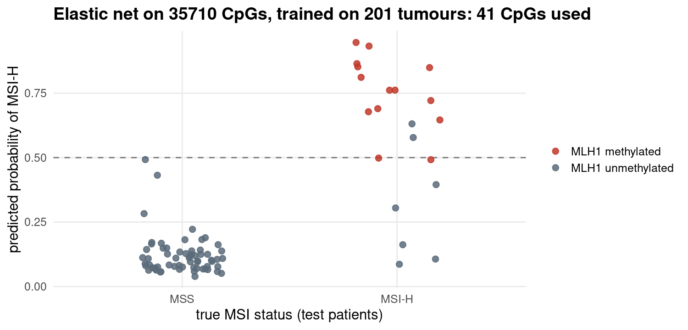{width="80%" fig-align="center"}

- Elastic net on 35 710 CpGs, trained on 201 colon tumours, tested on 84 **held-out patients**: predicts MSI-high from methylation alone, using **41 CpGs**.
- All 63 MSS tumours correct; **14 of 21** MSI-high found: **12 of 14** with MLH1 methylation, only **2 of 7** without.
- The model learned the **MLH1/CIMP** route to MSI; it misses most MSI-high tumours without MLH1 methylation in this test set.

::: notes
This is the exercise's R4 in miniature. The split is by patient so no person contributes to both training and test. The elastic net (glmnet) is penalised logistic regression, like the epigenetic clocks in *Epigenetic clocks and biomarkers*. Ask students to predict which tumours are missed before showing the colours: the model relies strongly on MLH1/CIMP-associated patterns and misses five of the seven MSI-high tumours without MLH1 methylation in this test set. This result does not establish that such tumours have no methylation changes, or that all methylation-based classifiers would miss them; identifying Lynch syndrome requires further genetic evaluation. A classifier is only as good as the biology it can measure, and a good test-set accuracy (77 of 84, 92% here) can hide a systematically missed subgroup.
:::

## Cancer detection from cell-free DNA {.smaller}

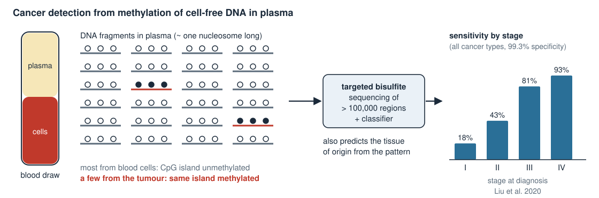{width="95%" fig-align="center"}

- Plasma contains short DNA fragments, mostly from blood cells; a **small fraction** comes from a tumour.
- Tumour fragments carry tumour-specific methylation; the pattern also reveals the **tissue of origin**.
- Liu et al. (2020): 99.3% specificity; sensitivity **18% in stage I, 93% in stage IV** across all cancer types.

::: notes
Methylation is better suited than mutations for this task because many regions change together, the changes are shared between patients, and the pattern says which tissue the DNA came from. The CCGA study (Liu et al. 2020) sequenced bisulfite-converted plasma DNA at more than 100 000 targeted regions in 6 689 participants. Note the stage dependence: early tumours shed little DNA, which is exactly where screening would help most. Whether such tests reduce cancer deaths in screening is being tested in large trials. The general use of methylation as a biomarker, and its pitfalls, are the subject of *Epigenetic clocks and biomarkers*.
:::

## The arithmetic of screening {.smaller}

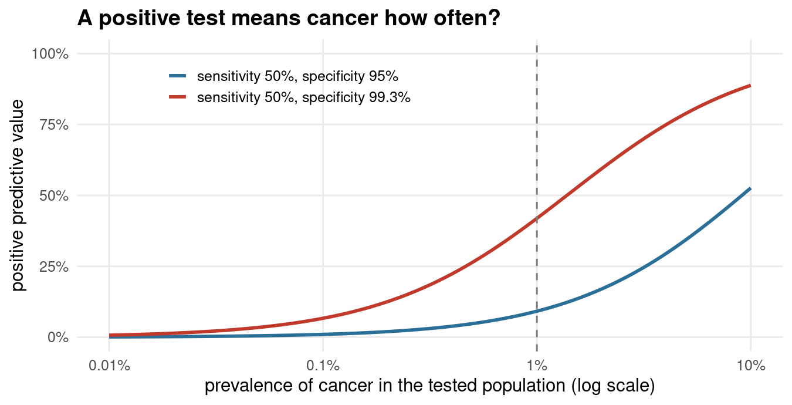{width="72%" fig-align="center"}

- **Positive predictive value** depends on prevalence: with 50% sensitivity and 99.3% specificity, PPV is **42%** at 1% prevalence; at 95% specificity only **9%**.
- In a screening population most positives can be false, so specificity matters more than it seems.

::: notes
PPV = sens × prev / (sens × prev + (1 − spec) × (1 − prev)). At 1% prevalence: 0.5 × 0.01 / (0.005 + 0.007 × 0.99) = 0.42. With 95% specificity: 0.005 / (0.005 + 0.05 × 0.99) = 0.09. This is an exam-type calculation. It explains why cfDNA tests are tuned for very high specificity even at the cost of sensitivity, and why they are first used in high-risk groups. Each false positive leads to imaging and sometimes biopsy.
:::

## Summary {.smaller}

| idea | key fact |
|---|---|
| cancer methylome | global loss (PMDs, repeats), focal gain at CpG islands, often Polycomb targets |
| epigenetic hit | promoter methylation silences MLH1, CDKN2A, BRCA1; MGMT predicts temozolomide benefit |
| CIMP | many CGIs methylated together; BRAF V600E, MSI (via MLH1), right colon |
| driver vs passenger | most hypermethylated CGIs are passengers, but good markers |
| mutated regulators | IDH1/2 → 2-HG blocks TET/KDMs (G-CIMP); DNMT3A/TET2 in clonal haematopoiesis; EZH2 gain/loss; H3K27M inhibits PRC2; SWI/SNF loss |
| drugs | azacitidine/decitabine, HDACi, IDH and menin inhibitors; tazemetostat withdrawn (2026); BET inhibitors in trials |
| diagnostics | methylation classifiers (Capper 2018); cfDNA detection; PPV depends on prevalence |

::: notes
Students should be able to explain the two faces of the cancer methylome, use MLH1 as the example of a functional epigenetic hit, explain IDH → 2-HG → hypermethylation, and do the PPV calculation. Links: *DNA methylation biology* (TETs, DNMTs), *Methylation arrays* (the data), *Epigenetic clocks and biomarkers* (penalised regression, cfDNA), *Machine learning from scratch* (classifiers and held-out data).
:::

## Key papers (optional further reading) {.smaller}

*Not required reading and not examined. For those who want the primary literature.*

- Feinberg & Vogelstein 1983, *Nature*. [Hypomethylation distinguishes genes of some human cancers from their normal counterparts](https://doi.org/10.1038/301089a0). The first epigenetic change found in cancer.
- Toyota et al. 1999, *PNAS*. [CpG island methylator phenotype in colorectal cancer](https://doi.org/10.1073/pnas.96.15.8681). The CIMP concept.
- Figueroa et al. 2010, *Cancer Cell*. [Leukemic IDH1 and IDH2 mutations result in a hypermethylation phenotype, disrupt TET2 function, and impair hematopoietic differentiation](https://doi.org/10.1016/j.ccr.2010.11.015). Metabolism meets methylation.
- Lewis et al. 2013, *Science*. [Inhibition of PRC2 activity by a gain-of-function H3 mutation found in pediatric glioblastoma](https://doi.org/10.1126/science.1232245). How an oncohistone works.
- Capper et al. 2018, *Nature*. [DNA methylation-based classification of central nervous system tumours](https://doi.org/10.1038/nature26000). Methylation in routine diagnostics.
- Flavahan, Gaskell & Bernstein 2017, *Science*. [Epigenetic plasticity and the hallmarks of cancer](https://doi.org/10.1126/science.aal2380). A broad review.
