## About this lecture {.smaller}

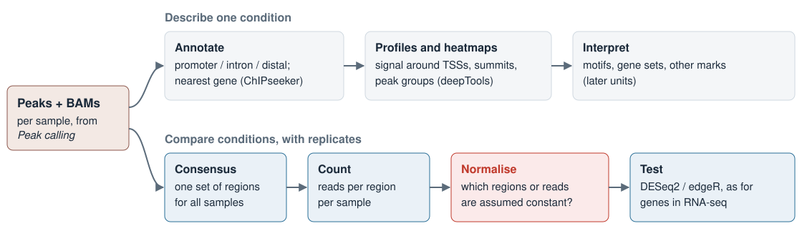{width="92%" fig-align="center"}

- **Describe**: annotate peaks relative to genes (ChIPseeker); profiles and heatmaps (deepTools).
- **Compare**: consensus regions → counts → **normalisation** → DESeq2, the RNA-seq workflow on peaks.
- Normalisation is where ChIP differs from RNA-seq: signal-to-noise, **copy number** and **global changes** (spike-ins).
- Real data: H3K27ac in **GM12878** (B-lymphoblastoid) and **K562** (erythroleukaemia), two ENCODE replicates each, chr21.

::: notes
Peak calling gave us peak sets per sample. This unit asks two questions. For one condition: where are the peaks, and what does the signal look like around genes or around the peaks? Between conditions: which regions differ, with replicates and a statistical test. The second part is RNA-seq again (students know DESeq2), so the time goes to what differs. The comparison dataset is H3K27ac (active promoters and enhancers) in two very different cell lines from the same lab (Broad), two biological replicates each, with ENCODE's filtered alignments restricted to chr21. Two cell lines are an extreme contrast, chosen because the data are public and comparable; a real study would compare conditions of one cell type, ideally with three or more replicates. Annotation also uses the CTCF peaks from earlier units.
:::

## Annotating peaks {.smaller}

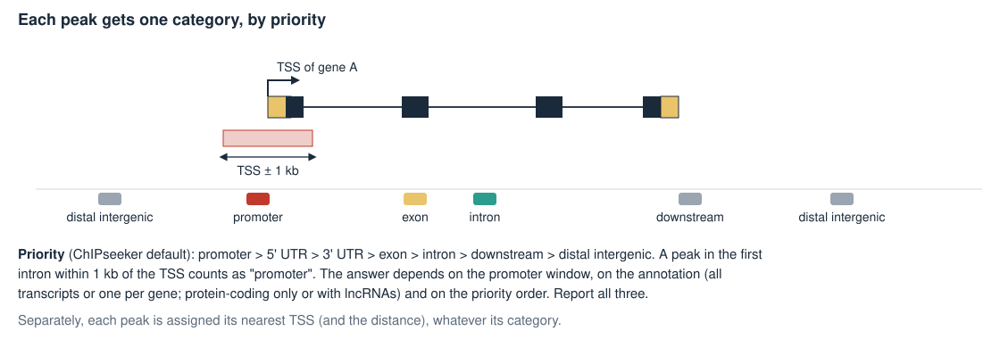{width="92%" fig-align="center"}

::: notes
ChIPseeker (Yu, Wang and He 2015) is the common Bioconductor tool: annotatePeak takes peaks and a TxDb (a transcript database, here built from the GENCODE GTF with txdbmaker) and returns, for each peak, a genomic category and the nearest TSS. HOMER annotatePeaks.pl does the same on the command line, and in Genomic intervals students did the core of it with distanceToNearest. Three choices change the answer and must be reported: the promoter window (±1 kb here; ±3 kb is ChIPseeker's default, which makes almost a third of the genome "promoter-proximal" in gene-dense regions); the annotation (all transcripts of all genes including lncRNAs, or protein-coding only); and the priority used when a peak overlaps several features. The categories are descriptive; they are not evidence of function.
:::

## Real data: where are the peaks? {.smaller}

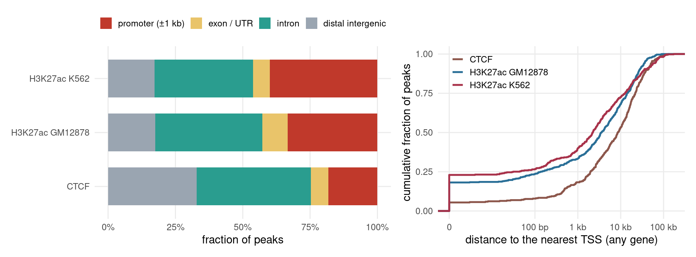{width="95%" fig-align="center"}

- **H3K27ac**: 33% (GM12878) and 40% (K562) of peaks at promoters; **CTCF**: 18%, and 33% distal intergenic.
- Median distance to the nearest TSS: H3K27ac 3.6 kb and 2.2 kb, CTCF **8.6 kb**; 47% of CTCF peaks are more than 10 kb from any TSS.

::: notes
ChIPseeker on the ENCODE peak sets on chr21 (405 CTCF, 567 GM12878 H3K27ac and 483 K562 H3K27ac peaks), promoter = TSS ± 1 kb, all GENCODE basic genes including lncRNAs (exercise R1). H3K27ac marks active promoters and enhancers, so a third or more of its peaks are promoters and most of the rest are in introns and intergenic DNA (candidate enhancers). CTCF is mostly away from promoters: insulators, loop anchors. The right panel is the cumulative distribution of distances; the steps at zero are the peaks that overlap a TSS. On a genome-wide scale the fractions differ (chr21 is gene-poor, which raises the distal fractions), so compare the marks, not the numbers with other papers.
:::

## The nearest gene is not the target {.smaller}

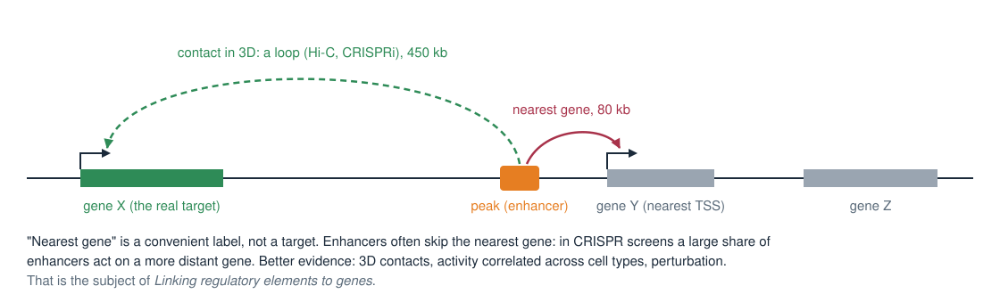{width="95%" fig-align="center"}

::: notes
Every annotation tool reports a nearest gene, and many papers then do gene-set enrichment on the nearest genes of their peaks. For promoter peaks that is reasonable; for distal peaks it is a guess. Enhancers act over tens to hundreds of kilobases within topologically associating domains, often skipping the nearest gene; CRISPR interference screens (e.g. Fulco et al. 2019, Gasperini et al. 2019) found that a large share of functional enhancer–gene pairs do not involve the nearest gene. On chr21, the strongest GM12878-specific H3K27ac region (later slide) is more than 100 kb from the nearest protein-coding TSS. Tools such as GREAT assign each region to genes within a regulatory domain rather than only the nearest one. Better links come from 3D contacts (Hi-C, HiChIP), correlation of enhancer activity with gene expression across samples, and perturbation: Linking regulatory elements to genes.
:::

## Profiles and heatmaps {.smaller}

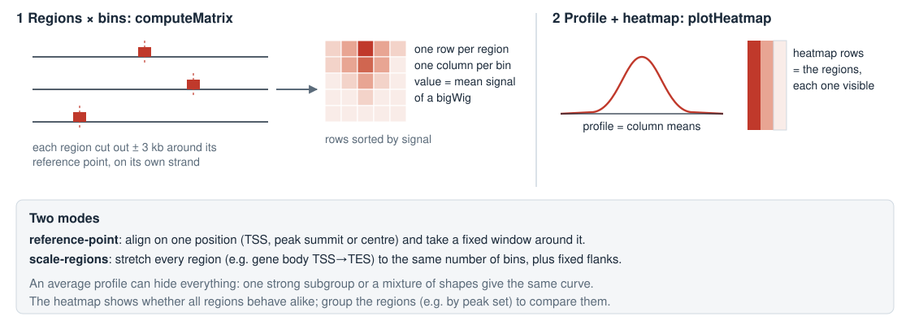{width="95%" fig-align="center"}

::: notes
deepTools (Ramírez et al. 2016) computeMatrix builds a matrix of signal (from bigWig files) in bins around a set of regions; plotProfile draws the column means and plotHeatmap draws the matrix itself with the profile on top. Two modes: reference-point (around TSSs or peak centres) and scale-regions (whole gene bodies stretched to a common length, as in the H3K36me3 metagene of ChIP-seq: the assay). Regions on the minus strand are flipped so that "downstream" is always to the right. The heatmap is what makes the plot honest: an average profile with a peak could come from all regions having a moderate peak or from a few regions with a huge one. Regions can be sorted, grouped by BED file (one group per file) or clustered (--kmeans; note that k-means clustering depends on a random start, so groups defined by biology are more reproducible). In R, EnrichedHeatmap and ChIPseeker's tagHeatmap do the same.
:::

## Real data: four marks around chr21 TSSs {.smaller}

:::: {.columns}
::: {.column width="52%"}
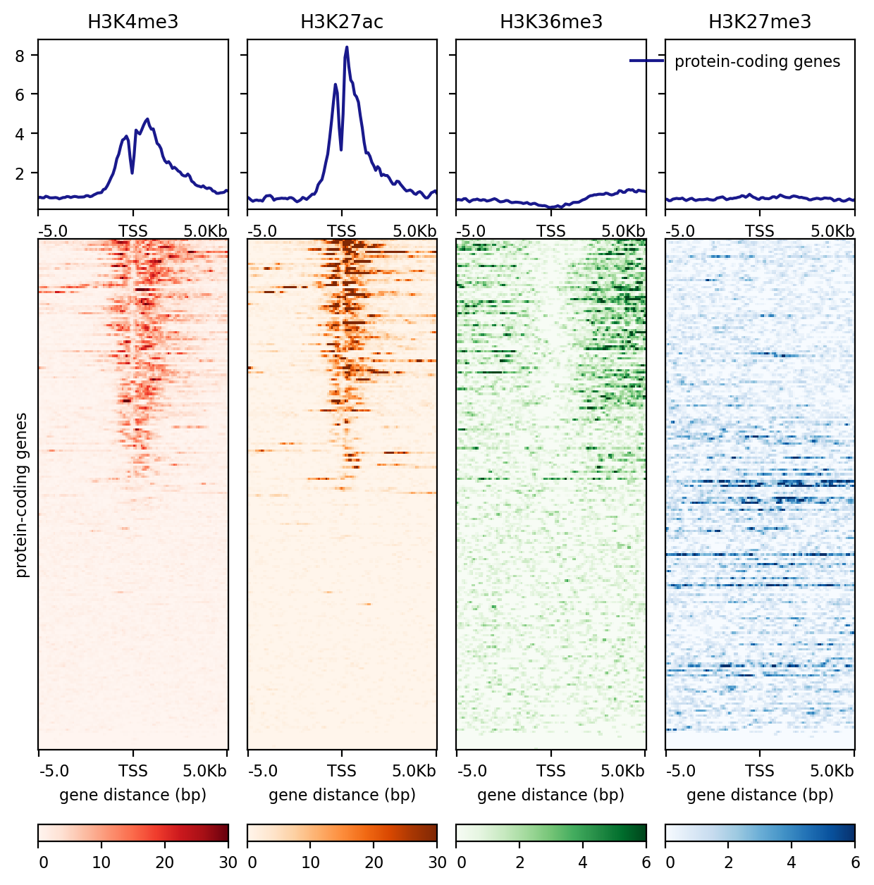{width="100%"}
:::
::: {.column width="48%"}
- 220 protein-coding genes, ±5 kb around the TSS, ENCODE GM12878 fold-change tracks, sorted by H3K4me3.
- The top third of genes: H3K4me3 and H3K27ac at the TSS and **H3K36me3 downstream**: active.
- The rest: little of any active mark; some have H3K27me3.
- One look tells you how many genes are active and that the marks agree.
:::
::::

::: notes
Exercise C4. All four columns are sorted by the same order (H3K4me3). The dip at the TSS in H3K4me3 and H3K27ac is the nucleosome-free region (ChIP-seq: the assay). H3K36me3 is only downstream of the TSS of active genes, as expected for a mark of transcription elongation. H3K27me3 shows a few strong rows among the silent genes (Polycomb targets such as OLIG1/OLIG2) and is weak overall in this cell line. The colour scale (zMax) is set per mark; always check the scale before comparing intensities between columns.
:::

## Real data: H3K27ac in two cell types {.smaller}

:::: {.columns}
::: {.column width="52%"}
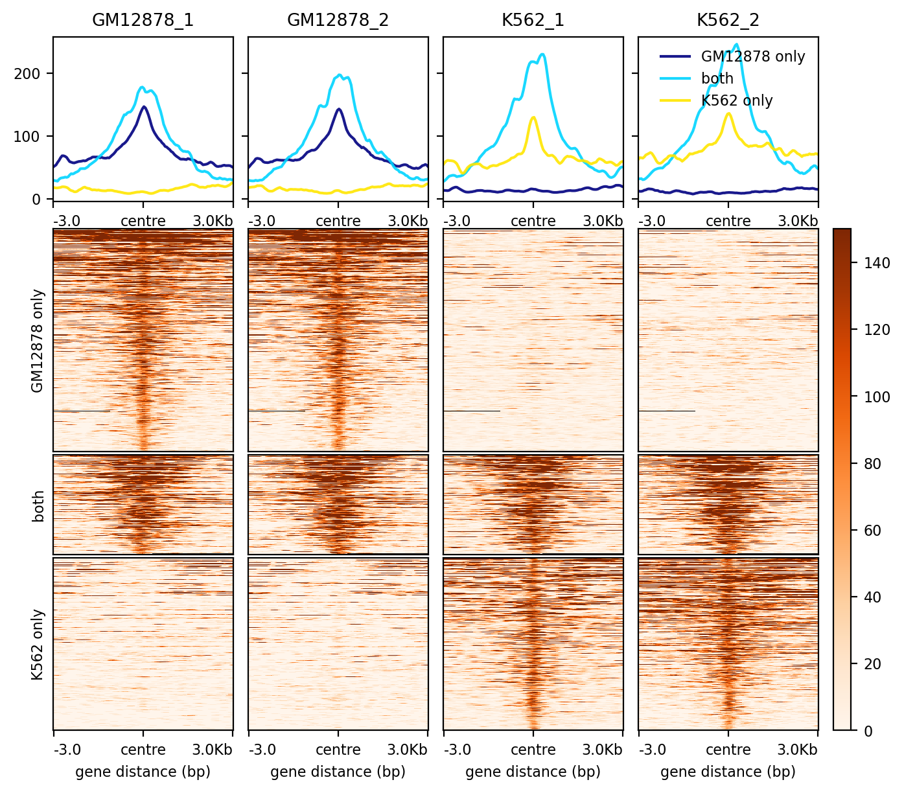{width="100%"}
:::
::: {.column width="48%"}
- 841 consensus H3K27ac regions on chr21, grouped by which cell line's peak set contains them: **378** GM12878 only, **170** both, **293** K562 only.
- CPM tracks of our four libraries, ±3 kb around the region centres.
- Replicates agree; cell-type-specific regions are nearly empty in the other cell line.
:::
::::

::: notes
Exercise C2–C4: consensus = union of ENCODE's replicated H3K27ac peaks of the two cell lines, merged and blacklist-filtered; bamCoverage CPM tracks from ENCODE's filtered BAMs (chr21), reads extended to 200 bp. Grouping by peak-set membership is a quick, descriptive view of differential binding; it is not a test: a region called in one cell line only can still have substantial signal in the other (peak calling has thresholds, and the K562 profiles in the "GM12878 only" group are low but not zero). The shared regions are mostly promoters of housekeeping genes. The proper comparison counts reads in all regions in all samples and tests the difference with replicates: next.
:::

## Differential binding is RNA-seq on peaks {.smaller}

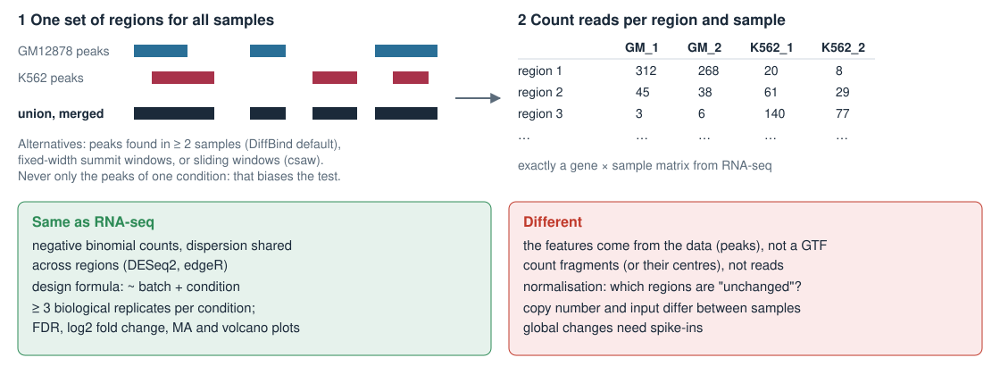{width="92%" fig-align="center"}

::: notes
Once there is a count matrix, the statistics are those of RNA-seq: DESeq2 or edgeR, negative binomial with dispersion shared across features, design formula with batch and condition, FDR. DiffBind (Ross-Innes et al. 2012; Stark and Brown) wraps exactly this: it builds the consensus (by default peaks found in at least two samples), counts reads, normalises and calls DESeq2 or edgeR. csaw (Lun and Smyth 2016) avoids peak calling altogether: it counts reads in sliding windows, tests every window and merges significant windows into regions, controlling the FDR over regions. What differs from RNA-seq: the features are made from the data, so the consensus must be built from all conditions (peaks of one condition only would bias the test towards that condition); one counts fragments (here the centre of each extended read); and above all normalisation.
:::

## Real data: the count matrix {.smaller}

| | GM12878 rep 1 | GM12878 rep 2 | K562 rep 1 | K562 rep 2 | GM12878 input | K562 input |
|---|---:|---:|---:|---:|---:|---:|
| reads on chr21 (filtered) | 77 180 | 63 656 | 137 885 | 64 446 | 67 346 | 237 564 |
| reads in the 841 regions | 42 836 | 34 973 | 54 526 | 28 516 | 2 808 | 11 547 |
| **FRiP** | **0.555** | **0.549** | **0.395** | **0.442** | 0.042 | 0.049 |
| read length (bp) | 51 | 51 | 36 | 36 | 51 | 36 |

- The GM12878 libraries put more of their reads into peaks: a **signal-to-noise** difference between the two experiments, not necessarily biology.
- Read length differs too (51 vs 36 bp): a technical variable **confounded** with cell type, as are the dates of the experiments.

::: notes
Exercise R2. Counts are fragment centres (reads shifted 100 bp along their strand) falling in the consensus regions. FRiP differs by about 0.1–0.15 between the cell lines. Is that because K562 truly has less H3K27ac in peaks relative to the rest of its genome, or because one IP worked better? From these data alone you cannot tell; that is exactly the question each normalisation answers differently (next slides). The confounding is real for any comparison of public data from different experiments: cell line, date, read length and sequencing run all change together. With only two replicates per group the dispersion estimates are weak; three or more is the recommendation, as for RNA-seq.
:::

## Normalisation: what is assumed to be constant? {.smaller}

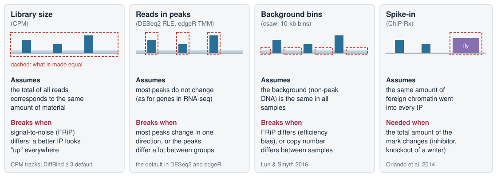{width="95%" fig-align="center"}

::: notes
This slide is the core of the unit. Every normalisation makes something equal between samples, and that something must truly be the same. Library size: total reads; fine if the IPs are equally efficient, wrong if one sample has a higher FRiP (its peaks all look up). Reads in peaks (DESeq2's median-of-ratios on the count matrix, edgeR's TMM): assumes most peaks do not change, the same assumption as for genes; wrong when most peaks change in one direction. Background bins (csaw's approach for "composition bias"): large windows away from peaks are assumed to be pure background, the same in all samples; wrong when the IP efficiency differs (then the better sample's peaks look up and its background looks down) or when copy number differs. Spike-in: a fixed amount of foreign chromatin per sample; the only option when the total amount of the mark changes, as with an EZH2 or DOT1L inhibitor (Experimental design and QC). DiffBind 3 changed its default from reads-in-peaks to full library size precisely because the choice matters; its documentation discusses the alternatives.
:::

## Real data: three normalisations, three answers {.smaller}

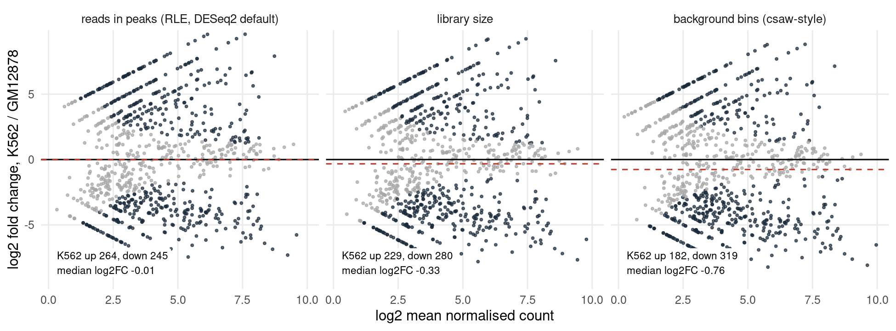{width="95%" fig-align="center"}

- Same counts, same test (DESeq2, padj < 0.05), different size factors: **264 / 245**, **229 / 280**, **182 / 319** regions up / down in K562.
- The size factors differ most for K562 rep 1: 1.43 (peaks), 1.70 (library), 1.94 (background).

::: notes
Exercise R3. MA plots: log2 fold change K562/GM12878 against mean count; black = significant; red dashed line = median log2 fold change. With the default (median-of-ratios on peaks), the cloud is centred on zero by construction. With library size, the median shifts to −0.33: the K562 libraries have fewer reads in peaks (lower FRiP), so most peaks look lower in K562. With background bins, −0.76: the K562 libraries have relatively more reads in the background, because of lower FRiP and because K562's chr21 has extra copies (next slide). The diagonal stripes are regions with zero reads in one cell line. Which answer is right? It depends on what you believe is constant. For two cell lines with thousands of cell-type-specific enhancers there is no ground truth; most analysts would accept the peak-based default here and say so, and check that conclusions about individual strong regions (|log2FC| > 3) do not depend on the choice: they do not.
:::

## Copy number differs between cell lines {.smaller}

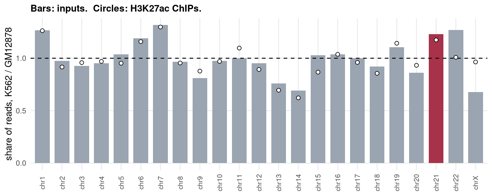{width="95%" fig-align="center"}

- Share of all reads per chromosome, K562 / GM12878. The **inputs** show K562's karyotype: chr22 and chr21 **1.2–1.3×**, chr9 0.81, chrX 0.68.
- Any region on an amplified chromosome gets more reads in every library: a "gain" in K562 unless the counts are corrected.

::: notes
From ENCODE's idxstats of the whole filtered BAMs (data/h3k27ac_idxstats.tsv; exercise R4). GM12878 is a near-diploid lymphoblastoid line; K562 is a near-triploid chronic myeloid leukaemia line with many gains and losses (the BCR-ABL1 amplification on 22q, loss of 9p including CDKN2A). The input share is a direct, coarse copy-number readout (the H3K27ac ChIPs, circles, follow it partly but mix in biology). chr21 has about 1.23 times the expected share in K562: every chr21 region has a head start in K562 counts, which partly offsets the lower FRiP. Remedies: DiffBind subtracts scaled control reads or masks "greylist" regions with abnormal input signal; one can include the input-derived copy number as an offset, or compare cell types only within regions of equal copy number. Copy number matters most for cancer samples compared with normal tissue.
:::

## Global changes need spike-ins {.smaller}

A fixed amount of *Drosophila* chromatin is added to each sample before the IP. DESeq2 accepts any size factors, so use the fly reads:

| | ctrl 1 | ctrl 2 | trt 1 | trt 2 |
|---|---:|---:|---:|---:|
| fly reads (spike-in) | 50 000 | 60 000 | 100 000 | 110 000 |
| size factor $s_j = N_{\text{fly},j} / \text{geometric mean}$ | 0.66 | 0.79 | 1.32 | 1.45 |
| reads in region A | 800 | 960 | 800 | 880 |
| normalised count = reads / $s_j$ | 1 213 | 1 213 | 606 | 606 |

- Read counts look **unchanged**; spike-in normalised, region A has **lost half** its signal.
- In R: `sizeFactors(dds) <- s` before `DESeq(dds)`.

::: notes
Experimental design and QC introduced spike-ins (ChIP-Rx, Orlando et al. 2014) with a CPM-style scaling factor α = 1/N_fly. Here the same idea enters the differential analysis: the size factor of each sample is proportional to its spike-in reads (the geometric mean of 50 000, 60 000, 100 000 and 110 000 is 75 793). Why does the treated sample have more fly reads? Both got the same fly chromatin, but the treated cells had half as much of the human mark, so the IP pulled down less human DNA and the fly made up a larger share of the library. A refinement used in practice: correct the spike-in factor by the fly/human ratio in each sample's input, which absorbs errors in how many cells were mixed. Spike-ins add noise, and they are only valid if the antibody sees the fly mark like the human one and the spike was added before any step that loses material.
:::

## Simulated: a global loss, with and without spike-ins {.smaller}

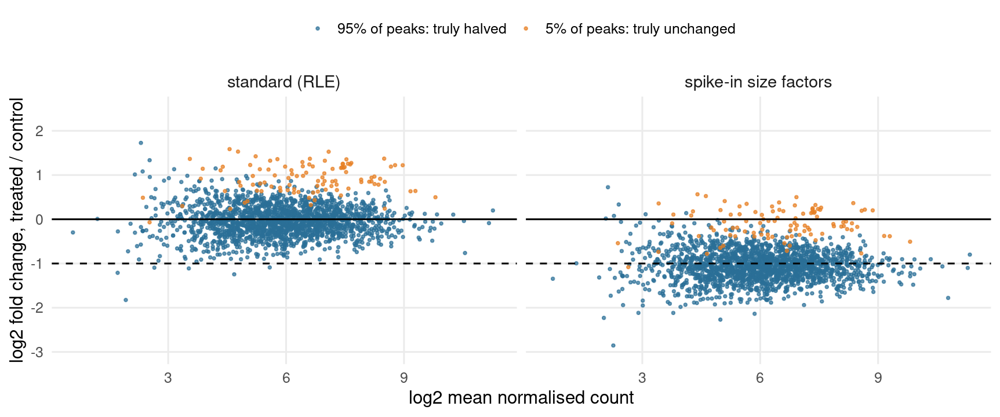{width="92%" fig-align="center"}

- 2 000 peaks, 3 + 3 samples, every library sequenced to the same depth. Truth: 95% of peaks lose half their mark, 5% are unchanged.
- **Standard normalisation**: the halved peaks look unchanged (mean log2FC −0.05) and the 5% unchanged peaks look **up** (+0.93). **Spike-in**: −1.06 and −0.10, the truth.

::: notes
A simulation, because no small public dataset with a known global change and spike-ins fits our chr21 setup (exercise R5 runs it). Negative binomial counts with a fixed dispersion; the spike-in reads double in the treated samples, with 5% noise. DESeq2's median-of-ratios assumes most peaks are unchanged, so it re-centres the 95% halved peaks on zero; the few truly unchanged peaks then appear to gain (43 significant "gains" with standard normalisation, 0 with spike-ins; 1 vs 1 562 significant losses). This is how papers on EZH2 inhibitors or H3K27M tumours can wrongly report "redistribution" of H3K27me3 to new sites. Whenever a treatment targets a writer or eraser of the mark you profile, plan spike-ins (or an orthogonal measurement: western blot, mass spectrometry) before the experiment.
:::

## Real data: a differential locus {.smaller}

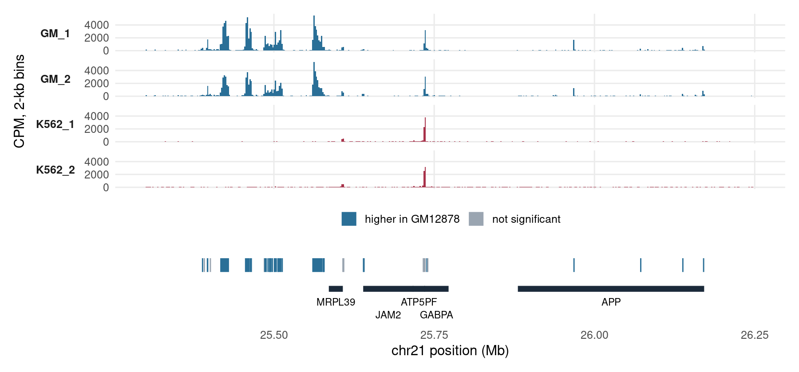{width="92%" fig-align="center"}

- chr21:25.3–26.25 Mb: a cluster of strong H3K27ac regions in GM12878, absent in K562; 27 of 35 consensus regions here are significantly higher in GM12878.
- The cluster lies **> 100 kb** from the nearest protein-coding TSS (MRPL39): which gene it regulates is a separate question.

::: notes
Fragment-centre counts in 2-kb bins, CPM; bars below are the consensus regions coloured by the DESeq2 result (default normalisation). The GM12878 cluster at 25.4–25.5 Mb is the region with the largest fold changes on chr21 (log2FC −6 to −7.5). Clusters of strong H3K27ac over tens of kilobases are often called super-enhancers; this one sits in a gene desert near a lncRNA (LINC00158) and far from protein-coding genes. The peak at the GABPA/ATP5PF promoters is shared and not significant: housekeeping promoters are the stable reference that peak-based normalisation relies on. At the other extreme, the strongest K562-specific regions include the KCNJ6 promoter and the DSCR4 region (chr21:38.1 Mb). Interpretation (which genes, which TFs) needs expression data, motifs and contacts: Linking regulatory elements to genes, Motifs, motif enrichment and TF footprinting.
:::

## Tools for differential binding {.smaller}

| tool | features | normalisation | test |
|---|---|---|---|
| DESeq2 / edgeR directly | your consensus peaks | median-of-ratios / TMM, or your own size factors | NB GLM |
| DiffBind | consensus of peaks in ≥ *n* samples | library size (default), RLE/TMM, background, spike-in | DESeq2 or edgeR |
| csaw | sliding windows, merged after testing | background bins or high-abundance windows | edgeR, region-level FDR |
| MAnorm2, ChIPComp | peaks | model-based, between groups | own models |
| broad marks | genes, promoters or large bins | as above | as above |

::: notes
For most ChIP-seq and ATAC-seq comparisons, DiffBind or a few lines of DESeq2 on a peak count matrix are enough (Differential accessibility did the same with ATAC). csaw is attractive when peak calling is unreliable (broad or diffuse marks, shifted peaks), because it tests windows directly. For broad marks, counting in genes (H3K36me3) or promoters ± a few kb (H3K27me3 at CpG islands) is often more robust than domain calls. Whatever the tool, report the consensus rule, the counting unit, the normalisation and the design formula.
:::

## Pitfalls {.smaller}

| pitfall | consequence | instead |
|---|---|---|
| comparing peak numbers or overlaps between conditions | thresholds and depth decide "gained" and "lost" sites | count reads in a common region set and test |
| consensus from one condition's peaks | bias towards that condition | union of all conditions (or ≥ *n* samples) |
| n = 1 per condition | no dispersion estimate; any difference "significant" | ≥ 3 biological replicates |
| default normalisation under a global change | real losses hidden, unchanged sites look gained | spike-ins; check with a western blot |
| ignoring copy number | amplified regions look gained | inputs from the same cells; greylists; compare within copy-number states |
| technical variables confounded with condition | batch or read length becomes "biology" | balance batches; include them in the design |
| nearest gene = target gene | wrong genes in enrichment analyses | contacts, expression correlation, perturbation |

::: notes
Each row has a counterpart in the literature. Our own example has two of them: two replicates only, and technical variables (lab date, read length, IP efficiency) confounded with cell type. That is acceptable for a teaching comparison of two very different cell lines with thousands of real differences; it would not be for subtle effects of a treatment.
:::

## Summary {.smaller}

| step | key fact |
|---|---|
| annotation | category by priority (promoter window!), nearest TSS; descriptive, not functional |
| nearest gene | a label; distal elements often regulate other genes |
| profiles, heatmaps | computeMatrix (reference-point, scale-regions) → plotHeatmap; look at the rows, not just the mean |
| consensus | union of peaks from all conditions (or ≥ *n* samples), blacklist removed |
| counts → test | DESeq2/edgeR exactly as RNA-seq; ≥ 3 replicates; batch in the design |
| normalisation | library size, reads in peaks, background bins, spike-in: each assumes a different constant |
| copy number | inputs reveal it; corrects or confounds differential binding |
| global changes | only spike-ins (or orthogonal data) can show them |

::: notes
Students should be able to annotate a peak by hand given a gene model, explain why nearest-gene assignment is weak, read a deepTools heatmap, set up a differential binding analysis, compute spike-in size factors and normalised counts by hand, predict how each normalisation behaves under different FRiPs, copy numbers and global changes, and spot the pitfalls in a methods section. Next units: CUT&RUN and CUT&Tag, then Chromatin states.
:::

## Key papers (optional further reading) {.smaller}

*Not required reading and not examined. For those who want the primary literature.*

- Yu, Wang & He 2015, *Bioinformatics*. [ChIPseeker: an R/Bioconductor package for ChIP peak annotation, comparison and visualization](https://doi.org/10.1093/bioinformatics/btv145). Peak annotation.
- Ramírez et al. 2016, *Nucleic Acids Res*. [deepTools2: a next generation web server for deep-sequencing data analysis](https://doi.org/10.1093/nar/gkw257). computeMatrix and plotHeatmap.
- Ross-Innes et al. 2012, *Nature*. [Differential oestrogen receptor binding is associated with clinical outcome in breast cancer](https://doi.org/10.1038/nature10730). The study behind DiffBind: differential binding in patient samples.
- Lun & Smyth 2016, *Nucleic Acids Res*. [csaw: a Bioconductor package for differential binding analysis of ChIP-seq data using sliding windows](https://doi.org/10.1093/nar/gkv1191). Windows, composition and efficiency biases.
- Orlando et al. 2014, *Cell Rep*. [Quantitative ChIP-Seq normalization reveals global modulation of the epigenome](https://doi.org/10.1016/j.celrep.2014.10.018). Spike-in normalisation.
- Chen et al. 2016, *Mol Cell Biol*. [The overlooked fact: fundamental need for spike-in control for virtually all genome-wide analyses](https://doi.org/10.1128/MCB.00970-14). Why normalising to totals hides global changes.
