## About this lecture {.smaller}

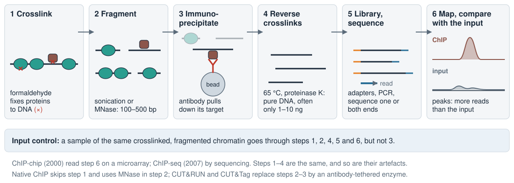{width="95%" fig-align="center"}

- **The wet lab**: crosslinking, fragmentation (sonication or MNase), immunoprecipitation, library. What each step does, and what it gets wrong.
- **The signal**: a population average; sharp peaks for transcription factors, broad domains for many histone marks; the input control.
- **Strands and resolution**: why reads come in two shifted piles, and how far a binding site can be pinned down.
- Real data: GM12878 **CTCF** and **H3K36me3** ChIP-seq with their inputs (chr21), and ENCODE tracks of seven marks.

::: notes
This is the assay unit of the ChIP-seq block. Students already know how to turn reads into a filtered BAM and a coverage track (From reads to coverage) and the QC metrics shared by all enrichment assays (Experimental design and QC); we use both without repeating them. Here the question is what the experiment physically measures, because every artefact in the data comes from a step in the figure. The input control is the same chromatin taken through every step except the immunoprecipitation: keep that definition in mind, it explains what the input can and cannot correct. The next units are Peak calling, then Annotation and differential binding. CUT&RUN and CUT&Tag replace steps 2 and 3 and have their own unit.
:::

## Two kinds of target {.smaller}

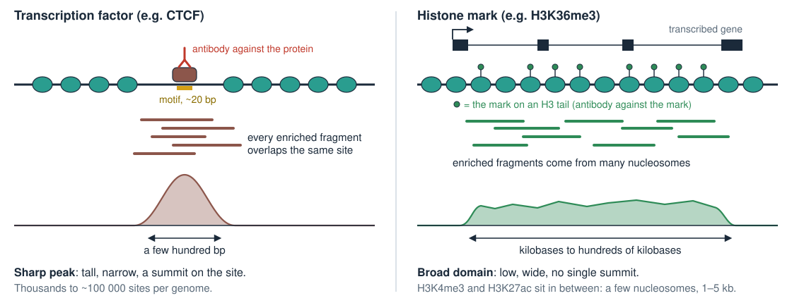{width="95%" fig-align="center"}

- A **transcription factor** contacts a short motif: every enriched fragment overlaps the same site, so the reads pile up in a **narrow peak**.
- A **histone mark** sits on nucleosomes, often on hundreds of them in a row: the enriched fragments tile a **broad domain**.
- Same protocol, same reads; the shape of the signal decides how we call peaks and how deep we sequence.

::: notes
The antibody defines the experiment. Against a protein (CTCF, a TF, Pol II, a chromatin remodeller) we see where the protein was when the cells were fixed. Against a histone modification (H3K4me3, H3K27ac, H3K36me3, H3K27me3) we see which nucleosomes carry the mark. The geometry follows: a TF occupies 10–30 bp, and any fragment that carries it must overlap that point, so the peak is about two fragment lengths wide at the base. A mark like H3K36me3 covers a transcribed gene body of tens of kilobases; every nucleosome there can be pulled down, so reads are spread thinly over the whole domain. The ENCODE standards reflect this: 20 million usable fragments per replicate for TFs and narrow marks, 45 million for broad marks, because a broad domain spreads its reads over a larger area. H3K4me3 and H3K27ac are in between: a few nucleosomes around a promoter or enhancer.
:::

## From ChIP to ChIP-seq {.smaller}

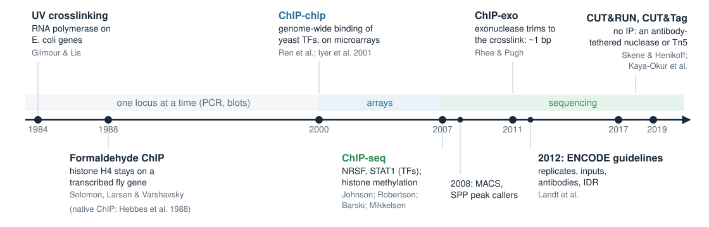{width="95%" fig-align="center"}

- The chemistry is from the **1980s**; only the readout changed: one locus by PCR → **arrays** (ChIP-chip, 2000) → **sequencing** (ChIP-seq, 2007).
- Sequencing gave the whole genome at once, with no probe design, better resolution and repeat-aware mapping.

::: notes
Gilmour and Lis (1984) used UV light to crosslink RNA polymerase to DNA in E. coli; Solomon, Larsen and Varshavsky (1988) introduced formaldehyde and showed that histone H4 stays on a highly transcribed Drosophila gene. In the same year, Hebbes, Thorne and Crane-Robinson immunoprecipitated native, unfixed nucleosomes with antibodies against acetylated histones: the ancestor of native ChIP. For two decades a ChIP was read out locus by locus with PCR. ChIP-chip hybridised the DNA to microarrays (Ren et al. 2000 for yeast Gal4 and Ste12; Iyer et al. 2001), limited by probe density and cross-hybridisation in repeats. In 2007 four papers sequenced ChIP DNA on the then-new short-read instruments: Johnson et al. (NRSF), Robertson et al. (STAT1), Barski et al. (histone methylations in human T cells) and Mikkelsen et al. (chromatin states in mouse ES cells). MACS and SPP, the first widely used peak callers, followed in 2008. ChIP-exo (2011) and ChIP-nexus (2015) trimmed fragments to the protein; CUT&RUN (2017) and CUT&Tag (2019) dropped the immunoprecipitation altogether.
:::

## Step 1: crosslinking with formaldehyde {.smaller}

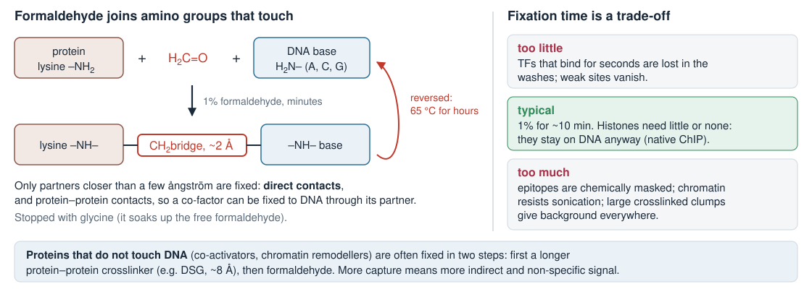{width="92%" fig-align="center"}

::: notes
Formaldehyde is small and enters cells within seconds. It reacts with primary amines, mostly lysine side chains on proteins and the exocyclic amino groups of A, C and G, and joins two amines that are within about 2 ångström by a methylene bridge. So it fixes direct protein–DNA contacts and protein–protein contacts, which means a protein that never touches DNA can still be fixed to it through a partner. The reaction is stopped with glycine and reversed by heating to 65 °C for several hours. Fixation is a trade-off: too short and transient binders are lost during the long washes; too long and the epitope is chemically modified, the chromatin becomes hard to shear, and big crosslinked complexes give background everywhere. One percent formaldehyde for about ten minutes at room temperature is the usual compromise. For co-factors and chromatin remodellers people add a longer protein–protein crosslinker such as DSG first. Every increase in capture also captures more non-specific, indirect contacts: crosslinking is one of the reasons ChIP peaks are not proof of direct binding.
:::

## Step 2: fragmenting the chromatin {.smaller}

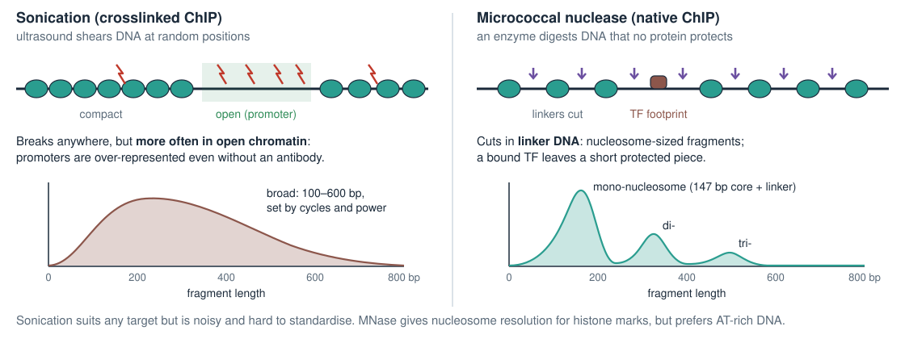{width="95%" fig-align="center"}

::: notes
Sonication uses ultrasound to break DNA by cavitation. It needs no enzyme and works on crosslinked chromatin, which is why it is the standard for TF ChIP. It is hard to standardise: the result depends on the instrument, the volume, the number of cycles and how much the chromatin was fixed, so fragment sizes are broad, typically 100–600 bp. And it is not random: open, nucleosome-depleted chromatin breaks more easily, so promoters are over-represented among the fragments even without any antibody (next slide). Micrococcal nuclease (MNase) is an endo-exonuclease that cuts where no protein protects the DNA: in the linkers between nucleosomes. Partial digestion gives a ladder of mono-, di- and tri-nucleosomes; extensive digestion gives mostly mono-nucleosomes, about 147 bp plus some linker. MNase is the method of choice for native ChIP of histone marks because it gives nucleosome resolution. It prefers AT-rich DNA, and it can over-digest fragile nucleosomes, so MNase-based data have their own biases.
:::

## Real data: the input is not flat {.smaller}

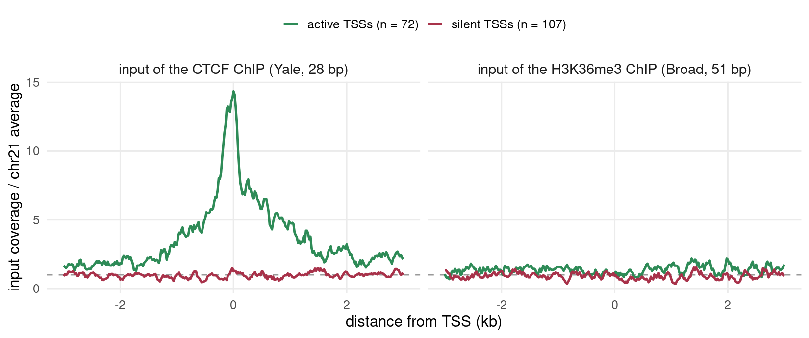{width="92%" fig-align="center"}

- Input coverage around the TSSs of chr21 protein-coding genes, active (H3K4me3 high) vs silent, relative to the chr21 average.
- Input of the CTCF ChIP: **14×** the average at active TSSs, **1.3×** at silent ones. Input of the H3K36me3 ChIP: about **1.1×** at both.
- Inputs differ between protocols. The control must come from **the same chromatin preparation** as the ChIP.

::: notes
Real data from the exercise (make-chipintro-figs.R): 72 active TSSs (ENCODE H3K4me3 fold change above 5 within 1 kb) and 107 silent ones (below 1), reads extended to 100 bp. The CTCF input (ENCODE ENCSR000EYX, Yale, 2009, 28 bp reads) is strongly enriched at active promoters: 14 times the chromosome average at the TSS itself (median over TSSs 12 times), 2.5 times 2 kb away. That is sonication bias, plus perhaps easier release of open chromatin from the nuclei. The input that came with the H3K36me3 experiment (ENCSR000AKJ, Broad, 2010) shows almost none of it. Two consequences. A peak at an active promoter is not evidence of binding unless it beats the input there; MACS uses the input's local level, which is how this bias enters peak calling (Peak calling). And an input is only a good control for a ChIP made from the same chromatin with the same fragmentation: borrowing another lab's input, or an input from a different cell type, corrects the wrong biases. Note how much depth matters, too: about 3 input reads per kb on chr21 here.
:::

## Steps 3–4: immunoprecipitation, and very little DNA {.smaller}

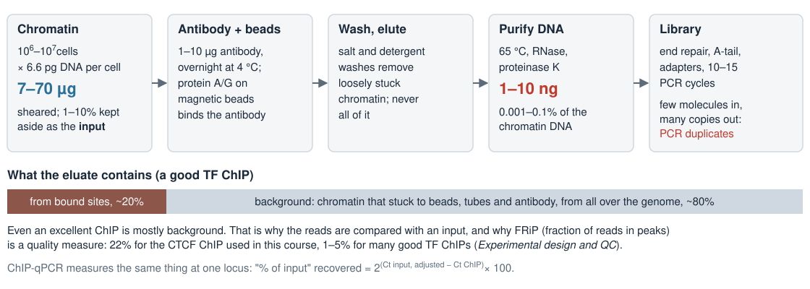{width="95%" fig-align="center"}

::: notes
Walk through the amounts; they explain most library problems. Ten million human cells contain about 66 µg of DNA (6.6 pg per diploid cell). The antibody, bound to protein A or G on magnetic beads, recovers a few nanograms, of the order of a ten-thousandth of the chromatin. Of those few nanograms, most is still background: chromatin that stuck to the beads, the tube or the antibody. In the CTCF ChIP of this course about 22% of the reads fall in ENCODE's CTCF peaks (FRiP, Experimental design and QC), an excellent value; many good TF ChIPs are at a few percent. With a few nanograms, library preparation needs 10–15 PCR cycles, and the fewer molecules went in, the more PCR duplicates come out: the CTCF replicate 2 library in Peak calling has 61% duplicates. In the lab, enrichment is checked by ChIP-qPCR before sequencing: percent of input at a known bound site (often 1–20%) against a negative region (often below 0.1%). For the formula, the input Ct is first adjusted for the fraction of chromatin that was set aside as input (subtract log2 of the dilution factor).
:::

## Antibodies: four ways to fail {.smaller}

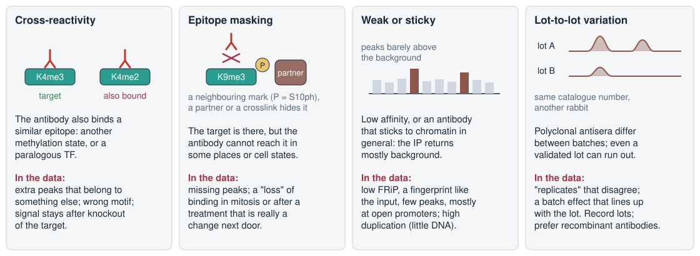{width="95%" fig-align="center"}

::: notes
Experimental design and QC covered how antibodies are validated (immunoblot, a second antibody or epitope tag, knockout). Here the focus is what each failure looks like in the data, because that is what you see when you read a paper. Cross-reactivity: histone-methylation antibodies often bind neighbouring methylation states (K4me2 and K4me3) or similar sequence contexts (H3K9me3 and H3K27me3 share an ARKS motif); a TF antibody can bind a paralog with a different motif. Masking: an adjacent modification (phosphorylation of H3S10 during mitosis next to K9me3), a partner protein or the crosslink itself can hide the epitope, so the "loss" of a peak may be a change next door. Weak or sticky antibodies give a ChIP that looks like its input: low FRiP, a fingerprint near the diagonal, peaks mostly at open promoters (the input bias of the previous slide), and high duplication because little DNA was recovered. Lot-to-lot variation: polyclonal sera are produced in animals and differ between bleeds; recombinant monoclonal antibodies are more reproducible. Egelhofer et al. 2011 found that about a quarter of the histone-modification antibodies they tested failed specificity tests.
:::

## A ChIP signal is a population average {.smaller}

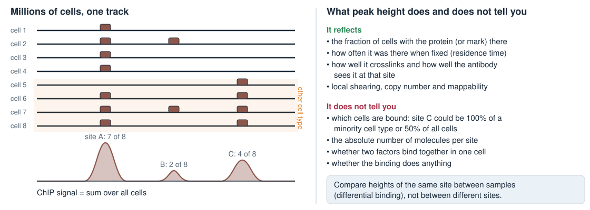{width="95%" fig-align="center"}

::: notes
A ChIP-seq library is made from millions of cells, and each fragment comes from one cell. A peak's height adds up how many cells had the protein there at the moment of fixation, how long it stays (a TF that binds for seconds is captured less often than one that stays for minutes), and technical efficiencies at that site: crosslinkability, epitope access, shearing, copy number and mappability. So comparing heights between different sites of the same sample says little about occupancy. Comparing the same site between samples processed the same way is meaningful: that is differential binding (Annotation and differential binding). Heterogeneity is invisible: site C could be bound in every cell of a minority cell type or in half of all cells. Single-cell methods (single-cell CUT&Tag) and sorting answer that question; bulk ChIP cannot. Co-binding of two factors at a site in a bulk ChIP likewise does not mean they bind together in one cell; sequential ChIP (re-ChIP) is needed for that.
:::

## Native ChIP: no crosslinking {.smaller}

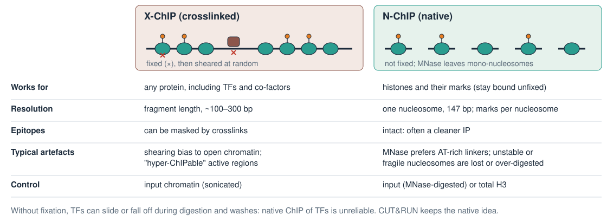{width="95%" fig-align="center"}

::: notes
Histones stay on DNA without fixation because a nucleosome is stable in the salt conditions of a ChIP, so histone marks can be mapped on native chromatin digested with MNase. Advantages: no epitope masking by formaldehyde, often a cleaner IP, nucleosome resolution, and no crosslinking artefacts. Barski et al. 2007, one of the first ChIP-seq papers, used native MNase ChIP for histone methylations. Disadvantages: most TFs dissociate or slide during digestion and washes, so native ChIP is not used for them; MNase cuts AT-rich linkers preferentially and can destroy fragile, often highly active, nucleosomes. Both methods use an input made the same way as the ChIP; for native ChIP of a mark, a ChIP of total H3 is a useful second control because it shows nucleosome occupancy (a mark per nucleosome rather than per base of DNA). CUT&RUN and CUT&Tag are also usually done on native, unfixed nuclei.
:::

## Real data: seven antibodies, one locus {.smaller}

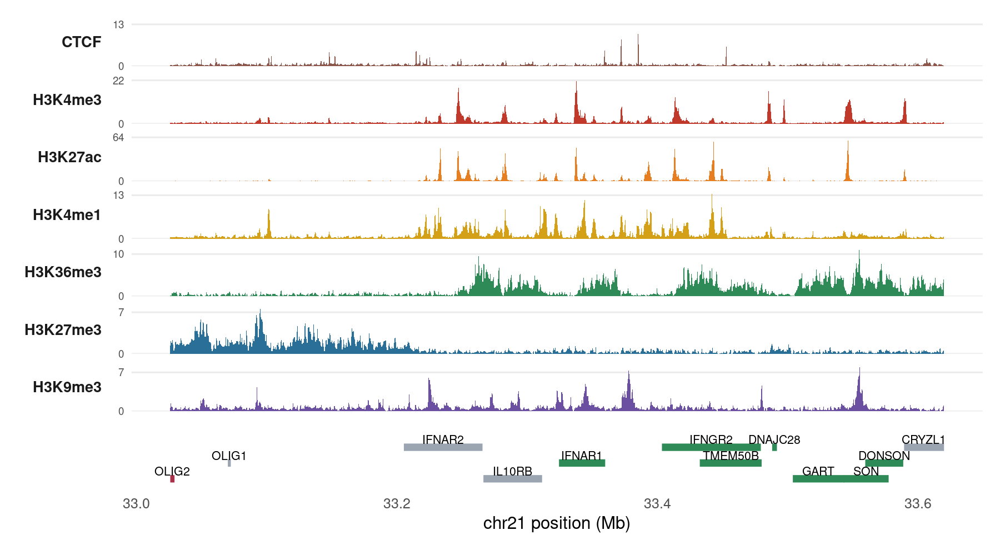{width="90%" fig-align="center"}

::: notes
ENCODE fold change over input for GM12878 at chr21:33.0–33.62 Mb, in 500-bp bins (make-chipintro-figs.R). Gene colours: green = active (H3K4me3 fold change above 5 at the TSS), red = silent (below 1), grey = in between. Walk down the tracks. CTCF: needles. H3K4me3: a peak at each active promoter (IFNAR1, IFNGR2, TMEM50B, GART/SON, DONSON; weaker at IFNAR2 and IL10RB). H3K27ac: promoters plus a few distal sites, the candidate enhancers. H3K4me1: wider areas around promoters and enhancers. H3K36me3: carpets over the bodies of transcribed genes, starting a little after the TSS. H3K27me3: a broad domain over the silent OLIG1/OLIG2 genes, developmental regulators of glia that a B-cell line has no use for (Polycomb repression). H3K9me3 is low here, but shows small peaks at active promoters: H3K9me3 belongs in heterochromatin, so these are most likely the open-chromatin and "hyper-ChIPable" artefacts discussed later, a reminder that every track has background structure. The y scales differ per track.
:::

## Where the marks sit on a gene {.smaller}

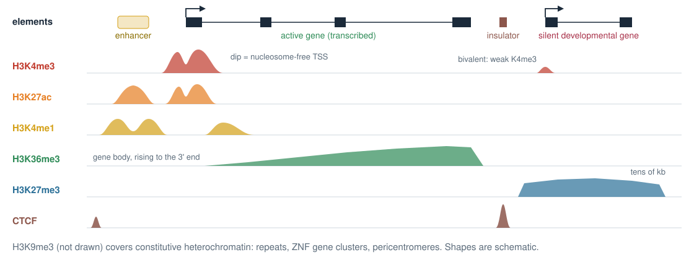{width="95%" fig-align="center"}

::: notes
A summary diagram of the shapes students will meet for the rest of the course (chromatin-intro introduced the marks themselves). Promoter marks, H3K4me3 and H3K27ac, sit on the nucleosomes flanking the nucleosome-free region at the TSS, so their profile has a dip exactly at the TSS. H3K4me1 marks enhancers and the flanks of promoters, and is depleted where H3K4me3 is high. H3K36me3 is deposited by SETD2, which travels with elongating RNA polymerase II, so it covers transcribed gene bodies and rises towards the 3' end. H3K27me3 (Polycomb) forms broad domains over silent developmental genes; at "bivalent" promoters in stem cells it coexists with a weak H3K4me3. CTCF marks insulators and loop anchors (3D genome units). H3K9me3 covers constitutive heterochromatin: repeats, pericentromeres, ZNF gene clusters. Chromatin states combines all of these into states with an HMM.
:::

## Real data: profiles around genes {.smaller}

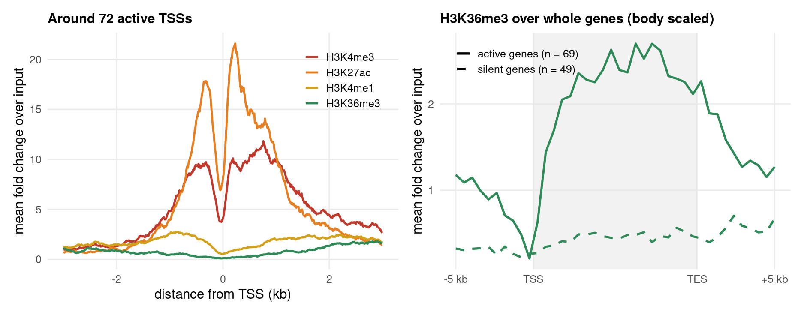{width="95%" fig-align="center"}

- Left: at 72 active TSSs, H3K4me3 and H3K27ac **dip at the TSS** (the nucleosome-free region) and peak on the flanking nucleosomes; H3K4me1 is depleted.
- Right: H3K36me3 covers the bodies of **active** genes (mean fold change 2.2) and not of silent ones (0.45).

::: notes
Averages of ENCODE fold-change tracks at base resolution, genes on the minus strand flipped (make-chipintro-figs.R). Left: H3K27ac reaches 21.6 at +230 bp and 17.7 at −300 bp, with 8.1 at the TSS itself; H3K4me3 has 4.1 at the TSS and about 10–12 on the flanks. The dip is the nucleosome-free region, typically 150–200 bp, occupied by the transcription machinery and TFs rather than nucleosomes: a histone ChIP cannot be enriched where there are no histones. H3K4me1 is lowest (0.5) at the TSS and highest about 1 kb away. H3K36me3 is nearly absent at the TSS and rises into the gene. Right: 69 active and 49 silent protein-coding genes longer than 5 kb, gene bodies scaled to 20 bins. H3K36me3 rises after the TSS and stays high to the end of the gene, then falls. This is the shape of a mark written co-transcriptionally. These are the kind of plots made with deepTools computeMatrix and plotHeatmap in Annotation and differential binding.
:::

## Real data: how far does the signal extend? {.smaller}

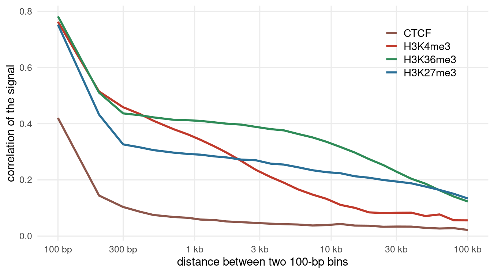{width="70%" fig-align="center"}

- Correlation of the signal between two 100-bp bins at a given distance, along chr21. **CTCF** loses it within a few hundred bp; **H3K4me3** within a few kb; **H3K36me3** and **H3K27me3** keep it over **tens of kb**.

::: notes
This is a peak-free way to measure "sharp" and "broad". For each mark: ENCODE fold change in 100-bp bins over the long arm of chr21, log-transformed, and the Pearson correlation between bins d apart. At 200 bp CTCF is down to 0.14 while the histone marks are around 0.4–0.5; at 1 kb CTCF is at 0.06, H3K4me3 0.35, H3K36me3 0.41; at 10 kb H3K4me3 0.12 but H3K36me3 still 0.33 and H3K27me3 0.23. The first steep drop for every mark is noise (two bins share fragments only up to a fragment length apart). The tail is biology: the size of the regions over which the mark is laid down. The broad tail is why peak callers for histone marks join neighbouring windows into domains (Peak calling).
:::

## Why reads come in two shifted piles {.smaller}

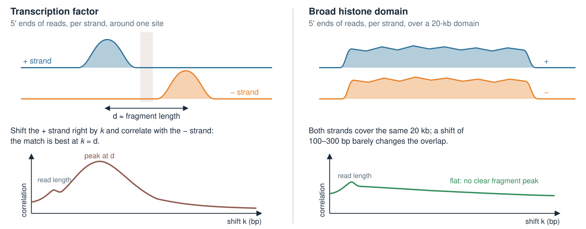{width="95%" fig-align="center"}

::: notes
A single-end read is the 5' end of a fragment. Fragments that carry a bound TF extend to either side of it; those sequenced from their left end give + strand reads to the left of the site, those sequenced from their right end give − strand reads to the right. The two piles are about one fragment length d apart (From reads to coverage showed this for CTCF and used it to extend reads). Shifting the + strand pile by k and correlating it with the − strand gives the strand cross-correlation, which peaks at k = d, plus a "phantom" peak at the read length from mappability (Experimental design and QC introduced NSC and RSC). For a broad domain, both strands cover the same 20 kb; shifting by a few hundred bp hardly changes the overlap, so the curve is flat. That is why fragment-length estimation, NSC and RSC are made for TFs and narrow marks and are unreliable for broad marks; with paired-end reads the fragment length is simply measured.
:::

## Real data: a TF and a broad mark {.smaller}

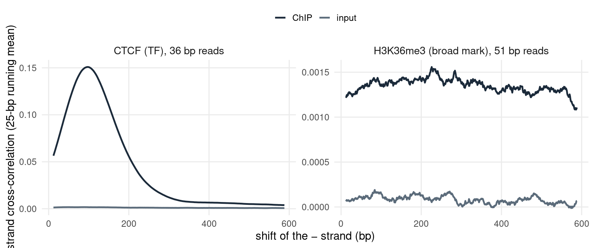{width="92%" fig-align="center"}

- **CTCF**: a clear fragment peak, cross-correlation **0.15 at 93 bp**; its input is flat (≤ 0.002).
- **H3K36me3**: no peak at any shift, values around **0.0013**, 100 times lower; the ChIP is above its input only because both strands share the same domains.
- Fragment-length estimates and NSC/RSC are tools for TFs and narrow marks.

::: notes
Computed in R exactly as in the exercise (make-chipintro-figs.R): 5' ends of the filtered reads per strand on the long arm of chr21, Pearson correlation of + strand counts at x with − strand counts at x + k; a 25-bp running mean is drawn because the H3K36me3 curve is noisy at single-base resolution. Note the y-axes: the two panels differ by a factor of 100. CTCF peaks at 93 bp (macs3 predictd says 100 bp; ENCODE 90–95 bp); the read-length position (36 bp) sits on the rising flank at 0.09, so there is no separate phantom peak here. H3K36me3 has 70 741 reads spread over tens of megabases of gene bodies: the + and − strand reads correlate weakly at every shift because they fall in the same domains, and the maximum at 294 bp is noise. A peak caller asked to build its model on this mark finds few paired strand peaks; for broad marks one sets the fragment length (e.g. from the sonication profile, or 147 bp for MNase) or uses paired-end reads.
:::

## Real data: H3K36me3 over transcribed genes {.smaller}

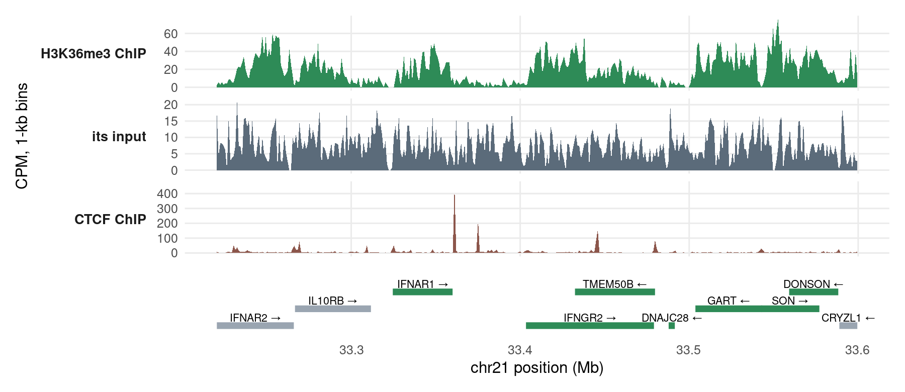{width="95%" fig-align="center"}

- Our own reads (exercise), CPM in 1-kb bins. H3K36me3 covers the transcribed genes from a little after the TSS to the end; the input is flat.
- In active gene bodies: **75.6** H3K36me3 reads per kb per million vs **31.4** in the input; in silent genes 23.4 vs 27.4.

::: notes
Reads from the H3K36me3 ChIP (ENCSR000AKE replicate 1, Broad, 51 bp) and its input aligned and filtered with the chain from From reads to coverage: 70 741 and 73 652 reads on chr21 after filtering, extended to 200 bp. The CTCF track is shown for contrast (note its different y scale). Gene colours: green active, red silent, grey in between (H3K4me3 at the TSS). The H3K36me3 enrichment is modest, about 2.4-fold over input in active gene bodies, and spread over 10–50 kb: in 1-kb bins it is clear, at a single base it would be invisible. The chr21 average is 24.9 reads per kb per million: silent genes sit at the background level, and the input itself is a little higher in active, gene-dense regions (31.4), which is why the ChIP is compared with the input rather than with the chromosome average. This dataset is sparse (only 0.42% of the 22 million reads in the library are on chr21, about half the share in the input), which is why calling broad domains in it is a challenge in Peak calling.
:::

## Resolution: where exactly is the protein? {.smaller}

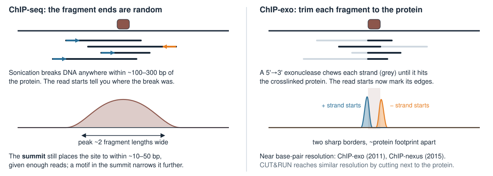{width="95%" fig-align="center"}

::: notes
In ChIP-seq the protein is somewhere inside each enriched fragment, and the fragment ends are where sonication happened to break the DNA. With enough fragments, the centre of the + and − strand piles (the summit) locates the site within tens of base pairs, and a motif search around the summit narrows it to the motif. ChIP-exo (Rhee and Pugh 2011) adds a lambda exonuclease step on the beads: it digests each strand 5'→3' until it is blocked by the crosslinked protein, so the read starts line up at the protein's border, and the distance between + and − strand borders is the footprint. ChIP-nexus (He et al. 2015) is a simpler library protocol with the same idea. Higher resolution separates closely spaced sites, shows the footprint of a complex, and reveals indirect binding (a factor with the footprint of another). CUT&RUN gets similar resolution because the tethered MNase cuts right next to the antibody-bound protein.
:::

## Peaks that are not binding {.smaller}

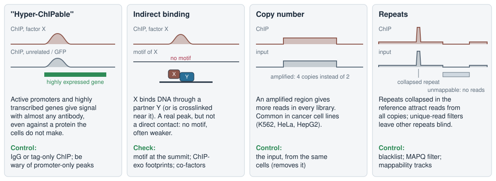{width="95%" fig-align="center"}

::: notes
Four ways to get a convincing peak that does not mean "this protein binds this DNA". Hyper-ChIPable regions: Teytelman et al. 2013 found that in yeast highly expressed genes give ChIP signal with antibodies against unrelated proteins, even GFP in cells without GFP; Jain et al. 2015 found "phantom peaks" at active promoters in Drosophila. Mock IPs (IgG, or an epitope-tag ChIP in cells without the tag) reveal them; be suspicious of a factor whose peaks are all at the most active promoters. Indirect binding: crosslinking captures a protein through its partner; such peaks lack the factor's motif and are often weaker; ENCODE found that many TF peak sets are dominated by motifs of other factors. Copy number: an amplified region has more reads in every library; the input corrects it only if it comes from the same cells (K562 has many amplifications; Annotation and differential binding uses it). Repeats: collapsed repeats attract reads (blacklist); multi-copy regions lose unique reads (MAPQ filter), so absence of signal there means "unknown".
:::

## Planning a ChIP-seq experiment {.smaller}

| | transcription factor | histone mark |
|---|---|---|
| cells per IP | 106–107 | 105–106 (often fewer) |
| fixation | formaldehyde, ~10 min (+ DSG for co-factors) | light or none (native) |
| fragmentation | sonication, 100–300 bp | sonication or MNase (mono-nucleosomes) |
| antibody | validated, ideally a knockout control; or an epitope tag | validated on modified peptides/nucleosomes; lot recorded |
| control | input from the same chromatin (IgG optional) | input; total H3 for native ChIP |
| depth (ENCODE) | 20 M usable fragments per replicate | 20 M (narrow marks) or 45 M (broad marks) |
| replicates | ≥ 2 biological | ≥ 2 biological |
| reads | single-end 50 bp is enough; paired-end measures fragments | same; paired-end helps in repeats |
| peak calling | narrow peaks, summits, IDR | narrow or broad domains |

::: notes
A planning table to pull the lecture together; each row links to a step on the earlier slides. Histone ChIPs need fewer cells because every nucleosome in a domain can be captured, while a TF is present at a few thousand sites. Epitope tagging (FLAG, HA, or a tag knocked into the endogenous gene) is a common way around a poor antibody, with the tag-only ChIP as a control. The depth figures are ENCODE's standards (Experimental design and QC). Peak calling, broad domains and IDR are the next unit.
:::

## Beyond ChIP-seq {.smaller}

| method | what changes | why use it |
|---|---|---|
| ChIP-exo, ChIP-nexus | exonuclease trims fragments to the crosslink | near-bp resolution, footprints |
| Mint-ChIP and other barcoded ChIP | chromatin of many samples barcoded, then pooled for one IP | many samples, little material, comparable IPs |
| CUT&RUN | antibody-tethered MNase cuts next to the target, in permeabilised nuclei | low background, few cells, no sonication |
| CUT&Tag | antibody-tethered Tn5 inserts adapters at the target | very few cells, single-cell versions |
| spike-in ChIP (ChIP-Rx) | foreign chromatin added before the IP | quantitative comparisons under global changes |

::: notes
ChIP-seq is still the reference method (ENCODE's thousands of datasets are ChIP-seq), but for many histone marks CUT&Tag has replaced it in new studies because it needs far fewer cells and gives much lower background. The CUT&RUN and CUT&Tag unit covers those. Spike-ins come back in Annotation and differential binding, where normalisation under a global change matters. Mint-ChIP (Mint = multiplexed, indexed T7) and similar barcoding methods pool many samples into one IP, which removes IP-to-IP variation between samples.
:::

## Summary {.smaller}

| idea | key fact |
|---|---|
| crosslinking | formaldehyde joins amines within ~2 Å; captures direct and indirect contacts; reversed at 65 °C |
| fragmentation | sonication: random-ish, biased to open chromatin; MNase: linker cuts, nucleosome resolution (native ChIP) |
| IP and library | a few ng of DNA from µg of chromatin, mostly background; PCR duplicates when yields are low |
| antibodies | cross-reactivity, masking, weak/sticky, lot variation: each with a signature in the data |
| input | same chromatin, no IP; shows shearing, copy number and mappability; must match the ChIP |
| signal shape | TF: sharp peak around the site; histone marks: nucleosome-scale to 100-kb domains |
| strands | + reads left, − reads right of a site, d apart; flat cross-correlation for broad marks |
| interpretation | a population average; height ≠ occupancy; peaks can be indirect or artefacts |

::: notes
Students should be able to draw the protocol and say what each step can get wrong, compute DNA amounts and a percent-input, predict the shape of a track for a TF and for a mark, explain why the input is needed and why it must match, and read a strand cross-correlation plot. Next: Peak calling turns these reads into peaks, with the input entering through the local λ.
:::

## Key papers (optional further reading) {.smaller}

*Not required reading and not examined. For those who want the primary literature.*

- Solomon, Larsen & Varshavsky 1988, *Cell*. [Mapping protein-DNA interactions in vivo with formaldehyde: evidence that histone H4 is retained on a highly transcribed gene](https://doi.org/10.1016/s0092-8674(88)90469-2). The formaldehyde ChIP.
- Johnson, Mortazavi, Myers & Wold 2007, *Science*. [Genome-wide mapping of in vivo protein-DNA interactions](https://doi.org/10.1126/science.1141319). One of the first ChIP-seq papers (NRSF).
- Barski et al. 2007, *Cell*. [High-resolution profiling of histone methylations in the human genome](https://doi.org/10.1016/j.cell.2007.05.009). Native ChIP-seq of 20 histone methylations; the shapes on our profile slide.
- Park 2009, *Nat Rev Genet*. [ChIP-seq: advantages and challenges of a maturing technology](https://doi.org/10.1038/nrg2641). A clear review of the assay and its analysis.
- Rhee & Pugh 2011, *Cell*. [Comprehensive genome-wide protein-DNA interactions detected at single-nucleotide resolution](https://doi.org/10.1016/j.cell.2011.11.013). ChIP-exo.
- Teytelman et al. 2013, *PNAS*. [Highly expressed loci are vulnerable to misleading ChIP localization of multiple unrelated proteins](https://doi.org/10.1073/pnas.1316064110). Hyper-ChIPable regions.
