## About this lecture {.smaller}

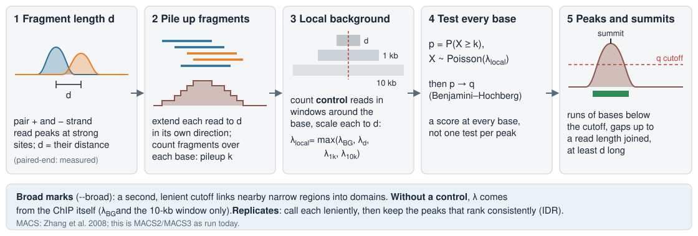{width="95%" fig-align="center"}

- **MACS step by step** for ChIP-seq with an input: fragment length, pileup, the local λ, Poisson p-values, q-values, peaks and summits.
- **What the input does**, and what happens without one. **Thresholds**: how many peaks are real?
- **Broad domains**: why narrow callers fail on H3K36me3, and how SICER/epic2 and `--broad` help.
- **Replicates**: the IDR model in detail, pseudoreplicates and ENCODE's peak sets.

::: notes
ATAC-seq processing and peak calling introduced MACS3 and the local λ for data without a control, and the idea of IDR. Here we do ChIP-seq with an input, where the control enters the statistics, and we go into the IDR model properly. Running examples: the CTCF ChIP-seq used since From reads to coverage, now with its second replicate, and the H3K36me3 ChIP-seq from ChIP-seq: the assay, now with two replicates. Everything is on chr21 and every number on the slides comes from commands in the exercise. The figure is the plan of the lecture: the five steps of MACS, then broad marks, no control and replicates in the box at the bottom.
:::

## Step 1: the fragment length {.smaller}

| sample | paired + / − strand peaks | predicted d | alternatives |
|---|---:|---:|---|
| CTCF replicate 1 (36 bp reads) | 359 | **100 bp** | 100 |
| CTCF replicate 2 | – | **109 bp** | – |
| H3K36me3 (51 bp reads) | 305 | 246 bp | 17 values from 24 to 595 bp |

- MACS finds strong regions, pairs a + strand pile with a − strand pile downstream, and takes their typical distance as **d**. Each read is then extended to d.
- For broad marks the estimate is **unstable**: set d yourself (`--nomodel --extsize 200`) or use paired-end reads (`-f BAMPE`).

::: notes
The model step of MACS (Zhang et al. 2008): it scans the genome for regions with high tag counts (by default 5 to 50 times enriched, the "model fold" in the log), keeps up to 1000 of them, finds the + and − strand tag peaks in each, and builds a histogram of the distance between them; d is its mode (MACS3 also reports the cross-correlation and "alternative" lengths). Numbers from macs3 predictd in the exercise. For CTCF the answer is stable and agrees with the strand cross-correlation from ChIP-seq: the assay (93 bp) and with ENCODE (90–95 bp). For H3K36me3 MACS still finds 305 paired peaks, but the distances are all over the place: there is no fragment-length peak in a broad mark. If the model fails completely, MACS stops with "too few paired peaks" and you have to give --nomodel --extsize. For paired-end data the fragments are measured, and none of this is needed. ENCODE's TF pipeline takes d from the strand cross-correlation (phantompeakqualtools) and passes it to MACS2.
:::

## Steps 2–3: pileup and the local λ {.smaller}

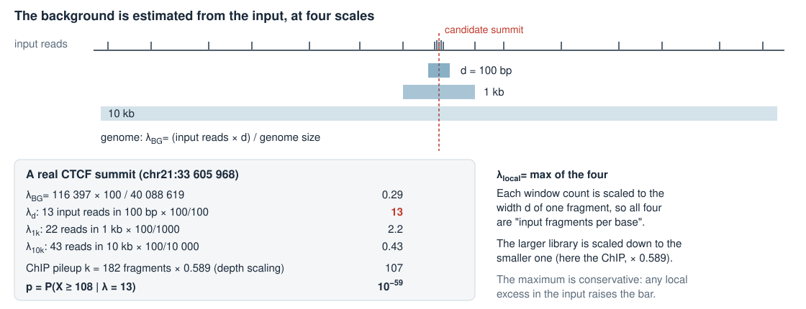{width="92%" fig-align="center"}

::: notes
The pileup k at a base is the number of extended ChIP fragments covering it. The expected number under background, λ, is estimated from the input in four ways: the genome-wide average λBG, and the input reads in windows of d (100 bp here), 1 kb (--slocal) and 10 kb (--llocal) around the base, each scaled to the width of one fragment. The original paper (Zhang et al. 2008) used 1, 5 and 10 kb; MACS2 and MACS3 use d, 1 kb and 10 kb. The maximum is taken. Depth: the libraries are first made comparable, by default by scaling the larger one down to the smaller one; here the ChIP has 197 587 reads and the input 116 397, so the ChIP pileup is multiplied by 0.589. This is the summit with the highest λ in our data: 13 input reads fall within 100 bp of it, a little pile of input at a strong CTCF site (input DNA is enriched at open CTCF sites, ChIP-seq: the assay). The test still gives p = 10^-59, because 182 ChIP fragments overlap that base. The exercise has you compute these numbers yourself from the input BAM, and they match MACS to the third decimal.
:::

## Real data: λ at 521 CTCF summits {.smaller}

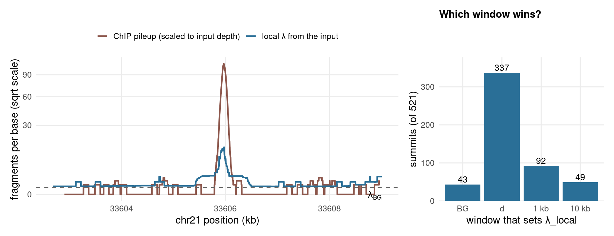{width="95%" fig-align="center"}

- Left: the summit of the slide before. The ChIP pileup (brown) and the local λ (blue), which rises under the peak because the input has reads there.
- Right: with a **shallow input** (3 reads per kb), the **100-bp window** sets λ at 337 of 521 summits; λBG (0.29) at only 43.

::: notes
From MACS3's own bedGraph output (--bdg: _treat_pileup.bdg and _control_lambda.bdg) and from recounting the input reads around each summit in R (exercise R1); the two agree (correlation 0.998). Away from peaks λ jumps between 0.29 (λBG), values set by the 1-kb window, and integers set by single input reads in the 100-bp window: with 116 000 input reads on 40 Mb, one input read in 100 bp is already 3.4 times λBG. That makes the background estimate noisy, and it is the reason the input should be sequenced at least as deeply as the ChIP. The λ also shows why a peak at a site where the input piles up gets a weaker p-value than the same peak in a clean region: this is the open-chromatin and copy-number correction in action.
:::

## The Poisson test, by hand {.smaller}

A candidate summit has pileup $k = 25$ (after depth scaling). From the input: $\lambda_\text{BG} = 0.3$, $\lambda_d = 2$, $\lambda_\text{1k} = 4.5$, $\lambda_\text{10k} = 1.2$.

$$\lambda_\text{local} = \max(0.3,\ 2,\ 4.5,\ 1.2) = 4.5 \qquad p = P(X \ge 25 \mid X \sim \text{Poisson}(4.5)) = 1 - \sum_{x=0}^{24} \frac{e^{-4.5}\,4.5^x}{x!}$$

| λ | 0.3 | 1.2 | 2 | 4.5 | 10 |
|---|---|---|---|---|---|
| $P(X \ge 25)$ | 4.1 × 10−39 | 1.9 × 10−24 | 3.2 × 10−19 | 1.9 × 10−11 | 4.7 × 10−5 |
| −log10 p | 38.4 | 23.7 | 18.5 | 10.7 | 4.3 |

- **Fold enrichment** = (k + 1) / (λ + 1) at the summit = 26 / 5.5 = 4.7 (MACS adds a pseudocount of 1).
- The same 25 fragments: overwhelming against the genome average, convincing against the local input, and nothing special inside a region where the input is 10.

::: notes
This is the calculation the exam asks for: choose λlocal as the maximum, then read the p-value from a table or compute it. Students do not need to compute a Poisson tail by hand beyond a few terms; they need to know which λ to use and how p changes with λ. The table values are exact upper tails (ppois in R). MACS reports −log10 p at the summit in column 8 of the narrowPeak file and the fold enrichment in column 7; for fold enrichment MACS uses (pileup + 1)/(λ + 1): at the real summit of the previous slides (107.2 + 1)/(13 + 1) = 7.73, exactly column 7. The last column of the table (λ = 10) is what happens in an amplified region or at a hyper-ChIPable promoter where the input is high: the same pileup is no longer significant. With real data, MACS also accounts for the depth scaling, so k is a fractional number; MACS rounds it up before the test.
:::

## From p-values to peaks {.smaller}

- MACS scores **every base** by −log10 p, and converts the scores to **q-values** (Benjamini–Hochberg on the p-scores of all bases, weighted by how many bases have each score).
- **Peak** = a run of bases with q below the cutoff (default 0.05; ENCODE and this course 0.01), joined across gaps up to a read length, at least d long. **Summit** = the base with the highest pileup.
- narrowPeak columns: summit fold enrichment (7), −log10 p (8), −log10 q (9), summit offset (10).

| q cutoff | 0.1 | 0.01 | 10−5 | 10−10 | 10−20 | 10−40 |
|---|---:|---:|---:|---:|---:|---:|
| CTCF peaks (chr21) | 573 | 521 | 413 | 319 | 246 | 144 |
| also in ENCODE's IDR set | 387 | 377 | 343 | 293 | 239 | 140 |

::: notes
The q-value is computed over positions, not over peaks, so "q < 0.01" does not mean that 1% of the peaks are false; it is a convenient ranking scale. The Poisson model also ignores extra-Poisson variation (overdispersion), so p-values of MACS are too small in absolute terms; peaks are best treated as a ranked list. That is why the number of peaks depends smoothly on the cutoff and why ENCODE chooses the final set with replicates (IDR) rather than with the q-value. Numbers from the exercise: our replicate 1 against its input; the ENCODE set is the conservative IDR set from two replicates of the full data (405 peaks on chr21).
:::

## Real data: how many peaks are real? {.smaller}

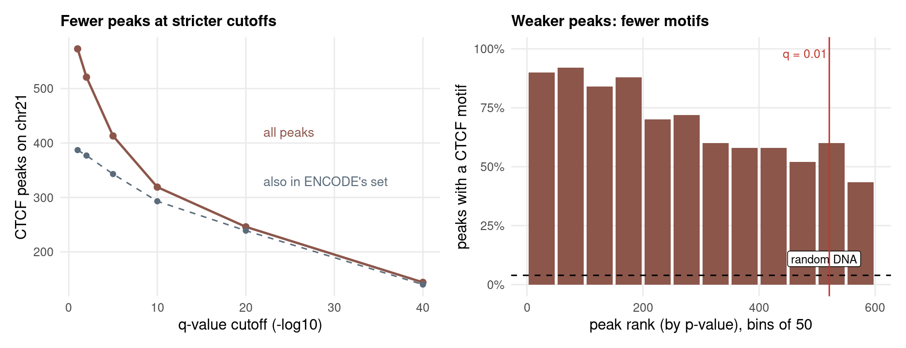{width="95%" fig-align="center"}

- Right: the fraction of peaks with a **CTCF motif** within 50 bp of the summit, by rank. Top 50 peaks: **90%**; ranks 500–573: **43–60%**; random DNA: **4%**.
- There is no clean break: weak peaks are a mixture of weak real sites and noise.

::: notes
Peaks from the most lenient call (q < 0.1, 573 peaks) ranked by p-value, in bins of 50; motif matches with the JASPAR 2024 CTCF matrix (MA0139.2, motifmatchr, p < 10^-4) in 101 bp around each summit. The motif is an independent check, not used by the peak caller. Even the weakest bins are 10–15 times above random DNA, so most weak peaks are still real CTCF sites, but a growing fraction is noise or indirect. The red line marks q < 0.01, our standard cutoff (521 peaks, 72% with the motif). Left: fewer peaks at stricter cutoffs, and almost all strict peaks are also in ENCODE's set. Motif enrichment is a good validation for a TF with a strong motif; for histone marks there is no such check, and replicates are the only internal validation.
:::

## What the input does: CTCF without a control {.smaller}

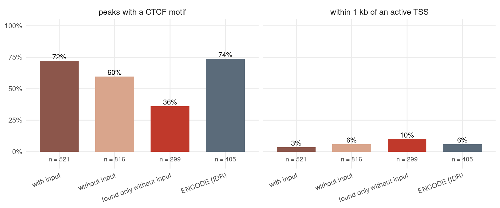{width="88%" fig-align="center"}

- Without input: **816** peaks instead of 521. The 299 extra peaks: **36%** with a CTCF motif, **9%** in ENCODE's set.
- No input means λ from the ChIP itself (λBG and its 10-kb window): no correction for open chromatin, copy number or input pile-ups.

::: notes
Exercise C4 and R3. Without a control, MACS3 uses the ChIP's own genome-wide λ and its 10-kb window (a 1-kb window of the ChIP would contain the peak). It finds more peaks: 403 of ENCODE's 405 (vs 377 with the input), but also 299 that the input-based call rejects, and only 36% of those carry a motif. Some extras are real weak CTCF sites that the conservative λd (a single input read in 100 bp) suppressed; many are not. For CTCF in a near-diploid cell line the damage is modest, because CTCF peaks are strong; for a weaker factor or a cancer cell line with amplifications, missing input produces many false peaks at open promoters and amplified regions. ATAC-seq and CUT&Tag routinely run without input (Experimental design and QC): for ATAC, there is no sensible control; for CUT&Tag, the background is very low.
:::

## Broad marks need a different caller {.smaller}

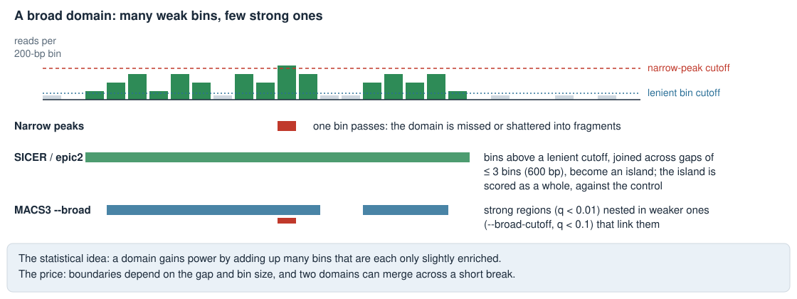{width="92%" fig-align="center"}

::: notes
A narrow-peak caller asks, base by base, "is this position much higher than background?" In a broad domain the answer is usually no: H3K36me3 spreads its reads over tens of kilobases, so each base is only slightly enriched. Broad callers pool evidence across windows. SICER (Zang et al. 2009) divides the genome into 200-bp windows, marks windows above a lenient threshold, joins them into "islands" if separated by at most a few windows (the gap), scores each island as a whole and compares it with the control; epic2 (Stovner and Sætrom 2019) is a fast reimplementation. MACS3 --broad does a two-level call: strong regions at the usual cutoff are linked by weaker regions above --broad-cutoff. Other approaches: hidden Markov models (e.g. hiddenDomains, or chromatin-state models in Chromatin states), and simply counting reads in fixed large windows or in gene bodies. ENCODE's histone pipeline calls MACS2 narrow peaks at a lenient threshold and keeps those that are replicated or pseudoreplicated, which works for the narrower marks better than for broad ones.
:::

## Real data: H3K36me3 with three callers {.smaller}

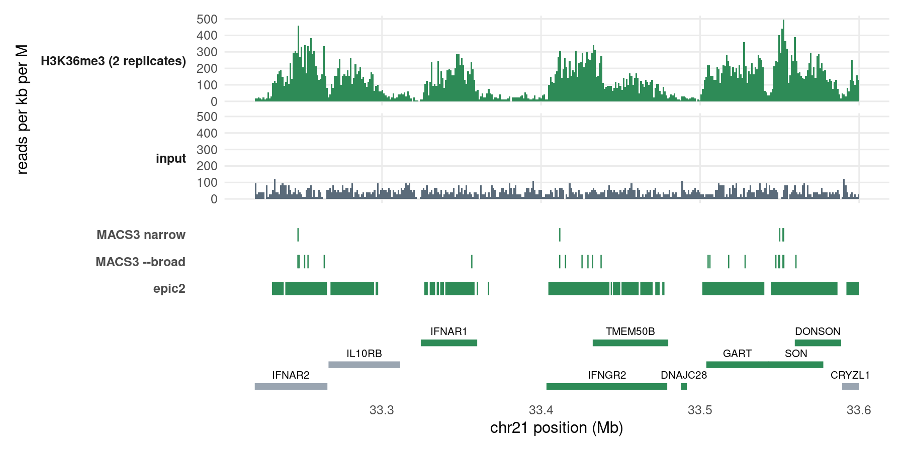{width="92%" fig-align="center"}

- Same reads (2 replicates, 170 000 reads on chr21), same input. **MACS3 narrow**: 11 peaks on all of chr21 (2.8 kb). **MACS3 --broad**: 123 regions (48 kb). **epic2**: **671 domains, 3.8 Mb**, up to 84 kb long.

::: notes
Exercise C5. The domains are obvious by eye in 1-kb bins, but no single base passes a strict test: this library is sparse (about 2 reads per kb on average) and the enrichment over input is about 2.4-fold. The narrow call finds 11 peaks on the whole chromosome; --broad finds slightly more, as fragments of domains; epic2 joins 200-bp windows across gaps of up to 600 bp and finds the domains over IFNAR1, IFNGR2/TMEM50B and GART/SON/DONSON. All runs used --nomodel --extsize 200 (MACS) or --fragment-size 200 (epic2), because the fragment length cannot be estimated for this mark. With deeper data (ENCODE recommends 45 M reads for broad marks), MACS --broad does much better; with sparse data, pooling windows is what makes calling possible.
:::

## Real data: do the domains cover the right genes? {.smaller}

:::: {.columns}
::: {.column width="58%"}
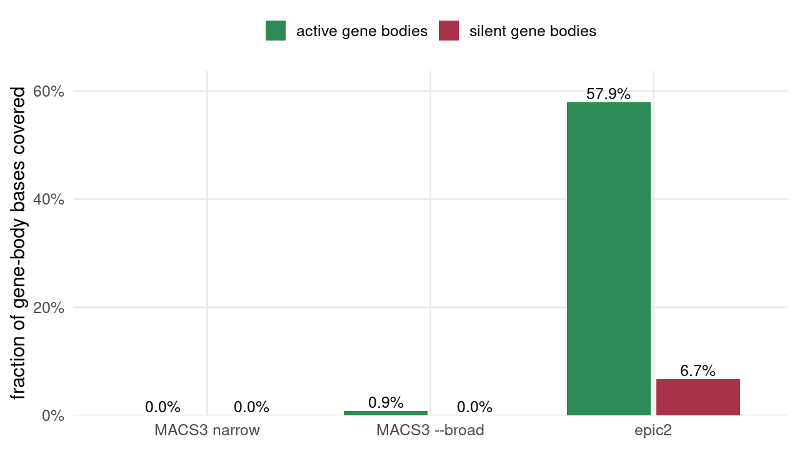{width="100%"}
:::
::: {.column width="42%"}
- epic2 domains cover **58%** of the bases of active gene bodies, but only **6.7%** of silent ones.
- 59% of all epic2 domain bases lie in active gene bodies (genes > 5 kb).
- A biological check without a gold standard: H3K36me3 should follow transcription.
:::
::::

::: notes
Active and silent genes as in ChIP-seq: the assay (H3K4me3 fold change at the TSS above 5 or below 1; 69 and 49 protein-coding genes longer than 5 kb). MACS narrow and --broad cover less than 1% of active gene bodies. The 6.7% of silent gene bodies covered by epic2 is a mixture of false positives, genes that are transcribed without a strong H3K4me3 peak, and domains extending from neighbouring active genes. For broad marks there is no motif to check, so biology (transcribed genes for H3K36me3, Polycomb targets for H3K27me3) and replicates are the validation. Note the trade-off: bigger gaps and lower window thresholds give longer domains, which merge neighbouring genes; the parameters should be chosen with the biology in mind and reported.
:::

## Reproducibility: the IDR model {.smaller}

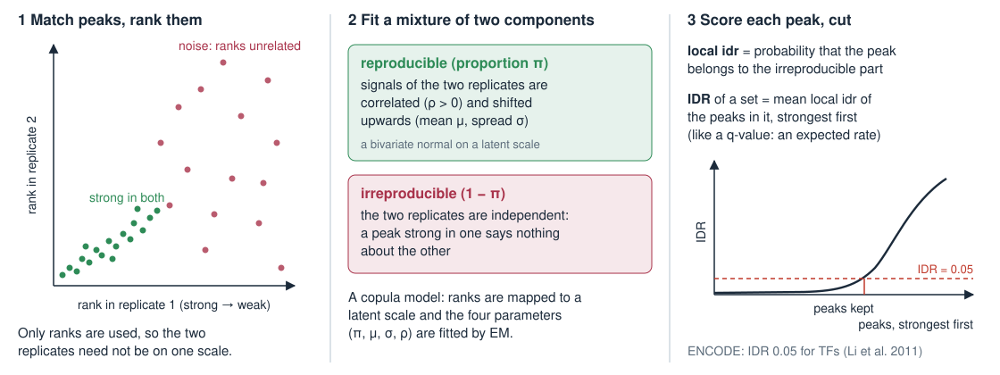{width="95%" fig-align="center"}

::: notes
ATAC-seq processing and peak calling introduced IDR with a simple rank-consistency curve; here is the model itself (Li, Brown, Huang and Bickel 2011). Input: the two replicates' lenient peak lists, matched by overlap, each peak with a score (MACS p-value). Only the ranks are used, so differences in depth or signal-to-noise between replicates do not matter. The ranks are mapped to a latent scale (a copula), where the model is a mixture of two components: reproducible peaks, whose latent scores are correlated between replicates (ρ) and shifted upwards (μ, σ), with proportion π; and irreproducible peaks, independent between replicates. The parameters are fitted by EM. Each peak gets a local idr, the posterior probability that it belongs to the irreproducible component; the IDR of a set of peaks is the average local idr of the peaks in it, taken from the most reproducible down, so it is an expected fraction of irreproducible peaks, analogous to a q-value. The input must contain noise: run it on lenient calls (p < 0.01, up to 300 000 peaks genome-wide in ENCODE), never on peaks already thresholded at q < 0.01.
:::

## Real data: IDR on two CTCF replicates {.smaller}

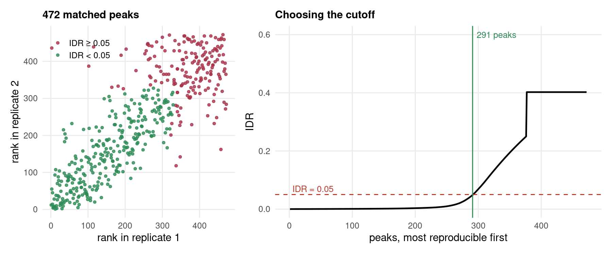{width="92%" fig-align="center"}

- 763 and 570 lenient peaks; **472** matched; **291** pass IDR < 0.05. Fitted: μ = 1.95, σ = 0.56, ρ = 0.79, π = 0.60.
- 281 of our 291 IDR peaks are in ENCODE's conservative set (405 on chr21, from deeper data).

::: notes
Exercise C6 and R4: idr 2.0 with --rank p.value, the pooled peaks as the peak list (as in ENCODE) and --use-best-multisummit-IDR. Left: ranks of the matched peaks in the two replicates; green = IDR < 0.05. The strong peaks agree; from rank ~300 down, the ranks become unrelated. Replicate 2 is the weaker library (120 076 reads after filtering, with 61% of its reads flagged as duplicates), so it limits how far down the list we can go. Right: the IDR curve stays near zero for the first ~250 peaks and then rises steeply; the cutoff at 0.05 falls at 291. ENCODE's conservative set has more peaks because it was called on the whole genome with the full reads. 283 of ENCODE's 405 chr21 peaks are recovered; most of the rest are weaker peaks that our shallow replicate 2 cannot support.
:::

## ENCODE's reproducibility workflow {.smaller}

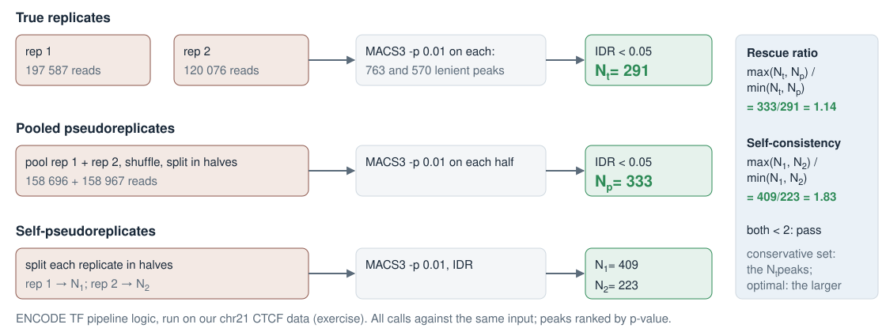{width="95%" fig-align="center"}

::: notes
Pseudoreplicates are random halves of the reads: they differ only by sampling, so IDR between them tells you how many peaks the data could support if the replicates were perfect copies. Np (pooled pseudoreplicates) close to Nt (true replicates) means the true replicates are as consistent as random halves: rescue ratio 1.14 here. N1 and N2 (self-pseudoreplicates of each replicate) measure each replicate's own strength; their ratio of 1.83 shows that replicate 2 supports far fewer peaks than replicate 1, close to ENCODE's limit of 2. ENCODE flags an experiment if either ratio exceeds 2. The released sets: "conservative" = the Nt peaks from true replicates; "optimal" = the larger of the Nt and Np sets (here the Np set). Experimental design and QC introduced the ratios; here they are computed on real data. With only one replicate, pseudoreplicates can still give a reproducibility-filtered set, but they say nothing about biological variation.
:::

## Choices and pitfalls {.smaller}

| choice | what goes wrong | do instead |
|---|---|---|
| no input, or another cell type's input | peaks at open promoters, amplified regions, input pile-ups | input from the same chromatin, sequenced at least as deep |
| shallow input | noisy λ; single input reads decide | deeper input; MACS falls back to λBG and larger windows |
| narrow caller on a broad mark | few, fragmented peaks; domains missed | `--broad`, SICER/epic2, window counts; deeper sequencing |
| fragment model on a broad mark | arbitrary d | `--nomodel --extsize`, or paired-end reads |
| IDR on thresholded peaks | no noise component; the model fails | lenient calls (p < 0.01) as input |
| wrong `-g` | λBG off by orders of magnitude | effective size of the genome you aligned to |
| `--keep-dup` and duplicates | strong peaks flattened or PCR stacks called | remove duplicates once, then `--keep-dup all` (or MACS's default 1 if not removed) |
| one cutoff for all samples | sample depth decides the peak number | compare samples in a common peak set (*Annotation and differential binding*) |

::: notes
Each row is something seen in published analyses. The -g point is the same as in the ATAC unit: here 40 088 619, the non-N length of chr21. MACS's default --keep-dup 1 keeps one read per position and strand, which is a crude duplicate filter; since we removed duplicates with samtools markdup (which keeps one copy too), the results are the same here (MACS reported 0% redundant reads). The last row leads to the next unit: comparing peak numbers between conditions is not a differential analysis; counting reads in a common set of regions is.
:::

## Other callers and pipelines {.smaller}

| tool | idea | typical use |
|---|---|---|
| MACS3 | local Poisson λ from input; narrow and `--broad` | TFs, narrow marks; ATAC; the default |
| SPP | strand cross-correlation, windowed tag differences | ENCODE TF pipeline (older versions) |
| SICER / epic2 | windows joined into islands | broad histone marks |
| HOMER `findPeaks` | fixed-width peaks, local and input filters | TFs and marks, with motif tools |
| GEM, ChIP-exo callers | read-distribution model, motif-aware | high-resolution TF sites |
| SEACR | threshold on the background of near-empty data | CUT&RUN / CUT&Tag |
| ENCODE pipeline, nf-core/chipseq | alignment → filtering → MACS → IDR or replicated peaks → QC | production |

::: notes
Benchmark papers (e.g. Thomas et al. 2016; Wilbanks and Facciotti 2010) find that callers agree on the strong peaks and differ on the weak ones, and that the choice of thresholds and controls matters more than the choice of tool. nf-core/chipseq runs MACS2 with narrow or broad mode per antibody and a consensus across replicates; the ENCODE TF pipeline runs SPP or MACS2 with IDR and the histone pipeline MACS2 with replicated/pseudoreplicated peaks. SEACR is in CUT&RUN and CUT&Tag.
:::

## Summary {.smaller}

| step | key fact |
|---|---|
| fragment length | MACS pairs + and − strand peaks; d ≈ 100 bp for our CTCF; unstable for broad marks: set it |
| pileup | extended fragments over each base; the larger library is scaled to the smaller |
| local λ | $\max(\lambda_\text{BG}, \lambda_d, \lambda_\text{1k}, \lambda_\text{10k})$ from the input, each scaled to d |
| test | $p = P(X \ge k)$, Poisson(λlocal); q-values by BH over bases; peaks = runs below the cutoff |
| thresholds | no natural cutoff; motif fraction falls with rank; use replicates to decide |
| input | removes open-chromatin, copy-number and pile-up artefacts; without it: more, less specific peaks |
| broad marks | pool windows (SICER/epic2, `--broad`); validate with biology |
| IDR | ranks only; mixture of reproducible and independent components; lenient input; IDR < 0.05 |
| ENCODE sets | Nt, Np, N1, N2; rescue and self-consistency ratios < 2 |

::: notes
Students should be able to choose λlocal and compute a Poisson tail from a table, explain depth scaling, say what the input does and what happens without it, explain why narrow callers fail on broad marks and what a broad caller does instead, describe the IDR model in words and compute the ENCODE ratios. Next: Annotation and differential binding, where peaks are annotated and compared between cell types.
:::

## Key papers (optional further reading) {.smaller}

*Not required reading and not examined. For those who want the primary literature.*

- Zhang et al. 2008, *Genome Biol*. [Model-based Analysis of ChIP-Seq (MACS)](https://doi.org/10.1186/gb-2008-9-9-r137). The fragment model and the local λ.
- Zang et al. 2009, *Bioinformatics*. [A clustering approach for identification of enriched domains from histone modification ChIP-Seq data](https://doi.org/10.1093/bioinformatics/btp340). SICER: windows joined into islands.
- Stovner & Sætrom 2019, *Bioinformatics*. [epic2 efficiently finds diffuse domains in ChIP-seq data](https://doi.org/10.1093/bioinformatics/btz232). The broad caller used here.
- Li, Brown, Huang & Bickel 2011, *Ann Appl Stat*. [Measuring reproducibility of high-throughput experiments](https://doi.org/10.1214/11-AOAS466). IDR.
- Landt et al. 2012, *Genome Res*. [ChIP-seq guidelines and practices of the ENCODE and modENCODE consortia](https://doi.org/10.1101/gr.136184.111). IDR, pseudoreplicates and the ratios in practice.
- Thomas, Thomas, Holloway & Pollard 2016, *Brief Bioinform*. [Features that define the best ChIP-seq peak calling algorithms](https://doi.org/10.1093/bib/bbw035). A benchmark of callers.
