## About this lecture

Every cell in your body carries (almost) the same genome, yet a neuron and a B cell use very different genes. This lecture is about the layer of information **on top of** the DNA sequence that helps decide which genes a cell uses, and remembers that decision.

- What "epigenetic" means, and why the word is used in two different ways.
- **Chromatin**: how 2 m of DNA is packed into a nucleus, and why packing controls access.
- **Histone modifications**: the marks you will map with ChIP-seq and CUT&Tag.
- **DNA methylation**: the mark you will map with bisulfite and long-read sequencing.
- How a state can be **remembered** through cell division.
- A map of the assays in this course, and what each one measures.

::: notes
This is the first unit of the course and sets up the vocabulary for everything else. Students know transcription and transcription factors from their bachelor's; most have heard "histone" and "DNA methylation" but few can say what H3K27me3 means or why it should be heritable. The aim today is a working mental model, not a catalogue: by the end they should be able to look at a genome-browser view of a few histone marks and say "this is an active promoter, this is a repressed gene". Every later unit builds on this.
:::

## One genome, many cell types {.smaller}

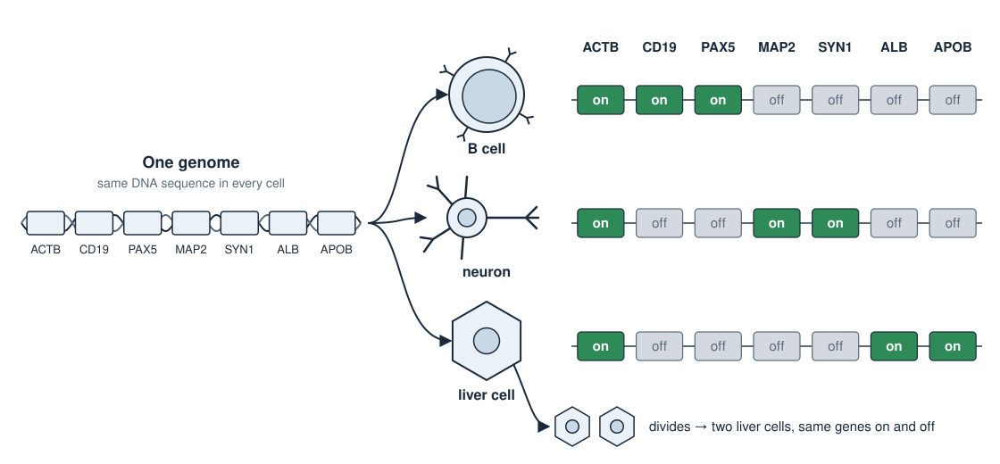{width="90%" fig-align="center"}

- A B cell, a neuron and a liver cell share the same DNA sequence, but express different sets of genes.
- The identity is **stable**: a liver cell divides into liver cells, not neurons, long after the signal that made it a liver cell is gone.
- So something besides the sequence is (1) different between cell types and (2) copied when a cell divides.

::: notes
Start from the puzzle that created the field. Cell identity is both different and stable. Transcription factors explain "different": a liver cell has liver TFs. But TF levels fluctuate and the initial signals during development are transient, so something must also remember. The two candidates we study in this course are chromatin (histones and their modifications) and DNA methylation. Exceptions to "same genome" exist (B and T cells rearrange their receptor genes, somatic mutations), but they do not explain cell identity.
:::

## What does "epigenetic" mean? {.smaller}

:::: {.columns}
::: {.column width="45%"}
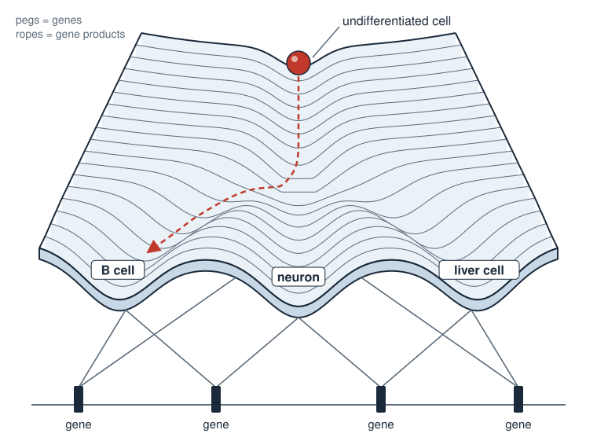{width="100%"}
:::
::: {.column width="55%"}
- **Waddington (1940s–50s):** the "epigenetic landscape". A cell rolls downhill into one of several valleys (fates); the genes shape the landscape.
- **Narrow definition (Riggs et al. 1996):** *mitotically and/or meiotically heritable changes in gene function that cannot be explained by changes in DNA sequence.*
- **Broad definition (Bird 2007):** the structural adaptation of chromosomal regions so as to register, signal or perpetuate altered activity states.
:::
::::

- In practice "**epigenomics**" means measuring chromatin and DNA methylation genome-wide, whether or not the state is heritable.

::: notes
Two meanings coexist and cause confusion in papers. The narrow, classical one demands heritability: a state that is copied through cell division (mitotic) or even to offspring (meiotic) without a change in sequence. The broad one, which most genomics papers use, calls any chromatin feature "epigenetic", including states that are rebuilt every time by transcription factors. When a paper says "epigenetic regulation", ask which one they mean: is there evidence the state is self-perpetuating, or is it just a chromatin mark that correlates with expression? We come back to this in the unit on epigenetic inheritance. Waddington's landscape is a metaphor, not a mechanism, but it captures the two properties from the previous slide: valleys are different (identity) and walls are high (stability).
:::

## Two meters of DNA in a nucleus {.smaller}

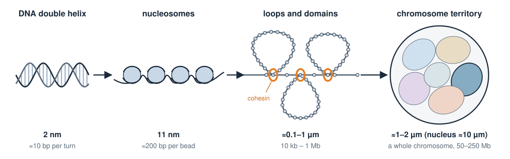{width="95%" fig-align="center"}

- A human diploid genome is $6.4 \times 10^9$ bp, about **2 m** of DNA, packed into a nucleus about **10 µm** across.
- Packing is hierarchical: DNA → **nucleosomes** ("beads on a string", 11 nm) → loops and domains → **chromosome territories**.
- Packing is not just storage: the more compact a region, the harder it is for proteins to reach the DNA.

::: notes
Numbers to make it concrete: 0.34 nm per base pair, times 6.4 billion is about 2.2 m. If the nucleus were a football (22 cm), the DNA would be a thread about 40 km long. Each level of the figure is the subject of one part of the course: nucleosomes and their marks (ChIP-seq, ATAC-seq), loops, TADs and compartments (Hi-C). The 30 nm fibre found in textbooks is largely absent in living cells; we skip it. The key message is the last bullet: compaction is a regulatory layer, because a transcription factor or polymerase needs access to its sequence.
:::

## The nucleosome {.smaller}

:::: {.columns}
::: {.column width="55%"}
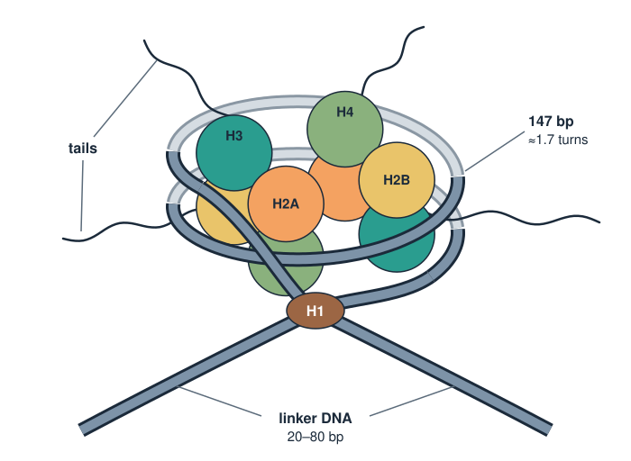{width="100%"}
:::
::: {.column width="45%"}
- **147 bp** of DNA wrapped about 1.7 turns around a **histone octamer**: two copies each of H2A, H2B, H3 and H4.
- Nucleosomes are separated by **linker DNA** (about 20–80 bp). The linker histone **H1** sits where DNA enters and leaves.
- Each histone has a flexible **tail** that sticks out of the particle. The tails carry most of the modifications.
:::
::::

::: notes
The nucleosome core particle was solved at atomic resolution in 1997 (Luger et al.), one of the key papers. The drawing is simplified to two layers of four histones; in the real structure H3–H4 form a tetramer in the middle, flanked by two H2A–H2B dimers. DNA contacts the octamer every 10 bp or so, where the minor groove faces the histones; this is why some sequences wrap more easily than others. The tails are unstructured and accessible to enzymes, which is why they are the main target of the modifications on the next slides. H1 is not part of the core; it stabilises the more compact forms.
:::

## Nucleosomes come in a regular repeat {.smaller}

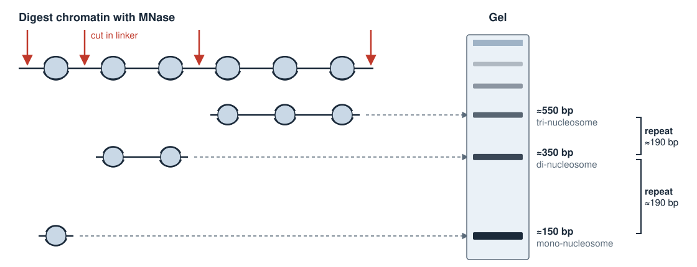{width="85%" fig-align="center"}

- Digest chromatin with an enzyme that cuts only **linker DNA** (micrococcal nuclease, MNase) and you get a **ladder**: about 150, 350, 550 bp …: one, two, three nucleosomes.
- The step of the ladder is the **nucleosome repeat length**, about 190–200 bp in human cells (147 bp core + linker).
- You will see the same ladder in the fragment lengths of every ATAC-seq library.

::: notes
This is the 1970s experiment that showed chromatin is a repeating unit (Kornberg 1974 proposed the model). The enzyme can only reach linker DNA, so cuts fall between nucleosomes. Fragment sizes are therefore multiples of the repeat length, plus the core. The same logic underlies ATAC-seq: the Tn5 transposase also prefers linker and nucleosome-free DNA, so the fragment-length histogram of an ATAC library has a big nucleosome-free peak under 100 bp, then a mono-nucleosome peak near 200 bp, then di-nucleosomes near 400 bp. Students will compute this in the ATAC units. MNase-seq maps nucleosome positions genome-wide this way.
:::

## Nucleosomes block access; regulatory DNA is open {.smaller}

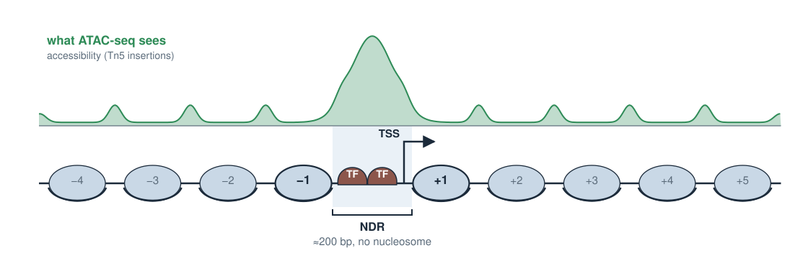{width="90%" fig-align="center"}

- Most of the genome is wrapped in nucleosomes. Active **promoters** and **enhancers** have a **nucleosome-depleted region** (NDR) of a few hundred bp.
- Transcription factors bind in the NDR; well-positioned nucleosomes flank it (the **+1 nucleosome** sits just downstream of the transcription start site, TSS).
- "Open" (accessible) chromatin is what ATAC-seq and DNase-seq measure: about 1–3% of the genome in a given cell type.

::: notes
The NDR is the defining feature of active regulatory DNA. Most transcription factors cannot bind a motif wrapped on a nucleosome; a few "pioneer" factors can (gene-regulation unit), and they open the region for the rest. Chromatin remodelers then slide or evict nucleosomes. The +1 nucleosome is strongly positioned downstream of the TSS; the -1 nucleosome upstream. This figure is the picture students should have in mind when they look at an ATAC-seq peak: a peak is an NDR. The 1–3% number varies with cell type and peak caller, so treat it as an order of magnitude.
:::

## Histone tails carry chemical modifications {.smaller}

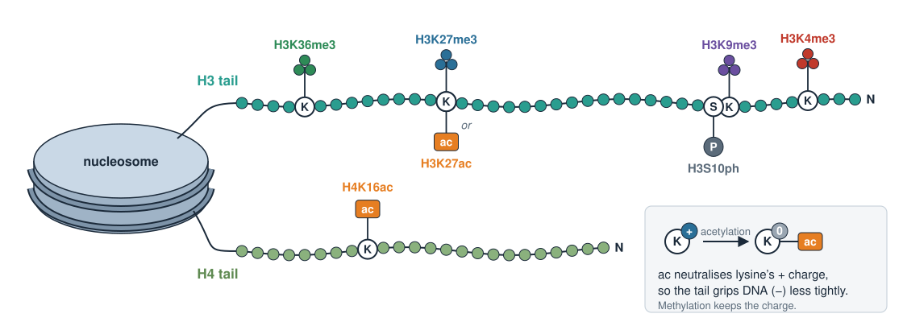{width="90%" fig-align="center"}

- Enzymes add small groups to amino acids in the tails: **acetylation** (ac) and **methylation** (me1, me2, me3) of lysines (K), **phosphorylation** of serines, and more.
- Over 100 different modifications are known. A handful of them are well understood and mapped routinely; those are the ones in this course.
- Modifications act in two ways: they change how tightly the histone holds DNA, and they recruit proteins that recognise them.

::: notes
Point at H3 and H4 tails, which carry the best-studied marks. Lysine acetylation removes the positive charge of the lysine side chain; DNA is negative, so the tail binds DNA less tightly and the chromatin loosens. Methylation does not change the charge: its effect comes almost entirely from proteins that bind methylated lysines. Ubiquitylation of H2A (H2AK119ub, by Polycomb PRC1) and H2B are on the C-terminal tails and are much larger additions. The "histone code" hypothesis (Strahl & Allis 2000) proposed that combinations of marks are read like a code; the modern view is less strict, but combinations do define chromatin states (chromatin-states unit).
:::

## Reading the name of a histone mark {.smaller}

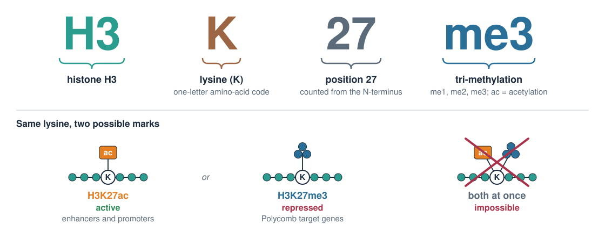{width="80%" fig-align="center"}

- **H3K27me3** = histone **H3**, lysine (**K**) at position **27**, **tri-methylated**.
- **H3K27ac** is the same lysine, **acetylated**. One lysine can carry either mark but not both: the two are mutually exclusive, and they mean opposite things.
- Positions count from the N-terminus of the mature histone.

::: notes
A small slide but students need to be able to decode the names fluently, and it is a typical exam question. K is the one-letter code for lysine, S serine, R arginine, T threonine. me1/me2/me3 are mono-, di- and tri-methylation; a lysine can carry up to three methyl groups. H3K27 is a nice example because the same residue is either acetylated (active enhancers and promoters) or tri-methylated (Polycomb repression). Histone variants get their own names: H3.3, H2A.Z, CENP-A (later slide).
:::

## Writers, readers and erasers {.smaller}

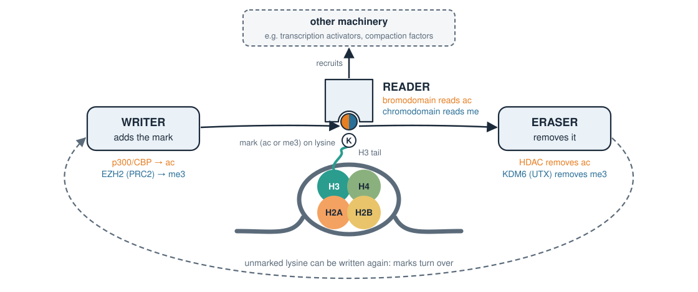{width="90%" fig-align="center"}

- **Writers** add a mark: histone acetyltransferases (HATs, e.g. p300/CBP), lysine methyltransferases (e.g. EZH2, SETD2).
- **Erasers** remove it: histone deacetylases (HDACs), lysine demethylases (e.g. KDM6/UTX).
- **Readers** bind it and bring in other machinery: **bromodomains** read acetyl-lysine, **chromodomains** and PHD fingers read methyl-lysine.
- Marks are **dynamic**: they are turned over by writers and erasers, some within minutes.

::: notes
The writer/reader/eraser framing is the single most useful way to think about any chromatin mark. For each mark you meet in the course, ask: who writes it, who reads it, who erases it. Examples: p300/CBP write H3K27ac at enhancers; BRD4 reads it with its bromodomains and recruits the transcription machinery; HDACs erase it. EZH2 (in the PRC2 complex) writes H3K27me3; KDM6A/UTX and KDM6B/JMJD3 erase it. Many of these enzymes are drug targets (HDAC inhibitors, EZH2 inhibitors, BET inhibitors that block BRD4): see the cancer-epigenetics unit.
:::

## The marks you will meet in this course {.smaller}

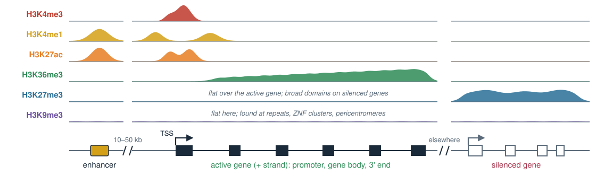{width="95%" fig-align="center"}

| mark | where | meaning |
|---|---|---|
| H3K4me3 | promoters (around the TSS) | active or poised promoter |
| H3K4me1 | enhancers (and flanks of promoters) | enhancer, active or primed |
| H3K27ac | active promoters and enhancers | **active** regulatory element |
| H3K36me3 | bodies of transcribed genes | transcription has passed here |
| H3K27me3 | broad domains over silenced genes | Polycomb repression (facultative) |
| H3K9me3 | repeats, ZNF gene clusters, pericentromeres | constitutive heterochromatin |

::: notes
This table is the most important reference of the course; students should know it by heart. Read it with the figure: a gene model with promoter, an upstream enhancer, the gene body, and where each mark sits. Two pairs are worth stressing. H3K4me1 without H3K27ac marks a primed enhancer, with H3K27ac an active one (Creyghton et al. 2010; Rada-Iglesias et al. 2011). H3K4me3 is at the promoter (narrow, a few kb), H3K36me3 over the gene body (broad, as long as the gene), because SETD2 travels with elongating RNA polymerase II. The two repressive marks are different systems: H3K27me3 (Polycomb) silences developmental genes that may be needed in another cell type; H3K9me3 silences repeats and transposons, mostly permanently.
:::

## Real data: an active gene in B cells {.smaller}

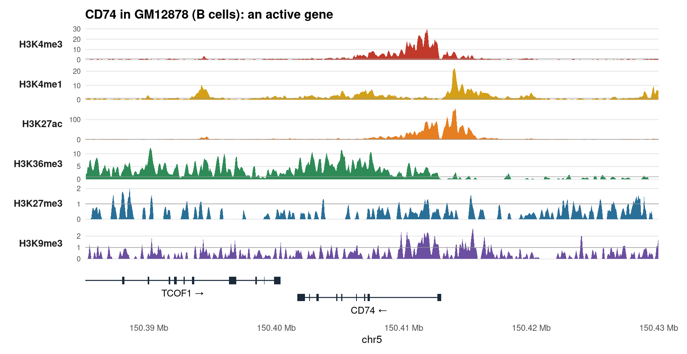{width="95%" fig-align="center"}

- ENCODE ChIP-seq in **GM12878**, a B-lymphoblastoid cell line (the course's main dataset). Each track: enrichment over input (fold change).
- H3K4me3 and H3K27ac peak at the **promoter**; H3K36me3 covers the **gene body**; H3K27me3 and H3K9me3 are absent.

::: notes
First look at real data, in a genome-browser layout like IGV. Explain how to read a track: x is position along the chromosome, y is how many more reads than in the input control, so a value of 1 means "no enrichment". The gene model at the bottom shows exons as boxes and the arrow gives the direction of transcription. Point out that the H3K36me3 signal increases towards the 3' end, as expected for a mark deposited during elongation. The H3K4me1 signal flanks the H3K4me3 peak. The figure is made by make-chromatin-figs.R from ENCODE files listed in data/manifest.tsv; students make the same plots in the exercise.
:::

## Real data: two kinds of silence {.smaller}

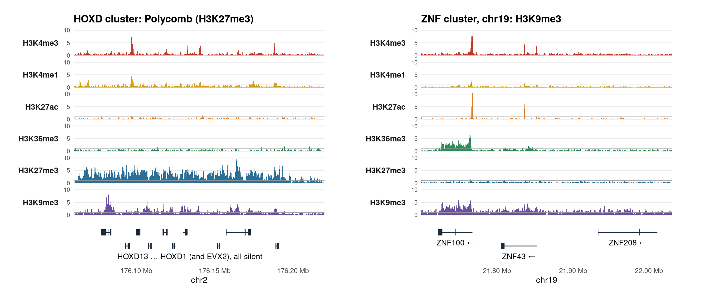{width="95%" fig-align="center"}

- **Left: the HOXD cluster.** Developmental genes, silent in B cells, covered by a broad **H3K27me3** domain (Polycomb).
- **Right: a zinc-finger (ZNF) gene cluster on chr19**, marked by **H3K9me3** (with H3K36me3 over the gene bodies that are still transcribed).
- Repressive marks form **broad domains** (tens to hundreds of kb), not sharp peaks: this matters for peak calling later.

::: notes
The HOX genes pattern the body axis during development; in a B cell they are off, but they are kept in a repressed state that could in principle be reversed (facultative heterochromatin). H3K27me3 covers the whole cluster, more than 100 kb. The ZNF cluster is the classical place for H3K9me3 in euchromatin; the ZNF genes themselves are transcribed but their 3' ends carry H3K9me3 together with H3K36me3, an unusual combination. Broad domains matter technically: a peak caller made for sharp TF peaks (MACS default) will cut a broad domain into many fragments, which is why the ChIP units teach broad-domain calling.
:::

## Euchromatin and heterochromatin {.smaller}

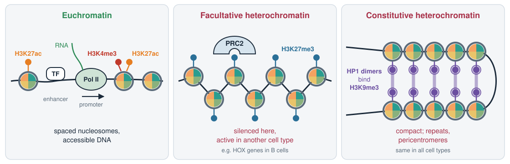{width="90%" fig-align="center"}

- **Euchromatin:** open, gene-rich, early-replicating, where most active genes are.
- **Constitutive heterochromatin:** compact, H3K9me3, read by **HP1**; repeats, pericentromeres, telomeres. The same in all cell types.
- **Facultative heterochromatin:** H3K27me3 (Polycomb); developmental genes silenced in *this* cell type but active in another.

::: notes
The terms date from the 1920s (Heitz), when heterochromatin was the part of the chromosome that stayed condensed and darkly stained through interphase. In modern terms it is defined by the marks. HP1 (heterochromatin protein 1) binds H3K9me3 through its chromodomain, dimerises and bridges nucleosomes, compacting the region. In the Hi-C units, heterochromatin is the B compartment, euchromatin the A compartment. In imaging, heterochromatin sits at the nuclear periphery (lamina-associated domains) and around the nucleolus.
:::

## Read–write feedback: how a mark can spread and persist {.smaller}

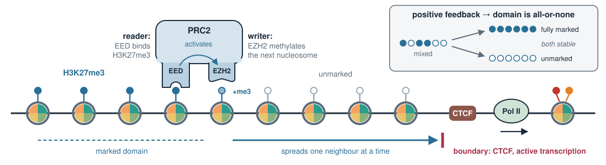{width="90%" fig-align="center"}

- Some writers carry a **reader** for their own product. PRC2 (writer of H3K27me3) is activated when its EED subunit binds H3K27me3; SUV39H1 (writer of H3K9me3) has a chromodomain that binds H3K9me3.
- A mark therefore recruits more of itself to **neighbouring** nucleosomes: domains **spread** until something stops them.
- The same loop can **restore** a mark after it is diluted, which is the key to memory.

::: notes
This is the mechanism behind both broad domains (previous slides) and inheritance (next slide). Positive feedback makes a state bistable: a region tends to be either fully marked or not marked, and it stays that way. For Polycomb, PRC2 binding to H3K27me3 through EED allosterically stimulates the methyltransferase activity of EZH2 (Margueron et al. 2009). Spreading is limited by boundaries such as active transcription, CTCF sites and the turnover by erasers. Mathematical models of this bistability (Dodd et al. 2007) are a good further read for students with a modelling interest.
:::

## Through DNA replication: diluted, then restored {.smaller}

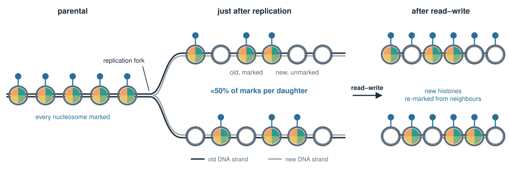{width="95%" fig-align="center"}

- At replication, old histones (with their marks) are split **randomly between the two daughter strands**; new, unmarked histones fill the gaps.
- Each daughter gets about **half** the marked nucleosomes. Read–write feedback then re-marks the new neighbours.
- Whether histone marks are truly self-sustaining through many divisions is still debated; for H3K27me3 the evidence is strongest.

::: notes
This is why histone-based memory is harder than DNA methylation: the information is halved at every replication and must be restored from a 50% template. In flies and in mammalian cells, removing the Polycomb recruitment sequence leads to loss of H3K27me3 over a few divisions, which suggests the domain needs both DNA-sequence recruitment and the read-write loop (Laprell et al. 2017; Coleman & Struhl 2017). The plant FLC example later is one of the clearest cases of mitotic memory of a Polycomb state. Be honest with students: this is an active research field, not settled textbook material.
:::

## DNA methylation: a mark on the DNA itself {.smaller}

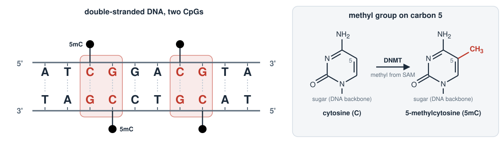{width="85%" fig-align="center"}

- In mammals, a methyl group is added to carbon 5 of **cytosine**, almost only in **CpG** dinucleotides: **5-methylcytosine (5mC)**.
- CpG is **palindromic**: both strands carry a CpG, and both are usually methylated together.
- About **70–80%** of CpGs in a human somatic cell are methylated. The exceptions are mostly in CpG islands at promoters.
- Plants also methylate CHG and CHH (H = A, C or T).

::: notes
The methyl group sits in the major groove and does not change base pairing: 5mC still pairs with G, which is why it survives replication as information but is invisible to normal sequencing. Bisulfite sequencing (methylation units) converts unmethylated C to U but leaves 5mC, turning the mark into a sequence difference. Long-read technologies (nanopore, PacBio) detect 5mC directly from the signal. 5mC can be oxidised by TET enzymes to 5hmC, 5fC and 5caC, which are intermediates in active demethylation; bisulfite cannot distinguish 5mC from 5hmC. In plants the non-CG contexts are maintained by different enzymes (CMT3, DRM2 via RNA-directed DNA methylation), covered in methylation-biology.
:::

## Copying DNA methylation through replication {.smaller}

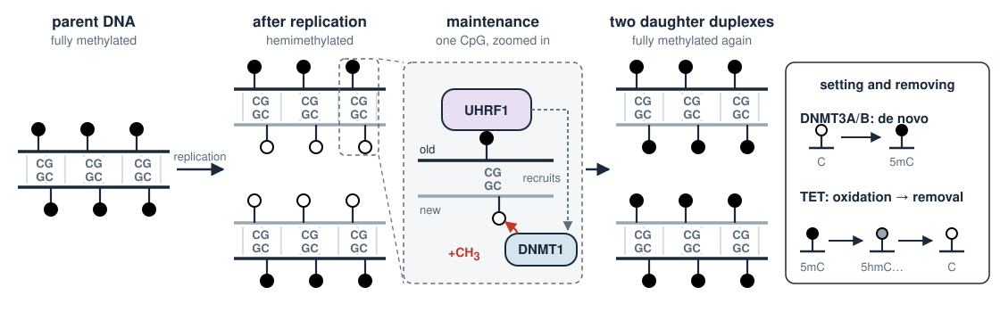{width="95%" fig-align="center"}

- After replication the new strand is unmethylated: each CpG is **hemimethylated**.
- **UHRF1** recognises hemimethylated CpGs and recruits **DNMT1**, which methylates the new strand: the pattern is copied.
- **DNMT3A/3B** methylate *de novo* (new sites, e.g. during development); **TET** enzymes start active removal.
- Because the template is copied site by site, DNA methylation is the clearest example of a **mitotically heritable** epigenetic mark.

::: notes
This is the textbook mechanism for epigenetic memory, proposed in 1975 (Holliday & Pugh; Riggs), and it fits the narrow definition perfectly: the information is in the pattern, and a dedicated enzyme copies it to the daughter strand. Copying is not perfect (about 1 error in 20–1000 CpGs per division depending on context), which is one origin of the drift that epigenetic clocks measure. Passive demethylation happens if DNMT1 is absent or blocked during replication; this is how the primordial germ cells and the early embryo erase most methylation. The de novo enzymes DNMT3A and DNMT3B (Okano et al. 1999) set the patterns in the first place.
:::

## CpG islands {.smaller}

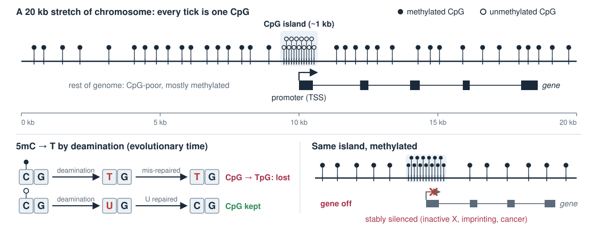{width="95%" fig-align="center"}

- The human genome has only about **a quarter** of the CpGs expected from its base composition. Methylated C mutates easily to T (spontaneous deamination), so CpGs are slowly lost.
- **CpG islands** (CGIs) are about 1 kb stretches that keep a high CpG density because they are **unmethylated**. About 60–70% of human gene promoters have one.
- CGI promoters are usually unmethylated even when the gene is off; methylation of a CGI promoter means **stable silencing** (inactive X, imprinted genes, some genes in cancer).

::: notes
Deamination of C gives U, which repair recognises as foreign; deamination of 5mC gives T, a normal base, so the resulting T:G mismatch is often repaired the wrong way. Over evolutionary time, methylated CpGs become TpG or CpA, which depletes CpG genome-wide (observed/expected ratio about 0.2–0.25). Islands escape because they are protected from methylation, mostly by being bound by transcription machinery and proteins such as CFP1 and KDM2B that recognise unmethylated CpG. The classical definition (Gardiner-Garden & Frommer 1987): at least 200 bp, GC content above 50%, observed/expected CpG above 0.6. In tumours, hypermethylation of CGI promoters silences tumour suppressors (cancer-epigenetics unit).
:::

## Remodelers and histone variants {.smaller}

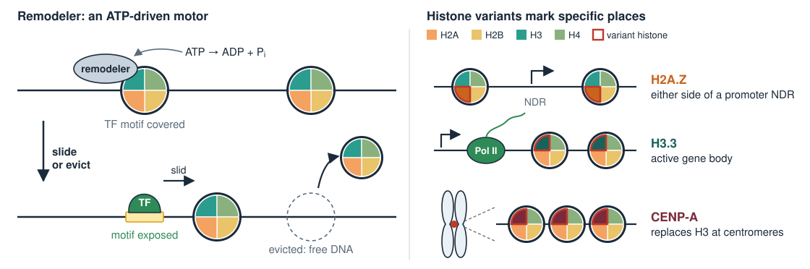{width="90%" fig-align="center"}

- **Chromatin remodelers** use ATP to slide, evict or exchange nucleosomes (e.g. SWI/SNF, ISWI, CHD, INO80 families). They create and maintain NDRs.
- **Histone variants** replace canonical histones at specific places: **H2A.Z** flanks promoters and enhancers, **H3.3** is deposited in active genes independently of replication, **CENP-A** defines centromeres.

::: notes
Remodelers are the motors of chromatin: modifications recruit them, and they physically move nucleosomes. SWI/SNF (BAF) subunits are mutated in about 20% of human cancers, which shows how important access is. Variants differ by a few amino acids from the canonical histones but are deposited by dedicated chaperones at specific places. CENP-A is a beautiful example of an epigenetically defined locus: centromeres are defined by CENP-A nucleosomes, not by a specific sequence, and neocentromeres can form on ordinary DNA. H3.3 is also the histone that carries the K27M oncohistone mutation in paediatric gliomas.
:::

## Beyond one dimension: the 3D genome {.smaller}

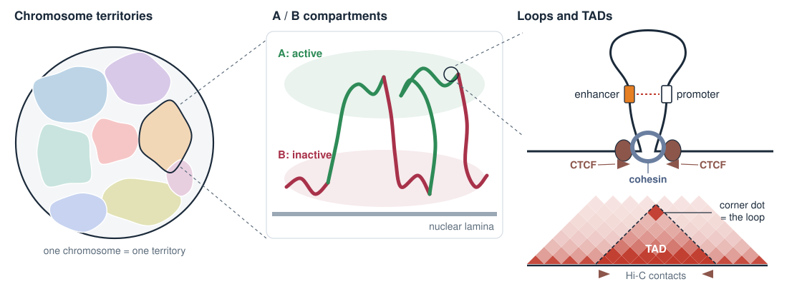{width="90%" fig-align="center"}

- Chromosomes occupy **territories**; active and inactive chromatin separate into **A and B compartments**.
- Within them, **loops** and **topologically associating domains (TADs)** bring enhancers close to the promoters they regulate, often over 10–1000 kb.
- Measured with Hi-C (3D genome units).

::: notes
A teaser only. The point here: a 1D track (previous slides) does not tell us which promoter an enhancer talks to. Loops are made by cohesin extruding DNA until it hits CTCF bound in a convergent orientation; that is why CTCF is in the course dataset. Compartments correlate strongly with the marks: A is H3K27ac/H3K36me3-rich, B is H3K9me3/H3K27me3-rich and lamina-associated. Students will compute compartments themselves from a Hi-C matrix.
:::

## Epigenetic memory in action {.smaller}

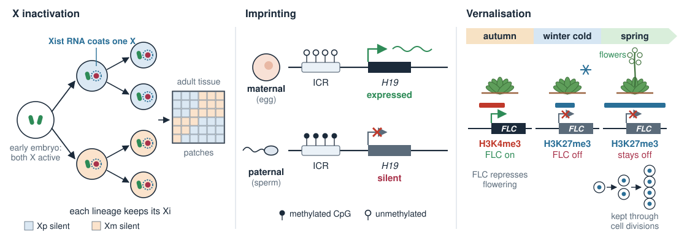{width="95%" fig-align="center"}

- **X inactivation:** in female mammals one X is silenced early in development (Xist RNA, H3K27me3, CGI methylation) and stays silent in all descendants.
- **Genomic imprinting:** some genes are expressed only from the maternal or only the paternal copy, set by DNA methylation in the germ line.
- **Vernalisation in plants:** *Arabidopsis* remembers winter. Cold silences the flowering repressor *FLC* by Polycomb (H3K27me3), and the silence is kept through cell divisions after it warms up, so the plant flowers in spring.

::: notes
Three examples that fit the narrow definition: a state set by a transient signal and remembered through mitosis. X inactivation shows memory at the scale of a whole chromosome; calico cats are the visible result of random X inactivation. Imprinting shows memory from the parents' germ lines: the paternal and maternal copies differ only in methylation at imprinting control regions. The figure uses H19: its imprinting control region is methylated on the paternal allele (set in the male germ line), so H19 is expressed only from the maternal copy. Vernalisation is the plant example (Umeå has a strong plant-science community); it is one of the best-studied cases of quantitative Polycomb memory: the longer the cold, the more cells switch FLC off (an all-or-none switch per cell). The epigenetic-inheritance unit asks which claims of memory across generations hold up.
:::

## Cause or consequence? {.smaller}

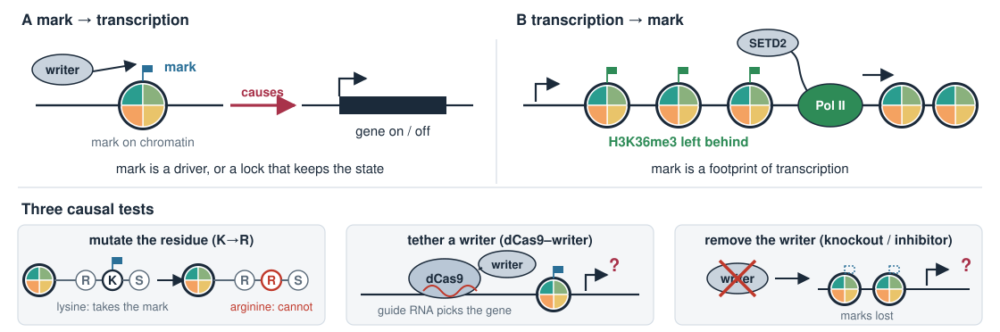{width="85%" fig-align="center"}

- Marks correlate with activity, but correlation does not show that the mark **causes** it. H3K36me3 is deposited *because* the gene is transcribed.
- Causal tests: replace a histone with a mutant that cannot be modified (e.g. lysine → arginine), tether a writer to a gene (**epigenome editing**: dCas9 fused to a writer or eraser), or remove the writer.
- Treat "epigenetic regulation of gene X" with care: is the mark a driver, a lock that keeps a decision, or a footprint of transcription?

::: notes
This is the critical-thinking slide and should come back throughout the course. Some marks are clearly downstream of transcription (H3K36me3, H3K79me2). Others act as locks: in flies, replacing all H3 copies with H3K27R derepresses Polycomb target genes, showing the lysine itself is needed for repression. Epigenome editing (dCas9-p300, dCas9-KRAB, dCas9-DNMT3A) can test whether placing a mark changes expression and whether the change is remembered after the tool is gone. Most genome-wide studies, including the ones we analyse, are correlational.
:::

## What the assays in this course measure {.smaller}

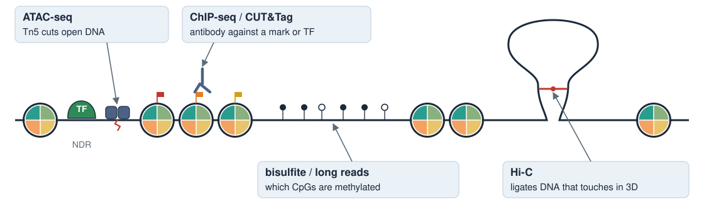{width="95%" fig-align="center"}

| question | assay | units |
|---|---|---|
| Where is the DNA accessible? | ATAC-seq (DNase-seq, MNase-seq) | ATAC-seq block |
| Where is a histone mark or a TF? | ChIP-seq, CUT&RUN, CUT&Tag | ChIP-seq block |
| Which CpGs are methylated? | bisulfite / EM-seq, arrays, long reads | methylation block |
| Which regions touch in 3D? | Hi-C, Micro-C | 3D genome block |

::: notes
This is the map of the course. Every assay turns a chromatin property into DNA fragments that are sequenced, and every one has its own way of being wrong: Tn5 sequence bias in ATAC, antibody specificity and input in ChIP, incomplete bisulfite conversion, ligation artefacts and distance decay in Hi-C. The analysis always ends in the same kinds of objects: intervals (peaks, domains), signal tracks, and counts in regions. That is why the next units are on genomic intervals and on going from reads to coverage.
:::

## Summary {.smaller}

| idea | key fact |
|---|---|
| epigenetic | narrow: heritable without sequence change; broad (epigenomics): any chromatin state |
| nucleosome | 147 bp around an octamer (H2A, H2B, H3, H4 ×2); repeat about 190 bp |
| open chromatin | nucleosome-depleted regions at active promoters and enhancers |
| histone marks | named histone–residue–modification: H3K27ac; written, read, erased by enzymes |
| active marks | H3K4me3 (promoter), H3K4me1 (enhancer), H3K27ac (active), H3K36me3 (gene body) |
| repressive marks | H3K27me3 (Polycomb, facultative), H3K9me3 (HP1, constitutive) |
| memory | read–write feedback for histone marks; DNMT1 + UHRF1 copy CpG methylation |
| CpG islands | unmethylated, CpG-rich promoters; methylated when stably silenced |
| caution | correlation is not causation: many marks follow transcription |

::: notes
Students should leave able to decode a mark's name, place the six marks on a gene, explain the difference between the two kinds of heterochromatin, and explain how DNA methylation is copied through replication. Next units: gene regulation (transcription factors, enhancers), then the technical foundation (intervals, reads to coverage).
:::

## Key papers (optional further reading) {.smaller}

*Not required reading and not examined. For those who want the primary literature.*

- Luger et al. 1997, *Nature*. [Crystal structure of the nucleosome core particle at 2.8 Å resolution](https://doi.org/10.1038/38444). The atomic picture of the nucleosome.
- Kornberg 1974, *Science*. [Chromatin structure: a repeating unit of histones and DNA](https://doi.org/10.1126/science.184.4139.868). The nucleosome model, from the ladder of digestion fragments.
- Strahl & Allis 2000, *Nature*. [The language of covalent histone modifications](https://doi.org/10.1038/47412). The "histone code" hypothesis.
- Barski et al. 2007, *Cell*. [High-resolution profiling of histone methylations in the human genome](https://doi.org/10.1016/j.cell.2007.05.009). One of the first genome-wide maps of histone marks by ChIP-seq.
- Bird 2007, *Nature*. [Perceptions of epigenetics](https://doi.org/10.1038/nature05913). A short essay on what the word should mean.
- Allis & Jenuwein 2016, *Nat Rev Genet*. [The molecular hallmarks of epigenetic control](https://doi.org/10.1038/nrg.2016.59). A broad review of the whole field.
