## About this lecture

Each histone-mark track answers one question ("is there H3K4me1 here?"). The genome's regulatory elements are defined by **combinations** of marks. This lecture turns six tracks into **one annotation**: a chromatin state for every 200 bp.

- **The combinatorial idea**: which combinations mean promoter, enhancer, transcribed, repressed.
- **Binarisation**: a Poisson test per 200-bp bin turns read counts into present/absent.
- **ChromHMM**, a hidden Markov model: emission and transition matrices, learning, decoding, choosing the number of states, naming states by their enrichments.
- **Reference epigenomes**: Roadmap/ENCODE 15- and 18-state models; Segway briefly; what states are used for.
- Running example: **GM12878**, six ENCODE marks + input, **chr21**, our own ChromHMM model compared with the published Roadmap one.

::: notes
The marks were introduced in *What is epigenetics? Chromatin, nucleosomes, histone marks, DNA methylation*, and the elements (promoters, enhancers, insulators) in *Promoters, enhancers, insulators, transcription factors*. Here we ask how to read six tracks together, systematically, for the whole genome. Students have not met hidden Markov models before; we build one from scratch with a toy example, and the exam questions are of that size (a forward or Viterbi step by hand, an emission product, reading an emission matrix). The running example uses ENCODE's filtered alignments of the six GM12878 marks of the Roadmap 18-state model (H3K4me3, H3K27ac, H3K4me1, H3K36me3, H3K27me3, H3K9me3, Bernstein lab), replicate 1, plus the input, restricted to chr21. Every number comes from the exercise commands.
:::

## One mark is ambiguous; combinations are not {.smaller}

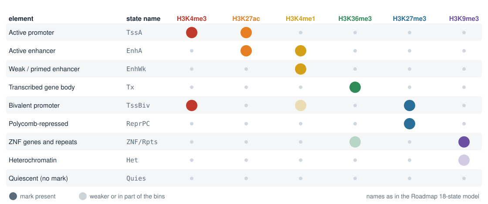{width="92%" fig-align="center"}

- H3K4me1 alone: a primed or weak enhancer. + H3K27ac: an **active** enhancer. H3K4me3 + H3K27ac: an active promoter. H3K4me3 + H3K27me3: a **bivalent** promoter.
- Six marks, present/absent: 2<sup>6</sup> = 64 combinations, but a handful dominate the genome.

::: notes
This is the observation behind chromatin states (Ernst & Kellis 2010; Ernst et al. 2011). Each row is a type of element defined by marks; the names on the right are the mnemonics of the Roadmap 18-state model, which we meet again at the end. Two points to stress. First, the same mark appears in several rows: H3K4me1 is at enhancers and at the flanks of promoters; H3K27ac at both active promoters and active enhancers; H3K36me3 in transcribed gene bodies and, together with H3K9me3, over zinc-finger gene clusters. Only the combination is specific. Second, absence is information too: most of the genome carries none of these marks ("quiescent"), and a model must have a state for it. The pale circles mean the mark is often but not always present in bins of that state.
:::

## Real data: six marks, one locus {.smaller}

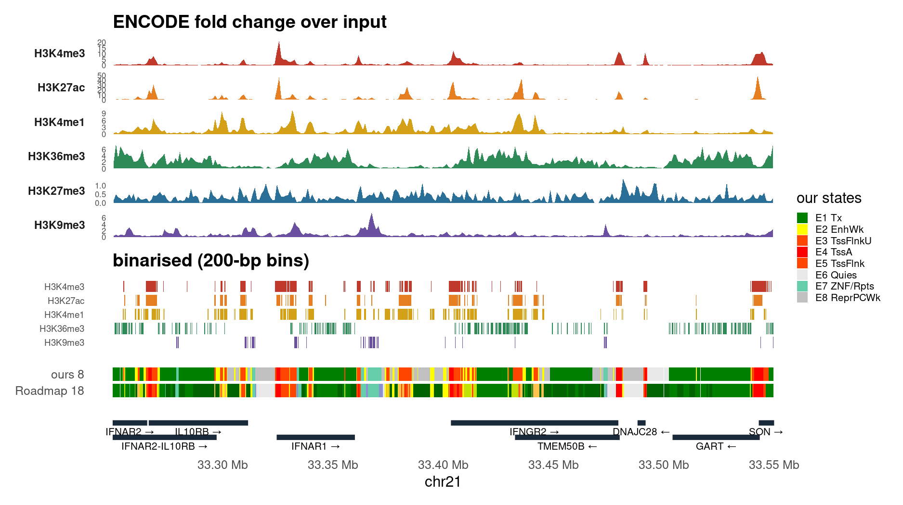{width="95%" fig-align="center"}

- GM12878, ENCODE fold change over input. Below: our binarised marks (200-bp bins) and the states learned in this lecture.
- Interferon-receptor genes (chr21:33.25–33.55 Mb): promoters (red), flanks and enhancers (orange, yellow), transcribed bodies (green); our 8 states and Roadmap's 18 agree on the main pattern.

::: notes
The same locus as the CUT&Tag tracks in *CUT&RUN and CUT&Tag*, now in GM12878. Top: ENCODE fold change over input for the six marks (the bigWigs of *What is epigenetics?*). Middle: the binarised calls in 200-bp bins (exercise C1). Bottom: our 8-state segmentation and the Roadmap 18-state segmentation of the same cell line (E116), with Roadmap's colours (red promoters, orange flanks, yellow enhancers, green transcription, grey Polycomb, white/pale quiescent). Walk along it: IFNAR2, IL10RB, IFNAR1 and IFNGR2 are expressed; each has a red TSS state, orange/yellow flanks, and a green body where H3K36me3 is called. Note that H3K36me3 is called in scattered bins along gene bodies, not continuously: the broad marks are sparse after binarisation, and the HMM's transitions fill in the gaps. Point out the gaps between genes, where both models say quiescent.
:::

## Why a model, not rules? {.smaller}

- Rules ("H3K4me3 and H3K27ac → promoter") need thresholds for every mark and break on noise: one missing bin splits an element in two.
- Real elements are **wider than a bin** and come in typical **neighbourhoods** (promoter → flanking → transcribed).
- A probabilistic model learns, from the data, (1) which mark combinations occur and (2) which ones follow each other along the genome.

::: notes
Without a model you could cluster bins by their mark vector (k-means on binary vectors) and get much of the way: the emission part of ChromHMM is in effect a clustering of bins. What the HMM adds is the spatial part: a bin's state also depends on its neighbours, so a single bin where a mark was missed by chance does not change the annotation. It also gives probabilities rather than hard calls. ChromHMM is unsupervised: no element types are given; they are named afterwards by looking at the learned parameters and at enrichments. This is the same logic as clustering cells in single-cell RNA-seq and naming the clusters by marker genes, which some students will know.
:::

## Step 1: bins and a Poisson threshold {.smaller}

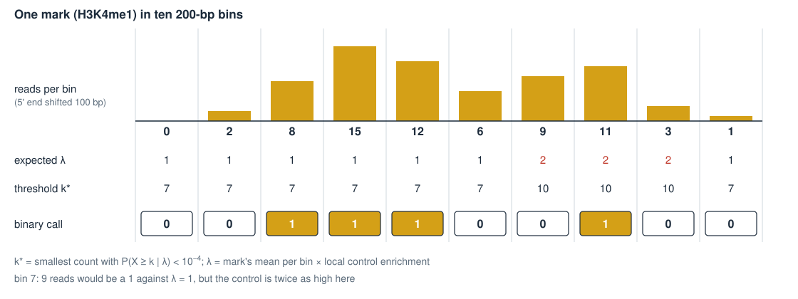{width="95%" fig-align="center"}

- The genome is cut into **200-bp bins**; each read is placed by its 5′ end shifted 100 bp towards the fragment centre.
- A mark is **present (1)** in a bin if the count is improbably high under a Poisson background: $P(X \ge k \mid \lambda) < 10^{-4}$.

::: notes
This is ChromHMM's BinarizeBam (or BinarizeBed). The expected count λ is the mark's genome-wide mean count per bin, multiplied by the local enrichment of the control (input) around the bin: the input count in the bin ± 5 bins, plus a pseudocount, relative to the input's mean. So regions with more input (amplifications, repeats with mappability artefacts) need more reads. Bin 7 on the slide is the example: 9 reads would pass against λ = 1, but not against λ = 2. The threshold 10^-4 is the default; it is the same Poisson logic as the MACS peak caller in *Peak calling*, applied to fixed bins instead of a sliding window. The 100-bp shift approximates moving from the 5′ end of a single-end read to the middle of the fragment, the same idea as read extension in *From reads to coverage for enrichment assays*. Binarising throws away information about how strong the signal is; ChromHMM accepts that loss for robustness against differences in depth and antibody efficiency between marks. Models on continuous signal exist (Segway, later).
:::

## Binarising chr21

```bash
# cell  mark  reads  control
printf "GM12878\tH3K4me3\tgm12878_h3k4me3_chip_chr21.bam\tgm12878_input_chr21.bam\n" >  cellmarkfiletable.txt
...                                                                              # six marks
printf "chr21\t46709983\n" > chr21.sizes
java -mx4G -jar ChromHMM.jar BinarizeBam -b 200 chr21.sizes $D cellmarkfiletable.txt binary
```

| | H3K4me3 | H3K27ac | H3K4me1 | H3K36me3 | H3K27me3 | H3K9me3 |
|---|---|---|---|---|---|---|
| reads on chr21 | 791 771 | 141 058 | 401 955 | 158 528 | 154 148 | 285 065 |
| bins called 1 (%) | 2.97 | 1.77 | 3.61 | 2.22 | 0.88 | 0.96 |

::: notes
The cell-mark file table has four columns: cell type, mark, reads, control. Two ENCODE replicates per mark were merged (and the two input replicates); the input has 134 625 reads on chr21. Binarisation takes about 12 seconds. 91.9% of the 233 549 bins have no mark at all. The sharp marks (H3K4me3, H3K27ac, H3K4me1) are called in a few percent of bins; the broad marks only in about 1–2%, although biologically they cover more: their enrichment per 200-bp bin is weak and needs depth. With replicate 1 alone, H3K36me3 was called in 0.74% of bins and H3K27me3 in 0.73%, and the learned "transcribed" state had an emission of only 0.09: depth matters, which is why the Roadmap consortium subsampled all marks to comparable depth before learning its models.
:::

## Real data: which combinations occur? {.smaller}

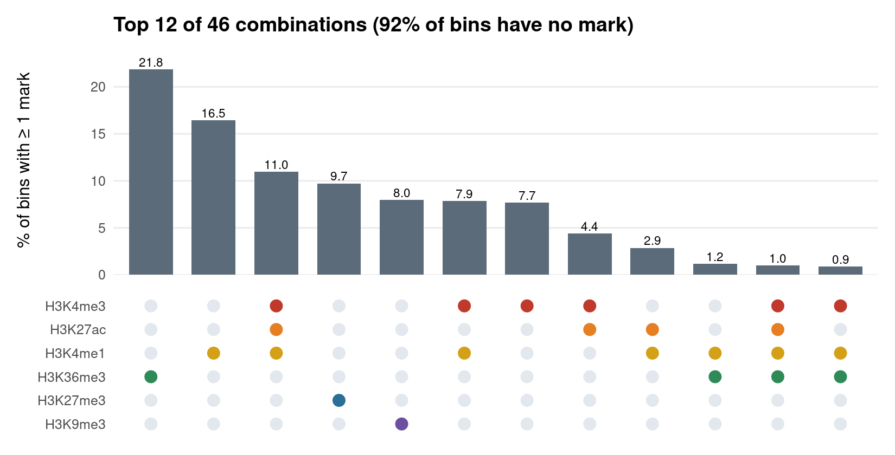{width="92%" fig-align="center"}

- 46 of 64 combinations occur; **91.9%** of bins have no mark; the ten most common combinations cover **91%** of the marked bins.
- Top five: H3K36me3 alone (gene bodies), H3K4me1 alone (weak enhancers), H3K4me3 + H3K27ac + H3K4me1 (active promoters), H3K27me3 alone, H3K9me3 alone.

::: notes
Percentages are of bins with at least one mark; the dots below each bar show the combination (exercise R1). This is the empirical basis of chromatin states: out of 64 possible combinations, a few recur, and they are the ones biology predicts. Rare combinations (H3K9me3 with H3K4me3, H3K27me3 with H3K27ac) are mostly noise, or real but rare elements. A model with 8–18 states is a compact description of these frequent patterns plus their neighbourhoods. Note that the marked bins are only 8% of chr21.
:::

## A hidden Markov model {.smaller}

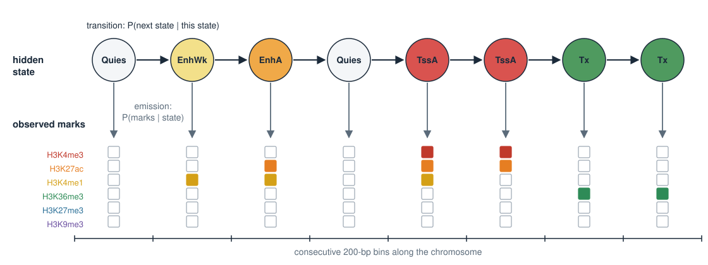{width="95%" fig-align="center"}

- **Hidden**: each bin has one state we do not observe. **Observed**: the six binary marks.
- **Emission**: the state determines the probability of each mark. **Transition**: the state of the next bin depends only on the state of this bin (Markov).

::: notes
Define the three ingredients of an HMM. The initial probabilities π_s: the chance that the first bin is in state s. The transition matrix A, with entry a_rs = P(state of bin t+1 = s | state of bin t = r); each row sums to 1. The emission probabilities: in ChromHMM, for each state s and mark m, a single number e_sm = P(mark m present | state s). Given these, the probability of any sequence of states together with the observations is a product: π for the first bin, then for each bin one transition and one emission. The word "hidden" just means we never see the states; we infer them. The same model family is used for gene finding, CpG island detection, copy-number segmentation and, in ATAC-seq, HMMRATAC.
:::

## Emissions: a product over marks {.smaller}

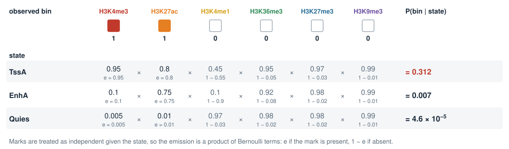{width="95%" fig-align="center"}

- $P(\text{bin} \mid s) = \prod_m e_{sm}^{\,o_m}(1 - e_{sm})^{1 - o_m}$: marks are **independent given the state**.
- The observation (H3K4me3 + H3K27ac) is ~**47×** more likely under TssA than under EnhA.

::: notes
o_m is 1 if mark m is present in the bin and 0 if absent; the formula takes e if present and 1 − e if absent. The emission probabilities on the slide are made up but close to the real ones (compare with the learned matrix in a few slides). The independence assumption is a simplification: given that a bin is a promoter, H3K4me3 and H3K27ac are not truly independent, but treating them so keeps the model small (one number per state and mark) and works well in practice. Note how strongly the absence of H3K4me1 pushes against EnhA: 1 − 0.9 = 0.1. A bin is not assigned the state with the highest emission alone; the transitions also count, which is the next slide.
:::

## Transitions smooth along the genome: the Viterbi path {.smaller}

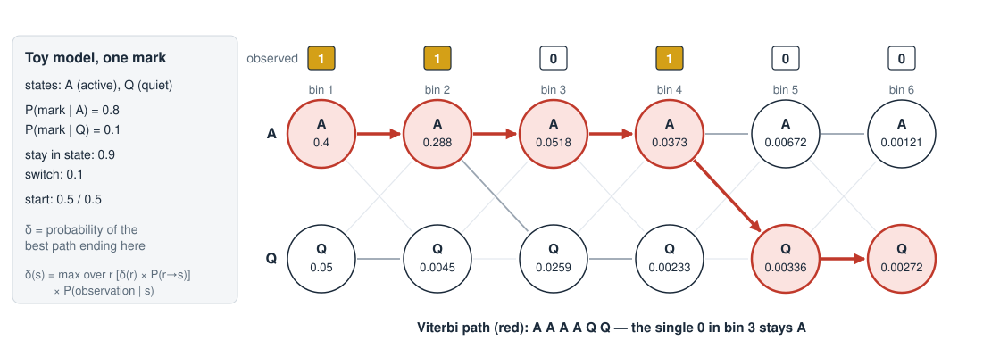{width="95%" fig-align="center"}

- Each δ = probability of the **best path** ending in that state; keep the best predecessor (grey arrows), trace back from the end.
- The single 0 in bin 3 is absorbed: switching to Q and back costs 0.1 × 0.1, more than one missed mark.

::: notes
Work through the first columns on the slide. Bin 1 (observed 1): δ(A) = 0.5 × 0.8 = 0.4, δ(Q) = 0.5 × 0.1 = 0.05. Bin 2 (1): δ(A) = max(0.4 × 0.9, 0.05 × 0.1) × 0.8 = 0.288; δ(Q) = max(0.4 × 0.1, 0.05 × 0.9) × 0.1 = 0.0045. Bin 3 (0): δ(A) = 0.288 × 0.9 × 0.2 = 0.0518; δ(Q) = max(0.288 × 0.1, 0.0045 × 0.9) × 0.9 = 0.0259. And so on. At the end Q wins (0.00272 > 0.00121), and the back-pointers give A A A A Q Q. Notice bin 5: δ(A) > δ(Q) there, but the best complete path goes through Q, because the decision is made for the whole sequence. This is the Viterbi algorithm. The forward algorithm is the same calculation with a sum instead of the max, and gives the probability of the observations; combined with a backward pass it gives, for each bin, the posterior probability of each state. ChromHMM by default assigns each bin the state with the highest posterior; the two usually agree. Students do a forward and a Viterbi calculation by hand in the exercise.
:::

## Learning the parameters {.smaller}

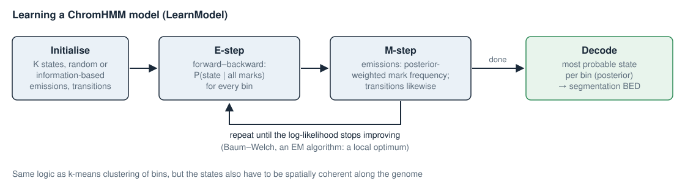{width="95%" fig-align="center"}

- Nobody tells the model what a promoter is: emissions and transitions are fitted to maximise the likelihood of the binarised data (**Baum–Welch**, an EM algorithm).
- EM finds a **local** optimum; ChromHMM's default "information" initialisation makes runs reproducible.

::: notes
E-step: with the current parameters, compute for every bin the posterior probability of each state (forward–backward). M-step: re-estimate each emission e_sm as the posterior-weighted fraction of bins with mark m present, and each transition from the posterior-weighted counts of consecutive state pairs. Repeat until the log-likelihood changes less than a threshold or a maximum number of iterations is reached (ChromHMM: 200). This is the same structure as fitting a Gaussian mixture or k-means: guess, assign softly, update, repeat. Like them it can end in different local optima depending on the start; ChromHMM's default initialisation chooses initial emissions from the data in a deterministic way. On chr21 with six marks (234 000 bins) learning an 8-state model takes about 15 seconds on 4 threads; the Roadmap models were learned jointly across many epigenomes, i.e. on hundreds of millions of bins.
:::

## Running ChromHMM

```bash
java -mx4G -jar ChromHMM.jar LearnModel -b 200 -l chr21.sizes binary model_8 8 hg38
```

- Output: `emissions_8.png/.txt`, `transitions_8.png/.txt`, `GM12878_8_segments.bed` (one line per segment), browser files, and enrichment tables for TSSs, genes, CpG islands.
- `OverlapEnrichment` and `NeighborhoodEnrichment` compute the same enrichments for any annotation you give it.

::: notes
LearnModel learns the model, decodes the training data and makes the standard plots. The last argument (hg38) tells it which built-in annotation files to use for the enrichment heatmaps (RefSeq TSS, TES, genes, exons, CpG islands from the COORDS folder of the ChromHMM download). -l restricts the output to the chromosomes in the file. With the default options, the result is deterministic. MakeSegmentation applies an existing model to new binarised data (for example another cell type), CompareModels compares the emissions of two models, Reorder renames and reorders states. The command takes a few seconds per iteration on chr21.
:::

## Real data: the emission matrix {.smaller}

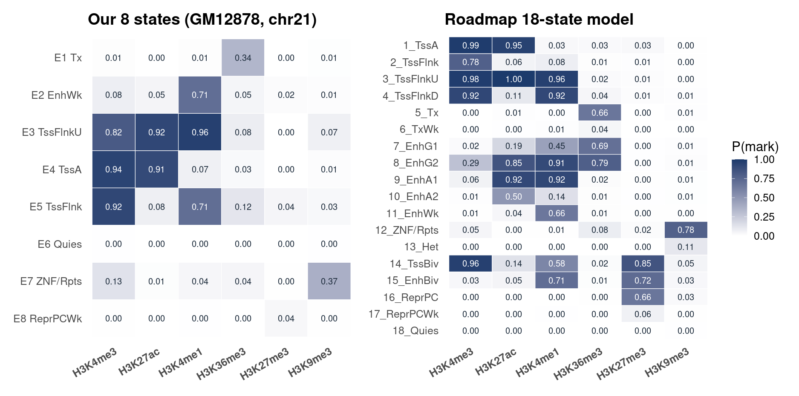{width="92%" fig-align="center"}

- Ours: active TSS (E4), TSS flanks (E3, E5), weak enhancer (E2), transcribed (E1), H3K9me3 (E7), weak H3K27me3 (E8) and quiescent (E6).
- Roadmap's 18 states, learned on many epigenomes, also separate genic enhancers, bivalent and strong Polycomb states; the shared states have similar emissions.

::: notes
Rows are states, columns marks, values P(mark present | state). Names are given by rules on the emissions (in make-chromstates-figs.R) and checked against the enrichments of the next slides. E4 (0.94 H3K4me3, 0.91 H3K27ac, 0.07 H3K4me1) matches Roadmap's 1_TssA almost exactly. E3 has all three active marks, like 3_TssFlnkU. E5 has H3K4me3 and H3K4me1 without H3K27ac, like 4_TssFlnkD. E1's H3K36me3 emission (0.34) is lower than Roadmap's 5_Tx (0.66): our H3K36me3 is less deep. E7 (H3K9me3 0.37 plus some H3K4me3) is the ZNF/repeats state. Our model has no strong Polycomb state: H3K27me3 is called in under 1% of bins, and in GM12878 strong Polycomb domains are rare on chr21 (Roadmap gives 0.24% 16_ReprPC). Learned from one chromosome of one cell line, the model sees few examples of rare states; Roadmap learned one joint model across many epigenomes and applied it to all 98 with H3K27ac.
:::

## Real data: the transition matrix {.smaller}

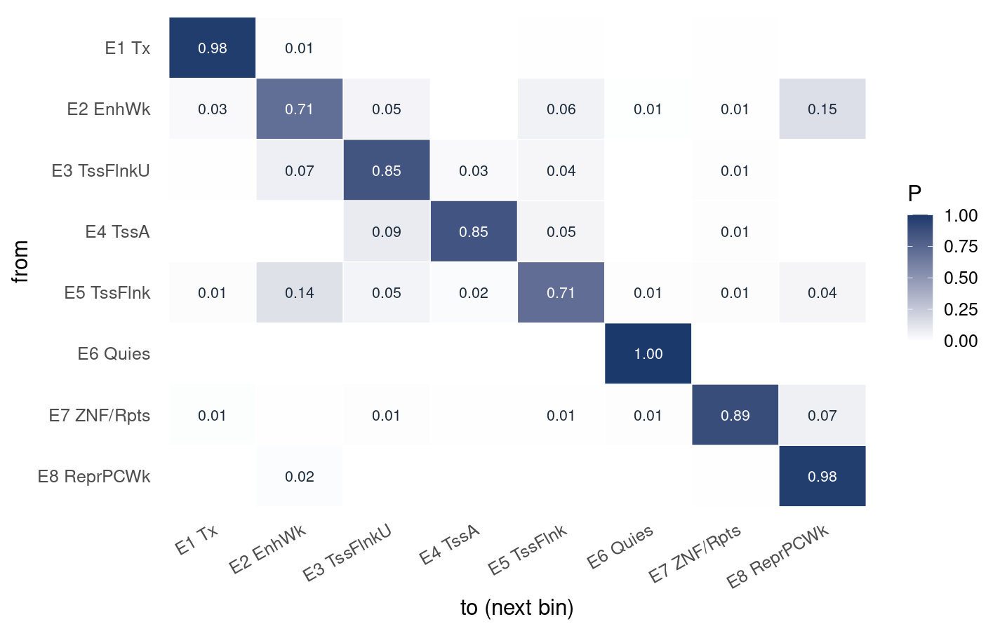{width="88%" fig-align="center"}

- Most probability on the diagonal: expected run lengths 229 kb (quiescent), 10.6 kb (transcribed), 1.3 kb (TSS states), 0.7 kb (weak enhancer).
- Off the diagonal: TSS → TSS flank → weak enhancer; weak enhancer ↔ weak Polycomb; quiescent bins almost never jump straight to an active state.

::: notes
The expected length of a run of state s is 1 / (1 − a_ss) bins: 0.999 gives 1000 bins, here about 229 kb for E6. Off-diagonal entries are the typical neighbours: E4 (TssA) goes next mostly to E3 (0.09) and E5; E5 (TssFlnk) to E2 (0.14), the weak enhancer; E2 to E8 (0.15). E1 (Tx) is entered mainly from the flanking states. The transition matrix is learned together with the emissions; it encodes typical element sizes and orders, which is what lets the HMM smooth noisy binarised data. Read row by row: each row sums to 1.
:::

## Naming states by enrichment {.smaller}

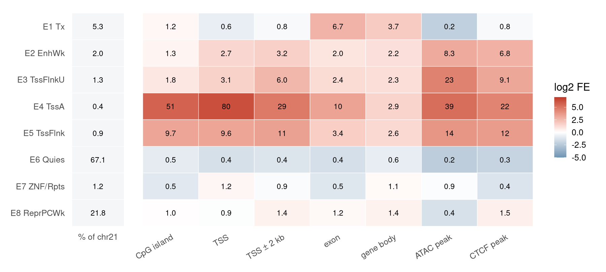{width="95%" fig-align="center"}

- Fold enrichment of a state for an annotation $A$: $\dfrac{\text{bins in state and in } A \,/\, \text{bins in } A}{\text{bins in state} \,/\, \text{all bins}}$.
- E4 (TssA): **80×** at TSS bins, **51×** at CpG islands, 39× at ATAC peaks; E1: 6.7× at exons, 3.7× over gene bodies; E6 (quiescent): depleted everywhere (0.2–0.6).

::: notes
Fold enrichments computed in R over 200-bp bins (exercise R3 and make-chromstates-figs.R): for each annotation, the fraction of its bins in each state divided by the fraction of all bins in the state. Annotations: CpG islands from ChromHMM's COORDS folder, GENCODE protein-coding TSSs, exons and gene bodies, and two GM12878 peak sets from earlier units (ATAC-seq and CTCF ChIP-seq), which were not used to learn the model. That E4 is 39-fold enriched at ATAC peaks and E2/E3 at ATAC and CTCF peaks is independent support. ChromHMM computes the same table itself (OverlapEnrichment, exercise C3). The maximum possible fold enrichment of a state is 1 / its genome fraction (E4: 0.40% → 250).
:::

## Real data: states around the TSS {.smaller}

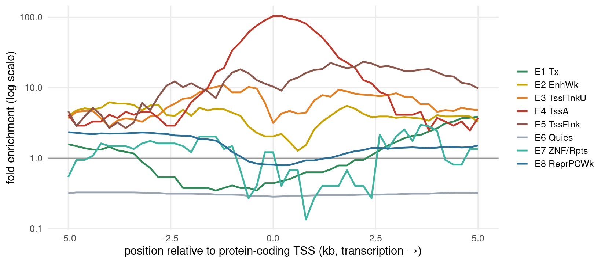{width="92%" fig-align="center"}

- E4 (TssA) peaks at the TSS (**105×**); E3 and E5 rise on both flanks (~11–23× at 1–2 kb); E1 (transcribed) increases downstream into the gene body.
- The spatial order promoter flank → TSS → flank → transcribed body is learned, not given.

::: notes
Strand-aware: positive positions are downstream in the direction of transcription. For each offset from 602 protein-coding TSS positions on chr21 (GENCODE), the fold enrichment of each state (log scale). E4 reaches ~105-fold within 200 bp of the TSS. E5 (H3K4me3 + H3K4me1, no H3K27ac) is highest about 2 kb downstream: the H3K4me1-marked flank of active promoters, Roadmap's TssFlnkD ("downstream"). E3 is highest upstream (~11× at −1.2 kb), like TssFlnkU. E1 (H3K36me3) is depleted at the TSS and rises downstream, as transcription elongation marks the body towards the 3' end. ChromHMM's NeighborhoodEnrichment gives the same with RefSeq (exercise C3).
:::

## How many states? {.smaller}

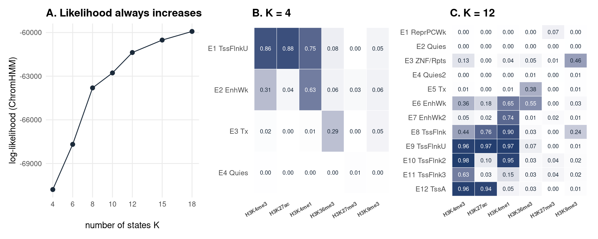{width="95%" fig-align="center"}

- More states always fit better: the likelihood cannot choose *K*. BIC tends to choose far too many on genome-sized data.
- In practice: learn several *K*, keep the smallest that resolves the distinctions you care about, and check that states are **interpretable and reproducible**.

::: notes
A: ChromHMM's final log-likelihood for 4–18 states on our data; every extra state improves the fit (−70 792 for 4 to −59 925 for 18). B and C: the 4- and 12-state emission matrices. With 4 states there is one "active" promoter/enhancer state, a weak H3K4me1 state, transcribed and quiescent; Polycomb and heterochromatin are absorbed into quiescent. With 12 states: two quiescent states, an enhancer-in-gene-body state (H3K4me1 + H3K36me3, like Roadmap's EnhG), several TSS-flank states and an H3K9me3 + H3K27ac state that is hard to interpret. The Roadmap consortium chose 15 states for 5 marks by learning models of up to ~20 states and keeping the smallest that captured the states seen in the larger models (CompareModels), across many epigenomes; Ernst & Kellis 2017 recommend the same. Training time grows with K: 6 s for 4 states, 15 s for 8, 47 s for 12 on chr21. Larger models also need more iterations (here 43, 71, 130).
:::

## Our states vs the published Roadmap model {.smaller}

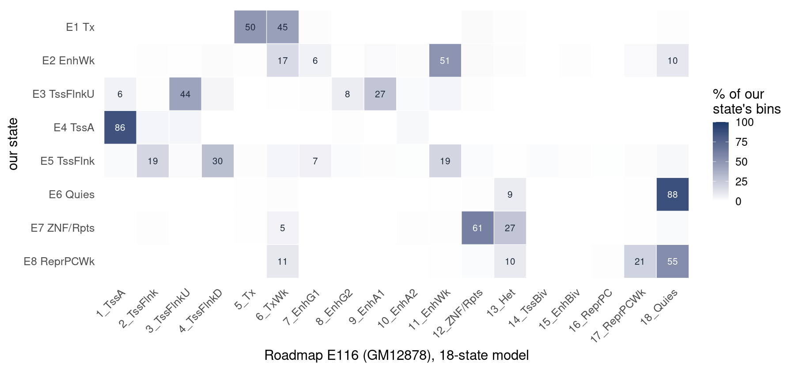{width="95%" fig-align="center"}

- E4 → 86% Roadmap TssA; E6 → 88% Quies; E1 → 95% Tx/TxWk; E7 → 61% ZNF/Rpts + 27% Het. Mixtures: E3 (TssFlnkU + EnhA), E5 (flanks + EnhWk), E8 (Quies + ReprPCWk).
- In six coarse classes (promoter, enhancer, transcribed, Polycomb, heterochromatin, quiescent) the two maps agree on **68%** of bins, but on only **36%** of the bins that are not quiescent in both.

::: notes
Each row: where the bins of one of our states fall in the Roadmap E116 segmentation (only the 35 Mb of chr21 that Roadmap covers after liftover). Strong agreement for the clear states. The coarse-class agreement shows how much of the apparent agreement comes from the quiescent majority; among marked bins the two maps often disagree on the class, mostly between neighbouring classes (promoter flank vs enhancer, weak transcription vs quiescent). Reasons: different data (ENCODE alignments of 2011 data reprocessed for GRCh38 vs Roadmap's uniformly processed hg19 data), our model learned on one chromosome of one cell type vs Roadmap's joint model across many epigenomes, 8 vs 18 states, and liftover. This is the honest message: segmentations are models, and two reasonable models of the same cell type agree on the main structure and differ in the details.
:::

## Most of the genome is quiet {.smaller}

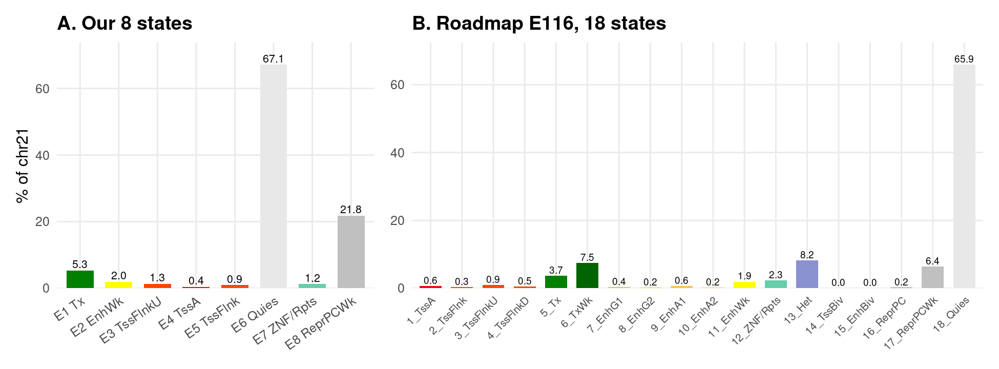{width="88%" fig-align="center"}

- Our quiescent state covers **67%** of chr21 (plus 22% nearly unmarked, E8); Roadmap's 18_Quies **66%** of what it covers.
- Promoter and enhancer states together: ~5% (ours) and ~6% (Roadmap). Transcribed: 5% (ours) vs 11% (Roadmap Tx + TxWk).

::: notes
Percentages of 200-bp bins on chr21. The regulatory part of the genome is small: active promoters 0.4%, flanks and enhancers a few percent. Roadmap assigns more of chr21 to transcription (Tx 3.7% + TxWk 7.5%) and to heterochromatin (Het 8.3%) than we do, because it calls H3K36me3 and H3K9me3 more sensitively (deeper, pooled across epigenomes, and its weak states TxWk and Het capture low levels of the marks). Our E8 (21.8%, only 4% H3K27me3) corresponds partly to Roadmap's ReprPCWk, partly to Quies. These numbers are typical: in Roadmap epigenomes, quiescent states cover ~60–70% of the genome.
:::

## Reference epigenomes: Roadmap and ENCODE {.smaller}

- **Roadmap Epigenomics** (2015): 111 reference epigenomes (+ 16 from ENCODE = 127) with a common ChromHMM model: **15 states** from 5 core marks (H3K4me3, H3K4me1, H3K36me3, H3K27me3, H3K9me3), **18 states** with H3K27ac (98 epigenomes), **25 states** on imputed data (12 marks).
- **ENCODE** (2012, and later): ChromHMM and Segway segmentations of the tier-1 cell lines, including GM12878 and K562; the SCREEN registry of candidate cis-regulatory elements (cCREs) is the newer, element-based annotation.
- **Full-stack ChromHMM** (Vu & Ernst 2022): one stacked model of > 1000 datasets, 100 states, a single annotation of the genome that is the same for all cell types.

::: notes
These are the annotations most papers use: you download the segmentation of your cell type (here E116 = GM12878) rather than learn your own, as long as your cell type is among them. Points to remember: Roadmap's segmentations are on hg19, with liftOver versions for hg38 (the ones we use); state names are the mnemonics (TssA, TssFlnk, Tx, EnhG, EnhA, EnhWk, ZNF/Rpts, Het, TssBiv, EnhBiv, ReprPC, Quies, ...). For a new cell type with only some marks, the imputed 25-state model and tools that learn with missing data are options. ENCODE's own cCRE registry (SCREEN) classifies elements from DNase, H3K4me3, H3K27ac and CTCF instead of genome-wide states. Text-only slide on purpose: the important thing is to know these resources exist and what was used to make them.
:::

## Concatenated and stacked models {.smaller}

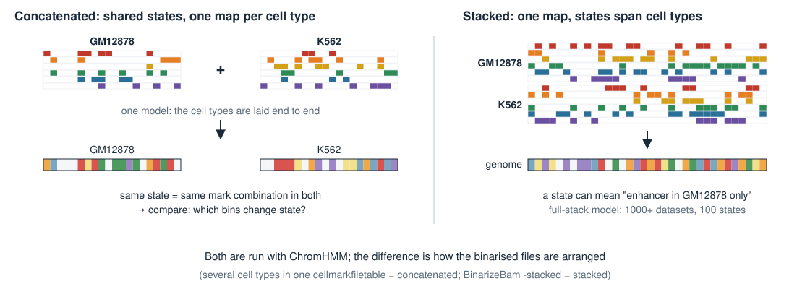{width="95%" fig-align="center"}

- **Concatenated** (Roadmap): one set of states, a separate map per cell type → compare cell types bin by bin ("enhancer in B cells, Polycomb in liver").
- **Stacked**: one map; states encode cross-cell-type patterns.

::: notes
To compare cell types with a concatenated model, the same marks must be available in all of them, ideally from comparable data (the Roadmap processing pipeline uniformly subsampled reads to the same depth for this reason). Stacked models need no such alignment of states but get very many states quickly; the full-stack model of Vu & Ernst has 100 states. Learning a separate model per cell type and then matching the states by hand is possible but makes comparisons subjective.
:::

## What states are used for {.smaller}

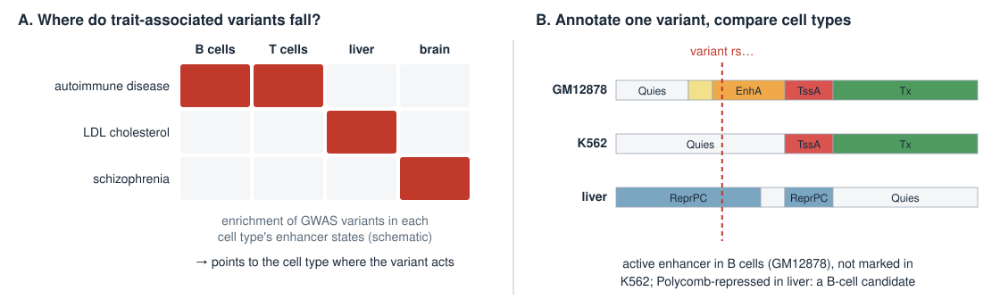{width="95%" fig-align="center"}

- **Variants**: GWAS hits for a trait are enriched in enhancer states of the relevant cell types (Roadmap 2015; *Epigenomics and genetic variation*).
- **Cell types**: which elements change state between cell types or with disease.

::: notes
Panel A is schematic, in the spirit of Figure 9 of the Roadmap 2015 paper: variants associated with immune diseases fall preferentially in enhancer states of immune cells, cholesterol-related variants in liver enhancers, and so on. This is how many GWAS papers propose the cell type in which a non-coding variant acts; the statistics (enrichment with matched backgrounds, LD) are in *Epigenomics and genetic variation*. Panel B: annotate one variant by looking up its state in several reference epigenomes. Caveat: a state annotation says what the chromatin looks like, not that the element regulates any particular gene, and not that the variant changes it. That needs *Linking regulatory elements to genes* and experimental tests.
:::

## Other segmentation methods {.smaller}

| method | input | model | resolution |
|---|---|---|---|
| ChromHMM | binarised marks | multivariate Bernoulli HMM | 200 bp |
| Segway | continuous signal (e.g. −log10 p) | dynamic Bayesian network, Gaussian emissions | 1 bp |
| IDEAS, EpiCSeg, Spectacle | signal or counts | joint across cell types / count models / spectral learning | 100–200 bp |

- They agree on the main classes (promoter, enhancer, transcribed, Polycomb, heterochromatin, quiet); they differ in detail and in how many states they find.

::: notes
Segway (Hoffman et al. 2012) models the continuous signal directly with a dynamic Bayesian network, and was used for ENCODE's 2012 segmentations alongside ChromHMM; working at base resolution it can find small elements but is much slower. ENCODE combined the two into a consensus annotation for the tier-1 cell lines. IDEAS shares information across cell types; EpiCSeg uses a negative multinomial count model; Spectacle learns HMM parameters by spectral methods. Students do not need to know these beyond the existence of alternatives; the conceptual model is the ChromHMM one.
:::

## Caveats {.smaller}

- States are **labels for mark combinations**, not proof of function: "EnhA" means "looks like an active enhancer".
- They depend on the **marks** profiled, the **antibodies**, the **depth** and the **binarisation threshold**: the same cell type profiled twice can give different maps.
- Cell populations are **mixtures**: a "bivalent" bin may be a mix of active and repressed cells.
- 200-bp resolution, one state per bin, marks independent given the state: simplifications that work, not biology.

::: notes
These are the questions to ask of any paper that uses chromatin states. A typical overreach: "variant X lies in an enhancer state, therefore it disrupts an enhancer of gene Y". Another: comparing segmentations of two cell types profiled in different labs at different depths and interpreting the differences as biology. For bivalent states in particular: true bivalency (both marks on the same nucleosome or nearby on the same DNA molecule) has been shown in embryonic stem cells by sequential ChIP, but in a mixed population, H3K4me3 + H3K27me3 in one bin may come from different cells. A state map is a hypothesis generator.
:::

## Summary {.smaller}

| topic | key idea |
|---|---|
| combinatorial code | elements are defined by combinations of marks, not single marks |
| binarisation | 200-bp bins; 1 if $P(X \ge k \mid \lambda) < 10^{-4}$, λ from the mark mean × local input |
| HMM | hidden state per bin; emissions (product of Bernoullis); transitions (Markov) |
| algorithms | forward (sum), Viterbi (max), Baum–Welch (EM, local optimum) |
| interpretation | emission matrix + enrichment at TSS, genes, CpG islands → state names |
| number of states | no statistical answer; interpretability and reproducibility |
| references | Roadmap 15/18/25-state models; ENCODE; full-stack 100-state annotation |
| uses | variant annotation, comparing cell types; caveat: annotation ≠ function |

::: notes
Students should leave able to: binarise a bin with a Poisson threshold, compute an emission probability, do a forward and a Viterbi step on a toy HMM, name states from an emission matrix and enrichments, explain why the number of states is a choice, and say what a chromatin-state annotation can and cannot support.
:::

## Key papers (optional further reading) {.smaller}

*Not required reading and not examined. For those who want the primary literature.*

- Ernst et al. 2011, *Nature*. [Mapping and analysis of chromatin state dynamics in nine human cell types](https://doi.org/10.1038/nature09906). Chromatin states across ENCODE cell lines, and their use for GWAS variants.
- Ernst & Kellis 2012, *Nat Methods*. [ChromHMM: automating chromatin-state discovery and characterization](https://doi.org/10.1038/nmeth.1906). The software.
- Hoffman et al. 2012, *Nat Methods*. [Unsupervised pattern discovery in human chromatin structure through genomic segmentation](https://doi.org/10.1038/nmeth.1937). Segway.
- Roadmap Epigenomics Consortium 2015, *Nature*. [Integrative analysis of 111 reference human epigenomes](https://doi.org/10.1038/nature14248). The reference 15/18/25-state annotations.
- Ernst & Kellis 2017, *Nat Protoc*. [Chromatin-state discovery and genome annotation with ChromHMM](https://doi.org/10.1038/nprot.2017.124). Practical guide: binarisation, number of states, interpretation.
- Vu & Ernst 2022, *Genome Biol*. [Universal annotation of the human genome through integration of over a thousand epigenomic datasets](https://doi.org/10.1186/s13059-021-02572-z). The full-stack model.
