## About this lecture

*ChIP-seq: the assay, TFs vs histone marks* showed how chromatin immunoprecipitation finds where a protein or a mark sits. CUT&RUN (2017) and CUT&Tag (2019) answer the same question with a different trick: **bring the enzyme to the antibody inside the nucleus**, so only the target's neighbourhood is cut.

- **The assays**: pA–MNase and pA–Tn5 tethered to an antibody in situ; why the background is so low.
- **What changes in the data**: far fewer cells and reads, fragment sizes, duplicates, an IgG control, E. coli spike-in.
- **Peak calling** on sparse data: SEACR vs MACS3.
- **Caveats**: the open-chromatin bias of Tn5, and when ChIP is still the better choice.
- Running example: **K562 CUT&Tag** for H3K27me3 and H3K4me3 (Kaya-Okur et al. 2020) against **ENCODE ChIP-seq** of the same marks in the same cell line, chr21.

::: notes
The running example is real data: the replicate-1 CUT&Tag samples of the Henikoff lab's CUT&Tag tutorial (GEO GSE145187), paired-end 2 × 25 bp, for H3K27me3, H3K4me3 and an IgG control in K562 cells, restricted to the read pairs that align to chr21 (and the E. coli pairs used as spike-in). For comparison we use ENCODE's filtered ChIP-seq alignments for the same two marks and the input control in K562 (Bernstein lab, 36-bp single-end), also on chr21. Every number on the slides comes from running the commands of the exercise on these files. Peak calling for ChIP-seq (MACS, the local lambda) is in *Peak calling*; differential binding and spike-in normalisation under global changes are in *Annotation and differential binding*. This lecture concentrates on what is different.
:::

## ChIP fragments everything; CUT&RUN/Tag cut only at the target {.smaller}

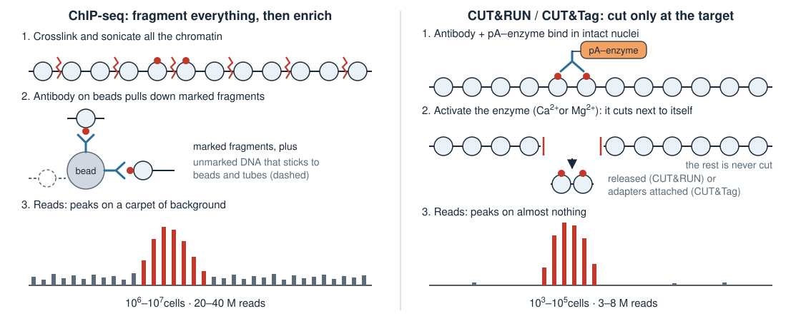{width="95%" fig-align="center"}

- ChIP: shear **all** the chromatin, then enrich. Unmarked DNA that sticks to beads and tubes is sequenced too → a **carpet of background**.
- CUT&RUN / CUT&Tag: the antibody brings an enzyme to the target in intact nuclei; DNA elsewhere is **never cut**, so it never enters the library.

::: notes
The left side is the problem the in-situ methods solve. In ChIP-seq, the whole genome is fragmented and solubilised; an immunoprecipitation typically enriches the target by a factor of ten to a few hundred, so most of the library is still background, and you need deep sequencing (ENCODE asks for 20 M usable fragments for narrow marks, 45 M for broad ones) and an input control to see the signal over it. Crosslinking, sonication and the IP need millions of cells. In CUT&RUN and CUT&Tag nothing is fragmented except where the enzyme is tethered. The background is not zero (we will see where it comes from), but it is low enough that 3–8 million reads, from thousands to a few hundred thousand cells, give a usable profile. Caveat to say early: low background is a property of the chemistry, not a guarantee of correctness; the antibody still decides what you measure.
:::

## Two protocols, one idea {.smaller}

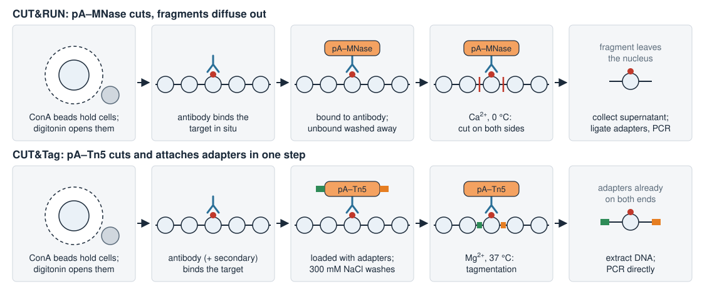{width="95%" fig-align="center"}

- **CUT&RUN** (Skene & Henikoff 2017): protein A–MNase, activated by Ca<sup>2+</sup> on ice; cut fragments diffuse out of the nucleus and are collected; adapters are ligated afterwards.
- **CUT&Tag** (Kaya-Okur et al. 2019): protein A–Tn5 loaded with sequencing adapters, activated by Mg<sup>2+</sup>; cutting and adapter insertion are one step, then **PCR directly**.

::: notes
Both start with unfixed cells or nuclei bound to concanavalin A–coated magnetic beads and permeabilised with digitonin, so antibodies and the fusion enzyme can enter. Protein A (or the protein A/G fusion used in newer kits) binds the Fc part of the antibody; in CUT&Tag a secondary antibody is usually added to increase the number of protein A binding sites. In CUT&RUN, MNase is inactive until calcium is added; the reaction is done at 0 °C to limit diffusion of the cut fragments, then stopped with EGTA, and the small fragments released into the supernatant are purified and turned into a library. In CUT&Tag the Tn5 is the same hyperactive transposase as in ATAC-seq (*ATAC-seq: Tn5, fragment sizes, nucleosome ladder*), pre-loaded with the Nextera adapters; after binding, the nuclei are washed with 300 mM NaCl to remove unbound Tn5 (it sticks to open chromatin, a point we return to), and magnesium starts tagmentation. The whole CUT&Tag protocol takes a day, ends with PCR, and needs no library preparation kit. Both methods have automated, plate-based and single-cell versions (single-cell CUT&Tag already in Kaya-Okur et al. 2019, and later droplet-based and multi-target variants).
:::

## ChIP-seq, CUT&RUN and CUT&Tag side by side {.smaller}

| | ChIP-seq | CUT&RUN | CUT&Tag |
|---|---|---|---|
| fixation | usually formaldehyde | none (light fixation optional) | none (light fixation optional) |
| fragmentation | sonication or MNase, whole genome | pA–MNase at the target | pA–Tn5 at the target |
| cells per sample | 10<sup>6</sup>–10<sup>7</sup> | 10<sup>3</sup>–10<sup>5</sup> | 10<sup>2</sup>–10<sup>5</sup>, single cells |
| reads for a profile | 20–40 M | 3–8 M | 2–5 M |
| control | input DNA | IgG (or none) | IgG (or none) |
| best for | everything, incl. TFs; huge reference (ENCODE) | TFs and histone marks | histone marks; low input |
| library | ligation | ligation | Tn5 adapters + PCR |

::: notes
The numbers are typical, not limits. CUT&RUN works well for transcription factors because the washes can be gentle (150 mM salt); CUT&Tag needs high-salt washes to remove free Tn5, and these strip many transcription factors off the DNA, which is why CUT&Tag is mostly used for histone marks and very stably bound proteins (CTCF works, many TFs do not). ChIP-seq is still the method with by far the largest reference data (ENCODE, Roadmap, Cistrome) and works on crosslinked or frozen tissue, where in-situ methods are harder. A fair summary: for histone marks on limited material, CUT&Tag is now the default in many labs; for comparison with public data, or for TFs with weak binding, ChIP or CUT&RUN.
:::

## Real data: the same marks, ChIP vs CUT&Tag {.smaller}

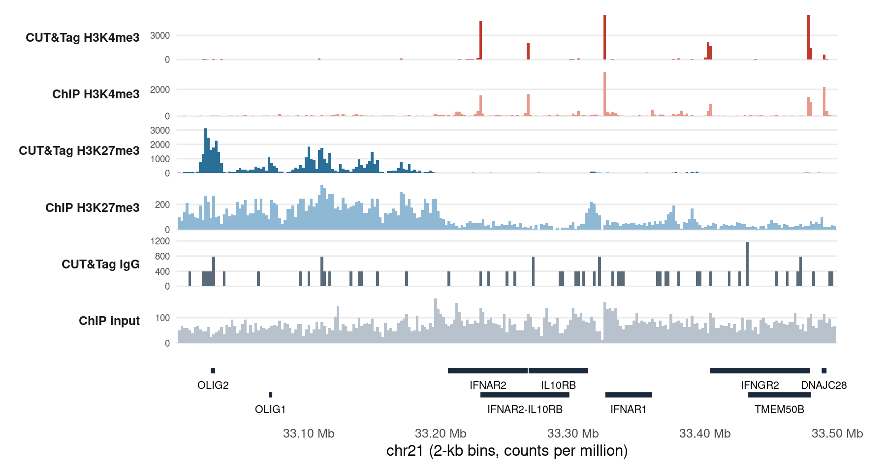{width="95%" fig-align="center"}

- K562, chr21, CPM-scaled. CUT&Tag: **17 380** H3K4me3 and **45 130** H3K27me3 fragments on chr21; ChIP: **94 538** and **141 487** reads.
- Same peaks, but between them CUT&Tag is almost empty; ChIP and input have reads everywhere.

::: notes
The OLIG2/OLIG1 region and the interferon-receptor genes on chr21 (33.0–33.5 Mb), in 2-kb bins, counts per million. OLIG2 is a classic Polycomb target outside the nervous system: a broad H3K27me3 domain, very clean in CUT&Tag, visible but on a high background in ChIP. The interferon-receptor genes (IFNAR2, IL10RB, IFNAR1, IFNGR2) are expressed in K562 and carry sharp H3K4me3 peaks at their promoters in both assays. Look at the scale of each track: CUT&Tag peaks reach several thousand CPM because almost all fragments are in peaks; the ChIP input has reads in every bin. The IgG track is sparse (2 544 distinct fragments on chr21). Note also the small H3K27me3 ChIP bump at the IFNAR1 promoter (~33.32 Mb), where CUT&Tag has nothing: active promoters often show up weakly in ChIP of any mark because open chromatin shears and is recovered more easily. The CUT&Tag numbers are what remained of whole libraries of 1.6 M (H3K4me3) and 3.0 M (H3K27me3) read pairs; ENCODE's ChIP libraries had 6.9 M and 9.3 M filtered reads.
:::

## Fragment sizes {.smaller}

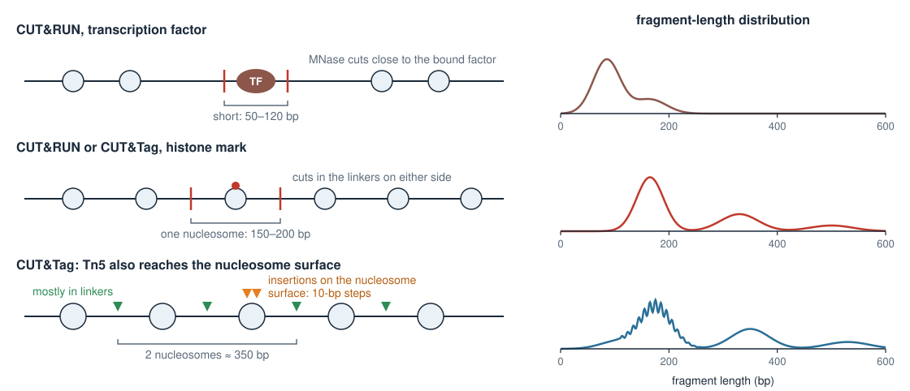{width="92%" fig-align="center"}

- The enzyme cuts where it can reach DNA: **linkers**. Histone-mark libraries are a **nucleosome ladder**; TF CUT&RUN libraries are dominated by **short fragments** (< 120 bp) protected by the factor.
- Tn5 also reaches DNA on the nucleosome surface where it faces outwards, once per helical turn: a **10-bp ripple** in CUT&Tag.

::: notes
Paired-end sequencing gives the fragment length of every molecule, so the fragment-length distribution is the first QC plot. For a histone mark you expect the mono-nucleosome peak at about 150–200 bp (the 147 bp of nucleosomal DNA plus some linker), and di- and tri-nucleosomes. In CUT&Tag the measured length includes no adapter, but the Tn5 duplication of 9 bp makes each fragment 9 bp longer than the DNA between the two cuts. For transcription factors, CUT&RUN fragments of 50–120 bp come from MNase cutting close to the bound factor; selecting short fragments (< 120 bp) sharpens TF peaks, and the footprint of the factor can be seen at base-pair resolution (Skene & Henikoff 2017). The 10-bp periodicity is the same phenomenon as in ATAC-seq: on a nucleosome, the DNA backbone faces outwards once per ~10.4 bp, which is where Tn5 can insert.
:::

## Real data: fragment-length distribution {.smaller}

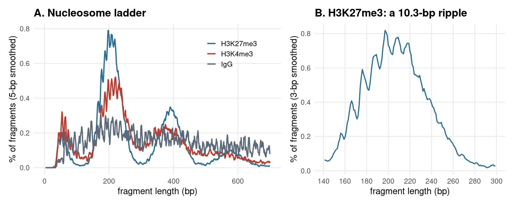{width="92%" fig-align="center"}

- Median fragment length: H3K4me3 **252 bp**, H3K27me3 **229 bp**, IgG **330 bp**.
- H3K27me3: mono-nucleosome peak at ~200 bp, di-nucleosomes at ~390 bp, and a **10.3-bp ripple** across the mono-nucleosome peak; only 6% of fragments are < 120 bp.

::: notes
Left: fragment-length distributions of the three libraries on chr21 (5-bp smoothing). The peaks are a little longer than 147 bp plus a short linker because Tn5 duplicates 9 bp at each insertion and cuts a few bases into the linker. H3K4me3 has more short fragments (12% < 120 bp) than H3K27me3 (6%): at active promoters there is a nucleosome-free region. The IgG (2 544 fragments after removing duplicates) is broad and noisy, with more long fragments: untethered cutting is not anchored to one nucleosome. Right: a zoom on the H3K27me3 mono-nucleosome peak with 3-bp smoothing; the strongest periodic component of the detrended histogram has a period of 10.3 bp, the helical repeat of DNA on the nucleosome surface. For a TF CUT&RUN library you would instead see most fragments below 120 bp. With single-end ChIP-seq (the ENCODE data we compare with) the length of each molecule is unknown.
:::

## Processing: the same building blocks, different settings {.smaller}

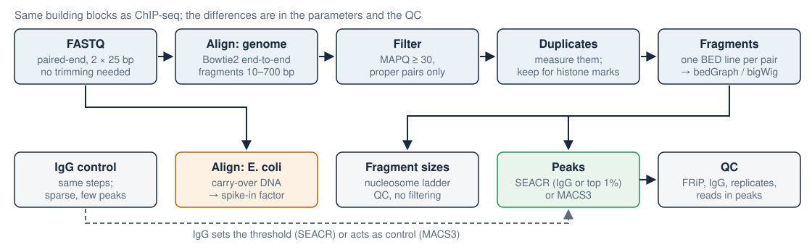{width="95%" fig-align="center"}

- Bowtie2 **end-to-end**, `--very-sensitive`, fragments 10–700 bp, `--no-mixed --no-discordant`: only properly aligned pairs.
- A second alignment to the **E. coli** genome counts the spike-in.

::: notes
This follows the Henikoff-lab CUT&Tag data-processing tutorial (Zheng, Ahmad and Henikoff, protocols.io) and nf-core/cutandrun. For these 25-bp reads we follow the tutorial and omit adapter trimming. Adapter read-through can occur for fragments shorter than 25 bp; the 10-bp minimum does not exclude all such fragments, although end-to-end alignment rejects many adapter-contaminated reads. Inspect the read QC rather than assuming short reads never need trimming. With longer reads (e.g. 2 × 150) you must trim Nextera adapters, just as for ATAC-seq, because many CUT&Tag fragments are shorter than the read. The E. coli alignment uses two more options (--no-overlap --no-dovetail) to avoid counting human reads that happen to align to E. coli. The filters after alignment are those of *From reads to coverage for enrichment assays*: MAPQ ≥ 30 and proper pairs. Duplicates are the step that differs, next slide.
:::

## Align, filter, count

```bash
bowtie2 -p 8 --end-to-end --very-sensitive --no-mixed --no-discordant -I 10 -X 700 \
        -x hg38_chr21_chrM -1 R1.fastq.gz -2 R2.fastq.gz 2> h3k27me3.bowtie2.log \
  | samtools fixmate -m -u - - | samtools sort -o h3k27me3.raw.bam
samtools view -u -q 30 -f 2 -F 1804 h3k27me3.raw.bam chr21 | ... \
  | samtools markdup -s - h3k27me3.bam            # mark duplicates, keep them
```

| | H3K4me3 | H3K27me3 | IgG |
|---|---|---|---|
| read pairs in our files | 25 102 | 58 803 | 293 653 |
| fragments on chr21 after filters | 17 380 | 45 130 | 16 941 |
| duplicate fragments | 1 225 (7%) | 2 356 (5%) | 14 397 (85%) |

::: notes
Our FASTQ files contain only the pairs that aligned to chr21 or chrM in the full genome, plus the E. coli pairs; that is why 98–100% of the human pairs align again, and why 26% of the IgG pairs do not (they are E. coli). After MAPQ ≥ 30, proper pairs and chr21: 17 380 H3K4me3, 45 130 H3K27me3 and 16 941 IgG fragments. The original whole libraries contained 1.58 M H3K4me3 and 2.98 M H3K27me3 read pairs before our filtering: typical CUT&Tag sequencing depths. The chr21 fraction of enriched reads depends on the mark, so multiplying chr21 counts by the inverse chromosome-size fraction would not reliably estimate usable whole-genome fragments. The duplication rates of the two marks are low (5–7%) because these libraries were sequenced far from saturation; the IgG is 85% duplicates. The filter chain is the one of *From reads to coverage for enrichment assays*; markdup without -r only marks duplicates.
:::

## Duplicates are expected {.smaller}

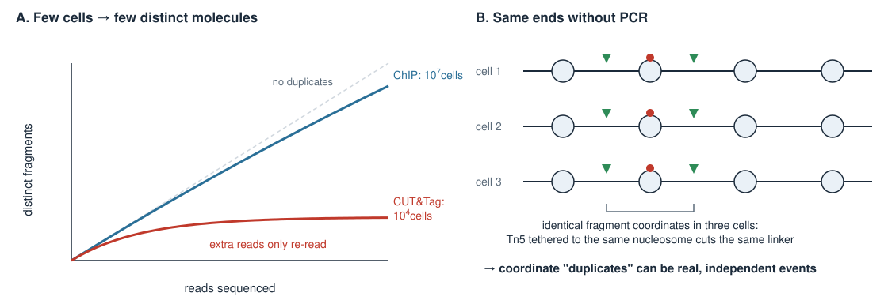{width="92%" fig-align="center"}

- **Few cells, few molecules**: a library from 10<sup>4</sup>–10<sup>5</sup> cells saturates quickly; extra sequencing re-reads the same fragments.
- Tethered Tn5 cuts the **same linkers** in different cells: identical coordinates do not prove a PCR copy.
- Henikoff-lab advice: **keep** duplicates for abundant histone marks; remove them for IgG, TFs and low-input samples.

::: notes
In ChIP-seq, two reads at exactly the same position are almost always PCR copies, because sonication cuts randomly and the library contains millions of distinct molecules. In CUT&Tag both assumptions fail. Cutting is not random: Tn5 tethered to a given nucleosome reaches only a few linker positions, so different cells give the same fragment. And the number of distinct molecules is small, because there are few cells and the enzyme makes few cuts. High duplication is therefore expected and is not by itself a sign of a bad library. It still tells you about complexity: if you sequence a library to a duplication rate of 80%, more sequencing is pointless. IgG libraries are the extreme case: very few distinct molecules, so they are dominated by duplicates. The safe practice is to compute the duplication rate, keep duplicates for histone marks, and check that conclusions do not change if they are removed.
:::

## Real data: duplication and depth {.smaller}

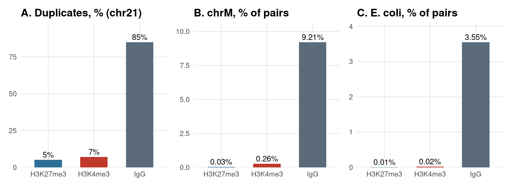{width="90%" fig-align="center"}

- Marks: **5–7%** duplicates (sequenced far from saturation). IgG: **85%**: few distinct molecules, so we remove its duplicates.
- The IgG also has **9.2%** of its pairs on chrM and **3.6%** from E. coli: little tethered human DNA, so carry-over and accessible DNA dominate.

::: notes
A: the fraction of chr21 fragments marked as duplicates (same start and end). B: pairs on chrM as a fraction of the whole library (0.03% H3K27me3, 0.26% H3K4me3, 9.2% IgG): mitochondrial DNA is nucleosome-free and abundant, and untethered pA–Tn5 inserts there just like Tn5 in ATAC-seq. C: E. coli pairs as a fraction of the library. All three panels say the same about the IgG: without a tethered target, the reaction produces few human fragments, so whatever else is in the tube (carry-over DNA, open chromatin, mtDNA) makes up the library, and PCR copies of the few molecules make up most of the reads. For the two marks the duplication rates are low; the argument of the previous slide (identical fragments can be real) matters for deeply sequenced libraries.
:::

## A spike-in for free: E. coli carry-over {.smaller}

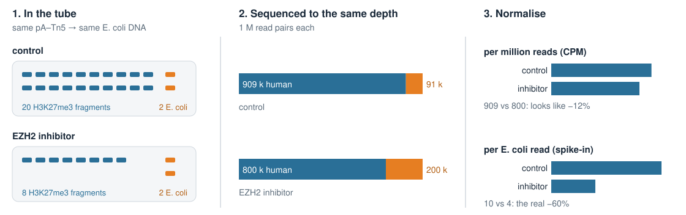{width="95%" fig-align="center"}

- pA–Tn5 and pA–MNase are made in *E. coli*; a little bacterial DNA comes with the enzyme and is tagmented too.
- Same enzyme batch, same amount per reaction → E. coli reads act as an **internal ruler**. Scale factor ∝ 1 / (E. coli fragments).

::: notes
Why a spike-in at all: CPM normalisation assumes that the total amount of signal is the same in every sample. Treat cells with an EZH2 inhibitor and H3K27me3 falls everywhere; every sample is still sequenced to the same depth, so CPM hides most of the loss (here 909 vs 800, −12%, while the truth is −60%). A spike-in that is added in the same amount to every reaction rescales the samples: the fraction of spike-in reads goes up when the target goes down. In the Henikoff tutorial the scale factor is S = C / (number of E. coli fragments), with C an arbitrary constant such as 10 000, and the normalised track is the fragment coverage × S. For CUT&RUN, the original protocol added a defined amount of yeast or Drosophila DNA, and the carry-over E. coli DNA from the pA–MNase preparation was later shown to work as well (Meers et al. 2019). The full treatment of normalisation under global changes, including spike-in normalisation for ChIP-seq, is in *Annotation and differential binding*.
:::

## Real data: how much E. coli? {.smaller}

| | H3K4me3 | H3K27me3 | IgG |
|---|---|---|---|
| all read pairs (whole library) | 1 581 710 | 2 984 630 | 2 127 635 |
| E. coli pairs | 355 | 231 | 75 492 |
| E. coli, % of the library | 0.022% | 0.008% | 3.55% |
| scale factor 10 000 / E. coli | 28.2 | 43.3 | 0.13 |

- The IgG has ~250 times more E. coli than the marks: it makes few human fragments, so the same carry-over is a large share.
- The ruler only works if every reaction got the **same** amount of enzyme from the **same** batch. Check the spike-in fraction, do not trust it blindly.

::: notes
E. coli pairs were counted by aligning all read pairs to the E. coli K-12 genome (U00096.3) with the Henikoff-lab settings; our FASTQ files contain all of them, so these are whole-library numbers. According to the Henikoff tutorial, the E. coli fraction ranges from about 0.01% to 10% in typical H3K27me3 CUT&Tag of 65 000 K562 cells; ours are at the low end. The scale factor is S = 10 000 / E. coli pairs. Two points. First, these samples are different antibodies, so their spike-in-scaled signals are not comparable; spike-in scaling is for the same mark across conditions. Second, it assumes every reaction got the same amount of E. coli DNA; with different enzyme batches or amounts, or very different cell numbers, the factors reflect handling. Replicates whose spike-in-scaled totals agree are the best check. Commercial kits now often add a defined spike-in (E. coli DNA of known amount, or barcoded designer nucleosomes) instead of relying on carry-over.
:::

## IgG: what the negative control measures {.smaller}

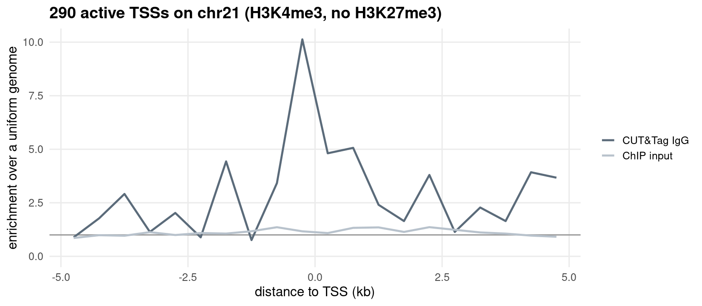{width="92%" fig-align="center"}

- A non-specific IgG brings pA–Tn5 nowhere in particular: what remains is **untethered** cutting, mostly in **open chromatin** (promoters).
- It is sparse (2 544 distinct fragments on chr21), so it cannot be used like a ChIP input for a local λ, but it shows where false peaks would be.

::: notes
Profile of fragment centres around the 290 active protein-coding TSSs on chr21 (TSSs in an ENCODE H3K4me3 peak and without H3K27me3 within 2 kb), in 500-bp bins, as enrichment over a uniform distribution. The deduplicated IgG is 8 times enriched within ± 500 bp of active TSSs (the peak bin about 10 times); the ChIP input is almost flat (1.06 times). The IgG shows where untethered or non-specifically bound pA–Tn5 cuts: accessible DNA, as in ATAC-seq. That is why the IgG is the right control for CUT&Tag: it shows the background that a target's peaks have to beat. It also shows its limits: with a few thousand fragments it cannot give a smooth local background, the motivation for SEACR on the next slides. A no-antibody control, or ATAC-seq of the same cells, shows the same thing.
:::

## Peak calling on sparse data {.smaller}

- MACS3 models background with a Poisson λ estimated from a control or from the sample's neighbourhood (*Peak calling*). In CUT&Tag most of the genome has **zero** reads: λ is tiny, so almost any pile-up looks significant, and the control is too sparse to estimate λ well.
- **SEACR** (Meers, Tenenbaum & Henikoff 2019) avoids the background model: it works on **blocks of contiguous signal** and asks how much signal a block must contain to be more typical of the target than of the IgG.
- Both are used: nf-core/cutandrun runs SEACR by default and MACS3 as an option.

::: notes
This slide is text because the point is conceptual. Recall the MACS logic: at each position compare the pileup k with λ_local = max(λ_BG, λ_1k, λ_5k, λ_10k). With 300 000 fragments on chr21, λ_BG is about 300 000 × 200 / (4 × 10^7) ≈ 1.5 for a 200-bp window, and in large regions the local windows are empty. A dozen fragments is then extremely significant, which is right for strong peaks but also lets through small piles of untethered cutting at open chromatin. MACS3 still works on CUT&Tag data, especially with the IgG as control and a strict cutoff; many published analyses use it. SEACR was designed for exactly this situation and is the method the CUT&RUN/Tag developers recommend; it has two settings (stringent, relaxed) and either an IgG control or a fixed top fraction.
:::

## SEACR: thresholds from signal blocks {.smaller}

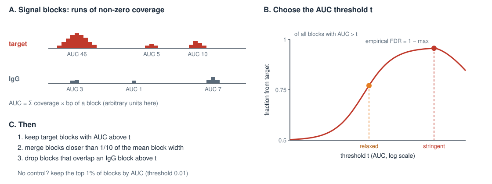{width="95%" fig-align="center"}

- A **block** = a run of non-zero coverage in the bedGraph; its **AUC** = total signal in it.
- Threshold *t*: where the fraction of blocks above *t* that are target (not IgG) blocks is highest (stringent), or at the knee below it (relaxed).

::: notes
Walk through it. Panel A: target and IgG bedGraphs are cut into blocks wherever the coverage drops to zero, and each block gets an AUC (the sum of coverage times bp). Panel B: for every possible AUC threshold t, SEACR counts the target blocks above t and the IgG blocks above t, and computes the fraction that are target blocks. At low t many IgG blocks pass; at high t almost only target blocks do. The stringent threshold is the t with the highest fraction (1 minus that fraction is reported as an empirical FDR); the relaxed threshold is lower, roughly at the knee of the curve. Panel C: blocks above the threshold are merged when they are closer than a tenth of the mean block width, and blocks that overlap an IgG block above the threshold are removed. Without an IgG, SEACR keeps the top fraction of blocks by AUC (e.g. 0.01 = top 1%). With "norm", SEACR rescales the IgG to the target before comparing; use "non" only if the tracks are already normalised (for example with the spike-in). Because blocks are defined by contiguous non-zero coverage, SEACR works best on sparse data: very deep data turn the whole genome into one block.
:::

## Running SEACR and MACS3

```bash
# fragments -> bedGraph (zero-coverage regions omitted)
bedtools genomecov -bg -i h3k4me3.frag.bed -g chrom.sizes > h3k4me3.bedgraph
# SEACR: with the IgG as control, or the top 1% of blocks
bash SEACR_1.3.sh h3k4me3.bedgraph igg.bedgraph norm stringent h3k4me3_seacr_igg
bash SEACR_1.3.sh h3k4me3.bedgraph 0.01 non stringent h3k4me3_seacr_top1
# MACS3 on the fragments, IgG as control
macs3 callpeak -t h3k4me3.bam -c igg.bam -f BAMPE -g 4.0e7 --keep-dup all -q 0.01 -n h3k4me3_macs
```

- SEACR output: one line per region, with total signal (AUC), maximum and the position of the maximum.

::: notes
The SEACR script is a bash wrapper around an R script (github.com/FredHutch/SEACR); it needs bedtools and R on the PATH. The bedGraph is made from the fragment BED (one line per read pair, from the leftmost to the rightmost base), so the signal is fragment coverage, as for paired-end ChIP. For H3K27me3 we call MACS3 in --broad mode, as for broad ChIP-seq marks (*Peak calling*). --keep-dup all because we kept the duplicates on purpose. Each call takes seconds on chr21.
:::

## Real data: SEACR vs MACS3 {.smaller}

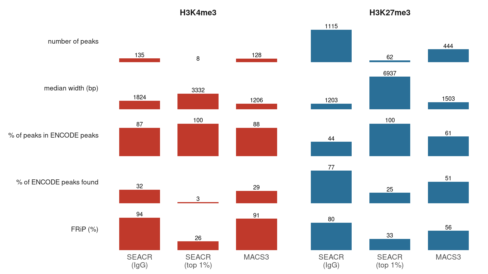{width="95%" fig-align="center"}

- **H3K4me3**: SEACR (IgG) 135 and MACS3 128 peaks, ~87% in ENCODE peaks, FRiP 0.91–0.94. "Top 1%" keeps only 8: 1% of just 980 signal blocks.
- **H3K27me3**: SEACR (IgG) is the most sensitive (77% of ENCODE regions found) but least precise (44% in ENCODE); MACS3 `--broad` lies in between.

::: notes
Six calls on the same chr21 data, scored against ENCODE's ChIP peaks for the same mark (492 H3K4me3 and 1 451 H3K27me3 regions on chr21). For the sharp mark, the two callers agree closely. For the broad mark the result depends strongly on the settings: the deduplicated IgG is so sparse (2 544 fragments) that SEACR's threshold ends up low and many small blocks pass; the top-1% rule keeps only the 62 strongest domains, which are all in ENCODE's set but miss most of it. MACS3 in broad mode is in between. The top-1% number depends on how many blocks there are, i.e. on depth and on the size of the genome analysed: on chr21 alone 1% is very few; on a whole genome the same rule gives thousands. Lesson: compare callers in a browser, and report the caller, its settings and the control in the methods.
:::

## Signal-to-noise: FRiP and the fingerprint {.smaller}

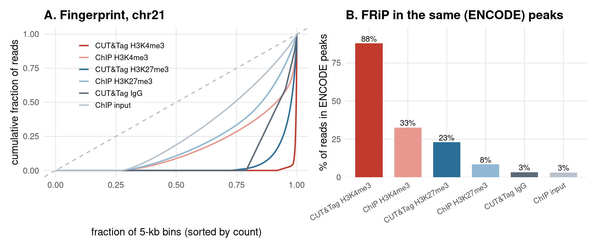{width="92%" fig-align="center"}

- FRiP in the **same** ENCODE peaks: H3K4me3 **0.88** CUT&Tag vs **0.33** ChIP; H3K27me3 **0.23** vs **0.084**. Controls: IgG 0.033, input 0.032 (no enrichment: 0.012).
- Fingerprint: CUT&Tag puts 90% (H3K4me3) and 30% (H3K27me3) of its reads in the top 1% of 5-kb bins; ChIP 23% and 6%, input 3%.

::: notes
The fair comparison uses one reference set of peaks for both assays: ENCODE's ChIP peaks, which if anything favours ChIP. Each read or fragment is counted once, at its centre. A: the fingerprint (the logic of deepTools plotFingerprint): sort 5-kb bins by count and plot the cumulative fraction of reads. A library without enrichment follows the diagonal; the more the curve bends to the bottom right, the more of the reads sit in a few bins. The CUT&Tag curves are flat for most of chr21 because most bins have no fragments at all; the ChIP curves sit close to the input. The IgG also looks concentrated (13% of reads in the top 1% of bins): sparse data look enriched, which is why the fingerprint is read together with the control. B: FRiP. The broad mark has lower FRiP in both assays because ENCODE's narrow peaks capture only part of the broad domains.
:::

## How many reads do you need? {.smaller}

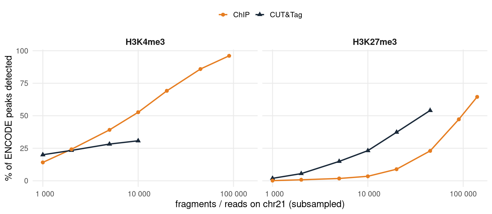{width="90%" fig-align="center"}

- **H3K27me3**: CUT&Tag finds 54% of the ENCODE regions with 45 000 fragments; ChIP needs ~110 000 reads for the same (47% at 90 000, 65% at 140 000).
- **H3K4me3**: CUT&Tag finds the strong promoter peaks (91% of the strongest quarter) with a few thousand fragments, then levels off at ~32%: it does not see the weak, mostly distal ENCODE peaks.

::: notes
Both libraries were subsampled to the same number of reads (fragments) on chr21, five times each; a peak counts as detected if it has more reads than expected (p < 0.001) from the library's own background density outside all ENCODE peaks. The H3K27me3 panel is the textbook result: at equal depth CUT&Tag detects far more, and ChIP needs about 2.5 times as many reads to catch up. The H3K4me3 panel is the honest complication. ENCODE's set includes many weak peaks (median 9–14 ChIP reads, mostly away from TSSs); the CUT&Tag library has almost no fragments there even at full depth, so more sequencing would not help much. These may be weak real H3K4me3 sites that this low-input library cannot reach, partly ChIP background, or differences between two K562 cultures in two labs. This is one library of 1.6 M pairs, made for a methods paper. Scaled to the genome (chr21 ≈ 1.5%), 45 000 chr21 fragments correspond to about 3 M fragments, 110 000 ChIP reads to about 7 M.
:::

## The open-chromatin bias of Tn5 {.smaller}

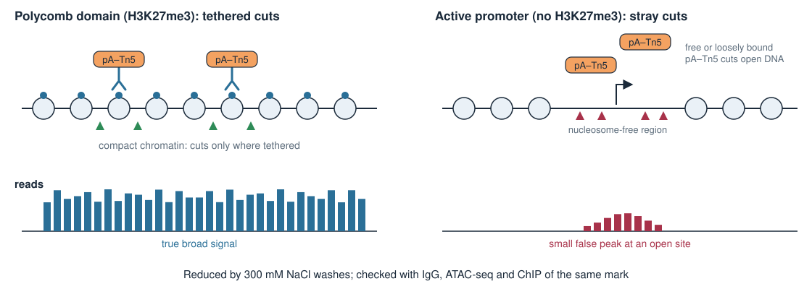{width="92%" fig-align="center"}

- Tn5 that is free or loosely bound prefers **accessible DNA**, so CUT&Tag can show small peaks at active promoters for **any** target, including repressive marks.
- High-salt washes reduce it; IgG, ATAC-seq or ChIP of the same mark reveal it.

::: notes
Tn5 is the ATAC-seq enzyme: wherever it is not tethered, it inserts into nucleosome-free DNA. Kaya-Okur et al. 2019 introduced the 300 mM NaCl washes to remove unbound pA–Tn5 for exactly this reason; the same group later turned the effect into an assay (CUTAC: low-salt tagmentation with an H3K4me2 antibody maps accessibility, Henikoff et al. 2020). Wang & Zhang (2021, preprint) argued that Tn5-based profiling methods in general carry an open-chromatin bias, most visible for marks and factors with weak signal. Be balanced: for abundant histone marks the bias is small relative to the true signal; for sparse targets, and in single-cell CUT&Tag where every cell has very few fragments, it matters more. The practical consequences: do not interpret small CUT&Tag peaks at active promoters for a repressive mark without checking IgG and a second method, and use the IgG to remove open-chromatin peaks.
:::

## Real data: H3K27me3 at active promoters {.smaller}

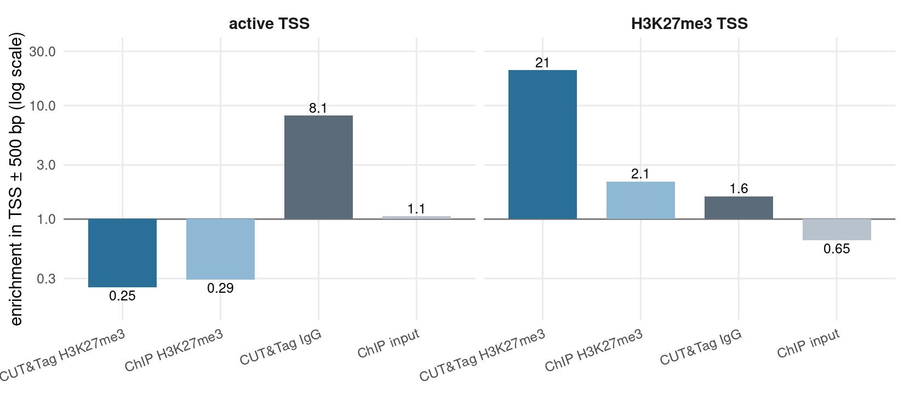{width="92%" fig-align="center"}

- IgG: **8.1×** enriched at active promoters (input 1.06×): untethered pA–Tn5 does go to open chromatin.
- H3K27me3 CUT&Tag: **0.25×** at active promoters (ChIP 0.29×) and **21×** at Polycomb-marked promoters (ChIP 2.1×). In this abundant-mark, high-salt dataset the bias is swamped by the true signal.

::: notes
Enrichment of read centres within ± 500 bp of 290 active TSSs and of 47 TSSs inside ENCODE H3K27me3 peaks on chr21, relative to a uniform distribution (log scale). This is the balanced view: the open-chromatin bias is real and visible in the IgG, but for H3K27me3 with 300 mM salt washes it does not create H3K27me3 signal at active promoters; CUT&Tag is depleted there just like ChIP. The bias becomes a problem when the tethered signal is weak relative to the untethered background: rare marks, weak antibodies, very few cells, single cells, and transcription factors whose sites are themselves in open chromatin (where a TF peak and an accessibility peak cannot be told apart without controls). Check with the IgG, with ATAC-seq of the same cells, and where possible with ChIP or CUT&RUN.
:::

## QC for CUT&RUN and CUT&Tag {.smaller}

| check | ChIP-seq habit | CUT&RUN / CUT&Tag |
|---|---|---|
| depth | 20–45 M reads | 2–8 M is usually enough; watch saturation |
| duplicates | remove; high rate = bad library | expected; report, keep for histone marks |
| control | input, needed for the local λ | IgG: sparse; shows open-chromatin background |
| fragment sizes | (single-end: not measured) | nucleosome ladder; < 120 bp for TFs (CUT&RUN) |
| signal-to-noise | FRiP (ENCODE: > 1% for TF ChIP), fingerprint | FRiP usually much higher; compare with IgG |
| normalisation | input, spike-in chromatin | E. coli carry-over or added spike-in |
| replicates | two biological replicates, IDR | the same: two biological replicates, correlation of signal in bins |

::: notes
The left column refers to *Experimental design and QC for epigenomic assays* and the ChIP-seq units. Most rows change because of the chemistry. A useful extra QC in CUT&Tag is the fraction of reads in known open chromatin (e.g. in ATAC-seq peaks of the same cell type) for a target that should not be there; and, as always, two biological replicates whose signal correlates in genomic bins. ENCODE's FRiP threshold of 1% was made for ChIP; for CUT&Tag of abundant marks a FRiP far above that is expected, and a FRiP close to the IgG's is a failed experiment.
:::

## Production pipelines {.smaller}

- **nf-core/cutandrun** (Nextflow): trimming, Bowtie2 to the genome and to a spike-in genome, duplicate marking (removed only for the IgG by default), spike-in or CPM scaling, SEACR and/or MACS2 peaks, IgG-based filtering, FRiP and fragment QC, a MultiQC report.
- The Henikoff-lab **CUT&Tag data processing and analysis tutorial** (Zheng, Ahmad & Henikoff, protocols.io): the steps of this lecture, one by one.

```bash
nextflow run nf-core/cutandrun -profile singularity --input samplesheet.csv \
    --genome GRCh38 --outdir results --peakcaller seacr,macs2
```

::: notes
The pipeline is described in Hodgetts et al., JOSS 2026. Its sample sheet has one line per FASTQ pair with a group, a replicate number and the name of the control group (the IgG). As always with nf-core: run it once on the cluster with a container profile, read the MultiQC report, and know what each step does, which is what the exercise is for. Defaults change between versions; check the documentation of the version you run and report it in the methods.
:::

## Pitfalls {.smaller}

| pitfall | what happens | fix |
|---|---|---|
| removing all duplicates of an abundant mark | signal compressed at strong sites | keep them; report the rate |
| treating IgG like input in MACS3 | λ from an almost empty track | SEACR, or a strict MACS3 cutoff and IgG-overlap filter |
| CPM after a global change | the loss of a mark is hidden | spike-in (E. coli or added), checked for consistency |
| trusting small peaks at active promoters | Tn5 open-chromatin bias | IgG, ATAC-seq, ChIP of the same mark |
| CUT&Tag for a weakly bound TF | high-salt washes strip it | CUT&RUN or ChIP |
| over-sequencing | 90% duplicates, no new information | look at saturation; pool libraries sensibly |

::: notes
Each row is a mistake seen in published work or in the methods sections of papers. Ask students which of them they could detect from the fragment-length plot, the duplication rate, the IgG track or the E. coli fraction alone.
:::

## Summary {.smaller}

| topic | key idea |
|---|---|
| principle | antibody-tethered enzyme cuts in situ; uncut DNA never enters the library |
| CUT&RUN | pA–MNase + Ca<sup>2+</sup>, fragments diffuse out; good for TFs |
| CUT&Tag | pA–Tn5 with adapters + Mg<sup>2+</sup>, PCR directly; good for histone marks, low input |
| data | 2–8 M reads, high FRiP, fragment ladder, many (often real) duplicates |
| spike-in | E. coli carry-over DNA: scale factor ∝ 1 / E. coli fragments |
| control | IgG: sparse, shows untethered (open-chromatin) cutting |
| peaks | SEACR: AUC threshold from target vs IgG blocks; MACS3 also used |
| caveats | Tn5 open-chromatin bias; salt washes vs TF binding; small reference data sets |

::: notes
Students should leave able to: explain why the background is low, read a fragment-length plot of a CUT&RUN or CUT&Tag library, decide whether duplicates should be removed, compute a spike-in scale factor and say when it is valid, explain the SEACR threshold, compute FRiP and judge a claim based on small CUT&Tag peaks at active promoters.
:::

## Key papers (optional further reading) {.smaller}

*Not required reading and not examined. For those who want the primary literature.*

- Skene & Henikoff 2017, *eLife*. [An efficient targeted nuclease strategy for high-resolution mapping of DNA binding sites](https://doi.org/10.7554/eLife.21856). CUT&RUN.
- Kaya-Okur et al. 2019, *Nat Commun*. [CUT&Tag for efficient epigenomic profiling of small samples and single cells](https://doi.org/10.1038/s41467-019-09982-5). CUT&Tag, high-salt washes, single cells.
- Meers, Bryson, Henikoff & Henikoff 2019, *eLife*. [Improved CUT&RUN chromatin profiling tools](https://doi.org/10.7554/eLife.46314). pAG–MNase, and E. coli carry-over DNA as a spike-in.
- Meers, Tenenbaum & Henikoff 2019, *Epigenetics Chromatin*. [Peak calling by Sparse Enrichment Analysis for CUT&RUN chromatin profiling](https://doi.org/10.1186/s13072-019-0287-4). SEACR.
- Kaya-Okur et al. 2020, *Nat Protoc*. [Efficient low-cost chromatin profiling with CUT&Tag](https://doi.org/10.1038/s41596-020-0373-x). The protocol and the data used here.
- Wang & Zhang 2021, *bioRxiv* (preprint). [Tn5 transposase-based epigenomic profiling methods are prone to open chromatin bias](https://doi.org/10.1101/2021.07.09.451758). The critical view.
