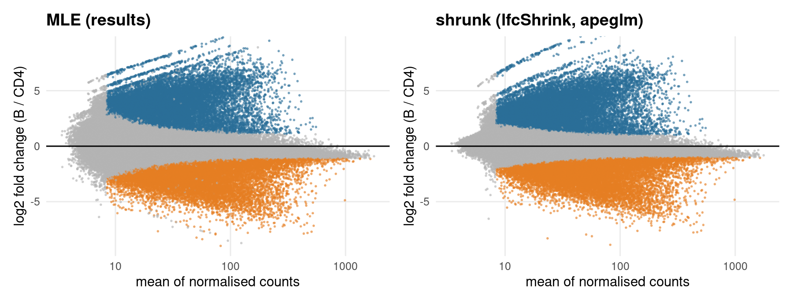

## Goal

After this exercise you will be able to:

- Compute **median-of-ratios size factors** by hand, and predict what a **global change** in accessibility or a difference in signal-to-noise does to them.
- Write and explain the **design matrix** of a paired experiment (`~ donor + celltype`), and say when pairing helps.
- Read an **MA plot** and a **volcano plot** of peaks, and interpret a log2 fold change and an adjusted $p$-value.
- Turn a public peak × sample count matrix into a differential accessibility analysis in R: decode the samples, **lift the peaks to GRCh38**, build a `SummarizedExperiment`, explore, run [DESeq2](https://bioconductor.org/packages/release/bioc/html/DESeq2.html) with collapsed technical replicates, shrink fold changes, and compare normalisations and designs.
- Annotate differential peaks with their nearest gene, check them against known markers and against RNA-seq, and **save the result** for *Motifs, motif enrichment and TF footprinting*.

## Background

**The count matrix.** One row per peak (a consensus set shared by all samples), one column per library, integer counts of fragments in the peak. From here on the analysis is the RNA-seq one: DESeq2 or edgeR.

**Size factors (DESeq2, median of ratios).** For peak $i$ and sample $j$ with count $k_{ij}$ and $m$ samples:

$$ s_j = \operatorname{median}_i \frac{k_{ij}}{\left( \prod_{v=1}^{m} k_{iv} \right)^{1/m}} $$

Peaks with a zero in any sample are left out of the median. Normalised count = $k_{ij} / s_j$. The assumption: **the typical peak does not change**. TMM (edgeR) makes the same assumption; normalising by total reads assumes the total signal per cell is the same; background-bin normalisation (csaw) assumes that reads outside peaks are constant.

**Design.** `~ donor + celltype` fits one baseline per donor and one cell-type effect shared by all donors: the cell-type coefficient is the within-donor log2 fold change. `~ celltype` ignores who is who.

**FRiP** (fraction of reads in peaks) = reads in peaks / all reads. Expected count in a peak ≈ depth × FRiP × (that peak's share of the reads in peaks).

**Our definition of a differential peak**, used again in *Motifs, motif enrichment and TF footprinting*: adjusted $p$ < 0.05 **and** |shrunken log2 fold change| > 1. Positive = more open in B cells (`B_up`), negative = more open in CD4 T cells (`T_up`).

## Data

ATAC-seq and RNA-seq count matrices from Corces et al. 2016 (GEO [GSE74912](https://www.ncbi.nlm.nih.gov/geo/query/acc.cgi?acc=GSE74912) and [GSE74246](https://www.ncbi.nlm.nih.gov/geo/query/acc.cgi?acc=GSE74246)), the UCSC hg19 → hg38 liftOver chain, and the GENCODE v46 annotation. From the course repository:

```bash
data/download.sh differential-accessibility      # about 70 MB (plus the GTF, 40 MB)
mkdir -p ~/epi/diffacc && cd ~/epi/diffacc
D=/path/to/course/data                           # where download.sh put the files
```

- `corces2016_atac_counts.txt.gz`: columns `Chr Start End` (hg19, 0-based starts, 590 650 peaks of 500 bp) followed by 132 libraries (77 from healthy donors, the rest from AML patients and bulk CD34+ cells).
- `corces2016_rna_counts.txt.gz`: gene symbols × 81 RNA-seq libraries.

**What the column names mean.** From the GEO sample table of GSE74912 (each library is listed with its donor and cell type): `Donor4983-CD4-9A-150120` is donor 4983, CD4 T cells, cell-type code 9, library A, sequenced on 2015-01-20. The early libraries have only donor and code: `4983-7A` is donor 4983, code 7 (monocytes), library A. The codes are 1 HSC, 2 MPP, 3 LMPP, 4 CMP, 5 GMP, 6 MEP, 7 monocyte, 9 CD4 T cell, 10 CD8 T cell, 11 NK cell, 13 B cell, 14 CLP, 15 erythroblast. Libraries A, B (C) of the same donor and cell type are **technical replicates** (Corces et al. 2016, Supplementary Table 1).

**Shortcuts, said plainly.** We start from the authors' count matrix, not from BAM files (counting is shown in the lecture and in *ATAC-seq processing and peak calling*), and the peaks were called on hg19 and are lifted to GRCh38 rather than re-called.

The R part runs in about 12 minutes in total and needs about 4 GB of memory. On the cluster, run the R part in an interactive job or wrap it in an `sbatch` script (`Rscript diffacc.R`).

## By hand

Do these on paper.

**B1. Median of ratios.** Four peaks, three samples:

| peak | S1 | S2 | S3 |
|---|---:|---:|---:|
| p1 | 100 | 200 | 50 |
| p2 | 40 | 80 | 20 |
| p3 | 300 | 600 | 150 |
| p4 | 20 | 320 | 10 |

(a) Compute the geometric mean of each row. (Hint: $100 \cdot 200 \cdot 50 = 10^6$.)

(b) Divide each count by its row's geometric mean, and take the median per column. These are the size factors.

(c) Compute the normalised counts of p4. Which peak changes, and in which sample?

(d) Compute size factors from total counts instead (column sums, divided by their geometric mean; a calculator helps). Why is S2's factor larger than with the median of ratios, and what does that do to p1–p3 in S2?

**B2. A global opening.** A drug is expected to open chromatin. Both libraries are sequenced to 1000 fragments (a toy scale). Counts in four peaks and in the background (all reads outside peaks):

| | p1 | p2 | p3 | p4 | background |
|---|---:|---:|---:|---:|---:|
| control | 50 | 100 | 150 | 200 | 500 |
| drug | 80 | 160 | 240 | 320 | 200 |

(a) What is the FRiP of each library?

(b) Normalise with the median of ratios computed on the four peaks (two samples: the ratio drug/control of the size factors is the median of the per-peak ratios). What fold change do you report for each peak?

(c) Normalise instead by the background reads. What fold change do you report now?

(d) Normalise by total reads. What do you get?

(e) Give one biological and one technical explanation for the data. What extra information would let you decide between them?

**B3. Paired or unpaired.** Three donors give B cells and CD4 T cells (6 samples, ordered D1-T, D1-B, D2-T, D2-B, D3-T, D3-B, with CD4 T as the reference level).

(a) Write the design matrix for `~ celltype` (columns: intercept, celltypeBcell).

(b) Write the design matrix for `~ donor + celltype` (columns: intercept, donorD2, donorD3, celltypeBcell).

(c) How many residual degrees of freedom does each model have? What does the intercept mean in (b)?

(d) In the toy figure of the lecture, the paired test wins clearly. In the real data, 47 peaks have a significant donor effect and the paired model finds fewer differential peaks (36 703 vs 41 671 at padj < 0.05). Explain both observations. Which model would you report, and why?

**B4. Technical replicates.** Donor 5483 has two B-cell libraries, A and B, with 120 and 80 fragments in a peak.

(a) What count goes into the collapsed sample?

(b) A colleague instead keeps A and B as two samples in `~ celltype`. How many "B-cell replicates" does the model think there are? Will the $p$-values be too small or too large? Why?

**B5. How many reads per peak?** A library has 40 million fragments and FRiP 0.25; the consensus set has 100 000 peaks.

(a) What is the mean number of fragments per peak?

(b) Another library has 10 million fragments and FRiP 0.4. Mean per peak? Which library gives more information per peak?

(c) A peak gets 5 fragments in a sample. Ignoring biological variation (Poisson), what is the relative standard deviation of that count? Would you trust a 4-fold difference between 5 and 20 fragments in two single samples?

**B6. Read the MA plot.** Look at the MA plots in the lecture (MLE on the left, apeglm-shrunk on the right).

{width="100%"}

(a) Why do the MLE fold changes fan out to ±8 at the left of the plot?

(b) Why does shrinkage change the left of the plot much more than the right?

(c) Where is the centre of the grey cloud? What would you suspect if it were at +0.7?

(d) Are there coloured points with small mean counts on the right panel? Why are there few?

**B7. Interpret the table.** Four rows of a DESeq2 result for B vs CD4 (positive = more open in B):

| peak | baseMean | log2FC (MLE) | log2FC (shrunk) | padj |
|---|---:|---:|---:|---:|
| a | 1800 | −2.3 | −2.3 | $10^{-40}$ |
| b | 4 | 6.1 | 0.4 | 0.30 |
| c | 250 | 0.8 | 0.7 | 0.001 |
| d | 90 | 3.0 | 2.6 | 0.02 |

(a) Which peaks are differential by our definition, and in which direction?

(b) How many times more open is peak a in CD4 T cells than in B cells?

(c) Peak c is significant but not differential by our definition. Is it "not changed"? What would you write about it?

(d) Why is peak b's MLE fold change so large, and why is it not significant?

**B8. Judge the claim.** A paper reports: "Peaks more open in B cells are near genes such as *PAX5* and *CD79A*, so these peaks drive B-cell gene expression. Moreover, 30% of B-specific peaks are near genes that are *not* more expressed in B cells, showing that accessibility and expression are uncoupled."

Give two reasons why the first sentence overstates what was shown, and two reasons why a B-specific peak can sit next to a gene that is not differentially expressed.

## On the command line

### C1 — Look at the count matrix

```bash
zcat $D/corces2016_atac_counts.txt.gz | head -1 | tr '\t' '\n' | head -30
zcat $D/corces2016_atac_counts.txt.gz | head -1 | tr '\t' '\n' | grep -c .
zcat $D/corces2016_atac_counts.txt.gz | head -1 | tr '\t' '\n' | grep -E -- '-(Bcell|CD4)-'
zcat $D/corces2016_atac_counts.txt.gz | head -3 | cut -f1-6
zcat $D/corces2016_atac_counts.txt.gz | tail -n +2 | awk '{ w[$3 - $2]++ } END { for (k in w) print k, w[k] }'
zcat $D/corces2016_atac_counts.txt.gz | tail -n +2 | cut -f1 | sort | uniq -c | sort -k1,1nr | head -25
```

(a) How many columns, and how many libraries? Which B-cell and CD4 T-cell libraries are there, and from which donors? Which donors have both?

(b) Are the coordinates 0-based or 1-based? (Use the widths.)

(c) Which chromosomes are present? Which are absent, and what would that mean for comparing male and female donors?

### C2 — Reads in peaks for one library, and the peaks as BED

```bash
zcat $D/corces2016_atac_counts.txt.gz | awk -F'\t' '
  NR == 1 { for (i = 1; i <= NF; i++) if ($i == "Donor1022-Bcell-13-150120") c = i; next }
  { s += $c; if ($c == 0) z++ }
  END { print "column", c, "reads in peaks", s, "peaks with 0 reads", z }'
zcat $D/corces2016_atac_counts.txt.gz | tail -n +2 | cut -f1-3 > corces_hg19.bed
head -2 corces_hg19.bed
```

(a) How many reads in peaks does the B-cell library of donor 1022 have, and in how many peaks does it have no read at all?

(b) Why do so many peaks have zero reads in a B-cell library? (Where were the peaks called?)

## In R

You need DESeq2, edgeR, apeglm, GenomicRanges, rtracklayer, data.table, ggplot2 and ggrepel (see *Install the software you need*).

```r
suppressPackageStartupMessages({
  library(data.table); library(GenomicRanges); library(rtracklayer)
  library(SummarizedExperiment); library(DESeq2); library(edgeR); library(ggplot2); library(ggrepel)
})
D <- "/path/to/course/data"
```

### R1 — Load and decode the samples

```r
atac <- fread(file.path(D, "corces2016_atac_counts.txt.gz"))        # about 5 s
dim(atac)
cn <- names(atac)[-(1:3)]
healthy <- grep("^(Donor)?[0-9]+-", cn, value = TRUE)
re <- "^(?:Donor)?([0-9]+)-(?:[A-Za-z][A-Za-z0-9]*-)?([0-9]+)([A-C]?)(?:-[0-9]+)?$"
m  <- regmatches(healthy, regexec(re, healthy, perl = TRUE))
code2type <- c(`1` = "HSC", `2` = "MPP", `3` = "LMPP", `4` = "CMP", `5` = "GMP", `6` = "MEP",
               `7` = "Mono", `9` = "CD4", `10` = "CD8", `11` = "NK", `13` = "Bcell",
               `14` = "CLP", `15` = "Ery")
samples <- data.frame(sample = healthy, donor = sapply(m, `[`, 2),
                      celltype = unname(code2type[sapply(m, `[`, 3)]), rep = sapply(m, `[`, 4))
table(samples$celltype, samples$donor)
```

(a) Explain the regular expression piece by piece. Which part captures the donor, the cell-type code and the replicate letter? Why must the optional cell-type word start with a letter? (Try what happens to `Donor7256-1A-110614` if it may start with a digit.)

(b) How many healthy libraries, donors and cell types are there? Which donors have both B cells and CD4 T cells?

(c) Which columns did `grep` leave out, and what are they?

### R2 — Lift the peaks to GRCh38

```r
gr19 <- GRanges(atac$Chr, IRanges(atac$Start + 1, atac$End))
chainf <- tempfile(fileext = ".chain")
writeLines(readLines(gzfile(file.path(D, "hg19ToHg38.over.chain.gz"))), chainf)
lo <- liftOver(gr19, import.chain(chainf))
table(pmin(lengths(lo), 2))                                     # 0, 1, 2 or more pieces
keep <- which(lengths(lo) == 1)
gr38 <- unlist(lo[keep])
ok <- width(gr38) == 500 & as.character(seqnames(gr38)) == as.character(seqnames(gr19)[keep])
sum(!ok)
keep <- keep[ok]; gr38 <- gr38[ok]
names(gr38) <- sprintf("peak%06d", keep)
length(gr38)
```

(a) How many peaks fail, how many split into several pieces, and how many single pieces change width or chromosome? What fraction is kept?

(b) Why `atac$Start + 1`?

(c) Why name the peaks by their row number in the original file?

### R3 — A SummarizedExperiment of the eight libraries

```r
sel <- samples[samples$celltype %in% c("Bcell", "CD4") & samples$donor %in% c("1022", "4983", "5483"), ]
cnt <- as.matrix(atac[keep, sel$sample, with = FALSE])
rownames(cnt) <- names(gr38)
cd <- DataFrame(donor = factor(sel$donor), celltype = factor(sel$celltype, levels = c("CD4", "Bcell")),
                rep = sel$rep, row.names = sel$sample)
cd$unit <- paste(cd$donor, cd$celltype, sep = "_")
se <- SummarizedExperiment(assays = list(counts = cnt), rowRanges = gr38, colData = cd)
se
colSums(assay(se)) / 1e6
lcpm <- cpm(assay(se), log = TRUE, prior.count = 2)[rowMeans(cpm(assay(se))) >= 2, ]
round(cor(lcpm), 2)
```

(a) How many reads in peaks does each library have? Which is the smallest?

(b) What is the correlation between the technical replicates of donor 5483 (B cells; CD4 T cells)? Between the B-cell libraries of different donors? Between B and T cells?

### R4 — PCA: all cell types, then our six samples

```r
cnt_all <- as.matrix(atac[keep, samples$sample, with = FALSE])
use <- rowMeans(cnt_all) >= 10
dall <- DESeqDataSetFromMatrix(cnt_all[use, ], data.frame(samples[, 2:3], row.names = samples$sample), ~ 1)
vall <- vst(dall, blind = TRUE)                                  # a few seconds
plotPCA(vall, intgroup = "celltype", ntop = 10000)

dds <- DESeqDataSet(se, design = ~ donor + celltype)
dds <- collapseReplicates(dds, groupby = dds$unit)
colData(dds)
vsd <- vst(dds, blind = TRUE)
plotPCA(vsd, intgroup = c("celltype", "donor"))
```

(a) In the PCA of all 77 libraries, which cell types group together? Is there a donor effect you can see?

(b) After `collapseReplicates`, how many columns are there, and what are the counts of `5483_Bcell` (compare with the two libraries in `se`)?

(c) In the PCA of the six samples, what separates on PC1? On PC2?

### R5 — DESeq2 with the paired design

```r
dds <- dds[rowSums(counts(dds) >= 10) >= 3, ]
nrow(dds)
system.time(dds <- DESeq(dds))
resultsNames(dds)
plotDispEsts(dds)
res <- results(dds, name = "celltype_Bcell_vs_CD4", alpha = 0.05)
summary(res)
```

(a) How many peaks pass the filter? Why "≥ 10 reads in ≥ 3 samples" and not "in all 6"?

(b) How long does `DESeq()` take? What is the typical dispersion (`median(dispersions(dds))`)? What coefficient of variation between donors is that?

(c) How many peaks have padj < 0.05, in each direction?

### R6 — Fold-change shrinkage, MA and volcano plots

```r
system.time(shr <- lfcShrink(dds, coef = "celltype_Bcell_vs_CD4", type = "apeglm"))
par(mfrow = c(1, 2))
plotMA(res, ylim = c(-8, 8), main = "MLE")
plotMA(shr, ylim = c(-8, 8), main = "apeglm")
cls <- ifelse(!is.na(res$padj) & res$padj < 0.05 & shr$log2FoldChange >  1, "B_up",
       ifelse(!is.na(res$padj) & res$padj < 0.05 & shr$log2FoldChange < -1, "T_up", "ns"))
table(cls)
vol <- data.frame(lfc = shr$log2FoldChange, p = -log10(res$padj), cls = cls)
ggplot(vol[!is.na(vol$p), ], aes(lfc, p, colour = cls)) + geom_point(size = 0.4) +
  scale_colour_manual(values = c(B_up = "#2a6f97", T_up = "#e67e22", ns = "grey70"))
```

(a) How many B_up and T_up peaks are there?

(b) Compare `res$log2FoldChange` and `shr$log2FoldChange` for the peaks with `baseMean < 20`. What does shrinkage do to them?

(c) How many peaks would pass `|MLE log2FC| > 1` instead? Why is the difference small here?

### R7 — Three normalisations

```r
tot <- colSums(counts(dds))
y <- normLibSizes(DGEList(counts(dds)))
eff <- y$samples$lib.size * y$samples$norm.factors
sf <- rbind(DESeq2 = sizeFactors(dds), TMM = eff / exp(mean(log(eff))), total = tot / exp(mean(log(tot))))
round(sf, 2)
dt <- dds
sizeFactors(dt) <- sf["total", ]
dt <- DESeq(dt, quiet = TRUE)
rt <- results(dt, name = "celltype_Bcell_vs_CD4", alpha = 0.05)
c(B_up = sum(rt$padj < 0.05 & rt$log2FoldChange > 1, na.rm = TRUE),
  T_up = sum(rt$padj < 0.05 & rt$log2FoldChange < -1, na.rm = TRUE))
c(DESeq2 = median(res$log2FoldChange, na.rm = TRUE), total = median(rt$log2FoldChange, na.rm = TRUE))
```

(a) Compare the three rows of size factors. Which libraries differ most between the median-of-ratios and the total-count factors?

(b) How many peaks are differential (here with the MLE fold change) with total-count normalisation? Compare with `sum(res$padj < 0.05 & res$log2FoldChange > 1, na.rm = TRUE)` and the same for `< -1`.

(c) What is the median log2 fold change under each normalisation? What would have to be true for the total-count result to be the right one?

### R8 — Paired vs unpaired

```r
du <- dds
design(du) <- ~ celltype
du <- DESeq(du, quiet = TRUE)
ru <- results(du, name = "celltype_Bcell_vs_CD4", alpha = 0.05)
c(paired = sum(res$padj < 0.05, na.rm = TRUE), unpaired = sum(ru$padj < 0.05, na.rm = TRUE),
  both = sum(res$padj < 0.05 & ru$padj < 0.05, na.rm = TRUE))
c(paired = median(dispersions(dds)), unpaired = median(dispersions(du)))
dl <- DESeq(dds, test = "LRT", reduced = ~ celltype, quiet = TRUE)
sum(results(dl)$padj < 0.05, na.rm = TRUE)
```

(a) Which design finds more peaks? How much do the two lists overlap?

(b) How many peaks have a significant donor effect (LRT)? Relate this to B3d.

### R9 — Nearest gene and marker genes

```r
gtf <- import(file.path(D, "gencode.v46.basic.annotation.gtf.gz"), feature.type = "transcript")
tss <- unique(resize(gtf[gtf$transcript_type == "protein_coding"], width = 1, fix = "start"))
mcols(tss) <- mcols(tss)["gene_name"]
dn <- distanceToNearest(rowRanges(dds), tss, ignore.strand = TRUE)
ann <- data.frame(peak = rownames(dds), gene = tss$gene_name[subjectHits(dn)], dist = mcols(dn)$distance,
                  lfc = shr$log2FoldChange, padj = res$padj, cls = cls)
tapply(ann$dist <= 1000, ann$cls, mean)
mk <- c("PAX5", "CD79A", "MS4A1", "CD19", "EBF1", "BLK", "CD3E", "BCL11B", "TCF7", "LEF1", "GATA3", "CD28")
t(sapply(mk, function(g) table(factor(ann$cls[ann$gene == g], levels = c("B_up", "T_up", "ns")))))
head(ann[order(ann$padj), ], 10)
```

(a) What fraction of B_up, T_up and non-differential peaks lie within 1 kb of a protein-coding TSS? Why are differential peaks depleted at promoters?

(b) Do the B-cell markers have B_up peaks and the T-cell markers T_up peaks? Which marker has peaks in both directions?

(c) Look at the 10 most significant peaks. How far are they from their nearest TSS? Would you name these genes in a paper as "targets"?

### R10 — Does it agree with RNA-seq?

```r
rna <- fread(file.path(D, "corces2016_rna_counts.txt.gz"))
rc <- as.matrix(rna[, -1]); rownames(rc) <- rna[[1]]
rcol <- grep("-(Bcell|CD4Tcell)$", colnames(rc), value = TRUE)
rcd <- data.frame(donor = factor(sub("-.*", "", rcol)),
                  celltype = factor(ifelse(grepl("Bcell", rcol), "Bcell", "CD4"), levels = c("CD4", "Bcell")),
                  row.names = rcol)
ddr <- DESeqDataSetFromMatrix(rc[, rcol], rcd, ~ donor + celltype)
ddr <- DESeq(ddr[rowSums(counts(ddr) >= 10) >= 2, ], quiet = TRUE)
rr <- results(ddr, name = "celltype_Bcell_vs_CD4")
ann$rna <- rr$log2FoldChange[match(ann$gene, rownames(rr))]
tapply(ann$rna, ann$cls, median, na.rm = TRUE)
prom <- ann$cls != "ns" & ann$dist <= 1000 & !is.na(ann$rna)
dist <- ann$cls != "ns" & ann$dist >  1000 & !is.na(ann$rna)
c(promoter = cor(ann$lfc[prom], ann$rna[prom], method = "spearman"),
  distal   = cor(ann$lfc[dist], ann$rna[dist], method = "spearman"))
ggplot(ann[prom, ], aes(lfc, rna, colour = cls)) + geom_point(size = 0.6) +
  geom_text_repel(data = ann[prom & ann$gene %in% mk, ], aes(label = gene), colour = "black")
```

(a) Which donors are in the RNA-seq comparison? Are they the same as in the ATAC comparison?

(b) What is the median RNA log2 fold change of the genes nearest to B_up, T_up and non-differential peaks?

(c) Why is the correlation higher for promoter peaks than for distal peaks?

### R11 — Save the result

```r
tab <- data.frame(peak_id = rownames(dds), chr = as.character(seqnames(dds)), start = start(dds), end = end(dds),
                  baseMean = res$baseMean, log2FoldChange = shr$log2FoldChange, lfcSE = shr$lfcSE,
                  log2FoldChange_mle = res$log2FoldChange, pvalue = res$pvalue, padj = res$padj,
                  nearest_gene = ann$gene, dist_to_tss = ann$dist, class = cls)
write.table(tab, "differential_peaks.tsv", sep = "\t", quote = FALSE, row.names = FALSE)
table(tab$class)
```

The file has one row per tested peak (GRCh38, 1-based closed coordinates as in GRanges, 500 bp). *Motifs, motif enrichment and TF footprinting* starts from it.

## Hints

::: {.callout-tip collapse="true" title="Hint 1 — size factors (B1, B2, R7)"}
Geometric mean of three numbers = cube root of their product. With two samples, the median of the per-peak ratios S2/S1 is the ratio of the two size factors. Normalised count = count / size factor. The DESeq2 vignette explains [size factors](https://bioconductor.org/packages/release/bioc/vignettes/DESeq2/inst/doc/DESeq2.html#sample-gene-dependent-normalization-factors); TMM is in [`normLibSizes`](https://rdrr.io/bioc/edgeR/man/calcNormFactors.html) (formerly `calcNormFactors`) and [Robinson & Oshlack 2010](https://doi.org/10.1186/gb-2010-11-3-r25); background bins in the [csaw book](https://bioconductor.org/books/release/csawBook/).
:::

::: {.callout-tip collapse="true" title="Hint 2 — design matrices (B3, R5, R8)"}
`model.matrix(~ donor + celltype, data)` prints the matrix in R. Residual degrees of freedom = samples − columns. The intercept in `~ donor + celltype` is the reference donor in the reference cell type. [DESeq2 vignette: multi-factor designs](https://bioconductor.org/packages/release/bioc/vignettes/DESeq2/inst/doc/DESeq2.html#multi-factor-designs); the [likelihood ratio test](https://bioconductor.org/packages/release/bioc/vignettes/DESeq2/inst/doc/DESeq2.html#likelihood-ratio-test) compares a full and a reduced design.
:::

::: {.callout-tip collapse="true" title="Hint 3 — replicates (B4, R3, R4)"}
[`collapseReplicates`](https://rdrr.io/bioc/DESeq2/man/collapseReplicates.html) sums the counts of columns with the same `groupby` value. A `SummarizedExperiment` holds the matrix, the row ranges and the sample table together ([vignette](https://bioconductor.org/packages/release/bioc/vignettes/SummarizedExperiment/inst/doc/SummarizedExperiment.html)); `DESeqDataSet(se, design)` turns it into a DESeq2 object.
:::

::: {.callout-tip collapse="true" title="Hint 4 — Poisson and depth (B5)"}
For a Poisson count with mean $\lambda$ the standard deviation is $\sqrt{\lambda}$, so the relative SD is $1/\sqrt{\lambda}$. Real replicates add biological variation on top (the dispersion).
:::

::: {.callout-tip collapse="true" title="Hint 5 — MA plots, shrinkage and results (B6, B7, R6)"}
[`plotMA`](https://rdrr.io/bioc/DESeq2/man/plotMA.html), [`lfcShrink`](https://rdrr.io/bioc/DESeq2/man/lfcShrink.html) with `type = "apeglm"` ([Zhu et al. 2019](https://doi.org/10.1093/bioinformatics/bty895)). A log2 fold change of $-2.3$ is a ratio of $2^{-2.3}$. Shrinkage changes fold changes, not $p$-values.
:::

::: {.callout-tip collapse="true" title="Hint 6 — liftOver and annotation (R2, R9)"}
[`rtracklayer::liftOver`](https://rdrr.io/bioc/rtracklayer/man/liftOver.html) returns a `GRangesList`; `lengths()` gives the number of pieces per peak. `import.chain` needs an uncompressed chain file. [`distanceToNearest`](https://rdrr.io/bioc/GenomicRanges/man/nearest-methods.html) gives the nearest TSS, as in *Genomic intervals*. The UCSC [liftOver documentation](https://genome.ucsc.edu/cgi-bin/hgLiftOver) explains the chain files.
:::

::: {.callout-tip collapse="true" title="Hint 7 — reading the data (C1, C2, R1)"}
The GEO sample list of [GSE74912](https://www.ncbi.nlm.nih.gov/geo/query/acc.cgi?acc=GSE74912) gives donor and cell type for every library. [`data.table::fread`](https://rdatatable.gitlab.io/data.table/reference/fread.html) reads gzipped files directly. In the regular expression, `(?:...)` is a group that is not captured, `?` makes it optional; see `?regex` in R.
:::

## Solutions

::: {.callout-note collapse="true" title="Solutions — by hand"}

**B1.** (a) p1: $(10^6)^{1/3} = 100$; p2: $(64\,000)^{1/3} = 40$; p3: $(2.7 \times 10^7)^{1/3} = 300$; p4: $(64\,000)^{1/3} = 40$.
(b) Ratios S1: 1, 1, 1, 0.5 → median (of four: the mean of the middle two) **1**. S2: 2, 2, 2, 8 → **2**. S3: 0.5, 0.5, 0.5, 0.25 → **0.5**.
(c) p4 normalised: 20, 160, 20. p4 is 8-fold more open in S2; p1–p3 are identical in all samples after normalisation.
(d) Column sums 460, 1200, 230; geometric mean $(460 \cdot 1200 \cdot 230)^{1/3} \approx 503$; factors 0.92, **2.39**, 0.46. S2's total includes the extra reads in p4, so its factor is too large: p1–p3 in S2 become $200/2.39 = 84$ instead of 100, a false 16% decrease, and p4's increase shrinks from 8-fold to about 6.1-fold (21.9 in S1, 134 in S2). One strongly changing peak drags the total; the median ignores it.

**B2.** (a) Control FRiP $500/1000 = 0.5$; drug $800/1000 = 0.8$.
(b) Per-peak ratios drug/control are all 1.6, so the size-factor ratio is 1.6, and every normalised fold change is **1**: no differential peak.
(c) Background ratio $200/500 = 0.4$; normalised fold change $1.6/0.4 =$ **4** for every peak: a global 4-fold opening.
(d) Totals are equal (1000), so the fold change is the raw **1.6**.
(e) Biological: the drug opens chromatin everywhere (e.g. an HDAC inhibitor), so the true answer is close to (c). Technical: the control library has more background (more dead or damaged cells, worse transposition), so its peaks look weaker; then (b) is right and the "opening" is an artefact. To decide: QC per library (TSS enrichment, fragment-size distribution, mitochondrial fraction, FRiP across replicates), a spike-in (a fixed number of foreign nuclei per sample), or an orthogonal measurement (e.g. imaging of chromatin compaction, or a set of loci known not to change).

**B3.** (a)
```
     (Intercept) celltypeBcell
D1-T     1            0
D1-B     1            1
D2-T     1            0
D2-B     1            1
D3-T     1            0
D3-B     1            1
```
(b)
```
     (Intercept) donorD2 donorD3 celltypeBcell
D1-T     1          0       0         0
D1-B     1          0       0         1
D2-T     1          1       0         0
D2-B     1          1       0         1
D3-T     1          0       1         0
D3-B     1          0       1         1
```
(c) $6 - 2 = 4$ and $6 - 4 = 2$. In (b) the intercept is the (log) level of donor D1's CD4 T cells; `donorD2` is how much D2 differs from D1 in both cell types; `celltypeBcell` is the B vs T log2 fold change within a donor.
(d) Pairing removes donor-to-donor variation that both cell types share, but costs one parameter per extra donor. In this dataset (sorted cells from healthy adults) donors differ little, so the gain is small and the loss of 2 of 4 residual degrees of freedom dominates: fewer hits. Report the paired model: it is the design of the experiment, chosen before seeing results; choosing the model that gives more hits is a form of $p$-hacking. With patients or donors that differ more (genotype, age, treatment), pairing usually gains a lot.

**B4.** (a) $120 + 80 = 200$. (b) Four B-cell "replicates" instead of three (the model thinks 5483 is two people). The variance between technical replicates is smaller than between people, so the dispersion is underestimated and the $p$-values are **too small** (pseudo-replication). Also, donor 5483 gets double weight.

**B5.** (a) $40 \times 10^6 \times 0.25 / 10^5 = 100$. (b) $10 \times 10^6 \times 0.4 / 10^5 = 40$. The first: depth beats FRiP here (100 vs 40 reads per peak), although the second library is cleaner. (c) $1/\sqrt{5} \approx 0.45$: 45%. Between 5 and 20 the Poisson noise alone is large (and biological variation adds to it); a 4-fold difference between two single samples at this depth is weak evidence. This is what dispersion estimation and shrinkage handle.

**B6.** (a) Few reads: a peak with 0 vs 3 fragments has an MLE fold change that is huge and poorly determined. (b) apeglm shrinks in proportion to the uncertainty: weak peaks have large standard errors and are pulled to 0; strong peaks are well measured and keep their fold change. (c) At 0. A centre at +0.7 means the typical peak looks 1.6-fold more open in B cells: either a global difference (B cells more open overall) that peak-based normalisation should have removed (so check the normalisation), or a normalisation computed on a different set of peaks than the one plotted. (d) Few: a peak needs enough reads to reach |shrunk LFC| > 1 and padj < 0.05; weak peaks are shrunk below 1 or not significant.

**B7.** (a) a: T_up (padj tiny, shrunk −2.3); d: B_up (padj 0.02, shrunk 2.6). b and c are not. (b) $2^{2.3} \approx 4.9$ times more open in CD4 T cells. (c) No: it is significantly more open in B cells, by about $2^{0.7} \approx 1.6$-fold. It fails only our effect-size threshold. Write "modestly more accessible (1.6-fold, padj 0.001)" if it matters; the threshold is a convention for making lists, not a test of "no change". (d) baseMean 4: a few reads, so the MLE is noisy and huge; the standard error is also huge, so the Wald test is not significant and apeglm shrinks it to 0.4.

**B8.** First sentence: "near" a gene is not "regulating" it (the nearest gene is a guess, often wrong for distal elements); and correlation of accessibility and expression is not causation ("drive" needs perturbation, e.g. CRISPR deletion or inhibition of the element). A B-specific peak next to a non-DE gene: the peak regulates a different, more distant gene; the gene is expressed in both cell types from other elements; the element is primed (open before expression starts, or a repressor binds); or the gene is not expressed in either because another factor is missing. 30% non-concordance is therefore expected, not evidence of "uncoupling".
:::

::: {.callout-note collapse="true" title="Solutions — command line"}

**C1.** (a) 135 columns: `Chr Start End` and 132 libraries. B cells: `Donor1022-Bcell-13-150120`, `Donor4983-Bcell-13A-150120`, `Donor5483-Bcell-13A-150305`, `Donor5483-Bcell-13B-150305`. CD4 T cells: `Donor1022-CD4-9-150120`, `Donor2596-CD4-9A-150303`, `Donor4983-CD4-9A-150120`, `Donor5483-CD4-9A-150305`, `Donor5483-CD4-9B-150305`. Donors 1022, 4983 and 5483 have both; 2596 has CD4 T cells only. (b) Every peak has End − Start = 500 (590 650 peaks), so the file uses BED-style 0-based starts, from summit − 250 to summit + 250. (c) chr1–22 and chrX (chr1 has the most peaks, 51 405; chr21 the fewest, 6887). No chrY and no chrM: the authors removed them (chrM reads are a known ATAC artefact). Without chrY, male and female donors differ only on chrX, where one X is inactive in females; a donor's sex can still create chrX differences, which the paired design absorbs.

**C2.** (a) Column 27; 4 650 539 reads in peaks; 46 335 peaks with no read at all. (b) The peaks were called on all 13 cell types (and AML samples) together, so many are elements open only in other cell types (e.g. erythroid or myeloid enhancers).
:::

::: {.callout-note collapse="true" title="Solutions — R"}

Run times are from one server core; a laptop is 1.5–3 times slower.

**R1.** (a) `^(?:Donor)?` an optional "Donor" prefix; `([0-9]+)` the donor ID (group 1); `-(?:[A-Za-z][A-Za-z0-9]*-)?` an optional cell-type word such as `CD4-` or `Erythroblast-`; `([0-9]+)` the cell-type code (group 2); `([A-C]?)` the replicate letter (group 3, may be empty); `(?:-[0-9]+)?$` an optional run date. If the word could start with a digit, in `Donor7256-1A-110614` the regex would take `1A-` as the word and `110614` as the code. (b) 77 libraries, 7 donors, 13 cell types; B cells and CD4 T cells both in donors 1022, 4983 and 5483. (c) The 52 AML columns (`SU…`: leukaemia, LSC and pre-leukaemic HSC samples) and the 3 bulk CD34+ samples (`BM-CD34-1`, `BM-CD34-2`, `CB102-CD34-150627`), whose names do not start with digits or `Donor` + digits.

**R2.** (a) 159 fail, 1375 split, 46 single pieces of the wrong width or on another chromosome; 589 070 kept (99.7%). (b) The file's starts are 0-based (BED-like); GRanges is 1-based. (c) A stable ID that links the lifted peak back to the hg19 row (and to other analyses of the same file, such as *Motifs*), independent of filtering.

**R3.** (a) Reads in peaks after liftOver (millions): 1022 B 4.64, 1022 CD4 6.35, 4983 B 17.89, 4983 CD4 11.22, 5483 B 10.50 + 6.35, 5483 CD4 8.22 + 5.99. The smallest is the B-cell library of donor 1022. (b) Technical replicates r = 0.94 (both cell types); B cells of different donors 0.77–0.88 (lowest with 1022), CD4 T cells of different donors 0.87–0.93; B vs CD4 0.19–0.37 (75 922 peaks with mean CPM ≥ 2). B vs CD4 is low because many peaks are open in only one of the two.

**R4.** (a) Lymphocytes (B, CD4, CD8, NK) separate from stem, progenitor and myeloid cells on PC1; erythroblasts and MEPs form their own direction; CD4 and CD8 T cells overlap, NK cells next to them. Libraries cluster by cell type, not by donor. Monocytes sit close to the lymphocytes on PC1–PC2 (both are mature cells) and separate on later components. (127 515 peaks have mean ≥ 10; `vst` takes about 5 s.) (b) 6 columns; `5483_Bcell` = the sum of the two 5483 B-cell libraries (10.50 + 6.35 = 16.85 M reads in peaks). (c) PC1 (95% of the variance of the 500 most variable peaks): B vs T. PC2 (2%) separates the CD4 samples of 4983 and 5483 and does nothing for the B cells: no consistent donor effect.

**R5.** (a) 211 824 of 589 070. "In ≥ 3" keeps peaks open in only one cell type (3 samples), which are exactly the most interesting; "in all 6" would remove them. (b) About 1.3 min. Median dispersion 0.39 → coefficient of variation $\sqrt{0.39} \approx 0.63$, about 60% between donors. (c) padj < 0.05: 19 439 up in B and 17 264 up in CD4 T (36 703 in total; 24 641 peaks removed by independent filtering).

**R6.** (a) B_up 19 404, T_up 16 897 (about 2.5 min for apeglm). (b) For weak peaks the MLE fold changes are spread widely (many beyond ±3); shrinkage pulls them towards 0. (c) 19 438 and 17 202 with the MLE: almost the same, because peaks with padj < 0.05 are mostly well measured, so shrinkage changes their fold changes little.

**R7.** (a)

| | 1022_B | 1022_CD4 | 4983_B | 4983_CD4 | 5483_B | 5483_CD4 |
|---|---:|---:|---:|---:|---:|---:|
| DESeq2 | 0.46 | 0.57 | 1.88 | 1.23 | 1.55 | 1.37 |
| TMM | 0.47 | 0.55 | 1.82 | 1.15 | 1.49 | 1.23 |
| total | 0.35 | 0.69 | 1.49 | 1.10 | 1.68 | 1.49 |

DESeq2 and TMM agree within about 10%; total counts differ most for 1022_Bcell (0.35 vs 0.46), 4983_Bcell (1.49 vs 1.88) and 1022_CD4 (0.69 vs 0.57).
(b) Total counts: 23 703 B_up and 13 540 T_up; DESeq2 factors: 19 438 and 17 202 (MLE thresholds). (c) Median log2 fold change 0.26 with DESeq2 factors and **0.52** with total counts: total-count normalisation moves every fold change by about 0.26 towards B. (Even with DESeq2 factors the median over all tested peaks is not 0: many peaks are all-or-none, and the size factors are computed only from peaks without zeros.) The total-count result is right only if every sample truly has the same total accessible signal per cell *and* the same signal-to-noise; then B cells would be globally more open than T cells. Without a spike-in we cannot check this, so we keep the peak-based normalisation and say so.

**R8.** (a) Paired 36 703, unpaired 41 671 at padj < 0.05; 35 031 of the 36 703 paired hits are also unpaired hits. Median dispersion 0.39 paired, 0.28 unpaired. (b) 47 peaks with a donor effect: donors differ very little here, so the donor term mostly costs degrees of freedom (B3d).

**R9.** (a) Within 1 kb of a protein-coding TSS: B_up 7.5%, T_up 13.5%, ns 21.5% (all tested peaks: 19.6%). Promoters tend to be open in many cell types (housekeeping and poised promoters); cell-type-specific regulation sits in distal enhancers. (b) Yes: PAX5 31 B_up, 0 T_up; CD79A 3/0; MS4A1 4/0; CD19 2/0; BLK 13/1; CD3E 1/3; BCL11B 1/58; TCF7 0/13; LEF1 0/27; GATA3 1/33; CD28 2/19. EBF1 has 32 B_up but also 4 T_up peaks (its large locus contains elements used in T cells too). (c) All ten are T_up, and only one is within 3 kb of a TSS (*ATP6V0A4*, 2.9 kb); the others are 13–175 kb away (*THEMIS* 53 kb, *SYTL2*, *IL21*, *TGFBR3*, *CSGALNACT1*, *MBD5*, *CD44*, *QDPR*, *NFKB1*). Some names are plausible (*THEMIS* is a T-cell signalling gene, *IL21* a T-helper cytokine), but proximity alone does not make a gene a target: say "near", not "regulates".

**R10.** (a) RNA: donors 1022, 2596, 5852, 7653 (4 per cell type). Only 1022 is in both comparisons, so this is a comparison of cell types across partly different people. (b) Median RNA log2 FC +0.46 near B_up, −0.61 near T_up, −0.09 near non-differential peaks. 67% (B_up) and 71% (T_up) of DA peaks have a nearest gene that changes in the same direction. (c) Spearman 0.69 for promoter DA peaks (2876 peaks with an RNA value), 0.42 for distal ones (24 673). A promoter peak belongs to its gene; a distal peak may regulate another gene, and many distal elements act together.

**R11.** `table(tab$class)`: B_up 19 404, T_up 16 897, ns 175 523. The file has 211 824 rows.
:::

## Where this leads

- *Motifs, motif enrichment and TF footprinting* reads `differential_peaks.tsv`, extracts the sequences of B_up and T_up peaks (GRCh38) and asks which transcription factor motifs are enriched, using the `ns` peaks as background.
- *Linking regulatory elements to genes* replaces "nearest TSS" (R9) with contacts and activity, and returns to the RNA concordance (R10).
- *Experimental design and QC* covers spike-ins and FRiP, the tools for deciding between the normalisations in B2 and R7.
- Single-cell ATAC (ArchR, Signac) uses the same consensus peaks and counts, summed over cells of a type ("pseudobulk") for differential tests.

## Key papers (optional further reading)

*Not required reading and not examined.*

- Corces et al. 2016, *Nat Genet*. [Lineage-specific and single-cell chromatin accessibility charts human hematopoiesis and leukemia evolution](https://doi.org/10.1038/ng.3646).
- Love, Huber & Anders 2014, *Genome Biol*. [Moderated estimation of fold change and dispersion for RNA-seq data with DESeq2](https://doi.org/10.1186/s13059-014-0550-8).
- Ross-Innes et al. 2012, *Nature*. [Differential oestrogen receptor binding is associated with clinical outcome in breast cancer](https://doi.org/10.1038/nature10730).
- Lun & Smyth 2016, *Nucleic Acids Res*. [csaw: a Bioconductor package for differential binding analysis of ChIP-seq data using sliding windows](https://doi.org/10.1093/nar/gkv1191).
- Robinson & Oshlack 2010, *Genome Biol*. [A scaling normalization method for differential expression analysis of RNA-seq data](https://doi.org/10.1186/gb-2010-11-3-r25).
- Reske, Wilson & Chandler 2020, *Epigenetics Chromatin*. [ATAC-seq normalization method can significantly affect differential accessibility analysis and interpretation](https://doi.org/10.1186/s13072-020-00342-y).
