## About this lecture

*ATAC-seq processing and peak calling* ended with one set of peaks for all samples. Now we ask which of those regulatory elements are **more open in one cell type (or condition) than in another**. Most of the statistics is the DESeq2 you know from RNA-seq; this lecture spends its time on what is different.

- From peaks and BAM files to a **count matrix**: consensus peaks, what to count.
- The running example: **B cells vs CD4 T cells** from three donors (Corces et al. 2016), and why the design is **paired**.
- **Exploration**: reads in peaks, PCA, sample correlation.
- **Normalisation**, the central difference from RNA-seq: peaks, background, spike-ins, and what a global change does.
- **DESeq2 on peaks**: dispersion, MA and volcano plots, shrinkage.
- **Interpretation**: marker genes, nearest-gene caveats, agreement with RNA-seq.

::: notes
Students have done a full DESeq2 analysis of RNA-seq. Say so at the start: the negative binomial model, the design formula, the Wald test and the multiple-testing correction are exactly what they know. The new ideas are where the rows of the matrix come from (peaks found in the data, not genes from an annotation), what normalisation assumes when the total amount of open chromatin can differ between samples, and how to turn a list of differential peaks into biology. The running example is real: the Corces et al. 2016 haematopoiesis atlas, 590 650 fixed-width peaks, which is exactly the kind of consensus peak set the previous unit ended with. The result of this unit (B-specific and T-specific peaks) is the input to *Motifs, motif enrichment and TF footprinting*.
:::

## The question {.smaller}

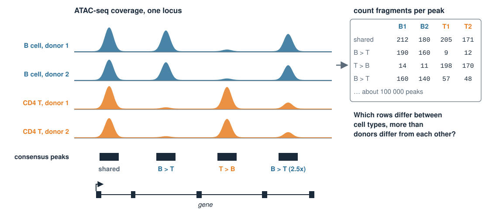{width="92%" fig-align="center"}

- Two cell types share most of their open chromatin (promoters of housekeeping genes), but each has its own **enhancers**.
- **Differential accessibility (DA)**: which peaks have more fragments in one group than in the other, more than donors differ among themselves?
- Answers can be **all-or-none** (an enhancer open only in B cells) or **quantitative** (2.5-fold more open).

::: notes
Walk through the four peaks: the first is shared (a promoter, open in both), the second is open only in B cells, the third only in T cells, the fourth is open in both but more in B cells. In counts, these become rows of a matrix: one row per peak, one column per sample. The question is the same as in RNA-seq, with peaks instead of genes. Note that the figure shows two donors per cell type: without replicates we could not say whether a difference is larger than the difference between two people. Typical applications: cell types (as here), treatment vs control, a knockout, a time course, disease vs healthy tissue.
:::

## What is the same as RNA-seq, and what is not {.smaller}

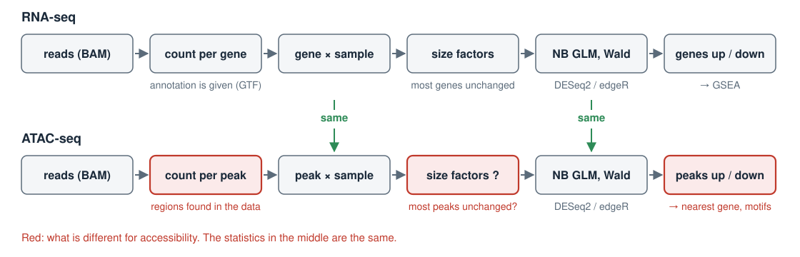{width="95%" fig-align="center"}

- **Same**: a count matrix, the negative binomial GLM, the design formula, dispersion shrinkage, Wald test, Benjamini–Hochberg, fold-change shrinkage. DESeq2 or edgeR run unchanged.
- **Different**: the rows are found in the data; the normalisation assumption ("most features do not change") is shakier; the result is a list of regions, which needs annotation before it means anything.

::: notes
This slide is the map of the lecture. Everything in grey is a recap; everything in red is new. A useful way to say it: DESeq2 does not know whether a row is a gene or a peak. It sees counts. All the epigenomics-specific decisions happen before (which regions, what to count, which normalisation) and after (what the regions are near, what binds there). That is also why published differential accessibility analyses differ so much: the statistics are standard, the choices around them are not.
:::

## One set of regions for all samples {.smaller}

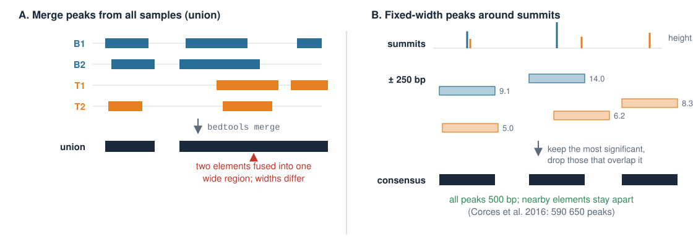{width="92%" fig-align="center"}

- Every sample must be counted in the **same regions**. Peaks called per sample must be combined into a **consensus** set.
- **Union and merge** (A) is simple, but nearby elements fuse into wide regions of unequal width.
- **Fixed-width peaks** (B): extend each summit to 500 bp, keep the most significant, drop those that overlap it. Used by Corces et al. 2016 and by ArchR; DiffBind re-centres on summits (± 200 bp).
- Keep only peaks found in **at least *k* samples** (DiffBind default: 2) or call peaks on pooled data per group, so one noisy sample does not add thousands of peaks.

::: notes
The consensus step is a design choice with consequences. A merged region of 3 kb that contains a promoter and an enhancer will be counted as one feature: if the enhancer opens and the promoter does not, the change is diluted. Fixed-width peaks keep elements separate and make counts comparable between peaks (every peak is 500 bp, so count differences between peaks are not due to width). The iterative procedure in panel B is what Corces et al. describe: summits from MACS2 extended to 500 bp, ranked by significance, overlapping lower-ranked peaks removed. It is also the default in ArchR. Calling peaks on each group's pooled reads (rather than per sample) is common too; the important thing is not to call peaks on one group only, which biases the test towards that group. The previous unit (*ATAC-seq processing and peak calling*) built such a consensus set; here we start from Corces's.
:::

## What to count in a peak {.smaller}

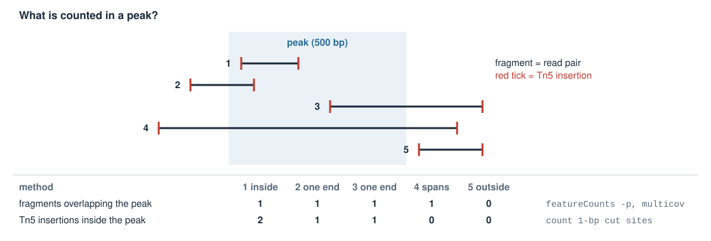{width="88%" fig-align="center"}

- ATAC-seq measures **Tn5 insertions**: each fragment end is a cut site in open chromatin. Fragment 4 spans the peak without a single cut inside it.
- Counting **fragments that overlap** the peak (featureCounts with pairs, `bedtools multicov`) is the common default; counting **insertions** (fragment ends, shifted +4/−5) is more precise and what ArchR and chromVAR use.
- Either way: one number per peak per sample, **integer counts**, no normalisation yet.

::: notes
For RNA-seq students counted reads per gene with featureCounts or salmon. Here it is the same, with peaks as features. Two subtleties. First, a long fragment spanning the peak (fragment 4) says that the DNA at both ends was accessible, not the peak itself; insertion counting does not count it. Second, with read counting (not fragment counting) a fragment with both ends in the peak counts twice, which breaks the Poisson assumptions mildly; count pairs (featureCounts -p --countReadPairs) or insertions. With 500-bp peaks and mostly short fragments the two methods give highly correlated counts; the choice matters more for nucleosome-scale questions. The Corces count matrix counts fragments per peak.
:::

## Counting on the command line

```bash
# consensus peaks (BED) -> SAF, the simple annotation format of featureCounts
awk 'BEGIN { OFS = "\t"; print "GeneID", "Chr", "Start", "End", "Strand" }
     { print "peak" NR, $1, $2 + 1, $3, "." }' consensus.bed > consensus.saf

# count fragments (read pairs) per peak, all samples at once
featureCounts -F SAF -a consensus.saf -p --countReadPairs -B -C \
  -T 8 -o atac_counts.txt sample1.bam sample2.bam sample3.bam ...

# or, with bedtools: one column per BAM
bedtools multicov -bams sample1.bam sample2.bam -bed consensus.bed > atac_counts.bed
```

- `-p --countReadPairs`: count fragments, not reads. `-B -C`: both ends aligned, on the same chromosome.
- SAF is **1-based** (start + 1), BED is 0-based: the boundary from *Genomic intervals* again.
- The output is the matrix: peaks × samples. **Corces et al. provide it**, so the exercise starts there.

::: notes
featureCounts is the same program students used for RNA-seq; with SAF they give it intervals instead of a GTF. By default featureCounts assigns a fragment that overlaps two features to neither (ambiguous); with non-overlapping fixed-width peaks this rarely matters, and --fracOverlap or -O change the behaviour. bedtools multicov is slower but transparent. A third route is csaw::windowCounts or DiffBind::dba.count in R, which read the BAMs directly. On the cluster, run featureCounts in an sbatch job with -T set to the number of cores requested. The matrix has one row per peak, an integer count per sample, and that is all DESeq2 needs.
:::

## The dataset: Corces et al. 2016 {.smaller}

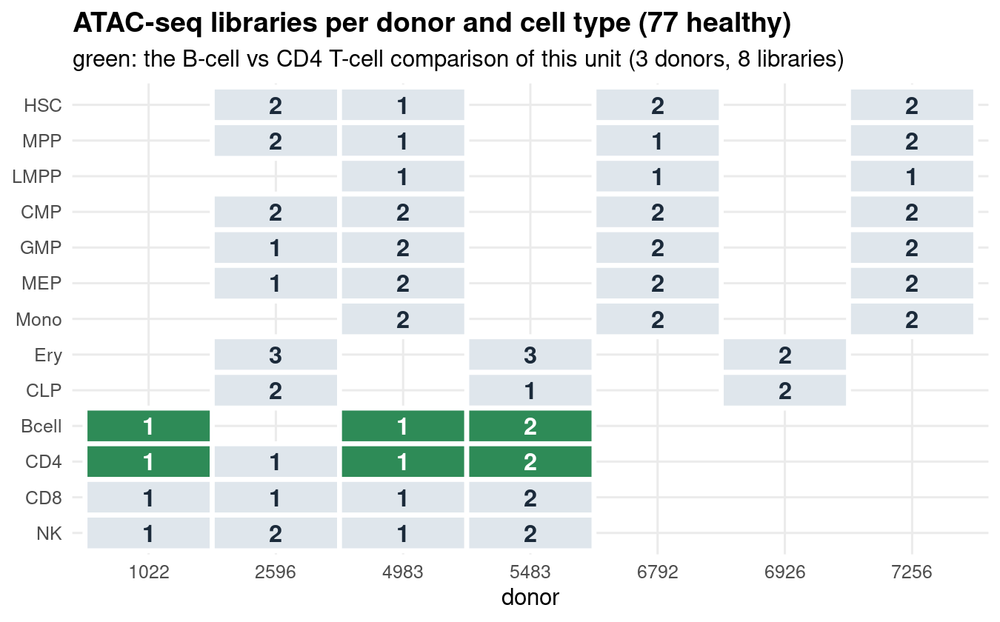{width="68%" fig-align="center"}

- ATAC-seq of **13 FACS-sorted blood cell types** from 7 healthy donors (plus AML samples we ignore): 590 650 peaks (hg19) × 132 libraries, GEO [GSE74912](https://www.ncbi.nlm.nih.gov/geo/query/acc.cgi?acc=GSE74912).
- Our comparison: **B cells vs CD4 T cells** from the 3 donors with both (1022, 4983, 5483): 8 libraries.
- Column names encode donor and cell type: `Donor4983-CD4-9A-150120` = donor 4983, CD4 T cells (code 9), library A, run date. Early samples are just `4983-7A` (code 7 = monocytes): **decode from the GEO sample table, never guess**.

::: notes
Corces et al. sorted cells directly from bone marrow or blood of healthy donors and ran an optimised ATAC protocol (Fast-ATAC) on about 5000 cells each. The GEO series lists every library with its donor and cell type, which is how we decoded the numeric codes: 1 HSC, 2 MPP, 3 LMPP, 4 CMP, 5 GMP, 6 MEP, 7 monocytes, 9 CD4 T, 10 CD8 T, 11 NK, 13 B, 14 CLP, 15 erythroblasts. The design is unbalanced: progenitors come from donors 4983, 6792, 7256 and 2596, mature lymphocytes from 1022, 2596, 4983, 5483. Only three donors gave both B cells and CD4 T cells; donor 2596 has CD4 T cells but no B-cell library, so it cannot be paired and we leave it out (the exercise asks what including it would do). The peaks are on hg19; the course uses GRCh38, next slide.
:::

## The peaks are hg19: liftOver

```r
gr19 <- GRanges(atac$Chr, IRanges(atac$Start + 1, atac$End))   # 0-based starts in the file
lo   <- liftOver(gr19, import.chain("hg19ToHg38.over.chain"))  # a GRangesList: 0, 1 or more pieces
table(lengths(lo))
```

| result of liftOver | peaks |
|---|---:|
| no match in GRCh38 (deleted or rearranged) | 159 |
| split into ≥ 2 pieces | 1 375 |
| one piece, but not 500 bp or a different chromosome | 46 |
| **one piece, 500 bp: kept** | **589 070** (99.7%) |

- Dropping 0.3% of the peaks is fine here. Better still, when you have the reads: **re-align to GRCh38** and call peaks there.

::: notes
This is the liftOver from *Genomic intervals*, now with real numbers. The file's Start column is 0-based (End − Start = 500), so add 1 when building a GRanges. liftOver returns a list because one input range can map to zero, one or several pieces. A peak that is split, or whose lifted width is no longer 500 bp, spans a gap or rearrangement between the builds; we drop those rather than guess. We give each peak an ID from its row in the original file (peak000001…) so that hg19 and hg38 versions can always be matched. The counts do not change: liftOver moves the coordinates, not the reads. That is also the limitation: reads that would map differently in GRCh38 (new sequence, fixed errors) are not recovered.
:::

## Technical and biological replicates {.smaller}

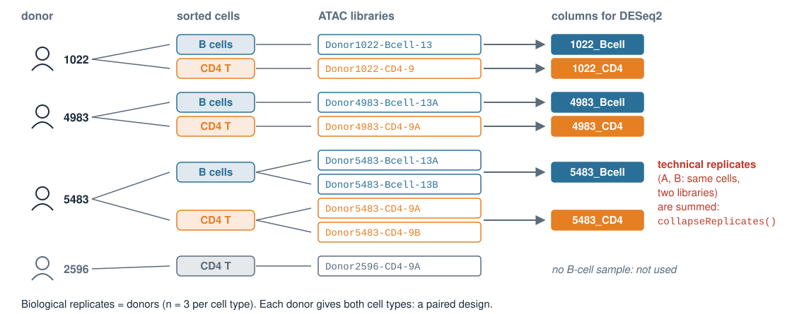{width="88%" fig-align="center"}

- **Biological replicates** = independent donors. They carry the variation the test must beat.
- **Technical replicates** (A, B) = two libraries from the same sorted cells. They measure library noise only: **sum** them (`collapseReplicates`), do not count them as extra samples.
- 8 libraries → **6 columns**: 3 donors × 2 cell types.

::: notes
Treating technical replicates as biological replicates is pseudo-replication: the model would think donor 5483 is two people and underestimate the variance between people, giving too many significant peaks. Summing counts is right because a technical replicate is just more sequencing of the same material (the two libraries correlate at r = 0.94 on log CPM in this dataset, against 0.77–0.93 between donors of the same cell type). DESeq2::collapseReplicates sums the columns that share a label. Sorting matters too: each population is FACS-sorted on surface markers (CD19 for B cells, CD4 for T helpers), so the purity of the sort is part of the biological sample.
:::

## Why pair by donor? {.smaller}

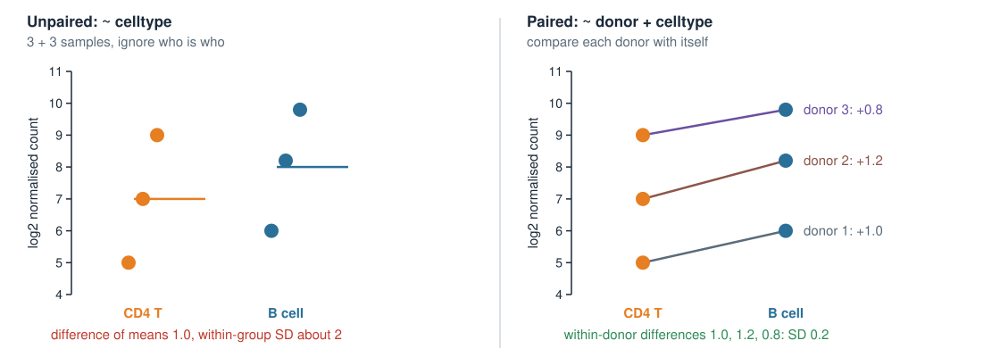{width="90%" fig-align="center"}

- If donors differ (genotype, age, sex, sample handling), each B-cell sample shares part of that difference with the T-cell sample from **the same person**.
- `~ donor + celltype` compares every donor with itself: the donor effect is removed, and the `celltype` coefficient is the **within-donor log fold change**.
- The cost: one coefficient per extra donor. With 6 samples, the residual degrees of freedom drop from 4 to 2.

::: notes
The toy numbers are on the slide. Unpaired, the difference of 1.0 (log2 scale) is small against a within-group SD of about 2 (donors differ a lot), so nothing is significant. Paired, the three within-donor differences are 1.0, 1.2 and 0.8: a consistent increase. This is the paired t-test idea in a GLM, same as in RNA-seq experiments with patients. In DESeq2 the last term in the design is the one results() tests by default, so put the variable of interest last. Whether pairing pays off depends on how big the donor effect is compared with the cost in degrees of freedom; we will check that on the real data.
:::

## Exploration: reads in peaks per library {.smaller}

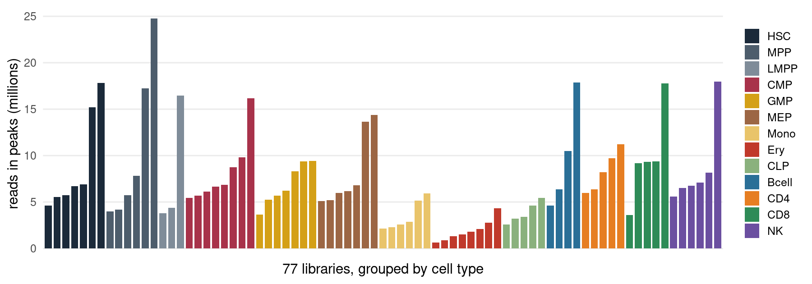{width="92%" fig-align="center"}

- Reads in peaks range from **0.6 to 25 million** per library: a 40-fold range, partly sequencing depth and partly **signal-to-noise** (the fraction of reads in peaks, FRiP).
- Erythroblasts are low in every donor (Corces et al. report poor replicate agreement for them, r ≈ 0.5). The B-cell library of donor 1022 has 4.6 M reads in peaks; the B cells of 4983 and 5483 have 17–18 M (5483: two libraries summed).

::: notes
The count matrix only has reads in peaks, not total reads, so we cannot compute FRiP here; in your own data you have both (*Experimental design and QC*). Two libraries with the same depth can have very different counts in peaks if one is noisier (more reads in background, mitochondria, dead cells). For differential analysis this matters in two ways: low counts mean less power for that sample, and differences in FRiP feed directly into the normalisation question later. Erythroblasts are a hard sample (Corces et al. note R = 0.55 between technical replicates against 0.94 for other cell types), a reminder to look at QC per sample before a comparison.
:::

## Signal-to-noise differs between libraries {.smaller}

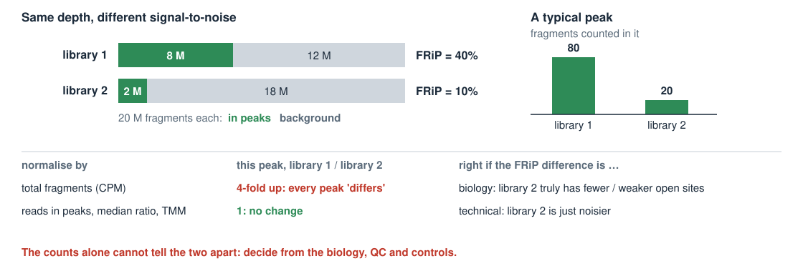{width="92%" fig-align="center"}

- Same depth, FRiP 40% vs 10%: a typical peak gets **4 times** fewer fragments in library 2.
- Normalising by **total reads** makes every peak "4-fold up" in library 1. Normalising **within peaks** says nothing changed.
- Which one is right depends on **why** FRiP differs. A worse library? Then within-peak normalisation. Fewer or weaker open sites in the cells? Then the total-read answer may be the biology.

::: notes
This is the first half of the normalisation story and the most important idea of the lecture. FRiP mixes technology (how many dead cells, how well transposition worked, how deep the library is relative to its complexity) and biology (how much of the genome is open). A cell type with fewer open sites (e.g. quiescent cells, or erythroblasts which compact their chromatin before enucleation) will have lower FRiP for biological reasons. The counts cannot distinguish the two; QC metrics (TSS enrichment, fragment-size distribution, mitochondrial fraction) and knowledge of the system can.
:::

## PCA: cell type dominates {.smaller}

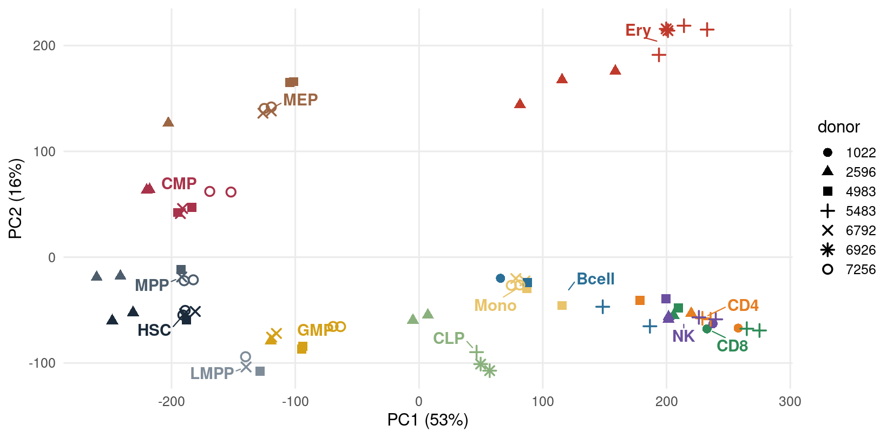{width="78%" fig-align="center"}

- VST of 127 515 peaks with mean count ≥ 10, all 77 healthy libraries, the 10 000 most variable peaks.
- Libraries cluster by **cell type**, not by donor (shape). PC1 runs from stem and progenitor cells (left) to mature cells (right); PC2 separates the erythroid branch (MEP → erythroblasts).

::: notes
Exactly as in RNA-seq: variance-stabilising transformation (vst, blind = TRUE), then prcomp on the most variable rows. The picture follows the haematopoietic tree: HSC and MPP together, LMPP, CMP and GMP nearby; MEP on the way to erythroblasts (PC2); CLP between the progenitors and the mature lymphocytes; monocytes, B, NK and T cells are all mature and sit at the right of PC1, and separate from each other on later components. Erythroblasts spread out more than the others, matching their poor replicate agreement. Donor (point shape) adds little on top. Corces et al. made the same point more strongly: accessibility classifies cell types better than RNA does. For our test this is good news: the cell-type signal is large compared with donor variation.
:::

## The six samples of our comparison {.smaller}

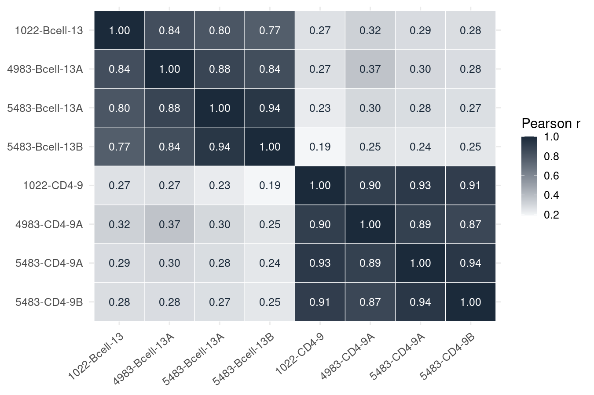{width="60%" fig-align="center"}

- Pearson correlation of log2 CPM over 75 922 peaks (mean CPM ≥ 2), all 8 libraries.
- Technical replicates: r = 0.94. Same cell type, other donor: 0.77–0.88 (B), 0.87–0.93 (CD4). B vs CD4: 0.19–0.37.
- The **1022 B-cell** library correlates least with its group: fewest reads in peaks (4.6 M).

::: notes
Point out the block structure: B cells with B cells, T cells with T cells; inside each block, the technical replicates of 5483 are the most similar pair. This justifies summing technical replicates. Also note that 1022 B cells correlate less with the other B cells (0.77–0.84) than 4983 and 5483 do with each other (0.84–0.88): a lower-quality library (4.6 M reads in peaks) is noisier. With only 3 donors per group, one weaker sample matters; DESeq2's dispersion estimates will absorb it, at a cost in power.
:::

## Normalisation: median of ratios, on peaks {.smaller}

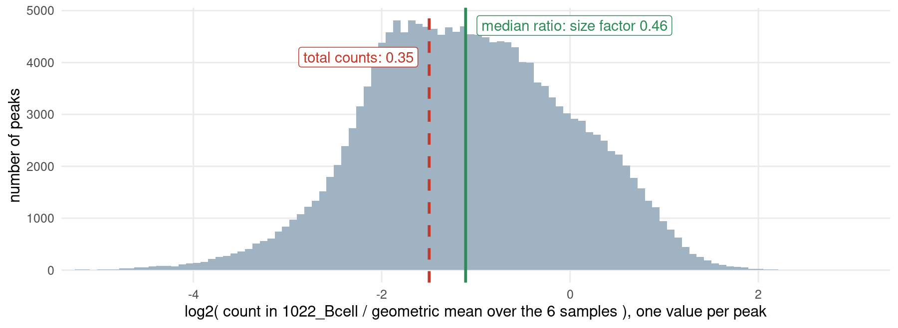{width="90%" fig-align="center"}

- DESeq2 size factor for sample $j$: $s_j = \text{median}_i \, \dfrac{k_{ij}}{\left(\prod_{v} k_{iv}\right)^{1/m}}$, the median over peaks of the count divided by the peak's geometric mean.
- The same as for genes. The **assumption** is too: the typical (median) peak does not change.
- Here, for the 1022 B-cell library: size factor **0.46** from the median ratio, **0.35** from total counts in peaks.

::: notes
Recap, students know this formula. Each peak votes with its ratio to a pseudo-reference sample; the median is robust to the minority of peaks that change. The histogram is the real distribution of log2 ratios for one sample. The two lines differ because the reads of 1022_Bcell are distributed differently across peaks: relatively fewer reads in the strongest peaks, consistent with a noisier library. Neither is "wrong"; they answer different questions. Total-count normalisation says "the same number of reads in peaks in every sample"; median ratio says "the typical peak is unchanged". TMM (edgeR) makes the same assumption as the median ratio with a trimmed mean of log ratios, and gives similar factors.
:::

## When most peaks do change: a global opening {.smaller}

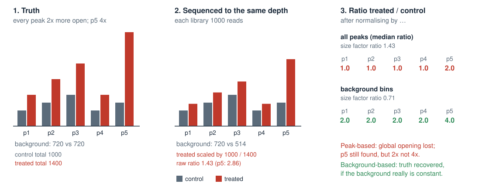{width="95%" fig-align="center"}

- A treatment that opens chromatin **everywhere** (e.g. an HDAC inhibitor) gives more fragments in every peak. Sequenced to the same depth, the extra signal is diluted.
- Peak-based size factors make the median peak unchanged: the **global opening disappears**, and only the relative change (p5) survives, at half its size.
- Background bins (reads outside peaks) can recover it, **if** the background truly is constant.

::: notes
Go through the numbers. Truth: all peaks double, p5 quadruples, background unchanged. The treated library has 1400 reads' worth of material, but the sequencer gives 1000 reads, so everything is scaled by 1000/1400. The raw ratio is then 1.43 for most peaks. Median-of-ratios normalisation divides by 1.43: most peaks become 1.0 (no change) and p5 becomes 2.0. Normalising by the background (which went from 720 to 514 reads) divides by 0.71 and recovers 2 and 4. This is the same problem as the EZH2-inhibitor example in *Experimental design and QC*, now for accessibility. The by-hand exercise has a version of it. Note the symmetry: a global closing would be hidden in the same way.
:::

## Four ways to normalise, four assumptions {.smaller}

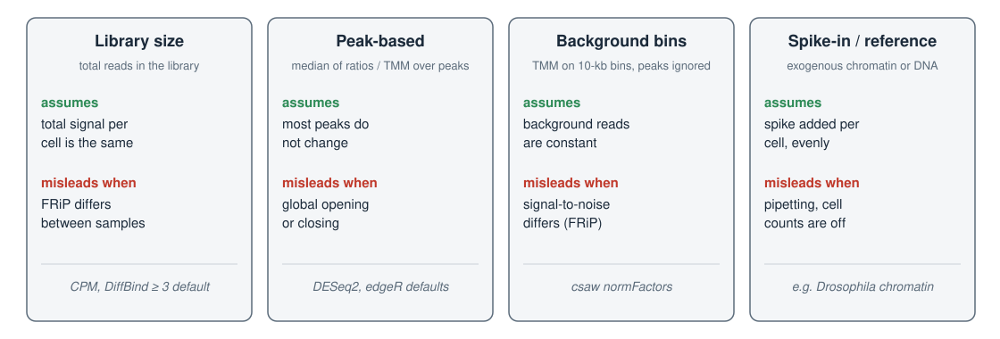{width="95%" fig-align="center"}

- No method is assumption-free. Pick the one whose assumption you can defend for **your** experiment, and say it in the methods.
- If two reasonable methods disagree, the disagreement **is** the result: report it (Reske et al. 2020 found the number and direction of DA peaks change with the method).

::: notes
Library size: the total signal per cell is the same, fine when FRiP is similar across samples. Peak-based (median ratio, TMM): most peaks are unchanged, the default in DESeq2 and edgeR; wrong under global change. Background bins (csaw's normFactors on 10-kb bins, Lun & Smyth): the reads outside peaks are noise at a constant rate per cell; wrong when signal-to-noise differs for technical reasons (a library with more dead cells has more background, and background normalisation then inflates its peaks). Spike-ins: add a fixed amount of foreign chromatin per cell (e.g. Drosophila nuclei) before transposition; for ATAC this is not yet routine. A fifth option is a set of reference peaks assumed constant (e.g. housekeeping promoters). Reske, Wilson & Chandler 2020 re-analysed an ATAC dataset with different normalisations and obtained different numbers of DA peaks and even different biological conclusions.
:::

## Real data: the choice changes the answer {.smaller}

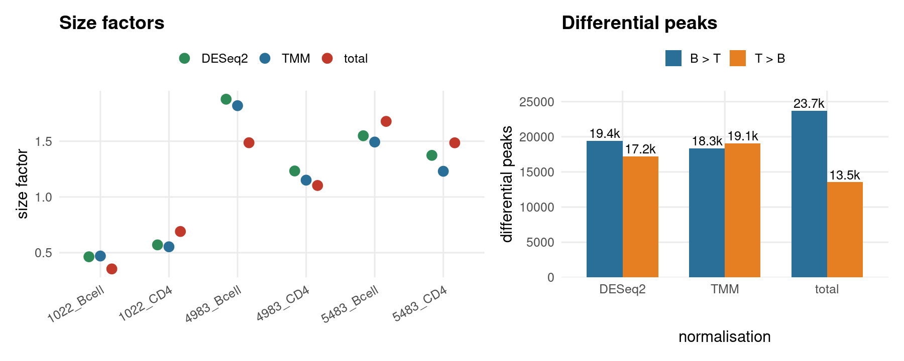{width="92%" fig-align="center"}

- DESeq2 and TMM factors agree within 10%; total counts differ by up to **25%** (B cells of 1022 and 4983).
- Same model, same data: **19 438 / 17 202** peaks up in B / up in T with DESeq2 factors, 18 342 / 19 074 with TMM, **23 703 / 13 540** with total counts.
- Total counts shift all fold changes towards B (median log2 FC 0.52 vs 0.26 with DESeq2 factors): relative to the typical peak, the B-cell libraries have more reads in peaks.

::: notes
Thresholds: padj < 0.05 and |MLE log2 fold change| > 1 for this comparison. Most of the strong cell-type-specific peaks are found by all three; the difference is in the hundreds to thousands of moderate peaks, and in the balance between "up" and "down". The median log fold change over all tested peaks is a quick diagnostic: 0.26 with DESeq2 factors, 0.19 with TMM, 0.52 with total counts. (It is not exactly 0 even with peak-based factors, because the median is taken over many all-or-none peaks, and DESeq2 computes its factors only from peaks with no zero count.) Is the extra 0.26 with total counts real (B cells have more accessible chromatin) or technical (the B-cell libraries happen to have better signal-to-noise)? Without spike-ins or another external reference we cannot tell, and for a comparison of two cell types the conservative, conventional choice is peak-based. For a treatment expected to change chromatin globally, that default needs to be questioned.
:::

## Tools: DiffBind and csaw {.smaller}

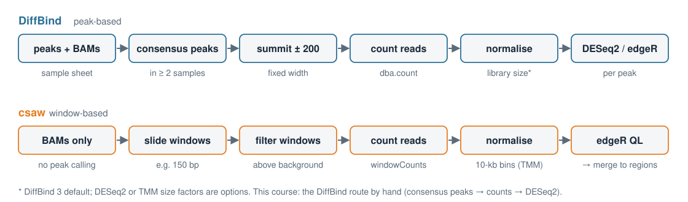{width="95%" fig-align="center"}

- **DiffBind**: peak-based. Builds the consensus, counts, then calls DESeq2 or edgeR. What we do by hand in this unit.
- **csaw**: window-based. No peak calling; counts in sliding windows, normalises on background bins, tests each window, merges windows into regions and controls the FDR over **regions**.
- Neither is installed in this course: the exercise does the same steps with DESeq2 and edgeR directly.

::: notes
DiffBind (Ross-Innes et al. 2012, Stark & Brown) was written for ChIP-seq of transcription factors (oestrogen receptor in breast cancer) and is widely used for ATAC too. Its defaults have changed between versions: since version 3 it normalises by full library size by default, and offers DESeq2/TMM/background options (dba.normalize). csaw (Lun & Smyth 2016) avoids the circularity of calling peaks and testing in the same data, handles regions of any width, and makes the FDR refer to regions rather than windows. For narrow, well-defined ATAC peaks the two approaches give similar answers; csaw shines for broad or shifting signals. The statistical core of both is the negative binomial GLM.
:::

## DESeq2 on peaks

```r
dds <- DESeqDataSet(se, design = ~ donor + celltype)       # se: peaks x 8 libraries, rowRanges in hg38
dds <- collapseReplicates(dds, groupby = dds$unit)         # 8 libraries -> 6 samples
dds <- dds[rowSums(counts(dds) >= 10) >= 3, ]              # 211 824 of 589 070 peaks
dds <- DESeq(dds)                                          # about 1 minute
res <- results(dds, name = "celltype_Bcell_vs_CD4", alpha = 0.05)
shr <- lfcShrink(dds, coef = "celltype_Bcell_vs_CD4", type = "apeglm")   # about 2 minutes
```

- Exactly the RNA-seq workflow. **Filter first**: most of the 589 070 peaks were called in other cell types and have almost no reads in B or T cells.
- `celltype` levels `CD4`, `Bcell`: positive log2 fold change = **more open in B cells**.

::: notes
The filter keeps peaks with at least 10 fragments in at least 3 of the 6 samples (3 = the size of the smaller group, so a peak open in only one cell type is kept). Without it DESeq2 runs on 589 070 rows, most of them zeros, which costs time and multiple-testing burden; independent filtering in results() would remove many of them anyway. Factor levels: DESeq2 compares to the first level, so set CD4 first. The name of the coefficient is printed by resultsNames(dds). Run times are on one core of a server; on a laptop expect 2–4 minutes for DESeq() and a bit more for apeglm.
:::

## Dispersion: paired or not {.smaller}

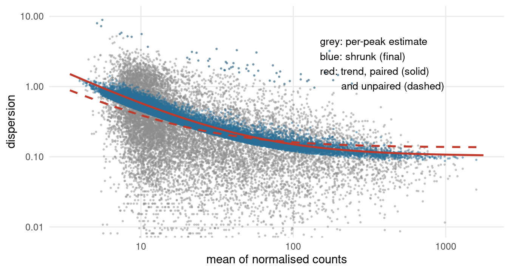{width="68%" fig-align="center"}

- The familiar picture: noisy per-peak estimates, a fitted trend, shrunk final values. Typical dispersion ≈ 0.4 (coefficient of variation ≈ 60% between donors), higher than for genes.
- Here the **donor effect is small**: only 47 peaks have a significant donor term (LRT). Pairing costs 2 degrees of freedom: **36 703** peaks at padj < 0.05 paired, **41 671** unpaired.

::: notes
Dispersion is the squared coefficient of variation between biological replicates, beyond Poisson noise. ATAC peaks are noisier than genes: they are small (500 bp), counts are lower, and library quality varies. The dashed trend is the unpaired fit, lower because the residual degrees of freedom are 4 instead of 2 and the donor term absorbs little. This is a real, honest result: in this dataset of sorted cells from healthy adults, the donor effect is weak, and the paired model finds fewer peaks. Should we switch to the unpaired design because it gives more hits? No: choose the design from the structure of the experiment before looking at the number of hits. The paired design is the right one for a paired experiment; it protects against donor effects when they exist (e.g. patients with different genotypes or treatments), and the cost here is modest (most strong peaks are found by both).
:::

## MA plot and fold-change shrinkage {.smaller}

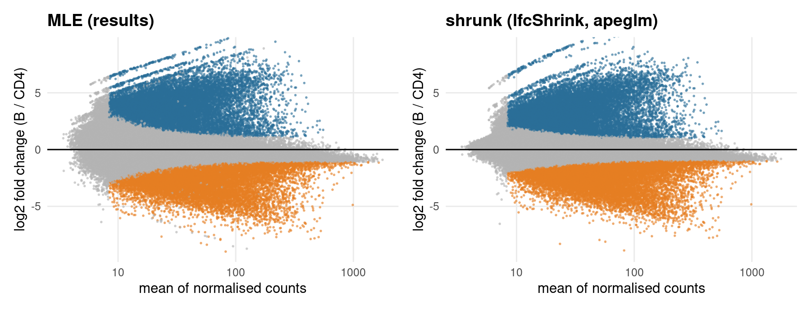{width="95%" fig-align="center"}

- Left: maximum-likelihood fold changes are **huge and noisy for weak peaks** (few reads: 0 vs 5 is "infinitely" open).
- Right: **apeglm** shrinks uncertain fold changes towards 0 and leaves well-measured ones alone. Use shrunk values to **rank and filter** by effect size, and for plots.
- Blue/orange: padj < 0.05 and |shrunk LFC| > 1. Where counts are high, the grey cloud of unchanged peaks sits on 0: the normalisation assumption holds for most peaks.

::: notes
Same as for RNA-seq; students have probably used lfcShrink. Two things to read from an MA plot of peaks. First, the shape: a cell-type comparison gives many large fold changes (cell-type-specific enhancers are often all-or-none), so the plot looks more dramatic than a typical RNA-seq treatment. Second, the centre of the grey cloud: if it sat at +0.5 instead of 0, the normalisation would be suspect (or there is a global change). The p-values come from the unshrunk model; shrinkage changes the effect sizes, not which peaks are significant. Our definition of a differential peak uses both: padj < 0.05 from results(), |log2 fold change| > 1 from the shrunk estimate.
:::

## Volcano plot {.smaller}

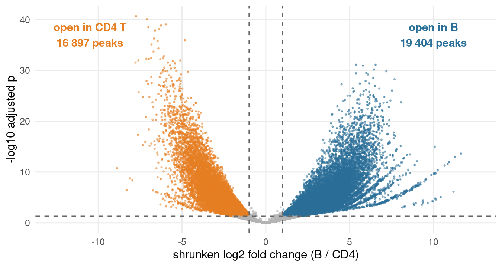{width="70%" fig-align="center"}

- **19 404 peaks more open in B cells** and **16 897 more open in CD4 T cells** (padj < 0.05, |shrunk log2 FC| > 1), out of 211 824 tested.
- 17% of tested peaks differ more than 2-fold: B and T cells are distinct lineages, so this is expected. A drug treatment typically moves hundreds, not tens of thousands.

::: notes
The y axis is −log10 of the adjusted p-value, the x axis the shrunk log2 fold change. The two arms are roughly symmetric, a sign that the normalisation is not biased towards one side. These two lists are the result of the unit and the starting point of *Motifs, motif enrichment and TF footprinting*, which asks which transcription factor motifs are enriched in B-specific vs T-specific peaks (expect EBF1, PAX5, PU.1/SPIB, OCT2 for B; TCF7/LEF1, RUNX, ETS, GATA3 for T). The exercise saves them as differential_peaks.tsv.
:::

## Do the peaks make sense? Marker loci {.smaller}

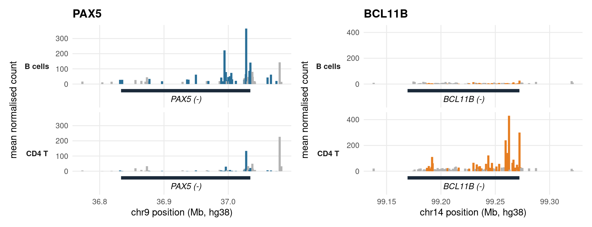{width="95%" fig-align="center"}

- Each bar is one peak (mean normalised count over 3 donors): **blue** = open in B, **orange** = open in T, grey = not differential.
- **PAX5** (B-cell identity factor): 31 peaks whose nearest TSS is *PAX5* open in B, none in T. **BCL11B** (T-cell commitment): 58 open in T, 1 in B.
- Other markers: *CD79A*, *MS4A1*, *CD19*, *BLK*, *EBF1* (B); *CD3E*, *TCF7*, *LEF1*, *GATA3*, *CD28* (T).

::: notes
A sanity check every analysis should include: do the known marker genes come out on the right side? They do. Note how many peaks a single regulator gene has: PAX5 and BCL11B sit in large regulatory landscapes with dozens of enhancers, and the large intron of PAX5 is full of B-specific elements. Not every peak near a marker changes: promoters of these genes can be accessible (poised) in both cell types, and some elements near EBF1 open in T cells. A short table of counts per marker is in the exercise (R9).
:::

## From peaks to genes: the nearest-TSS caveat {.smaller}

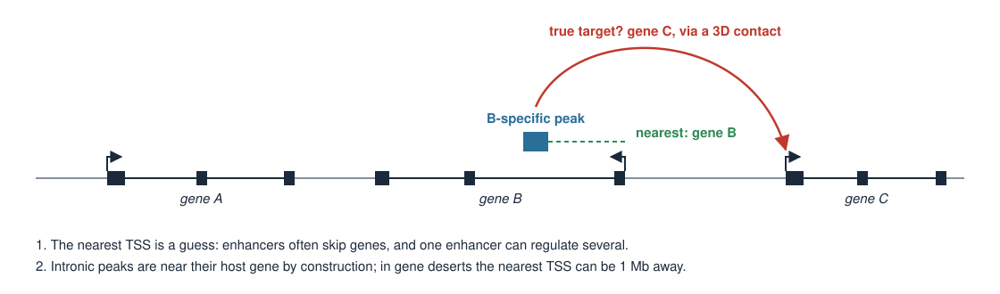{width="90%" fig-align="center"}

- Only **8%** of B-specific and **14%** of T-specific peaks are within 1 kb of a protein-coding TSS (20% of all tested peaks): DA peaks are mostly **distal**.
- Assigning each peak to its nearest gene is a first guess, right for perhaps half of enhancers. Better links use contacts or correlation (*Linking regulatory elements to genes*).

::: notes
Promoters tend to be accessible in many cell types, enhancers are cell-type specific: that is why differential peaks are depleted at promoters. For the distal majority, the nearest gene is a convenient label, not a mechanism. The exercise annotates each peak with its nearest protein-coding TSS (GenomicRanges::distanceToNearest, as in *Genomic intervals*). Tools such as ChIPseeker or GREAT make this a one-liner and add rules (GREAT assigns a regulatory domain to each gene). Keep the distance in the table; a peak 400 kb from its "nearest gene" in a gene desert is not evidence about that gene.
:::

## Does accessibility agree with expression? {.smaller}

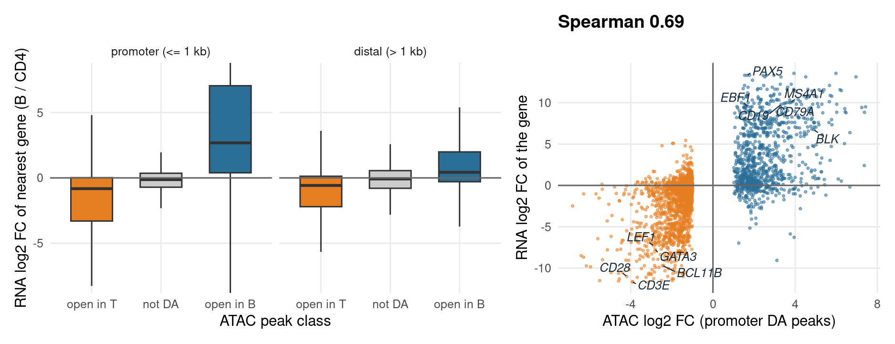{width="95%" fig-align="center"}

- RNA-seq from the same study (GSE74246), B vs CD4 T cells from 4 donors, DESeq2 `~ donor + celltype`.
- Genes near B-open peaks go up in B (median RNA log2 FC +0.5), near T-open peaks go up in T (−0.6). Promoter peaks agree well (Spearman **0.69**), distal peaks less (**0.42**).

::: notes
The RNA donors (1022, 2596, 5852, 7653) are only partly the same people as the ATAC donors, so this is a comparison of cell types, not of matched samples. The agreement is clear but far from perfect, for good reasons: a distal peak may not regulate its nearest gene; a gene can have several elements changing in opposite directions; accessibility can be primed before expression (or remain after it); and expression is also regulated after transcription. A promoter peak and its own gene are linked directly, which is why their correlation is higher. About two thirds of DA peaks (67% for B, 71% for T) have a nearest gene that changes in the same direction. This is the starting point of *Linking regulatory elements to genes*.
:::

## The result to reuse

```r
tab <- data.frame(peak_id = names(dds), chr = seqnames(dds), start = start(dds), end = end(dds),
                  baseMean = res$baseMean, log2FoldChange = shr$log2FoldChange, lfcSE = shr$lfcSE,
                  pvalue = res$pvalue, padj = res$padj, nearest_gene = ..., dist_to_tss = ...)
tab$class <- ifelse(tab$padj < 0.05 & tab$log2FoldChange >  1, "B_up",
             ifelse(tab$padj < 0.05 & tab$log2FoldChange < -1, "T_up", "ns"))
write.table(tab, "differential_peaks.tsv", sep = "\t", quote = FALSE, row.names = FALSE)
```

- **Definition**: differential = `padj < 0.05` and `|shrunken log2 FC| > 1`; B_up = more open in B cells, T_up = more open in CD4 T cells. GRCh38, 1-based coordinates, 500 bp.
- Keep **all tested peaks** (class `ns` included): motif enrichment needs a background.

::: notes
This table is the hand-over to *Motifs, motif enrichment and TF footprinting*. Two decisions are written into it and should be in any methods section: the thresholds (FDR 5%, at least 2-fold), and the background (all 211 824 peaks that passed the count filter, which are accessible in B or T cells; a better background for motifs than random genomic sequence, because it has the same GC and chromatin context). Coordinates are GRanges, 1-based closed; when writing BED from them, subtract 1 from start (*Genomic intervals*). A variant worth knowing: results(dds, lfcThreshold = 1) tests |LFC| > 1 directly instead of filtering afterwards, which is stricter (here 10 153 and 7 503 peaks).
:::

## Limitations of this analysis {.smaller}

- **Sorted populations are still mixtures**: a 2% contamination of T cells in the B-cell sort puts T-cell peaks into the B-cell counts. "Specific" means "much more", not "only". Single-cell ATAC avoids this, at the price of sparse counts.
- **Peaks lifted from hg19**: 0.3% lost; reads were aligned to an older genome.
- **Fixed 500-bp peaks**: good for TF sites and comparable counts, but a broad domain is cut into pieces or partly missed.
- **Peaks called in all 13 cell types**: the set includes elements never open in B or T cells (filtered out), and misses none that are open in only one sample.
- **Three donors per group**: dispersion estimates rely heavily on the trend; one weak library (1022) carries a lot of weight.
- **Normalisation**: peak-based by choice. A real global difference in accessibility between B and T cells would be hidden.

::: notes
These are the questions to ask of any differential accessibility paper, too. Mixtures: Corces et al. sorted with strict gates, but purity is never 100%, and for rare populations contamination can dominate. Peak set: calling peaks on all cell types together, then testing two of them, is fine (the consensus is not biased towards one of the two groups), which is a design point worth contrasting with calling peaks on one group only. Fixed width: some of the strongest B-cell elements are clusters of several peaks (super-enhancer-like), and counting them as independent peaks inflates the number of DA "elements". A common follow-up is to merge DA peaks within a few kb before counting regions.
:::

## Summary {.smaller}

| idea | key fact |
|---|---|
| consensus peaks | one region set for all samples; fixed-width summit peaks keep elements apart |
| counting | fragments (or Tn5 insertions) per peak; featureCounts / multicov; integer counts |
| replicates | donors are biological replicates; technical replicates are summed |
| design | `~ donor + celltype` for paired samples; decide before looking at the hit count |
| normalisation | peak-based (median ratio, TMM) assumes most peaks unchanged; background bins, spike-ins otherwise |
| global change | hidden by peak-based size factors; FRiP differences can fake or hide it |
| statistics | DESeq2/edgeR exactly as for RNA-seq; filter low-count peaks; shrink fold changes |
| interpretation | DA peaks are mostly distal; nearest gene is a guess; check markers and RNA |
| this dataset | 211 824 peaks tested; 19 404 B_up, 16 897 T_up (padj < 0.05, \|LFC\| > 1) |

::: notes
Students should leave able to: compute a median-of-ratios size factor by hand; explain why a global change in accessibility is invisible to peak-based normalisation and what to do about it; write the design formula for a paired experiment and say what each coefficient means; read an MA and a volcano plot of peaks; and say what "nearest gene" can and cannot tell. Next: *Motifs, motif enrichment and TF footprinting*, which asks which transcription factors explain the B- and T-specific peaks.
:::

## Key papers (optional further reading) {.smaller}

*Not required reading and not examined. For those who want the primary literature.*

- Corces et al. 2016, *Nat Genet*. [Lineage-specific and single-cell chromatin accessibility charts human hematopoiesis and leukemia evolution](https://doi.org/10.1038/ng.3646). The dataset of this unit.
- Love, Huber & Anders 2014, *Genome Biol*. [Moderated estimation of fold change and dispersion for RNA-seq data with DESeq2](https://doi.org/10.1186/s13059-014-0550-8). The model, unchanged for peaks.
- Ross-Innes et al. 2012, *Nature*. [Differential oestrogen receptor binding is associated with clinical outcome in breast cancer](https://doi.org/10.1038/nature10730). The paper that introduced DiffBind.
- Lun & Smyth 2016, *Nucleic Acids Res*. [csaw: a Bioconductor package for differential binding analysis of ChIP-seq data using sliding windows](https://doi.org/10.1093/nar/gkv1191). Windows, background normalisation, region-level FDR.
- Robinson & Oshlack 2010, *Genome Biol*. [A scaling normalization method for differential expression analysis of RNA-seq data](https://doi.org/10.1186/gb-2010-11-3-r25). TMM, and why the total is not the right normaliser.
- Reske, Wilson & Chandler 2020, *Epigenetics Chromatin*. [ATAC-seq normalization method can significantly affect differential accessibility analysis and interpretation](https://doi.org/10.1186/s13072-020-00342-y). The normalisation choice, on real data.
