## About this lecture {.smaller}

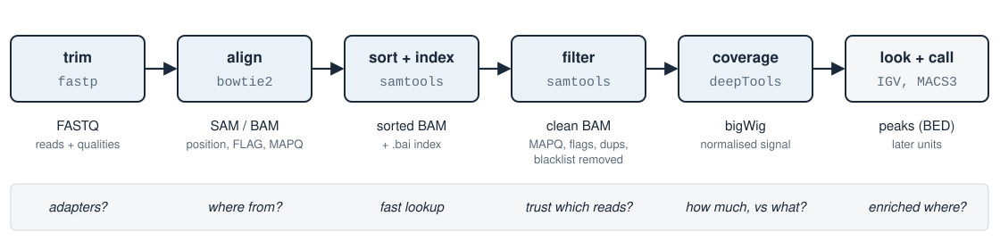{width="95%" fig-align="center"}

ChIP-seq, ATAC-seq and CUT&Tag measure different things, but they all hand you the same raw material: **DNA fragments from enriched regions**, read by a sequencer. This lecture is the shared processing that turns those reads into a signal track you can trust.

- **Reads**: FASTQ, base qualities, adapters, trimming.
- **Alignment**: bowtie2, SAM/BAM, FLAGs, MAPQ and multi-mapping reads.
- **Filtering**: duplicates, the blacklist, chrM, the order of the steps.
- **Coverage**: read extension, CPM and RPGC, fold change over input, with deepTools.
- Real data throughout: GM12878 **CTCF ChIP-seq** and its **input**, chr21.

::: notes
Students have done RNA-seq, so FASTQ and BAM are not new; what is new is everything that comes after alignment when there is no gene annotation to count on. The running example is the ENCODE CTCF ChIP-seq experiment ENCSR000DZN (replicate 1) and its input control, restricted to chr21 so that every command runs in seconds; students run exactly this chain in the exercise. The same chain, with a few assay-specific additions (Tn5 shift, fragment sizes, chrM), is reused in the ATAC-seq and CUT&Tag units. Peak calling is not here: it has its own units. At the end we compare our home-made track with the one ENCODE made from the same data.
:::

## Three assays, one kind of data {.smaller}

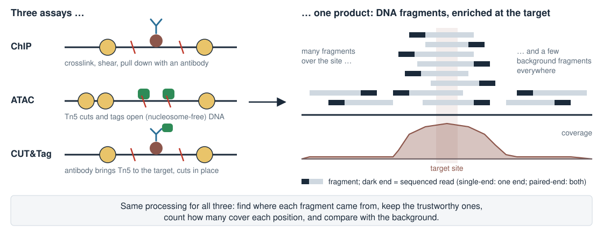{width="92%" fig-align="center"}

- **ChIP**: crosslink, shear, pull down with an antibody. **ATAC**: Tn5 cuts open DNA. **CUT&Tag**: an antibody tethers Tn5 to the target.
- Each gives **fragments**, more of them at the target than elsewhere. We sequence one end (single-end) or both ends (paired-end) of each fragment.
- Processing: find where each fragment came from, keep the trustworthy ones, count how many cover each position, compare with the background.

::: notes
This is the key abstraction of the unit: the biology differs, the data have the same shape. In RNA-seq, reads come from transcripts, and the question is how many per gene. Here, reads come from fragments of genomic DNA, and the question is where in the genome they pile up more than expected. The "background" fragments are important: in ChIP they come from non-specific pull-down and open chromatin; in ATAC from Tn5 cutting anywhere accessible. Everything in this lecture is about separating enrichment from background and artefacts. The details of each assay come in the ATAC, ChIP and CUT&Tag units.
:::

## FASTQ and base quality {.smaller}

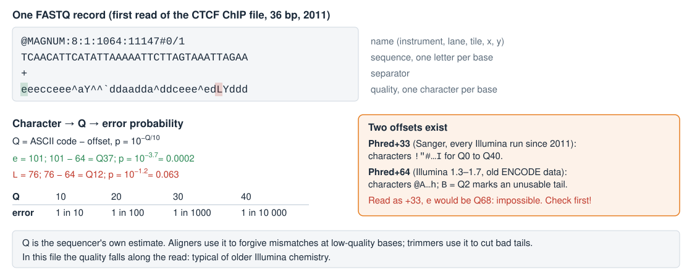{width="88%" fig-align="center"}

- Four lines per read: name, sequence, `+`, quality. Each quality character encodes **Q = −10 log<sub>10</sub>(p<sub>error</sub>)**.
- Q20 = 1 error in 100, Q30 = 1 in 1000. To decode: ASCII code − offset (33 today, 64 in old Illumina files like this one).

::: notes
Work through the example on the slide: the character e has ASCII code 101; this 2011 file uses the old Phred+64 encoding, so Q = 37 and the error probability is 10 to the minus 3.7, about 2 in 10 000. The L near the end is Q12, about 6% error. Always check the encoding of old public data: if you read a +64 file as +33, every base looks like Q60–70, which is impossible, and a tool may silently accept it. In the exercise students convert the file to +33 with a one-line Perl tr before trimming. fastp has a --phred64 option, but with fastp 0.23.4 we got different filter counts from run to run with it, so we convert explicitly: one more reason to look at the data rather than trust flags. Modern Illumina instruments also bin qualities into a few values (e.g. 2, 12, 23, 37), so do not expect a smooth spectrum.
:::

## Real data: quality along the read {.smaller}

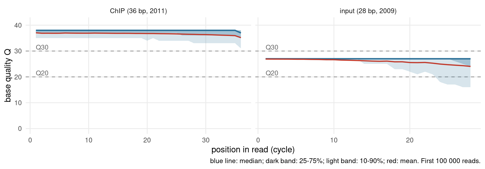{width="95%" fig-align="center"}

- CTCF ChIP (36 bp, 2011): median Q38, mean Q37 at the start, Q35 at the last base. Input (28 bp, 2009): mean Q27 falling to Q24; at the last base **16%** of bases are below Q20.
- Quality falls along the read: the sequencing chemistry loses phase cycle by cycle. A few bad bases are tolerated by the aligner; bad **tails** are trimmed.

::: notes
These plots come from the first 100 000 reads of each FASTQ file (make-enrichalign-figs.R), the same thing fastp and FastQC show in their reports. The input library is older (2009, Illumina GA) and clearly worse: shorter and lower quality. That matters later: 28 bp reads are less often unique in the genome. A caveat that applies to all course data: these reads were selected because ENCODE could align them to chr21 or chrM, so reads too bad to align are already missing. Real raw data look a bit worse than this.
:::

## Adapters and read-through {.smaller}

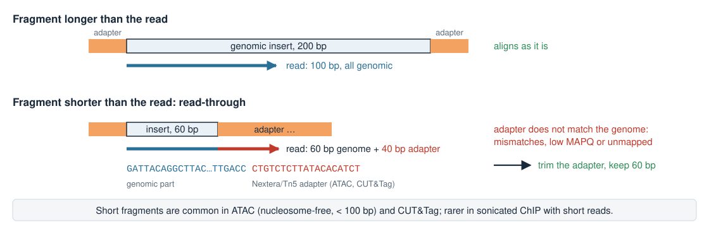{width="88%" fig-align="center"}

- If the fragment is **shorter than the read**, the sequencer reads on into the adapter. The adapter part matches nothing in the genome.
- Common in **ATAC** and **CUT&Tag** (fragments under 100 bp), rare in sonicated ChIP with short reads: fastp found no adapter in our 36 bp CTCF reads.
- `fastp` detects adapters (from the data, or from the overlap of paired reads) and trims them, removes low-quality and too-short reads (tail trimming on request: `--cut_right`), and writes an HTML report.

```bash
fastp -w 8 -i chip.fastq.gz -o chip.trim.fastq.gz -h chip.fastp.html -j chip.fastp.json
```

::: notes
In paired-end data the read-through is easy to detect without knowing the adapter: when the fragment is shorter than the read length, read 1 and read 2 overlap completely and each runs into the other's adapter. fastp uses that overlap. For the CTCF ChIP, fastp found no adapter, and filtered 9514 of 390 097 reads (2.4%) as low quality (by default: more than 40% of bases below Q15) and 13 for too many Ns. For the input, only 348 reads were removed. Trimming matters more with end-to-end alignment (next slides): an untrimmed adapter tail forces mismatches. In the ATAC-seq unit, with 2×100 bp reads of fragments often under 100 bp, the effect is large. Other trimmers: Trim Galore (cutadapt), Trimmomatic; nf-core uses Trim Galore.
:::

## Aligning DNA is simpler than aligning RNA {.smaller}

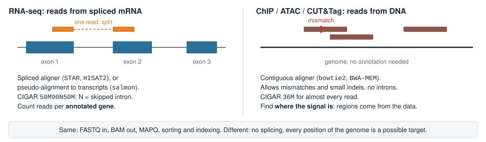{width="95%" fig-align="center"}

- No splicing: a read from genomic DNA aligns **contiguously**, with at most a few mismatches and small indels. **bowtie2** or **BWA-MEM**, not STAR.
- No annotation: every position of the genome is a possible target. The regions come from the data (peaks), not from a GTF.

::: notes
Students used STAR or HISAT2, which search for split alignments across introns, or salmon, which skips alignment to the genome altogether. Neither is right here: spliced alignment would invent "introns" in DNA reads, and pseudo-alignment needs a list of transcripts. bowtie2 is the standard for short ChIP, ATAC and CUT&Tag reads; BWA-MEM is common for longer reads and is the default in nf-core/chipseq. You could use STAR with splicing switched off, but there is no reason to. What carries over from RNA-seq: the BAM format, sorting and indexing, MAPQ, samtools.
:::

## How bowtie2 finds a position: seed and extend {.smaller}

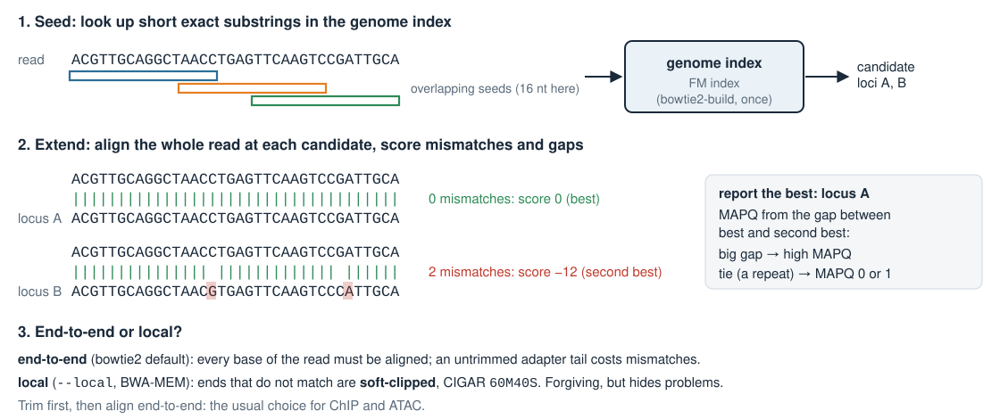{width="85%" fig-align="center"}

::: notes
Step 1: the genome is indexed once (bowtie2-build, an FM index based on the Burrows–Wheeler transform; 27 s for chr21+chrM with 8 threads, an hour or more for the whole human genome). Short substrings of the read, the seeds, are looked up exactly in the index; this is fast because the index makes exact-match lookups cheap. Step 2: each candidate locus is aligned in full with dynamic programming, scoring mismatches (penalty up to 6, less at low-quality bases) and gaps. Step 3: the best alignment is reported, and the gap between best and second best becomes MAPQ. End-to-end mode (the default) is strict: every base must align, so trim first. Local mode soft-clips ends that do not match (S in the CIGAR); it is forgiving, which is why it is popular for CUT&Tag, but it can also hide adapter problems. You do not need the algorithm for the exam; you need to know why a read in a repeat gets a low MAPQ and what soft-clipping is.
:::

## bowtie2 on the command line

```bash
# once per genome: build the index (chr21 + chrM in this course; 27 s with 8 threads)
bowtie2-build --threads 8 hg38_chr21_chrM.fa hg38_chr21_chrM

# align, and sort by position on the way out (3 s for 380 000 reads)
bowtie2 -p 8 -x hg38_chr21_chrM -U chip.trim.fastq.gz 2> chip.bowtie2.log \
  | samtools sort -@ 4 -o chip.sorted.bam -
samtools index chip.sorted.bam          # .bai: jump to any region
samtools flagstat chip.sorted.bam       # how many mapped, paired, duplicates ...
samtools idxstats chip.sorted.bam       # reads per chromosome
```

```
380570 reads; of these: 2014 (0.53%) aligned 0 times
                        291310 (76.55%) aligned exactly 1 time
                        87246 (22.93%) aligned >1 times
```

::: notes
Paired-end: -1 R1.fastq.gz -2 R2.fastq.gz instead of -U. The pipe avoids writing a large unsorted SAM file. "Aligned >1 times" means bowtie2 found more than one valid alignment and reported one of them: these become the low-MAPQ reads. 23% of the ChIP reads on chr21+chrM are multi-mapping; that is not a failure of the experiment, it is what 36 bp reads in a genome full of repeats look like. Only 0.5% did not align at all, much lower than in real data, because the course reads were preselected (slide on the shortcut). The 2014 unaligned reads are mostly reads that ENCODE aligned after cropping them to 28 bp, and whose last bases do not match. For whole-genome indexes, download a prebuilt one (iGenomes, the bowtie2 website) instead of building it.
:::

## The SAM record {.smaller}

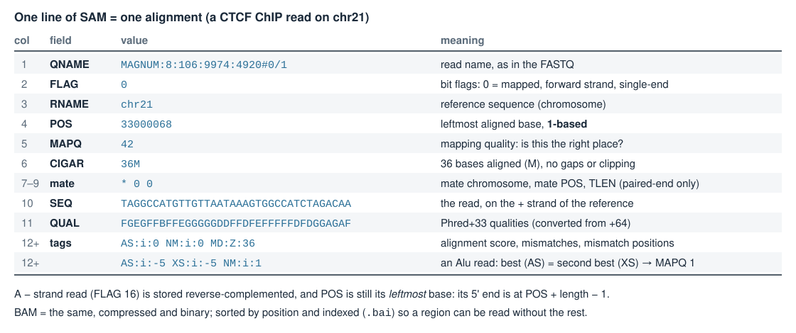{width="88%" fig-align="center"}

::: notes
A real read from the ChIP BAM. Columns students must be able to read on paper: FLAG, RNAME, POS (1-based leftmost base), MAPQ and CIGAR; and for paired-end data, the mate columns and TLEN. The tags are aligner-specific: AS is this alignment's score, XS the score of the second-best alignment (only present when there is one), NM the edit distance, MD where the mismatches are. The second tag line is an Alu read (its sequence starts with the classic Alu motif): AS = XS = −5, a tie, so MAPQ 1. A reverse-strand read is stored as the reverse complement of what the sequencer read, and POS is still the leftmost base: the read's own 5' end, where the fragment starts, is at POS + length − 1. That matters for extending reads and for Tn5 shifts in ATAC.
:::

## Decoding the FLAG by hand {.smaller}

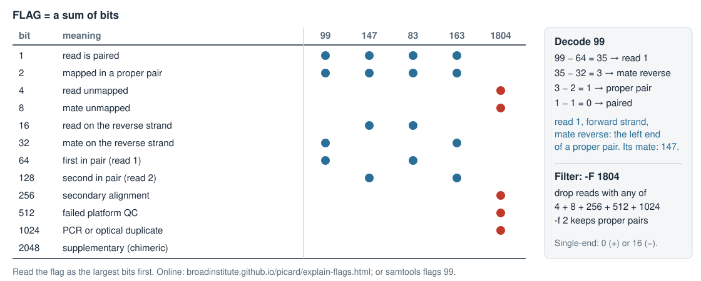{width="85%" fig-align="center"}

::: notes
Exam material. FLAG is a sum of powers of two, so each value decodes uniquely: subtract the largest bit that fits, repeat. 99 = 64 + 32 + 2 + 1: read 1, mate on the reverse strand, proper pair, paired. Its mate is 147 = 128 + 16 + 2 + 1. 83 and 163 are the same pair the other way round. Single-end reads: 0 or 16 when mapped, 4 when unmapped. With samtools: -f keeps reads with all the given bits set, -F drops reads with any of them set. -F 1804 (4 + 8 + 256 + 512 + 1024) is the ENCODE filter: drop unmapped reads, reads whose mate is unmapped, secondary alignments, QC failures and duplicates. samtools flags 1804 decodes it for you; so does the Picard "explain flags" web page.
:::

## MAPQ and reads in repeats {.smaller}

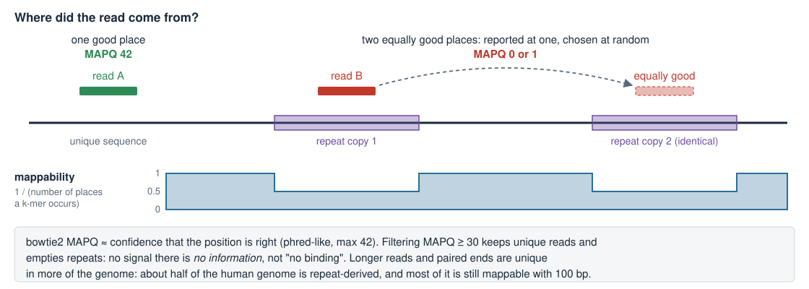{width="88%" fig-align="center"}

- About half of the human genome is repeat-derived (transposons, segmental duplications, satellites). A short read there fits **several places equally well**.
- bowtie2 reports **one** of them at random, with **MAPQ 0 or 1**. Keep only MAPQ ≥ 30 (or ≥ 10–20 in some pipelines) for coverage tracks.

::: notes
MAPQ is phred-scaled like base quality: in principle MAPQ 30 means 1 in 1000 that the position is wrong. Each aligner computes it differently: bowtie2 tops out at 42, BWA at 60, STAR uses 255 for unique. Removing multi-mappers has a cost: repeats become blind spots, with no signal at all. That is no information, not evidence of no binding. Some marks, especially H3K9me3 in heterochromatin, live mostly in repeats; there, people keep multi-mappers or distribute them with an EM algorithm. Mappability tracks (e.g. from GenMap or Umap) give, for each position and read length, whether a read starting there is unique. Longer and paired reads raise mappability.
:::

## Real data: MAPQ on chr21 {.smaller}

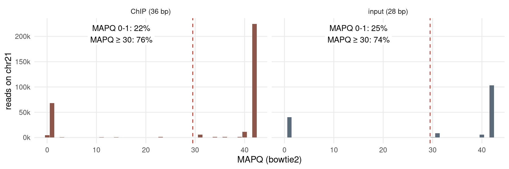{width="95%" fig-align="center"}

- Two peaks: **MAPQ 0–1** (22% of ChIP reads, 25% of input reads) and **MAPQ 42**. Little in between.
- Filtering at MAPQ ≥ 30 keeps 76% (ChIP, 36 bp) and 74% (input, 28 bp) of the reads on chr21. Shorter reads are unique less often.

::: notes
The distribution is strongly bimodal: a read is either unique or not. The intermediate values are reads whose second-best alignment is somewhat worse, e.g. two copies of a repeat that differ by a few bases. The threshold therefore matters less than one might fear: 10, 20 or 30 remove almost the same reads. The input has slightly more multi-mappers on chr21 than the ChIP, partly because its reads are 8 bases shorter and partly because the ChIP reads are enriched at CTCF sites, which are mostly in unique sequence. Overall the input looks more "unique" (91% MAPQ ≥ 30 of all reads) only because two thirds of its reads are on chrM, which is unique in this reference. Keep that in mind when comparing summary numbers between libraries.
:::

## Paired-end reads and the fragment {.smaller}

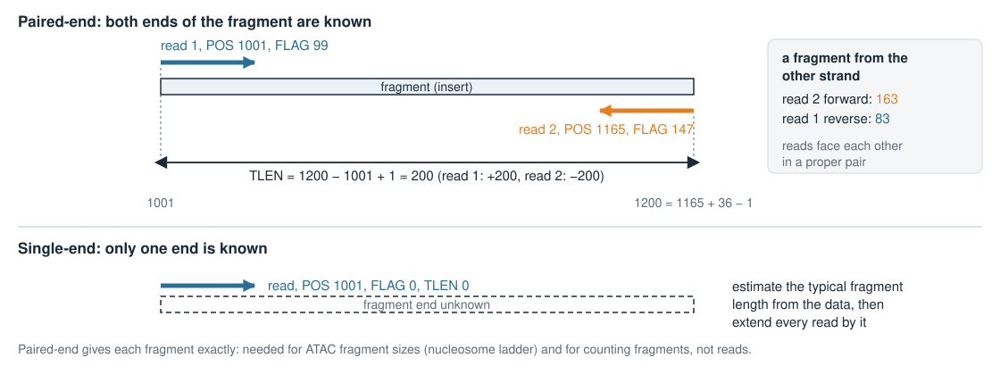{width="88%" fig-align="center"}

- A proper pair: the two reads **face each other** on opposite strands, at a plausible distance. **TLEN** = rightmost end − leftmost start + 1 = the fragment length.
- Single-end data know only one end: the fragment length must be **estimated** and the reads **extended**.

::: notes
Work through the numbers: read 1 starts at 1001, read 2 (36 bp) ends at 1200, so TLEN = 1200 − 1001 + 1 = 200, positive on the leftmost read and negative on its mate. Paired-end sequencing is now standard for ATAC and CUT&Tag because the fragment length itself is information: the ATAC nucleosome ladder, the CUT&Tag sub-nucleosomal fragments. It also helps mapping: a read in a repeat can be placed by its uniquely mapped mate. Our CTCF data are single-end, as most ChIP-seq before about 2015 was, so we estimate the fragment length later in the lecture. Filtering paired data: -f 2 keeps proper pairs; remove reads whose mate failed filtering, otherwise you get orphan reads (samtools fixmate -m and -F 1804 take care of most of this).
:::

## PCR and optical duplicates {.smaller}

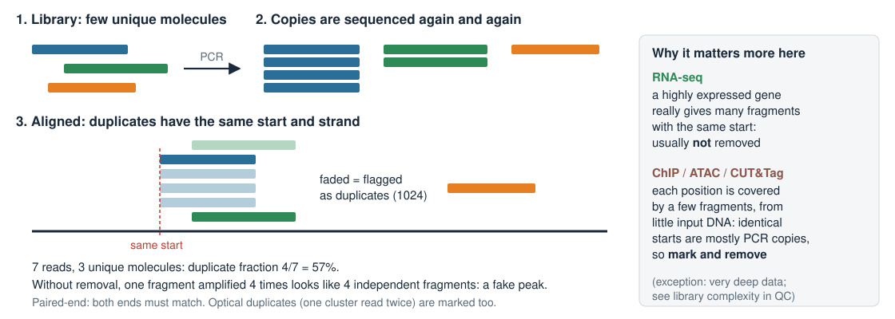{width="90%" fig-align="center"}

::: notes
Library preparation includes PCR, so each original molecule can be sequenced many times. Duplicates are defined by position: same start and strand for single-end reads, same both ends for paired-end reads. Optical duplicates are a different artefact: one cluster read as two on the flow cell, recognised by being physically close. samtools markdup (or Picard MarkDuplicates) sets bit 1024 and keeps the copy with the best base qualities; with -r it removes them instead. The paired-end recipe needs name-collated input and samtools fixmate -m first: collate → fixmate -m → sort → markdup. For single-end reads, sort → markdup is enough. Why not in RNA-seq? A highly expressed gene saturates the possible start positions, so many identical starts are real; removing them would compress expression. In ChIP and ATAC, a position is covered by few independent fragments, so identical starts are mostly PCR copies, which would create fake peaks. The duplicate rate also measures library complexity: a high rate means few unique molecules (little input DNA, too many PCR cycles), discussed in Experimental design and QC.
:::

## Real data: the blacklist and chrM {.smaller}

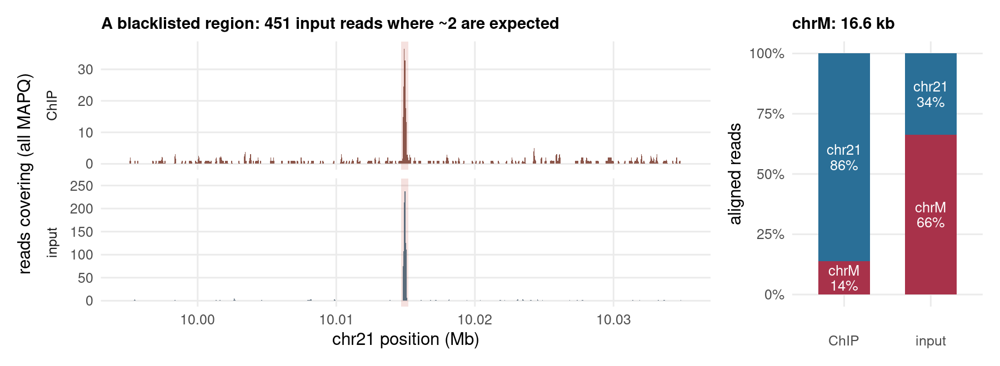{width="95%" fig-align="center"}

- **Blacklist** (ENCODE exclusion list): regions with extreme signal in *every* experiment, input included: satellite repeats, rDNA, centromeres. 910 regions in GRCh38, **24 on chr21**. Remove reads there.
- **chrM**: many copies per cell, no nucleosomes. 14% of ChIP reads but **66% of input reads** here; in ATAC often 20–80%. Remove before normalising.

::: notes
Left: input reads pile up in a 520 bp blacklisted region at chr21:10.01 Mb: 451 reads where about 2 are expected from the input's depth, and 72 ChIP reads. Here 448 of the 451 have MAPQ 1, so the MAPQ filter already removes them; elsewhere it does not: after MAPQ and duplicate filtering, the 3 kb blacklisted region at chr21:6.37 Mb still has 24 times the average input density. The blacklist catches what the other filters miss. Such regions are usually unassembled or collapsed repeats: in the reference there is one copy, in the cell there are many, so reads from all copies land on it, with high MAPQ. They produce "peaks" in every experiment and would dominate any genome-wide ranking. Amemiya, Kundaje and Boyle derived the list from large collections of input (and DNase) data, so it is assay-independent. Right: the share of aligned reads on chrM. Mitochondrial DNA is present in hundreds of copies per cell; in ATAC, Tn5 attacks it eagerly because it is not packed into nucleosomes. For a nuclear chromatin assay, chrM reads are not informative: drop them before computing CPM, otherwise a library with more chrM looks shallower. Also note NUMTs: nuclear copies of mitochondrial sequence pull mitochondrial reads into the nuclear genome, one more reason for the MAPQ filter and the blacklist.
:::

## The filtering chain, step by step {.smaller}

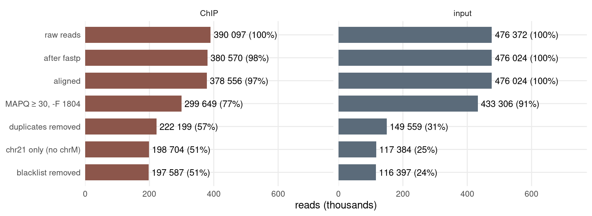{width="90%" fig-align="center"}

```bash
samtools view -b -q 30 -F 1804 -o chip.q30.bam chip.sorted.bam        # unique, mapped, primary
samtools markdup -s chip.q30.bam chip.markdup.bam                     # flag duplicates (1024)
samtools view -b -F 1024 -o chip.dedup.bam chip.markdup.bam chr21     # drop them, and chrM
bedtools intersect -v -abam chip.dedup.bam -b blacklist.bed > chip.final.bam
```

::: notes
The real read counts from the exercise. ChIP: 390 097 raw → 197 587 final reads (51%). Input: 476 372 → 116 397 (24%), because most of its reads are chrM duplicates. Order matters. MAPQ and flag filters first, so that duplicates are judged among reads we trust. Duplicates before taking chr21: it makes no difference here, but marking on the whole BAM is the norm. Blacklist last (or any time), because it removes positions, not reads with problems. For paired-end data add -f 2 to the first step, and mark duplicates on pairs (fixmate -m first). A note on duplicates at strong peaks: in the ChIP, 49% of the reads inside the 405 chr21 CTCF peaks were flagged as duplicates, against 4% outside peaks. With single-end 36 bp reads, a 200 bp peak has only a few hundred possible start positions per strand, so at very strong peaks some "duplicates" are real independent fragments. Dedup compresses the strongest peaks; it is still the standard, because PCR copies are the bigger danger.
:::

## Single-end reads need extending {.smaller}

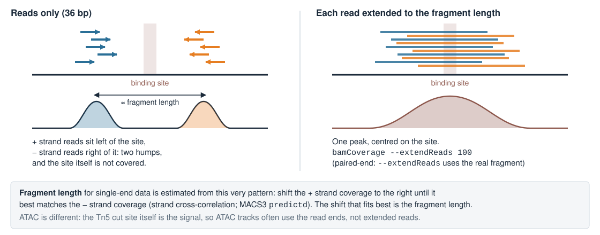{width="95%" fig-align="center"}

::: notes
A fragment covers the binding site, but a 36 bp read covers only its first 36 bases. Fragments from the + strand are read from their left end, so their reads sit to the left of the site; fragments from the − strand are read from the right end. The result is two humps, about one fragment length apart, with the site itself in the gap. Extending each read in its own direction to the fragment length rebuilds the fragment and gives one peak on the site. For paired-end data there is nothing to estimate: deepTools uses the real fragment between the mates. The fragment length is estimated from the strand shift: MACS3 predictd pairs + and − strand peaks; the strand cross-correlation used in ENCODE QC computes the correlation of the two strands at every shift. For ATAC, the cut sites are the signal, so ATAC tracks are often built from the Tn5 insertion points (read 5' ends, shifted), discussed in the ATAC units.
:::

## Real data: the two strands around CTCF sites {.smaller}

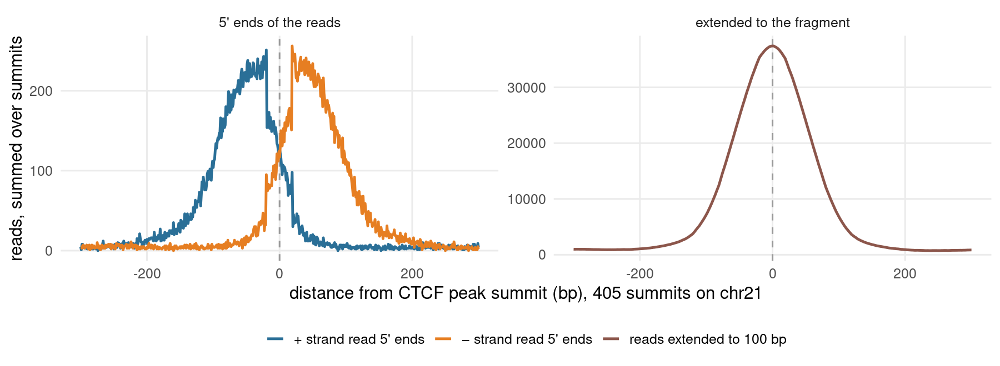{width="95%" fig-align="center"}

- Left: 5' ends of **+** strand reads peak about **50 bp left** of the CTCF summits, **−** strand reads about **50 bp right**. Median distance between them: ≈ **100 bp** = the typical fragment.
- `macs3 predictd` estimates the same: 100 bp. Right: reads extended to 100 bp give one peak, centred on the summits.

::: notes
These are the 405 ENCODE CTCF peak summits on chr21, with the filtered ChIP reads summed around them (make-enrichalign-figs.R). The medians of the 5' end positions are −50 bp for + strand reads and +48 bp for − strand reads. The sharp inner edges at about ±18 bp are a footprint: CTCF itself protects about 20–40 bp of DNA, and fragment ends cannot fall inside the protein. 100 bp is shorter than the 150–300 bp a sonicated library usually shows on a gel; for TF ChIP the strand-shift estimate is often shorter than the gel size, because it measures the fragments that actually carry the bound protein. We therefore use --extendReads 100 in the exercise. ENCODE ran its own estimate on the full data set.
:::

## Coverage and normalisation: CPM and RPGC {.smaller}

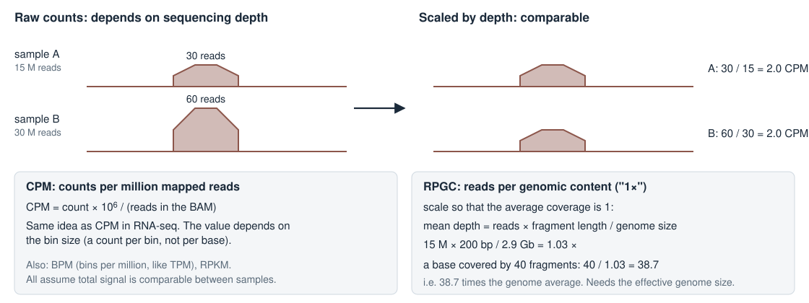{width="90%" fig-align="center"}

- Raw counts scale with sequencing depth. **CPM** divides by the number of reads (in millions): the same as CPM in RNA-seq.
- **RPGC** (1× normalisation) scales so the genome average is 1: a value of 38.7 means 38.7 times the average coverage.
- Both assume the **total** amount of signal is comparable between samples. A global change (a drug that removes a mark everywhere) breaks them: spike-ins, in *Experimental design and QC*.

::: notes
In deepTools: bamCoverage --normalizeUsing CPM, BPM (like TPM: per bin, then scaled to a million), RPKM, or RPGC with --effectiveGenomeSize. CPM per bin depends on the bin size, because it is a count of reads overlapping a bin; RPGC is a per-base coverage and does not. Effective genome size: the mappable part of the genome, about 2.7–2.9 Gb for human depending on read length (deepTools documents values); in the exercise we use the non-N length of chr21, 40.1 Mb, because our BAM contains chr21 only. Exam-style calculation: 15 million reads of 200 bp fragments over 2.9 Gb gives an average depth of 1.03; a base covered by 40 fragments has RPGC 38.7. These are the RNA-seq ideas students know, with the same weakness: normalising to the total assumes most of the genome does not change. The differential-accessibility unit returns to this.
:::

## Fold change over the input {.smaller}

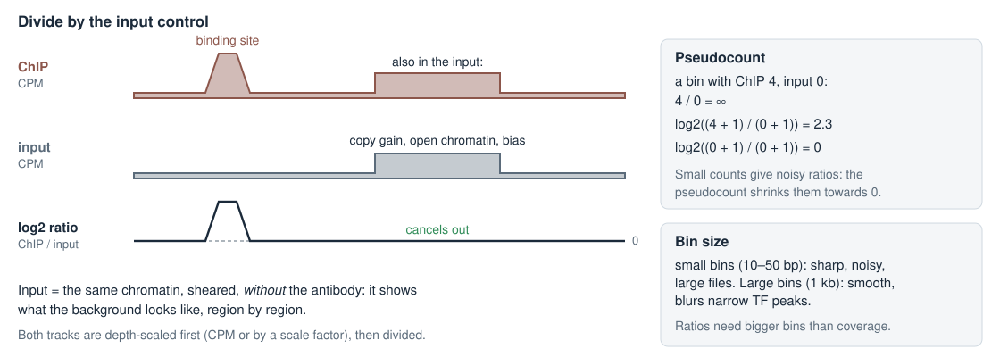{width="95%" fig-align="center"}

- The **input** (same chromatin, no antibody) shows local background: copy number, open chromatin, mappability, GC bias. Dividing by it removes what ChIP and input share.
- `bamCompare` scales both to the same depth, then reports **ratio** or **log2 ratio** per bin, with a **pseudocount** to avoid dividing by zero.

::: notes
Background is not flat. Amplified regions, open chromatin (sheared more easily) and repeats all give more reads in the input as well as in the ChIP. Dividing by the input corrects for these. Pseudocount: with 0 input reads, the ratio is infinite; adding 1 to both counts gives log2(5/1) = 2.3 for a bin with 4 ChIP reads, and 0 for an empty bin. The pseudocount shrinks ratios of small counts towards 0, which is what you want for noisy bins. Bin size: a 10 bp bin with 0 or 1 input read gives a meaningless ratio, so ratios use larger bins (50 bp here) or smoothed input. Peak callers like MACS3 do the smarter version: a local background estimated from the input over 1 kb and 10 kb windows. That is in the peak-calling unit.
:::

## Coverage tracks with deepTools

```bash
# ChIP and input, each normalised to counts per million, reads extended to 100 bp
bamCoverage -b chip.final.bam  -o chip.cpm.bw  --normalizeUsing CPM --extendReads 100 --binSize 10 -p 8
bamCoverage -b input.final.bam -o input.cpm.bw --normalizeUsing CPM --extendReads 100 --binSize 10 -p 8

# the same ChIP track as "times the average coverage" (RPGC; chr21 only, so chr21's size)
bamCoverage -b chip.final.bam -o chip.rpgc.bw --normalizeUsing RPGC \
  --effectiveGenomeSize 40088619 --extendReads 100 --binSize 10 -p 8

# ChIP over input: depth-scaled, log2 ratio in 50 bp bins, pseudocount 1
bamCompare -b1 chip.final.bam -b2 input.final.bam -o chip_vs_input.log2.bw \
  --operation log2 --scaleFactorsMethod readCount --pseudocount 1 \
  --extendReads 100 --binSize 50 -p 8
```

::: notes
Each command takes 2–5 seconds on the chr21 BAMs; on a full human ChIP-seq BAM of 30 million reads, a few minutes. --extendReads without a number uses the mate for paired-end data. --ignoreForNormalization chrX chrM is common when the BAM still contains them. bamCompare --operation ratio gives the plain ratio, comparable with ENCODE's fold-change track; subtract gives a difference. The output is bigWig, the indexed format from Genomic intervals, so it opens instantly in IGV. Alternatives: MACS3 writes fold-enrichment bedGraphs as part of peak calling (that is what ENCODE's track is), and nf-core uses bedtools genomecov scaled to one million reads.
:::

## Real data: our tracks at a locus {.smaller}

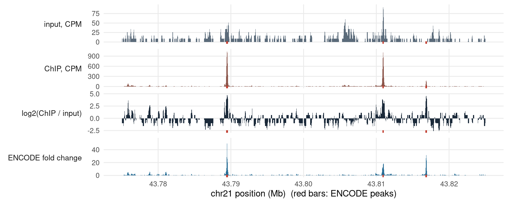{width="95%" fig-align="center"}

- Three CTCF sites at chr21:43.78–43.82 Mb. Our ChIP CPM track and ENCODE's fold change agree on where the peaks are.
- Our log2 ratio is **noisy** away from peaks: the input has only 116 000 reads on chr21, about 3 per kb. ENCODE's track smooths the input over kilobases (MACS2 local λ).

::: notes
Open these files in IGV (desktop or igv.js) in the exercise: load the bigWigs, the ENCODE peaks and the BAM itself, and zoom in on a peak to see the + and − strand reads on either side of the summit. Points to make: the input is not flat (a bump at 43.806 Mb, and some input reads at the 43.81 Mb CTCF site itself, which is common at strong open sites); the third site at 43.817 Mb is weaker in CPM but has a high ratio, because the input there is low. A ratio track is only as good as its denominator: with a shallow input, smooth it or use larger bins. ENCODE's fold change is MACS2's: ChIP pileup divided by a local background from the input over 1 kb and 10 kb windows (and never below the genome-wide average), and it pools two replicates.
:::

## Real data: our track against ENCODE's {.smaller}

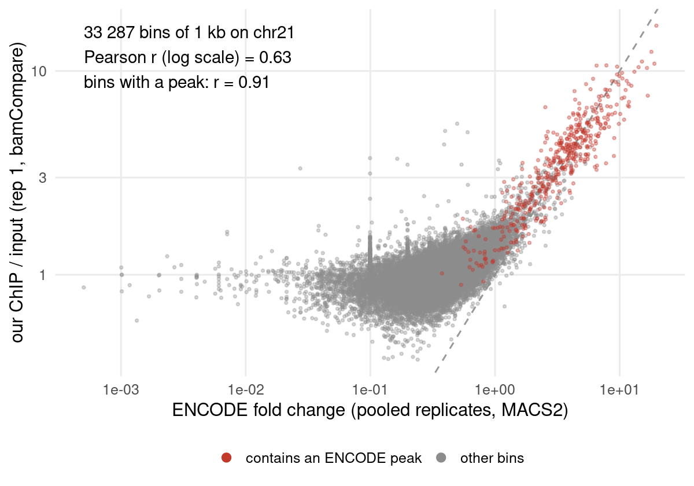{width="68%" fig-align="center"}

- Mean signal in 33 287 one-kb bins on chr21 (blacklist and empty bins removed). Bins with an ENCODE peak agree well (**r = 0.91**); background bins much less (overall **r = 0.63**).
- Same data, different tools and choices: the **peaks** are robust, the **background** depends on how you treat the input.

::: notes
This is how you check a pipeline: compare with a trusted result on the same data. The differences have known causes: we used replicate 1 only, a fragment length of 100 bp, a 50 bp bin ratio with pseudocount 1; ENCODE pooled two replicates, cropped the ChIP reads to 28 bp (the input's length; see the @PG line of their BAM), and used MACS2's smoothed local background, which is why its background values sit well below 1 while ours sit around 1. Correlations computed on the log scale (Pearson); Spearman 0.60 over all bins. In the exercise students compute these numbers themselves in R.
:::

## The shortcut used in this course {.smaller}

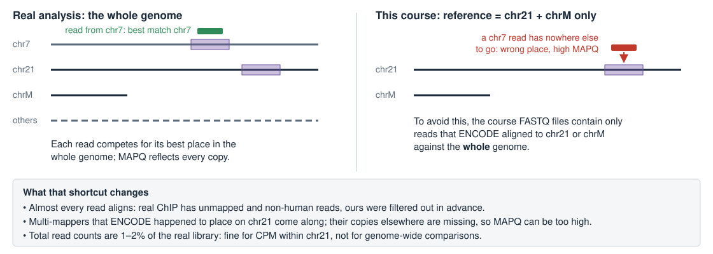{width="92%" fig-align="center"}

::: notes
Honesty slide (design principle 10). Aligning to chr21 + chrM only is fast, but it changes the problem: a read from anywhere else in the genome has nowhere to go but chr21 or chrM, so it lands at the most similar sequence, often with a high MAPQ, because MAPQ only reflects the copies the aligner can see. We avoided most of this by giving students only the reads that ENCODE aligned to chr21 or chrM against the full genome. The price: alignment rates look perfect (99.5% and 100%), multi-mappers whose other copies are on other chromosomes may get a MAPQ that is too high, and library sizes are 1–2% of the real ones (390 000 of 29.5 million ChIP reads). A real analysis aligns to the whole genome (GRCh38 analysis set, without alt contigs), on a cluster: well under an hour per sample with 8 threads for 30 million short reads. The nf-core pipelines on the next slide do exactly that.
:::

## What the production pipelines do {.smaller}

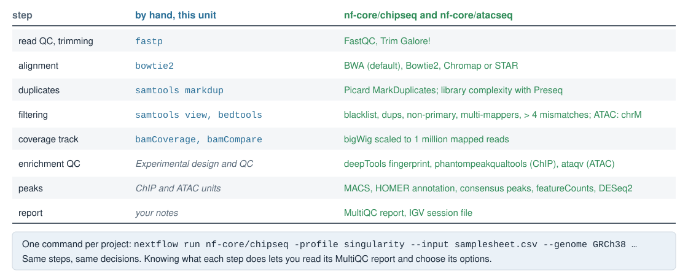{width="95%" fig-align="center"}

::: notes
nf-core/chipseq and nf-core/atacseq run the same chain at scale, with containers and a samplesheet, on a laptop, a server or a SLURM cluster. Differences from our hand-made chain: BWA as the default aligner (bowtie2 available), Picard for duplicates, a stricter filter set (also more than 4 mismatches, soft-clipped reads in ATAC, insert size over 2 kb), bigWigs scaled to a million mapped reads with bedtools, and QC that we cover in Experimental design and QC (fingerprint, strand cross-correlation, library complexity). ENCODE has its own pipeline (ENCODE TF/histone ChIP-seq pipeline) with the same logic: MAPQ 30, -F 1804, duplicates removed, blacklist filtered. Knowing the steps is what lets you read the MultiQC report and choose parameters; running the pipeline without knowing them is how mistakes go unnoticed.
:::

## Summary {.smaller}

| step | key fact |
|---|---|
| FASTQ quality | Q = −10 log<sub>10</sub> p; Q20 = 1% error, Q30 = 0.1%; check the offset (+33 or +64) |
| trimming | adapters appear when the fragment is shorter than the read; fastp |
| alignment | contiguous, no splicing: bowtie2 / BWA; seed and extend; end-to-end vs local |
| SAM | FLAG = sum of bits (99/147, 83/163, 16, 4, 1024); POS 1-based leftmost; TLEN = fragment |
| MAPQ | 0–1 = several equal places (repeats); keep ≥ 30; repeats become blind spots |
| duplicates | same start (and end): PCR copies; remove for ChIP/ATAC, not RNA-seq |
| blacklist, chrM | remove artefact regions and mitochondrial reads before normalising |
| coverage | extend single-end reads to the fragment (~100 bp here); CPM, RPGC; ratio to input |

::: notes
Students should leave able to decode a FLAG and a quality character on paper, compute TLEN, CPM, RPGC and a fold change with a pseudocount, explain each filtering step and its order, and say what a coverage track does and does not show. Next: Experimental design and QC (replicates, controls, FRiP, fingerprints), then the ATAC and ChIP blocks, which start from the clean BAM files made here.
:::

## Key papers (optional further reading) {.smaller}

*Not required reading and not examined. For those who want the primary literature.*

- Langmead & Salzberg 2012, *Nat Methods*. [Fast gapped-read alignment with Bowtie 2](https://doi.org/10.1038/nmeth.1923). The aligner of this unit.
- Li et al. 2009, *Bioinformatics*. [The Sequence Alignment/Map format and SAMtools](https://doi.org/10.1093/bioinformatics/btp352). SAM/BAM, FLAGs and MAPQ, defined.
- Chen et al. 2018, *Bioinformatics*. [fastp: an ultra-fast all-in-one FASTQ preprocessor](https://doi.org/10.1093/bioinformatics/bty560). Adapter detection from the data and from read overlap.
- Ramírez et al. 2016, *Nucleic Acids Res*. [deepTools2: a next generation web server for deep-sequencing data analysis](https://doi.org/10.1093/nar/gkw257). bamCoverage, bamCompare and the normalisations.
- Amemiya, Kundaje & Boyle 2019, *Sci Rep*. [The ENCODE Blacklist: identification of problematic regions of the genome](https://doi.org/10.1038/s41598-019-45839-z). How the blacklist was made, and what happens without it.
- Robinson et al. 2011, *Nat Biotechnol*. [Integrative genomics viewer](https://doi.org/10.1038/nbt.1754). IGV.
