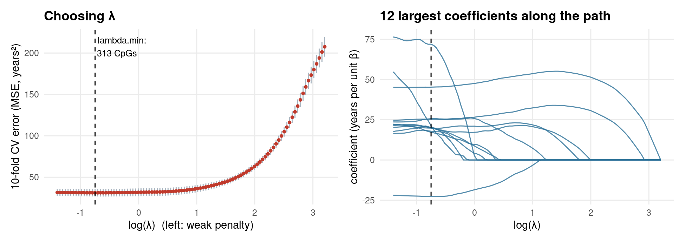
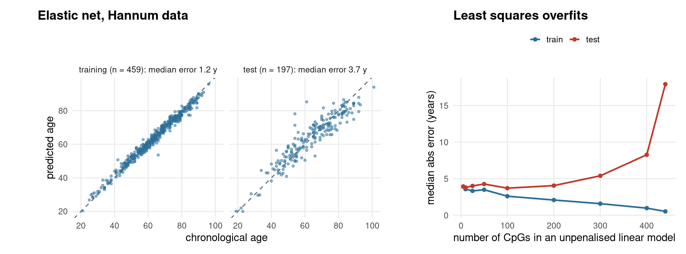

## Goal

After this exercise you will be able to:

- Predict an age by hand from clock coefficients, including Horvath's age transformation.
- Fit your own **epigenetic clock** with the elastic net ([glmnet](https://glmnet.stanford.edu/)) on public blood methylation data, choosing λ by **cross-validation**.
- Evaluate it honestly: training vs **held-out** error, an **external** data set, and the effect of **leakage**.
- Apply Horvath's published clock and compute **age acceleration** as a residual.
- **Deconvolve** a methylation profile against a reference atlas, as used for cell-free DNA, and compute a **positive predictive value** for a screening test.

## Background

**The elastic net.** For people $i$ with age $y_i$ and CpG β values $x_{ij}$, glmnet finds the intercept $a$ and coefficients $b_j$ that minimise

$$ \frac{1}{2n}\sum_i \Big(y_i - a - \sum_j b_j x_{ij}\Big)^2 + \lambda \Big[ \alpha \sum_j |b_j| + \frac{1-\alpha}{2} \sum_j b_j^2 \Big]. $$

α = 1 is the lasso (many coefficients exactly 0), α = 0 ridge regression (all shrunk, none 0). Clocks use α = 0.5. λ is chosen by **k-fold cross-validation** on the training data; the test data are used once, at the end.

**Prediction** is then a weighted sum: predicted age $= a + \sum_j b_j \beta_j$.

**Horvath's transformation.** Horvath's clock predicts $F(\text{age})$ with $F(a) = \log(a + 1) - \log(21)$ for $a \le 20$ and $F(a) = (a - 20)/21$ for $a > 20$. The inverse: if the linear predictor $z < 0$, age $= 21 e^{z} - 1$; otherwise age $= 21 z + 20$.

**Age acceleration** is the residual of DNAm age regressed on chronological age in the data at hand: $\text{AA}_i = \text{DNAmAge}_i - (c_0 + c_1 \cdot \text{age}_i)$.

**Deconvolution.** A sample's β values are modelled as a non-negative mixture of reference profiles: $y \approx R w$, $w \ge 0$, solved by non-negative least squares ([nnls](https://cran.r-project.org/package=nnls)), as in the Houseman method of *Methylation arrays*.

**Screening.** Positive predictive value (PPV) = true positives / all positives = $\dfrac{\text{sens} \cdot p}{\text{sens} \cdot p + (1 - \text{spec})(1 - p)}$ for prevalence $p$.

## Data

From `data/prepare-meth2.sh clocks` and `data/prepare-meth2.sh arrays`:

```bash
mkdir -p ~/epi/clocks && cd ~/epi/clocks
D=/path/to/course/data                     # where the course data are
```

| file | what |
|---|---|
| `hannum_gse40279_beta_subset.tsv.gz` | Hannum et al. 2013 (GEO [GSE40279](https://www.ncbi.nlm.nih.gov/geo/query/acc.cgi?acc=GSE40279)): β values of 656 whole-blood samples (450k), **26 127 CpGs**: the 20 000 most variable CpGs (chosen without looking at age), plus the CpGs of the Horvath clock and of the Moss atlas, plus *ELOVL2* cg16867657 and *FHL2* cg06639320. Columns: `cpg`, then one column per GEO sample |
| `hannum_gse40279_samples.tsv` | sample table: GEO accession, age, sex, ethnicity, recruitment site, plate |
| `horvath2013_coefficients.csv` | Horvath 2013, Additional file 3: intercept and 353 CpG coefficients (column `CoefficientTraining`) |
| `moss2018_reference_atlas.csv` | Moss et al. 2018: β of marker CpGs in 25 cell types and tissues ([meth_atlas](https://github.com/nloyfer/meth_atlas)) |
| `gse42861_idat/`, `gse42861_samples.tsv` | the 151 rheumatoid arthritis / control arrays of *Methylation arrays*: our external test set |

**Shortcuts, said plainly.** The Hannum β values are the authors' processed values (not re-normalised from IDATs). We use a CpG subset to keep memory small; a real clock would start from all ~470 000 CpGs. The subset contains the Horvath CpGs, which Horvath selected partly using these very samples: a mild form of leakage for any clock trained on the subset, which is one reason to test on GSE42861 as well.

You need R packages data.table, glmnet, nnls, ggplot2, and (for R6–R7) minfi with `IlluminaHumanMethylation450kmanifest`. The R part takes about 10 minutes, mostly reading IDATs in R6, and needs about 8 GB of memory.

## By hand

Do these on paper.

**B1. Predict an age.** A (toy) clock has intercept 18 and three CpGs:

| CpG | coefficient | person P: β | person Q: β |
|---|---:|---:|---:|
| ELOVL2 | 60 | 0.70 | 0.55 |
| FHL2 | 40 | 0.50 | 0.40 |
| cgX | −30 | 0.40 | 0.60 |

(a) Compute the predicted ages of P and Q.

(b) An array batch effect adds +0.02 to every β. How much does it change every predicted age? What does that mean for comparing people measured in different batches?

**B2. Horvath's transformation.** (a) Compute F(5) and F(60). (b) The linear predictor for a sample is z = −1.2; what is the predicted age? And for z = 2.0? (c) Why transform age at all?

**B3. Which penalty?** Three models were fitted on the same 26 000 CpGs. Model 1 has 26 000 non-zero coefficients, all small. Model 2 has 40 non-zero coefficients. Model 3 has 313. Which could be ridge, lasso and elastic net? Why might the lasso keep only one CpG of a group of five neighbouring, highly correlated CpGs, and why does the elastic net tend to keep several?

**B4. Spot the leakage.** Which of these procedures give an over-optimistic test error? Explain.

(a) Select the 1 000 CpGs most correlated with age in all 656 samples; then split 70/30 and fit an elastic net on the training part.

(b) Split 70/30; normalise all 656 arrays together with quantile normalisation; fit on training, test on test.

(c) Split 70/30; within the training set, select CpGs and choose λ by cross-validation; test once.

(d) Fit five different models, evaluate each on the test set, and report the best test error.

(e) The data contain 30 pairs of twins; split people (not pairs) at random.

**B5. Read the figures.** Use the lecture figures:

{width="100%"}

{width="100%"}

(a) In the CV curve, why does the error rise to the right? Why is it flat at the left? Which λ would you choose and why?

(b) In the right panel of the second figure, why does the training error keep falling as CpGs are added, and why does the test error go up after about 100 CpGs?

**B6. Age acceleration.** In a cohort, the line of DNAm age on age is DNAm age = 10 + 0.85 × age.

| person | age | DNAm age |
|---|---:|---:|
| R | 25 | 33 |
| S | 60 | 59 |
| T | 80 | 75 |

(a) Compute DNAm age − age and the age acceleration (residual) for each.

(b) A study compares a group with mean age 30 with a group with mean age 70 using DNAm age − age and finds the young group "older". Explain.

**B7. Deconvolution by hand.** Two CpGs and two cell types:

| | neutrophils | lymphocytes | sample |
|---|---:|---:|---:|
| CpG 1 | 0.9 | 0.1 | 0.66 |
| CpG 2 | 0.2 | 0.8 | 0.38 |

(a) Assume the fractions are w and 1 − w. Solve for w from CpG 1, and check CpG 2.

(b) A third cell type (liver) has β = 0.1 at CpG 1 and 0.1 at CpG 2. Could a 5% liver contribution be detected from these two CpGs? What kind of CpGs would you add?

**B8. Screening arithmetic.** A cfDNA cancer test has 99.3% specificity and 40% sensitivity for early cancers. 100 000 people aged 50–75 are screened; 0.8% have a (mostly early) cancer.

(a) How many true positives and false positives? What is the PPV?

(b) What happens to the PPV if the test is used in a high-risk group with 5% prevalence?

(c) The test also predicts the tissue of origin correctly in 90% of true positives. Why does that matter for the follow-up of a positive result?

**B9. Judge the claim.** "In our 12-month study, 18 people taking supplement X became 1.8 years younger by DNAm PhenoAge (p = 0.04); four other clocks showed no change." List at least four problems, and design a better study.

## On the command line

### C1 — Look at the data

```bash
zcat $D/hannum_gse40279_beta_subset.tsv.gz | head -3 | cut -f 1-5
zcat $D/hannum_gse40279_beta_subset.tsv.gz | tail -n +2 | wc -l
head -3 $D/hannum_gse40279_samples.tsv
cut -f 3 $D/hannum_gse40279_samples.tsv | tail -n +2 | sort -n | awk '{ a[NR] = $1 } END { print "n", NR, "min", a[1], "median", a[int((NR + 1) / 2)], "max", a[NR] }'
cut -f 5 $D/hannum_gse40279_samples.tsv | tail -n +2 | sort | uniq -c
sed -n '1,5p' $D/horvath2013_coefficients.csv | cut -d, -f 1-3
grep -c '^cg' $D/horvath2013_coefficients.csv
```

(a) How many CpGs and samples? What are the age range and the median age?

(b) Which ethnic groups are in the Hannum data? Why could that matter when the clock is applied to a Swedish cohort?

(c) What is the intercept of Horvath's clock, and how many CpGs does it have?

## In R

```r
suppressPackageStartupMessages({ library(data.table); library(glmnet); library(nnls); library(ggplot2) })
D <- "/path/to/course/data"
b <- fread(file.path(D, "hannum_gse40279_beta_subset.tsv.gz"))
s <- fread(file.path(D, "hannum_gse40279_samples.tsv"))
X <- t(as.matrix(b[, -1])); colnames(X) <- b$cpg          # samples x CpGs
stopifnot(identical(rownames(X), s$gsm))
age <- s$age
dim(X)
```

### R1 — Single CpGs

```r
r <- cor(X, age)[, 1]
r[c("cg16867657", "cg06639320")]                       # ELOVL2, FHL2
head(sort(r), 3); head(sort(r, decreasing = TRUE), 3)
sum(abs(r) > 0.5); sum(abs(r) > 0.3)
fit1 <- lm(age ~ X[, "cg16867657"])
summary(fit1)$r.squared; median(abs(residuals(fit1)))
ggplot(data.frame(age, elovl2 = X[, "cg16867657"]), aes(age, elovl2)) + geom_point(alpha = 0.4) + geom_smooth(method = "lm")
```

(a) How well does ELOVL2 alone predict age (R², median absolute error)?

(b) How many CpGs have |r| > 0.5?

### R2 — Train/test split and an elastic net

```r
set.seed(42)
test  <- sample(nrow(X), round(0.3 * nrow(X)))
train <- setdiff(seq_len(nrow(X)), test)
cv <- cv.glmnet(X[train, ], age[train], alpha = 0.5, nfolds = 10)
plot(cv)
cv$lambda.min; cv$lambda.1se
cf <- coef(cv, s = "lambda.min")[, 1]
sum(cf[-1] != 0); sum(coef(cv, s = "lambda.1se")[-1] != 0)
head(sort(abs(cf[-1]), decreasing = TRUE), 5)
```

(a) How many CpGs does the model use at `lambda.min` and at `lambda.1se`?

(b) Is ELOVL2 among the selected CpGs? What is its coefficient, in years per unit β?

### R3 — Training and test error

```r
mae <- function(p, a) median(abs(p - a))
p_train <- predict(cv, X[train, ], s = "lambda.min")[, 1]
p_test  <- predict(cv, X[test, ], s = "lambda.min")[, 1]
c(train = mae(p_train, age[train]), test = mae(p_test, age[test]))
c(train = cor(p_train, age[train]), test = cor(p_test, age[test]))
p1se <- predict(cv, X[test, ], s = "lambda.1se")[, 1]; mae(p1se, age[test])
ggplot(data.frame(age = age[test], pred = p_test), aes(age, pred)) + geom_point() + geom_abline(linetype = 2)
```

(a) Report training and test errors. Why do they differ?

(b) How much worse is the 36-CpG model (`lambda.1se`) on the test set?

### R4 — Overfitting without a penalty

```r
rt <- cor(X[train, ], age[train])[, 1]
ols <- function(k, sel = rt) {
  g <- names(sort(abs(sel), decreasing = TRUE))[1:k]
  f <- lm.fit(cbind(1, X[train, g]), age[train]); bb <- f$coefficients; bb[is.na(bb)] <- 0
  c(k = k, train = mae(cbind(1, X[train, g]) %*% bb, age[train]), test = mae(cbind(1, X[test, g]) %*% bb, age[test]))
}
t(sapply(c(10, 50, 100, 200, 300, 400, 440), ols))
```

(a) At which k is the test error lowest? What happens as k approaches the number of training samples (459)?

### R5 — Leakage

Pure noise: 5 000 random "CpGs" with no relation to age. Select the 100 most age-correlated ones either using all samples (leaky) or using the training samples only (honest), then fit an elastic net on the training set and predict the test set.

```r
set.seed(1)
noise <- matrix(runif(nrow(X) * 5000), nrow(X))
pick <- function(r, k = 100) order(abs(r), decreasing = TRUE)[1:k]
leaky  <- pick(cor(noise, age)[, 1])                        # uses the test samples' ages!
honest <- pick(cor(noise[train, ], age[train])[, 1])
fit_noise <- function(g) {
  set.seed(2); f <- cv.glmnet(noise[train, g], age[train], alpha = 0.5)
  p <- predict(f, noise[test, g], s = "lambda.min")[, 1]
  c(test_mae = mae(p, age[test]), test_r = cor(p, age[test]))
}
rbind(leaky = fit_noise(leaky), honest = fit_noise(honest))
mae(rep(median(age[train]), length(test)), age[test])      # baseline: always predict the median age
```

(a) What test error and correlation does the leaky procedure report? Compare with the baseline of predicting the median age.

(b) What does the honest procedure give, and why?

(c) Our data file contains Horvath's 353 CpGs, which Horvath selected using (among others) these Hannum samples. Is that the same kind of leakage? How serious is it for our clock, and how do we check?

### R6 — Horvath's clock and an external test set

```r
hc <- fread(file.path(D, "horvath2013_coefficients.csv"), skip = 2)[, .(cpg = CpGmarker, w = CoefficientTraining)]
h0 <- hc[cpg == "(Intercept)", w]; hc <- hc[cpg != "(Intercept)"]
anti <- function(z) ifelse(z < 0, 21 * exp(z) - 1, 21 * z + 20)
horvath <- function(B) anti(h0 + B[, hc$cpg, drop = FALSE] %*% hc$w)[, 1]
h_hannum <- horvath(X)
c(r = cor(h_hannum, age), mae = mae(h_hannum, age), offset = median(h_hannum - age))

suppressPackageStartupMessages(library(minfi))
g <- fread(file.path(D, "gse42861_samples.tsv"))
g$Basename <- file.path(D, "gse42861_idat", g$basename)
rg <- read.metharray.exp(targets = as.data.frame(g))      # about 4 minutes
bg <- getBeta(preprocessNoob(rg)); rm(rg); invisible(gc())
Xg <- t(bg[colnames(X), ])
p_ext <- predict(cv, Xg, s = "lambda.min")[, 1]
h_ext <- horvath(t(bg[hc$cpg, ]))
rbind(ours = c(r = cor(p_ext, g$age), mae = mae(p_ext, g$age), offset = median(p_ext - g$age)),
      horvath = c(r = cor(h_ext, g$age), mae = mae(h_ext, g$age), offset = median(h_ext - g$age)))
```

(a) Why is the Horvath result on the Hannum data not a fair test? (Look at Additional file 1 of Horvath 2013.)

(b) How do the two clocks do on GSE42861? What is the median offset, and what could cause it?

### R7 — Age acceleration

```r
fit <- lm(p_ext ~ g$age)
coef(fit)
g$acc <- residuals(fit)
g$diff <- p_ext - g$age
t.test(acc ~ status, data = g)$p.value
aggregate(cbind(acc, diff) ~ status, data = g, FUN = mean)
aggregate(acc ~ smoking, data = g, FUN = mean)
cor(g$diff, g$age); cor(g$acc, g$age)
```

(a) What is the slope of DNAm age on age? (b) Do RA patients have accelerated epigenetic ages? (c) Why is the raw difference correlated with age, and the residual not?

### R8 — Deconvolution with a methylation atlas

```r
atl <- fread(file.path(D, "moss2018_reference_atlas.csv"))
atl <- atl[!duplicated(CpGs)]                               # markers chosen for two cell types appear twice
R <- as.matrix(atl[, -1]); rownames(R) <- atl$CpGs
common <- intersect(rownames(R), rownames(bg)); R <- R[common, ]
length(common); ncol(R)
deconv <- function(y) { f <- nnls(R, y)$x; names(f) <- colnames(R); f / sum(f) }
W <- t(apply(bg[common, ], 2, deconv))
round(sort(colMeans(W), decreasing = TRUE)[1:8], 3)
set.seed(7)
sim <- sapply(c(0, 0.01, 0.05, 0.1), function(f) {
  y <- (1 - f) * bg[common, 1] + f * R[, "Hepatocytes"] + rnorm(length(common), 0, 0.03)
  deconv(pmin(pmax(y, 0), 1))["Hepatocytes"] })
round(sim, 3)
```

(a) What does whole blood consist of according to the atlas? Compare with the Houseman estimates of *Methylation arrays* (granulocytes ~64%).

(b) How well is added hepatocyte DNA recovered? What would limit this in real plasma cfDNA?

## Hints

::: {.callout-tip collapse="true" title="Hint 1 — the elastic net and glmnet (B3, R2, R3)"}
[glmnet vignette](https://glmnet.stanford.edu/articles/glmnet.html): `cv.glmnet`, `lambda.min`, `lambda.1se`, `coef`, `predict`. Zou & Hastie 2005, [Regularization and variable selection via the elastic net](https://doi.org/10.1111/j.1467-9868.2005.00503.x). `coef(cv)` returns a sparse matrix; the first row is the intercept.
:::

::: {.callout-tip collapse="true" title="Hint 2 — overfitting and leakage (B4, B5, R4, R5)"}
A model with as many parameters as samples can fit the training data exactly. Leakage = any information from the test samples used before the test (selection, normalisation, model choice). Related individuals (twins) or replicates of one sample in both sets also leak. *Machine learning from scratch* treats this in depth.
:::

::: {.callout-tip collapse="true" title="Hint 3 — Horvath's clock (B2, R6)"}
Horvath 2013, [DNA methylation age of human tissues and cell types](https://doi.org/10.1186/gb-2013-14-10-r115): Additional file 2 (the transformation, section "Age transformation"), Additional file 1 (which data sets were training and test), Additional file 3 (coefficients). $\log$ is the natural logarithm.
:::

::: {.callout-tip collapse="true" title="Hint 4 — age acceleration (B6, R7)"}
Residuals from `lm(DNAmAge ~ age)`; [`residuals`](https://rdrr.io/r/stats/residuals.html). A slope below 1 means the clock overestimates the young and underestimates the old.
:::

::: {.callout-tip collapse="true" title="Hint 5 — reading IDATs (R6)"}
[minfi user's guide](https://bioconductor.org/packages/release/bioc/vignettes/minfi/inst/doc/minfi.html): `read.metharray.exp`, `preprocessNoob`, `getBeta`. The `Basename` column is the path without `_Grn.idat.gz`.
:::

::: {.callout-tip collapse="true" title="Hint 6 — deconvolution and screening (B7, B8, R8)"}
[`nnls::nnls`](https://rdrr.io/cran/nnls/man/nnls.html) solves $\min \|Ax - b\|$ with $x \ge 0$. Moss et al. 2018, [the atlas paper](https://doi.org/10.1038/s41467-018-07466-6). For B8 draw a 2×2 table: cancer yes/no × test positive/negative.
:::

## Solutions

::: {.callout-note collapse="true" title="Solutions — by hand"}

**B1.** (a) P: 18 + 60·0.70 + 40·0.50 − 30·0.40 = 18 + 42 + 20 − 12 = **68**. Q: 18 + 33 + 16 − 18 = **49**. (b) +0.02 × (60 + 40 − 30) = **+1.4 years** for everyone. A batch effect shifts all predictions of that batch; comparing people across batches mixes biology with batch. Real clocks have hundreds of coefficients of both signs, but the sum of their coefficients is rarely zero, so global shifts in β move DNAm age.

**B2.** (a) F(5) = log 6 − log 21 = 1.792 − 3.045 = **−1.25**; F(60) = 40/21 = **1.90**. (b) z = −1.2: 21·e^{−1.2} − 1 = 21·0.301 − 1 = **5.3 years**; z = 2.0: 21·2 + 20 = **62 years**. (c) Methylation changes much faster in childhood than in adulthood; on the log scale for children the relation with CpGs is closer to linear, so one linear model fits the whole lifespan.

**B3.** Model 1: ridge (no zeros). Model 2: lasso (most sparse). Model 3: elastic net (sparse, but keeps more correlated CpGs). The lasso penalty is indifferent between spreading a coefficient over five identical CpGs and putting it all on one, and the geometry of the L1 penalty makes the solution land on one; the L2 part of the elastic net prefers spreading the weight, so correlated CpGs enter together.

**B4.** Leaky: (a) selection uses the test samples' ages; (d) the test set is used for model choice, so the reported error is the minimum of five noisy estimates; (e) twins share genotype and family environment, so a twin in the test set is partly "seen" through the co-twin in training: split by pair. (b) is a mild leak in principle (normalisation uses test arrays, though not their ages); most clock papers accept it, but the safest is to normalise each array on its own (noob) or to freeze the normalisation on the training set. (c) is correct.

**B5.** (a) To the right λ is large: few or no CpGs, the model is too simple (underfitting), error near the variance of age. To the left the penalty is weak: many CpGs, but cross-validation shows no further gain; the curve is flat because the extra CpGs have tiny coefficients. Choose `lambda.min` for the lowest CV error or `lambda.1se` (largest λ within one standard error) for a simpler model with similar error. (b) More parameters always fit the training data at least as well; beyond ~100 CpGs the extra parameters fit noise in the training samples, which does not generalise, so the test error rises (overfitting); near k = n the fit is exact and useless.

**B6.** (a) Fitted: R 10 + 21.25 = 31.25; S 61; T 78. Raw differences: R +8, S −1, T −5. Residuals: R **+1.75**, S **−2**, T **−3**. (b) With a slope below 1 the clock overestimates the young and underestimates the old, so DNAm age − age falls with age (here from +8 to −5) even for people who are not accelerated. The comparison confounds acceleration with age; use residuals (or include age in the model).

**B7.** (a) CpG 1: 0.9w + 0.1(1 − w) = 0.66 → 0.8w = 0.56 → **w = 0.7**. Check CpG 2: 0.2·0.7 + 0.8·0.3 = 0.14 + 0.24 = 0.38 ✓. (b) Liver at 5% changes CpG 1 by 0.05·(0.1 − 0.66) ≈ −0.03 and looks like a small shift towards lymphocytes; with two CpGs and three unknowns the system is not identifiable. Add CpGs where liver differs from all blood cells (e.g. unmethylated only in hepatocytes and methylated in all blood cells); many such markers make a small fraction detectable.

**B8.** (a) Cancers: 800; true positives 0.40·800 = **320**; false positives 0.007·99 200 = **694**; PPV = 320/1014 = **32%**. Two out of three positives are false. (b) 5 000 cancers: TP 2 000; FP 0.007·95 000 = 665; PPV = 2000/2665 = **75%**. (c) A positive test must be followed by imaging and biopsy; knowing where to look shortens and cheapens the work-up and reduces harm from searching the whole body.

**B9.** Problems: no control group (regression to the mean, seasonal effects); before and after samples probably in different array batches (offsets of years are common); technical noise of single-CpG clocks (replicates differ by years); multiple testing across five clocks (one p = 0.04 is expected by chance); small n; possible change in blood cell composition; a lower PhenoAge is a surrogate, not a health outcome. Better: randomised placebo-controlled, all samples (both time points, both arms) on the same arrays in random order, technical replicates, a pre-registered primary clock with high reliability (DunedinPACE or a PC clock), cell composition estimated and modelled, and clinical outcomes.
:::

::: {.callout-note collapse="true" title="Solutions — command line"}

**C1.** (a) 26 127 CpGs (rows after the header) × 656 samples; age 19–101, median 65. (b) 426 "Caucasian - European" and 230 "Hispanic - Mexican". Methylation at some CpGs differs between populations (partly through meQTLs), so a clock trained on one population can be offset in another. (c) Intercept 0.6955 (`CoefficientTraining`; the shrunk version is 0.8869); 353 CpGs.
:::

::: {.callout-note collapse="true" title="Solutions — R"}

**R1.** (a) ELOVL2 r = 0.86 (FHL2 0.75); alone it explains R² = 0.74 of the variance in age, with a median absolute error of 4.4 years. Most negative: cg10501210, r = −0.73. (b) 50 CpGs with |r| > 0.5, 470 with |r| > 0.3.

**R2.** (a) lambda.min = 0.472 with **313 CpGs**; lambda.1se keeps 36. (b) Yes: ELOVL2 cg16867657 has the second-largest coefficient, about 45 years per unit β (0.1 more methylation adds 4.5 years); the largest is cg09541794 (72). lambda.1se = 2.52.

**R3.** (a) Training: median absolute error 1.23 years, r = 0.99; test: **3.71 years**, r = 0.93. The model has partly fitted the noise of its training samples; only the test error estimates performance on new people. (b) The 36-CpG model has a test error of 4.4 years: 0.7 years worse, with a tenth of the CpGs.

**R4.** (a) The test error is lowest around k = 10–100 (3.7–3.9 years). At k = 400 the training error is 0.97 and the test error 8.3; at k = 440 the training error is 0.52 and the test error 17.9 years.

**R5.** (a) Leaky selection of 100 noise "CpGs": test median error **8.1 years** and r = **0.62**, apparently much better than the baseline of predicting the median age (**11 years**), although the features contain no information about age. The selection used the test samples' ages, so the chosen features happen to correlate with age in the test set. (b) Honest selection: test error 13.5 years and r = −0.11, worse than the baseline: the model fits noise in the training set, as it should. (c) Yes, in a milder form: Horvath used GSE40279 to choose his 353 CpGs, so they are slightly favoured on these samples. The effect is small for real age CpGs (age signal is strong and replicates), but it is why the external test on GSE42861 is the more trustworthy number (3.2 vs 3.7 years: no sign of optimism here).

**R6.** (a) GSE40279 (Hannum) was one of Horvath's 39 training data sets (Additional file 1, row 3). Horvath on Hannum: r = 0.92, median error 3.9 years, median offset −2.3 years. (b) GSE42861: our clock r = 0.92, median error **3.2 years**, offset **+2.5**; Horvath r = 0.87, error **4.3 years**, offset **+2.3**. Different lab, normalisation (noob vs the authors' processing; Horvath used a BMIQ variant), population (Swedish vs American), age range (22–69 vs 19–101). Horvath reported a median error of 3.8 years on this data set (it was one of his test sets) with his own normalisation.

**R7.** (a) Slope 0.90 (intercept about 7.9). (b) No: mean acceleration −0.03 (controls) and +0.03 (RA), p = 0.94. Current smokers +1.2 years vs never smokers 0.0 (not significant in this small sample). (c) Because the slope is below 1, DNAm age − age decreases with age; the residual is by construction uncorrelated with age.

**R8.** (a) 6 105 unique atlas CpGs on the 450k array, 25 cell types. Mean: neutrophils 0.61, CD8 T 0.12, CD4 T 0.07, erythrocyte progenitors 0.04, NK 0.04, monocytes 0.04, B cells 0.03, breast 0.02. Similar to the Houseman estimates (granulocytes ~0.64), but the split between CD4 and CD8 differs: estimates depend on the reference. A few percent go to tissues that cannot be in blood: the noise floor. (b) Estimates 0.000, 0.009, 0.050 and 0.098 for 0, 1, 5 and 10% added: recovered within a fraction of a percentage point. Real cfDNA: a few thousand genome copies per locus, so each CpG is measured with few reads (sampling noise far larger than SD 0.03); low tumour or tissue fractions; and the tissue may be missing from the atlas.
:::

## Where this leads

- *Machine learning from scratch* generalises training/test splits, cross-validation and overfitting, and adds classification (ROC and PR curves).
- *What people try to predict, and how to tell if it works* returns to age and tumour-type prediction from methylation, and to genomics-specific leakage.
- *Epigenetics in disease and therapy* covers methylation-based tumour classification.
- *Methylation and chromatin from long reads*: nanopore sequencing of cfDNA reads methylation and fragment patterns together.

## Key papers (optional further reading)

*Not required reading and not examined.*

- Horvath 2013, *Genome Biol*. [DNA methylation age of human tissues and cell types](https://doi.org/10.1186/gb-2013-14-10-r115).
- Hannum et al. 2013, *Mol Cell*. [Genome-wide methylation profiles reveal quantitative views of human aging rates](https://doi.org/10.1016/j.molcel.2012.10.016).
- Levine et al. 2018, *Aging*. [An epigenetic biomarker of aging for lifespan and healthspan](https://doi.org/10.18632/aging.101414).
- Belsky et al. 2022, *eLife*. [DunedinPACE, a DNA methylation biomarker of the pace of aging](https://doi.org/10.7554/eLife.73420).
- Higgins-Chen et al. 2022, *Nat Aging*. [A computational solution for bolstering reliability of epigenetic clocks](https://doi.org/10.1038/s43587-022-00248-2).
- Moss et al. 2018, *Nat Commun*. [Comprehensive human cell-type methylation atlas reveals origins of circulating cell-free DNA in health and disease](https://doi.org/10.1038/s41467-018-07466-6).
