## About this lecture

A few hundred CpGs predict a person's age from a blood sample to within about 3–4 years. Such **epigenetic clocks** are the best-known methylation biomarkers, and a good case study in building, testing and over-interpreting a predictor.

- **Methylation changes with age**: single CpGs, and why one is not enough.
- **Penalised regression** (elastic net): a linear model with a price on complexity, chosen by **cross-validation**.
- **Train, test, overfitting, leakage**: a preview of *Machine learning from scratch*.
- **Published clocks**: Horvath, Hannum, PhenoAge, GrimAge, DunedinPACE; **age acceleration**; what clocks do and do not measure.
- **Cell-free DNA**: methylation tells which tissue a fragment came from; cancer detection.
- Data: **Hannum et al. 2013** (656 people, 450k) to build a clock; **GSE42861** (*Methylation arrays*) to test it.

::: notes
Students know linear models from RNA-seq (design matrices) and arrays from *Methylation arrays*. This lecture uses the same arrays for a different purpose: not to find CpGs associated with a trait (EWAS), but to predict a number for a new sample. That changes what counts as success: not a p-value but the error on samples the model has never seen. The machine-learning vocabulary (training and test data, overfitting, regularisation, cross-validation) is introduced here in its simplest form and returns in the machine learning block. Every number in the figures comes from data you will use in the exercise: the Hannum blood data set, from which we train our own clock, and the rheumatoid arthritis data set of the previous lecture, which serves as an independent test.
:::

## Methylation changes with age {.smaller}

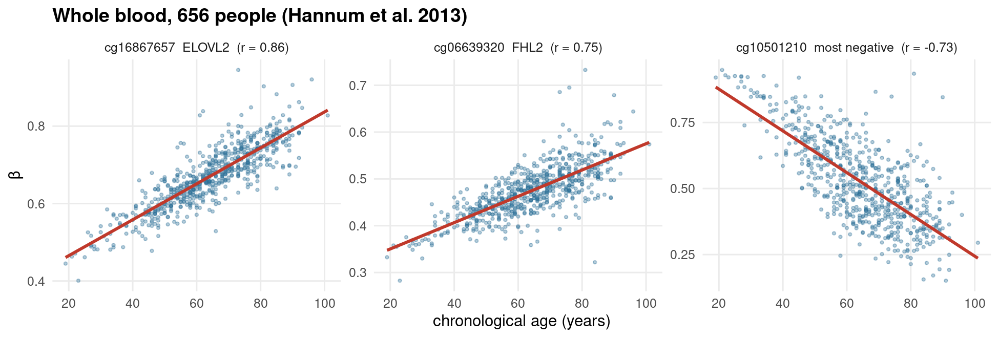{width="95%" fig-align="center"}

- Some CpGs gain methylation with age (*ELOVL2*: r = 0.86), others lose it (r = −0.73). The trends are steady over eight decades.
- But at any one age the spread is large: from ELOVL2 alone you could guess age only to within about ±10 years.

::: notes
Real data, whole blood of 656 people aged 19 to 101 (Hannum et al. 2013). The CpG in ELOVL2 (cg16867657), a fatty-acid elongase gene, is the most robust age-associated CpG known: it rises from about 0.45 in young adults to 0.85 in the very old, in blood and in many other tissues. Age-related gains are typical of CpG islands that are Polycomb targets in stem cells (bivalent promoters), while losses are typical of CpGs outside islands. Why methylation drifts with age is not fully understood: imperfect maintenance over many cell divisions, changes in the composition of the stem-cell pool, and programmed changes all play a part. Note the residual scatter: at age 60, ELOVL2 ranges from about 0.55 to 0.80. A single CpG is a weak predictor; many CpGs with partly independent noise can average it out.
:::

## Many CpGs, each weakly related to age {.smaller}

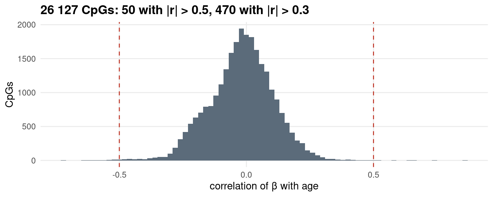{width="85%" fig-align="center"}

- Of 26 127 CpGs in our subset, only 50 have |r| > 0.5 with age, but 470 have |r| > 0.3: lots of small, partly redundant signals.
- Combining them in one linear model is the obvious idea. The problem: **26 127 CpGs, 459 people for training**.

::: notes
The histogram shows the correlation of each CpG with age across the 656 people. Most are near zero (no relation), with long tails on both sides. The subset was chosen by variance across people, without looking at age, plus the CpGs of the Horvath clock and of a tissue atlas (more on the leakage this implies later). On the full array there are about 470 000 CpGs; the pattern is the same. A linear model with all of them has more unknowns than observations: there are infinitely many sets of coefficients that fit the training data perfectly. The rest of the first half of the lecture is about how to choose a sensible one.
:::

## Penalised regression: a price on complexity {.smaller}

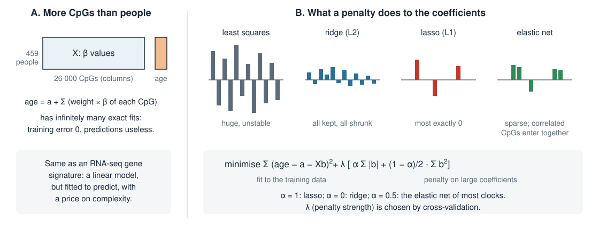{width="95%" fig-align="center"}

- **Ridge** (L2) shrinks all coefficients; **lasso** (L1) sets most of them exactly to zero; the **elastic net** (α between 0 and 1) does both and keeps groups of correlated CpGs together.
- Horvath, Hannum, PhenoAge, GrimAge and DunedinPACE are all **elastic nets** on CpG β values.

::: notes
The loss function is the familiar residual sum of squares plus a penalty. With λ = 0 it is ordinary least squares, which with more CpGs than people fits the training data exactly and predicts nonsense. As λ grows, large coefficients become expensive; the lasso penalty (sum of absolute values) produces exact zeros, which is why clocks end up with a few hundred CpGs rather than all of them: the model selects variables. The ridge part (sum of squares) stops the lasso from picking one CpG at random out of a group of highly correlated neighbours. Zou and Hastie (2005) introduced the elastic net; glmnet (Friedman, Hastie and Tibshirani) is the R package everybody uses. The link to students' RNA-seq knowledge: DESeq2's shrinkage of fold changes is also a penalty (a prior) that trades a little bias for much less variance. α = 0.5 is the usual choice in clock papers; λ is chosen by cross-validation.
:::

## Choosing λ: cross-validation inside the training set

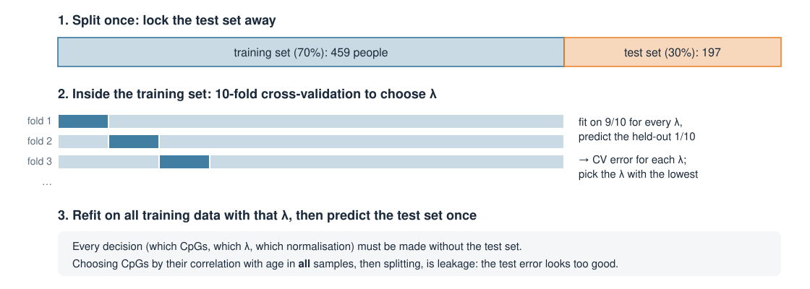{width="95%" fig-align="center"}

- The **test set** is touched once, at the end. λ (and every other choice) is tuned by **k-fold cross-validation** on the training set.
- **Leakage**: selecting CpGs by their age correlation in all samples, then splitting, makes the test error look too good.

::: notes
This is the core logic of supervised learning, and it returns in *Machine learning from scratch*. Split the samples once into training and test (here 70/30, at random, 459 and 197 people). Within the training set, split again into 10 folds; for each fold, fit the model on the other 9 for a whole path of λ values and predict the held-out fold; average the errors over folds for each λ; pick the λ with the lowest cross-validated error. Refit on all training data with that λ and predict the test set once. Anything learned from the test samples, even indirectly, leaks: choosing CpGs by their correlation with age in all 656 people, normalising all samples together with a method that uses the outcome, or trying ten models and reporting the best test result. In genomics there are subtler leaks: related individuals in training and test, technical replicates of one sample split across sets, or (for sequence models) overlapping regions. The cure is always the same: decide everything on the training data.
:::

## The elastic net on real data {.smaller}

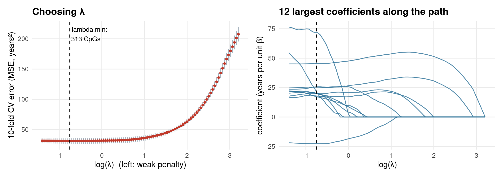{width="95%" fig-align="center"}

- Left: cross-validated error against λ. The minimum (`lambda.min`) keeps **313 CpGs**; the more conservative `lambda.1se` keeps 36.
- Right: coefficients enter the model one by one as λ decreases; most CpGs never enter.

::: notes
Real output of cv.glmnet with α = 0.5 on the 459 training samples (20 seconds on a laptop). Read the left panel from right to left: with a strong penalty (large λ) no CpG is in the model and the prediction is just the mean age, with an error variance near the variance of age (about 200 years²). As λ decreases, CpGs enter and the error drops steeply, then flattens: from log λ ≈ 0 to the left, adding CpGs no longer helps. lambda.1se is the largest λ whose error is within one standard error of the minimum: almost as good, much simpler (36 CpGs). Right: the coefficient paths of the 12 largest CpGs; the units are years per unit of β, so a coefficient of 50 means that 0.1 more methylation adds 5 years. Of the 313 CpGs selected, 32 are also in Horvath's clock: different clocks share only some CpGs, because many CpGs carry similar information and the lasso picks among them somewhat arbitrarily.
:::

## Training error lies; test error tells the truth {.smaller}

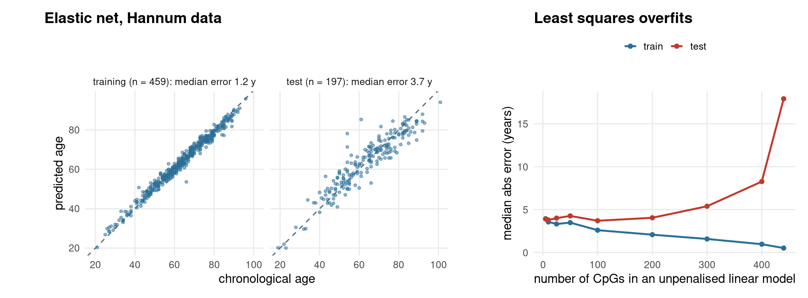{width="95%" fig-align="center"}

- Elastic net: median absolute error **1.2 years** on training data, **3.7 years** on the 197 held-out people (r = 0.93).
- Ordinary least squares on the top-k CpGs: with 440 CpGs the training error falls to 0.5 years while the test error explodes to **18 years**.

::: notes
Left: predictions for the training and test samples. Training predictions hug the diagonal; test predictions scatter more. The gap between the two is overfitting: the model has partly learned the noise of its training samples. Right: the same idea without a penalty. We take the k CpGs most correlated with age in the training data and fit an ordinary linear model. With 5–100 CpGs, training and test error are similar (3.7–4 years). As k approaches the number of training samples (459), the model can fit the training data almost exactly: training error drops to half a year, and the test error rises to 8 years at k = 400 and 18 years at k = 440. A penalised model avoids this by refusing to make coefficients large unless the data strongly support it. This curve, training error going down and test error going down then up, is the most important picture in machine learning.
:::

## Horvath's pan-tissue clock (2013) {.smaller}

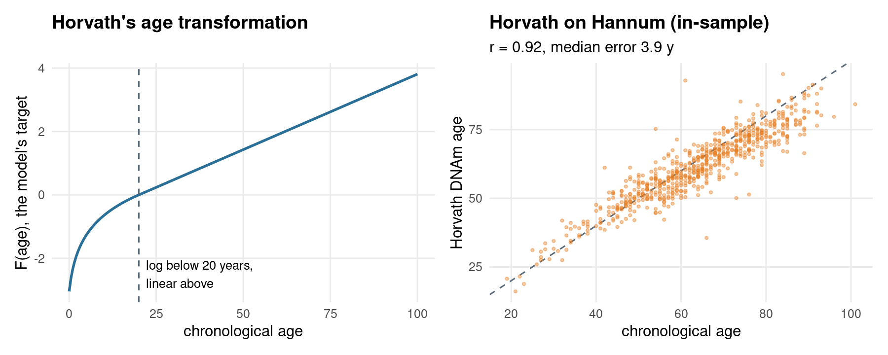{width="88%" fig-align="center"}

- Elastic net on ~8 000 samples from **51 tissues and cell types** (27k and 450k arrays): **353 CpGs**; median error 3.6 years in test data.
- Trained on a **transformed age**, F(age): logarithmic in childhood, linear after 20. Applied to Hannum's blood: r = 0.92, but **in-sample**: Hannum's data were in Horvath's training set.

::: notes
Horvath combined 82 public data sets (39 for training, 32 for testing) and restricted himself to the 21 369 CpGs present on both the 27k and 450k arrays. The age transformation: methylation changes fast in childhood and slowly in adults, so a linear model of raw age fits poorly across the whole lifespan; F(age) = log(age + 1) − log(21) below 20 and (age − 20)/21 above stretches childhood. The model predicts F(age) and the inverse transformation turns it back into years. The striking result was that one set of CpGs works in almost every tissue (except sperm, which looks "young", and some cancers). Right panel: we apply Horvath's published coefficients (Additional file 3 of the paper) to the Hannum data. It works well, but this is not a fair test: Hannum's GSE40279 was one of Horvath's training sets (his Additional file 1). Always check which data a published model has already seen.
:::

## Four generations, defined by the target {.smaller}

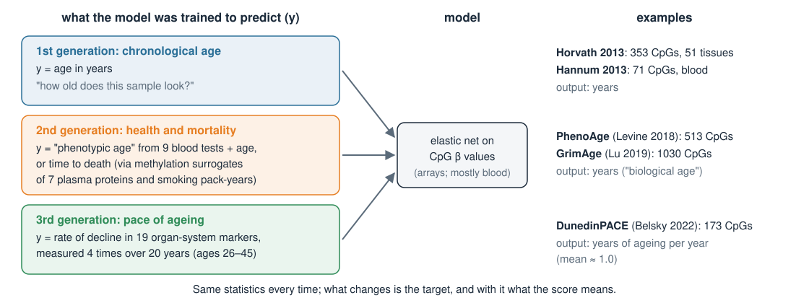{width="95%" fig-align="center"}

- First-generation clocks predict **chronological age**: the better they get, the less they can say beyond the calendar.
- Later clocks predict **health**: PhenoAge (clinical biomarkers), GrimAge (time to death), DunedinPACE (pace of decline).

::: notes
A clock that predicted chronological age perfectly would be useless as a biomarker: it would tell you the birth date. The interesting part of a first-generation clock is its error, and the error mixes biology (people who age faster) with noise. Second-generation clocks change the target. PhenoAge (Levine et al. 2018, 513 CpGs) is trained on "phenotypic age", a mortality-weighted combination of chronological age and nine blood tests (albumin, creatinine, glucose, CRP, lymphocyte percentage, mean cell volume, red cell distribution width, alkaline phosphatase, white cell count). GrimAge (Lu et al. 2019, 1 030 CpGs) first builds methylation surrogates of seven plasma proteins (including GDF15, PAI-1, cystatin C) and of smoking pack-years, then combines them to predict time to death in the Framingham Offspring cohort. DunedinPACE (Belsky et al. 2022, 173 CpGs) is trained on the rate at which 19 biomarkers of organ function declined between ages 26 and 45 in the Dunedin birth cohort (born 1972–73), and is expressed as years of biological ageing per calendar year (mean about 1). GrimAge and DunedinPACE predict mortality and morbidity better than first-generation clocks.
:::

## An external test: another lab, another cohort {.smaller}

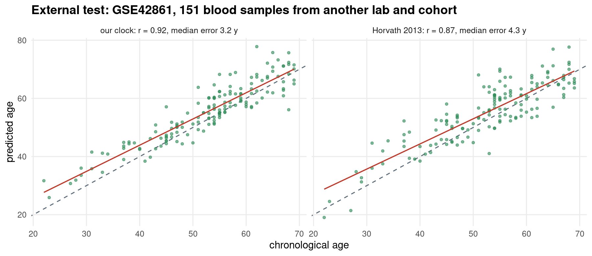{width="90%" fig-align="center"}

- GSE42861 (151 arrays, *Methylation arrays*), noob-normalised: our clock **r = 0.92, median error 3.2 years**; Horvath **r = 0.87, 4.3 years**.
- Both predict about **2.4 years too old** on average: a shift between data sets (lab, normalisation, population), not biology.

::: notes
This is the fair test: samples from a different study, lab and country, processed with a different normalisation than either training set. Both clocks keep their correlation with age, but the whole cloud is shifted upwards: our clock by 2.5 years and Horvath's by 2.3 years on median. Such offsets are typical when a clock meets new data; Horvath himself reported a median error of 3.8 years on this very data set (it was one of his test sets) after his own normalisation (a BMIQ variant). For a single person, an offset of 2–3 years matters; for comparing groups measured in the same batch it cancels out. This is why age acceleration is defined relative to the data at hand (next slide), and why comparing a person's DNAm age measured in one lab with norms from another is dangerous.
:::

## Age acceleration: the residual, not the difference {.smaller}

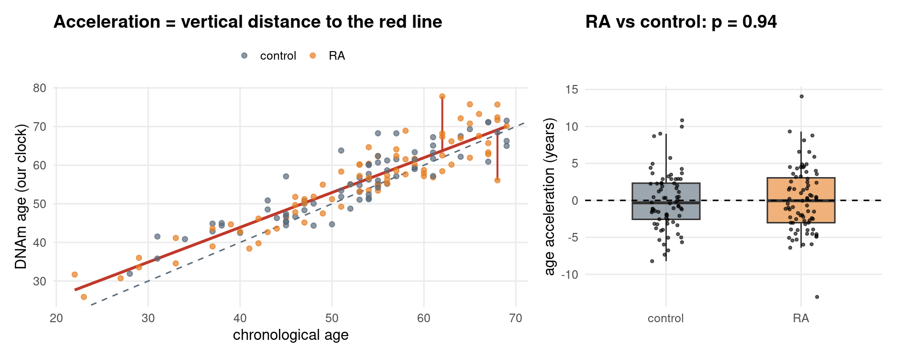{width="90%" fig-align="center"}

- **Age acceleration** = residual of DNAm age regressed on chronological age **in your data**. Removes offsets (here +2.5 y) and the flattening of the slope (0.90).
- RA vs control: **no difference** (p = 0.94). The raw difference (DNAm age − age) would carry the offset and an age trend.

::: notes
Fit a line of DNAm age on chronological age in the data set (red line), and use each person's vertical distance to the line. The red segments show the most accelerated and the most decelerated person. Two artefacts disappear: the global offset between data sets, and the fact that clocks systematically predict too young in old people and too old in young people (a slope below 1, here 0.90: a regression-to-the-mean effect of the penalty and of noise). With the raw difference, any group that is older on average would look "decelerated" just because of the slope. In GSE42861 the age acceleration of our clock does not differ between RA patients and controls (means −0.03 and +0.03 years), and current smokers are 1.1 years more accelerated than never smokers (not significant here). Published analyses often also adjust for estimated blood cell composition ("intrinsic" age acceleration) or deliberately keep it ("extrinsic"), because part of what a blood clock measures is the ageing of the immune cell mix.
:::

## Age acceleration by hand {.smaller}

| person | age | DNAm age | DNAm age − age | fitted (12 + 0.8 × age) | acceleration (residual) |
|---|---:|---:|---:|---:|---:|
| A | 30 | 36 | +6 | 36 | **0** |
| B | 50 | 55 | +5 | 52 | **+3** |
| C | 70 | 66 | −4 | 68 | **−2** |

- With a slope below 1, young people look "old" and old people "young" on the raw difference. The residual compares each person with others **of the same age**.
- Acceleration is relative to the reference data: a different cohort gives a different line.

::: notes
A worked example of the definition. The fitted line comes from regressing DNAm age on age in the whole data set; here it is 12 + 0.8 × age. Person A's DNAm age is 6 years above her calendar age, but exactly what the data predict for 30-year-olds: acceleration 0. Person B is 3 years above the line: accelerated. Person C has a negative raw difference, but is only 2 years below the line. The exam asks this kind of calculation. A practical consequence: an age acceleration value is not portable between studies unless the same reference line is used; commercial "biological age" tests that report a single number per person hide this choice.
:::

## What clocks measure, and what they do not {.smaller}

- **Associated with**: mortality, frailty, smoking, obesity, HIV, Down syndrome (accelerated); centenarians' offspring and some calorie-restriction studies (slower). Effects are modest: a few years.
- **Partly**: changes in **blood cell composition** (naive T cells decline with age), mitotic history of stem cells, and maintenance errors.
- **Not**: a measure of "true biological age" in one number, a cause of ageing, or a reliable per-person diagnostic. Different clocks correlate only moderately with each other.
- **Noise**: technical replicates of the same DNA can differ by **up to 9 years** for some clocks (Higgins-Chen et al. 2022); principal-component clocks fix much of this.

::: notes
The evidence that clocks capture something biological: age acceleration predicts mortality independently of chronological age and of classical risk factors (best for GrimAge and DunedinPACE), it is higher in conditions of accelerated ageing (HIV, Down syndrome, Werner syndrome in some studies), and it is partly heritable. But: blood clocks are strongly influenced by the composition of white blood cells, which itself changes with age and disease; individual CpGs of the clocks have poor test-retest reliability on arrays, so a single measurement of a person is noisy (Higgins-Chen et al. 2022 found differences up to 9 years between technical replicates and fixed it by training on principal components instead of single CpGs). Clocks are correlational: nothing shows that changing methylation at clock CpGs changes ageing. Keep this in mind for the next slide.
:::

## Judge the claim: "our intervention reverses epigenetic age" {.smaller}

- 15 volunteers, one supplement, DNAm age measured before and after 12 months; **"2.5 years younger"**. What would you ask?
- **No control group**: regression to the mean, seasonal and batch effects between the two array runs.
- **Measurement noise**: replicate differences of several years for single-CpG clocks; was each sample run in duplicate, in the same batch?
- **Multiple clocks**: five clocks reported, one significant.
- **Composition**: did the intervention shift blood cell counts (e.g. fewer neutrophils after an infection cleared)?
- **Meaning**: is a lower clock value a lower risk of disease? That needs outcomes, not a biomarker.

::: notes
This is the critical-reading skill that the exam tests. Claims of epigenetic age reversal by supplements, diets or drugs are common, and most rest on small uncontrolled studies. Each bullet is a design flaw students should be able to name: no randomised control, the two time points measured in different batches (a batch effect of a few years is easy, see the external test with a 2.4-year offset), technical noise of single-CpG clocks, selective reporting across clocks, and changes in cell composition that move blood clocks without any change inside cells. Even a real, controlled reduction of a clock value is a surrogate endpoint: it shows that methylation changed, not that health improved. DunedinPACE was designed for intervention studies (high test-retest reliability), and a randomised trial (CALERIE, calorie restriction) found a small slowing of DunedinPACE but no clear effect on the other clocks tested (Waziry et al. 2023).
:::

## Beyond age: methylation biomarkers {.smaller}

| biomarker | what it predicts | used for |
|---|---|---|
| *AHRR* cg05575921, smoking scores | smoking exposure, pack-years | epidemiology; verifying self-report |
| methylation risk scores | BMI, alcohol, inflammation (CRP) | epidemiology |
| gestational age clocks (cord blood) | gestational age | neonatal studies |
| mitotic clocks (epiTOC) | number of stem-cell divisions | cancer risk |
| tumour classifiers | CNS tumour type (Capper et al. 2018) | clinical diagnosis, from the same EPIC arrays |
| cfDNA methylation | tissue of origin, cancer signal | liquid biopsy (next slides) |

::: notes
Clocks are one example of a general recipe: a penalised model or classifier on array or sequencing methylation data. The most consequential clinical application so far is the DKFZ classifier of central nervous system tumours (Capper et al. 2018): a random forest trained on 450k data (and now run on EPIC arrays) assigns a tumour to a methylation class across the roughly 100 known CNS tumour types, and changed the diagnosis in up to 12% of prospective cases. It is now part of the WHO classification of brain tumours. The smoking CpG AHRR came up in *Methylation arrays* as a positive control; a single CpG is a better marker of recent smoking than many questionnaires. All of these inherit the issues of this lecture: training data, external validation, batch, composition. *Epigenetics in disease and therapy* returns to tumour classification.
:::

## Cell-free DNA: fragments of dying cells

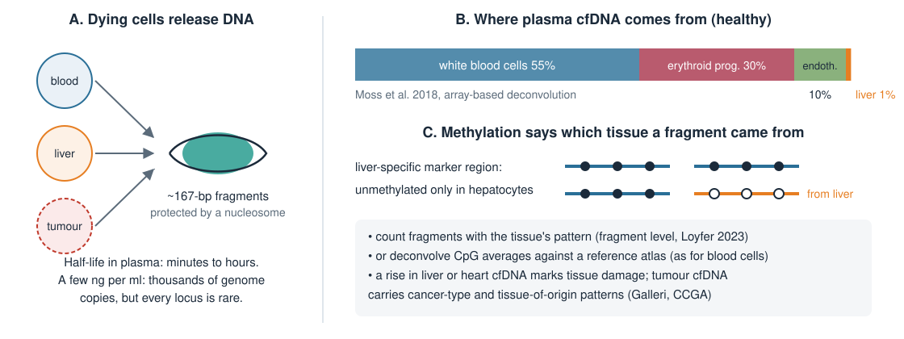{width="95%" fig-align="center"}

- Plasma DNA is mostly from **blood cells** (55% white blood cells, 30% erythroid progenitors), plus endothelium (10%) and liver (1%) in healthy people (Moss et al. 2018).
- Tissue damage or a tumour adds DNA with **its own methylation pattern**.

::: notes
When cells die by apoptosis, their chromatin is cut between nucleosomes, and the nucleosome-protected fragments of about 167 bp reach the blood, where they are cleared within minutes to hours. A tube of blood contains a few thousand genome equivalents of cell-free DNA (cfDNA), so every locus is present in a few thousand copies, but each copy carries the methylation pattern of the cell it came from. Cell-type-specific methylation is very stable (Loyfer et al. 2023: replicates of the same sorted cell type are more than 99.5% identical), so a fragment from hepatocytes can be recognised among fragments from blood cells. Applications: tissue damage (liver, heart, pancreatic beta cells after islet transplantation), transplant rejection, sepsis, and cancer, where tumour DNA (ctDNA) adds both tumour-specific methylation (CpG island hypermethylation) and the methylation of the tissue of origin. Prenatal testing uses the same idea (placental cfDNA in maternal blood).
:::

## Deconvolution with a reference atlas {.smaller}

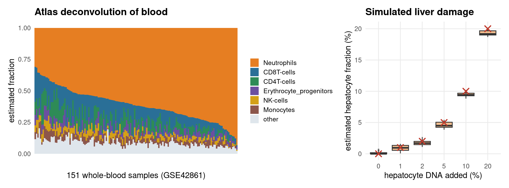{width="95%" fig-align="center"}

- The same linear algebra as the Houseman method: non-negative least squares against a **25-cell-type atlas** (Moss et al. 2018; 6 105 of its CpGs are on the 450k array).
- Blood of the GSE42861 samples comes out as 61% neutrophils, then lymphocytes and monocytes. Simulated liver DNA is recovered: 1% added → **0.94%** estimated.

::: notes
Left: each of the 151 whole-blood samples from *Methylation arrays*, deconvolved against the Moss atlas (bars sorted by the neutrophil fraction). The result is sensible: neutrophils dominate, then T cells, NK cells, monocytes and B cells; a few percent go to erythroid progenitors and other tissues (breast 1.6%), which is the noise floor of the method on array data. The atlas splits CD4 and CD8 T cells differently from the Reinius reference used in *Methylation arrays* (CD8 is larger here), a reminder that fractions depend on the reference. Right: simulated cfDNA. We mix a blood profile with a known fraction of the atlas's hepatocyte profile, add measurement noise (SD 0.03 in β) and deconvolve 20 times per fraction. Down to 1% the estimate is close to the truth (0.94% for 1%); with nothing added it reports about 0.1%: the noise floor that sets the detection limit. Real cfDNA is harder: few genome copies per locus, so sequencing depth limits sensitivity, which is why methods like Loyfer's count fragments with fully tissue-specific patterns rather than averaging CpGs.
:::

## Cancer detection from cfDNA methylation {.smaller}

| CCGA validation (Liu et al. 2020), targeted bisulfite sequencing of cfDNA | |
|---|---|
| specificity (non-cancer called non-cancer) | **99.3%** |
| sensitivity, all cancer types, stage I / II / III / IV | 18% / 43% / 81% / 93% |
| tissue of origin predicted correctly (when a signal was found) | 93% |

- By hand: screening 100 000 people with 1% prevalence, sensitivity 50%, specificity 99.3% → 500 true and 693 false positives: **PPV 42%**.
- Early tumours shed little DNA (often < 0.1% of cfDNA), which is why stage I sensitivity is low.

::: notes
The Circulating Cell-free Genome Atlas study (Liu et al. 2020, 6 689 participants) used targeted bisulfite sequencing of more than 100 000 methylation regions and a classifier trained on cancer and non-cancer samples. The results show both the promise and the problem. Specificity is very high, which is necessary for screening healthy people, and the tissue of origin is usually right, because tumours keep much of the methylation of their tissue. But sensitivity depends steeply on stage: the cancers we most want to find early shed the least DNA. The positive predictive value calculation is the essential exam skill: with a rare disease, even 99.3% specificity produces many false positives relative to true positives. Clonal haematopoiesis (expanded blood clones with mutations, common in older people) confounds mutation-based liquid biopsy; methylation tests are affected less, but blood cell composition still matters. Large randomised screening trials (such as NHS-Galleri in England) are testing whether such tests reduce late-stage cancers and deaths, the outcome that matters.
:::

## Summary {.smaller}

| idea | key fact |
|---|---|
| age and methylation | many CpGs change steadily with age (ELOVL2 r = 0.86); each is weak alone |
| elastic net | least squares + λ[α·L1 + (1 − α)/2·L2]; sparse, stable; λ by cross-validation |
| overfitting | training error 1.2 y vs test 3.7 y; unpenalised models collapse (18 y) |
| leakage | every choice made on training data only; check what a published model was trained on |
| clocks | Horvath 353 CpGs, 51 tissues; Hannum 71; PhenoAge, GrimAge (health, death); DunedinPACE (pace) |
| external test | GSE42861: our clock 3.2 y, Horvath 4.3 y, both +2.4 y offset |
| acceleration | residual of DNAm age on age within the data; RA vs control: none |
| caveats | composition, batch, replicate noise of several years, surrogate endpoints |
| cfDNA | tissue of origin by deconvolution; CCGA specificity 99.3%, stage I sensitivity 18%; PPV by hand |

::: notes
Students should leave able to: explain what the elastic net penalty does and why clocks have a few hundred CpGs; describe a correct train/test/cross-validation scheme and spot leakage; read a CV curve and a train-vs-test plot; compute age acceleration as a residual by hand; say what first-, second- and third-generation clocks are trained to predict; list reasons a clock difference between two groups may not be biological; explain how cfDNA methylation reveals the tissue of origin; and compute a positive predictive value from sensitivity, specificity and prevalence. The machine learning block (*Machine learning from scratch*, *What people try to predict, and how to tell if it works*) generalises these ideas.
:::

## Key papers (optional further reading) {.smaller}

*Not required reading and not examined. For those who want the primary literature.*

- Horvath 2013, *Genome Biol*. [DNA methylation age of human tissues and cell types](https://doi.org/10.1186/gb-2013-14-10-r115). The pan-tissue clock; its supplement lists all data sets and coefficients.
- Hannum et al. 2013, *Mol Cell*. [Genome-wide methylation profiles reveal quantitative views of human aging rates](https://doi.org/10.1016/j.molcel.2012.10.016). The blood clock and the data set of this unit.
- Levine et al. 2018, *Aging*. [An epigenetic biomarker of aging for lifespan and healthspan](https://doi.org/10.18632/aging.101414). PhenoAge: training on health instead of age.
- Belsky et al. 2022, *eLife*. [DunedinPACE, a DNA methylation biomarker of the pace of aging](https://doi.org/10.7554/eLife.73420). Pace of ageing from a longitudinal cohort.
- Higgins-Chen et al. 2022, *Nat Aging*. [A computational solution for bolstering reliability of epigenetic clocks](https://doi.org/10.1038/s43587-022-00248-2). How noisy clocks are, and a fix.
- Moss et al. 2018, *Nat Commun*. [Comprehensive human cell-type methylation atlas reveals origins of circulating cell-free DNA in health and disease](https://doi.org/10.1038/s41467-018-07466-6). The atlas and cfDNA deconvolution.
