## About this lecture

*What is epigenetics?* defined an epigenetic state as one that is **heritable without a change in DNA sequence**, and showed how marks survive cell division. This lecture asks the harder question: can a state, or an experience, be passed on to **children and grandchildren**?

- Three meanings of "inheritance", and the **F0–F3 rule**.
- Why mammals are a hard case: **two waves of reprogramming**.
- The robust cases: **plants**, **C. elegans**, a few **mouse loci**.
- The contested cases: **famine, diet and stress** in humans and mice.
- How false "inheritance" arises: **confounding, multiple testing, litters, small samples**.
- What evidence would convince.

::: notes
This is a judgement unit. There is no new assay; the aim is that students can read a paper or a news story claiming "trauma is inherited through epigenetics" and say what was shown, what was not, and what would be needed. Be fair in both directions: some forms of non-genetic inheritance are rock-solid (plants, worms), and the absence of strong evidence in humans does not prove absence. The exercise has students simulate how false transgenerational signals arise, and read real study designs. The DNA methylation facts used here (maintenance by DNMT1, imprinting) come from *What is epigenetics?* and *DNA methylation biology*.
:::

## Three kinds of "inheritance" {.smaller}

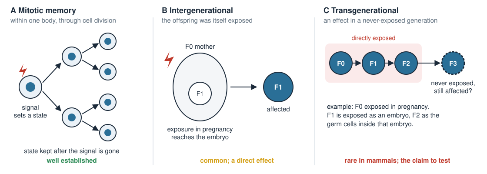{width="95%" fig-align="center"}

- **Mitotic memory:** a cell remembers a state through division (X inactivation, Polycomb silencing). Well established.
- **Intergenerational:** the offspring differs because *it* was exposed (as an embryo, or as a germ cell).
- **Transgenerational:** an effect in a generation that was **never exposed**. This is the strong claim.

::: notes
Most confusion in the literature comes from mixing these up. Mitotic memory is the subject of the rest of the course and is not in doubt. Intergenerational effects are very common and not surprising: a mother's diet in pregnancy changes the fetus, a father's diet may change his sperm. They do not require any mark to be inherited; they can be a direct effect of the exposure on the next generation's tissues or germ cells. Transgenerational inheritance requires that information is carried through at least one generation that was never exposed, which in mammals means it must survive the germline. Ask of every paper: which of the three is being claimed, and which was shown?
:::

## Which generation was never exposed? {.smaller}

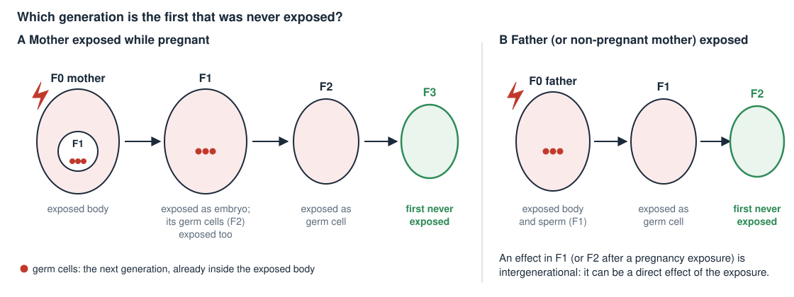{width="95%" fig-align="center"}

- A **pregnant** F0 female exposes the F1 embryo **and** the F1's germ cells, which will become F2. **F3** is the first unexposed generation.
- A **father** (or a female before pregnancy) exposes his germ cells, so F1 is exposed. **F2** is the first unexposed generation.
- An effect in F1 (or in F2 after a pregnancy exposure) is **intergenerational**: it can be a direct effect.

::: notes
This F0–F3 rule is a standard exam question. Primordial germ cells are specified in the mouse embryo at about E7, during the pregnancy, so anything that reaches the fetus also reaches the cells that will make the grandchildren. For paternal exposure, the sperm that make F1 were themselves exposed; F1 germ cells form later, inside F1, so F2 is unexposed. For plants that self-fertilise, the same logic applies with seed and pollen. Many papers that call themselves "transgenerational" report only F1 or F2 after a pregnancy exposure. That does not make them wrong, but the stronger word is not justified.
:::

## Two waves of reprogramming in mammals {.smaller}

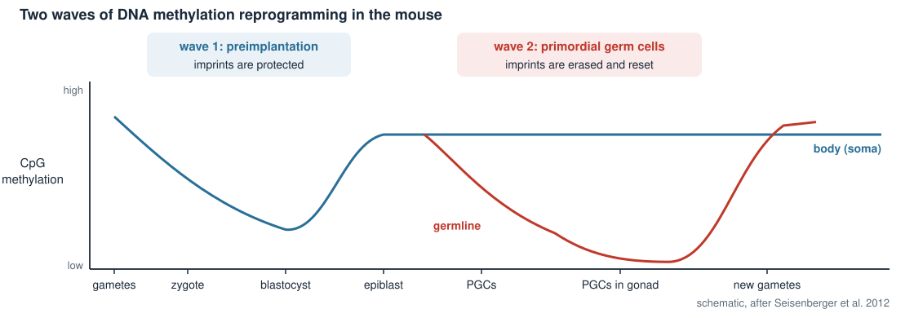{width="95%" fig-align="center"}

- **Wave 1, after fertilisation:** most DNA methylation is lost by the blastocyst, then re-established in the epiblast.
- **Wave 2, in primordial germ cells:** methylation is erased almost completely, including imprints, then reset according to the sex of the embryo.
- Any mark that is to reach a grandchild must get through both waves, or be rebuilt.

::: notes
Seisenberger et al. 2012 mapped this in mouse PGCs by whole-genome bisulfite sequencing: global loss during PGC expansion and migration, partly passive (no maintenance), and the last regions (imprints, CpG islands on the X, germline genes) demethylated on entry into the gonads, with TET enzymes helping. Human PGCs show the same erasure (Tang et al. 2015). Histone marks are also extensively remodelled in the germline and the paternal genome is packaged with protamines in sperm, replacing most histones. This is why mammalian transgenerational epigenetic inheritance is a priori unlikely: the system actively wipes the slate. It is a barrier, not a wall: see the next slide.
:::

## What gets through? {.smaller}

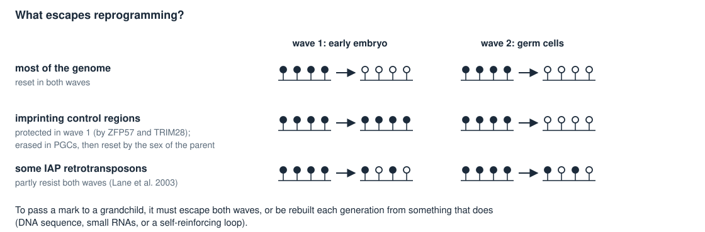{width="95%" fig-align="center"}

- **Imprinting control regions** keep their methylation through wave 1 (protected by ZFP57 and TRIM28), and are reset in wave 2: imprints last one generation by design.
- Some **IAP retrotransposons** partly resist both waves (Lane et al. 2003).
- Otherwise a state must be **rebuilt** each generation, from DNA sequence, from small RNAs, or by a self-reinforcing loop.

::: notes
Imprinting shows that mammals can carry a methylation mark from the gamete into every cell of the adult, but only for one generation: in the next germline it is erased and rewritten by sex. That is parent-of-origin memory, not inheritance of an experience. IAPs (intracisternal A particles) are young, active endogenous retroviruses; some copies keep methylation in PGCs, presumably because the cost of reactivating them is high. These escapees are the candidate carriers for non-genetic inheritance in mice, and the robust mouse examples later in the lecture are IAPs. Also mention: a sequence that recruits a silencing complex (for example a KRAB zinc-finger binding site) can rebuild the same state every generation. That is real "inheritance" of a state, but the information is in the DNA.
:::

## Plants: a germline that forms late {.smaller}

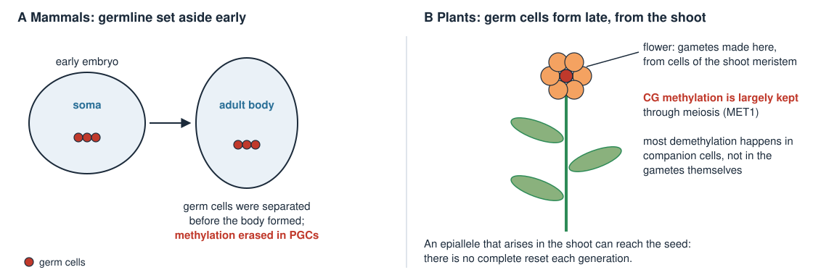{width="95%" fig-align="center"}

- Mammals set germ cells aside early and erase them. **Plants make gametes late, from the shoot**: a change in a somatic cell lineage can reach the seed.
- CG methylation is maintained by MET1 through meiosis; non-CG methylation is restored by **RNA-directed DNA methylation**.
- Demethylation in the plant germline happens mainly in **companion cells**, not in the gametes.

::: notes
This is the main reason the plant literature is so different from the mammalian one. There is no PGC-like erasure, so a methylation state (an epiallele) can persist for many generations. In the pollen, the vegetative nucleus loses methylation at transposons and makes small RNAs that are thought to reinforce silencing in the sperm cells; in the female gametophyte the central cell is demethylated by DEMETER (which also produces imprinting in the endosperm). Umeå has a strong plant-epigenetics community, so this is a good place to point students to local research. The methylation contexts (CG, CHG, CHH) and RdDM are covered in *DNA methylation biology*.
:::

## A natural epimutation: peloric toadflax {.smaller}

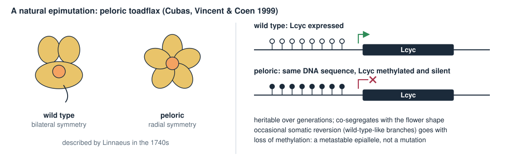{width="95%" fig-align="center"}

- Linnaeus described a *Linaria vulgaris* with **radially symmetric** flowers ("peloria") in the 18th century.
- Cubas, Vincent & Coen (1999): the gene *Lcyc* has the **same sequence** but is **heavily methylated and silent**; the state is heritable and co-segregates with the flower shape.
- Occasional reversion on single branches goes with loss of methylation: an **epiallele**, not a mutation.

::: notes
A beautiful case because it was found in nature and has a visible phenotype. Cycloidea controls dorsoventral asymmetry of the flower in snapdragon; its homologue in toadflax is silenced by methylation in the peloric form. The reversion during somatic development is the key evidence that the change is epigenetic: a DNA mutation would not revert at that frequency, and the revertant branches have regained expression and lost methylation. Note what was not shown: what caused the original epimutation. There is no environmental trigger here; it arose spontaneously, like most epialleles.
:::

## Arabidopsis epiRILs: heritable traits without DNA differences {.smaller}

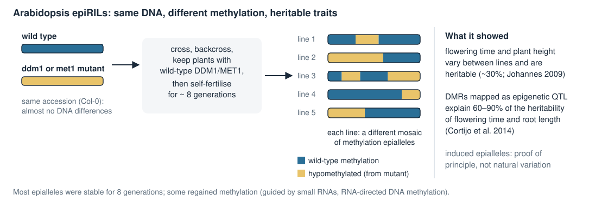{width="95%" fig-align="center"}

- Cross wild type with a methylation mutant (*ddm1* or *met1*) of the same accession, restore the wild-type gene, and self for ~8 generations: lines differ in **methylation**, hardly in sequence.
- Flowering time and height vary and are **heritable (~30%)** (Johannes et al. 2009).
- Specific DMRs act as **epigenetic QTL** explaining 60–90% of the heritability of flowering time and root length (Cortijo et al. 2014).

::: notes
This is the cleanest experimental test of whether methylation differences alone can cause heritable trait variation. The genetic background is nearly constant, so variation between lines must come from the epialleles (or from the few transposon insertions that occur in ddm1 backgrounds, which the authors had to check). Two honest caveats: these epialleles were induced by a mutant, so they are larger and more numerous than natural ones; and some hypomethylated regions regain methylation over generations, guided by small RNAs. Still, the result settles the principle in plants: methylation variation can be stably inherited and can shape quantitative traits.
:::

## How often do epialleles arise? {.smaller}

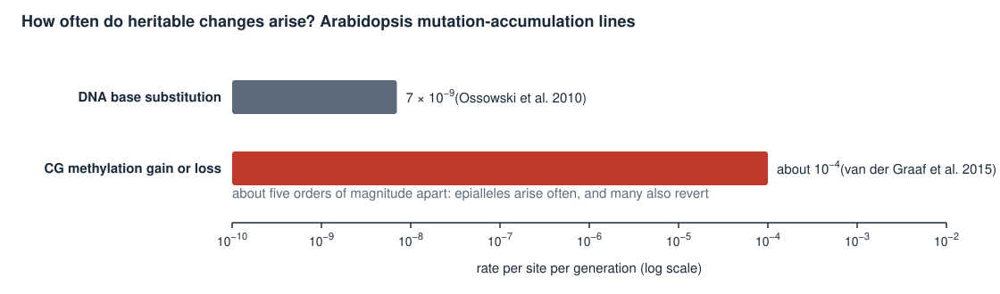{width="95%" fig-align="center"}

- Mutation-accumulation lines (one seed per generation, ~30 generations) measure **spontaneous** change.
- DNA base substitutions: about **7 × 10⁻⁹** per site per generation (Ossowski et al. 2010).
- CG methylation gains and losses: about **10⁻⁴** per CpG per generation (van der Graaf et al. 2015): epialleles arise often, and also **revert** often.

::: notes
Becker et al. 2011 and Schmitz et al. 2011 sequenced methylomes of Arabidopsis lines propagated by single-seed descent, and van der Graaf et al. 2015 estimated forward and backward epimutation rates from them. The comparison has two sides. Epimutations are about five orders of magnitude more frequent than mutations, so methylation can create heritable variation quickly. Reversion is also much more frequent than DNA back-mutation, but this does not imply loss within a few generations. The genome-wide loss rate estimated by [van der Graaf et al.](https://doi.org/10.1073/pnas.1424254112) is about 6.3 × 10⁻⁴ per methylated CG per generation: under a constant-rate model the mean waiting time for loss is about 1 600 generations. Rates vary greatly across genomic contexts; some epialleles persist long enough to respond to selection. Most of these spontaneous changes are at single CpGs in gene bodies and have no known phenotype. Students compute expected numbers per genome in the exercise.
:::

## Paramutation: one allele converts the other {.smaller}

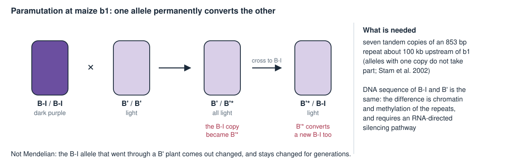{width="95%" fig-align="center"}

- At maize *b1*, the weakly expressed **B'** allele converts the strongly expressed **B-I** allele into a new B' when they meet in one plant, at close to 100%.
- The converted allele is **stably** weak in later generations and converts others in turn: a clear breach of Mendel's rules.
- Requires an **upstream tandem-repeat array** and an RNA-directed silencing pathway. B-I and B' carry seven repeats about 100 kb upstream (Stam et al. 2002); reduced arrays can still participate.

::: notes
Paramutation was described by Brink in 1956 at the maize r1 locus and studied in detail at b1 by Vicki Chandler's group. The two alleles have the same DNA sequence in the region required; they differ in chromatin and methylation of the repeats. Mutations in genes of the RNA-directed DNA methylation pathway (for example mediator of paramutation 1, an RNA-dependent RNA polymerase) abolish paramutation, so small RNAs from the repeats are thought to carry the silent state to the other allele. Paramutation-like phenomena have been reported in mice, but are rare and less well understood. For the exam: paramutation is allele interaction, heritable, with a known DNA requirement and a known pathway, the ideal of a well-understood case.
:::

## C. elegans: small RNAs carry memory {.smaller}

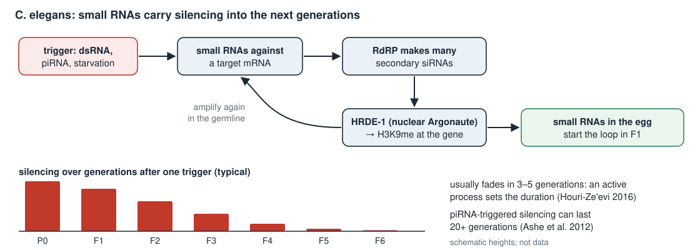{width="95%" fig-align="center"}

- A trigger (dsRNA, a piRNA, starvation) produces small RNAs; an RNA-dependent RNA polymerase **amplifies** them in each generation.
- The nuclear Argonaute **HRDE-1** brings H3K9 methylation to the target; small RNAs in the egg restart the loop in the offspring.
- Usually lasts **3–5 generations**, actively limited; piRNA-triggered silencing can last **20+** (Ashe et al. 2012). Starvation-induced small RNAs persist for at least three generations (Rechavi et al. 2014).

::: notes
Worms are the best animal example because the mechanism is known and testable with mutants. The amplification step solves the dilution problem: unlike a chemical mark, a small-RNA population can be re-made from itself every generation. Houri-Ze'evi et al. 2016 showed that the duration is regulated, so the default is to forget after a few generations; mutants can extend it. Two lessons for mammals: (1) a carrier needs an amplification or self-reinforcement step to survive many generations; (2) mammals lack the RNA-dependent RNA polymerase that worms and plants use, which is one reason to expect shorter-lived effects. Also note worms have a short life cycle and are often isogenic, which removes several confounders.
:::

## Mouse metastable epialleles: the robust mammalian cases {.smaller}

| locus | what it is | what is inherited |
|---|---|---|
| *A^vy^* (agouti viable yellow) | an IAP upstream of *agouti*; its methylation varies between genetically identical mice and sets coat colour | offspring resemble the **mother's** state: incomplete erasure through the female germline (Morgan et al. 1999) |
| *Axin^Fu^* (axin fused) | an IAP in *Axin*; methylation predicts a kinked tail | inherited through **both** mothers and fathers (Rakyan et al. 2003) |
| genome-wide screen | variably methylated IAPs in C57BL/6J (Kazachenka et al. 2018) | most are **reset** after fertilisation and **re-established** as variable: the variability is inherited, not the parent's state |

- Real, but **locus-specific**, depend on a retrotransposon, and often reflect the strain background.

::: notes
Morgan et al. 1999 showed that the distribution of coat colours among isogenic Avy offspring depends on the dam's phenotype, and showed that this maternal effect is not caused by the maternal environment: it follows the allele through the female germline. AxinFu adds paternal transmission, which argues against cytoplasmic or metabolic explanations because sperm contribute little cytoplasm. Kazachenka et al. 2018 then searched the whole genome for similar loci. They found several, but the methylation state of the parent did not predict that of the offspring for the loci they tested: the states are rebuilt from scratch, variably, each generation. So "epigenetic variation that is heritable as a property of the locus" exists; "inheritance of a parental state" is rarer. Diet experiments on Avy mothers have been reported to shift offspring coat colours; this is a pregnancy exposure, so by the F0–F3 rule an F1 effect is intergenerational, and claims of persistence to F2/F3 have given mixed results.
:::

## Dutch Hunger Winter: a sibling design {.smaller}

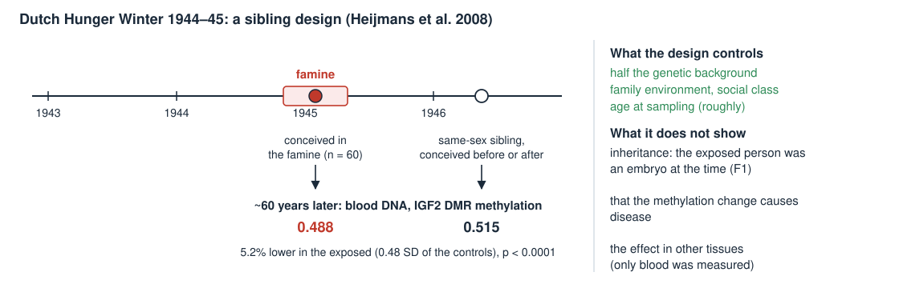{width="95%" fig-align="center"}

- People **conceived** during the 1944–45 famine had, 60 years later, **5.2% lower** methylation at the imprinted *IGF2* DMR in blood (0.488 vs 0.515) than their same-sex siblings (Heijmans et al. 2008).
- A careful design, but it shows a **lasting effect of prenatal exposure** (F1), not inheritance.

::: notes
The study is often cited as evidence for "epigenetic inheritance in humans". Read it carefully: 60 individuals exposed periconceptionally, each compared with an unexposed same-sex sibling, which controls half the genes and the family environment. The difference is 0.027 in beta, 0.48 SD of the controls, at five CpGs measured by mass spectrometry. Exposure late in gestation showed no such difference. It is an important result about developmental programming, and a nice demonstration that early-embryo methylation can be affected by the environment. It says nothing about transmission to unexposed generations, and nothing about whether the IGF2 change matters for health. Later work (Painter et al. 2008) reported differences in the grandchildren of exposed women; by the F0–F3 rule those grandchildren were exposed as germ cells.
:::

## Överkalix: grandparents' food and grandchildren's mortality {.smaller}

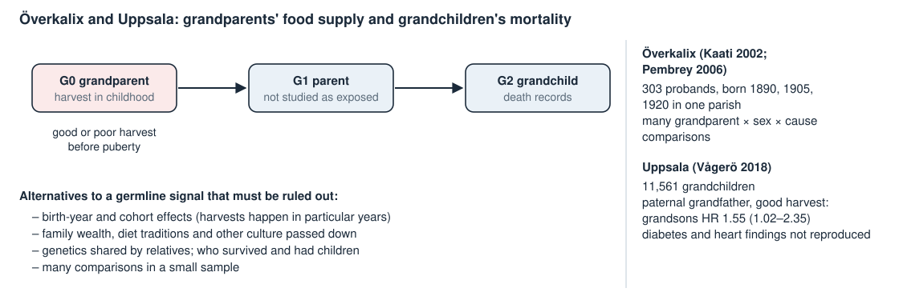{width="95%" fig-align="center"}

- Three birth cohorts from **Överkalix parish** (Norrbotten, northern Sweden): food availability in a grandparent's pre-pubertal "slow growth period", judged from harvest records, was associated with grandchildren's mortality, sex-specifically (Kaati 2002; Pembrey 2006).
- A 40× larger Swedish replication (Uppsala multigenerational cohort; Vågerö et al. 2018) supported **one** finding (paternal grandfather → grandsons, HR 1.55, 95% CI 1.02–2.35) and **not** the diabetes and cardiovascular findings.

::: notes
This is a Swedish study and students will meet it in Swedish media. Be fair: it is an ingenious use of historical records, and the partial replication in a much larger cohort is notable. But the original data are small (303 probands, 1818 relatives), the families are interwoven, the exposure is defined by birth year (so cohort effects are confounded with harvests), many grandparent × grandchild-sex × outcome combinations were examined, and there is no biological measurement at all: no mark, no mechanism. The replication's confidence interval almost touches 1 and the original diabetes signal did not replicate. Conclusion: an intriguing association, not evidence for a germline epigenetic mechanism. The exercise asks students to compute the expected number of false positives for this kind of design.
:::

## Fathers, sperm and small RNAs {.smaller}

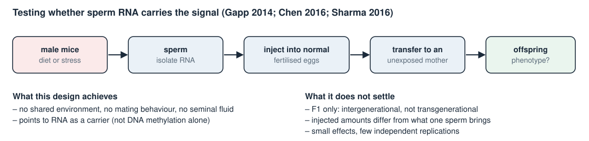{width="95%" fig-align="center"}

- Paternal diet or early stress in mice changes **small RNAs in sperm** (tRNA fragments, miRNAs).
- **Injecting** RNA from such sperm into normal fertilised eggs reproduced metabolic or behavioural changes in the offspring (Gapp et al. 2014; Chen et al. 2016; Sharma et al. 2016).
- The strongest mammalian evidence for a **carrier**, but so far mostly for **F1**: intergenerational.

::: notes
The injection design is the right kind of experiment: it removes the father's behaviour, seminal fluid and the maternal environment, and points to a molecule. Sperm RNA payload is changed during epididymal maturation (Sharma 2016), which offers a route from the father's physiology to the sperm. Open questions: how a small amount of RNA in one sperm has a lasting effect on development, how reproducible the effects are across labs and strains, and whether any of it persists beyond F1. Teach this as a promising, active field where the evidence is genuinely stronger than for most human claims.
:::

## Contested claims, and why {.smaller}

| claim | issue raised |
|---|---|
| Endocrine disruptor (vinclozolin) given to pregnant rats lowers male fertility to F4 (Anway et al. 2005) | high doses by injection; reports from other groups, with other exposure routes and strains, have been inconsistent |
| Odour fear conditioning of F0 mice changes F1 and F2 sensitivity to that odour (Dias & Ressler 2014) | the uniformly significant results across many small experiments are improbable (Francis 2014 estimated p = 0.004); mechanism unclear |
| Human famine, trauma or smoking affects grandchildren | confounded by genetics, culture and in-utero exposure; no measured carrier |

- Both mouse studies used good design elements (IVF, cross-fostering in Dias & Ressler); the debate is about **reproducibility and statistics**.

::: notes
Present these neutrally. The Anway paper was a landmark that started a field; the Skinner lab has continued to report transgenerational effects, while results from other groups using other exposure routes or strains have been inconsistent (see the reviews in the key papers). The Dias & Ressler paper used IVF and cross-fostering, which closes several routes, and that is to its credit. Francis's critique is statistical: with the effect sizes and sample sizes reported, the probability that all experiments come out significant is about 0.004, which suggests selective reporting or analysis flexibility. Students can reproduce this kind of argument in the exercise (the power calculation and the "too much success" probability). Make the point that a famous paper is not the same as a replicated finding.
:::

## Many routes, one claim {.smaller}

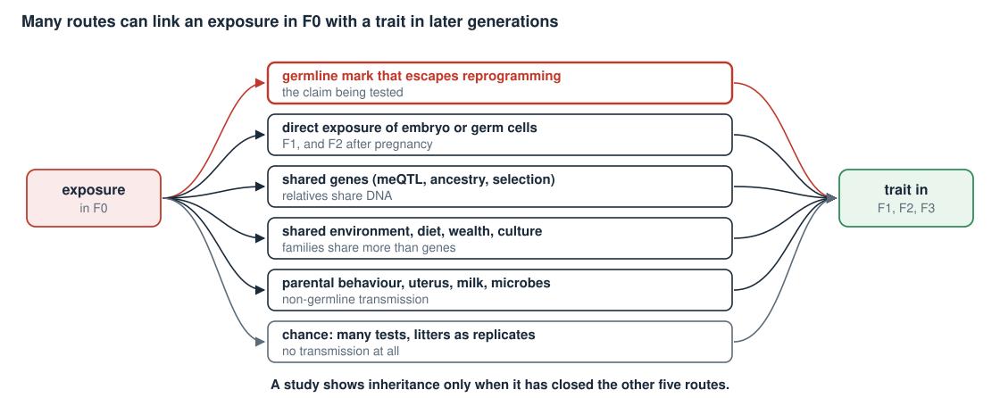{width="92%" fig-align="center"}

- A trait that follows an exposure across generations can travel by **six routes**. Only one is inheritance of an epigenetic mark.
- **Genes**, **shared environment and culture**, **parental behaviour** (e.g. maternal care in rats, Weaver et al. 2004) and **direct exposure** are all real routes.
- And **chance**, made likely by many tests and small, clustered samples.

::: notes
This is the slide to remember for the exam. For each study, go through the routes and ask which the design closes. Genetics: relatives share alleles; exposures are not random with respect to ancestry; famine survivors and parents are selected. Shared environment: families pass on diet, wealth, smoking, place of residence. Behaviour: the Weaver et al. maternal-care work in rats showed that a methylation difference in the offspring hippocampus followed the mother's licking and grooming and was reversed by cross-fostering: a non-germline, behavioural route that still involves methylation. Direct exposure: the F0–F3 rule. Chance: the next slides.
:::

## Chance, part 1: forking paths {.smaller}

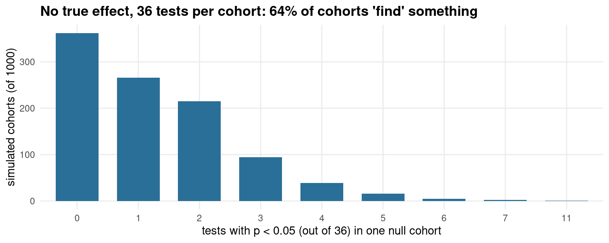{width="88%" fig-align="center"}

- Simulated Överkalix-like cohorts with **no true effect**: 300 grandchildren, 4 grandparents × 3 causes of death × 3 sex groups = **36 tests**.
- **64%** of null cohorts produce at least one p < 0.05.
- Without a pre-specified hypothesis, a "sex-specific, line-specific" finding is expected by chance.

::: notes
Numbers from make-inheritance-figs.R: 1000 simulated cohorts, each with 36 Fisher tests, 63.8% had at least one p below 0.05, with 1.27 hits on average. The exact numbers depend on the test (Fisher's exact test is conservative), but the point does not: with 36 tests, finding something is the norm. This does not mean the Överkalix finding is false; it means the original analysis cannot distinguish a real effect from chance, which is why a pre-specified replication (as in Vågerö et al. 2018) matters so much. In the exercise, students run this simulation and change the number of tests.
:::

## Chance, part 2: genome-wide tests across generations {.smaller}

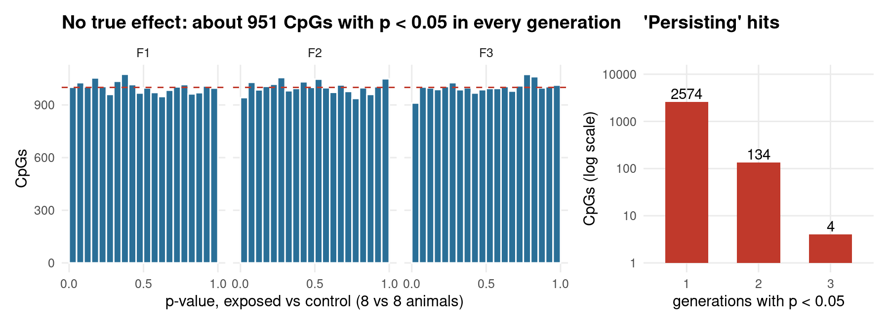{width="92%" fig-align="center"}

- 20 000 CpGs, 8 exposed vs 8 control animals per generation, **no true effect**: about **950** CpGs with p < 0.05 in every generation.
- **4** CpGs reach p < 0.05 in F1, F2 **and** F3 (2.5 expected), and **none** survives FDR correction.
- "Methylation changes that persist to F3" can be pure noise.

::: notes
A common figure in papers is a Venn diagram of DMRs in F1, F2 and F3 with a small overlap called "persistent". With 20 000 independent tests at 0.05, about 1000 hits per generation are expected, about 50 in any two generations (20 000 × 0.05²) and about 2.5 in all three (20 000 × 0.05³). We got 4. The overlap is no evidence unless it is larger than expected under independence, and unless the hits survive correction. Arrays and WGBS test hundreds of thousands to millions of CpGs, so the problem is larger in real data. Students reproduce this in the exercise.
:::

## Chance, part 3: litters are not independent {.smaller}

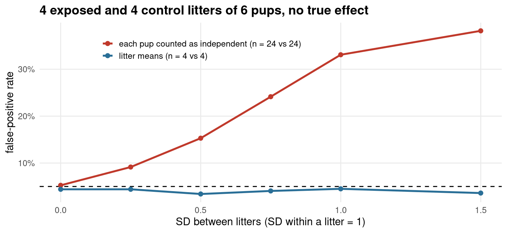{width="85%" fig-align="center"}

- Pups from one litter share a mother, a uterus and a cage. Treating them as independent **inflates** the false-positive rate.
- 4 litters per group, 6 pups each, litter SD = pup SD: **33%** false positives when pups are counted; **4–5%** when litter means are used.

::: notes
In transgenerational designs, the exposure is applied to F0 parents, so the independent unit is the litter (or the F0 animal), not the pup. If between-litter variation is large, a handful of litters can differ by chance and every pup in them carries that difference. The simulation shows the false-positive rate climbing from 5% with no litter effect to 33% when the litter SD equals the within-litter SD, and 38% when it is 1.5 times larger. The fix is to analyse litter means, or use a mixed model with litter as a random effect, and to use many litters. Check the methods section: n = 24 animals from 4 litters is n = 4 for the exposure.
:::

## Confounding by genes {.smaller}

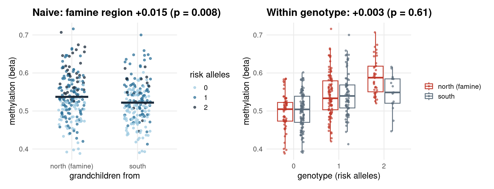{width="92%" fig-align="center"}

- A simulated cohort: methylation depends **only on a genotype** (an meQTL); the famine region has a higher frequency of the methylation-raising allele.
- Naive comparison: **+0.015**, p = 0.008. Adjusted for genotype: **+0.003**, p = 0.61.
- In humans, ancestry and local allele frequencies differ between regions, families and exposure groups.

::: notes
Methylation at many CpGs is strongly determined by nearby genetic variants (methylation QTLs), covered in *Epigenomics and genetic variation*. If exposure groups differ in ancestry, a methylation difference between their grandchildren can be entirely genetic. Sibling designs (as in the Dutch famine study) control for half of it; within-family designs and genotype adjustment help; in mice, isogenic strains remove it. This also applies to F0 selection: famine and war select who survives and has children.
:::

## Chance, part 4: small studies of small effects {.smaller}

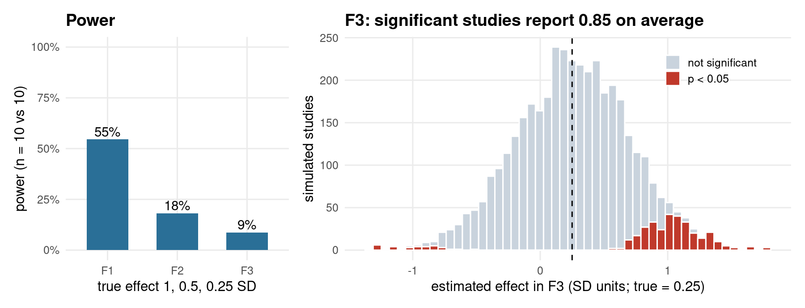{width="92%" fig-align="center"}

- A **real** effect that halves each generation (1, 0.5, 0.25 SD), n = 10 per group: power **55%, 18%, 9%**.
- Studies that reach significance in F3 report on average **0.85 SD**, more than three times the true 0.25.
- Small, significant, transgenerational effects are expected to be **exaggerated**, and to shrink on replication.

::: notes
This is the "winner's curse": when power is low, only the studies that happened to overestimate the effect reach significance, so the published effect is inflated. It also explains Francis's argument: if each experiment has 50% power, eight significant experiments in a row has probability 0.5⁸ ≈ 0.004. A realistic expectation for a real transgenerational effect is that it is small and decays; detecting it needs many independent litters, a pre-specified outcome and replication. Students compute power and the "too much success" probability by hand in the exercise.
:::

## What would convince? {.smaller}

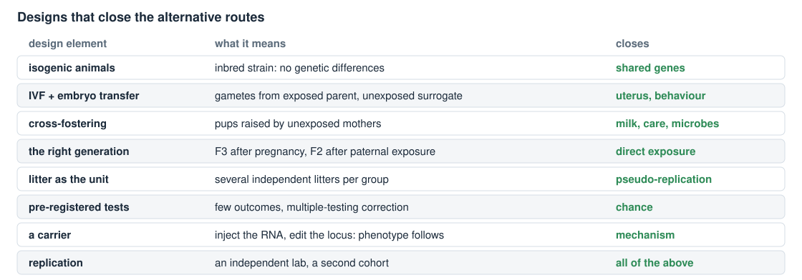{width="92%" fig-align="center"}

- Each design element closes one route; a convincing study combines several, **and** names a carrier that can be tested.
- Plants and worms meet most of these criteria; most mammalian claims meet a few.

::: notes
Go through the table with the routes from the earlier slide. IVF with embryo transfer and cross-fostering close the maternal and behavioural routes. Testing the first unexposed generation closes direct exposure. Isogenic animals close genetics. Litter-level analysis, pre-registration and multiple-testing correction close chance. Finally, a carrier: show that a specific molecule (an RNA fraction, a methylated locus) is sufficient, for example by injection or by editing the locus, and necessary, by removing it. And replication in an independent lab. In humans most of these are impossible, which is why human transgenerational claims will likely remain associations; that is a statement about the evidence, not about the biology.
:::

## The evidence in one picture {.smaller}

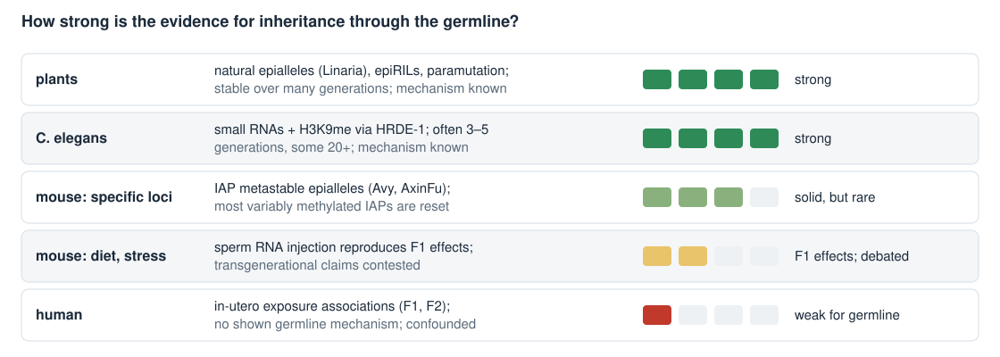{width="95%" fig-align="center"}

- **Strong:** plants, C. elegans. **Solid but rare:** specific mouse IAP loci.
- **Intergenerational, debated:** paternal diet and stress via sperm RNA in mice.
- **Weak for germline transmission:** humans; effects of in-utero exposure are real but are not inheritance.

::: notes
This summary is my reading of the current evidence and of reviews such as Heard & Martienssen 2014 and Horsthemke 2018; students should be able to justify each row with an example and the main caveat. The ranking is about inheritance through the germline of an acquired or variable state, not about whether early-life exposures matter for health (they clearly do). Be ready for the question "so is it all nonsense?": no. Non-genetic inheritance is established biology in several kingdoms; in mammals it appears to be restricted and short-lived, and the most publicised human claims are the least supported.
:::

## A checklist for reading a claim {.smaller}

| question | why |
|---|---|
| Which generation shows the effect? Was it exposed? | F0–F3 rule: intergenerational vs transgenerational |
| What is the unit of replication? | litters, families, F0 animals |
| How many outcomes, CpGs, subgroups were tested? | forking paths and multiple testing |
| Are genetics and shared environment controlled? | isogenic strains, siblings, genotype adjustment |
| Are maternal and behavioural routes closed? | IVF, embryo transfer, cross-fostering |
| Is there a carrier, and is it sufficient and necessary? | mechanism |
| Has it been replicated independently? | small studies exaggerate |

::: notes
This table is the practical outcome of the unit. Students apply it in the By-hand part of the exercise to three study descriptions. In the exam, expect a short description of a study and the question "what is shown, and what is missing?". A good answer names the generation, the unit of replication, one or two confounders and a design that would fix them.
:::

## Summary {.smaller}

| idea | key fact |
|---|---|
| three meanings | mitotic memory; intergenerational (offspring exposed); transgenerational (never exposed) |
| F0–F3 rule | pregnancy exposure: F3 is first unexposed; paternal exposure: F2 |
| mammalian barrier | two waves of reprogramming; imprints and some IAPs escape |
| plants | late germline, MET1 + RdDM: epialleles (Linaria), epiRILs, paramutation |
| C. elegans | small RNAs amplified each generation; usually 3–5 generations |
| mouse | IAP metastable epialleles; sperm RNA effects mostly F1 |
| humans | prenatal effects (Dutch famine) real; transgenerational claims (Överkalix) confounded |
| false signals | forking paths, genome-wide tests, litter effects, genetic confounding, winner's curse |

::: notes
Students should leave with a vocabulary (intergenerational vs transgenerational), a rule (F0–F3), a reason (reprogramming), a set of robust examples and their mechanisms, and a checklist for claims. Next: *Epigenetics in disease and therapy*, where the epigenome changes within one body, and *Epigenetic clocks and biomarkers*, where methylation tracks age.
:::

## Key papers (optional further reading) {.smaller}

*Not required reading and not examined. For those who want the primary literature.*

- Heard & Martienssen 2014, *Cell*. [Transgenerational epigenetic inheritance: myths and mechanisms](https://doi.org/10.1016/j.cell.2014.02.045). A balanced review across plants, worms and mammals.
- Horsthemke 2018, *Nat Commun*. [A critical view on transgenerational epigenetic inheritance in humans](https://doi.org/10.1038/s41467-018-05445-5). The human claims, read critically.
- Cubas, Vincent & Coen 1999, *Nature*. [An epigenetic mutation responsible for natural variation in floral symmetry](https://doi.org/10.1038/43657). The *Linaria* epiallele.
- Johannes et al. 2009, *PLoS Genet*. [Assessing the impact of transgenerational epigenetic variation on complex traits](https://doi.org/10.1371/journal.pgen.1000530). The epiRILs.
- Morgan et al. 1999, *Nat Genet*. [Epigenetic inheritance at the agouti locus in the mouse](https://doi.org/10.1038/15490). Incomplete erasure at a mammalian locus.
- Heijmans et al. 2008, *PNAS*. [Persistent epigenetic differences associated with prenatal exposure to famine in humans](https://doi.org/10.1073/pnas.0806560105). The Dutch Hunger Winter sibling study.
