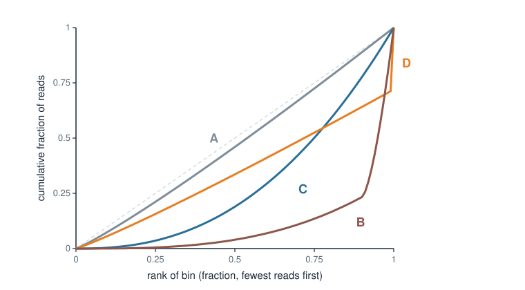

## Goal

After this exercise you will be able to:

- Compute the library-complexity metrics **NRF, PBC1 and PBC2** and the **FRiP** by hand and from a BAM file, and judge them against the ENCODE standards.
- Read a **fingerprint plot** and a **strand cross-correlation** curve, and compute NSC and RSC.
- Do a **spike-in normalisation** by hand, and explain why read-depth normalisation hides a global change.
- Critique the **design** of an epigenomic study: replicates, controls, batches, normalisation.
- Run the QC of a real ChIP-seq and ATAC-seq experiment on the command line ([samtools](https://www.htslib.org/doc/samtools.html), [bedtools](https://bedtools.readthedocs.io/), [deepTools](https://deeptools.readthedocs.io/)) and in R ([GenomicAlignments](https://bioconductor.org/packages/release/bioc/html/GenomicAlignments.html)), and compare your numbers with ENCODE's.

## Background

**Library complexity.** Count the filtered reads (MAPQ ≥ 30, primary; duplicates **not** yet removed) by position: for single-end reads the 5' end and strand, for paired-end reads the fragment's start and end. With $N$ reads, $M_\text{distinct}$ distinct positions, $M_1$ positions with exactly one read and $M_2$ with exactly two:

$$\text{NRF} = \frac{M_\text{distinct}}{N}, \qquad \text{PBC1} = \frac{M_1}{M_\text{distinct}}, \qquad \text{PBC2} = \frac{M_1}{M_2}$$

ENCODE ChIP-seq: NRF > 0.9, PBC1 > 0.9, PBC2 > 10 is ideal; 0.8–0.9 (NRF "compliant", PBC1 "mild"), PBC2 3–10 ("mild"); NRF or PBC1 below 0.5 or PBC2 below 1 is severe. ATAC-seq preferred values: NRF > 0.9, PBC1 > 0.9, PBC2 > 3.

**FRiP** = reads overlapping peaks / all filtered reads. ENCODE scrutinises TF ChIP-seq with FRiP below 1% (Landt et al. 2012); ATAC-seq should have FRiP > 0.3 (> 0.2 acceptable).

**Fingerprint.** Count reads in bins, sort the bins, plot the cumulative fraction of reads against the fraction of bins. Input ≈ diagonal; an enriched sample bends towards the lower right.

**Strand cross-correlation** $CC(k)$: the correlation between + strand read 5' ends at $x$ and − strand read 5' ends at $x + k$. It peaks at the fragment length, with a "phantom" peak at the read length.

$$\text{NSC} = \frac{CC(\text{fragment})}{\min CC}, \qquad \text{RSC} = \frac{CC(\text{fragment}) - \min CC}{CC(\text{read length}) - \min CC}$$

ENCODE repeats experiments with NSC < 1.05 and RSC < 0.8.

**Spike-in (ChIP-Rx).** A fixed amount of fly chromatin is added to each sample before the IP. With $N_\text{fly}$ the reads (in millions) on the fly genome, multiply the human signal by $\alpha = 1/N_\text{fly}$.

## Data

The CTCF ChIP-seq of GM12878 (ENCODE ENCSR000DZN, replicate 1, single-end 36 bp, 2008-era Illumina reads with phred+64 qualities) and its input control (ENCSR000EYX, single-end 27–28 bp), and ATAC-seq of GM12878 in two biological replicates (ENCSR095QNB, paired-end 2 × 100 bp). For each library you get the **original, untrimmed reads** that ENCODE aligned to **chr21 or chrM**, plus a Bowtie2 index of chr21 + chrM, the ENCODE peaks (CTCF and ATAC, IDR-thresholded), the blacklist and the GENCODE annotation.

```bash
data/download.sh epigenomics-design      # about 1.5 GB
mkdir -p ~/epi/design && cd ~/epi/design
D=/path/to/course/data                   # where download.sh put the files
T=8                                      # threads
```

You need `fastp`, `bowtie2`, `samtools` (1.12 or newer), `bedtools`, deepTools and R with `GenomicAlignments` (see *Install the software you need*). The ChIP part runs in a minute; aligning the ATAC-seq reads takes about 10 minutes with 8 threads, so run it as a batch job on the cluster (wrap the alignment block in an `sbatch` script) and do the by-hand part meanwhile.

::: {.callout-warning title="A shortcut to be aware of"}
The reads were selected because ENCODE aligned them to chr21 or chrM. Two consequences: the **alignment rate** is close to 100% (the reads that would not align were never selected), and the **chrM fraction** is hugely inflated (all mitochondrial reads were kept, but only 1/60 of the nuclear ones). We therefore compute every metric on **chr21 only**, where the reads are a faithful sample of the full library. The ENCODE values for the whole genome are given in the solutions for comparison.
:::

## By hand

Do these on paper.

**B1. Library complexity.** Two ChIP-seq libraries were each sequenced to 10 million uniquely mapped reads (before duplicate removal).

| | library 1 | library 2 |
|---|---:|---:|
| distinct positions $M_\text{distinct}$ | 8.2 M | 3.0 M |
| positions with exactly one read $M_1$ | 7.0 M | 1.2 M |
| positions with exactly two reads $M_2$ | 0.9 M | 0.6 M |

(a) Compute NRF, PBC1 and PBC2 for both, and classify each with the ENCODE ChIP-seq table.

(b) What fraction of library 2's reads would `samtools markdup -r` remove? How many usable reads are left?

(c) Library 2 is sequenced again, to 40 M reads. Will NRF go up, stay the same or go down? Will the number of usable reads go up four-fold? Why?

(d) Why must these metrics be computed **before** duplicate removal?

**B2. FRiP.** A CTCF ChIP-seq has 18 M filtered reads, of which 540 000 overlap the 45 000 called peaks. The peaks are on average 300 bp wide; the mappable genome is 2.7 Gb.

(a) Compute FRiP. Does it pass the ENCODE guideline?

(b) What FRiP would you expect if the reads were spread uniformly over the mappable genome? How many times more reads are in the peaks than expected?

(c) The input of the same experiment has a FRiP of 0.4% in the same peaks. Why is that higher than your answer in (b)?

(d) An ATAC-seq library has FRiP 0.15. What does ENCODE say? Name two things that could have gone wrong in the experiment.

**B3. Read a fingerprint plot.** The figure shows four samples, A–D, each with 1-kb bins over the genome.

{width="70%" fig-align="center"}

(a) Which curve is most likely an input? Which is a TF ChIP-seq with strong, sharp peaks? Which is a broad histone mark such as H3K27me3?

(b) For curve B, read off the fraction of reads in the top 10% of bins.

(c) Curve D follows the input until the last 1% of bins, which hold almost 30% of the reads. Is this a good ChIP? What could produce such a curve? (Think about the blacklist and about PCR.)

**B4. Strand cross-correlation.** Two single-end (36 bp) ChIP-seq experiments give these cross-correlation values:

| | CC at 36 bp | CC at the maximum (shift) | minimum CC |
|---|---:|---:|---:|
| experiment X | 0.21 | 0.32 (180 bp) | 0.15 |
| experiment Y | 0.30 | 0.26 (170 bp) | 0.25 |

(a) Compute NSC and RSC for both. Which passes the ENCODE thresholds?

(b) What is the fragment length of experiment X? Why does the curve have a peak at 36 bp at all?

(c) Experiment Y is an H3K36me3 ChIP-seq. Is a low RSC enough to reject it? Which other metric would you look at?

**B5. Spike-in normalisation.** H3K27me3 ChIP-Rx in control cells and after 7 days of an EZH2 inhibitor. Each sample got the same amount of *Drosophila* chromatin.

| | control | EZH2 inhibitor |
|---|---:|---:|
| reads mapped | 25 M | 25 M |
| reads on the fly genome | 1.25 M | 3.75 M |
| reads in the HOXA domain | 600 | 450 |

(a) Normalise the HOXA counts per million **human** reads. What do you conclude?

(b) Normalise with the spike-in factor $\alpha = 1/N_\text{fly}$. What do you conclude now? By how much did H3K27me3 change at HOXA?

(c) Why did the fly share of the library go up in the treated sample?

(d) The treated sample accidentally received twice as many human cells as the control (same amount of fly chromatin). How would that bias the result, and which measurement would reveal the mistake?

**B6. Judge the design.** For each study, list the problems and propose a better design within a similar budget.

(a) "We performed H3K27ac ChIP-seq on a tumour and on adjacent normal tissue from one patient. Peaks were called with MACS2 (no control). We identify 5214 tumour-specific enhancers."

(b) "ATAC-seq was performed on livers of three *Tet2*-knockout and three wild-type mice. Knockout livers were collected and processed in week 1 and sequenced on flow cell 1; wild-type livers in week 2 on flow cell 2. Differential accessibility was tested with DESeq2 (~ genotype)."

(c) "CUT&RUN for H3K27me3 in three replicates of DMSO- and EZH2-inhibitor-treated cells. Tracks were normalised to counts per million. H3K27me3 is unchanged at most domains, so we conclude that the inhibitor does not reduce H3K27me3 at Polycomb targets."

**B7. How many reads?** You plan a TF ChIP-seq and want 20 M usable fragments per replicate (ENCODE). A pilot run gave: 92% of reads aligned, 80% of the aligned reads have MAPQ ≥ 30, and 15% of those are duplicates.

(a) What fraction of sequenced reads is usable? How many reads must you sequence per replicate?

(b) The duplicate rate was measured at pilot depth (2 M reads). Will it be the same at full depth? What does that mean for your estimate?

(c) The pilot FRiP is 5% and you expect about 20 000 binding sites. On average, how many reads fall into one peak at 20 M usable reads? And at FRiP 0.5%?

## On the command line

### C1 — Produce the filtered BAM files

This is the alignment chain from *From reads to coverage*: trim with fastp, align with Bowtie2, keep primary alignments with MAPQ ≥ 30 (and proper pairs for paired-end), mark and remove duplicates, keep chr21 and drop blacklisted regions. We keep the intermediate files: `filt.bam` (filtered, duplicates still in) is what complexity is computed on, `final.bam` is what everything else uses.

```bash
# single-end CTCF ChIP and input (old reads: phred+64 qualities)
for s in ctcf_chip ctcf_input; do
  fastp --phred64 -w $T -i $D/gm12878_$s.fastq.gz -o $s.trim.fq.gz \
        -j $s.fastp.json -h $s.fastp.html 2> $s.fastp.log
  bowtie2 -p $T -x $D/bowtie2/hg38_chr21_chrM -U $s.trim.fq.gz 2> $s.bowtie2.log \
    | samtools view -u -q 30 -F 0x904 - \
    | samtools sort -@ $T -o $s.filt.bam -
  samtools index $s.filt.bam
  samtools markdup -r -s $s.filt.bam $s.dedup.bam 2> $s.markdup.txt
  samtools index $s.dedup.bam
  samtools view -b $s.dedup.bam chr21 \
    | bedtools intersect -v -abam - -b $D/hg38_blacklist.bed.gz > $s.final.bam
  samtools index $s.final.bam
done

# paired-end ATAC-seq, two replicates
for r in rep1 rep2; do
  s=atac_$r
  fastp -w $T -i $D/gm12878_atac_${r}_R1.fastq.gz -I $D/gm12878_atac_${r}_R2.fastq.gz \
        -o $s.R1.fq.gz -O $s.R2.fq.gz -j $s.fastp.json -h $s.fastp.html 2> $s.fastp.log
  bowtie2 -p $T -X 2000 -x $D/bowtie2/hg38_chr21_chrM \
          -1 $s.R1.fq.gz -2 $s.R2.fq.gz 2> $s.bowtie2.log \
    | samtools view -u -q 30 -f 2 -F 0x904 - \
    | samtools sort -n -u -@ $T - \
    | samtools fixmate -m -u - - \
    | samtools view -u -f 2 - \
    | samtools sort -@ $T -o $s.filt.bam -
  samtools index $s.filt.bam
  samtools markdup -r -s $s.filt.bam $s.dedup.bam 2> $s.markdup.txt
  samtools index $s.dedup.bam
  samtools view -b $s.dedup.bam chr21 \
    | bedtools intersect -v -abam - -b $D/hg38_blacklist.bed.gz > $s.final.bam
  samtools index $s.final.bam
done
```

Then count what is left at each stage:

```bash
grep overall *.bowtie2.log
for s in ctcf_chip ctcf_input atac_rep1 atac_rep2; do
  echo $s $(samtools view -c $s.filt.bam) $(samtools view -c $s.filt.bam chrM) \
       $(samtools view -c $s.filt.bam chr21) $(samtools view -c $s.dedup.bam chr21) $(samtools view -c $s.final.bam)
done
```

(a) Make a table: filtered reads, of which chrM, of which chr21; chr21 reads after duplicate removal; final reads. Why are the ATAC numbers dominated by chrM, and why must you not quote this chrM fraction as the library's (see the warning above)?

(b) What fraction of the chr21 reads were duplicates in each library? Which library is the least complex?

(c) Why does the ATAC loop filter on `-f 2` twice, before and after `samtools fixmate`?

### C2 — Library complexity with awk

Single-end: one line per read with chromosome, 5' end and strand; count identical lines.

```bash
for s in ctcf_chip ctcf_input; do
  samtools view -b $s.filt.bam chr21 | bedtools bamtobed -i - \
    | awk -v OFS='\t' '{ print $1, ($6 == "+" ? $2 : $3), $6 }' \
    | sort | uniq -c \
    | awk -v s=$s '{ n += $1; m++; if ($1 == 1) m1++; if ($1 == 2) m2++ }
        END { printf "%s reads %d distinct %d M1 %d M2 %d NRF %.3f PBC1 %.3f PBC2 %.2f\n",
              s, n, m, m1, m2, m/n, m1/m, m1/m2 }'
done
```

Paired-end: one line per fragment (both mates), from a name-sorted BAM.

```bash
for s in atac_rep1 atac_rep2; do
  samtools view -b $s.filt.bam chr21 | samtools sort -n - | bedtools bamtobed -bedpe -i - \
    | awk -v OFS='\t' '{ st = ($2 < $5 ? $2 : $5); en = ($3 > $6 ? $3 : $6); print $1, st, en }' \
    | sort | uniq -c \
    | awk -v s=$s '{ n += $1; m++; if ($1 == 1) m1++; if ($1 == 2) m2++ }
        END { printf "%s fragments %d distinct %d M1 %d M2 %d NRF %.3f PBC1 %.3f PBC2 %.2f\n",
              s, n, m, m1, m2, m/n, m1/m, m1/m2 }'
done
```

(a) Explain the first `awk`: why is the position of a − strand read its end ($3) and not its start?

(b) Classify the four libraries with the ENCODE tables (ChIP-seq table for ChIP and input, ATAC table for ATAC).

(c) Compare with the genome-wide values that ENCODE reports for the same libraries (in the solutions). Is chr21 a fair sample?

### C3 — FRiP

```bash
zcat $D/gm12878_ctcf_peaks.bed.gz > ctcf_peaks.bed
zcat $D/gm12878_atac_peaks.bed.gz > atac_peaks.bed
for s in ctcf_chip ctcf_input; do
  echo $s CTCF-peaks $(samtools view -c -L ctcf_peaks.bed $s.final.bam) $(samtools view -c $s.final.bam)
done
for s in atac_rep1 atac_rep2 ctcf_input; do
  echo $s ATAC-peaks $(samtools view -c -L atac_peaks.bed $s.final.bam) $(samtools view -c $s.final.bam)
done
# bases of chr21 inside peaks (overlapping peaks merged)
for p in ctcf atac; do
  awk '$1 == "chr21"' ${p}_peaks.bed | sort -k1,1 -k2,2n | bedtools merge | awk -v p=$p '{ s += $3 - $2 } END { print p, NR, s }'
done
```

(a) Compute the FRiP of each sample. Do the ChIP and the ATAC-seq pass the guidelines?

(b) The assembled part of chr21 is about 40.1 Mb. What FRiP would uniformly spread reads have in each peak set? How many times higher is the input's FRiP than that? What does this tell you about the input (lecture: *the background is not flat*)?

(c) We used ENCODE's peaks, called on the full data of both replicates. Why does that make the FRiPs of the two ATAC replicates comparable? What would change if each replicate's FRiP were computed with its own peaks?

### C4 — Fingerprint

```bash
plotFingerprint -b ctcf_chip.final.bam ctcf_input.final.bam atac_rep1.final.bam \
  --labels CTCF input ATAC --region chr21 --binSize 1000 --numberOfSamples 50000 -p $T \
  --JSDsample ctcf_input.final.bam --outQualityMetrics fingerprint_metrics.txt \
  --outRawCounts fingerprint_counts.tab -o fingerprint.png
cut -f1-3,6-8 fingerprint_metrics.txt | column -t -s $'\t'
```

(a) Open `fingerprint.png`. Which curve is the input, and how far is it from the diagonal? Which sample is most enriched?

(b) All three curves stay at zero up to about 0.3 on the x axis. Why? (What is on the first 5–10 Mb of chr21?)

(c) The metrics file gives the "elbow point" and the "synthetic" values: what a perfectly uniform sample of the same depth would give. Compare the input with its synthetic value.

### C5 — Replicate concordance

```bash
for b in 10000 1000; do
  multiBamSummary bins -b atac_rep1.final.bam atac_rep2.final.bam ctcf_chip.final.bam ctcf_input.final.bam \
    --labels ATAC1 ATAC2 CTCF input --region chr21 --binSize $b -p $T \
    -o bins$b.npz --outRawCounts bins$b.tab
  plotCorrelation -in bins$b.npz --corMethod spearman --whatToPlot heatmap --plotNumbers \
    --skipZeros -o cor$b.png --outFileCorMatrix cor$b.txt
done
plotCorrelation -in bins10000.npz --corMethod pearson --log1p --whatToPlot scatterplot \
  --skipZeros -o scatter10k.png
cat cor10000.txt cor1000.txt
```

(a) What is the Spearman correlation between the ATAC replicates in 10 kb and in 1 kb bins? Why is it lower in smaller bins?

(b) Is CTCF closer to its input or to ATAC? Why is a high correlation between ChIP and input not a good sign?

(c) A correlation of 0.9 between replicates sounds excellent. Why is it not enough to show that the *peaks* are reproducible? (Lecture: IDR.)

## Explore: fingerprint and library complexity {#explore-fingerprint}

The demo simulates a ChIP-seq library of 200 000 reads in 20 000 bins of 1 kb (8% of the bins cannot receive reads) and draws its fingerprint, with an input of the same depth (dashed) and the diagonal of a perfectly uniform sample. **Enriched reads** (the share of reads that come from enriched bins) moves the sample from input-like (0%) to a strong ChIP; **enriched bins** (% of the genome) sets how many bins share that signal (a TF binds in few places, a broad mark covers many). **Complexity** is the number of distinct molecules in the library per read sequenced: below about ×3 the same molecules are read again and again. The right panel counts reads per position (5' end + strand) before duplicate removal and gives NRF, PBC1 and PBC2 with ENCODE's classes, and the FRiP, with the enriched bins playing the role of peaks.

```{=html}
<link rel="stylesheet" href="../demos/dist/demo.css">
<div data-demo="fingerprint"></div>
<script src="../demos/dist/fingerprint.js"></script>
```

**E1. Three shapes.** Click **input-like**, **TF ChIP** and **broad mark** in turn. For each, note the share of reads in the top 10% and top 1% of bins and the FRiP. Where does each curve leave the input? Which of the curves A–D of B3 does each resemble?

**E2. A failed ChIP.** Click **failed ChIP** (3% of reads from 0.5% of the bins). How different is its fingerprint from the input? What is its FRiP, and would it pass the 1% guideline? What would a peak caller make of this sample?

**E3. Complexity.** Click **TF ChIP**, then lower the complexity step by step from ×10 to ×0.5 (**bottlenecked TF**). Note NRF, PBC1, PBC2 and the duplicates, and watch the bar chart. Then go to ×100: why is NRF still not close to 1? (Which positions are shared?)

**E4. Duplicates and the fingerprint.** Click **input-like** and set the complexity to ×0.5. Compare the curve with the input and read the top 10%. Then tick **remove duplicates first**. What does a bottlenecked library do to a fingerprint, and what does deduplication do to the FRiP of the **TF ChIP**?

::: {.callout-note collapse="true" title="Solutions"}

**E1.** Input-like: top 10% of bins hold 21% of the reads, the top 1% 3%; FRiP 0.5% (the "peaks" are 0.5% of the bins). TF ChIP: 45% and 32%, FRiP 30% (the input has 0.6% in the same bins); the curve runs below the input and then rises almost vertically in the last 0.5% of bins: a sharp elbow at the very end, like curve B. Broad mark: 48% and only 11%, FRiP 61% (input 22%, because the domains cover 20% of the genome); the curve bends away from the diagonal gradually over the whole range, like curve C. All curves stay at 0 for the first 8% of bins: the unmappable bins (C4b). Even the input is below the diagonal, because counts vary by chance (about 10 reads per bin) and by the mild background bias.

**E2.** The failed ChIP follows the input almost exactly (top 10% 23% vs 21%, top 1% 5% vs 3%). Its FRiP is 3.5%, which passes the 1% guideline, but only because we count in the true sites; a peak caller would find few of them, and the FRiP in its own peaks would be low and dominated by noise. The fingerprint alone does not tell a weak ChIP from an input; compare with the input at the same depth and look at the other metrics.

**E3.** ×10: NRF 0.87, PBC1 0.88, PBC2 8.6, 13% duplicates (compliant, mild). ×3: 0.75, 0.75, 4.0, 25%. ×1: 0.53, 0.51, 1.9, 47%. ×0.5: NRF 0.36 (concerning), PBC1 0.32 (severe), PBC2 1.3 (moderate), 64% duplicates; the bar chart shifts from "almost all positions have 1 read" to many positions with 2, 3 and 5+ reads. At ×100 NRF is 0.92 and PBC2 17.7, not 1 and ∞: 30% of the reads come from only 100 bins, so independent fragments in strong peaks often start at the same base. Those are not PCR copies, but duplicate marking cannot tell them apart; this is why TF ChIP-seq with very strong peaks can have a lower NRF than its input.

**E4.** A bottlenecked input (×0.5, NRF 0.37) bends further from the diagonal than the complex input: its top 10% of bins hold 26% of the reads instead of 21%, because some molecules were amplified and read many times (jackpots), which looks like enrichment. After duplicate removal it is closer to the input again (24%). For the TF ChIP, removing duplicates lowers the FRiP from 30.4% to 25.6%: duplicate removal caps the count at each position, and the strongest peaks lose the most. Judge a fingerprint together with the complexity metrics, and compare ChIP and input processed the same way.
:::

## Explore: strand cross-correlation {#explore-crosscorr}

The demo simulates single-end ChIP-seq (200 000 reads on a 1-Mb genome with 300 binding sites). Short repeats make some read start positions unmappable; a longer read reaches unique sequence more often. The left panel sums the 5' ends of + strand reads (blue) and − strand reads (red) around all binding sites, or around the left edges of the repeats; the **shift** slider moves the − strand to the left by $k$ bp. The right panel is the cross-correlation $CC(k)$ of the + strand at $x$ and the − strand at $x + k$, computed as in R1, for $k$ = 0–600, with the fragment-length peak (green), the read-length peak (orange), the minimum, and NSC and RSC. As in phantompeakqualtools, the fragment peak is searched outside shifts 10 to $L + 10$. The other sliders set the share of reads that come from binding sites (**reads from sites**), the fragment length and the read length $L$.

```{=html}
<link rel="stylesheet" href="../demos/dist/demo.css">
<div data-demo="crosscorr"></div>
<script src="../demos/dist/crosscorr.js"></script>
```

**E1. Why the strands are offset.** At the start ($k = 0$), where are the + strand and − strand reads relative to the binding site, and why? Move the shift until the two peaks lie on top of each other. What $k$ is that, what is $CC(k)$ there, and how does it compare with the fragment length the demo estimates?

**E2. The phantom peak.** Set $k = 36$ (the read length) and click **repeat edges**. What lines up, and why? Now click **input**: which peak is left? Read NSC and RSC, and the estimated fragment length.

**E3. How much signal is enough?** Click **good TF ChIP**, then lower **reads from sites** to 10, 8, 6, 4 and 0%. Note NSC and RSC. Where does RSC cross ENCODE's 0.8? What about NSC and its 1.05?

**E4. Read length and fragment length.** Click **100-bp reads**: where is the phantom peak now, and what happens to RSC? Why? Then click **short fragments** (95 bp). Compare with the course's CTCF data in R1.

::: {.callout-note collapse="true" title="Solutions"}

**E1.** + strand reads pile up about 100 bp to the left of the site, − strand reads about 100 bp to the right: a + strand read starts at the left end of a fragment that covers the site, a − strand read at its right end, and fragments are about 200 bp long. The two peaks coincide at $k \approx 200$, where $CC(200) = 0.123$; the demo's fragment estimate is 202 bp with $CC = 0.125$. This is how the fragment length is estimated from single-end data (MACS's model and `predictd` use the same idea).

**E2.** Around repeat edges the + strand reads drop just after the edge (a read that starts in the repeat cannot be mapped), and the − strand reads drop $L = 36$ bp further right (a − strand read's 5' end is at the end of its $L$-mer). Shifting the − strand by 36 bp lines up the two gaps; the same happens at every repeat, so the strands correlate at $k = L$ in any library, whatever the IP did. In the input only this phantom peak is left ($CC(36) = 0.107$, minimum 0.070): NSC 1.12, RSC 0.23, and the "fragment length" of 58 bp is just the highest point of a flat, noisy curve outside the excluded shifts.

**E3.**

| reads from sites | 15% | 10% | 8% | 6% | 4% | 0% |
|---|---:|---:|---:|---:|---:|---:|
| NSC | 2.92 | 1.79 | 1.52 | 1.32 | 1.18 | 1.12 |
| RSC | 2.57 | 1.20 | 0.85 | 0.55 | 0.33 | 0.23 |

RSC crosses 0.8 between 6% and 8%: below that the fragment peak is lower than the phantom peak. NSC stays above 1.05 even for the input: NSC divides by the minimum of the curve, so its value depends on how the background correlation is estimated (here the simulated genome has strong regional coverage differences); RSC, a ratio of differences above the minimum, is the more robust of the two (R1c).

**E4.** With 100-bp reads the phantom peak moves to $k = 100$, and RSC rises from 2.57 to 5.67: longer reads are unique at more positions (91% vs 81% of start positions), so the phantom peak is smaller ($CC(100) = 0.068$) and the background correlation is higher (min 0.052). With 95-bp fragments the fragment peak is at 93 bp, close to the read length: the phantom peak at 36 bp sits on its rising flank, as in the course's 2008 CTCF library (fragment 93 bp, R1a); NSC 3.22, RSC 2.63.
:::

## In R

You need `GenomicAlignments` and `ggplot2`. Work in the same folder:

```r
library(GenomicAlignments); library(ggplot2)
setwd("~/epi/design")
```

### R1 — Strand cross-correlation of CTCF

The function counts the 5' ends of + and − strand reads at each base of chr21 and computes the Pearson correlation between the + strand counts at $x$ and the − strand counts at $x + k$. Only positions with a + strand read contribute to the sum of products, which makes it fast.

```r
strand_cc <- function(bam, shifts = 0:1000, len = 46709983) {
  r <- readGAlignments(bam)
  plus <- as.character(strand(r)) == "+"
  fwd <- tabulate(start(r)[plus], len)          # 5' ends of + strand reads
  rev <- tabulate(end(r)[!plus], len)           # 5' ends of - strand reads
  p <- which(fwd > 0)
  m <- mean(fwd) * mean(rev); s <- sd(fwd) * sd(rev)
  sapply(shifts, function(k) {                  # correlation of fwd(x) and rev(x + k)
    q <- p + k; ok <- q <= len
    (sum(fwd[p[ok]] * rev[q[ok]]) / len - m) / s
  })
}
k <- 0:1000
cc_chip  <- strand_cc("ctcf_chip.final.bam")
cc_input <- strand_cc("ctcf_input.final.bam")
frag <- k[k > 50][which.max(cc_chip[k > 50])]
c(fragment = frag, cc_frag = max(cc_chip[k > 50]), cc_read = cc_chip[k == 36], min = min(cc_chip))
d <- rbind(data.frame(k, cc = cc_chip, sample = "CTCF"), data.frame(k, cc = cc_input, sample = "input"))
ggplot(d[d$k <= 500, ], aes(k, cc)) + geom_line() + facet_wrap(~sample, scales = "free_y") +
  geom_vline(xintercept = c(36, frag), linetype = 2) + labs(x = "strand shift (bp)", y = "cross-correlation")
```

(a) What is the fragment length? Compute NSC and RSC for the CTCF ChIP (read length 36). Does it pass?

(b) Describe the input curve. Is there a fragment-length peak?

(c) ENCODE reports, for the same replicate genome-wide, RSC 1.69 and NSC 4.9 (phantompeakqualtools). Which of your two numbers agrees, and which does not? (Hint: what decides the minimum of the curve?)

### R2 — Replicate concordance in R

```r
b10 <- read.delim("bins10000.tab", check.names = FALSE)
names(b10) <- c("chr", "start", "end", "ATAC1", "ATAC2", "CTCF", "input")
b10 <- b10[rowSums(b10[, c("ATAC1", "ATAC2")]) > 0, ]
c(pearson_raw = cor(b10$ATAC1, b10$ATAC2),
  pearson_log = cor(log1p(b10$ATAC1), log1p(b10$ATAC2)),
  spearman    = cor(b10$ATAC1, b10$ATAC2, method = "spearman"))
ggplot(b10, aes(ATAC1 + 1, ATAC2 + 1)) + geom_point(alpha = 0.3) +
  scale_x_log10() + scale_y_log10() + coord_equal()
b10$M <- log2((b10$ATAC2 + 1) / sum(b10$ATAC2)) - log2((b10$ATAC1 + 1) / sum(b10$ATAC1))
b10$A <- (log2(b10$ATAC1 + 1) + log2(b10$ATAC2 + 1)) / 2
ggplot(b10, aes(A, M)) + geom_point(alpha = 0.3) + geom_hline(yintercept = 0, colour = "red")
```

(a) Why is the Pearson correlation of raw counts different from that of log counts? Which would you report?

(b) The MA plot (as for RNA-seq): where is the spread largest, and why?

### R3 — Why depth normalisation hides a global change

Simulate 500 H3K27me3 domains and 5000 background bins. The inhibitor removes 75% of H3K27me3 everywhere; the background (unspecific DNA) is unchanged. Both libraries are sequenced to the same depth, and each sample has the same amount of fly spike-in chromatin.

```r
set.seed(1)
true_ctrl <- c(rgamma(500, shape = 4, rate = 0.02), rep(20, 5000))  # domains, then background
true_trt  <- c(0.25 * true_ctrl[1:500], rep(20, 5000))
spike     <- 2000                                                    # fly signal, same in both
depth     <- 2e6
lib <- function(true) {                                              # sequencing = sampling to fixed depth
  p <- c(true, spike) / sum(true, spike)
  as.vector(rmultinom(1, depth, p))
}
ctrl <- lib(true_ctrl); trt <- lib(true_trt)
fly  <- c(ctrl = tail(ctrl, 1), trt = tail(trt, 1))
ctrl <- head(ctrl, -1); trt <- head(trt, -1)
dom <- 1:500
cpm <- function(x) x / sum(x) * 1e6
c(cpm_ratio   = median(cpm(trt)[dom] / cpm(ctrl)[dom]),
  spike_ratio = median((trt[dom] / fly["trt"]) / (ctrl[dom] / fly["ctrl"])))
```

(a) What are the two median ratios (treated / control at the domains)? Which one recovers the true 0.25?

(b) Why is the CPM ratio not 1, as in the toy example of the lecture, but somewhat below? (Hint: what fraction of the library is background in each sample?)

(c) Set `true_trt <- true_ctrl` (no change) and rerun. Do both methods give about 1?

## Hints

::: {.callout-tip collapse="true" title="Hint 1 — complexity (B1, C2)"}
NRF is a fraction of reads, PBC1 a fraction of positions, PBC2 a ratio of counts of positions. Duplicates removed = $N - M_\text{distinct}$. A library contains a fixed number of distinct molecules: sequencing deeper samples the same molecules again. The ENCODE definitions are on the [ENCODE data standards terms page](https://www.encodeproject.org/data-standards/terms/). [`bedtools bamtobed`](https://bedtools.readthedocs.io/en/latest/content/tools/bamtobed.html) writes one BED line per read (`-bedpe`: per pair; needs a name-sorted BAM, [`samtools sort -n`](https://www.htslib.org/doc/samtools-sort.html)). [`samtools markdup`](https://www.htslib.org/doc/samtools-markdup.html) needs [`samtools fixmate -m`](https://www.htslib.org/doc/samtools-fixmate.html) for paired-end data.
:::

::: {.callout-tip collapse="true" title="Hint 2 — FRiP (B2, C3)"}
Expected FRiP for uniform reads = fraction of the (mappable) genome covered by peaks. [`samtools view -c -L file.bed`](https://www.htslib.org/doc/samtools-view.html) counts the reads that overlap any region of the BED file; [`bedtools merge`](https://bedtools.readthedocs.io/en/latest/content/tools/merge.html) collapses overlapping peaks. FRiP is described in [Landt et al. 2012](https://doi.org/10.1101/gr.136184.111).
:::

::: {.callout-tip collapse="true" title="Hint 3 — fingerprint and cross-correlation (B3, B4, C4, R1)"}
Read the fingerprint from the right: the top 10% of bins are $x$ from 0.9 to 1, and they hold $1 - y(0.9)$ of the reads. See the [plotFingerprint manual](https://deeptools.readthedocs.io/en/latest/content/tools/plotFingerprint.html), including the description of its quality metrics. For NSC and RSC, plug the three numbers into the formulas in *Background*. The phantom peak and its explanation are in [Landt et al. 2012](https://doi.org/10.1101/gr.136184.111) (Fig. 4) and [Kharchenko et al. 2008](https://doi.org/10.1038/nbt.1508). [`readGAlignments`](https://rdrr.io/bioc/GenomicAlignments/man/readGAlignments.html) reads a BAM file; [`tabulate`](https://rdrr.io/r/base/tabulate.html) counts integers.
:::

::: {.callout-tip collapse="true" title="Hint 4 — spike-ins and design (B5, B6, R3)"}
CPM: divide by the human reads in millions. Spike-in: multiply by $1/N_\text{fly}$ (millions). The method is [Orlando et al. 2014](https://doi.org/10.1016/j.celrep.2014.10.018). For the design questions go through: biological replicates per condition, control, antibody, batches vs condition, normalisation under a global change. [`rmultinom`](https://rdrr.io/r/stats/Multinom.html) draws a fixed total of reads from the given proportions, like a sequencer.
:::

::: {.callout-tip collapse="true" title="Hint 5 — deepTools and depth (B7, C5, R2)"}
Usable fraction = product of the fractions kept at each step. [`multiBamSummary bins`](https://deeptools.readthedocs.io/en/latest/content/tools/multiBamSummary.html) counts reads in bins; [`plotCorrelation`](https://deeptools.readthedocs.io/en/latest/content/tools/plotCorrelation.html) plots and writes the correlation matrix. Spearman correlation uses ranks; Pearson on raw counts is dominated by the largest bins.
:::

## Solutions

::: {.callout-note collapse="true" title="Solutions — by hand"}

**B1.** (a) Library 1: NRF $8.2/10 = 0.82$, PBC1 $7.0/8.2 = 0.85$, PBC2 $7.0/0.9 = 7.8$: NRF compliant (0.8–0.9), mild bottlenecking by PBC1 and PBC2: acceptable. Library 2: NRF $0.30$, PBC1 $1.2/3.0 = 0.40$, PBC2 $1.2/0.6 = 2.0$: NRF concerning, PBC1 severe, PBC2 moderate: a strongly bottlenecked library. (b) $1 - 0.30 = 70\%$ of the reads are duplicates; 3.0 M usable reads remain. (c) NRF goes **down**: the library holds a limited number of distinct molecules (judging from PBC2, not many more than the 3 M already seen), so most new reads are copies of molecules already sequenced. The usable reads grow far less than four-fold. More sequencing cannot rescue a library that was amplified from too little DNA; make a new one. (d) After duplicate removal every position has exactly one read, so NRF = PBC1 = 1 by definition; the information is in how many copies there were.

**B2.** (a) $540\,000 / 18\,000\,000 = 3\%$: above 1%, passes. (b) Peaks cover $45\,000 \times 300 = 13.5$ Mb, $13.5 / 2700 = 0.5\%$ of the mappable genome; expected FRiP 0.5%, so the ChIP has 6 times more reads in peaks than uniform. (c) The input is not uniform: CTCF sites are often in open chromatin, which shears more easily, and they are in mappable, GC-rich DNA. (In the course data the input's FRiP in CTCF peaks is about 8 times the uniform expectation, C3.) (d) Below 0.2: not acceptable. Possible causes: too few cells or too much Tn5 for the cell number (over-tagmentation, more background), dead or dying cells (fragmented chromatin), poor nuclei isolation, many mitochondrial reads (these are removed but signal the problem), or a library dominated by background after too many PCR cycles.

**B3.** (a) A is the input (close to the diagonal). B is the sharp TF: flat for 90% of the bins, then a steep rise. C, a smooth curve bending away from the diagonal over the whole range, is the broad mark. (b) At $x = 0.9$, $y \approx 0.23$, so the top 10% of bins hold about **77%** of the reads. (c) No: 99% of the genome looks like an input. A few bins with huge counts produce the jump: artefact regions such as satellite repeats, rDNA or the mitochondrial genome (blacklisted regions), or a few PCR jackpots. Check what those bins are; remove the blacklist and duplicates and replot.

**B4.** (a) X: NSC $0.32 / 0.15 = 2.13$, RSC $(0.32 - 0.15)/(0.21 - 0.15) = 2.83$: passes both. Y: NSC $0.26/0.25 = 1.04$, RSC $(0.26 - 0.25)/(0.30 - 0.25) = 0.2$: fails both (NSC < 1.05, RSC < 0.8). (b) About 180 bp: the shift where + and − strand reads correlate best. The read-length (phantom) peak comes from mappability: a position that can be mapped on the + strand can also be mapped on the − strand one read length further, so the two strands correlate at that shift in any library, even an input. (c) No. Broad marks spread over whole gene bodies have flat cross-correlation curves even when the ChIP works. Look at the fingerprint (and FRiP in broad domains), the browser, and the replicate agreement.

**B5.** (a) Human reads: 23.75 M and 21.25 M. HOXA: $600/23.75 = 25.3$ and $450/21.25 = 21.2$ reads per million human reads, a 16% drop: "a mild decrease". (b) $\alpha = 1/1.25 = 0.8$ and $1/3.75 = 0.267$; scaled counts $600 \times 0.8 = 480$ and $450 \times 0.267 = 120$: a **4-fold** drop (75% loss). (c) The same amount of fly H3K27me3 went into each IP, but the treated cells had much less human H3K27me3 to pull down, so the fly chromatin made up a larger share of the immunoprecipitated DNA (and of the reads). (d) Twice as much human chromatin per fly chromatin makes the fly share smaller, $\alpha$ larger, and the treated sample looks too high: the loss is underestimated. The **input** (sequenced without IP) shows the actual human:fly ratio in each sample; ChIP-Rx-type normalisations correct by it.

**B6.** (a) n = 1 per condition (no biological replicates: no estimate of variability, any difference could be between two people); no input (copy-number changes in the tumour create "tumour-specific peaks"); tumour vs normal adjacent tissue also differ in cell-type composition. Better: tumours and matched normals from at least 3 (better 5+) patients, an input for each sample, the patient as a blocking factor (`~ patient + tissue`), and peaks called against the input. (b) Genotype is completely confounded with week and flow cell: the design matrix cannot separate them, and `~ genotype` attributes every batch effect to the knockout. Better: process and sequence knockout and wild-type livers together (e.g. one KO and one WT per day, all on one flow cell or spread evenly), and include the batch in the model. (c) CPM normalisation assumes the total amount of H3K27me3 is unchanged, which is exactly what an EZH2 inhibitor violates: after normalisation the remaining signal is scaled up and domains look unchanged. Use a spike-in (e.g. *Drosophila* chromatin or the *E. coli* DNA carried over in CUT&RUN), or check global levels by western blot / mass spectrometry. The conclusion as written is not supported.

**B7.** (a) $0.92 \times 0.80 \times 0.85 = 0.626$; $20 / 0.626 \approx 32$ M reads per replicate. (b) No: the duplicate rate rises with depth because the library has a limited number of distinct molecules. Expect more than 15% duplicates at 32 M, so sequence more, or (better) check the complexity first (e.g. with a library-complexity extrapolation such as preseq). (c) $20 \text{ M} \times 0.05 = 1$ M reads in peaks, about **50 reads per peak**; at FRiP 0.5%, about **5 reads per peak**: too few to call most peaks reliably.
:::

::: {.callout-note collapse="true" title="Solutions — command line"}

Runtimes on a shared (busy) 40-core server with `T=8`: the alignment block 11 min (ChIP and input 20 s, the rest ATAC, mostly Bowtie2); counting 13 s; complexity 2 s (SE) and 21 s (PE); FRiP 2 s; plotFingerprint 30 s; the two multiBamSummary runs 8 s. In R: R1 12 s, R2 and R3 under a second. Your numbers may differ by a few hundred reads, about 0.1% (Bowtie2 breaks ties between equally good alignments at random).

**C1.** (a)

| | filtered | chrM | chr21 | chr21 after markdup | final |
|---|---:|---:|---:|---:|---:|
| CTCF ChIP | 304 333 | 52 867 | 251 466 | 201 461 | 200 297 |
| input | 402 539 | 292 317 | 110 222 | 108 739 | 107 975 |
| ATAC rep1 | 11 333 106 | 10 700 736 | 632 370 | 504 652 | 482 022 |
| ATAC rep2 | 7 538 192 | 6 961 352 | 576 840 | 511 960 | 495 353 |

Bowtie2 aligned 98.9% (ChIP), 100% (input) and 99.4% (both ATAC) of the reads: high because of the read selection. The ATAC subset is ~94% chrM because the selection kept every mitochondrial read but only the nuclear reads from chr21 (1.5% of the genome). ENCODE's genome-wide numbers are 13.9% (rep1) and 10.3% (rep2) mitochondrial reads: still substantial, typical of ATAC-seq without a mitochondria-depleting protocol (Omni-ATAC). (b) Duplicates on chr21: CTCF 19.9%, input 1.4%, ATAC rep1 20.2%, rep2 11.2%. ATAC rep1 is the least complex, closely followed by the CTCF ChIP. (c) Filtering on MAPQ removes one mate of some pairs; the first `-f 2` keeps reads flagged as proper pairs, but an orphaned mate still carries that flag. `fixmate` rewrites the flags from the mates actually present, and the second `-f 2` drops the orphans, which `markdup` would otherwise choke on.

**C2.** (a) For a − strand read the sequenced 5' end is the rightmost base of the alignment; two PCR copies of the same molecule share that end, even if trimming left them with different lengths. (b)

| | reads / fragments | distinct | $M_1$ | $M_2$ | NRF | PBC1 | PBC2 | ENCODE |
|---|---:|---:|---:|---:|---:|---:|---:|---|
| CTCF ChIP | 251 466 | 201 461 | 176 332 | 13 491 | 0.80 | 0.88 | 13.1 | NRF compliant, PBC1 mild, PBC2 none |
| input | 110 222 | 108 739 | 107 322 | 1374 | 0.99 | 0.99 | 78.1 | ideal |
| ATAC rep1 | 316 185 | 252 326 | 202 943 | 38 858 | 0.80 | 0.80 | 5.2 | NRF and PBC1 below the preferred 0.9 (moderate); PBC2 > 3 |
| ATAC rep2 | 288 420 | 255 980 | 228 372 | 23 834 | 0.89 | 0.89 | 9.6 | just below 0.9; PBC2 > 3 |

(c) ENCODE, genome-wide (all reads of the replicate): CTCF rep1 NRF 0.75, PBC1 0.84, PBC2 9.9 (29.5 M reads); ATAC rep1 NRF 0.79–0.80, PBC1 0.80, PBC2 5.1–5.2; rep2 NRF 0.88–0.89, PBC1 0.89, PBC2 9.2–9.6. The ATAC values agree almost exactly; the ChIP values are close (ENCODE also counts reads in repeats and pericentromeres on other chromosomes, which add duplicates). chr21 is a fair sample of the library.

**C3.** (a) CTCF ChIP: 44 914 / 200 297 = **22.4%**, far above 1%. Input: 1690 / 107 975 = 1.6%. ATAC rep1: 283 347 / 482 022 = **58.8%**; rep2: 247 495 / 495 353 = **50.0%**, both well above 0.3. (ENCODE genome-wide: 54–60% for rep1 and 46–52% for rep2 with their peak sets.) (b) 405 CTCF peaks on chr21 cover 74 287 bp, 0.19% of 40.1 Mb; the 1784 ATAC peaks on chr21 merge into 821 regions covering 620 kb, 1.5% (ENCODE's IDR peaks list a region once per summit, so many overlap). The input has 1.6% of its reads in CTCF peaks (8 times the uniform expectation) and 8.3% in ATAC peaks (5 times): input DNA is enriched in open chromatin, which is why the ChIP must be compared with the input, not with a flat background. (c) Same peaks for both replicates means the same denominator of "where signal can be": the FRiP then compares only the signal-to-noise of the libraries. With each replicate's own peaks, the deeper or better replicate also gets more peaks, which raises its FRiP further; FRiP and peak number are not independent.

**C4.** (a) The input is the curve closest to the diagonal, but still clearly below it; ATAC is the most enriched (top 1% of 1-kb bins hold about 52% of the ATAC reads, 30% of CTCF reads, 8% of input reads). (b) About 28–40% of the 1-kb bins have no reads in any sample: the short arm of chr21 (0–~5 Mb, unassembled), the centromere (~11–13 Mb) and other gaps and repeats, where nothing can map. With the blacklist and these gaps the "genome" is smaller than the chromosome. (c) Elbow points: CTCF 0.74, input 0.62, ATAC 0.90; the synthetic (perfectly uniform) values are all about 0.51. Even the input is far from its synthetic value: it is not uniform, partly because of the unmappable bins, partly the open-chromatin bias seen in C3. The Jensen–Shannon distance to the input is 0.26 for CTCF and 0.49 for ATAC.

**C5.** (a) Spearman ATAC1–ATAC2: **0.90** in 10 kb bins, **0.59** in 1 kb bins (bins with reads in at least one sample). Small bins have few reads each, so Poisson counting noise is a larger part of the variation. (b) In 10 kb bins CTCF correlates about equally with its input (0.64) and with ATAC (0.65), and the input correlates even better with ATAC (0.75–0.76) than with CTCF. At this scale all libraries share the same background: mappability, GC content and open chromatin (C3). A ChIP that correlates highly with its input has little specific signal; here CTCF's signal is in a few hundred narrow peaks, which hardly move a 10 kb-bin correlation. (c) Correlation over bins is dominated by the many background bins and by large-scale coverage variation that both replicates share; it says little about whether the *same peaks*, in the same order, are found. IDR answers that question.
:::

::: {.callout-note collapse="true" title="Solutions — R"}

**R1.** (a) Fragment length **93 bp** (ENCODE: 90–95). $CC(93) = 0.147$, $CC(36) = 0.091$, minimum (at ~1 kb) $0.0032$: NSC $= 0.147 / 0.0032 \approx 47$, RSC $= (0.147 - 0.0032)/(0.091 - 0.0032) = 1.65$. Passes both thresholds easily. Note that the phantom peak at 36 bp is hidden on the rising flank of the fragment peak: CTCF fragments here are short. Runtime: about 12 s for both BAM files. (b) The input curve is low and noisy (0.001–0.0025), slowly decreasing with the shift, without a clear fragment-length peak: no enrichment. (c) RSC agrees (1.65 vs 1.69); NSC does not (47 vs 4.9). RSC is a ratio of two *differences* above the minimum and is robust. NSC divides by the minimum of the curve, the background correlation, which depends on how the background is estimated: per base or in bins, which chromosomes and regions are included (pericentromeric repeats, artefacts), the range of shifts. Compare NSC only between datasets computed the same way.

**R2.** Pearson of raw counts 0.97, of log counts 0.94, Spearman 0.89 (the 3580 10-kb bins with ATAC reads). (a) Raw counts are dominated by the few bins with very high counts (strong peaks), which inflates the Pearson correlation; log counts or ranks weigh all bins more equally. Report Spearman or Pearson on log counts, and say which. In ENCODE ATAC peaks (the counts used for differential accessibility), the log correlation is 0.99. (b) The spread is largest at low A (few reads): Poisson noise is relatively largest when counts are small, the same funnel shape as an MA plot in RNA-seq.

**R3.** (a) The CPM ratio is **0.40**, the spike-in ratio **0.25**: only the spike-in recovers the true 4-fold loss. (b) The domains hold about 100 000 units of signal in the control (500 × a mean of 200) and 25 000 after treatment; the background is 100 000 units in both. So the background is half of the control library but 80% of the treated one, and normalising both to the same total scales the treated sample up by $200\,000 / 125\,000 = 1.6$: $0.25 \times 1.6 = 0.40$. The domains seem to lose 60% instead of 75%. Real ChIP data behave in the same way: how much the global change is hidden depends on the share of background in the library. (c) Both give 1.00.
:::

## Where this leads

- *ATAC-seq: Tn5, fragment sizes, nucleosome ladder* explains the fragment-size distribution and TSS enrichment of these two replicates.
- *Peak calling* calls the CTCF peaks with MACS3 against the input you aligned here, and runs IDR on replicates.
- *Differential accessibility* and *Annotation and differential binding* use the replicate structure, batches and (for global changes) spike-in factors.
- In practice, nf-core/chipseq and nf-core/atacseq compute all of these metrics and collect them in a MultiQC report.

## Key papers (optional further reading)

*Not required reading and not examined.*

- Landt et al. 2012, *Genome Res*. [ChIP-seq guidelines and practices of the ENCODE and modENCODE consortia](https://doi.org/10.1101/gr.136184.111).
- Kharchenko, Tolstorukov & Park 2008, *Nat Biotechnol*. [Design and analysis of ChIP-seq experiments for DNA-binding proteins](https://doi.org/10.1038/nbt.1508).
- Li, Brown, Huang & Bickel 2011, *Ann Appl Stat*. [Measuring reproducibility of high-throughput experiments](https://doi.org/10.1214/11-AOAS466).
- Orlando et al. 2014, *Cell Rep*. [Quantitative ChIP-Seq normalization reveals global modulation of the epigenome](https://doi.org/10.1016/j.celrep.2014.10.018).
- Diaz, Park, Lim & Song 2012, *Stat Appl Genet Mol Biol*. [Normalization, bias correction, and peak calling for ChIP-seq](https://doi.org/10.1515/1544-6115.1750).
- Ewels, Magnusson, Lundin & Käller 2016, *Bioinformatics*. [MultiQC: summarize analysis results for multiple tools and samples in a single report](https://doi.org/10.1093/bioinformatics/btw354).
