## About this lecture

You can align reads and make a coverage track (*From reads to coverage*). Whether that track means anything depends on decisions made before the first read was sequenced, and on a handful of numbers you should check before the first peak is called.

- **Design**: biological replicates, controls (input, IgG, none), antibodies, spike-ins for global changes, batches.
- **QC metrics shared by ChIP-seq, ATAC-seq and CUT&Tag**: library complexity, duplicates, FRiP, fingerprint, strand cross-correlation, replicate concordance, and for ATAC TSS enrichment and fragment sizes.
- What each metric **looks like** on good and bad data, and the **ENCODE thresholds**.
- Real numbers from the course data: GM12878 **CTCF ChIP-seq** with its input, and **ATAC-seq** in two replicates, on chr21.
- How to read a methods section, and the **red flags** in published data.

::: notes
This unit sits between the alignment unit and the assay blocks. Everything here is reused in the ATAC-seq, ChIP-seq, CUT&Tag and differential-analysis units, so it is taught once. The tone is practical: what can go wrong in an epigenomic experiment, how you would see it in the data, and how you decide whether to trust a dataset, your own or a published one. Students know design matrices and normalisation from RNA-seq; we reuse that, and spend the time on what is specific to enrichment assays: controls, enrichment metrics, and global changes. All real-data figures are made with make-design-figs.R from the same reads the students align in the exercise.
:::

## What makes an epigenomic experiment interpretable? {.smaller}

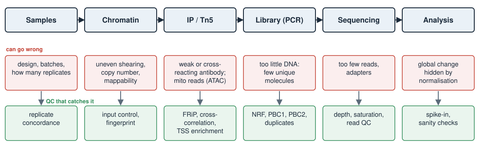{width="95%" fig-align="center"}

- Each step from cells to peaks can fail **silently**: the pipeline still produces a BAM, a bigWig and a peak list.
- Each failure leaves a **fingerprint in the data** that a QC metric is designed to catch.
- Two failures cannot be repaired afterwards: **no replicates** and **no control**. Plan them before the experiment.

::: notes
Walk along the chain. Samples: if conditions and batches are confounded, no analysis can separate them. Chromatin: sonication shears open chromatin more easily, so even DNA with no antibody shows "peaks" at promoters; amplified regions give more reads everywhere. IP: an antibody that binds weakly or cross-reacts gives a low signal-to-noise ratio. Library: if the IP returned very little DNA, PCR copies a few molecules many times. Sequencing: too few reads and weak sites are missed. Analysis: standard normalisation assumes the total amount of the mark is the same in all samples. The rest of the lecture goes through these in order: design first (the part you cannot fix), then the metrics. Point out that a pipeline never fails on bad data; it produces confident-looking output either way.
:::

## Replicates: biological, technical and pseudo {.smaller}

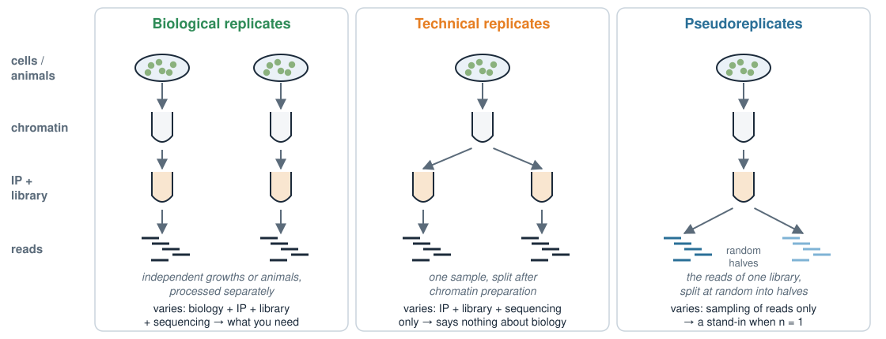{width="88%" fig-align="center"}

- **Biological replicates** (independent cultures, animals, patients) are what a claim about biology needs. ENCODE requires **at least two**; for differential analysis use **at least three per condition**, as in RNA-seq.
- Technical replicates only measure the noise of the protocol. **Pseudoreplicates** (random halves of one library) only measure counting noise: a stand-in when there is a single sample, never evidence of reproducibility.

::: notes
The same logic as in RNA-seq: the variance you need to estimate for a test is the variance between independent biological units. Two growths of a cell line on different days are the minimum for a cell line; for tissues, different animals or donors. Technical replicates (the same chromatin split into two IPs) are useful when developing a protocol, but adding them does not increase n. ENCODE's consortium decision (Landt et al. 2012) was two biological replicates per ChIP-seq experiment; more replicates did not add many sites. For differential binding or accessibility, power depends on replicates far more than on depth: three per condition is the usual minimum, more when the effect is subtle or the samples are primary tissue. Pseudoreplicates: ENCODE's pipeline splits the pooled reads at random into two halves and calls peaks on each half; this tells you whether a peak is supported by enough reads, not whether the experiment would replicate. Students should be suspicious of "n = 1, peaks called on pseudoreplicates" in a paper that makes biological claims.
:::

## Why a control? The background is not flat {.smaller}

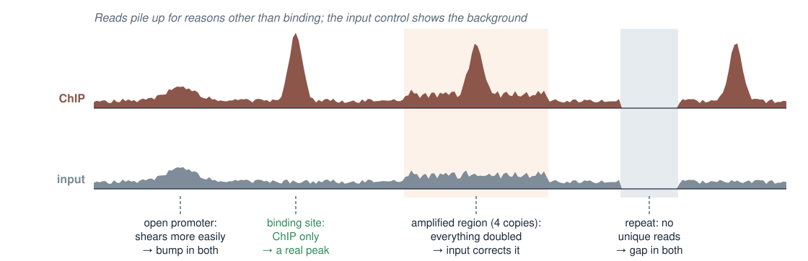{width="95%" fig-align="center"}

- Reads pile up where nothing is bound: **open chromatin shears more easily**, **amplified regions** have more DNA, **repeats** get no unique reads, GC-rich fragments amplify better.
- An **input** library (sheared chromatin, no antibody) shows exactly these biases. Peak callers compare the ChIP to it **locally**, not to a flat average.

::: notes
The schematic has the four common causes. Open promoters: sonication preferentially fragments open, nucleosome-free DNA, so input DNA has small bumps at active promoters, which a naive caller would report as peaks of any factor. Copy number: cancer cell lines (K562, HeLa, HepG2) have many amplifications; a 4-copy region gives twice as many reads in both ChIP and input; without the input every amplified region looks enriched. Mappability: repeats get no uniquely mapped reads in either; these gaps and the high-signal artefact regions are why we also use the blacklist. MACS uses the input to estimate a local background rate lambda in 1 kb, 5 kb and 10 kb windows around each candidate peak, which is how the input actually enters the statistics; that is covered in *Peak calling*. Match the control to the ChIP: same cells, same crosslinking and sonication, similar read length, sequenced at least as deep.
:::

## Input, IgG or no control {.smaller}

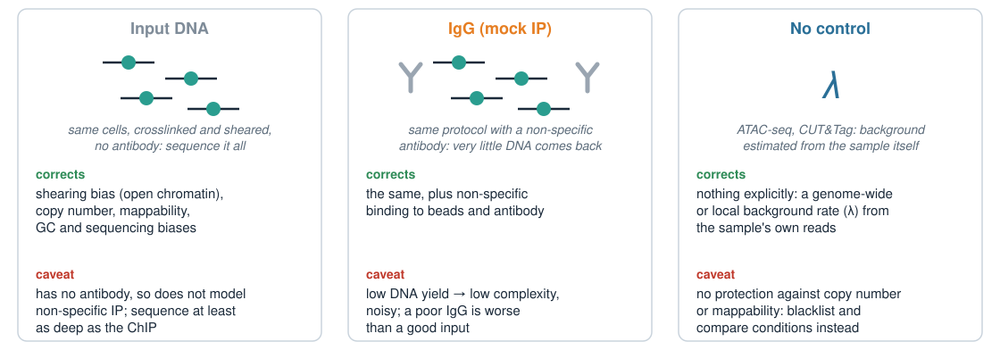{width="92%" fig-align="center"}

- **Input** is the standard for ChIP-seq (ENCODE): cheap, complex, captures shearing, copy number and mappability.
- **IgG** mimics the IP but recovers little DNA, so the library is often small and noisy.
- **ATAC-seq and CUT&Tag** have no input: the background is estimated from the sample itself. Comparing **conditions** and **replicates** carries the weight instead.

::: notes
Landt et al. describe both kinds of control and note that an IgG control must yield a library of complexity comparable to the ChIP, which often fails because a non-specific antibody pulls down very little DNA. In practice ENCODE uses inputs. For ATAC-seq there is no sensible control: naked genomic DNA tagmented by Tn5 would model Tn5's sequence preference but nobody does it routinely. MACS then uses the genome-wide background of the sample, and a local lambda from the sample itself. CUT&Tag sometimes uses an IgG control, and its background is so low that the main concern is different (covered in *CUT&RUN and CUT&Tag*). Students should know that "no control" is normal for ATAC and a red flag for ChIP.
:::

## Real data: CTCF ChIP and its input on chr21 {.smaller}

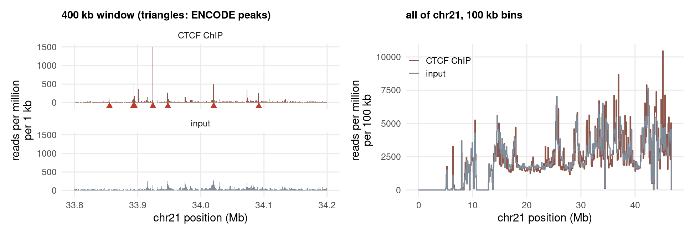{width="95%" fig-align="center"}

- Left: reads per million in 1 kb bins over 400 kb. The ChIP has sharp peaks at the ENCODE peaks; the input is low, with small bumps at some of the same sites.
- Right: 100 kb bins over all of chr21. ChIP and input rise and fall **together** (correlation 0.87): no reads on the unassembled short arm and the centromere, more reads in gene-dense regions. That is background, and the input measures it.

::: notes
Real data from the exercise: GM12878 CTCF ChIP-seq (ENCODE ENCSR000DZN, replicate 1, 36 bp single-end reads from 2008) and its input (ENCSR000EYX), aligned to chr21, filtered, deduplicated and blacklist-filtered; about 200 000 ChIP and 108 000 input reads on chr21. Left: CTCF peaks are tall and narrow, and most bins between peaks have a few reads in both tracks. Look for the small input bumps under some CTCF peaks: input DNA is enriched at open chromatin, and many CTCF sites are open. Right: at 100 kb scale the ChIP looks almost like the input: 93 of 468 bins have no input reads (the first ~5 Mb of chr21 is the unassembled acrocentric short arm; the gap at 11-13 Mb is the centromere), and the gene-rich distal end of chr21 has more reads in both. This is the background that the peak caller must not report: it compares the ChIP with the local input level, not with the chromosome average. GM12878 has a near-normal karyotype; in a cancer cell line you would also see copy-number steps in both tracks.
:::

## Antibodies decide what you measure {.smaller}

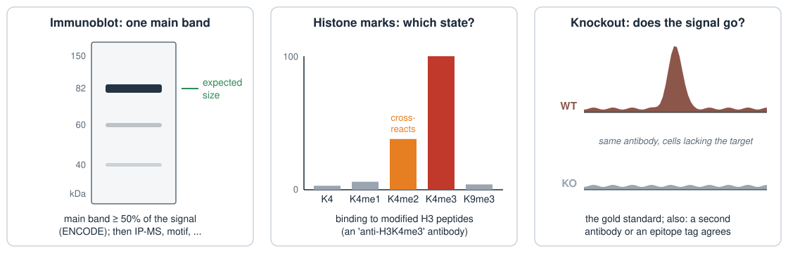{width="95%" fig-align="center"}

- A ChIP is only as specific as its antibody. Check: **one main band** on an immunoblot (ENCODE: at least 50% of the signal), and a second line of evidence: IP–mass spectrometry, a second antibody or an epitope tag, the expected motif, or loss of signal in a **knockout or knockdown**.
- Histone-mark antibodies can **cross-react** with neighbouring states (H3K4me2 vs me3) or be blocked by a modification next door. Lots differ: record the lot number.

::: notes
Landt et al. give the ENCODE antibody standards: a primary characterisation (immunoblot or immunofluorescence; on the blot the main band should hold at least 50% of the signal, ideally at the expected size) and one of several secondary characterisations: knockdown, a second antibody against another epitope or a complex member, an epitope-tagged construct, IP followed by mass spectrometry, or motif enrichment in the peaks. Histone antibodies are tested on peptide arrays or with modified nucleosomes. Egelhofer et al. 2011 tested more than 200 histone-modification antibodies and found that about a quarter failed specificity tests. The knockout control is the strongest: if the signal persists in cells lacking the protein, it was not the protein. When reading a paper, look for catalogue and lot numbers and some evidence of validation.
:::

## Normalisation assumes the total does not change {.smaller}

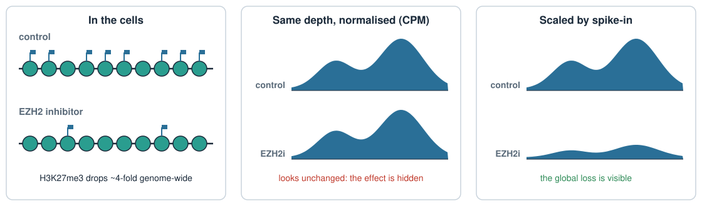{width="95%" fig-align="center"}

- Standard normalisation (CPM, RPKM, DESeq2 size factors) makes every library the **same total**. Fine when most sites do not change.
- An **EZH2 inhibitor** removes most H3K27me3 **everywhere**. The IP still returns DNA, the library is sequenced to the same depth, and after normalisation the tracks look **unchanged**.
- To see a global change you need an **external reference** added in a known amount: a spike-in.

::: notes
This is the same assumption students met with DESeq2 size factors: the median-of-ratios method assumes most genes do not change. In RNA-seq this fails for global transcriptional amplification (e.g. MYC); in epigenomics it fails whenever a drug or mutation changes the total amount of a mark: EZH2 inhibitors or EZH2 mutations (H3K27me3), the oncohistone H3K27M (loss of H3K27me3), BET inhibitors and HDAC inhibitors (acetylation), DOT1L inhibitors (H3K79me2). The IP always returns some DNA, library preparation adds PCR cycles until there is enough, and the sequencer gives each sample its 20 million reads. Information about the absolute amount is lost at every one of these steps. Normalising by read depth then redistributes the remaining signal, so a 4-fold global drop looks like no change, or even a gain at the strongest sites.
:::

## Spike-in normalisation (ChIP-Rx) {.smaller}

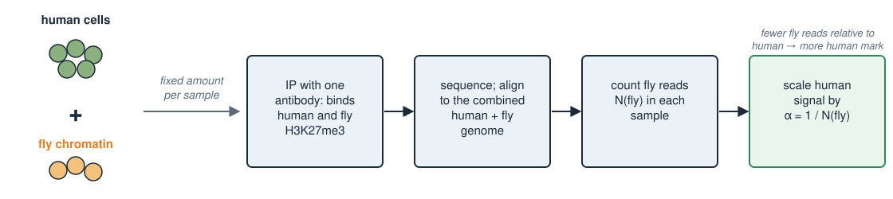{width="95%" fig-align="center"}

- Add the **same amount of foreign chromatin** (e.g. *Drosophila* cells, or synthetic modified nucleosomes) to each sample **before** the IP. The antibody pulls down the fly mark too.
- The fly reads measure how efficient the IP was in each sample. Scale each human signal by $\alpha = 1/N_\text{fly}$ (fly reads, in millions).

::: notes
Orlando et al. 2014 (ChIP-Rx, "reference exogenous genome") added a fixed number of Drosophila S2 cells to a fixed number of human cells, did the ChIP with antibodies that recognise the conserved mark in both species, and aligned reads to a combined genome. Their normalisation factor was alpha = 1 / (million reads mapped to the fly genome). They showed that a DOT1L inhibitor reduced H3K79me2 globally, which standard normalisation hid. Variants: synthetic barcoded nucleosomes (SNAP-ChIP/ICeChIP), E. coli carry-over DNA in CUT&RUN, and spike-ins for ATAC-seq. Spike-ins add their own uncertainty: the ratio of cells must be accurate (count cells, check the fly fraction in the input), and the spike-in must be added before any step that loses material. When the total does not change, spike-in normalisation only adds noise.
:::

## A toy spike-in calculation

| | control | EZH2 inhibitor |
|---|---:|---:|
| reads mapped, total | 20 M | 20 M |
| reads on the fly genome, $N_\text{fly}$ | 1 M | 4 M |
| reads on the human genome | 19 M | 16 M |
| reads in one H3K27me3 domain | 1900 | 1600 |
| **per million human reads** (CPM) | **100** | **100** |
| **spike-in scaled**, reads $\times\ 1/N_\text{fly}$ | **1900** | **400** |

- CPM says **nothing changed**. The spike-in says the domain lost $1 - 400/1900 \approx$ **79%** of its H3K27me3.
- The inhibitor-treated IP pulled down less human DNA, so the same amount of fly chromatin made up a **larger share** of the library.

::: notes
Go through the arithmetic slowly; a version of this is in the exercise and is a natural exam question. Both libraries were sequenced to 20 M reads. In the control, fly reads are 1 M (5%); in the treated sample 4 M (20%): the fly chromatin is the same amount, so a larger share means less human material was pulled down. CPM: 1900 / 19 = 100 and 1600 / 16 = 100, identical. Spike-in: alpha is 1/1 = 1 and 1/4 = 0.25, giving 1900 and 400, a 4.75-fold drop. Note that the CPM values are identical because the domain is a fixed fraction of the human reads; in real data the strongest domains often even appear to gain. In a full analysis the factor is also corrected for the fly fraction in each input (to account for small differences in how many cells were mixed), and DESeq2 can be given these factors as size factors instead of estimating its own.
:::

## Batches and confounding {.smaller}

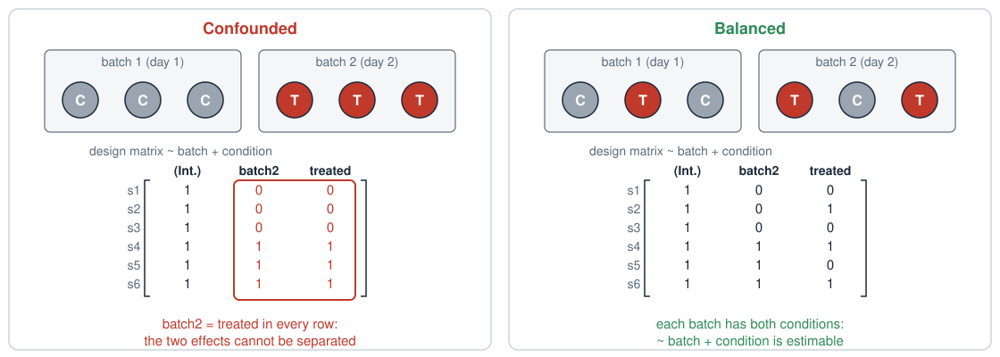{width="88%" fig-align="center"}

- Day of processing, antibody lot, sequencing run and operator all change the data. If they line up with the condition, **the effect is not identifiable**: no software can fix it.
- Spread conditions across batches, record the batches, and put them in the model, `~ batch + condition`, exactly as in DESeq2.

::: notes
Students know design matrices from RNA-seq; the point here is that in epigenomic experiments batch effects are often larger than in RNA-seq, because the IP step adds variability: antibody lot, crosslinking time, sonication efficiency and IP efficiency all vary between days. In the confounded design, the batch2 column equals the treated column in every row, so the design matrix is rank-deficient and DESeq2 refuses to fit it; worse, if you drop batch from the model, it fits happily and attributes the day-2 effect to the treatment. Balanced design: process one control and one treated sample together each day. Also: randomise the order of samples on the sequencer, and use the same antibody lot for a whole study. A PCA of the samples (as in RNA-seq) shows whether samples cluster by batch.
:::

## Sequencing depth and saturation {.smaller}

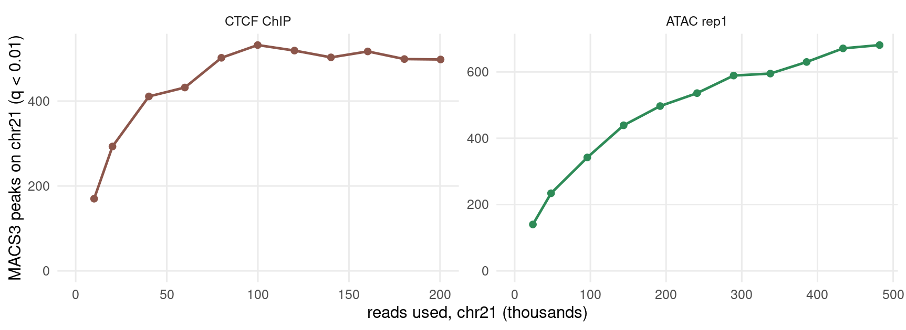{width="92%" fig-align="center"}

- Peaks called by MACS3 on random subsamples of the chr21 reads. **CTCF saturates**: about 500 peaks from half of the reads on. **ATAC does not**: weaker accessible sites keep appearing with depth.
- ENCODE: **20 M** usable fragments per replicate for TFs and narrow marks, **45 M** for broad marks, **25 M** non-duplicate, non-mitochondrial fragments for ATAC-seq. Depth cannot rescue a poor library: once every unique molecule has been read, more sequencing only adds **duplicates**.

::: notes
How to read the figure: each point is a MACS3 run (q < 0.01) on a subsample, for CTCF with the input as control. The chr21 numbers correspond to roughly 70 times as many reads genome-wide: 200 000 CTCF reads on chr21 is about 15 M usable reads in total. CTCF is a strong factor with a long motif and high-occupancy sites, so most of its sites are found with a few million reads; the curve flattens at about 100 000 chr21 reads (some 7 M genome-wide). ATAC-seq measures a continuum of accessibility, and the number of peaks keeps growing; the same is true for weak TFs and for broad marks, where depth decides how much of each domain is called. Landt et al. 2012 (Fig. 3) showed the same for ENCODE TFs: peak numbers keep rising with depth for many factors, with the new peaks increasingly weak. The practical rules: plan depth from the standards, check saturation on your own data by subsampling, and remember that complexity, not depth, limits a poor library (next slide).
:::

## Library complexity: NRF, PBC1, PBC2 {.smaller}

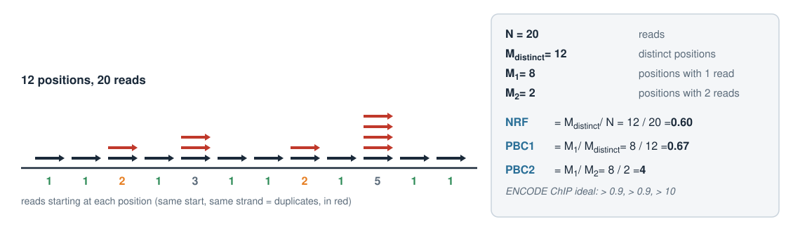{width="95%" fig-align="center"}

- Count reads by their **start position and strand**. A complex library has almost every read at its own position; a bottlenecked library (little starting DNA, too many PCR cycles) has the same molecules many times.
- **NRF** = distinct positions / reads. **PBC1** = positions with exactly one read / distinct positions. **PBC2** = positions with one read / positions with two.

::: notes
Definitions from the ENCODE data standards. They are computed on the filtered reads *before* duplicate removal. NRF is the fraction of reads that are not redundant. PBC1 asks: of the positions with any read, what fraction have exactly one? In a complex library sequenced to moderate depth almost all positions have one read, PBC1 close to 1. PBC2 is the ratio of singletons to doubletons; for a Poisson sample of a huge library, few positions get two reads and PBC2 is large; when a library is exhausted, positions with two, three, many reads become common and PBC2 drops towards 1. ENCODE ChIP-seq thresholds: NRF > 0.9, PBC1 > 0.9, PBC2 > 10 is ideal; NRF < 0.5, PBC1 < 0.5 or PBC2 < 1 is a severe bottleneck. ATAC-seq preferred values: NRF > 0.9, PBC1 > 0.9, PBC2 > 3. Note that all three depend on depth: the same library sequenced deeper looks less complex, and at very strong peaks, true independent fragments can share a start position (more so for single-end reads and narrow TF sites).
:::

## Real data: complexity and duplicates {.smaller}

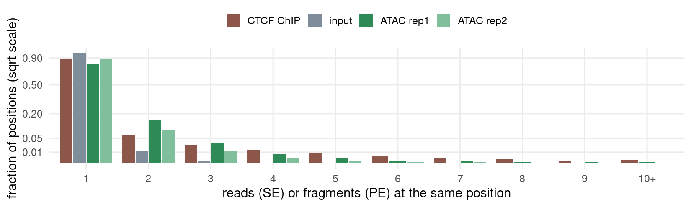{width="80%" fig-align="center"}

| chr21 | reads or fragments | NRF | PBC1 | PBC2 | duplicates | ENCODE, genome-wide NRF / PBC1 / PBC2 |
|---|---:|---:|---:|---:|---:|---|
| CTCF ChIP | 251 469 | 0.80 | 0.88 | 13.1 | 20% | 0.75 / 0.84 / 9.9 |
| input | 110 212 | 0.99 | 0.99 | 77.9 | 1% | |
| ATAC rep1 | 316 185 | 0.80 | 0.80 | 5.2 | 20% | 0.79 / 0.80 / 5.1 |
| ATAC rep2 | 288 420 | 0.89 | 0.89 | 9.6 | 11% | 0.88 / 0.89 / 9.2 |

::: notes
Computed in the exercise with bedtools bamtobed, sort, uniq -c and awk, on the chr21 reads with MAPQ >= 30 before duplicate removal. The bar chart shows how many reads share a start position: almost all input positions have one read; the CTCF ChIP has a long tail (some of it real: at a strong CTCF site, independent fragments often start at the same base); ATAC rep1 has many positions with 2-3 fragments. The right column gives ENCODE's own values for the same replicates computed on the whole genome: the chr21 numbers agree closely, so one chromosome is a fair sample of the library. Verdicts: the CTCF library is acceptable (NRF compliant, mild bottleneck by PBC1); ATAC rep1 is below the preferred 0.9 for NRF and PBC1 but PBC2 is above 3; rep2 is better. A warning about chrM: before restricting to chr21, the input had 73% and the ATAC libraries 92-94% of their filtered reads on chrM, and those are mostly duplicates. That is an artefact of our read selection (all chrM reads kept, but only chr21 of the nuclear genome); genome-wide, ENCODE reports 14% and 10% mitochondrial reads for the two ATAC replicates. Always compute complexity on the nuclear genome.
:::

## Fraction of reads in peaks (FRiP) {.smaller}

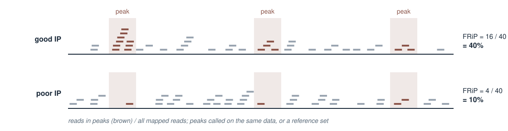{width="92%" fig-align="center"}

- **FRiP** = reads overlapping peaks / all mapped (filtered) reads. A direct measure of how much of the library is signal.
- Guides: ENCODE inspects TF ChIP with FRiP **below 1%**; for ATAC-seq FRiP should be **> 0.3** (0.2 acceptable). Broad histone marks and good CUT&Tag reach much higher values.
- FRiP depends on the peak caller and the number of peaks: compare samples only with **the same peak set** or the same caller and settings.

::: notes
Landt et al. 2012: most of 1052 ENCODE TF datasets had FRiP of 1% or more with MACS default peaks, and ENCODE scrutinises experiments below 1%. That threshold suits factors with thousands to tens of thousands of sites; a factor with a few hundred sites can be a perfect experiment at 0.5%. ATAC-seq standard: FRiP > 0.3, values > 0.2 acceptable. FRiP correlates with the number of peaks, which is partly circular: a weak experiment gives fewer peaks and therefore lower FRiP. Computing FRiP against a fixed reference peak set (here the ENCODE peaks) makes samples comparable. For paired-end data, count fragments or reads, but say which.
:::

## Real data: FRiP {.smaller}

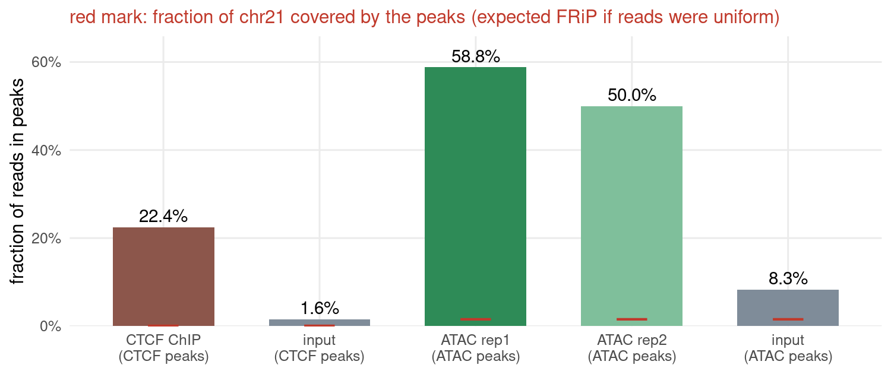{width="80%" fig-align="center"}

- CTCF ChIP: **22%** of reads in the 405 ENCODE CTCF peaks on chr21, which cover only 0.19% of the chromosome. ATAC: **59%** and **50%** of reads in ATAC peaks (1.5% of chr21). All far above the guidelines.
- The **input** has 1.6% of its reads in CTCF peaks and 8.3% in ATAC peaks: 5–8 times more than uniform. Input DNA is **enriched in open chromatin**.

::: notes
FRiP computed against ENCODE's IDR-thresholded peaks with samtools view -c -L (exercise C3). The red marks show the fraction of chr21 covered by the peaks: what the FRiP would be if reads were spread uniformly. CTCF is a strong, high-quality ChIP: 22% is high for a TF (many good TF datasets are in the 1-10% range). ENCODE reports FRiPs of 46-60% for these ATAC replicates genome-wide, depending on the peak set, consistent with our chr21 values. The input result is the most instructive number on the slide: an input is supposed to be background, yet 8% of its reads fall into 1.5% of the chromosome where ATAC finds open chromatin. That is the sonication bias of slide "Why a control": open chromatin shears more easily and is better represented in sequencing libraries. It is exactly why a ChIP peak at an open promoter is only meaningful when compared with the input.
:::

## The fingerprint plot {.smaller}

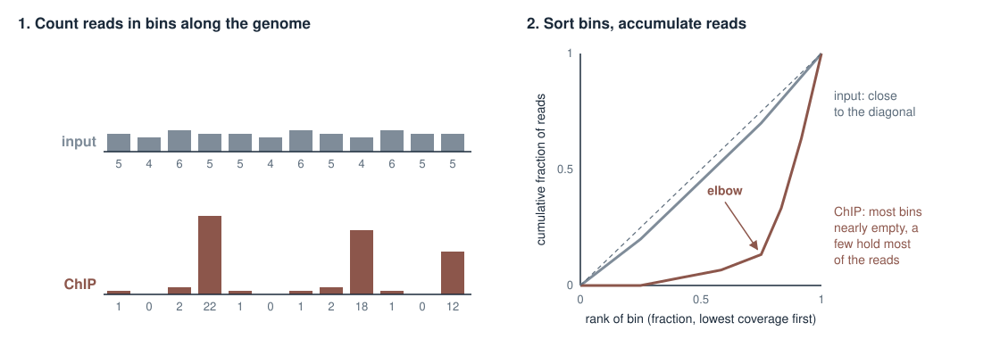{width="95%" fig-align="center"}

- Divide the genome into bins, count reads, **sort** the bins from fewest to most reads, and plot the **cumulative** fraction of reads (deepTools `plotFingerprint`, after the CHANCE method).
- A **uniform** library (input) follows the diagonal. A **good ChIP** stays low and then rises steeply: a small fraction of the genome holds a large fraction of the reads.

::: notes
The fingerprint plot is from Diaz et al. 2012 (CHANCE) and is implemented in deepTools plotFingerprint. It needs no peak calling, which makes it useful as a first check and for comparing ChIP with input directly. Read the plot from the right end: if the top 10% of bins (x from 0.9 to 1) hold 60% of the reads, the curve is at 0.4 at x = 0.9. Things to look for: the input should be close to the diagonal; a curve that rises steeply at the very end only (very few bins) can mean amplification artefacts or a few very high regions (blacklisted regions); a ChIP that looks like its input has failed. Broad marks (H3K27me3, H3K36me3) give a gentler bend than TFs, because the signal is spread over a larger part of the genome. With low coverage, many bins are empty, so the curve starts flat at zero for every sample: use bins large enough to have reads in most of them.
:::

## Real data: fingerprint of CTCF ChIP and input {.smaller}

:::: {.columns}
::: {.column width="48%"}
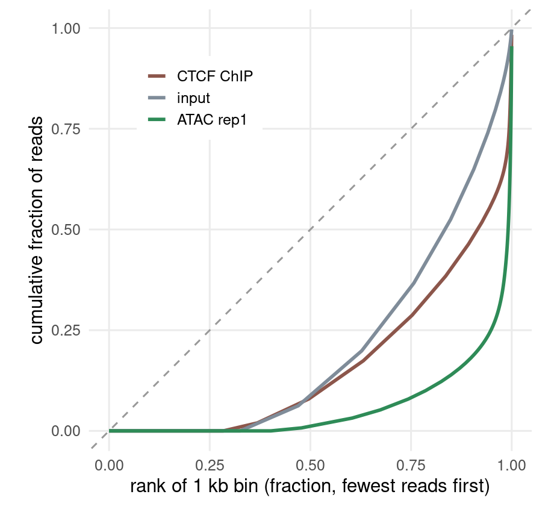{width="100%"}
:::
::: {.column width="52%"}
- The **input** is closest to the diagonal; **CTCF** bends further; **ATAC** has the sharpest elbow.
- Top 1% of 1 kb bins hold **8%** of input reads, **30%** of CTCF reads and **52%** of ATAC reads.
- All curves are flat up to 0.3–0.4: those bins have **no reads at all** (short arm, centromere, gaps). Only the rest of the chromosome is informative.
:::
::::

::: notes
Computed from read 5' ends in 1 kb bins over chr21 (make-design-figs.R); in the exercise students make the same plot with deepTools plotFingerprint. The input is not on the diagonal: partly because about 30% of the bins cannot receive reads at all, partly the open-chromatin bias from the FRiP slide. Compare like with like: the useful comparison is ChIP against its own input, made at the same bin size. The CTCF curve departs from the input mainly in the last 5% of bins: CTCF binds at a few hundred sites on chr21, each covering less than 1 kb. The ATAC curve bends earlier and harder: accessible sites are more numerous and the signal-to-noise of this ATAC library is excellent (FRiP 50-60%). deepTools also reports quality metrics derived from the curve, such as the elbow point and the Jensen-Shannon distance to the input (CHANCE, Diaz et al. 2012).
:::

## Strand cross-correlation {.smaller}

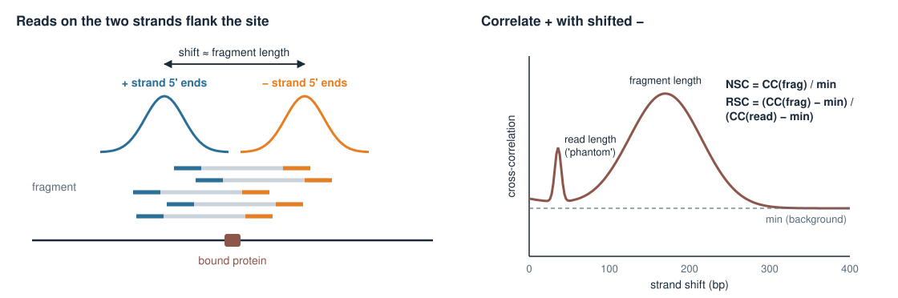{width="95%" fig-align="center"}

- Single-end reads come from the 5' ends of fragments: around a bound site, **+ strand reads pile up to the left, − strand reads to the right**, one fragment length apart.
- Shift the − strand coverage by $k$ bp and correlate it with the + strand: the correlation peaks at the **fragment length**. A second peak at the **read length** ("phantom") comes from mappability, not from binding.
- **NSC** = CC(fragment) / min(CC); **RSC** = (CC(fragment) − min) / (CC(read) − min). ENCODE repeats experiments with **NSC < 1.05** and **RSC < 0.8**.

::: notes
Kharchenko, Tolstorukov and Park 2008 introduced strand cross-correlation (in their SPP package) as a way to estimate the fragment length and the enrichment from single-end data without a peak caller. The phantom peak at the read length appears in every library, including the input: a position that is mappable on the + strand at x is also mappable on the − strand at x + read length, so the coverage of the two strands correlates at that shift for purely technical reasons. Good TF ChIP: the fragment peak is much higher than the phantom peak, RSC > 1. Input or failed ChIP: the phantom dominates, RSC well below 1. NSC compares the fragment peak with the background (the minimum of the curve), and is just above 1 for a weak experiment. Thresholds from Landt et al.: NSC < 1.05 and RSC < 0.8 lead ENCODE to repeat the experiment. Broad histone marks have flat profiles even when they are good, so these metrics are mostly for TFs and narrow marks. With paired-end data the fragment length is measured directly from the pairs.
:::

## Real data: CTCF cross-correlation {.smaller}

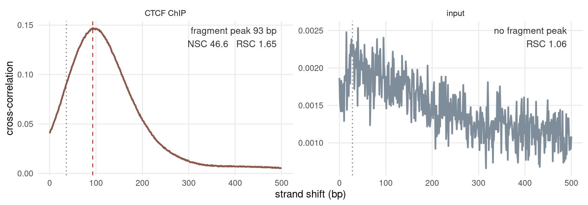{width="92%" fig-align="center"}

- CTCF: a clear **fragment-length peak at 93 bp** (ENCODE: 90–95 bp). The read-length position (36 bp, dotted) lies on its rising flank. **RSC 1.65** (ENCODE 1.69–1.86): passes.
- Input: low, noisy, no fragment peak (RSC ≈ 1).
- Our NSC (47) is far above ENCODE's (4.9–10): NSC depends on how the background **minimum** is estimated. Compare it only between datasets computed the same way.

::: notes
Computed in R in the exercise (R1): count the 5' ends of + and - strand reads at every base of chr21, and correlate the + strand counts at x with the - strand counts at x + k for k from 0 to 1000. The y axes differ by a factor of 60. The CTCF fragments in this 2008 library are short (about 93 bp), so the phantom peak at the read length is not a separate peak but a shoulder on the fragment peak. RSC uses differences above the minimum and agrees well with ENCODE's value from phantompeakqualtools on the whole genome. NSC divides by the minimum itself; our minimum is much lower than in ENCODE's genome-wide computation (per-base vs binned counts, which chromosomes and repeats are included), so NSC comes out much higher. The lesson for reading papers: NSC and RSC from the standard tool (phantompeakqualtools, also in the ENCODE and nf-core pipelines) are comparable with the ENCODE thresholds; numbers from home-made implementations are not necessarily.
:::

## Replicate concordance {.smaller}

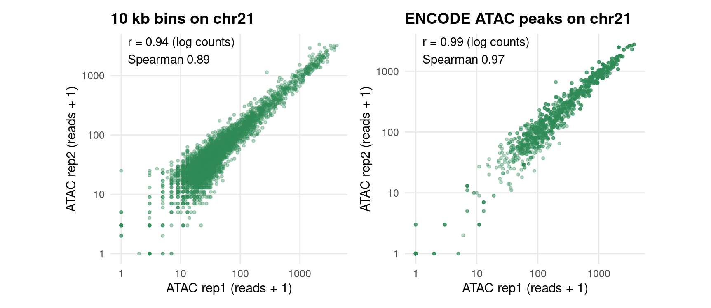{width="85%" fig-align="center"}

- Count reads in bins (or peaks) in each replicate and correlate (deepTools `multiBamSummary`, `plotCorrelation`). ATAC rep1 vs rep2: **r = 0.94** (log counts) in 10 kb bins, **0.99** in ENCODE peaks.
- Smaller bins are noisier: 0.81 in 1 kb bins. Different assays correlate less: ATAC vs CTCF 0.65.
- A high correlation is necessary, not sufficient: it is driven by shared background and the strongest regions.

::: notes
Real data: the two ATAC replicates (ENCSR095QNB, about 480 000 reads each on chr21 after filtering). Bin-level correlation is the quickest check for a swapped or failed sample; plotCorrelation produces a heatmap of all pairwise correlations, and with many samples a PCA does the same job (as in RNA-seq). Use Spearman or Pearson on log counts: raw-count Pearson is dominated by the few largest bins. Why not sufficient: both replicates share the same mappability, GC and open-chromatin background, which alone produces correlation (ChIP and input correlate 0.87 at 100 kb, slide "Real data: CTCF ChIP and its input"). The question "are the same peaks found, and in the same order?" is what IDR answers (next slide). For differential analysis the relevant quantity is the dispersion between replicates in counts per peak, which DESeq2 estimates.
:::

## IDR: are the same peaks found in both replicates? {.smaller}

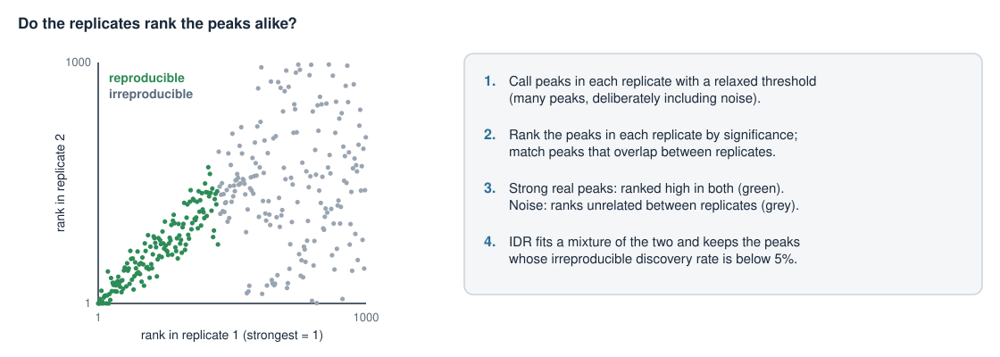{width="95%" fig-align="center"}

- The **irreproducible discovery rate** (Li et al. 2011) compares the **ranks** of matched peaks in two replicates and keeps the peaks that are consistently strong. ENCODE's TF and ATAC peak sets (including the ones we use) are IDR-thresholded.
- ENCODE passes an experiment if the **rescue** and **self-consistency ratios** (true replicates vs pseudoreplicates) are both **< 2**. Details in *Peak calling*.

::: notes
IDR is analogous to FDR, but for reproducibility rather than significance. The key idea: peaks that are real tend to be ranked high in both replicates, while noise peaks have uncorrelated ranks. The method fits a copula mixture model with a reproducible and an irreproducible component, and gives each peak pair a local IDR. The input to IDR must be a relaxed peak list (e.g. 300 000 peaks with a p-value threshold of 0.01), so that the noise component is represented; a stringent threshold before IDR breaks the method. The ratios: the self-consistency ratio compares the number of IDR peaks from the two pseudoreplicates of each replicate; the rescue ratio compares IDR on true replicates with IDR on pooled pseudoreplicates. Ratios above 2 mean the replicates disagree more than random halves of the data do. Students run IDR in *Peak calling*; here the concept is enough.
:::

## ATAC-seq: fragment sizes and TSS enrichment {.smaller}

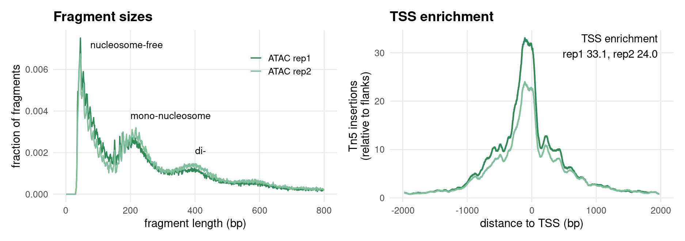{width="95%" fig-align="center"}

- **Fragment sizes**: a nucleosome-free peak below 100 bp, then mono- and di-nucleosome humps (~200 and ~400 bp). ENCODE requires the NFR and mono-nucleosome peaks to be present.
- **TSS enrichment**: Tn5 insertions at TSSs relative to 2 kb away. Here **33** (rep1) and **24** (rep2); ENCODE: > 7 ideal (GRCh38, RefSeq TSSs), and reports 28–30 and 22–23 for these replicates.
- Also check the **mitochondrial fraction** (here 14% and 10% genome-wide) and FRiP. Details in *ATAC-seq: Tn5, fragment sizes, nucleosome ladder*.

::: notes
These two plots are the ATAC-specific QC; they replace the cross-correlation, which makes little sense for paired-end data where the fragment length is measured directly. The fragment-size ladder is the nucleosome signature: Tn5 cuts in linker DNA, so fragments that span one, two or three nucleosomes are enriched; a library with no ladder suggests over-digested or naked DNA. The TSS enrichment counts Tn5 insertion sites (read ends shifted +4/-5) in a window around all protein-coding TSSs on chr21 (602 TSSs), divided by the level 1900-2000 bp away, smoothed over 51 bp; the maximum is the score. It is the most robust single signal-to-noise metric for ATAC-seq: active promoters are open in almost every cell type. ENCODE's thresholds depend on the TSS annotation (RefSeq vs GENCODE) and on the exact method, so compare like with like; our chr21 values are close to ENCODE's genome-wide values for the same replicates. Rep2 has a lower TSS enrichment and FRiP than rep1 but higher complexity: no single metric decides.
:::

## Reading a MultiQC report {.smaller}

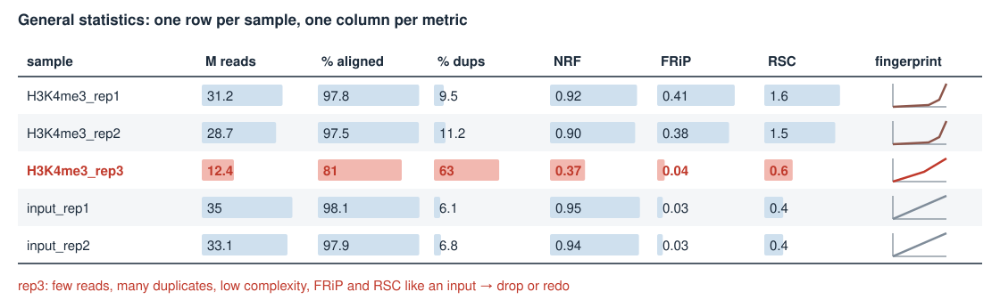{width="95%" fig-align="center"}

- **MultiQC** collects the logs of fastp, Bowtie2, samtools, Picard, deepTools, MACS and many more into one HTML report, one row per sample. nf-core pipelines produce one at the end of every run.
- Read it **across samples**: the bad sample is the one that differs from its replicates. Then open the plots behind the number (duplication curve, fingerprint, cross-correlation).

::: notes
Ewels et al. 2016. The general statistics table is a summary; the value is in comparing samples side by side. In the schematic, rep3 has fewer reads, a lower alignment rate, 63% duplicates, NRF 0.37, FRiP of 0.04 and RSC 0.6, and its fingerprint looks halfway to an input: the IP worked poorly and the library was amplified from very little DNA. A defensible decision: exclude it and say so, or redo it. What is not defensible: keeping it in a differential analysis without comment, or dropping it silently. Show students an nf-core/chipseq or nf-core/atacseq MultiQC report in the browser if time allows; the course pipelines produce one.
:::

## ENCODE standards at a glance {.smaller}

| metric | ChIP-seq (TF, histone) | ATAC-seq |
|---|---|---|
| replicates | ≥ 2 biological | ≥ 2 biological |
| depth per replicate | 20 M usable fragments (TF, narrow marks); 45 M (broad marks) | 25 M non-duplicate, non-mito fragments |
| control | input with matching run type and read length | none |
| NRF / PBC1 / PBC2 | > 0.9 / > 0.9 / > 10 (ideal); < 0.5 / < 0.5 / < 1 severe | > 0.9 / > 0.9 / > 3 |
| FRiP | TF: inspected if < 1% (Landt 2012); no fixed threshold now | > 0.3 (> 0.2 acceptable) |
| NSC / RSC | repeat if < 1.05 / < 0.8 (Landt 2012) | (not used) |
| reproducibility | IDR rescue and self-consistency ratios < 2 | IDR ratios < 2 |
| ATAC only | | alignment > 95% (> 80%); TSS enrichment > 7 ideal, 5–7 acceptable (GRCh38, RefSeq); NFR and mono-nucleosome peak present |

::: notes
From the ENCODE data standards pages (ChIP-seq TF, histone, ATAC-seq; current at the time of writing) and Landt et al. 2012. Thresholds are guides for flagging, not laws: a factor with few sites can have a low FRiP and be fine, broad marks have flat cross-correlation curves, and complexity metrics depend on depth. ENCODE itself marks data with coloured audit flags rather than rejecting them outright. The value of the table is as a reference point when you look at your own numbers or at a paper's supplementary QC table. TSS enrichment thresholds depend on the TSS annotation and the exact method, so compare like with like.
:::

## Red flags in published data {.smaller}

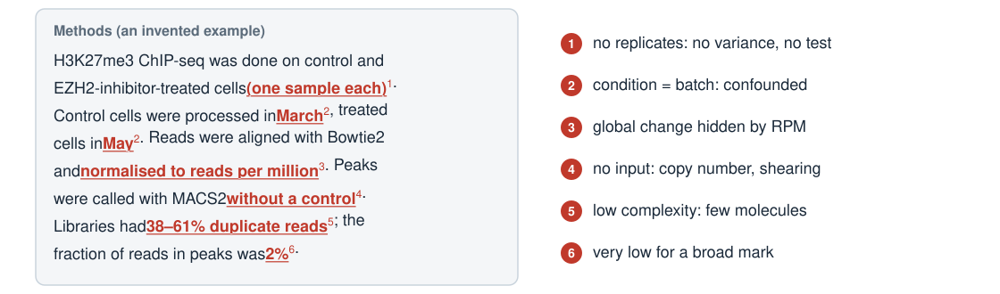{width="92%" fig-align="center"}

- **No input** for a ChIP-seq, or the same input reused for unrelated cell types. **n = 1** with claims about differences between conditions.
- **FRiP of 1–2%** for a histone mark, a fingerprint that looks like the input, **duplication above 50%** with no comment, fewer reads than the standard.
- A **global change** (inhibitor, knockout of a writer) normalised by read depth. Conditions processed on **different days**. No antibody catalogue or lot number.

::: notes
A checklist for reading methods sections and supplementary tables, and the core of the "judge the design" exam questions. Each flag is not automatically fatal, but each should be explained. Where to find the information: GEO entries often list the controls and the number of replicates; supplementary tables sometimes give FRiP and duplication. If the raw data are public, you can compute all of these metrics yourself in an hour, which is what the exercise does for an ENCODE dataset. Good practice to point out: ENCODE and the nf-core pipelines report all of these metrics by default, and the ENCODE portal flags experiments that fail them.
:::

## Summary {.smaller}

| idea | key fact |
|---|---|
| replicates | ≥ 2 biological (ENCODE), ≥ 3 per condition for differential tests; pseudoreplicates are not replicates |
| controls | input for ChIP (shearing, copy number, mappability); IgG often too little DNA; ATAC has none |
| antibodies | one main band, a second line of evidence, knockout loses the signal |
| global changes | depth normalisation hides them; spike-in chromatin, scale by $1/N_\text{spike}$ |
| batches | never confound with condition; model `~ batch + condition` |
| complexity | NRF, PBC1 = $M_1/M_\text{distinct}$, PBC2 = $M_1/M_2$; computed before duplicate removal |
| enrichment | FRiP; fingerprint (input on the diagonal, ChIP bends); NSC, RSC from strand cross-correlation |
| reproducibility | correlation of binned counts; IDR on ranked peaks |
| ATAC | fragment-size ladder, TSS enrichment, mitochondrial fraction |

::: notes
Students should leave able to compute NRF, PBC1, PBC2 and FRiP from counts, read a fingerprint and a cross-correlation plot, explain what an input corrects and why spike-ins are needed for global changes, and critique a study design. Next: the ATAC-seq block, where TSS enrichment and fragment sizes are covered properly, and the ChIP-seq block, where the input enters the peak caller.
:::

## Key papers (optional further reading) {.smaller}

*Not required reading and not examined. For those who want the primary literature.*

- Landt et al. 2012, *Genome Res*. [ChIP-seq guidelines and practices of the ENCODE and modENCODE consortia](https://doi.org/10.1101/gr.136184.111). Where most of the metrics and thresholds in this lecture come from.
- Kharchenko, Tolstorukov & Park 2008, *Nat Biotechnol*. [Design and analysis of ChIP-seq experiments for DNA-binding proteins](https://doi.org/10.1038/nbt.1508). Strand cross-correlation and the SPP peak caller.
- Li, Brown, Huang & Bickel 2011, *Ann Appl Stat*. [Measuring reproducibility of high-throughput experiments](https://doi.org/10.1214/11-AOAS466). The IDR method.
- Orlando et al. 2014, *Cell Rep*. [Quantitative ChIP-Seq normalization reveals global modulation of the epigenome](https://doi.org/10.1016/j.celrep.2014.10.018). ChIP-Rx spike-in normalisation.
- Diaz, Park, Lim & Song 2012, *Stat Appl Genet Mol Biol*. [Normalization, bias correction, and peak calling for ChIP-seq](https://doi.org/10.1515/1544-6115.1750). CHANCE and the fingerprint plot.
- Ewels, Magnusson, Lundin & Käller 2016, *Bioinformatics*. [MultiQC: summarize analysis results for multiple tools and samples in a single report](https://doi.org/10.1093/bioinformatics/btw354).
