## About this lecture

Chromatin marks tell you *where* the regulatory DNA is. This lecture is about *what* that DNA is and *who* reads it: short sequence elements (promoters, enhancers, silencers, insulators) and the sequence-specific **transcription factors** (TFs) that bind them.

- The **cis-regulatory code**: core promoters, enhancers, silencers, insulators.
- **Transcription factors**: DNA-binding domains, and motifs written as **position weight matrices**.
- Why a TF binds only a small fraction of its motif matches: accessibility, **pioneer factors**, cooperation.
- **Combinatorial control**: the B-cell TFs behind the GM12878 data.
- How all of this shows up in ATAC-seq, ChIP-seq, Hi-C and motif analysis.

::: notes
Students know transcription and "a TF binds a promoter" from their bachelor's, and from *What is epigenetics?* they know the six histone marks and that open chromatin is nucleosome-depleted. This unit supplies the sequence side: what the regulatory elements are, how a TF recognises DNA, and how to write that down as a matrix one can scan a genome with. The running example is GM12878, the B-lymphoblastoid cell line used throughout the course: we look at its CTCF peaks, its ATAC peaks and an enhancer cluster at PAX5, the master regulator of B-cell identity. Every later assay unit measures one of the things introduced here.
:::

## The cis-regulatory code {.smaller}

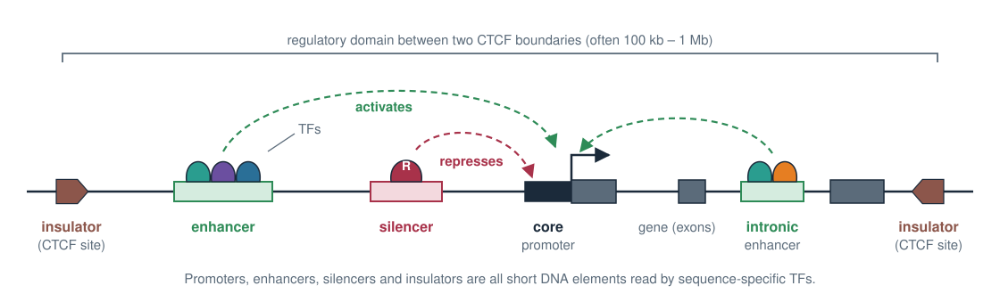{width="95%" fig-align="center"}

- A gene's expression is set by short DNA elements in **cis** (on the same molecule): the **core promoter**, **enhancers** that activate, **silencers** that repress, and **insulators** that delimit their reach.
- Each element is a cluster of **TF binding sites**, typically 6–20 bp each, in a stretch of a few hundred bp.
- The proteins that read them (TFs, co-factors) act in **trans**: they are encoded elsewhere and diffuse to their sites.

::: notes
The cis/trans distinction comes from genetics: a cis-acting mutation affects only the allele on the same chromosome, a trans-acting one (in a TF gene) affects both alleles. Most variants associated with disease in genome-wide association studies are non-coding and fall in enhancers, so this code matters for human genetics too. Scale: a promoter's core is about 80 bp; an enhancer a few hundred bp; the regulatory domain of a gene can be up to a megabase, usually bounded by CTCF sites (insulators). ENCODE lists close to a million candidate cis-regulatory elements in the human genome, against about 20 000 protein-coding genes: most genes have several enhancers.
:::

## The first enhancer (1981) {.smaller}

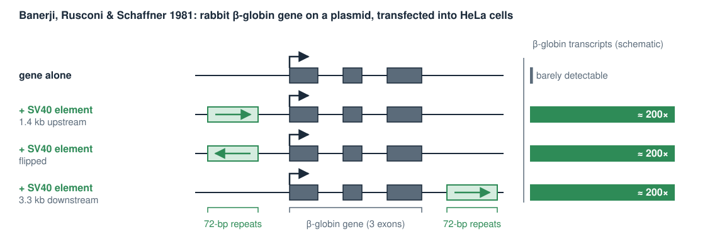{width="92%" fig-align="center"}

- A 72-bp repeat from the SV40 virus raised transcription of a β-globin gene on the same plasmid about **200-fold**.
- It worked in **either orientation**, **upstream or downstream**, and **kilobases away** from the start site (1.4 kb upstream, 3.3 kb downstream).
- This defines an **enhancer**: a DNA element that activates transcription from a distance, independent of orientation.

::: notes
Banerji, Rusconi and Schaffner transfected HeLa cells with a rabbit β-globin gene and measured correctly initiated transcripts by S1 mapping. On its own the plasmid gave barely detectable transcripts; with SV40 DNA in cis, 200 times more, and the activity mapped to the 72-bp repeat. The bars in the figure are schematic: the paper reports the 200-fold enhancement and that the element acted "in either orientation at many positions". The key word is cis: SV40 DNA on a separate plasmid did nothing. The same year a polyoma virus element gave the same result, and within two years the first cellular enhancer was found in the immunoglobulin heavy-chain locus, in B cells, which fits our running example. Reporter assays like this one are still the standard functional test; today they are run in parallel on thousands of fragments (massively parallel reporter assays, STARR-seq).
:::

## The core promoter {.smaller}

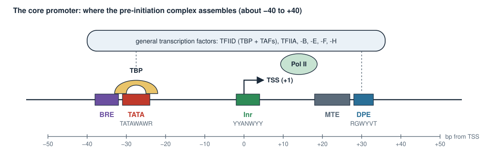{width="92%" fig-align="center"}

- The **core promoter** (about −40 to +40 around the transcription start site, TSS) is where RNA polymerase II and the **general transcription factors** assemble the pre-initiation complex.
- Known elements: **TATA box** (about −30, bound by TBP), **Initiator** (Inr, at the TSS), **DPE**, **BRE**. Each promoter has only some of them; a minority have a TATA box.
- The core promoter decides *where* transcription starts and in which direction. How *often* it starts is set mostly by TFs at proximal sites and enhancers.

::: notes
The general transcription factors (TFIID, which contains the TATA-binding protein TBP and about 13 TAF subunits, plus TFIIA, B, E, F and H) are present in every cell; they are not what makes a gene cell-type specific. The core elements are short and degenerate, so you cannot find promoters by searching for TATA boxes: only a minority of human promoters (often quoted as 10–20%) have one, mostly highly regulated tissue-specific genes. Letters in the consensus sequences are IUPAC codes (W = A or T, R = A or G, Y = C or T, S = C or G). In practice, promoters are mapped from the data: 5' ends of transcripts (CAGE), H3K4me3, and the GENCODE annotation you used in *Genomic intervals*. Review: Haberle and Stark 2018.
:::

## Two kinds of promoters {.smaller}

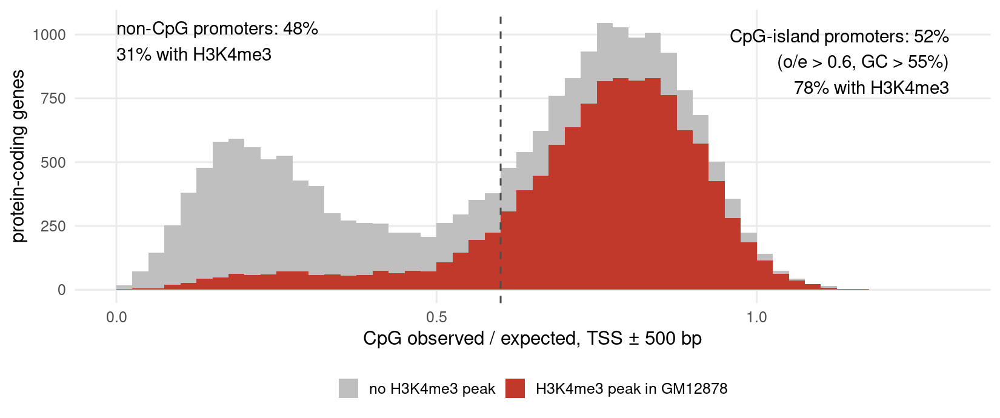{width="85%" fig-align="center"}

- CpG observed/expected around all 19 989 protein-coding TSSs: **two populations**. About half are **CpG-island promoters** (52% by a strict cutoff), the rest are CpG-poor.
- **CpG-island promoters**: housekeeping and developmental genes, broad TSS, rarely a TATA box, kept unmethylated. 78% carry H3K4me3 in GM12878.
- **Non-CpG promoters**: often tissue-specific, sharper TSS, more TATA boxes. Only 31% are marked in a B-cell line.

::: notes
CpG observed/expected is the number of CG dinucleotides divided by (number of C × number of G / length): about 0.2–0.25 in bulk human DNA because methylated CpGs mutate to TpG over evolution; near 1 in CpG islands, which escaped methylation in the germline. The cutoff (o/e > 0.6 and GC > 55%, over ±500 bp) is a strict version of the classic Gardiner-Garden and Frommer definition; looser definitions give 55–70% CGI promoters. The H3K4me3 colouring shows why the two classes matter for epigenomics: CpG-island promoters are marked in most cell types (CFP1 binds unmethylated CpG and recruits the H3K4 methyltransferase), while non-CpG promoters are marked only where the gene is used. Silencing differs too: CpG-island promoters of developmental genes are silenced by Polycomb (H3K27me3), and stably by DNA methylation in, for example, X inactivation and cancer. Made with make-generegulation-figs.R.
:::

## Promoters are bidirectional {.smaller}

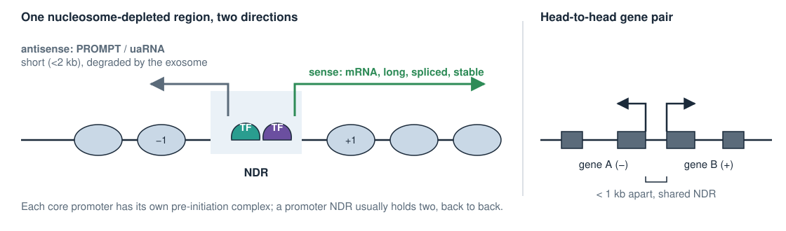{width="92%" fig-align="center"}

- A promoter's nucleosome-depleted region usually contains **two** core promoters facing away from each other.
- The sense transcript becomes the mRNA. The antisense transcript (**PROMPT** or upstream antisense RNA) is short, terminated early and degraded by the RNA exosome.
- When both directions are productive you get a **head-to-head gene pair** sharing one promoter region.

::: notes
Divergent transcription was found by sequencing nascent RNA (GRO-seq) and RNA in cells lacking the nuclear exosome (Preker et al. 2008). The asymmetry comes from sequence downstream of each TSS: the sense direction has 5' splice sites (U1 snRNP binding suppresses early termination), the antisense direction has early polyadenylation signals. Relevance for the course: an ATAC-seq peak at a promoter is a single NDR, but it hosts two initiation sites, and H3K4me3 and H3K27ac are found on both sides of it (the bimodal shape in the next units). Enhancers show the same bidirectional initiation, which leads to the eRNAs a few slides on.
:::

## Enhancers can act from far away {.smaller}

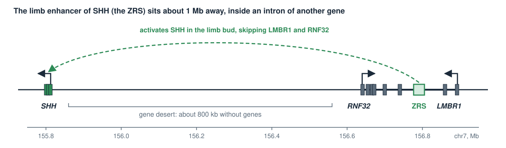{width="95%" fig-align="center"}

- The **ZRS** controls *SHH* in the developing limb from about **1 Mb** away, inside an intron of *LMBR1*, across a gene desert.
- Single-base changes in the ZRS cause extra digits (preaxial polydactyly); deleting it in mice abolishes *Shh* expression in the limb: limbs without digits, an otherwise normal animal.
- Lesson: the **nearest gene is often not the target**. Enhancers are tissue-specific modules; one gene can have many, each for one tissue or stage.

::: notes
The ZRS (zone of polarising activity regulatory sequence) is the textbook long-range enhancer (Lettice et al. 2003; Sagai et al. 2005). It shows three features at once: distance (about 1 Mb in human), position inside another gene whose expression it does not control, and modularity: SHH has other enhancers for the brain, the gut and the notochord, and only the limb one is lost in these mutants, so the phenotype is restricted to the limbs. This is why "nearest gene" assignment of peaks, which students did in *Genomic intervals*, is only a first guess. Linking enhancers to genes properly uses 3D contacts (Hi-C, the 3D genome units), correlation across samples, and perturbation (CRISPRi), the topic of the integration unit. Coordinates in the figure are hg38 from GENCODE; the ZRS position is approximate.
:::

## How an enhancer reaches its promoter {.smaller}

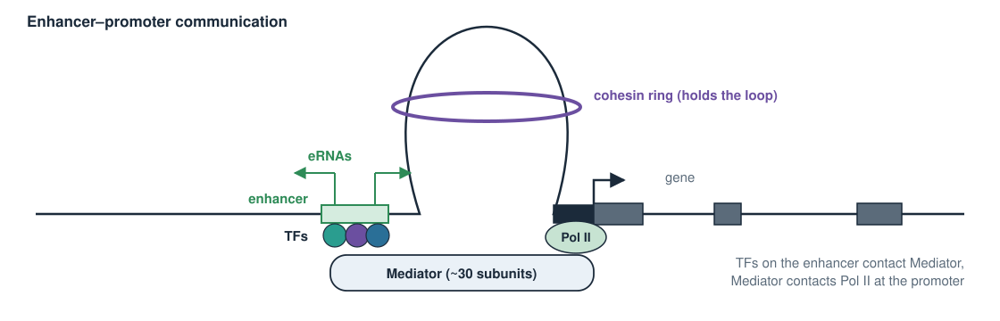{width="88%" fig-align="center"}

- The DNA between enhancer and promoter **loops out**, so that proteins bound at both meet in 3D.
- TFs on the enhancer bind co-activators such as **Mediator**, which contacts RNA polymerase II at the promoter. **Cohesin** extrudes and holds loops.
- Active enhancers are themselves transcribed: short, bidirectional **enhancer RNAs (eRNAs)**, a sign of activity used to map enhancers.

::: notes
The looping model is supported by chromosome conformation capture (3C, Hi-C, Micro-C) and microscopy, and by experiments where forcing a loop (tethering a protein that self-associates) activates a gene. It is not the whole story: imaging often shows enhancer and promoter several hundred nm apart even when the gene is on, and some models propose transcriptional "hubs" or condensates in which many TFs and co-activators are concentrated. Mediator is a complex of about 30 subunits; it binds activation domains of TFs and Pol II. eRNAs were found by Kim et al. 2010; FANTOM5 (Andersson et al. 2014) used bidirectional CAGE signal to define about 43 000 active enhancers across human cell types. Whether eRNAs have a function or are a by-product is debated; as a marker they are very useful. Loops and cohesin come back in the 3D genome units.
:::

## Enhancer states and their marks {.smaller}

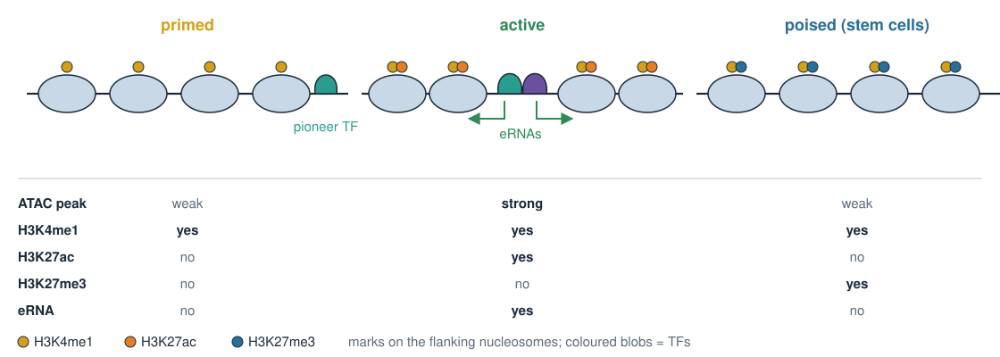{width="90%" fig-align="center"}

- **Primed**: H3K4me1, a pioneer TF may be bound, little accessibility. **Active**: open core with TFs, H3K4me1 **and H3K27ac**, eRNAs. **Poised** (in stem cells): H3K4me1 with H3K27me3.
- The core is a nucleosome-depleted region of a few hundred bp; the marks sit on the **flanking** nucleosomes.
- This is why "H3K27ac peak, distal to a TSS, no H3K4me3" is the standard working definition of an active enhancer.

::: notes
This connects the marks table of *What is epigenetics?* to enhancer biology. Creyghton et al. 2010 and Rada-Iglesias et al. 2011 showed that H3K27ac separates active from primed or poised enhancers carrying H3K4me1. The poised state (H3K4me1 + H3K27me3) is mostly described in embryonic stem cells, at developmental enhancers that become active upon differentiation. The marks are correlates of activity, not proof of function (the cause-or-consequence slide in *What is epigenetics?*): only a fraction of H3K27ac-marked elements activate a reporter, and some functional enhancers carry little H3K27ac. The definition H3K27ac minus H3K4me3, away from TSSs, is the one students used to build an enhancer set in *Genomic intervals*. In the table, "weak" ATAC means accessible in some cells or partly: primed enhancers often give small peaks.
:::

## Real data: an enhancer cluster at PAX5 {.smaller}

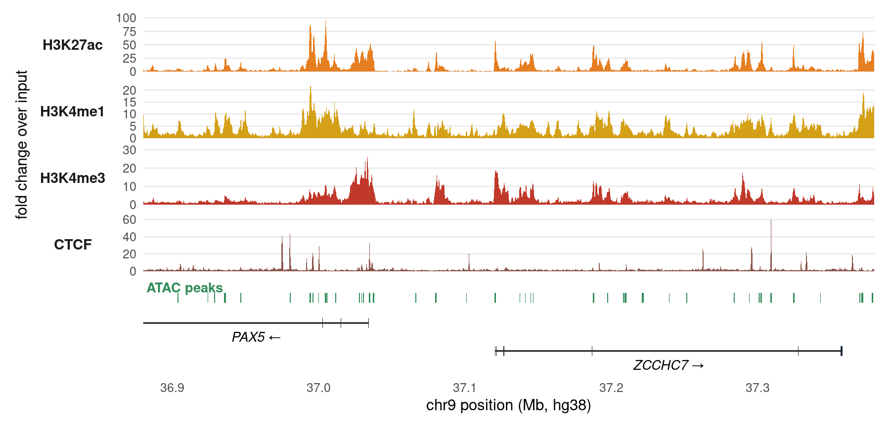{width="88%" fig-align="center"}

- PAX5 is the master regulator of B-cell identity. In GM12878, 500 kb around *PAX5* contain **91 ATAC peaks** and **71 H3K27ac peaks**, most of them far from any TSS, many inside the neighbouring gene *ZCCHC7*.
- H3K4me1 is broad over the whole cluster; H3K27ac and ATAC mark the active cores; H3K4me3 marks the *PAX5* promoter (and, weakly, some strong enhancers).

::: notes
ENCODE fold-change tracks (500-bp bins, maximum per bin) and ATAC IDR peaks from GM12878, plotted by make-generegulation-figs.R. PAX5 is on the minus strand, so its promoter is at the right end of the gene, near 37.03 Mb; the gene extends to the left beyond the window. Many of the active elements lie inside ZCCHC7; which gene each one regulates cannot be read from these tracks (the problem of the ZRS slide again), it needs contact or perturbation data. CTCF peaks are few and sharp: they mark boundaries and loop anchors, not enhancers. Point out the scales: H3K27ac reaches 100-fold enrichment, H3K4me1 only 20-fold, because H3K4me1 is spread over many nucleosomes. Weak H3K4me3 at very active enhancers is normal; it is a reason not to define promoters by H3K4me3 alone.
:::

## "Super-enhancers": a useful ranking, a contested category {.smaller}

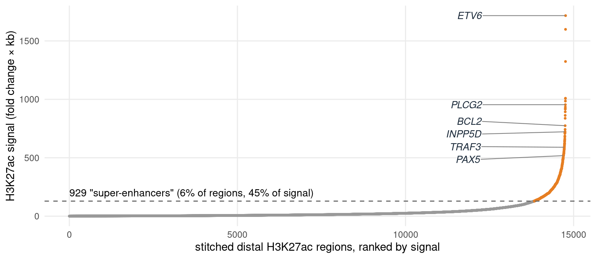{width="85%" fig-align="center"}

- Stitch distal H3K27ac peaks within 12.5 kb, rank by total signal, and cut where the curve turns up: **929 regions (6%) hold 45% of the signal** in GM12878. They sit near B-cell genes (*ETV6*, *PLCG2*, *BCL2*, *PAX5* …).
- Whyte et al. 2013 called such regions **super-enhancers** and proposed they drive cell identity genes.
- **Critique**: the cutoff is arbitrary on a continuous distribution, and dissected super-enhancers often behave as **several ordinary enhancers adding up**. Use the ranking, be careful with the category.

::: notes
The method (ROSE) stitches enhancer peaks within 12.5 kb, excludes peaks near TSSs, ranks stitched regions by signal (originally Mediator or H3K27ac ChIP), and draws the cutoff where a line of slope 1 touches the normalised curve. Our version uses H3K27ac peaks and fold-change bigWig signal, so numbers differ from published lists. The biology behind it is real: genes with large, highly active enhancer clusters tend to be cell identity genes and oncogenes, and those clusters are sensitive to BET inhibitors (BRD4) and to loss of Mediator. The critique (Pott and Lieb 2015; Hay et al. 2016 on the α-globin locus) is that there is no evidence for a distinct class with emergent properties: the distribution has no gap, and deleting individual constituents mostly gives additive effects. Read "super-enhancer" as "the top of a ranking of enhancer clusters".
:::

## Silencers and insulators {.smaller}

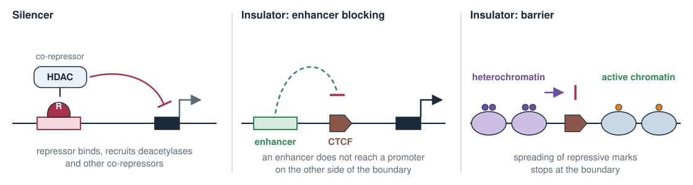{width="95%" fig-align="center"}

- **Silencers** bind repressors that recruit **co-repressors** (HDACs, histone methyltransferases). Example: REST binds the RE1 element and silences neuronal genes in non-neuronal cells.
- **Insulators** delimit where regulation acts: **enhancer-blocking** (an enhancer cannot activate a promoter on the other side) and **barrier** (heterochromatin cannot spread past).
- In vertebrates most insulator activity depends on **CTCF**.

::: notes
Silencers are much less catalogued than enhancers, partly because a loss of function is harder to measure than a gain; recent screens suggest some elements act as enhancers in one cell type and silencers in another. The classic vertebrate insulator is the chicken β-globin HS4 element: its enhancer-blocking activity needs a CTCF site (Bell, West and Felsenfeld 1999), its barrier activity other proteins. A beautiful human example combines CTCF and DNA methylation: at the H19/IGF2 imprinting control region CTCF binds only the unmethylated maternal allele and blocks the shared enhancers from reaching IGF2; on the methylated paternal allele CTCF cannot bind and IGF2 is expressed. We return to methylation-sensitive binding a few slides on.
:::

## CTCF and loop extrusion {.smaller}

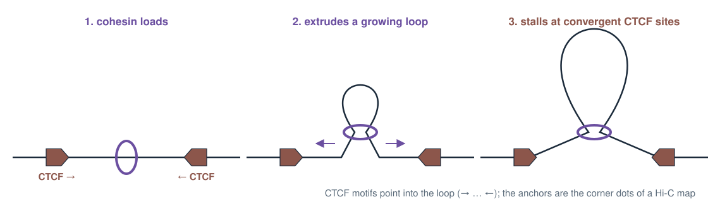{width="95%" fig-align="center"}

- **Cohesin** loads on DNA and extrudes a growing loop until it meets CTCF bound in the right **orientation**.
- Loops form between **convergent** CTCF sites (motifs pointing towards each other): about 90% of loops with a CTCF motif at both anchors in high-resolution Hi-C. Flip one site and the loop is lost.
- The result: insulated domains (TADs) in which enhancers find their promoters more easily than across the boundary.

::: notes
CTCF has 11 zinc fingers and binds a long (about 20 bp) asymmetric motif, so each site has an orientation; the N-terminus of CTCF faces the loop and stops cohesin coming from that side. Rao et al. 2014 found that loop anchors are mostly convergent pairs of CTCF motifs; inverting a single CTCF site with CRISPR re-wires the loop (de Wit et al. 2015; Guo et al. 2015). Removing CTCF or cohesin acutely (degron experiments) erases most TADs and loops but changes the expression of surprisingly few genes in the short term, a reminder that boundaries are one layer among several. This slide sets up the 3D genome units and the motif-strand question in the exercise. GM12878 has about 44 000 CTCF peaks in the file we use.
:::

## Transcription factors {.smaller}

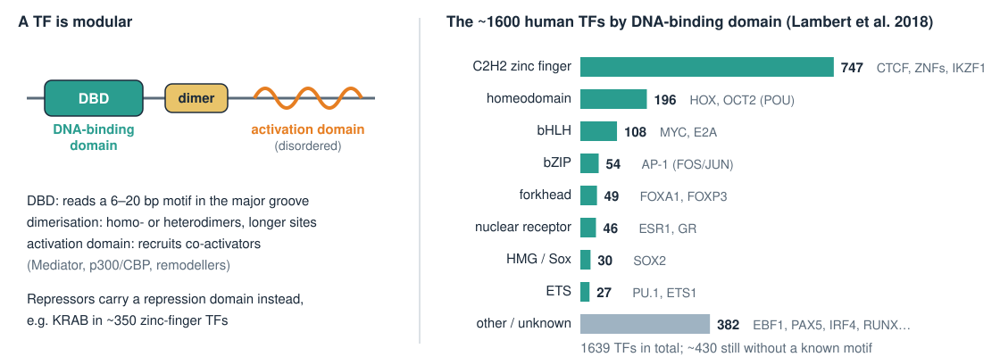{width="95%" fig-align="center"}

- A TF has a **DNA-binding domain** (DBD) that reads a short motif, and effector domains that recruit co-activators or co-repressors.
- Humans have about **1600 TFs**, classified by DBD family; half are C2H2 zinc fingers. Members of one family bind similar motifs.
- About a quarter still have **no known motif**.

::: notes
Numbers from Lambert et al. 2018, a manually curated census (1639 TFs; the counts in the figure are from its database). Each DBD family has a typical motif shape: bHLH factors bind the E-box CANNTG as dimers, bZIP factors palindromes, homeodomains TAAT cores, ETS factors GGAA cores (PU.1 is an ETS factor), forkheads TGTTTAC. Many paralogues share nearly identical motifs, so a motif match rarely tells you which family member binds: an ETS motif in a peak could be PU.1, ETS1, ELF1 or FLI1. Activation domains are mostly intrinsically disordered, acidic or rich in glutamine or proline. The KRAB zinc fingers (344 in the database) mostly silence transposable elements by recruiting KAP1/TRIM28 and SETDB1, which writes H3K9me3; this is the H3K9me3 at ZNF clusters seen in *What is epigenetics?*.
:::

## A motif as a matrix {.smaller}

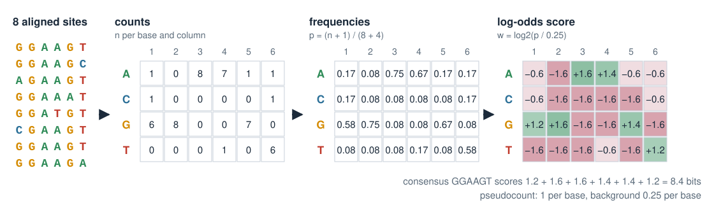{width="95%" fig-align="center"}

- Align known binding sites, **count** each base at each position, add a **pseudocount**, divide to get **frequencies** $p_{b,j}$.
- The **log-odds** weight of base $b$ at position $j$ against a background $q_b$: $\;w_{b,j} = \log_2 \dfrac{p_{b,j}}{q_b}$. Positive: preferred; negative: disfavoured.
- The pseudocount keeps unseen bases from getting $-\infty$: with only 8 sites, "never seen" does not mean "impossible".

::: notes
This is the position weight matrix (PWM), the standard representation of a TF motif (Stormo 2000; Wasserman and Sandelin 2004). The example is an ETS-type site with the GGAA core that PU.1 binds. Walk through one column: column 1 has 6 G, 1 A, 1 C, 0 T. With a pseudocount of 1 per base and 8 sites the frequencies are 7/12, 2/12, 2/12 and 1/12; against a uniform background of 0.25, G scores log2(0.583/0.25) = +1.2 and T scores log2(0.083/0.25) = −1.6. Pseudocount choices vary (JASPAR tools use 0.8 in total, others 1 per base or a fraction proportional to the background); the more sites, the less it matters. A real background is not uniform: the human genome is 41% GC, so q(G) = q(C) ≈ 0.2 and q(A) = q(T) ≈ 0.3. The exercise builds a matrix like this by hand.
:::

## Scanning a sequence {.smaller}

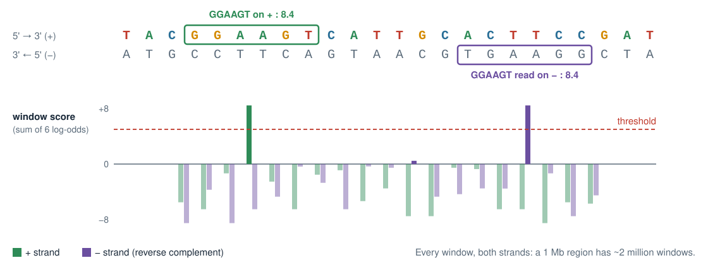{width="95%" fig-align="center"}

- The score of a window is the **sum** of the weights of its bases. Slide the window along the sequence, on **both strands** (the reverse complement).
- A score above a **threshold** is a **match** (a predicted site). Tools set the threshold from a $p$-value: the chance that a random window scores as high.
- Summing log-odds assumes the positions contribute **independently**. Usually a good approximation; dinucleotide models and neural networks relax it.

::: notes
The second match in the figure only appears on the minus strand: the top strand reads ACTTCC, whose reverse complement is GGAAGT. A scanner reports it with strand "−", and the motif then points to the left on the genome; this matters for CTCF orientation. The best possible score is the sum of the column maxima (8.4 here); the worst is the sum of the minima. Tools such as FIMO (MEME suite), HOMER, motifmatchr and Biostrings::matchPWM compute an exact p-value per score from the matrix and the background. With p < 1e-4 per window and strand, about 200 windows per Mb pass the threshold by chance, which is the topic of the next slides. The independence assumption fails for some TFs (e.g. flexible spacing in dimers); this is part of why convolutional neural networks, which learn motifs from data, outperform PWMs (machine-learning units).
:::

## Information content and sequence logos {.smaller}

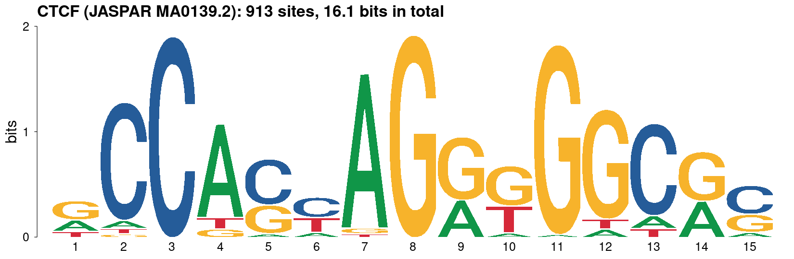{width="88%" fig-align="center"}

- **Information content** of a column (uniform background): $\;IC_j = 2 + \sum_b p_{b,j} \log_2 p_{b,j}$ bits. 2 bits: one base only; 0 bits: all four equally likely.
- A **sequence logo** draws each column as a stack of height $IC_j$, each letter scaled by its frequency.
- CTCF (JASPAR MA0139.2, from 913 ChIP-seq sites): 15 positions, **16.1 bits** in total; the core CCA·…AGGGGGC carries most of it.

::: notes
Information content is the reduction in uncertainty compared with a random base (2 bits for DNA). Column 3 of CTCF (C in 903 of 913 sites) has 1.9 bits; column 1 only 0.34. The total information content gives a rule of thumb for how often a motif occurs by chance: roughly once every 2^IC bp per strand, so 2^16 ≈ 70 000 bp for a high-scoring CTCF match. JASPAR is the open database of curated TF matrices (2024 release: Rauluseviciute et al.); CIS-BP, HOCOMOCO and the HOMER and MEME collections are alternatives. Logo made with universalmotif in make-generegulation-figs.R. Note that this matrix was derived from ChIP-seq peaks, so it describes in vivo binding sites, including bias from the experiment; other matrices come from in vitro assays (SELEX, protein-binding microarrays).
:::

## How many matches by chance? {.smaller}

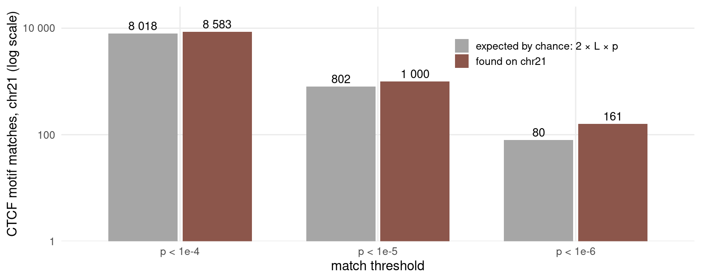{width="82%" fig-align="center"}

- At a $p$-value threshold $p$, a sequence of length $L$ has about $\;2 L p\;$ matches by chance (two strands).
- chr21 (40 Mb of sequence): **8583** CTCF matches at $p < 10^{-4}$, close to the 8018 expected by chance. Genome-wide, about **600 000** are expected.
- GM12878 has 44 217 CTCF peaks. Even a long, informative motif has **far more matches than bound sites**.

::: notes
Log scale on the y axis. This is the point of the slide: motif matches are cheap. A 6-bp exact word occurs once every 4^6 = 4096 bp per strand, about 500 times per Mb on both strands; a typical TF motif with 10–12 bits of information occurs thousands of times per Mb at usual thresholds. The observed counts are close to the expectation because the expectation is computed from the matrix itself with a uniform background, and chr21 is not uniform (41% GC); at stricter thresholds the observed count exceeds the expected one, partly because real CTCF sites are enriched (there are a few hundred bound sites on chr21) and partly because of base composition and repeats. Numbers computed in make-generegulation-figs.R with motifmatchr (exercise R7).
:::

## Real data: CTCF peaks contain the CTCF motif {.smaller}

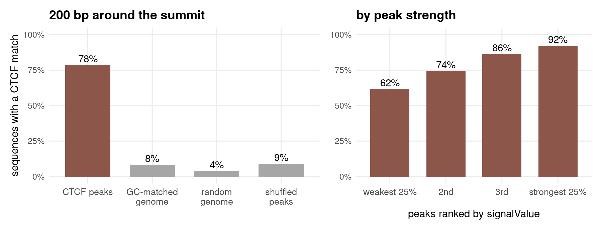{width="90%" fig-align="center"}

- Of 200 bp around each CTCF summit, **78%** contain a match ($p < 10^{-4}$), against **8%** of GC-matched genomic windows and 9% of the same sequences shuffled.
- The stronger the peak, the more likely the motif: **62%** of the weakest quarter, **92%** of the strongest.
- Weak peaks without a motif: indirect binding, weaker motif variants, or noise.

::: notes
Three backgrounds: random genomic windows (4%), windows matched to the GC content of the peaks (8%, because the CTCF motif is GC-rich and so occurs more often in GC-rich DNA), and the peak sequences shuffled so that each keeps its dinucleotide composition (9%). The GC-matched background is the fair one; a random-genome background would overstate the enrichment by a factor of two. This is exactly the issue of the null from the shuffle test in *Genomic intervals*: here the null must match sequence composition. HOMER uses GC-matched genomic background, MEME/SEA shuffled sequences. The strong dependence on peak strength is typical of ChIP-seq of a direct DNA binder and is a quality check: if the strongest peaks of your TF ChIP do not contain its motif, worry about the antibody.
:::

## Real data: the motif sits at the summit {.smaller}

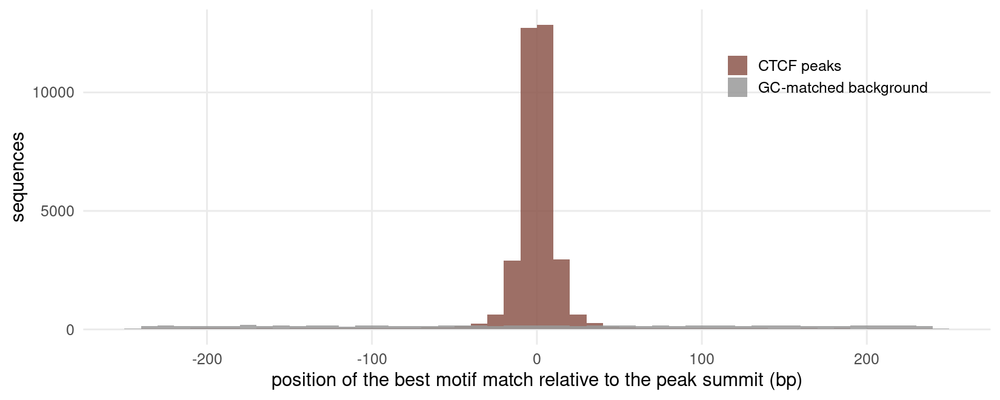{width="85%" fig-align="center"}

- Position of the best CTCF match in 500 bp around each summit: a sharp peak at 0. **94%** of best matches are within 50 bp of the summit (median distance 6 bp).
- In GC-matched background windows the best matches are spread evenly.
- **Centrality** is strong evidence that the motif is what the TF binds; tools such as CentriMo use it as a test.

::: notes
The summit is the position with the most ChIP fragments, which pile up symmetrically around the protein's binding position, so a directly bound motif should be at the summit within the precision of the experiment (tens of bp). A motif that is enriched in peaks but spread evenly over them suggests a partner factor or a sequence bias of the region, not the immunoprecipitated TF itself. The same plot centred on ATAC-seq summits is noisier, because an ATAC peak can contain several TFs. Only peaks with a match contribute (81% of peaks within ±250 bp; 17% of the 500-bp background windows have one). The exercise reproduces this histogram on 5000 peaks.
:::

## Most motif matches are not bound {.smaller}

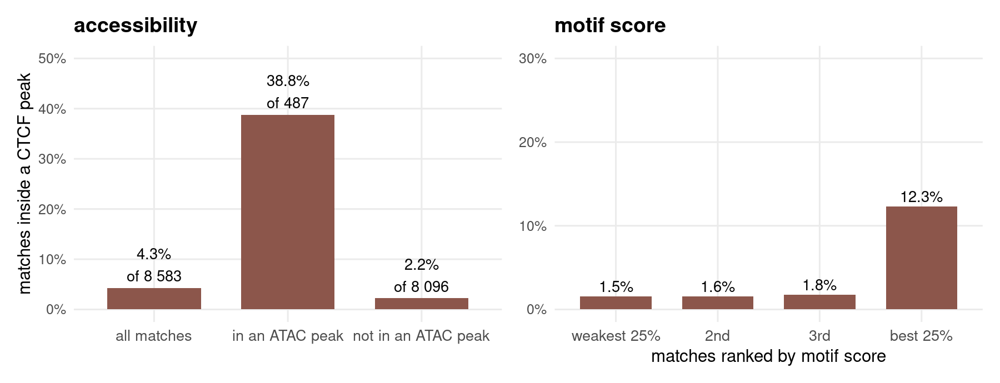{width="90%" fig-align="center"}

- Of the 8583 CTCF matches on chr21, only **369 (4.3%)** lie in a GM12878 CTCF peak, although CTCF is one of the most motif-driven TFs.
- Matches in **accessible** DNA (ATAC peaks) are bound **39%** of the time, matches elsewhere **2%**. The best-scoring quarter of matches is bound 12% of the time, the rest under 2%.
- Conversely, 79% of chr21 CTCF peaks have a match: the motif is nearly **necessary**, far from **sufficient**.

::: notes
This is the central quantitative message of the lecture. Accessibility and binding are not independent (CTCF binding itself creates an ATAC peak), so the 39% is not a causal estimate; but the asymmetry is the general pattern. For most TFs the fraction of bound matches is far lower than for CTCF, often well under 1%. The reasons are on the next slide. A consequence for analysis: predicting binding from sequence alone fails; combining sequence with accessibility (as chromVAR and many ML models do) works much better. Numbers from make-generegulation-figs.R; the exercise recomputes them (R7).
:::

## Why a motif is bound or not {.smaller}

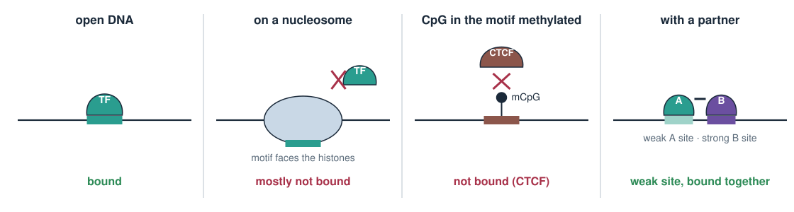{width="95%" fig-align="center"}

- **Nucleosomes**: most TFs cannot bind a motif wrapped on a histone octamer. **DNA methylation**: some TFs, CTCF among them, do not bind a motif with a methylated CpG.
- **Cooperativity**: TFs that bind next to each other stabilise each other, so a weak site is bound when a partner is there.
- **TF concentration and competition** with other proteins set how many sites are occupied.

::: notes
Each panel is a determinant that explains part of the gap on the previous slide. Nucleosomes: DNA on the octamer is bent and one face is blocked; access needs a pioneer factor or a remodeller (next slide). Methylation: the CTCF motif often contains CpGs (positions 13–14 of the JASPAR consensus GCCACCAGGGGGCGC); methylation there blocks binding, as at the H19 imprinting control region. Methyl-CpG can also increase binding for some TFs (the methyl-SELEX work of Yin et al. 2017). Cooperativity can be direct (protein–protein contacts, e.g. PU.1 with IRF4 or IRF8 on composite ETS–IRF elements in B cells) or indirect, through competition with the same nucleosome. TF concentration: a TF at higher levels occupies weaker sites; this is how dosage-sensitive TFs act.
:::

## Pioneer factors open closed chromatin {.smaller}

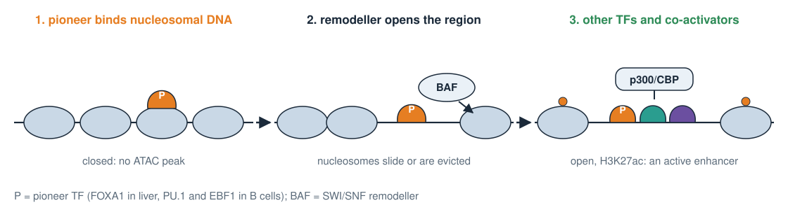{width="95%" fig-align="center"}

- **Pioneer factors** bind their motif on nucleosomal DNA, recruit remodellers (SWI/SNF/BAF), and make the site accessible for other TFs.
- Classic example: **FOXA1/FOXA2** in liver; its forkhead domain resembles linker histone H1. In B cells **PU.1** and **EBF1** act as pioneers.
- Pioneers set up **competence**: which enhancers *can* become active in a lineage. Signal-dependent TFs (NF-κB, steroid receptors) mostly bind where pioneers already opened the chromatin.

::: notes
Zaret and Carroll 2011 is the review. FOXA binds its site on the nucleosome surface and can open compacted chromatin in vitro without ATP-dependent remodellers (Cirillo et al. 2002), though in cells it works with remodellers. Pioneering is a spectrum, not a binary class: many TFs can bind partial motifs on nucleosomes to some degree. The definition is operational: a TF that binds closed chromatin and is needed for its opening. PU.1 opens thousands of sites in macrophages and B cells (Heinz et al. 2010); EBF1 opens chromatin at B-cell genes during B-cell commitment (Boller et al. 2016). The steps in the figure map onto assays: step 1 has a ChIP peak but little ATAC; step 3 has ATAC, H3K27ac and other TFs. For the ML units: pioneers are exactly where sequence alone predicts accessibility best.
:::

## Combinatorial control: the B-cell example {.smaller}

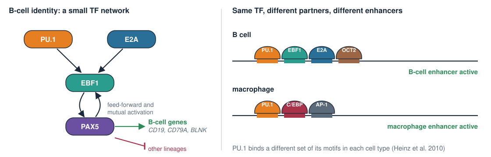{width="95%" fig-align="center"}

- B-cell identity rests on a few TFs: **PU.1** and **E2A** induce **EBF1**, EBF1 and **PAX5** activate each other and the B-cell programme, PAX5 represses other lineages.
- An enhancer is active only with the **right combination** of TFs. PU.1 is in both B cells and macrophages, but binds different sites with different partners.
- Combinations of ~1600 TFs give far more cell types than single TFs could.

::: notes
The hierarchy is from mouse genetics: mice without E2A or EBF1 have no B cells, and Pax5-deficient pro-B cells can still become macrophages or T cells, so PAX5 is the commitment factor (Nutt et al. 1999). PAX5 targets include CD19 and CD79A (activated) and CSF1R (repressed). Heinz et al. 2010 is the key paper on the right panel: PU.1 binds tens of thousands of sites in macrophages and in B cells, but largely different ones, next to C/EBP motifs in macrophages and EBF/E2A/OCT motifs in B cells; collaboratively they choose which sites become enhancers. GM12878 is an Epstein–Barr-virus-transformed B cell, so in addition to the B-cell factors it has very active NF-κB and IRF4 (EBV activates them), relevant when you look at its motif enrichment.
:::

## Real data: B-cell motifs in GM12878 open chromatin {.smaller}

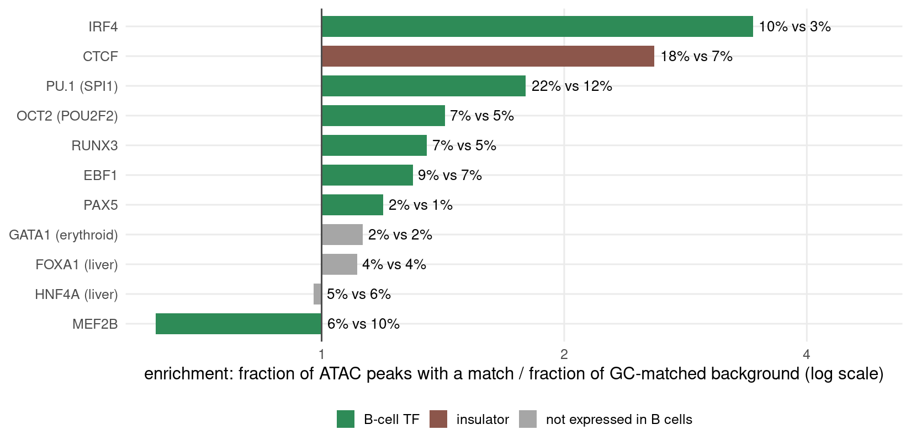{width="85%" fig-align="center"}

- Distal ATAC peaks (summit more than 2 kb from a protein-coding TSS), 200 bp around the summit, against GC-matched genomic windows.
- **IRF4** (3.4×), **CTCF** (2.6×) and **PU.1** (1.8×) motifs are the most enriched; OCT2, RUNX3 and EBF1 modestly (1.3–1.4×). Motifs of liver and erythroid TFs (HNF4A, FOXA1, GATA1) are not (≈1×).
- The open chromatin of a cell type tells you its TFs: the basis of motif enrichment analysis and chromVAR.

::: notes
Numbers next to the bars are the fraction of peaks with a match and the fraction of background windows with a match; 116 758 distal peaks of 155 151. Enrichments of 1.3–3-fold are typical: each motif occurs in only a minority of peaks, and many matches in either set are chance hits. IRF4 at the top fits an EBV-transformed B cell, where EBV drives IRF4; IRF and PU.1 motifs also occur together as composite ETS–IRF elements. Two honest caveats: PAX5's JASPAR matrix is short (8 bp) and captures only part of its long bipartite site, so its enrichment is underestimated; and MEF2B, a germinal-centre B-cell TF, is depleted, a reminder that motif enrichment depends on the matrix, the background and the window, and that absence of enrichment does not mean absence of function. Formal motif enrichment (HOMER, MEME-SEA, chromVAR) and footprinting are taught in *Motifs, motif enrichment and TF footprinting*; here the point is qualitative. Made with motifmatchr and JASPAR 2024 matrices in make-generegulation-figs.R.
:::

## Co-activators turn binding into activity {.smaller}

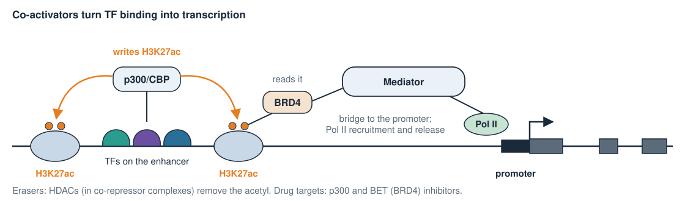{width="95%" fig-align="center"}

- Activation domains recruit **p300/CBP**, which acetylates H3K27 (and TFs): the **H3K27ac** you map at active enhancers and promoters.
- **BRD4** reads acetyl-lysine with its bromodomains and, with **Mediator**, helps recruit and release RNA polymerase II.
- Repressors recruit the opposite: HDACs, Polycomb, H3K9 methyltransferases.

::: notes
This closes the loop with the writers/readers/erasers framing of *What is epigenetics?*: TF binding at a sequence leads to the writing of a mark (H3K27ac by p300/CBP), which is read by BRD4, which helps the transcription machinery. It also explains why H3K27ac is such a good marker of active enhancers, and why p300 ChIP-seq was one of the first ways enhancers were mapped (Visel et al. 2009). Drugs: BET inhibitors (JQ1) displace BRD4 and hit super-enhancer-driven oncogenes such as MYC; p300/CBP inhibitors and degraders are in development. Pol II often pauses about 50 bp downstream of the TSS; release requires P-TEFb, which BRD4 recruits. Repressive co-factors are the other half: HDAC-containing complexes, Polycomb (H3K27me3) and SETDB1 (H3K9me3).
:::

## From mechanism to assay {.smaller}

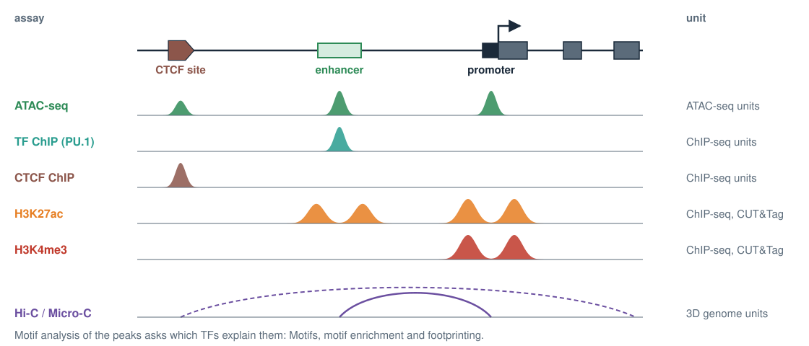{width="85%" fig-align="center"}

- **ATAC-seq** finds the open, TF-bound cores of promoters, enhancers and CTCF sites. **ChIP-seq of a TF** finds its bound sites, motif at the summit.
- **Histone ChIP / CUT&Tag** shows the marks on flanking nucleosomes. **Hi-C** shows the loops between CTCF sites and between enhancers and promoters.
- **Motif analysis** links the peaks back to the TFs that explain them.

::: notes
This is the map for the rest of the course. Each assay sees one layer of what we discussed: accessibility (a consequence of TF binding), the TF itself, the co-activator footprint as histone marks, and the 3D contacts. A useful exercise for students is to predict, for an element of their choice, what each track should look like, and then check it in the data. Note the bimodal histone signal: the marks are on the nucleosomes flanking the NDR, so a histone ChIP peak often has a dip where the ATAC peak is. Motif enrichment and footprinting have their own unit; the ML units train models that read the sequence directly.
:::

## Summary {.smaller}

| idea | key fact |
|---|---|
| cis-regulatory elements | core promoter, enhancers, silencers, insulators: clusters of TF sites |
| core promoter | about −40 to +40; TATA, Inr, DPE; CpG-island (about half, broad, housekeeping) vs non-CpG (tissue-specific) |
| enhancer | activates at a distance (up to ~1 Mb), either orientation; often not the nearest gene |
| active enhancer | open core with TFs; H3K4me1 + H3K27ac on flanking nucleosomes; eRNAs |
| insulator | CTCF; loops between convergent CTCF sites by cohesin extrusion |
| TF | DNA-binding domain + effector domain; ~1600 in human |
| PWM | counts → frequencies (pseudocount) → log-odds $\log_2(p/q)$; score = sum over positions |
| information content | $2 + \sum p \log_2 p$ per column; logo; chance match ≈ every $2^{IC}$ bp |
| binding | motif ≈ necessary, not sufficient: 4% of chr21 CTCF matches bound; accessibility, pioneers, partners |
| B cells | PU.1, E2A → EBF1 ↔ PAX5; combinations select enhancers |

::: notes
Students should be able to: build a PWM from a few aligned sites and score a sequence by hand; compute information content of a column; estimate the number of chance matches of a motif in a genome; explain why most matches are unbound; describe the marks of an active enhancer; and predict what ATAC-seq, TF ChIP-seq, histone ChIP-seq and Hi-C show at a promoter, an enhancer and a CTCF site. Next units: *Genomic intervals* (if not yet done), then the assay blocks, starting with ATAC-seq.
:::

## Key papers (optional further reading) {.smaller}

*Not required reading and not examined. For those who want the primary literature.*

- Banerji, Rusconi & Schaffner 1981, *Cell*. [Expression of a β-globin gene is enhanced by remote SV40 DNA sequences](https://doi.org/10.1016/0092-8674(81)90413-X). The discovery of enhancers.
- Spitz & Furlong 2012, *Nat Rev Genet*. [Transcription factors: from enhancer binding to developmental control](https://doi.org/10.1038/nrg3207). A clear review of enhancers, TF binding and combinatorial control.
- Lambert et al. 2018, *Cell*. [The human transcription factors](https://doi.org/10.1016/j.cell.2018.01.029). The census of ~1600 human TFs, their domains and motifs.
- Wasserman & Sandelin 2004, *Nat Rev Genet*. [Applied bioinformatics for the identification of regulatory elements](https://doi.org/10.1038/nrg1315). PWMs, information content and why most predicted sites are not functional ("the futility theorem").
- Zaret & Carroll 2011, *Genes Dev*. [Pioneer transcription factors: establishing competence for gene expression](https://doi.org/10.1101/gad.176826.111). The pioneer factor concept.
- Heinz et al. 2010, *Mol Cell*. [Simple combinations of lineage-determining transcription factors prime cis-regulatory elements required for macrophage and B cell identities](https://doi.org/10.1016/j.molcel.2010.05.004). PU.1 and its partners choose enhancers; also introduced HOMER.
