## About this lecture

The marks and peaks of the earlier units are one-dimensional: a position on a chromosome. But an enhancer can sit hundreds of kilobases from the gene it controls. This lecture is about how the genome is folded in the nucleus, and how that folding is measured.

- The levels of folding: **territories**, **A/B compartments**, **domains (TADs)** and **loops**, all in real GM12878 Hi-C data.
- The two mechanisms behind them: **loop extrusion** by cohesin, stopped by CTCF, and **compartmentalisation** of like with like.
- What happens when CTCF or cohesin is removed.
- Imaging single cells versus Hi-C on millions of cells; the **3C family** of assays.
- What folding means for genes: enhancer–promoter contact, and **disease** when a domain boundary breaks.

::: notes
This is the biology unit of the 3D-genome block; *Hi-C: from reads to contact matrices* and *Calling compartments, TADs and loops* are the analysis units. Students saw the 3D teaser in *What is epigenetics?* and CTCF and loop extrusion in *Gene regulation*; here we build the full picture. Every real-data figure comes from the same experiment: in situ Hi-C of GM12878 (Rao et al. 2014), all replicates combined, as reprocessed by ENCODE on GRCh38 (experiment ENCSR410MDC). The figures are made by make-genome3d-figs.py in the unit folder. Keep in mind throughout that a Hi-C map is a population average: the last third of the lecture comes back to that.
:::

## Why folding matters {.smaller}

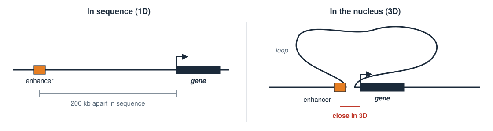{width="92%" fig-align="center"}

- Enhancers often lie **10 kb to 1 Mb** from the promoter they regulate, and often skip the nearest gene.
- To act, an enhancer must (at least transiently) come **close in 3D** to its promoter.
- So the questions are: what brings regions together, what keeps them apart, and how do we measure it?

::: notes
In *Gene regulation* we met the ZRS enhancer of Shh, about 1 Mb away from its gene inside an intron of another gene (LMBR1), and saw that the nearest gene is often not the target. A linear genome browser cannot tell you which promoter an enhancer talks to. The 3D organisation constrains it: elements in the same domain contact each other more, elements separated by a boundary less. The figure is a cartoon: in reality the DNA is a dynamic polymer and "close" means within a few hundred nanometres, often only for part of the time. We return to how close is close enough at the end.
:::

## Folding at many scales {.smaller}

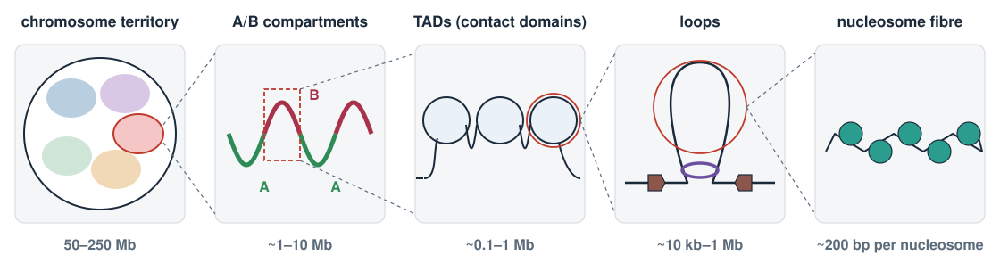{width="96%" fig-align="center"}

- **Territories:** each chromosome occupies its own region of the nucleus.
- **Compartments** (Mb): active (A) and inactive (B) chromatin segregate.
- **Domains / TADs** (~0.1–1 Mb) and **loops** (~10 kb–1 Mb): local units made by cohesin and CTCF.
- **Nucleosome fibre:** the 10-nm fibre of *What is epigenetics?*; the textbook 30-nm fibre is rare in living cells.

::: notes
The sizes are typical ranges for human cells, not hard limits. The levels are not a strict hierarchy of boxes inside boxes: compartments and TADs are made by different mechanisms (later slides) and a TAD can contain both A and B chromatin in principle, although in practice domain boundaries often coincide with compartment switches. Numbers to remember: a human chromosome is 50–250 Mb; GM12878 contact domains have a median size of about 200 kb (Rao et al. 2014 reported 185 kb); loops have a median size of a few hundred kb. "TAD" (topologically associating domain, Dixon et al. 2012; Nora et al. 2012) and "contact domain" (Rao et al. 2014) are used almost interchangeably; we use TAD.
:::

## Chromosome territories {.smaller}

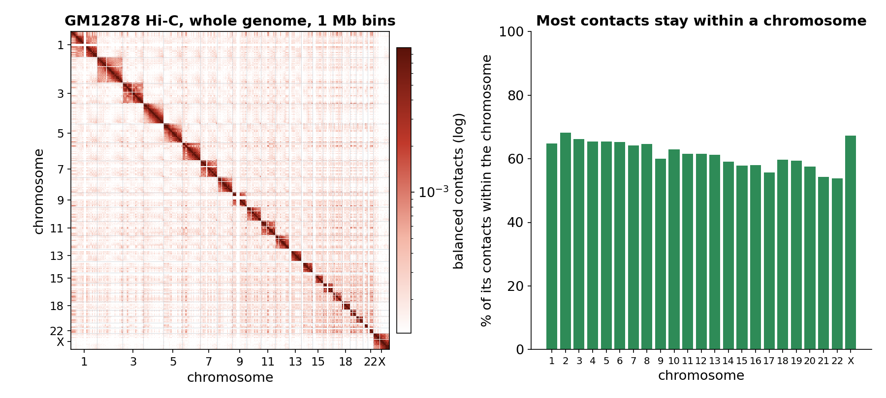{width="92%" fig-align="center"}

- Each chromosome is a **block on the diagonal**: contacts within a chromosome far outnumber contacts between chromosomes.
- In GM12878, **77%** of contacts are within a chromosome, although only **5%** of all pairs of positions are.
- Small, gene-rich chromosomes (16, 17, 19, 20, 22) contact each other more and keep a smaller share of contacts to themselves: they sit together in the nuclear interior.

::: notes
Territories were first seen by microscopy: chromosome painting with fluorescent probes for a whole chromosome shows compact, separate regions rather than intermingled spaghetti (Cremer and Cremer). Hi-C confirms it: the whole-genome map, 1 Mb bins, balanced, log colour scale, is dominated by blocks on the diagonal. The right panel computes, for each chromosome, the fraction of its contacts (raw counts, MAPQ ≥ 30) that land on the same chromosome. The "expected" figure is what you would get if a contact partner were picked uniformly from the genome, i.e. the sum of squared chromosome sizes over the squared genome size. In these data 77% of the 4.6 billion contacts are within a chromosome, against 5% expected at random; per chromosome (right panel; each trans contact counts for both chromosomes it joins) the share runs from 54% (chr21, chr22) to 68% (chr2) and 67% for chrX, whose inactive copy is compact. Numbers from make-genome3d-figs.py. Note that the cis fraction is also a quality metric for a Hi-C library: random ligation in solution (in the original dilution Hi-C protocol) produced many more trans contacts; we return to this in the processing unit.
:::

## Reading a Hi-C map {.smaller}

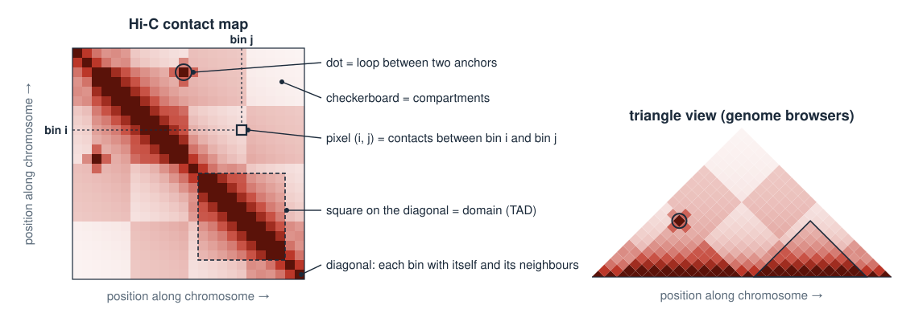{width="96%" fig-align="center"}

- Both axes are the genome. Pixel $(i, j)$ = how often bin $i$ and bin $j$ were found ligated together, **summed over millions of cells**.
- The map is symmetric; browsers often show only the upper triangle, turned 45°.
- Three patterns to look for: **squares** on the diagonal (domains), **dots** off the diagonal (loops), a **checkerboard** far from the diagonal (compartments).

::: notes
Teach students to read a map before they compute anything. The diagonal is always the strongest: neighbouring bins are physically connected. A square of enriched contacts means a region whose parts touch each other more than they touch the outside: a domain. A dot is a specific pair of loci with more contacts than their neighbours: a loop with anchors at the dot's row and column. The checkerboard means that bins far apart along the chromosome still prefer each other when they are of the same type (A with A, B with B). The triangle view is what you see in Juicebox, HiGlass or the WashU browser, with tracks such as ChIP-seq aligned underneath. Resolution: a pixel is a bin of 1 Mb in a genome-wide view, down to 1–5 kb in the deepest maps.
:::

## Contacts fall with distance {.smaller}

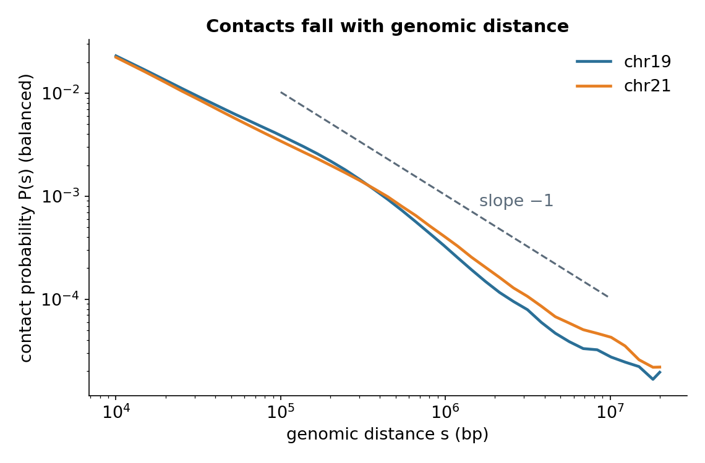{width="68%" fig-align="center"}

- The contact probability $P(s)$ falls roughly as a power law of genomic distance $s$: slope about **−1** on a log–log plot between 100 kb and 1 Mb here (chr21: −0.97; chr19: −1.14).
- This is the strongest signal in any Hi-C map. Everything else (domains, loops, compartments) is a **deviation from this expectation**.

::: notes
P(s) is computed by averaging the balanced matrix along each diagonal (cooltools expected_cis, chr19 and chr21 at 5 kb); the processing unit computes it from the students' own reads. Lieberman-Aiden et al. 2009 found a slope of about −1 between 500 kb and 7 Mb and proposed the "fractal globule", a knot-free, crumpled polymer state. Later work showed that the shape of P(s) reports on loop extrusion: removing cohesin changes the curve below about 1 Mb, and mitotic chromosomes, compacted by condensin loops, have a different slope again. For a student the practical point is the expected value: to say a contact is "enriched" we compare it with the average contact at the same distance (observed/expected), which the analysis units do.
:::

## A and B compartments {.smaller}

:::: {.columns}
::: {.column width="52%"}
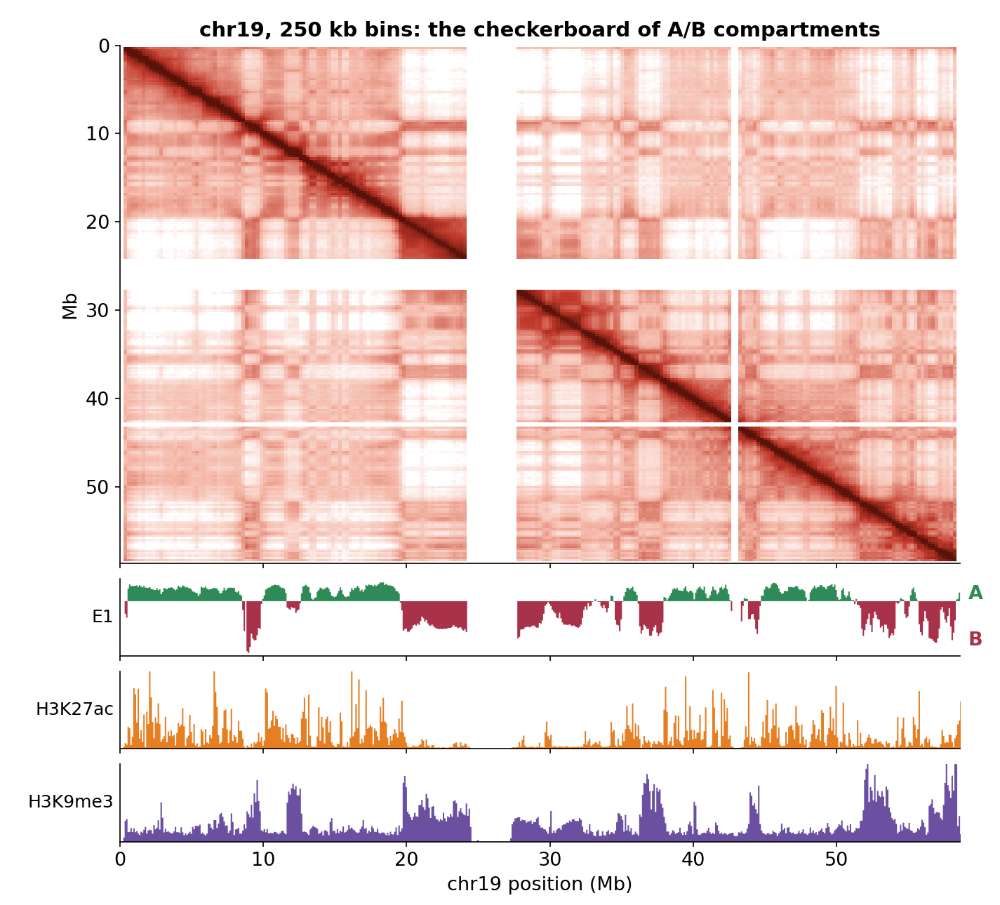{width="100%"}
:::
::: {.column width="48%"}
- Far from the diagonal, the map is a **checkerboard**: bins fall into two types that contact their own type more.
- The first eigenvector (**E1**) of the map's correlation matrix splits the bins: **A** (E1 > 0) and **B** (E1 < 0).
- A matches active chromatin: on chr19, E1 correlates with H3K27ac (r = 0.50) and against H3K9me3 (r = −0.64).
- **57%** of chr19 is A: it is the most gene-dense human chromosome.
:::
::::

::: notes
Lieberman-Aiden et al. 2009 discovered compartments at 1 Mb resolution. The left panel shows chr19 at 250 kb (balanced, log scale); below it E1 at 100 kb and the ENCODE fold-change tracks for H3K27ac and H3K9me3 averaged in the same bins. How E1 is computed, and how its arbitrary sign is fixed, is in *Calling compartments, TADs and loops*; here we oriented it so that it correlates positively with H3K27ac. A compartment is gene-rich, GC-rich, early-replicating, accessible and transcribed; B is gene-poor, late-replicating, and enriched for H3K9me3 or H3K27me3 and for contacts with the nuclear lamina. At higher resolution Rao et al. 2014 split them into six subcompartments (A1, A2, B1–B4) with distinct marks; for example B1 is H3K27me3-rich and B4 is a small subcompartment of KRAB-ZNF gene clusters on chr19, marked by H3K9me3 together with H3K36me3. Compartments change between cell types as genes are switched on and off, which makes them more than a sequence property.
:::

## Where compartments sit in the nucleus {.smaller}

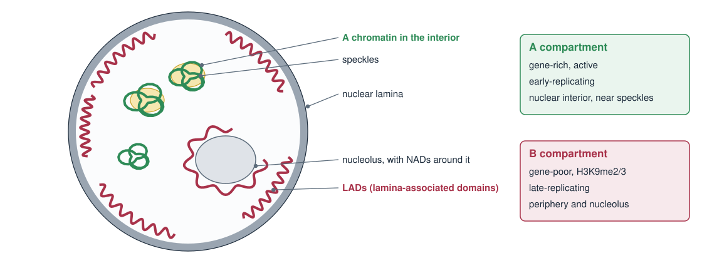{width="86%" fig-align="center"}

- **B** chromatin lines the **nuclear lamina** (lamina-associated domains, LADs) and surrounds the **nucleolus** (NADs).
- **A** chromatin fills the interior, near **nuclear speckles** (splicing-factor-rich bodies).
- So compartments are a sequencing readout of **nuclear position**: the periphery is mostly a repressive environment.

::: notes
LADs were mapped by DamID (van Steensel lab): fuse the Dam methyltransferase to lamin B1 and map where adenine methylation lands. LADs are 0.1–10 Mb, gene-poor, late-replicating and largely overlap B. They are not absolute: genes moved to the lamina are often but not always repressed, and LADs vary between cells. Speckle-associated domains (mapped by TSA-seq or SPRITE) are the most active parts of A. This slide links the abstract checkerboard to the microscope picture: A–A and B–B contacts are enriched because A regions are together in the interior and B regions together at the periphery and around nucleoli.
:::

## Domains (TADs) {.smaller}

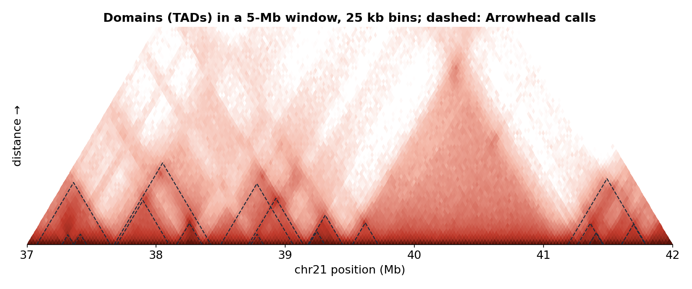{width="95%" fig-align="center"}

- **Domains** are regions of about 0.1–1 Mb whose parts contact each other more than they contact the neighbouring regions: squares on the diagonal, triangles in this view.
- Their edges, **boundaries**, are enriched for **CTCF** binding and active promoters.
- **16** domains called in this 5-Mb window of chr21 (Arrowhead, by ENCODE); **10 306** genome-wide, median size **185 kb**.

::: notes
Topologically associating domains were described in 2012 in mouse and human (Dixon et al., 40-kb bins, median about 880 kb) and in the mouse X-inactivation centre (Nora et al., 5C). With deeper data the big TADs split into smaller "contact domains" (Rao et al. 2014), many of which are loop domains: domains with a dot at their corner, i.e. a loop between the two boundaries (next slide). Domains are nested and their calls depend on the resolution and the caller, which is a theme of *Calling compartments, TADs and loops*. Many boundaries are shared between cell types, and between mouse and human at orthologous loci. The dashed triangles are ENCODE's Arrowhead domains from the same data (chr21:37–42 Mb, 25-kb bins). Note the large block between about 39.6 and 41.2 Mb that has no call: domain callers disagree, especially about large and nested domains, a point taken up in the analysis unit.
:::

## Loops {.smaller}

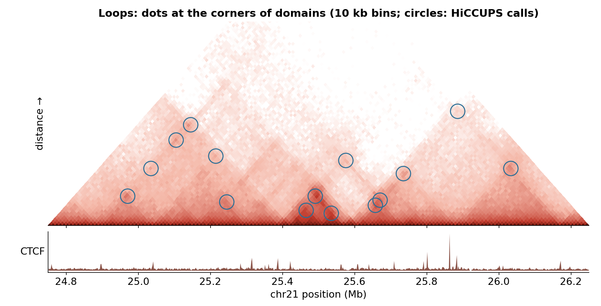{width="95%" fig-align="center"}

- A **loop** is a dot: two loci (anchors) with more contacts than their neighbourhood. Most loop anchors in GM12878 carry a **CTCF** peak.
- ENCODE's HiCCUPS calls **14 599** loops in GM12878, **164** on chr21; median anchor distance **330 kb**.
- Loops at the corners of domains are the "**loop domains**".

::: notes
Loops were mapped genome-wide by Rao et al. 2014 at 5–10 kb resolution with the HiCCUPS dot caller; how dots are called is in *Calling compartments, TADs and loops*. The window is chr21:24.75–26.25 Mb at 10 kb. Many dots sit at the apex of a triangle, and many anchors line up with CTCF peaks in the track below; 6 of these 15 loops have a CTCF peak at both anchors and 11 at one or both (exercise P4), while the strongest dot (25.50 × 25.56 Mb) has none: not every loop is a CTCF loop. Genome-wide, 64% of loop anchors overlap a CTCF peak against 13% of shuffled anchors (exercise C4). Rao et al. found that about 90% of loops with a CTCF motif at both anchors have the two motifs pointing towards each other (convergent): the convergent CTCF rule of *Gene regulation*. Most loops are not stable structures: live imaging (e.g. Gabriele et al. 2022) shows a given CTCF loop fully formed only a small fraction of the time; the dot is the population average of a transient event.
:::

## Loop extrusion {.smaller}

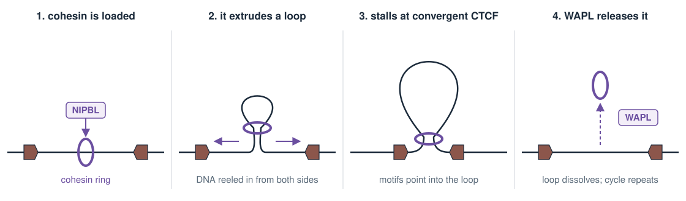{width="96%" fig-align="center"}

- **Cohesin**, a ring-shaped SMC complex, is loaded onto DNA (with **NIPBL**) and **extrudes** a loop, reeling in DNA, using ATP.
- It stops when it meets **CTCF** bound with its motif pointing **into the loop**. **WAPL** releases cohesin; the loop dissolves.
- Loops are therefore **dynamic**: formed, held and released within minutes, over and over.

::: notes
The idea that loops are extruded is old (Riggs 1990; Nasmyth 2001) and became a model for TADs when polymer simulations showed it reproduces domains, dots and the convergent rule (Sanborn et al. 2015; Fudenberg et al. 2016). Single-molecule experiments later watched it happen: yeast condensin extrudes loops on DNA curtains (Ganji et al. 2018), and human cohesin with NIPBL extrudes loops at roughly 0.5–1 kb per second (Davidson et al. 2019; Kim et al. 2019). Orientation dependence has a molecular explanation: the N-terminus of CTCF, which faces the loop when CTCF binds its motif, contacts the cohesin subunits SA2–SCC1 and blocks extrusion from that side (Li et al. 2020). Cohesin also holds sister chromatids together after replication; that is a different, longer-lived pool of cohesin.
:::

## What extrusion leaves in a Hi-C map {.smaller}

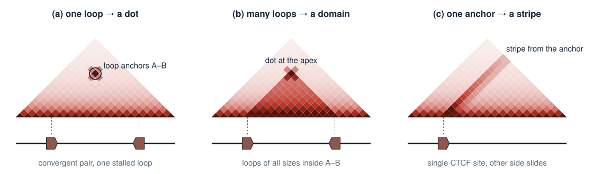{width="96%" fig-align="center"}

- A **dot**: many cells have the same loop between two convergent CTCF sites.
- A **domain**: extrusion in progress produces contacts at all distances between the two sites.
- A **stripe**: one anchor holds while the other side keeps being reeled in.

::: notes
This is why loop extrusion explains so much at once. In a population of cells, cohesin complexes are at different stages: some have just started, some are stalled at both CTCF sites. Summed over cells, contacts are enriched everywhere inside the two sites (the domain), and most strongly at the two anchors themselves (the dot at the apex). If only one side is blocked by CTCF, the other side of the loop keeps moving, and the blocked anchor contacts a growing range of positions: a stripe (also called a flame or line) runs from the anchor along the edge of the domain (Vian et al. 2018). Stripes are common at strong CTCF sites and at active enhancers that load cohesin.
:::

## Flip one CTCF site, move the loop {.smaller}

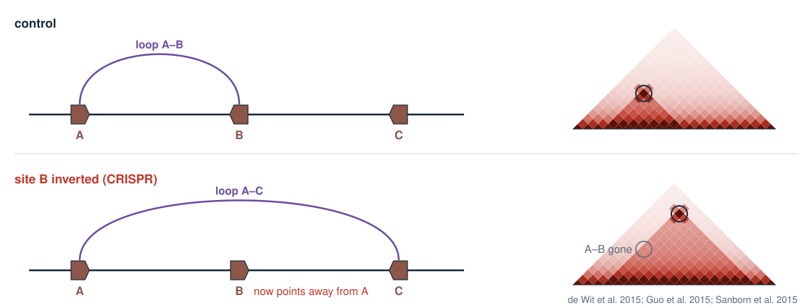{width="92%" fig-align="center"}

- Inverting a single CTCF site with CRISPR **loses** the loop it anchored, and a new loop forms with the next site in the right orientation.
- Deleting a site lets the domain **merge** with its neighbour.
- Strong evidence that orientation, not only presence, of CTCF sites shapes the map.

::: notes
De Wit et al. 2015 and Guo et al. 2015 inverted CTCF sites at several loci (the protocadherin cluster, the β-globin locus, and others) and saw loops lost and new ones formed as the convergent rule predicts; Sanborn et al. 2015 made a set of engineered changes and predicted the outcome with an extrusion model. The convergent rule only fixes which sites can stop cohesin; it does not say a loop is always there. Exercise B3 asks students to predict loops after deletions and inversions on paper. These results also explain why structural variants in patients (deletions, inversions, duplications) can change gene regulation without touching a gene: see the disease slides at the end.
:::

## Remove CTCF or cohesin {.smaller}

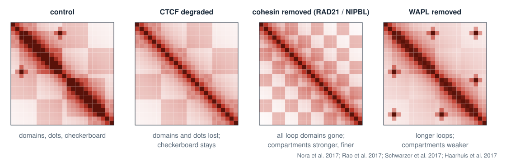{width="96%" fig-align="center"}

- **CTCF degraded** (auxin degron, Nora et al. 2017): domain insulation and loops largely lost; **compartments unchanged**.
- **Cohesin removed** (RAD21 degron, Rao et al. 2017; *Nipbl* deletion, Schwarzer et al. 2017): **all loop domains vanish**; compartments get **stronger** and finer.
- **WAPL removed** (Haarhuis et al. 2017): cohesin stays longer, loops grow longer, compartments weaken.
- Gene expression changes are surprisingly **modest** in the short term.

::: notes
These acute depletion experiments are the main causal evidence for the model. With degrons a protein is destroyed within hours, before secondary effects accumulate; Hi-C after 6 hours (cohesin) or 1–2 days (CTCF) shows the direct consequences, and washout restores the structures. Two conclusions: loops and domains need cohesin, and CTCF positions them; compartments do not need either, so they are made by a different mechanism (next slide); in fact removing cohesin strengthens compartments, because extrusion normally mixes A and B. The expression changes were modest: a few hundred genes changed in each study, many only weakly. Why remains debated: many enhancer–promoter contacts are short-range and survive (Hsieh et al. 2022 with Micro-C), the effects may be stronger during activation of genes than in maintenance, or redundancy may buffer them. It is a good example of a striking structural change with a small functional readout.
:::

## Two mechanisms, one map {.smaller}

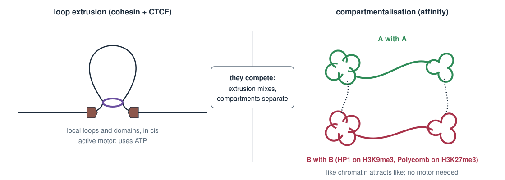{width="92%" fig-align="center"}

- **Extrusion** (cohesin + CTCF) makes local loops and domains, in cis, with a motor.
- **Compartmentalisation** separates chromatin types by **affinity**: like attracts like, for example HP1 bound to H3K9me3, Polycomb to H3K27me3.
- They act at the same time and **compete**: extrusion mixes neighbouring A and B segments; affinity separates them.

::: notes
Compartments are thought to form like microphase separation in a block copolymer: a chain made of A and B blocks, where A–A and B–B contacts are slightly favourable, folds so that like blocks cluster (Falk et al. 2019 argued that heterochromatin–heterochromatin attraction is the main driver, from inverted nuclei of nocturnal rodent rod cells). "Phase separation" or "condensates" (for HP1, Polycomb, transcription hubs) is one proposed physical basis; how much of compartmentalisation is liquid–liquid phase separation in the strict sense is debated, so say "affinity-driven segregation" when in doubt. The competition explains the depletion results: no cohesin, stronger compartments; more cohesin on DNA (WAPL loss), weaker compartments (Nuebler et al. 2018 simulations).
:::

## One cell versus millions {.smaller}

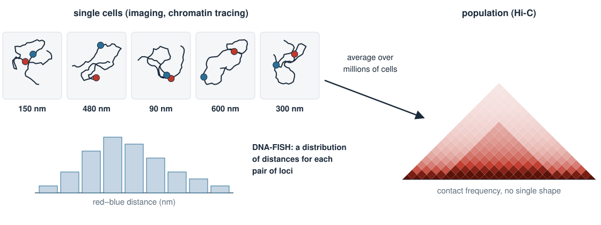{width="94%" fig-align="center"}

- A Hi-C map is an **average over millions of cells**. In any one cell, two loci in the "same domain" may be far apart.
- **Imaging** measures distances in single cells: DNA-FISH for a few loci, **chromatin tracing** (multiplexed FISH) for tens of loci along a region.
- Single cells have domain-like globules with **variable boundaries**; CTCF sites make boundaries more likely, not certain.

::: notes
Bintu et al. 2018 traced chromatin at 30-kb steps over a 2.5-Mb region in thousands of single cells: they saw TAD-like globules in individual cells, but with boundaries at different positions from cell to cell, preferentially at CTCF sites; after cohesin depletion the globules remained, but the preference for CTCF sites was lost. Single-cell Hi-C (Nagano et al. 2013; Stevens et al. 2017) reaches the same conclusion with far fewer contacts per cell. Contact frequency and distance are related but not the same thing: two loci can have a high Hi-C contact frequency but a large mean distance if they touch rarely but strongly, and FISH and Hi-C occasionally disagree (Williamson et al. 2014; Fudenberg and Imakaev 2017). When a paper says "the enhancer contacts the promoter", ask: in what fraction of cells, for how long, and measured how?
:::

## Proximity ligation: the principle {.smaller}

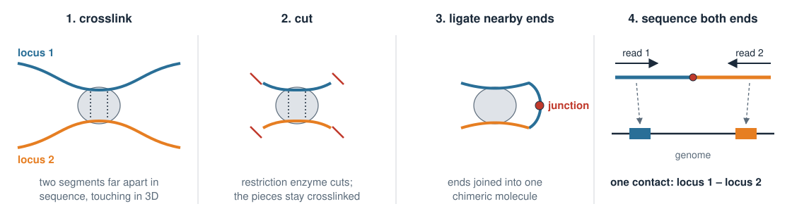{width="94%" fig-align="center"}

- **Crosslink** chromatin with formaldehyde, **cut** the DNA, **ligate** ends that are held close together, and **sequence** the junctions.
- Each sequenced junction is one contact between two genomic positions; counting them gives a contact map.
- The chemistry has artefacts of its own (unligated ends, self-ligated fragments, PCR duplicates): the subject of *Hi-C: from reads to contact matrices*.

::: notes
All "C" methods share this logic, introduced as 3C by Dekker et al. 2002 in yeast. Ligation favours ends that are physically close because crosslinking keeps them in the same small complex while the DNA is cut; ends from far apart rarely meet. What is measured is therefore a frequency of being crosslinkable and ligatable together, which depends on distance but also on the local chromatin (protein density, accessibility to the enzyme). The specifics (restriction enzymes, biotin fill-in, in situ ligation, how to map chimeric reads) come in the next unit.
:::

## The 3C family {.smaller}

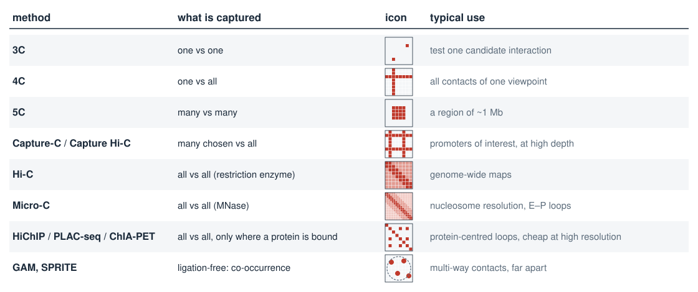{width="88%" fig-align="center"}

- They differ in **which** ligation products are read: one pair (3C), one viewpoint against all (4C), a region (5C), everything (Hi-C, Micro-C), chosen baits (Capture-C), or only those near a protein (HiChIP, PLAC-seq, ChIA-PET).
- Ligation-free methods (**GAM**, **SPRITE**) capture co-occurrence of many loci at once.

::: notes
History in one breath: 3C (Dekker 2002), 4C (Simonis et al. 2006; Zhao et al. 2006), 5C (Dostie et al. 2006), Hi-C (Lieberman-Aiden et al. 2009), in situ Hi-C (Rao et al. 2014), ChIA-PET (Fullwood et al. 2009), Capture-C (Hughes et al. 2014) and promoter Capture Hi-C (Mifsud et al. 2015), HiChIP (Mumbach et al. 2016), Micro-C (Hsieh et al. 2015 in yeast; mammalian cells 2020). The choice is about depth: a genome-wide map needs billions of reads to reach 1–5 kb resolution, so if you only care about the promoters of 20 genes, capture them and spend the reads there. HiChIP and ChIA-PET enrich for contacts at sites bound by a protein (cohesin, CTCF, H3K27ac); they are cheap but mix contact frequency with ChIP enrichment, a bias discussed in *Calling compartments, TADs and loops*. GAM (genome architecture mapping) sequences DNA from thin nuclear slices; SPRITE tags all DNA in a crosslinked complex with the same barcode; both see multi-way contacts and avoid ligation biases.
:::

## Does contact mean activation? {.smaller}

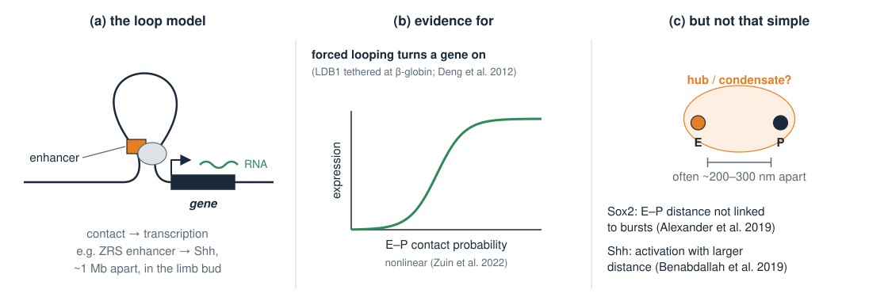{width="96%" fig-align="center"}

- **For:** forcing a loop between an enhancer and a promoter can switch a gene on; expression rises **nonlinearly** with contact probability.
- **Not that simple:** at *Sox2* the enhancer–promoter distance does not track transcriptional bursts; at *Shh* activation came with a *larger* distance in one system.
- Current view: proximity within a few hundred nm, perhaps in a **hub** of factors, rather than a stable direct touch.

::: notes
Deng et al. 2012 tethered the self-associating protein LDB1 to the β-globin promoter with an engineered zinc finger and restored looping to the LCR enhancer and transcription in cells lacking the activator GATA1. Zuin et al. 2022 moved an enhancer to many positions around a promoter in mouse ES cells and found that expression depends on contact probability in a sigmoidal, nonlinear way, and that CTCF insulation acts by lowering contact probability. Against a simple contact model: Alexander et al. 2019 imaged the Sox2 promoter and its enhancer (about 110 kb away) live and found their distance unrelated to bursts of transcription; Benabdallah et al. 2019 found that activating the Shh enhancer during differentiation increased its distance from the gene. Kane et al. 2022 showed that cohesin is needed for the very long-range ZRS–Shh action but less for short-range enhancers. The honest summary: contact is necessary in some sense, but the timescales, distances and the role of hubs of TFs and coactivators are open questions.
:::

## How much do domains matter for genes? {.smaller}

- **Boundaries constrain enhancers:** most enhancer–gene links found by CRISPR screens lie within the same domain, and insulation by CTCF lowers expression of genes across a boundary.
- **But redundancy is common:** removing CTCF or cohesin changes few genes in the short term; in *Drosophila*, extensive rearrangements of domains on balancer chromosomes changed the expression of few genes.
- **Context matters:** a domain change matters when it brings a **strong enhancer** to a **gene that is ready to respond** in the right tissue. That is the case in the disease examples that follow.

::: notes
A text slide for balance before the disease examples. Evidence for constraint: CRISPRi screens of enhancers (Fulco et al. 2019, Gasperini et al. 2019) found that most functional enhancer–gene pairs are within the same domain; Zuin et al. 2022 showed insulation acts by reducing contact. Evidence for redundancy: Nora 2017 and Rao 2017 found hundreds rather than thousands of genes changed; Ghavi-Helm et al. 2019 studied Drosophila balancer chromosomes with many inversions and found most genes unchanged; Despang et al. 2019 removed CTCF sites between Sox9 and Kcnj2 and fused the domains with only modest effects, while a larger rearrangement that moved the domain boundary did cause misexpression. Students should leave with a nuanced view: domains are a regulatory constraint, not a switch, and the consequence of breaking one depends on what is on either side.
:::

## Broken boundaries cause limb malformations {.smaller}

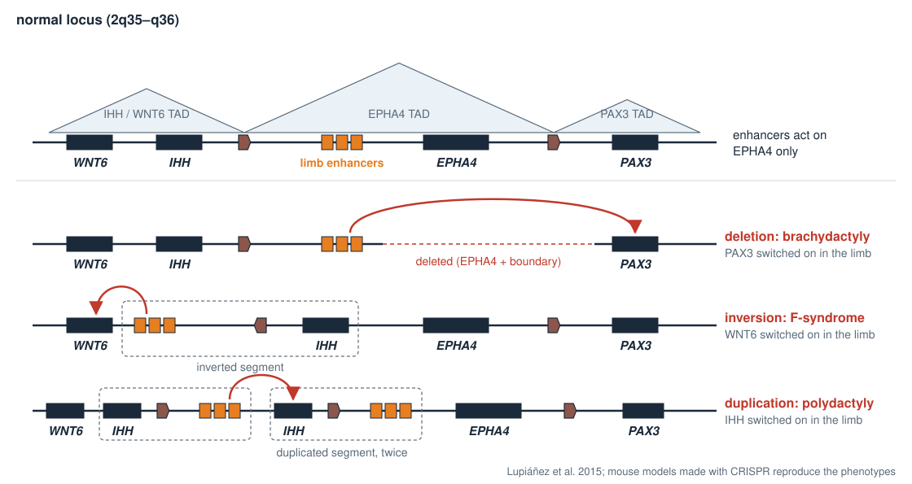{width="88%" fig-align="center"}

- At the *WNT6–IHH–EPHA4–PAX3* locus, limb enhancers normally act only on *EPHA4* in their own domain.
- **Deletions**, **inversions** and **duplications** that move a boundary let the enhancers reach *PAX3*, *WNT6* or *IHH*: three different malformations (Lupiáñez et al. 2015).
- The rewiring happened only when the variant **crossed a CTCF-associated boundary**; mice engineered with CRISPR reproduced it.

::: notes
This is the landmark paper linking TADs to disease. Patients with brachydactyly carried deletions that removed EPHA4 and the boundary to the PAX3 domain: the limb enhancers then contacted PAX3, which was expressed ectopically in the limb. F-syndrome patients carried an inversion that moved the enhancers next to WNT6; polydactyly patients carried duplications that included the boundary and placed a copy of IHH in a new domain with the enhancers. The mouse models (made by CRISPR in ES cells and tetraploid aggregation) reproduced the phenotypes and the ectopic contacts by capture-C. Clinical relevance: structural variants in non-coding DNA are routinely found by genome sequencing, and their pathogenicity can sometimes be predicted from whether they cross a boundary. Franke et al. 2016 extended this with duplications at SOX9–KCNJ2 that form a new domain (a "neo-TAD").
:::

## Boundary loss in cancer {.smaller}

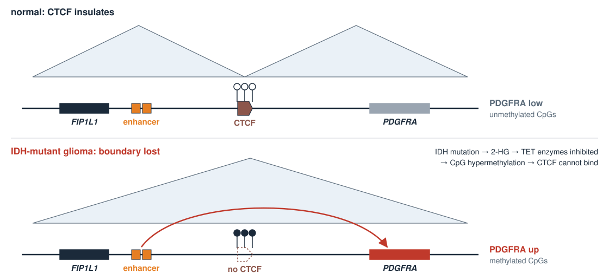{width="84%" fig-align="center"}

- In **IDH-mutant gliomas**, the oncometabolite 2-hydroxyglutarate inhibits TET demethylases and CpG sites gain methylation, including in **CTCF motifs**.
- CTCF cannot bind methylated sites: a boundary is lost and a constitutive enhancer activates the oncogene ***PDGFRA*** (Flavahan et al. 2016).
- Microdeletions of boundaries next to proto-oncogenes are also found in T-ALL and other cancers (Hnisz et al. 2016).

::: notes
This example connects three units of the course: DNA methylation (*DNA methylation biology*), CTCF binding (*Gene regulation*: CTCF cannot bind a motif with a methylated CpG, as at the H19/IGF2 imprinting control region) and 3D organisation. Flavahan et al. showed reduced CTCF binding at the boundary in IDH-mutant tumours, and that demethylating treatment restored CTCF binding and lowered PDGFRA; disrupting the boundary in non-mutant glioma cells with CRISPR raised PDGFRA. Hnisz et al. 2016 found recurrent microdeletions of CTCF boundary sites near TAL1 and LMO2 in T-cell acute lymphoblastic leukaemia. The cancer-epigenetics unit returns to IDH mutations.
:::

## Summary {.smaller}

| level | size | made by | seen as |
|---|---|---|---|
| territory | a chromosome | — | blocks on the genome-wide diagonal |
| compartment A/B | ~1–10 Mb | affinity of like chromatin (HP1, Polycomb, …) | checkerboard; sign of E1 |
| domain (TAD) | ~0.1–1 Mb | loop extrusion by cohesin, stopped by CTCF | squares / triangles |
| loop | 10 kb–1 Mb | cohesin stalled at convergent CTCF sites | dots |

- CTCF loss: domains and loops go, compartments stay. Cohesin loss: all loop domains go, compartments get stronger.
- A Hi-C map is an average over cells; single cells are variable. Contact is not the same as distance, nor as regulation.
- Moving a boundary can rewire enhancers to new genes: limb malformations, cancer.

::: notes
Students should be able to: read a Hi-C map and name the features; explain loop extrusion and the convergent CTCF rule and predict what an inversion or deletion of a CTCF site does; state what CTCF and cohesin depletion do and what that implies; explain the difference between single-cell distances and population contact frequencies; choose an assay from the 3C family for a given question; and explain how a structural variant can cause disease without touching a gene. Next: *Hi-C: from reads to contact matrices*.
:::

## Key papers (optional further reading) {.smaller}

*Not required reading and not examined. For those who want the primary literature.*

- Dekker et al. 2002, *Science*. [Capturing chromosome conformation](https://doi.org/10.1126/science.1067799). The first C method (3C), in yeast.
- Dixon et al. 2012, *Nature*. [Topological domains in mammalian genomes identified by analysis of chromatin interactions](https://doi.org/10.1038/nature11082). TADs, and their boundaries enriched for CTCF.
- Fudenberg et al. 2016, *Cell Rep*. [Formation of chromosomal domains by loop extrusion](https://doi.org/10.1016/j.celrep.2016.04.085). The polymer model that explains domains, dots and the CTCF rule.
- Nora et al. 2017, *Cell*. [Targeted degradation of CTCF decouples local insulation of chromosome domains from genomic compartmentalization](https://doi.org/10.1016/j.cell.2017.05.004). CTCF degron.
- Rao et al. 2017, *Cell*. [Cohesin loss eliminates all loop domains](https://doi.org/10.1016/j.cell.2017.09.026). Cohesin degron; compartments strengthen.
- Lupiáñez et al. 2015, *Cell*. [Disruptions of topological chromatin domains cause pathogenic rewiring of gene-enhancer interactions](https://doi.org/10.1016/j.cell.2015.04.004). TAD boundaries and limb malformations.
