## About this lecture

In RNA-seq you counted reads per **gene**: the annotation told you where to count. In epigenomics there is no such list. Peaks, domains, CpG islands, loops and methylated regions are all **intervals** that you find in the data, and most of the analysis is arithmetic on intervals: which overlap, how far apart, how many more than by chance.

- **Coordinates**: genome builds, and the two numbering systems (0-based and 1-based) that cause most off-by-one bugs.
- **File formats**: BED and narrowPeak, GTF, bedGraph and bigWig.
- **Interval operations** with `bedtools` on the command line.
- **Is an overlap meaningful?** Comparing with shuffled intervals.
- The same operations in R with **GenomicRanges**.

::: notes
This is a technical unit, but every later unit depends on it. Students are comfortable on the command line and in R, so the new content is the coordinate conventions and the interval logic. The running example uses ENCODE peaks from GM12878 (H3K4me3, H3K27ac, CTCF) and the GENCODE annotation, the same files as in the exercise. By the end they should be able to answer "what fraction of my peaks are at promoters, and is that more than chance?" in a few lines, both with bedtools and in R.
:::

## Everything is an interval {.smaller}

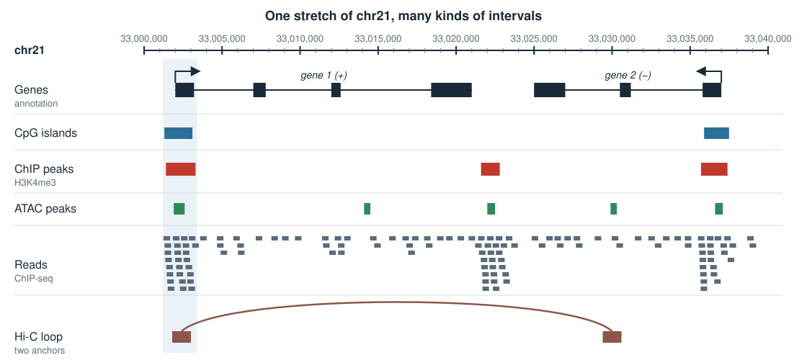{width="95%" fig-align="center"}

- A **genomic interval** is a chromosome, a start, an end and (sometimes) a strand: `chr21:33,000,000–33,002,000 (+)`.
- Genes, exons, promoters, peaks, CpG islands, methylated regions, reads, Hi-C loop anchors: all intervals.
- Questions about biology become questions about intervals: *do my peaks overlap promoters?* *which gene is nearest?* *how many reads fall in each peak?*

::: notes
The point of the figure: the same line (a stretch of chromosome) carries many different kinds of intervals, coming from annotation (genes, CpG islands) and from data (reads, peaks). Once everything is an interval, the same handful of operations answers most questions. Counting reads in peaks, which students will do for differential accessibility, is literally the same as counting reads in genes, which they did for RNA-seq; only the intervals differ.
:::

## A coordinate only means something with its genome build {.smaller}

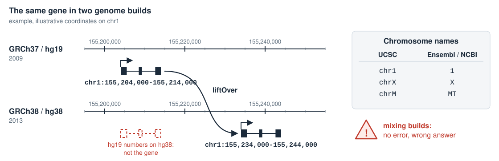{width="90%" fig-align="center"}

- The reference genome is updated: **GRCh37/hg19** (2009) and **GRCh38/hg38** (2013) are both still used. The same gene has different coordinates in each.
- Chromosome names differ too: UCSC writes `chr1`, Ensembl/NCBI write `1`. Mitochondria: `chrM` vs `MT`.
- **Always check that all your files use the same build and the same naming.** Mixing builds gives no error, just wrong answers.
- This course uses **GRCh38** with `chr` names throughout.

::: notes
The most common silent error in interval analysis. bedtools will happily intersect hg19 peaks with hg38 genes and report a few random overlaps. Check the header of the file, the methods section, or test: does a well-known gene's TSS fall where it should? Converting between builds is done with liftOver (later slide), which is lossy. Also mention the newer telomere-to-telomere T2T-CHM13 assembly, which fills the remaining gaps in GRCh38 and is gaining use, but most epigenomic resources (ENCODE, Roadmap) are still in GRCh38 or hg19.
:::

## Two ways to number the bases {.smaller}

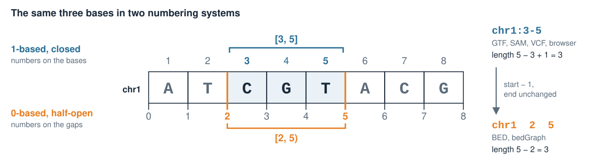{width="90%" fig-align="center"}

- **1-based, closed** $[s, e]$: the first base is 1, and the end base is included. Used by **GTF/GFF, SAM, VCF**, and by genome browsers when they display a position.
- **0-based, half-open** $[s, e)$: count the gaps *between* bases from 0; the interval runs from gap $s$ to gap $e$. Used by **BED, bedGraph, BAM internally**, and most programming languages.
- The bases `CGT` above are `chr1:3-5` in 1-based, `chr1 2 5` in BED. Length: $e - s + 1$ in 1-based, $e - s$ in BED.

::: notes
Draw the ruler on the board. In the 0-based half-open system the numbers label the boundaries between bases, so an interval is "from boundary 2 to boundary 5", which contains the 3rd, 4th and 5th bases. The advantages: length is end minus start, adjacent intervals share an end/start number, and an empty interval (an insertion point) has start = end. Rule for converting: BED start = 1-based start − 1, end is the same number. The UCSC browser displays 1-based but stores 0-based; that is why a BED line chr1 2 5 shows as chr1:3-5. This slide will be on the exam in some form.
:::

## Getting it wrong {.smaller}

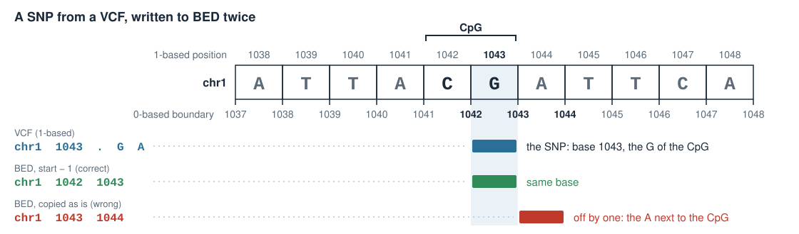{width="85%" fig-align="center"}

- Copy a 1-based position from a VCF into a BED file without subtracting 1 and your SNP sits **one base to the right**: next to the CpG you wanted, not on it.
- For peaks of hundreds of bp an off-by-one hardly matters. For **single bases** (SNPs, CpGs, TSSs, Tn5 insertion sites) it changes the answer.
- Tools convert for you when they read a format they know (`rtracklayer::import` adds 1 to BED starts). Trouble starts when you write files by hand with `awk` or `paste`.

::: notes
A concrete failure, as in the figure: the VCF says the SNP is at 1043 (1-based), the G of a CpG. Written correctly to BED it is chr1 1042 1043; copied as chr1 1043 1044 it sits on the next base, outside the CpG, and an overlap with a CpG list misses it. The same happens to CpG positions from a methylation caller written to BED as pos, pos+1. The fix is boring but important: know which convention each file uses, and convert at the boundary. In the exercise, students make a TSS file with awk from the GTF and have to get exactly this right.
:::

## BED and narrowPeak {.smaller}

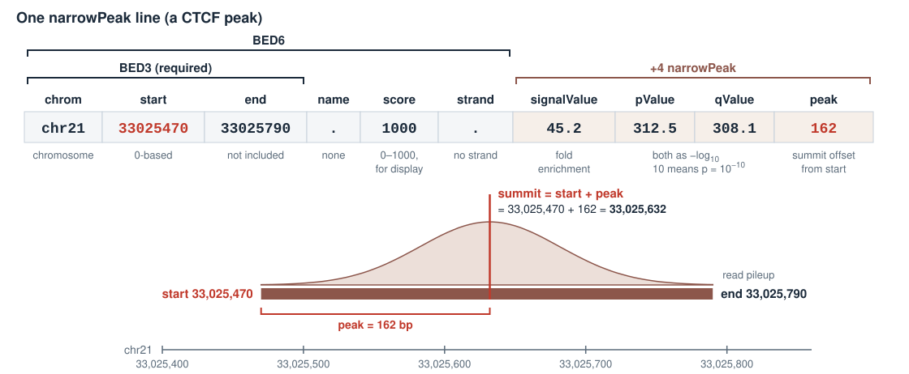{width="95%" fig-align="center"}

- **BED**: tab-separated; three required columns `chrom start end` (0-based), then optional `name score strand` and more.
- **narrowPeak** (BED6+4): what peak callers like MACS write. Adds `signalValue` (enrichment), `pValue` and `qValue` (as $-\log_{10}$), and `peak`: the summit, as an **offset from start**.
- **broadPeak** is the same without the summit column, for broad domains.

::: notes
Walk through the example line (the numbers are illustrative; the exercise starts from real lines of the ENCODE CTCF file). Column 5 (score) is often a scaled integer for display (0–1000) and not a statistic; the statistics are in columns 7–9. pValue and qValue are already −log10, so 10 means 1e-10. Column 10 is easy to misread: it is not a genome coordinate; the summit is start + peak. Summits are useful because the binding site is usually within a few tens of bp of the summit, much narrower than the peak: motif analysis and footprinting use windows around summits. A value of −1 means "not available": the ENCODE CTCF IDR peaks used in the exercise have pValue −1 in every line.
:::

## Annotation: GTF {.smaller}

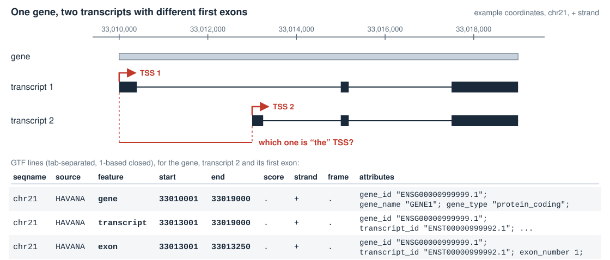{width="95%" fig-align="center"}

- Gene annotation (GENCODE, Ensembl) comes as **GTF/GFF**: one line per feature (`gene`, `transcript`, `exon`, `CDS`, …), **1-based closed**.
- Column 9 holds attributes: `gene_id`, `gene_name`, `gene_type`, `transcript_id`, ….
- A gene has several transcripts, often with **different start sites**. "The TSS of a gene" is a choice: the gene start, every transcript start, or a canonical transcript.

::: notes
Students met GTF files in RNA-seq when counting with featureCounts or building an index, but probably did not look inside. The hierarchy matters: gene lines span all their transcripts; transcripts are made of exons. GENCODE "basic" is a subset with the full-length, well-supported transcripts; we use it to keep files small. The TSS question is a real analysis choice: taking only the gene start can miss alternative promoters, and taking every transcript start counts some promoters many times. In the exercise students use transcript starts of protein-coding transcripts and collapse duplicates.
:::

## Strand: where is upstream? {.smaller}

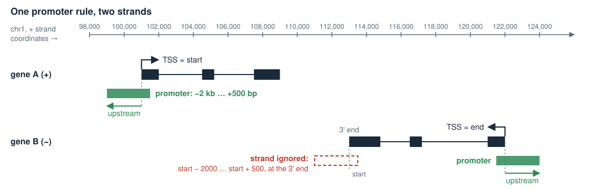{width="95%" fig-align="center"}

- Coordinates always increase left to right along the **+ strand**. A gene on the **−** strand is read right to left.
- TSS = `start` for a + gene, `end` for a − gene. **Upstream** of a − gene means *higher* coordinates.
- "Promoter = 2 kb upstream to 500 bp downstream of the TSS" therefore needs the strand. `GenomicRanges::promoters()` handles it; `bedtools slop -s -l 2000 -r 500` too.

::: notes
The second classic bug after off-by-one. In the figure, gene A is on + and gene B on −; their promoters point in opposite directions. If you build promoters as start − 2000 to start + 500 for every gene, all minus-strand promoters are in the gene body near the 3' end instead. In BED, strand is column 6; in GTF column 7. Peaks from ChIP or ATAC have no strand ("." or "*"), because chromatin has no direction; but the genes they are near do.
:::

## Signal tracks: bedGraph and bigWig {.smaller}

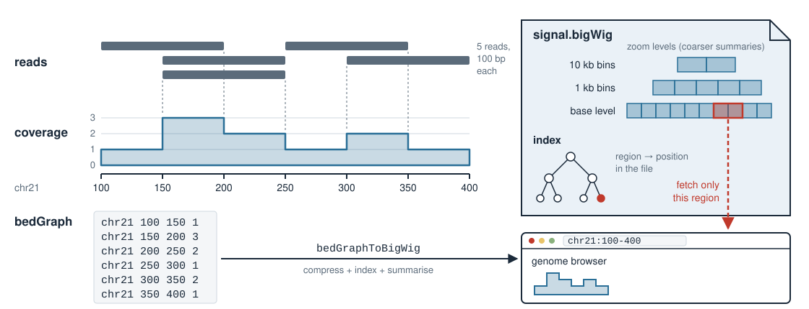{width="95%" fig-align="center"}

- A **signal track** gives a number for every position: reads piled up, divided by a normaliser (CPM, fold change over input).
- **bedGraph**: a BED-like text file, `chrom start end value`, one line per run of constant value.
- **bigWig**: the same data in a compressed, **indexed** binary file, with precomputed summaries at several zoom levels. A browser can fetch just the region on screen, even over the internet.

::: notes
Pileup: count how many reads (or fragments) cover each base. bedGraph compresses runs of equal value into one line. bigWig (Kent et al. 2010) adds an index and zoom levels, which is why a 500 MB bigWig opens instantly in IGV: it reads only the blocks for the current window and the right zoom level. ENCODE provides fold-change and p-value bigWigs for every ChIP experiment; in the chromatin-intro exercise we read regions from them with rtracklayer. Making bigWigs from BAM files is in the reads-to-coverage unit (deepTools bamCoverage).
:::

## The file formats at a glance {.smaller}

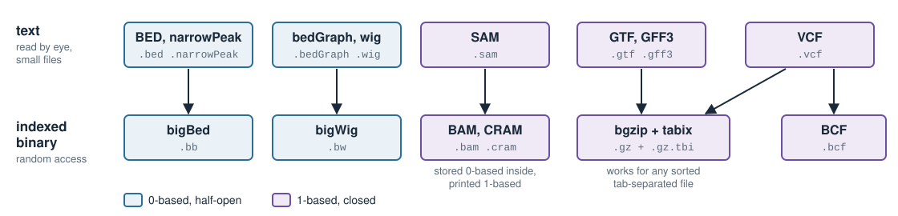{width="90%" fig-align="center"}

| content | text format | indexed binary | coordinates |
|---|---|---|---|
| intervals (peaks, regions) | BED, narrowPeak | bigBed | 0-based |
| signal per position | bedGraph, wig | bigWig | 0-based |
| aligned reads | SAM | BAM, CRAM | 1-based in SAM text |
| annotation | GTF, GFF3 | (tabix-indexed .gz) | 1-based |
| variants | VCF | BCF | 1-based in VCF text |

::: notes
A reference slide. Rule of thumb: text formats are for small files and for reading with your eyes, indexed binary formats are for large files and random access. Any sorted, bgzip-compressed text file can be indexed with tabix for random access, which is how large BED and GTF files are often distributed. BAM stores 0-based positions internally, but samtools view prints 1-based POS in SAM text; again the tools convert for you.
:::

## A genome browser shows intervals and signals together {.smaller}

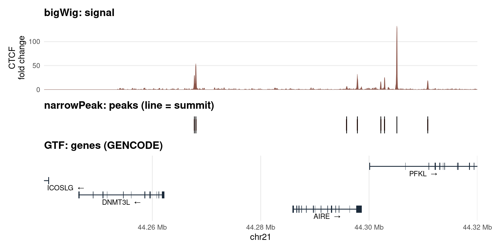{width="95%" fig-align="center"}

- Real data: GM12878 **CTCF** ChIP-seq on chr21. Top: the fold-change bigWig. Middle: the narrowPeak intervals, with summits. Bottom: GENCODE genes.
- Peaks are where the signal is high; a summit sits at the top of each peak.
- IGV (desktop or igv.js in a browser) loads all of these formats directly.

::: notes
This is a reconstruction of an IGV view in R (make-intervals-figs.R) so the exact files can be reproduced; in the exercise students load the same files in IGV. Point out a weak signal bump without a peak: the peak caller decided it was not significant. And point out how narrow CTCF peaks are: CTCF is a sequence-specific TF with a long motif, so its peaks are sharp, unlike the broad H3K27me3 domains in chromatin-intro.
:::

## The basic interval operations {.smaller}

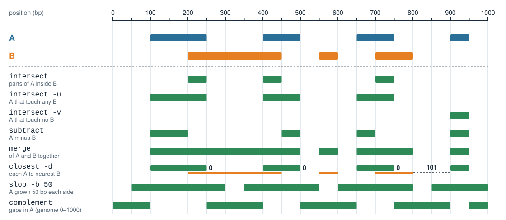{width="95%" fig-align="center"}

- **intersect**: the parts of A that overlap B (or: the A intervals that overlap any B, `-u`).
- **subtract** / `-v`: A minus B, or the A intervals that overlap no B.
- **merge**: collapse overlapping (or nearby, `-d`) intervals into one.
- **closest**: for each A, the nearest B and the distance.
- **slop / flank**: grow intervals, or make windows next to them. **complement**: the gaps.

::: notes
Go through each panel with the toy intervals. These six operations, plus coverage counting, cover most of what students will do. Every one exists in bedtools and in GenomicRanges, with slightly different names (table later). Insist on drawing toy intervals by hand when unsure what a command returns: it is faster than debugging.
:::

## What counts as an overlap? {.smaller}

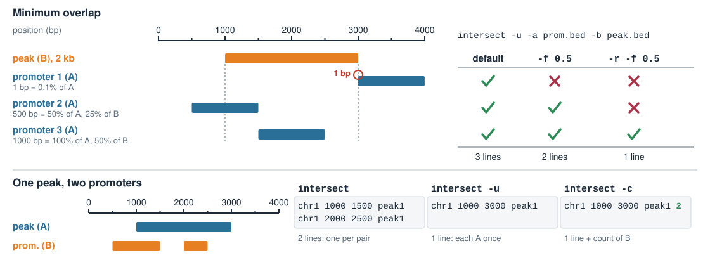{width="90%" fig-align="center"}

- By default, **one shared base** is an overlap. A 1 bp touch between a 2 kb peak and a promoter counts.
- Ask for a minimum: `bedtools intersect -f 0.5` (at least 50% of A), `-r` (reciprocal), or a minimum number of bases (`minoverlap` in R).
- Report choices: one line per pair (default), each A once (`-u`), or count of B per A (`-c`). These give different numbers of "overlapping peaks".

::: notes
Students are often surprised that "how many peaks overlap promoters" depends on these flags. Default intersect reports one line per overlapping pair, and each line is the overlapping *piece*, not the whole A interval (use -wa for whole intervals). A peak overlapping two promoters appears twice: if you count lines you overcount peaks. -u fixes that. In the figure the roles of A and B swap between the panels: in the left panel A is the promoters, because -f is a fraction of A. Fraction requirements matter most when comparing peak sets of different widths, for example narrow TF peaks against broad domains. There is no universally right choice; the rule is to state it in the methods.
:::

## Sorting and merging {.smaller}

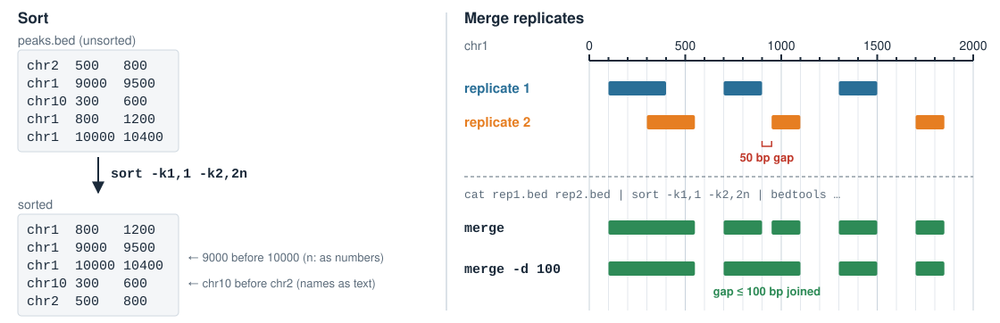{width="90%" fig-align="center"}

- Most tools that walk along the genome need input **sorted by chromosome, then start**: `sort -k1,1 -k2,2n`.
- `bedtools merge` collapses overlapping intervals: e.g. peaks from two replicates into one **consensus** set.
- Merging loses the per-interval information unless you ask for it (`-c 5 -o max`, keep the maximum score).

::: notes
Sorting: -k1,1 sorts by the first column only (as text), -k2,2n by the second column numerically. Lexical chromosome order (chr1, chr10, chr11, …, chr2) is fine for bedtools, as long as all files use the same order; some tools (bedtools with -g, bigWig tools) want the order of a genome file. Merging peaks from replicates or conditions into a consensus set is the first step of differential accessibility: you need one common set of regions to count reads in.
:::

## Nearest feature and distance {.smaller}

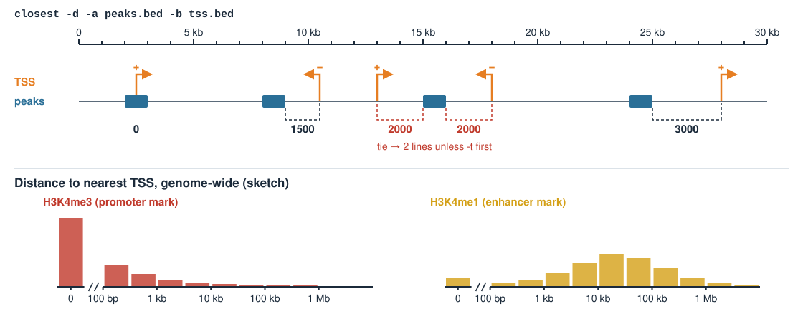{width="90%" fig-align="center"}

- `bedtools closest -a peaks.bed -b tss.bed -d` reports, for each peak, the nearest TSS and the distance (0 if they overlap).
- Ties (two TSSs at the same distance) give several lines per peak; `-t first` keeps one.
- The **distribution** of distances says what kind of element a mark labels: promoter marks sit at 0, enhancer marks kilobases away.

::: notes
Both files must be sorted. For non-overlapping intervals bedtools reports one more than the number of bases between them (the toy A [900,950) and B [700,800) in the operations figure: 100 bases apart, reported as 101). A signed distance relative to the gene's direction (-D b) tells upstream from downstream, useful for promoter analyses. Nearest gene is the naive way to assign a peak to a gene; it is right perhaps half the time for enhancers. The integration unit uses Hi-C contacts and activity to do better (ABC model).
:::

## Windows around intervals {.smaller}

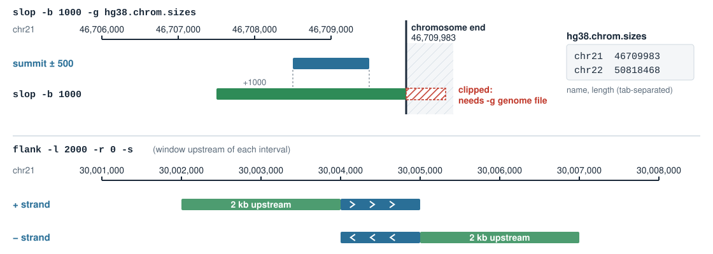{width="90%" fig-align="center"}

- `slop` extends each interval (e.g. ±1 kb around a summit), `flank` makes windows next to it (e.g. the 2 kb upstream), both strand-aware with `-s`.
- Near a chromosome end, a window would run off the end: these tools need a **genome file** with chromosome lengths (`-g hg38.chrom.sizes`) and clip at the end.

::: notes
Note that flank needs both sides (-l 2000 -r 0); -l alone is an error. The genome file is a two-column text file: chromosome name and length. Download it from UCSC (hg38.chrom.sizes) or make it from a FASTA index (cut -f1,2 genome.fa.fai). The same file is needed for complement, shuffle and genomecov. In R, GRanges carries the chromosome lengths in its seqinfo, and trim() clips out-of-bound ranges.
:::

## bedtools on the command line

```bash
# promoter windows: 1 kb either side of each protein-coding TSS
bedtools slop -i tss.bed -g hg38.chrom.sizes -b 1000 > promoters.bed

# H3K4me3 peaks at a promoter (each peak once) vs. not
bedtools intersect -u -a h3k4me3.bed -b promoters.bed | wc -l
bedtools intersect -v -a h3k4me3.bed -b promoters.bed | wc -l

# candidate enhancers: H3K27ac peaks with no H3K4me3 peak and away from TSSs
bedtools intersect -v -a h3k27ac.bed -b h3k4me3.bed \
  | bedtools intersect -v -a - -b promoters.bed > enhancers.bed

# distance from every enhancer to its nearest TSS
sort -k1,1 -k2,2n enhancers.bed | bedtools closest -a - -b tss.bed -d -t first
```

- Every command reads and writes plain text, so they **chain with pipes** (`-` means standard input).

::: notes
These are the exact commands of the exercise, so students see the shape before they type them. The enhancer definition (H3K27ac without H3K4me3, distal from promoters) is a common heuristic and a useful example of building a biological category from interval operations. Point out that wc -l counts lines; with -u each peak appears once, so lines = peaks.
:::

## Real data: where do the peaks sit? {.smaller}

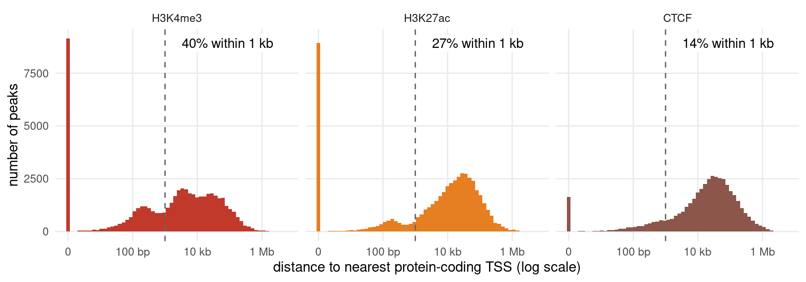{width="90%" fig-align="center"}

- Distance from each GM12878 peak to the nearest protein-coding TSS.
- **H3K4me3** peaks pile up at the TSS. **H3K27ac** is at TSSs *and* at distal enhancers. **CTCF** is mostly far from TSSs.

::: notes
The x axis is log scale (distance + 1). Read the figure as the answer to "what does this mark label?". The H3K4me3 distribution confirms the promoter mark from chromatin-intro with real data. H3K27ac is bimodal: active promoters and active enhancers. CTCF sites are insulators and loop anchors and are spread through the genome. Numbers on the plot (fraction within 1 kb) are computed in make-intervals-figs.R; students reproduce them in the exercise.
:::

## Is an overlap more than chance? {.smaller}

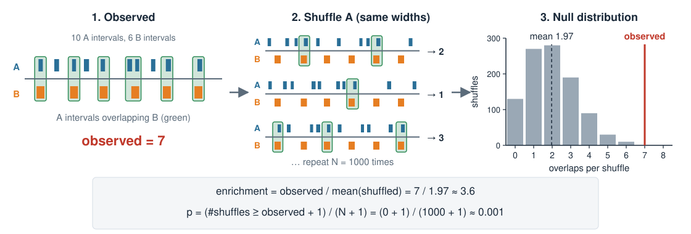{width="90%" fig-align="center"}

- Two sets of intervals will overlap somewhat **by chance**, more so if they are wide or numerous. A raw overlap count is not evidence.
- **Null by shuffling:** place the same intervals (same widths) at random positions, count overlaps, repeat many times. Compare the observed count with this distribution.
- Enrichment = observed / mean of shuffled. Empirical p-value = (number of shuffles with at least the observed overlap + 1) / (number of shuffles + 1).

::: notes
This is a permutation test, the same idea as in any statistics course, applied to positions on the genome. bedtools shuffle does one shuffle; repeat it in a loop. The p-value can be no smaller than 1/(number of shuffles + 1), so 100 shuffles can at best give about 0.01. For large enrichments, report the fold enrichment and say that none of the N shuffles reached the observed value. Next slide: the real numbers.
:::

## Real data: H3K27ac and CTCF overlap more than chance {.smaller}

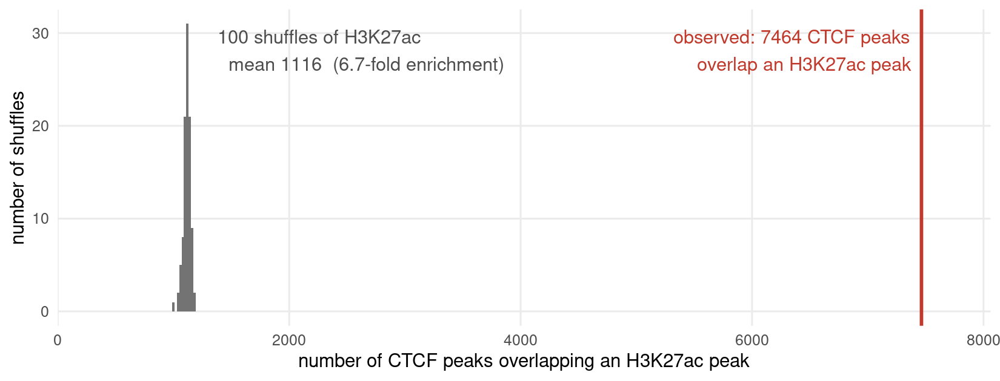{width="85%" fig-align="center"}

- Grey: overlaps between CTCF peaks and **shuffled** H3K27ac peaks (100 shuffles, same chromosome, same widths). Red: the observed overlap.
- The observed overlap is far outside the shuffled distribution: the two sets are associated.

::: notes
Numbers in the figure come from make-intervals-figs.R. A good discussion point: why do CTCF and H3K27ac co-occur at all, when CTCF is an insulator? Some CTCF sites are at active promoters and enhancers; others are not. The overlap is significant but partial, which a single p-value hides: report the fraction too.
:::

## Shuffling has assumptions {.smaller}

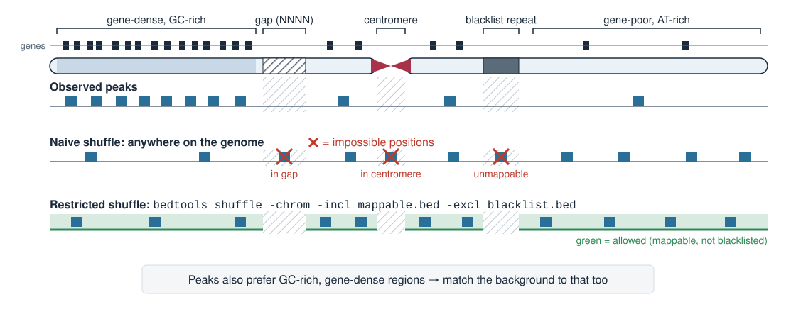{width="90%" fig-align="center"}

- A naive shuffle puts intervals in **gaps** (runs of N), centromeres and unmappable repeats, where real peaks can never be. This inflates enrichment.
- Keep shuffled intervals **on the same chromosome** (`-chrom`) and inside the mappable, non-blacklisted genome (`-incl` / `-excl`).
- Peaks also prefer GC-rich, gene-dense regions. The more of that structure the null ignores, the more "significant" everything looks. Choose the **background** with care; state it.

::: notes
The general lesson: a p-value is only as good as its null. Here the null is "the intervals could have been anywhere", and "anywhere" includes places where no assay can produce a peak. Better nulls restrict to the accessible genome, or match on GC content and distance to TSS. Tools such as regioneR (R) and LOLA formalise this; the idea is the same. The same issue comes back with motif enrichment (GC-matched background) and in the ML units (matched negatives).
:::

## Intervals in R: GRanges {.smaller}

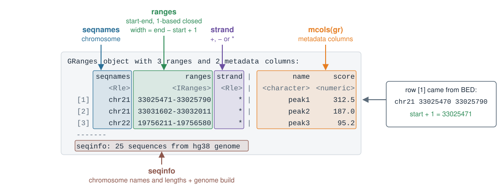{width="95%" fig-align="center"}

- `GRanges` (package **GenomicRanges**): `seqnames`, `ranges` (start, end, width, **1-based closed**), `strand`, and any metadata columns (`mcols`).
- `seqinfo` holds chromosome names, lengths and genome build: R refuses to compare ranges from different builds if they are set.
- `rtracklayer::import()` reads BED, narrowPeak, GTF and bigWig, and converts BED's 0-based starts to 1-based.

::: notes
GRanges is the Bioconductor container for intervals and is used under the hood by DESeq2's rowRanges, ChIPseeker, DiffBind, csaw, minfi, and many more. Students used SummarizedExperiment through DESeq2; its rowRanges is a GRanges. The seqinfo check is a nice safety net: genome(gr) <- "hg38" on both objects and a comparison with an hg19 object fails loudly instead of silently.
:::

## findOverlaps returns pairs

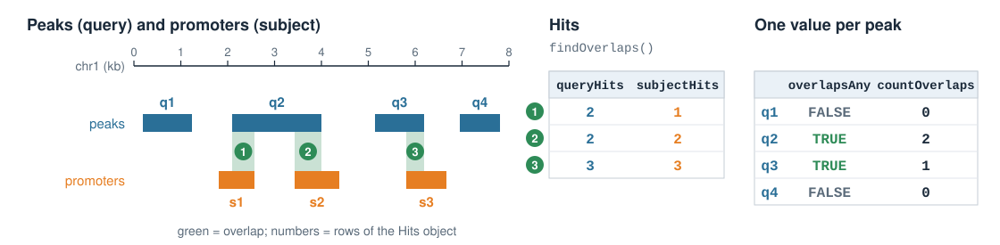{width="90%" fig-align="center"}

```r
hits <- findOverlaps(peaks, promoters)      # one row per overlapping pair
queryHits(hits); subjectHits(hits)          # indices into peaks and promoters
peaks[unique(queryHits(hits))]              # each peak once
overlapsAny(peaks, promoters)               # TRUE/FALSE per peak (= bedtools -u)
countOverlaps(peaks, promoters)             # number of promoters per peak (= -c)
```

::: notes
findOverlaps is the general operation; everything else is a convenience on top. The Hits object is a two-column table of indices, like a sparse matrix of overlaps. This is the same many-to-many issue as with bedtools default output: one peak can hit several promoters. subsetByOverlaps(peaks, promoters) is the R equivalent of intersect -u.
:::

## bedtools ↔ GenomicRanges {.smaller}

| task | bedtools | GenomicRanges |
|---|---|---|
| A that overlap B | `intersect -u` | `subsetByOverlaps(A, B)` |
| A that do not overlap B | `intersect -v` | `A[!overlapsAny(A, B)]` |
| all overlapping pairs | `intersect -wa -wb` | `findOverlaps(A, B)` |
| merge overlapping | `merge` | `reduce(A)` |
| nearest and distance | `closest -d` | `distanceToNearest(A, B)` |
| windows around TSS | `slop -s -l -r` / `flank` | `promoters(A, upstream, downstream)`, `flank()`, `resize()` |
| gaps | `complement` | `gaps(A)` |
| count per interval | `intersect -c`, `coverage` | `countOverlaps(A, B)` |

- Use the command line for big files and pipelines, R for analysis, statistics and plots. The answers must agree (exercise R5).

::: notes
A reference table; students do not need to memorise it. The key differences: GRanges is 1-based, bedtools 0-based (the numbers in the files differ by one at the start, the bases are the same); reduce() and findOverlaps() respect strand unless you say ignore.strand = TRUE (peaks have strand *, which overlaps both strands, so it rarely bites); distances differ by one: for two ranges that do not overlap, distanceToNearest reports the number of bases between them (0 for directly adjacent ranges), bedtools closest -d reports one more (1 for adjacent). Both report 0 for overlapping ranges. Small differences like these are why comparing the two in the exercise is instructive.
:::

## Same bases, different numbers {.smaller}

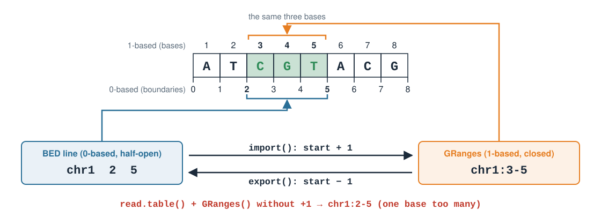{width="85%" fig-align="center"}

- The BED line `chr1  2  5` and the GRanges `chr1:3-5` are the **same three bases**.
- `rtracklayer::import()` and `export()` convert in both directions. If you read a BED file with `read.table()` and build a GRanges yourself, **add 1 to the start**.

::: notes
The single most common bug when students mix R and the command line: reading a BED with read.table or fread and calling GRanges(chr, IRanges(start, end)) without adding 1. Then every range is 1 bp too long on the left. For peaks it is harmless; for CpGs or SNPs it is wrong. makeGRangesFromDataFrame has a starts.in.df.are.0based argument for exactly this.
:::

## Moving between builds: liftOver {.smaller}

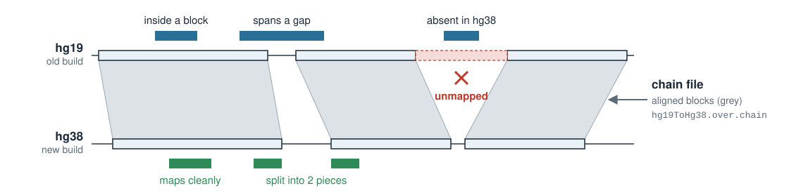{width="90%" fig-align="center"}

- **liftOver** maps intervals from one build to another using a **chain file** of aligned blocks (UCSC tool; `rtracklayer::liftOver` in R).
- Some intervals **fail** (deleted or rearranged in the new build) or **split** into pieces. Check how many you lose.
- Better, when possible: re-align the raw reads to the new build, or download the data already processed in the build you need.

::: notes
Chain files list blocks of sequence that align between builds and the gaps between them. An interval that spans a gap in the alignment comes out split or not at all. For small intervals (SNPs, CpGs, narrow peaks) liftOver is usually fine; for broad domains and anything near rearranged regions, be careful. ENCODE has reprocessed its data on GRCh38, which is why we use their GRCh38 files directly.
:::

## Summary {.smaller}

| idea | key fact |
|---|---|
| intervals | chrom, start, end, strand; same build and same chromosome names in every file |
| 0-based half-open | BED, bedGraph: length = end − start; first base is 0 |
| 1-based closed | GTF, SAM, VCF, GRanges, browser display: first base is 1 |
| narrowPeak | BED6 + signalValue, −log10 p, −log10 q, summit offset from start |
| bigWig | indexed binary signal track; read only the region you need |
| strand | TSS and upstream depend on strand; peaks have none |
| bedtools | intersect (-u, -v, -c, -f), merge, closest, slop/flank (-g), shuffle |
| GenomicRanges | findOverlaps, subsetByOverlaps, reduce, distanceToNearest, promoters |
| overlap statistics | compare with shuffled intervals; the null decides the answer |

::: notes
Students should leave able to convert a coordinate between conventions by hand, read a narrowPeak line, build strand-aware promoter windows, answer an overlap question with both bedtools and GRanges, and explain why an overlap count needs a null. Next: from reads to coverage, where these intervals come from.
:::

## Key papers (optional further reading) {.smaller}

*Not required reading and not examined. For those who want the primary literature.*

- Quinlan & Hall 2010, *Bioinformatics*. [BEDTools: a flexible suite of utilities for comparing genomic features](https://doi.org/10.1093/bioinformatics/btq033). The tool of this unit.
- Lawrence et al. 2013, *PLoS Comput Biol*. [Software for computing and annotating genomic ranges](https://doi.org/10.1371/journal.pcbi.1003118). GenomicRanges and the Bioconductor interval infrastructure.
- Li et al. 2009, *Bioinformatics*. [The Sequence Alignment/Map format and SAMtools](https://doi.org/10.1093/bioinformatics/btp352). The SAM/BAM formats.
- Kent et al. 2010, *Bioinformatics*. [BigWig and BigBed: enabling browsing of large distributed datasets](https://doi.org/10.1093/bioinformatics/btq351). Why a bigWig opens instantly.
- Frankish et al. 2019, *Nucleic Acids Res*. [GENCODE reference annotation for the human and mouse genomes](https://doi.org/10.1093/nar/gky955). The annotation we use.
- ENCODE Project Consortium 2020, *Nature*. [Expanded encyclopaedias of DNA elements in the human and mouse genomes](https://doi.org/10.1038/s41586-020-2493-4). Where the course data come from.
