## About this lecture

*Hi-C: from reads to contact matrices* ended with a balanced matrix and its expected value at each distance. This lecture turns that matrix into the three features of *3D genome organisation*, and checks them against other data.

- **Compartments**: the first eigenvector of the correlation matrix, its sign, and the **saddle plot**.
- **Domains**: the **insulation score**, boundaries, and why domain callers disagree.
- **Loops**: **dot calling** against a local background, the **CTCF orientation** at anchors, and **aggregate peak analysis** (APA).
- Briefly: **differential Hi-C**, and what Micro-C, HiChIP and Capture-C add.

::: notes
All real-data figures use GM12878 in situ Hi-C (Rao et al. 2014, all replicates), as reprocessed by ENCODE on GRCh38, reduced to chr19 and chr21 (the file gm12878_hic_chr19_chr21.mcool, 5 kb to 500 kb, ICE-balanced). The tools are from the open2c ecosystem: cooler for the matrices and cooltools for the analyses, all in Python; the CTCF motif step uses motifmatchr in R as in *Gene regulation*. Everything is computed in make-hicfeatures-figs.py and the exercise repeats it. The point of the unit is not the tools but the logic of each feature and its limits: every feature is a summary of a population average, and every caller has parameters that change the answer.
:::

## Three features, three kinds of caller {.smaller}

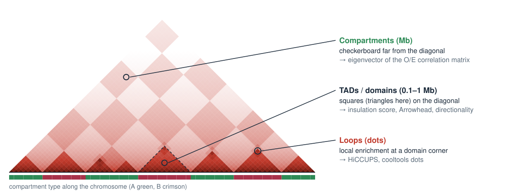{width="92%" fig-align="center"}

- Each feature is a different **deviation from the expected** contact frequency at a given distance.
- Compartments: long-range, **Mb**. Domains: blocks on the diagonal, **0.1–1 Mb**. Loops: single pixels, **10–100s of kb**.
- So each needs its own resolution and its own statistic.

::: notes
A reminder of the map vocabulary from *3D genome organisation*. Compartments are visible at 100 kb–1 Mb and need relatively few reads; domains need 10–50 kb; loops need 5–10 kb bins and therefore deep data (Rao et al. used about 4.9 billion contacts for GM12878; the ENCODE reprocessing we use has 4.6 billion with MAPQ ≥ 30). All three start from the balanced matrix and the expected value per diagonal, P(s), computed in the previous unit. Under the arrows are the most widely used algorithms; there are dozens more, especially for domains.
:::

## Compartments: from map to eigenvector {.smaller}

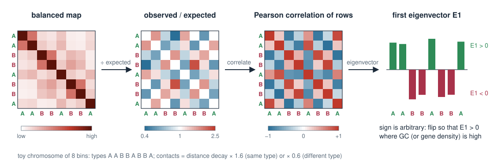{width="96%" fig-align="center"}

- Divide by the expected value per diagonal: **observed / expected** (O/E) removes the distance decay.
- Correlate every row with every other: bins of the same type have **similar contact profiles**.
- The **first eigenvector** (E1) of that correlation matrix splits bins into two groups: its sign is the compartment.

::: notes
Lieberman-Aiden et al. 2009 introduced this recipe. Why the correlation step: an A bin contacts other A bins more than expected, wherever they are, so the rows of two A bins look alike, and the correlation matrix shows a sharp checkerboard. The eigenvector with the largest eigenvalue captures the main pattern of variation: in most chromosomes that is A versus B. Modern implementations (cooltools eigs_cis) compute the eigenvector of the O/E matrix itself, after centring, and give equivalent results; they do it per chromosome or per chromosome arm. The toy numbers in the figure: bins of the same type contact 1.6 times more than the distance decay predicts, bins of different type 0.6 times; E1 comes out positive for the A bins and explains 66% of the variance in the toy.
:::

## Real data: chr19 {.smaller}

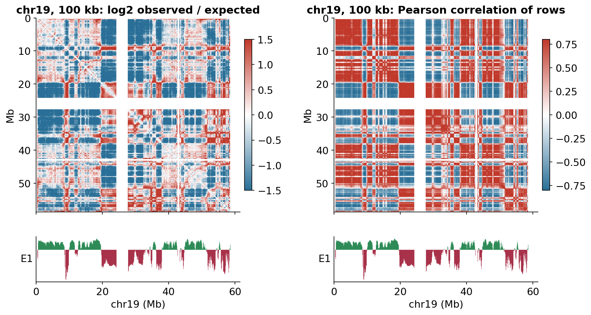{width="86%" fig-align="center"}

- O/E (left): red where bins contact more than expected at their distance, blue where less. The correlation (right) turns it into a crisp checkerboard.
- E1 at 100 kb: **57%** of chr19 is A (positive), **46%** of chr21.

::: notes
Both panels are chr19 at 100 kb, from the ENCODE map. The white bands are bins masked by balancing (the centromere at about 24–28 Mb and a few repeat-rich bins). The E1 track below is the same for both panels (it is computed once). Note how many sharp switches there are: compartment segments on chr19 are often only a few hundred kb to a few Mb long. In the exercise students compute E1 for both chromosomes; cooltools also returns E2 and E3, which sometimes carry the A/B pattern instead of E1 (next slides).
:::

## Which sign is A? {.smaller}

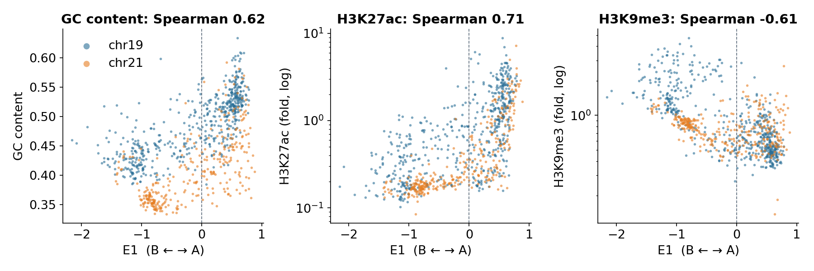{width="96%" fig-align="center"}

- The sign of an eigenvector is **arbitrary**. Orient it with a track that differs between A and B: **GC content** or **gene density** (no other data needed), or active marks.
- Here E1 was phased by GC: Spearman ρ = **0.62** with GC, **0.71** with H3K27ac, **−0.61** with H3K9me3 (chr19 + chr21, 100-kb bins).
- Our E1 agrees with ENCODE's own eigenvector: ρ = **0.97** (chr19) and **0.90** (chr21).

::: notes
A numerical eigensolver may return E1 or −E1; cooltools flips it so that it correlates positively with the phasing track (here GC content per bin, computed from hg38 with bioframe). Without phasing, half of the chromosomes in a genome-wide analysis would have A and B swapped, a classic bug. The relation with the marks is strong but not perfect: H3K27ac is a peak mark, and much of A has little of it; H3K9me3 marks only part of B (the rest is H3K27me3-rich or simply quiet, lamina-associated chromatin). The chr19 points in the top left of the H3K9me3 panel are B bins in the large KRAB zinc-finger gene clusters, which carry H3K9me3; chr21's B is mostly quiet, gene-poor DNA with low H3K9me3, so on chr21 E1 correlates weakly with H3K9me3 (ρ = −0.31) but strongly with H3K27ac (0.84). The ENCODE eigenvector was computed by Juicer at 10 kb, our E1 by cooltools at 100 kb.
:::

## Pitfalls of the eigenvector {.smaller}

- **E1 is not always A/B.** If a chromosome has a strong arm effect (centromere) or a large domain of its own, E1 can capture that and A/B moves to E2. Check: which eigenvector correlates with GC? (Here E1: ρ = 0.78 and 0.64; E2: 0.15 and 0.11.)
- **Compute per arm**, not per chromosome, when the centromere splits the chromosome in two: `eigs_cis(..., view_df=arms)`.
- **Resolution:** at 1 Mb, small A or B segments vanish; at 10 kb, too few contacts per bin for a stable correlation unless the data are very deep.
- **Only a sign, not a state:** two compartments are a simplification. Rao et al. 2014 found **six subcompartments** with distinct marks; newer methods use clustering of trans contacts.

::: notes
A text slide of practical advice. Eigenvalues for our data: chr19 299, 142, 122 for E1–E3; chr21 140, 84, −67: E1 dominates in both. On chromosomes like chr4 or chr9 in some cell types, the first eigenvector reflects the p- vs q-arm difference rather than A/B, which is why cooltools recommends the arms view (bioframe.make_chromarms with centromere positions). Subcompartments (A1, A2, B1–B4) were called by clustering interchromosomal contact profiles, possible only with very deep data; tools such as Calder and dcHiC do this from intrachromosomal data. Students should know that "A/B" is a two-state summary of a continuum.
:::

## Saddle plots: how strong are compartments? {.smaller}

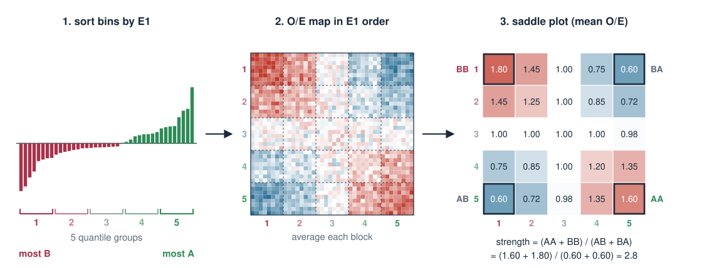{width="94%" fig-align="center"}

- Sort bins by E1, split them into groups, and average O/E for every pair of groups.
- **Compartment strength** = (AA + BB) / (AB + BA): how much more like contacts like.
- Used to compare conditions: e.g. stronger after cohesin loss, weaker after WAPL loss.

::: notes
The saddle plot is named after its shape: high in two opposite corners (B–B and A–A), low in the other two. Each cell is a mean O/E over all pairs of bins in the two groups (only cis contacts, away from the diagonal). The strength statistic varies between papers: some use the extreme 20% of bins, some the full plot; always compare like with like, at the same resolution and depth. The toy numbers in the concept figure give (1.6 + 1.8)/(0.6 + 0.6) = 2.8.
:::

## Real data: a saddle plot {.smaller}

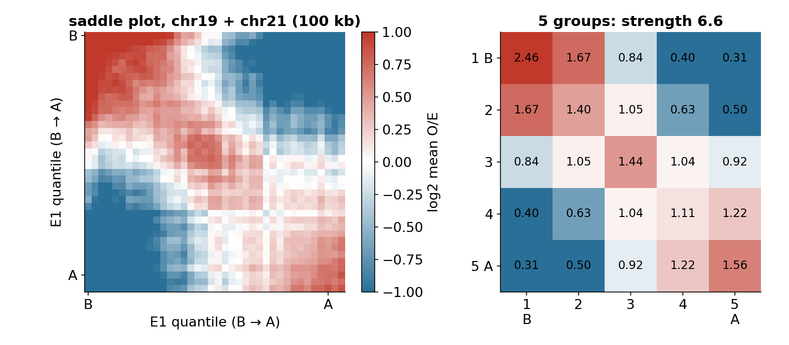{width="86%" fig-align="center"}

- chr19 + chr21, 100 kb. B–B contacts are **2.5×** expected, A–A **1.6×**, A–B only **0.3×**.
- Strength with five groups: (2.46 + 1.56) / (0.31 + 0.31) = **6.6**. B is more self-associated than A here.

::: notes
Left: the cooltools saddle with 38 quantile bins of E1 (the 2.5% most extreme bins at each end are dropped); right: the same with 5 groups and the mean O/E printed. The asymmetry (B–B stronger than A–A) is common: heterochromatin compacts and self-associates strongly, which fits the view that heterochromatin–heterochromatin attraction drives compartmentalisation (Falk et al. 2019). The middle group (3) is near 1 with everything: bins with E1 near zero are mixed or switch between cells. Compute the same number for two conditions with the same E1 groups to compare compartment strength.
:::

## Domains: the insulation score {.smaller}

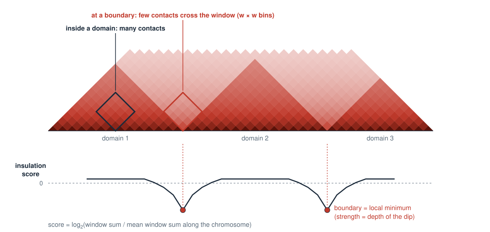{width="78%" fig-align="center"}

- Slide a square window of $w \times w$ bins along the diagonal and sum the contacts that **cross** each position.
- Inside a domain many contacts cross; at a **boundary** few do. The score is log2(window sum / chromosome mean).
- **Boundaries** = local minima; their **strength** = depth of the dip relative to the flanks.

::: notes
The insulation score was introduced by Crane et al. 2015 (in C. elegans dosage compensation) and is the most widely used, because it is simple, transparent and robust. The window is placed just off the diagonal, covering contacts between the w bins upstream and the w bins downstream of the position. cooltools.insulation computes it on the balanced matrix and calls boundaries as local minima whose prominence (boundary strength) passes a threshold chosen automatically (Li's or Otsu's method). Related scores: the directionality index of Dixon et al. 2012 (upstream versus downstream bias, the basis of the original TAD calls), and the Arrowhead transform of Rao et al. 2014.
:::

## Real data: insulation along chr21 {.smaller}

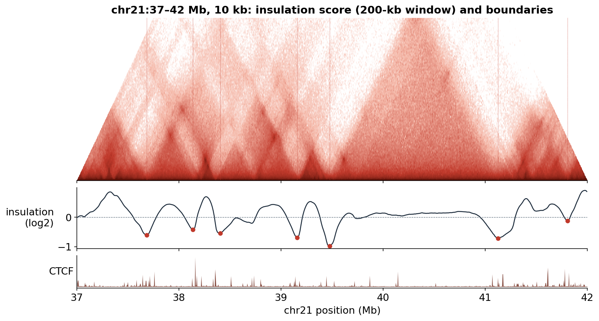{width="90%" fig-align="center"}

- 10-kb bins, 200-kb window: **7** boundaries in this 5-Mb window; the dips line up with the edges of the triangles.
- On chr19 + chr21: **160** boundaries; **66%** lie within 10 kb of a CTCF peak summit, against **39%** of random bins.

::: notes
The same window of chr21 as in *3D genome organisation* (37–42 Mb). Each red dot is a called boundary; the dotted lines carry it up into the map. Several shallower dips (e.g. at about 38.6 and 41.4 Mb) are not called: they do not pass the threshold, a choice. The random-bin rate is high because chr19 has a very high density of CTCF peaks (it is gene-dense), so a 30-kb window often contains one; the enrichment is what matters. The large block between 39.6 and 41.2 Mb has a flat score: it is one large domain (Arrowhead did not call it; see *3D genome organisation*).
:::

## The window decides what you find {.smaller}

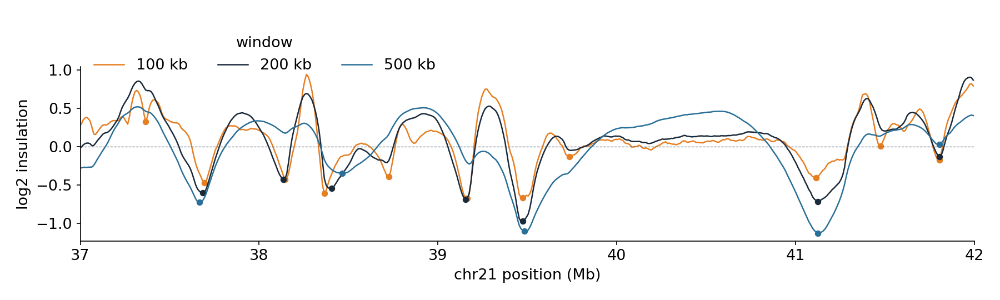{width="96%" fig-align="center"}

- Small windows (**100 kb**) find many, finer boundaries (**11** here); large windows (**500 kb**) only the strongest (**5**).
- Genome-wide on chr19 + chr21: **261**, **160** and **98** boundaries for 100, 200 and 500 kb.
- Domains are **nested**: there is no single right answer, only a scale.

::: notes
This is the main reason TAD callers disagree (next slides): each has a characteristic scale, set by a window, a resolution or a penalty. The boundaries at 39.5 and 41.1 Mb appear at every scale: strong, robust boundaries. Several at 100 kb are sub-domain boundaries within larger domains. A practical recommendation: report the window and resolution, use several, and prefer boundary strength (a continuous value) over a binary call when comparing conditions.
:::

## Boundaries are CTCF sites {.smaller}

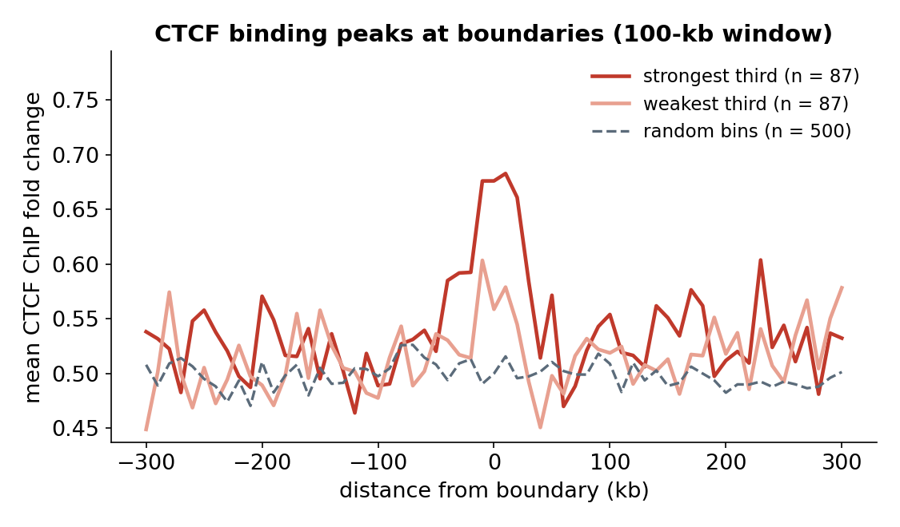{width="70%" fig-align="center"}

- Mean CTCF ChIP-seq signal around the 261 boundaries (100-kb window): a peak centred on the boundary, clear for the **strongest** third (fold change 0.68 vs 0.54 at 300 kb), weak for the weakest third.
- Fits the extrusion model: CTCF stops cohesin, so contacts across the site are depleted.
- Not every boundary has CTCF: active promoters and transcribed genes also insulate, more weakly.

::: notes
Profiles of the ENCODE CTCF fold-change track (mean over boundaries) at the 100-kb-window boundaries, split into thirds by boundary strength, against random bins. Dixon et al. 2012 first reported CTCF enrichment at TAD boundaries, together with housekeeping genes, tRNA genes and SINE elements. Strong boundaries often have several CTCF sites in a cluster, in both orientations (divergent sites stop cohesin coming from either side). Weak boundaries can come from transcription itself or from compartment transitions. Exact numbers are printed by make-hicfeatures-figs.py.
:::

## Domain callers disagree {.smaller}

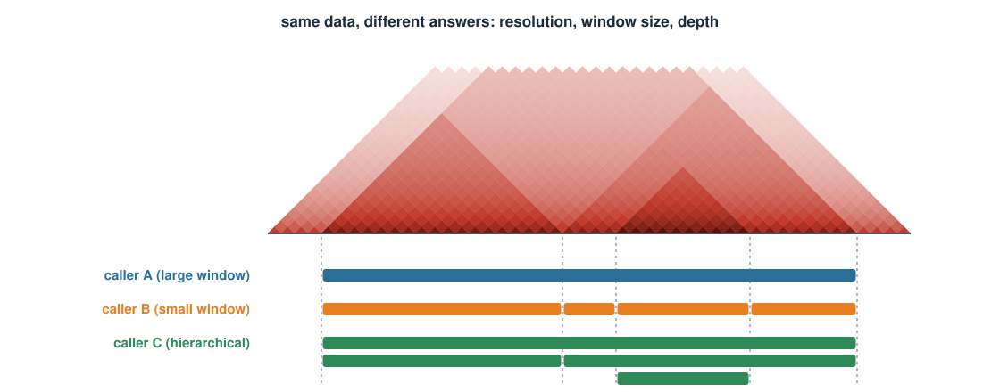{width="84%" fig-align="center"}

- Same data, different answers: callers differ in **scale**, in whether domains may **nest** or leave **gaps**, and in how they treat sparse data.
- Our 200-kb boundaries vs ENCODE's Arrowhead domains (chr19 + chr21): **81%** of our boundaries are near an Arrowhead edge; only **32%** of Arrowhead edges are near one of our boundaries.
- Benchmarks (Forcato et al. 2017; Zufferey et al. 2018) found low agreement between callers, and between resolutions.

::: notes
Arrowhead (Rao et al. 2014) calls nested domains of many sizes: 450 domains with 843 distinct edges on chr19 + chr21, far more than our 160 single-scale boundaries, so most of its edges have no partner among ours, while most of ours are also found by Arrowhead. Neither is wrong. Advice for reading papers: if a claim depends on "the TADs", ask which caller, which resolution, and whether the result holds with another. For differential analysis, compare continuous insulation scores or boundary strengths rather than overlaps of binary calls.
:::

## Loops: calling dots {.smaller}

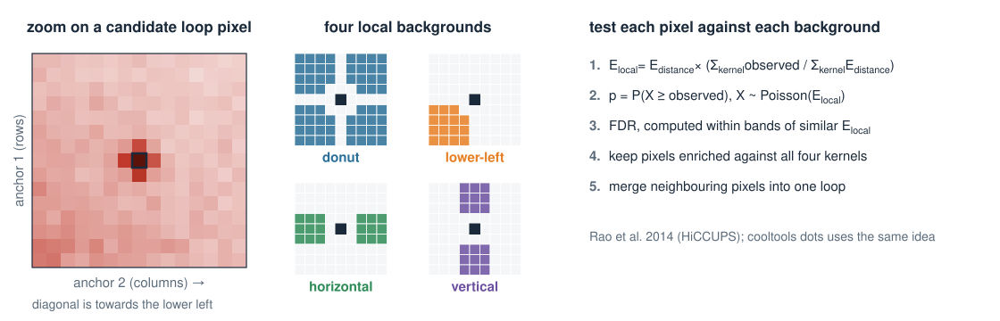{width="96%" fig-align="center"}

- A loop is a pixel **enriched over its local neighbourhood**, not just over the average at its distance (a domain corner is already above that average).
- HiCCUPS: four local backgrounds (donut, lower-left, horizontal, vertical); Poisson test of the count against each; FDR; neighbouring pixels merged.

::: notes
Rao et al. 2014 designed HiCCUPS for kilobase-resolution maps. The expected value for a pixel is its distance-expected value adjusted by the ratio of observed to expected contacts in the surrounding kernel, so a pixel inside a domain is compared with other pixels of that domain. The four kernels guard against different artefacts: the donut against domain enrichment, lower-left against the stronger signal towards the diagonal, horizontal and vertical against stripes. Because expected values vary over orders of magnitude, the FDR is controlled separately in bands of similar expected value ("lambda chunking"). cooltools.dots re-implements this idea; other callers include Mustache (scale-space), Peakachu (machine learning), and SIP (image analysis).
:::

## Real data: our dots and ENCODE's {.smaller}

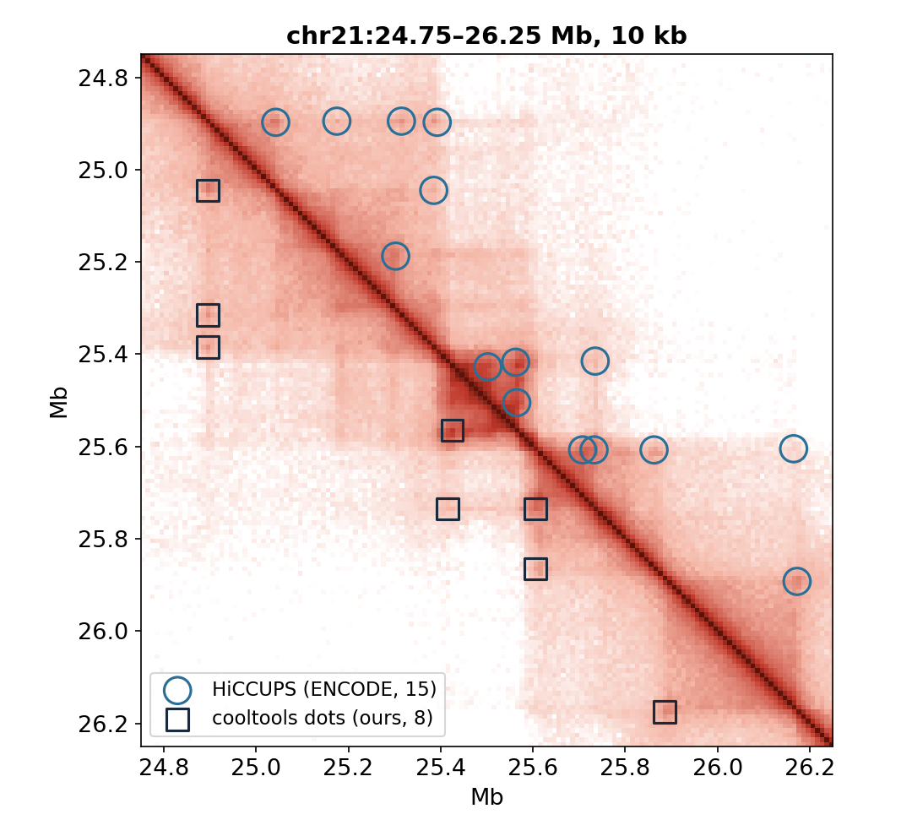{width="52%" fig-align="center"}

- cooltools dots at 10 kb on chr19 + chr21: **178** dots; **96%** of them match an ENCODE HiCCUPS loop (both anchors within 20 kb).
- HiCCUPS found **533** loops on these chromosomes (5, 10 and 25 kb combined); we recover **35%** of those spanning ≤ 2 Mb.

::: notes
Upper triangle: ENCODE's HiCCUPS loops; lower triangle: our cooltools dots, on chr21:24.75–26.25 Mb, the window of the loop slide in *3D genome organisation*. Most of our dots are real loops by this criterion; we find fewer because we used a single resolution (10 kb), a stricter default threshold, and only distances up to 2 Mb, while HiCCUPS merged calls from 5, 10 and 25 kb. As with domains, the number of loops is a function of depth, resolution and threshold, not a fixed property of the cell type.
:::

## Loop anchors: convergent CTCF motifs {.smaller}

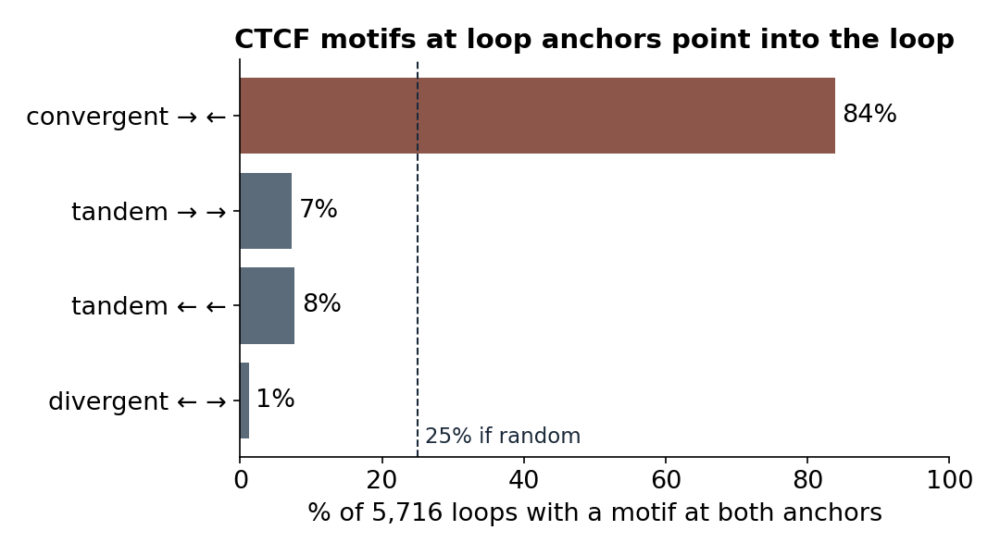{width="66%" fig-align="center"}

- For each anchor of the **14 599** ENCODE loops: the strongest CTCF peak with a motif, and the motif's strand.
- Of **5 716** loops with a motif at both anchors, **84%** are **convergent** (→ … ←); tandem 15%, divergent only **1%**.

::: notes
The CTCF motif orientation is found with the JASPAR matrix MA0139.2 in 100 bp around the peak summit (motifmatchr, p < 1e-4), as in *Gene regulation*; "+" means the motif reads on the plus strand, which in this matrix's orientation points into a loop on its left anchor. 58% of left and of right anchors have a CTCF peak with a motif. Rao et al. 2014 reported that over 90% of loops with a unique motif at each anchor are convergent; our 84% is lower because we take the strongest peak per anchor, and anchors are 5–25 kb wide and may hold several sites. This is the observation that led to the loop-extrusion model, and the exercise recomputes it in R.
:::

## Aggregate peak analysis (APA) {.smaller}

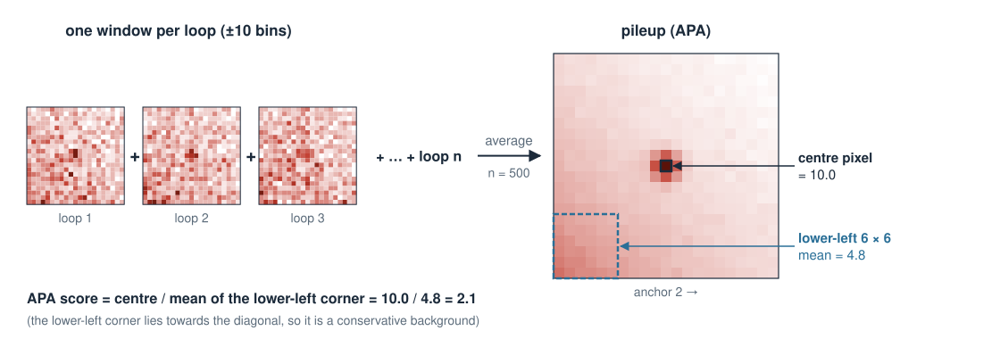{width="94%" fig-align="center"}

- Single loops are noisy. **Stack** the submatrices around many loop positions and average: the shared signal emerges.
- **APA score** = centre pixel / mean of the lower-left corner. Works for sets of loops called in other data (e.g. another cell type, or anchors defined by ChIP-seq).

::: notes
APA was introduced with HiCCUPS (Rao et al. 2014) to validate loop calls in shallower maps: a set of loops called in GM12878 can be tested in a lower-depth map of another cell type, where none would be called individually. The same pileup idea (cooltools.pileup, also called "snipping") works for any set of positions: aggregate TADs, aggregate boundaries, aggregate CTCF sites on the diagonal, enhancer–promoter pairs. Pile up O/E rather than balanced counts so that loops of different lengths can be averaged together. The lower-left corner lies towards the diagonal, so it is the stricter background.
:::

## Real data: APA of CTCF loops {.smaller}

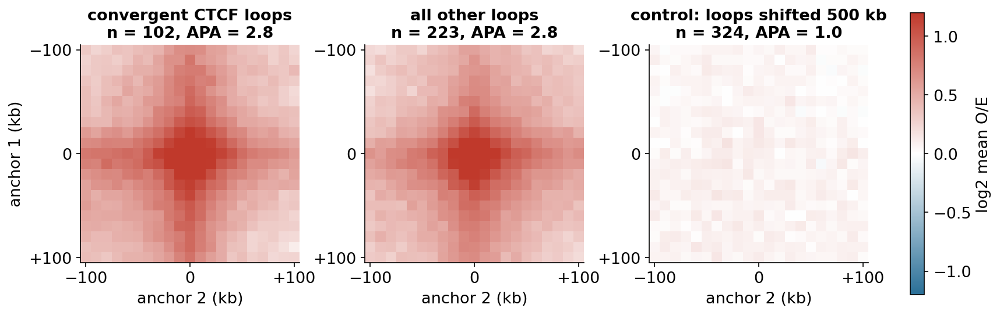{width="94%" fig-align="center"}

- chr19 + chr21, 10 kb, loops longer than 150 kb, O/E pileups ±100 kb.
- Convergent CTCF loops (n = 102): APA **2.8**; all other loops (n = 223): **2.8**; the same loops shifted by 500 kb: **1.0** (no dot).
- Loop calls are real on average; this test does not separate the classes.

::: notes
The control matters: the shifted loops keep the distance distribution but move away from the anchors; a dot that remained would mean the "loops" are a property of distance, not of the anchors. Both loop classes give the same APA score (2.80; centre O/E 3.9 and 3.7): every HiCCUPS call passed the same strict threshold, so the called loops are similarly strong whatever their anchors. The "other" class mixes loops with one CTCF motif, loops whose anchors lie outside our conservative CTCF peaks, enhancer–promoter loops and anchors where the motif scan failed. Comparing loop classes properly needs a set defined independently of the calls, e.g. all pairs of convergent CTCF sites at given distances, piled up whether called or not. The stripes running from the centre along rows and columns are the "extrusion stripes" of *3D genome organisation*: contacts of one anchor with the inside of the loop.
:::

## cooltools in practice

```python
import cooler, cooltools, bioframe
clr = cooler.Cooler("gm12878_hic_chr19_chr21.mcool::resolutions/100000")
exp = cooltools.expected_cis(clr, view_df=view)                         # P(s) per chromosome
eigvals, eigs = cooltools.eigs_cis(clr, view_df=view, phasing_track=gc)  # compartments
S, N = cooltools.saddle(clr, exp, eigs[["chrom", "start", "end", "E1"]], "cis", n_bins=5, view_df=view)

clr10 = cooler.Cooler("gm12878_hic_chr19_chr21.mcool::resolutions/10000")
ins = cooltools.insulation(clr10, [100_000, 200_000, 500_000], view_df=view10)  # boundaries
dots = cooltools.dots(clr10, expected=exp10, view_df=view10)                    # loops
stack = cooltools.pileup(clr10, loops, view_df=view10, expected_df=exp10, flank=100_000)  # APA
```

- Every function takes a **view** (which regions to analyse separately) and, where needed, the **expected**.
- In R: [HiCExperiment](https://bioconductor.org/packages/HiCExperiment)/[HiContacts](https://bioconductor.org/packages/HiContacts) read the same `.mcool` files.

::: notes
These are the calls of the exercise, with parameters omitted for space. The view is a table (chrom, start, end, name) of regions; using chromosome arms is the usual choice for compartments. Tools for the same tasks elsewhere: Juicer tools (Eigenvector, Arrowhead, HiCCUPS, APA) work on .hic files; HiCExplorer has hicPCA, hicFindTADs, hicDetectLoops and hicAggregateContacts; FAN-C is another Python toolkit. On Bioconductor, the HiCExperiment family (Serizay et al. 2024) handles .mcool, .hic and pairs files in R, if you prefer to stay in R.
:::

## Differential Hi-C {.smaller}

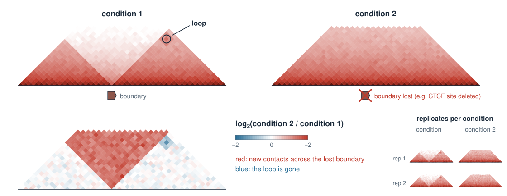{width="80%" fig-align="center"}

- Compare conditions (knockout vs wild type, two cell types) on **matched depth and resolution**, with **replicates**.
- Changes at three levels: compartment switches (E1, saddle strength), boundary strength (insulation), loop strength (APA, per-loop counts).
- Count-based tests for pixels exist (**diffHic**, **multiHiCcompare**, both edgeR-based: what you know from RNA-seq) but must handle distance decay and many tests.

::: notes
Pitfalls, in increasing order of subtlety. Depth: a shallower map has fewer loops and boundaries; downsample to equal depth before comparing calls. Distance decay: if one condition has a different P(s) (e.g. after cohesin loss), raw pixel ratios change everywhere; normalise per distance (O/E) before comparing, or use methods that do (HiCcompare's MD normalisation). Replicates: Hi-C replicates are expensive, so many studies have one per condition; without replicates there is no variance estimate and no test. Multiple testing: millions of pixels; most methods test at a coarser level (bins, domains, loops). Report effect sizes at the feature level: "the boundary at X lost 60% of its insulation", supported by replicates. Tools also include CHESS (structural similarity of submatrices) and selfish.
:::

## Beyond Hi-C: finer and targeted maps {.smaller}

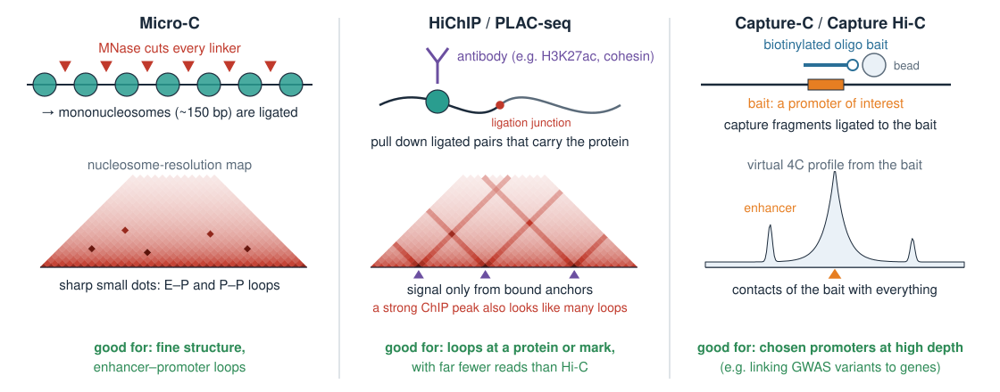{width="92%" fig-align="center"}

- **Micro-C** (MNase instead of a restriction enzyme): nucleosome resolution; reveals many enhancer–promoter and promoter–promoter dots that Hi-C misses.
- **HiChIP / PLAC-seq** (pull-down after ligation): loops at bound sites with fewer reads, but confounded with ChIP signal.
- **Capture-C / Capture Hi-C**: deep, targeted contacts of chosen promoters.

::: notes
Micro-C was developed in yeast (Hsieh et al. 2015) and applied to mammalian cells in 2020 (Krietenstein et al.; Hsieh et al.): with a similar number of reads it gives sharper loops and stripes and many more fine-scale interactions, at the cost of a more demanding protocol; analysis uses the same pairtools/cooler/cooltools steps. HiChIP (Mumbach et al. 2016) data need dedicated loop callers (FitHiChIP, hichipper) that model the ChIP-driven coverage of each anchor; otherwise every strong peak looks like a hub of loops. Capture data are analysed with CHiCAGO (for Capture Hi-C) or CapCruncher, with a background model along distance for each bait. For linking enhancers to genes (*Linking regulatory elements to genes*) promoter capture and Micro-C are the most informative 3C data.
:::

## What a call does and does not tell you {.smaller}

- A called loop is a pixel **enriched in the population**: the loop may exist in a small fraction of cells at any time.
- A domain boundary is a **position of reduced contacts**: its strength varies continuously and with the caller's scale.
- A compartment label is the **sign of one vector**: a two-state summary of a continuum, at one resolution.
- Calls depend on **depth, resolution, balancing and parameters**: compare like with like, and report them.
- Function needs **perturbation**: deletions, inversions, degrons, CRISPRi, not correlation with a call.

::: notes
A summary slide of judgement, which is what the written exam tests. Typical exam-style claims: "TADs are unchanged after treatment, therefore 3D structure is not involved" (resolution? depth? which caller? insulation strength?), "we found 10 000 loops in condition A and 6 000 in condition B" (equal depth?), "this enhancer loops to gene X, so it regulates it" (perturbation?). Students should be able to name the missing control.
:::

## Summary {.smaller}

| feature | statistic | real data (GM12878, chr19 + chr21) |
|---|---|---|
| compartments | E1 of O/E (correlation), phased by GC | 57% / 46% A; ρ = 0.71 with H3K27ac, −0.61 with H3K9me3 |
| compartment strength | saddle: (AA + BB) / (AB + BA) | 6.6 (5 groups, 100 kb) |
| boundaries | insulation score minima (window $w$) | 261 / 160 / 98 for 100 / 200 / 500 kb; enriched at CTCF |
| loops | dots vs local backgrounds (HiCCUPS, cooltools) | 178 dots at 10 kb; 96% match HiCCUPS |
| loop anchors | CTCF motif orientation | 84% convergent (of 5 716 with two motifs) |
| loop strength | APA: centre / lower-left | 2.8 at called loops; 1.0 when shifted |

::: notes
Students should be able to: compute O/E and an eigenvector sign on a toy matrix, and orient it with GC; read a saddle plot and compute strength; compute an insulation score on a toy matrix and find the boundary; explain why a domain corner is not automatically a loop, and what the local backgrounds do; compute an APA score; and criticise claims about differential TADs and loops. Next: *Linking regulatory elements to genes* uses contacts to assign enhancers to genes.
:::

## Key papers (optional further reading) {.smaller}

*Not required reading and not examined. For those who want the primary literature.*

- Rao et al. 2014, *Cell*. [A 3D map of the human genome at kilobase resolution reveals principles of chromatin looping](https://doi.org/10.1016/j.cell.2014.11.021). HiCCUPS, APA, Arrowhead, subcompartments and the convergent CTCF rule.
- Crane et al. 2015, *Nature*. [Condensin-driven remodelling of X chromosome topology during dosage compensation](https://doi.org/10.1038/nature14450). The insulation score.
- Open2C et al. 2024, *PLoS Comput Biol*. [Cooltools: enabling high-resolution Hi-C analysis in Python](https://doi.org/10.1371/journal.pcbi.1012067). The tools used here, with their design choices.
- Forcato et al. 2017, *Nat Methods*. [Comparison of computational methods for Hi-C data analysis](https://doi.org/10.1038/nmeth.4325). How much callers disagree.
- Hsieh et al. 2015, *Cell*. [Mapping nucleosome resolution chromosome folding in yeast by Micro-C](https://doi.org/10.1016/j.cell.2015.05.048). Micro-C.
- Mumbach et al. 2016, *Nat Methods*. [HiChIP: efficient and sensitive analysis of protein-directed genome architecture](https://doi.org/10.1038/nmeth.3999). HiChIP.
