## About this lecture

*3D genome organisation* showed what a Hi-C map contains. This lecture shows how a map is made from sequencing reads, and what can go wrong on the way.

- **The chemistry**: in situ Hi-C, restriction enzymes and the ligation junction that every valid read pair carries.
- **Reads to pairs**: mapping the two ends separately, chimeric reads, pair types, artefacts (dangling ends, self-circles) and duplicates.
- **Pairs to a matrix**: binning, resolution versus depth, the `.pairs`, `.cool`, `.mcool` and `.hic` formats.
- **Normalisation**: why maps are **balanced** (ICE), the **distance decay** $P(s)$ and **observed/expected**.

::: notes
The running example is real: GM12878 in situ Hi-C from Rao et al. 2014, library HIC001 (SRA run SRR1658570), 2 × 101 bp, MboI. We took the first 30 million read pairs of that run and aligned them to the whole genome: those statistics are on the slides. For the exercise we kept the read pairs that fall on chr21, so students can run the whole pipeline on a laptop in minutes; at the end we compare their chr21 map with ENCODE's map of the same experiment built from all replicates (4.6 billion contacts). The tools are the open2c ones (bwa, pairtools, cooler, cooltools), which are what the 4DN consortium and the distiller pipeline use; Juicer and HiC-Pro do the same steps differently. Figures from make-hicproc-figs.py.
:::

## The pipeline {.smaller}

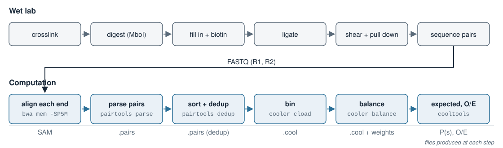{width="96%" fig-align="center"}

- The wet-lab steps decide which artefacts appear; each computational step removes or corrects one of them.
- Output: a **contact matrix** with **balancing weights**, and its **expected** contact frequency at each distance.

::: notes
Point out the file produced by each step, because the files are what students handle: FASTQ, SAM (never stored, streamed into pairtools), .pairs (text, one line per read pair), deduplicated .pairs, .cool (binned), .cool with a weight column after balancing, and tables of expected values. The same structure is shared with every assay in the course (reads, alignment, filtering, counting, normalisation); what is new here is that each read pair reports two positions, and the counting is in two dimensions.
:::

## In situ Hi-C {.smaller}

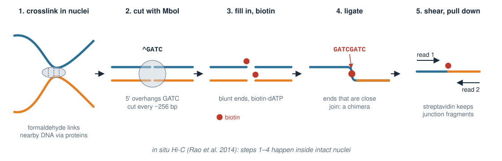{width="96%" fig-align="center"}

- **Crosslink** with formaldehyde, **cut** with a restriction enzyme, **fill in** the overhangs with a biotinylated nucleotide, **ligate** the blunt ends, **shear**, **pull down** biotin, sequence paired-end.
- Ligation happens **inside intact nuclei** (in situ), which reduces random ligations between molecules from different complexes or nuclei.

::: notes
Lieberman-Aiden et al. 2009 ligated in dilute solution after lysing the nuclei ("dilution Hi-C"); Rao et al. 2014 kept the nuclei intact for digestion and ligation ("in situ Hi-C"), which gave fewer spurious interchromosomal ligations, a faster protocol and higher resolution. Biotin marks the ligation junctions so that, after shearing, fragments that contain a junction can be enriched on streptavidin beads; unligated fragment ends with biotin are a known artefact (dangling ends) and are removed in some protocols with an exonuclease step. Each sequenced fragment should contain one junction somewhere between its two ends.
:::

## The ligation junction {.smaller}

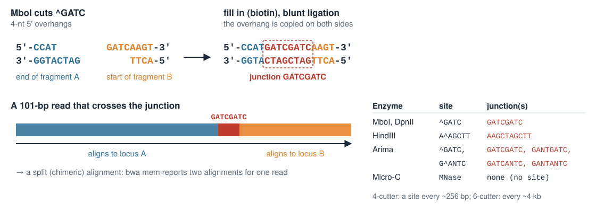{width="92%" fig-align="center"}

- MboI (and DpnII) cut ^GATC; fill-in and blunt ligation **duplicate** the overhang: the junction reads **GATCGATC**.
- **15%** of our 101-bp reads contain GATCGATC: they read through a junction and are **chimeric**.
- The enzyme sets the finest possible resolution: one site every ~256 bp (4-cutter) or ~4 kb (6-cutter).

::: notes
The junction sequence is a fingerprint of a real ligation product, and it is the reason Hi-C reads need special alignment. HindIII (a 6-cutter, used in the original 2009 protocol) gives AAGCTAGCTT; Arima kits combine two enzymes (^GATC and G^ANTC), so four junction sequences occur. Some pipelines (HiC-Pro, Juicer) search for the junction and trim reads there; the pairtools approach instead lets bwa split the read into two alignments. A fragment that has no junction between its read ends is either a dangling end (never ligated) or a pair whose junction lies between the reads, in the unsequenced middle: both are common.
:::

## Restriction fragments on chr21 {.smaller}

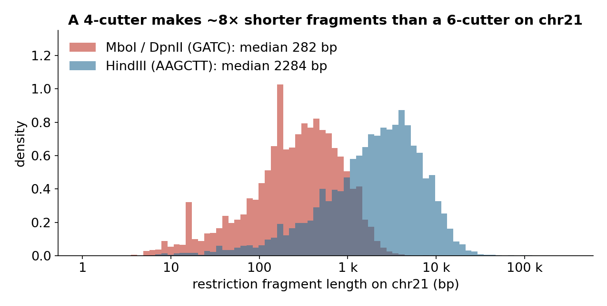{width="72%" fig-align="center"}

- chr21 has **91 397** GATC sites (157 000 expected at random) and **11 263** HindIII sites: median fragments **282 bp** and **2 284 bp**.
- Hi-C cannot resolve contacts within one fragment, so a 4-cutter allows **kilobase** maps; a 6-cutter limits them to **~5–10 kb**.

::: notes
Computed from the chr21 sequence in make-hicproc-figs.py; only fragments without assembly gaps are counted. The real distribution is broad because sites are not uniformly spaced: GATC is depleted in some sequence contexts and enriched in others, and repeats cluster. The resolution argument: the smallest unit of a contact is a pair of restriction fragments, and a bin must contain several fragments to average over their different ligation efficiencies. Micro-C replaces the enzyme by MNase, which cuts every linker, so its unit is a nucleosome (about 150 bp of DNA): the finest resolution available.
:::

## Read pairs, chimeras and walks {.smaller}

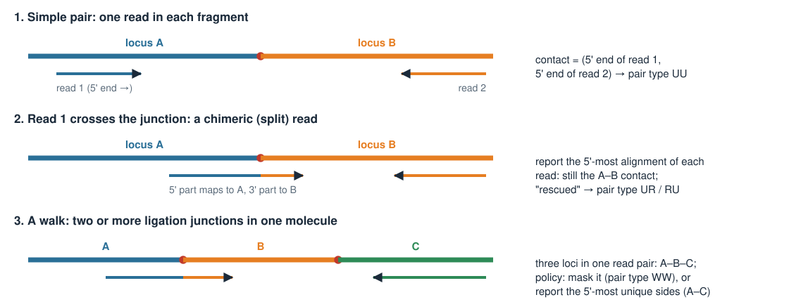{width="88%" fig-align="center"}

- Each **side** of a pair is represented by the **5′ end** of its read's first (5′-most) alignment: that is the position closest to the junction's partner fragment.
- A read that crosses the junction gives two alignments; if both sides agree, the pair is **rescued**. Several junctions in one molecule make a **walk**.

::: notes
Why the 5′ end: in a ligation product the junction lies between the two reads; the 5′ end of each read is the outer end of the molecule, i.e. the position in the fragment that was sequenced first, and its 5′-most alignment belongs to the fragment of that side. With 101-bp reads and fragments around 300–500 bp, a sizeable fraction of reads reach the junction (case 2). Walks (case 3) arise when three or more fragments were ligated together; they are informative about multi-way contacts (and are the basis of methods like Pore-C, which sequence whole concatemers with long reads), for a pairwise map we let pairtools report the 5′-most unique alignment of each side (--walks-policy 5unique); the alternative is to mask them (pair type WW).
:::

## Mapping: each end on its own

```bash
bwa mem -SP5M -t 8 chr21.fa R1.fastq.gz R2.fastq.gz \
  | pairtools parse --min-mapq 30 --walks-policy 5unique --max-inter-align-gap 30 \
      --drop-sam --drop-seq -c chr21.sizes -o chr21.pairs.gz
```

- `-SP`: do **not** pair the mates: no mate rescue (`-S`), no pairing (`-P`). The two ends are expected to come from anywhere in the genome.
- `-5`: for a split read, the **5′-most** alignment is the primary one. `-M`: mark the other parts as secondary.
- No trimming at the junction is needed: bwa mem's local alignment splits chimeric reads itself.

::: notes
Flags are not examined; the idea is. A normal paired-end aligner assumes the two reads face each other within a few hundred bp, penalises other placements and "rescues" a poorly aligned mate near the other; in Hi-C those assumptions are wrong for most pairs. bwa mem in local mode soft-clips the part of a read that crosses the junction and reports it as a supplementary alignment, which is exactly the split we want. Bowtie2 end-to-end (as in HiC-Pro) cannot do this and therefore needs the junction-trimming step. Our reference is chr21 only: an honest shortcut, because the reads were preselected as those that map to chr21 in the whole genome (see the last slides).
:::

## Pair types {.smaller}

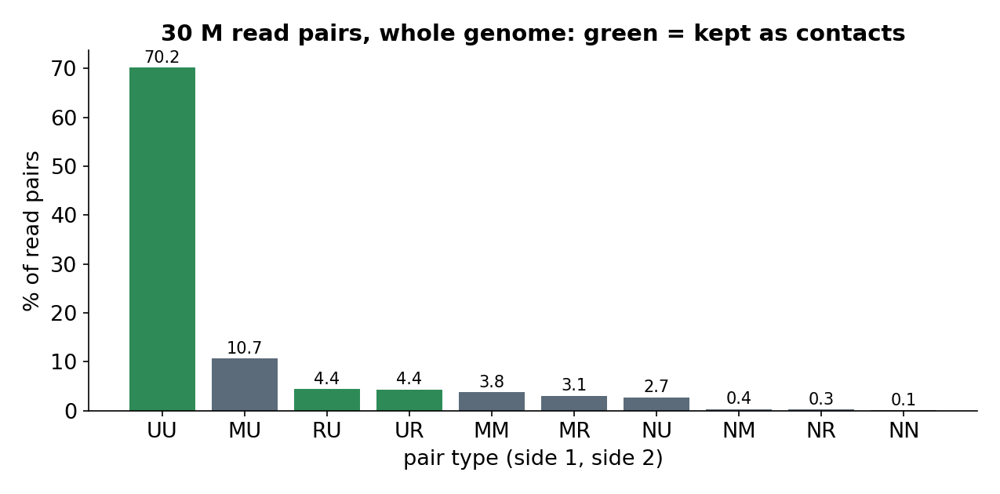{width="54%" fig-align="center"}

| letter | U | R | M | N | W |
|---|---|---|---|---|---|
| side is | unique (MAPQ ≥ 30) | rescued chimera | multi-mapped | unmapped | walk |

- **UU** **70%**, rescued **UR + RU** **9%**; pairs with an unmapped or multi-mapped side (**NU, MU, MM, …**) are dropped.

::: notes
All 30 million read pairs aligned to the whole genome (GRCh38 primary chromosomes and unplaced contigs, no alternative haplotypes), parsed with pairtools parse with the options on the previous slide; duplicates (1.5% of pairs, type DD) are left out of the chart. The pair type is two letters, one per side. M sides are mostly reads in repeats, segmental duplications and centromeric satellites. N sides include reads that are too short after a junction to align. About 5% of pairs have both sides multi-mapped or unmapped. In a typical library, 70–85% of pairs end up UU/UR/RU. The exercise does the same on chr21.
:::

## Ligation artefacts {.smaller}

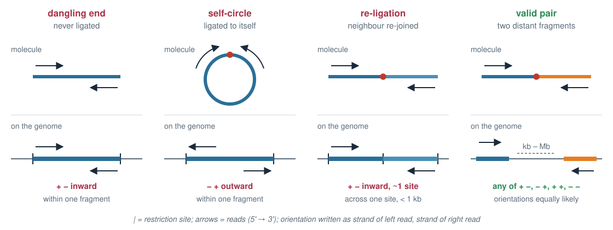{width="96%" fig-align="center"}

- **Dangling ends** (unligated fragments) and **re-ligations** of neighbours: reads point **inward** (+ −), less than ~1 kb apart.
- **Self-circles** (a fragment ligated to itself): reads point **outward** (− +), within one fragment.
- At large distances all four orientations are equally likely, so an excess of one orientation at short range marks artefacts.

::: notes
These are the classic Hi-C artefacts (Imakaev et al. 2012; HiC-Pro classifies them explicitly using a restriction-fragment map). A dangling end looks like a normal short paired-end fragment, the kind of pair any library has; it carries no 3D information. A self-circle can only arise if the fragment is short enough to circularise. pairtools does not need the restriction map: the orientation-by-distance plot on the next slide shows where the artefacts stop, and the simplest filter is to ignore contacts closer than about 1–2 kb, which balancing and expected calculations do by skipping the first diagonals.
:::

## Real data: orientation versus distance {.smaller}

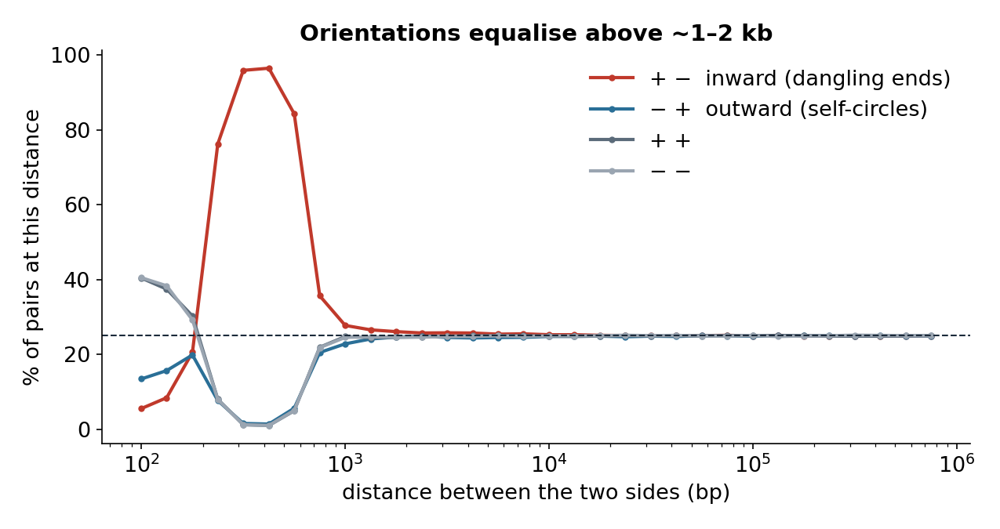{width="74%" fig-align="center"}

- Between ~200 and 600 bp, **96%** of pairs point **inward** (+ −): dangling ends and re-ligated neighbours. Outward self-circles are rare in this in situ library.
- Above **~1 kb**, all four orientations are within a few percent of 25%: the pairs are genuine ligation products.

::: notes
From the dist_freq section of the pairtools stats file (30 M pairs, whole genome, after deduplication), the fraction of each orientation in logarithmic distance bins from 100 bp. Strand of the left side first, as in the .pairs file. The inward peak at 200–600 bp is the size distribution of sheared, unligated fragments (dangling ends). Below about 200 bp the tandem orientations (+ +, − −) dominate; these very short pairs are further artefacts of short molecules and are discarded with everything under 1 kb. From 1 kb the four orientations are within 3 percentage points of 25%. This plot is a standard QC figure (the "4DN orientation plot"); it also shows where to set the minimum distance for analyses. Students make it in the exercise from the stats file.
:::

## Duplicates {.smaller}

- **PCR** and **optical** duplicates: two read pairs with the same two 5′ positions and strands. Two independent ligations producing exactly the same pair of ends are very unlikely.
- `pairtools dedup` removes pairs whose both sides match within **3 bp** (`--max-mismatch 3`).
- Our 30 M pairs: **1.9%** duplicates among mapped pairs; in the deep libraries of the full experiment the rate rises with depth (library complexity).

```bash
pairtools sort --nproc 4 -o chr21.sorted.pairs.gz chr21.pairs.gz
pairtools dedup --max-mismatch 3 --output-stats dedup.stats -o chr21.nodups.pairs.gz chr21.sorted.pairs.gz
```

::: notes
Exactly the logic of duplicate marking for paired-end ATAC-seq: a pair is defined by both ends, so true duplicates are rare. Sorting first puts identical pairs next to each other. The tolerance allows for small position shifts (e.g. soft-clipping differences). The duplication rate grows as you sequence a library deeper; pairtools stats estimates library complexity (the number of distinct molecules) from it, which tells you whether more sequencing of the same library is worthwhile. Our rate (1.9%, 448 270 of 23.8 M) is low because 30 M pairs is a small fraction of a complex library; on the chr21 subset it is the same (1.9%).
:::

## Real data: where the read pairs go {.smaller}

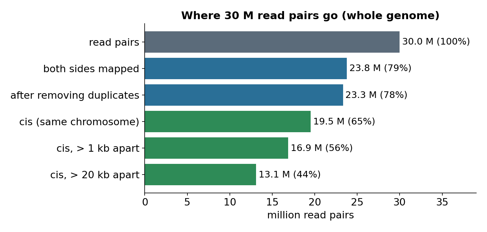{width="78%" fig-align="center"}

- Of **30 M** read pairs, **23.8 M** (79%) have both sides uniquely mapped; **16.9 M** are contacts on the same chromosome more than 1 kb apart.
- **84%** of unique pairs are cis and **16%** trans; **56%** are cis and more than 20 kb apart.

::: notes
pairtools stats of the deduplicated pairs (data/gm12878_hic_fullgenome_stats.txt). QC rules of thumb from 4DN and Rao et al.: a good in situ library has a high cis fraction, more than about 40% of pairs cis and more than 20 kb apart ("long-range cis"), and a trans fraction that is not too high (high trans suggests random ligation). Our library passes comfortably. The fraction of short-range cis pairs (< 1 kb) is mostly the artefacts of the previous slides and is not used.
:::

## Quality metrics {.smaller}

| metric | what it shows | good in situ Hi-C |
|---|---|---|
| uniquely mapped pairs (UU + UR + RU) | mappability, read quality | > 70% |
| duplicates | library complexity vs depth | low at the depth used |
| cis / (cis + trans) | random ligation is low | > 60–80% |
| cis > 20 kb / all | long-range information content | > 40% |
| orientation plot converges | artefacts confined to short range | by ~1–2 kb |
| fraction of reads with the junction | ligation happened | tens of % for 100-bp reads |

::: notes
Exact thresholds differ between consortia and protocols, so present them as orders of magnitude. The 4DN QC report and the ENCODE Hi-C pipeline compute these numbers. Two practical consequences: a shallow test sequencing run (a few million pairs) is enough to measure all of these before deciding to sequence deeply; and these metrics are the first thing to check in a paper's supplementary data.
:::

## From pairs to a matrix {.smaller}

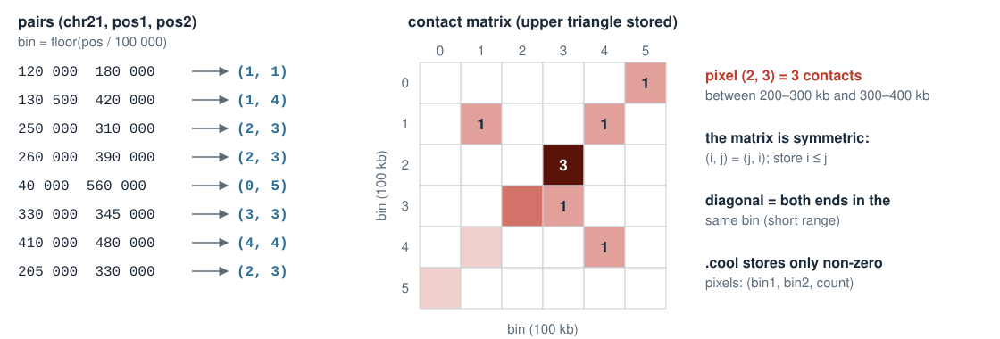{width="92%" fig-align="center"}

- Cut the genome into **bins** of fixed size; each valid pair adds 1 to pixel (bin of side 1, bin of side 2).
- The matrix is **symmetric** and **sparse**: store only the upper triangle and only non-zero pixels.

```bash
cooler cload pairs -c1 2 -p1 3 -c2 4 -p2 5 chr21.sizes:10000 chr21.valid.pairs.gz chr21_10kb.cool
```

::: notes
This is the "count matrix" step, the Hi-C equivalent of counting reads in peaks or genes, but in two dimensions. The columns -c1 -p1 -c2 -p2 tell cooler where chromosome and position of each side are in the .pairs file. Binning at 10 kb and then aggregating to coarser resolutions (cooler zoomify) is faster than re-reading the pairs. Bin by restriction fragments is possible too (Juicer offers fragment-resolution maps), but fixed-size bins are the norm because they make comparisons easy.
:::

## File formats {.smaller}

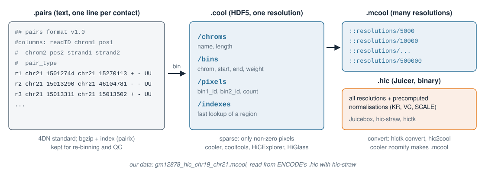{width="96%" fig-align="center"}

- **.pairs**: the 4DN text standard, one line per contact; keep it, you can re-bin it at any resolution.
- **.cool** / **.mcool** (HDF5, cooler): one or many resolutions; **.hic** (Juicer): all resolutions plus normalisation vectors.
- Convert with `hictk` or `hic2cool`; both are read by HiGlass, Juicebox (.hic) and the Python and R ecosystems.

::: notes
The two big ecosystems are Juicer/Juicebox (Aiden lab: .hic, Java) and open2c/4DN (cooler, pairtools, cooltools, HiGlass: .cool, Python). ENCODE distributes .hic files; 4DN distributes .mcool and .hic. Our course matrix gm12878_hic_chr19_chr21.mcool was made by reading ENCODE's 55-GB .hic file remotely with hic-straw (only the needed blocks are transferred), writing raw counts for chr19 and chr21 at 5 kb into a .cool, and running cooler zoomify with balancing: data/prepare-hic.sh. In R, the HiCExperiment package reads .cool, .mcool, .hic and .pairs.
:::

## Resolution and depth {.smaller}

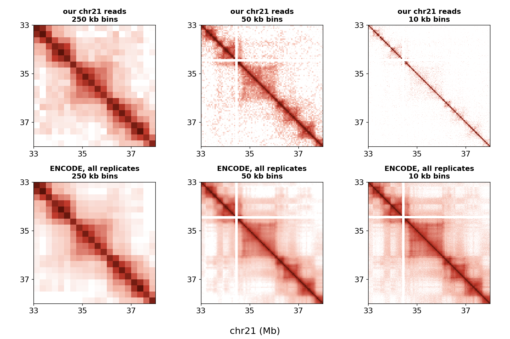{width="64%" fig-align="center"}

- Our **217 499** chr21 contacts against ENCODE's **35.2 million** (**162×**): at 250 kb the maps look alike; at 10 kb ours is mostly empty.
- Rule of thumb (Rao et al. 2014): resolution = the smallest bin size at which 80% of bins have ≥ 1 000 contacts. Ours: **250 kb** (82% of bins; 43% at 100 kb); ENCODE: **10 kb** or finer (93% at 10 kb).

::: notes
The number of pixels grows with the square of the number of bins, so halving the bin size needs roughly four times the reads for the same counts per pixel (within a fixed distance band, about twice as many). This is why compartments are studied at 100 kb–1 Mb with a few hundred million reads, while loops need billions. Same region (chr21:33–38 Mb), same colour scale rule (percentiles of each map), three resolutions. Our map is 273 200 read pairs, of which 217 499 valid contacts. The numbers for the 80% rule are printed by make-hicproc-figs.py for several bin sizes.
:::

## Why balance? {.smaller}

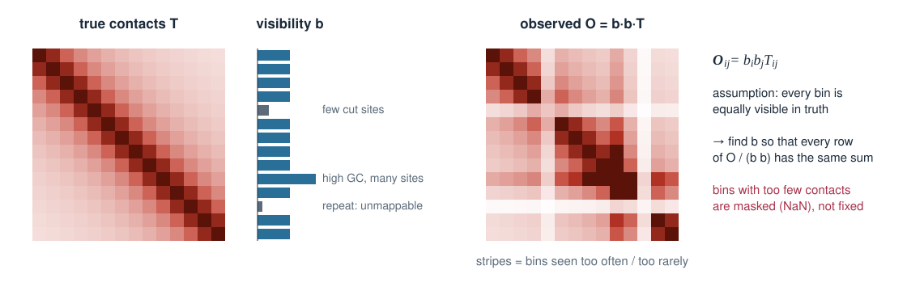{width="94%" fig-align="center"}

- Bins differ in how visible they are: **restriction-site density**, **GC content**, **mappability**, copy number.
- Model: observed $O_{ij} = b_i\, b_j\, T_{ij}$, with a bias $b$ per bin and true contacts $T$.
- Assumption: **every bin is equally visible in truth** (equal row sums of $T$). Bins with too few contacts are **masked**, not corrected.

::: notes
These biases are multiplicative and specific to each bin, which shows as horizontal and vertical stripes in a raw map. Explicit models (Yaffe and Tanay 2011; HiCNorm) fit them from known covariates; matrix balancing does it implicitly, without knowing the causes. The equal-visibility assumption is wrong for copy-number changes (a duplicated region in a cancer genome really has more contacts), which is why cancer Hi-C needs special care (e.g. OneD, or CNV-aware methods). The masked bins are white in balanced maps: low-mappability regions, centromeres, and bins with too few non-zero pixels (cooler's default filters: at least 10 non-zero pixels, and median absolute deviation filtering of row sums).
:::

## Iterative correction (ICE) {.smaller}

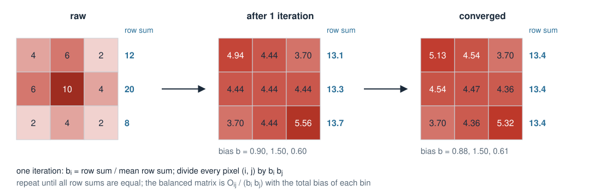{width="94%" fig-align="center"}

- Divide each row and column by its relative sum; repeat until all sums are equal. The product of the factors is the **bias** of each bin; `cooler balance` stores **1/bias** as the `weight` column.
- **Balanced value** = count × weight$_i$ × weight$_j$. KR, VC and SCALE (Juicer) are variants of the same idea.

::: notes
ICE (Imakaev et al. 2012) is an instance of matrix balancing (Sinkhorn–Knopp). In the toy example the raw row sums are 12, 20 and 8; after one iteration 13.1, 13.3, 13.7; at convergence all are 13.4. The bin with the most contacts gets the largest bias (1.50) and is scaled down most. Students do one iteration by hand in the exercise. Knight–Ruiz (KR) converges faster to the same solution; vanilla coverage (VC) is a single iteration; Juicer's SCALE is a fast balancing designed for very large matrices. In practice: balance per chromosome (cis-only) when you only analyse cis contacts, as we did for the course .mcool; genome-wide when you need trans.
:::

## Real data: raw versus balanced {.smaller}

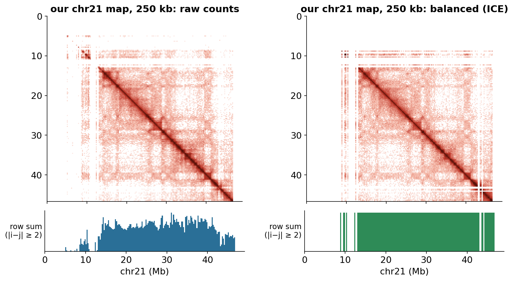{width="86%" fig-align="center"}

- Raw: stripes where bins are seen too often or too rarely; row sums vary from **399** to **3 587** contacts per 250-kb bin.
- Balanced: equal row sums (bottom), the stripes are gone, and **50** of **187** bins (the short arm and centromere, a few repeat bins) are masked.

::: notes
Our chr21 map at 250 kb, from the students' own pipeline (exercise C5–C6). The bars under the raw map are the row sums (coverage); under the balanced map, the balanced row sums, flat by construction. The masked region from 0 to about 14 Mb is the short arm and centromere of chr21, which is mostly gaps and satellite repeats in the assembly. Balancing does not remove distance decay, which remains the dominant signal; the next slide.
:::

## The distance decay $P(s)$ {.smaller}

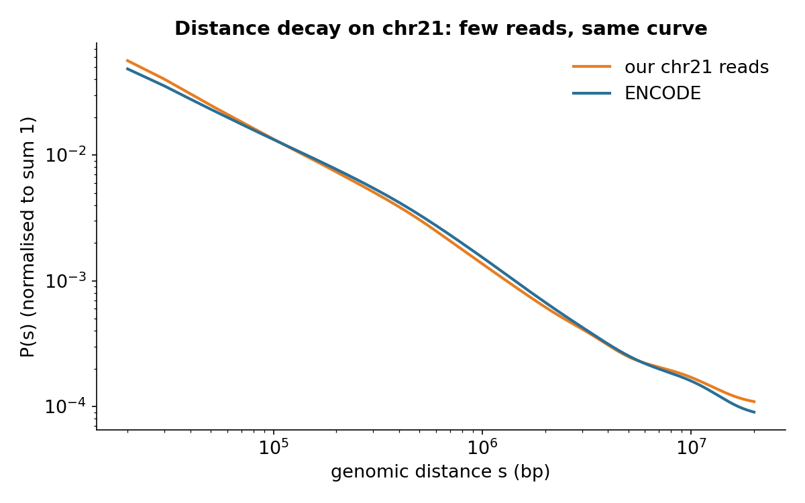{width="66%" fig-align="center"}

- Average the balanced matrix along each diagonal: $P(s)$, the **expected** contact frequency at distance $s$.
- Our chr21 map (217 499 contacts) and ENCODE's give the **same curve**: slopes **−1.02** and **−0.97** between 100 kb and 1 Mb.

::: notes
cooltools expected_cis computes, for each diagonal, the sum of balanced values divided by the number of valid pixels; with smoothing for display. Both curves are normalised to sum 1 so they can be compared. That two maps 162-fold apart in depth give the same P(s) shows that the expected is a robust statistic that needs few reads, unlike loops. P(s) is used as a QC (a library with too much random ligation has a flattened curve) and as biology: its shape reports on loop extrusion (cohesin loss removes the excess of contacts between about 100 kb and 1 Mb) and the curve of mitotic chromosomes is different again.
:::

## Observed / expected {.smaller}

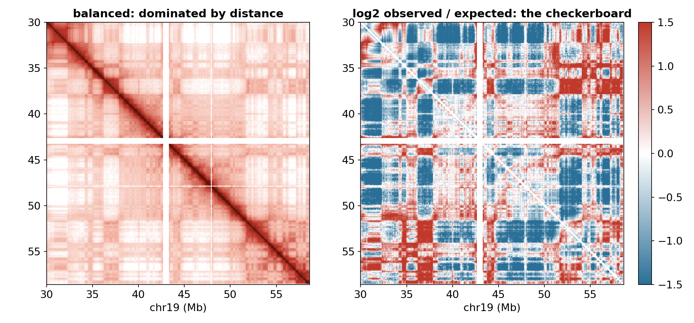{width="86%" fig-align="center"}

- Divide each pixel by $P(s)$ at its distance: **O/E** removes the distance decay and shows what is special about a pair of loci.
- On chr19 the balanced map (left) is dominated by the diagonal; O/E (right) shows the compartment checkerboard over the whole arm.

::: notes
ENCODE's chr19 map, 100 kb, q-arm (30 Mb to the end). Red: more contacts than expected at that distance, blue: fewer. The O/E matrix is the starting point of compartment calling (its correlation and eigenvector), of APA and of dot calling (which refines the expected locally): *Calling compartments, TADs and loops*. A by-hand O/E calculation is in the exercise.
:::

## Pipelines and the shortcut used here {.smaller}

- **Production pipelines:** distiller (open2c, Nextflow: bwa + pairtools + cooler), **nf-core/hic** (HiC-Pro logic), **Juicer** (Aiden lab, .hic), the **4DN** and **ENCODE** Hi-C pipelines. Same steps, different defaults.
- **Our shortcut:** 30 M read pairs of one run were aligned to the **whole genome**; the pairs with a side on chr21 (and the other on chr21 or unplaced) were kept as FASTQ, so the exercise aligns to chr21 only. Contacts to other chromosomes and true multi-mappers elsewhere are therefore missing.
- **Our map:** **217 499** contacts on chr21; ENCODE's map of the full experiment: 4.6 **billion** genome-wide. The features unit uses ENCODE's.

::: notes
Be explicit about the shortcut (designprinciples §10). Running the full pipeline on a deep Hi-C experiment takes hundreds of CPU hours and terabytes of temporary space; the steps are the same as in the exercise, wrapped in a workflow manager on a cluster (SLURM). The whole-genome statistics on the slides come from our full alignment of 30 M pairs (data/prepare-hic.sh), so the pair-type and cis/trans numbers are real whole-genome values. A side effect of preselecting chr21 reads: a read that was multi-mapped in the whole genome may look unique on chr21 alone, so the chr21-only run slightly overestimates mappability.
:::

## Summary {.smaller}

| step | key idea |
|---|---|
| chemistry | crosslink, digest (^GATC), biotin fill-in, ligate in situ; junction GATCGATC |
| mapping | each end alone (`bwa mem -SP5M`); split reads; 5′-most alignment represents a side |
| pairs | types UU/UR/RU kept; NU/MU/MM dropped; walks masked or reduced |
| artefacts | dangling ends (+ −) and self-circles (− +) below ~1–2 kb; PCR duplicates by both ends |
| QC | cis fraction, cis > 20 kb, duplicates, orientation convergence |
| matrix | fixed bins; symmetric, sparse; resolution limited by depth and enzyme |
| balancing | ICE: equal visibility; weight per bin; mask poor bins |
| expected | $P(s)$ per diagonal; O/E removes distance decay |

::: notes
Students should be able to: write the ligation junction for an enzyme; explain why Hi-C ends are mapped separately; classify a read pair as dangling end, self-circle or valid from positions and strands; put pairs into bins and fill a matrix; run one ICE iteration by hand; compute an expected value and O/E; and judge a library from its QC numbers. Next: *Calling compartments, TADs and loops*.
:::

## Key papers (optional further reading) {.smaller}

*Not required reading and not examined. For those who want the primary literature.*

- Lieberman-Aiden et al. 2009, *Science*. [Comprehensive mapping of long-range interactions reveals folding principles of the human genome](https://doi.org/10.1126/science.1181369). Hi-C, compartments and the distance decay.
- Rao et al. 2014, *Cell*. [A 3D map of the human genome at kilobase resolution reveals principles of chromatin looping](https://doi.org/10.1016/j.cell.2014.11.021). In situ Hi-C, and the data used here.
- Imakaev et al. 2012, *Nat Methods*. [Iterative correction of Hi-C data reveals hallmarks of chromosome organization](https://doi.org/10.1038/nmeth.2148). ICE balancing.
- Lajoie, Dekker & Kaplan 2015, *Methods*. [The Hitchhiker's guide to Hi-C analysis: practical guidelines](https://doi.org/10.1016/j.ymeth.2014.10.031). Every processing step and its pitfalls.
- Open2C et al. 2024, *PLoS Comput Biol*. [Pairtools: from sequencing data to chromosome contacts](https://doi.org/10.1371/journal.pcbi.1012164). Parsing, pair types and deduplication.
- Abdennur & Mirny 2020, *Bioinformatics*. [Cooler: scalable storage for Hi-C data and other genomically labeled arrays](https://doi.org/10.1093/bioinformatics/btz540). The .cool format.
