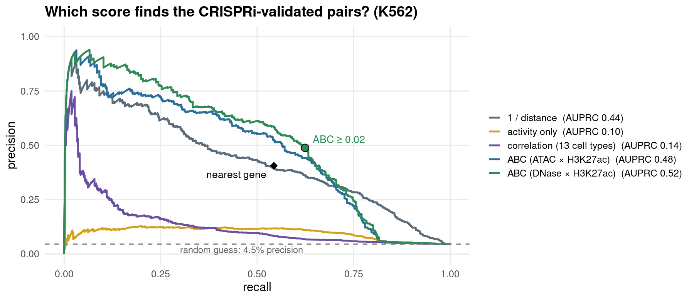

## Goal

After this exercise you will be able to:

- Assign an element to its **nearest gene** and say how often that is right, using CRISPRi screens as the ground truth.
- Compute an **activity-by-contact (ABC)** score by hand, and explain what the normalisation per gene does.
- Compute **precision and recall** from a confusion matrix, read a **precision–recall curve**, and know why the baseline is the fraction of positives.
- Explain why **correlation** of accessibility and expression across a few cell types links unrelated genes, and how a null distribution helps.
- In R: score ten thousand CRISPRi-tested element–gene pairs in K562 by distance, activity, correlation (Corces et al. 2016 cell types) and ABC; compare them; then build ABC from the course **GM12878** ATAC and H3K27ac tracks and test it on the GM12878 CRISPRi pairs.

## Background

**Nearest gene.** Assign each element to the gene with the closest TSS (often only protein-coding genes, sometimes only expressed ones). Free and always available; wrong for a large fraction of enhancers.

**Activity-by-contact (ABC)** (Fulco et al. 2019). For element $E$ and gene $G$,

$$ \text{ABC}(E, G) = \frac{A_E \cdot C_{E,G}}{\sum_{e} A_e \cdot C_{e,G}} $$

where the sum runs over all candidate elements $e$ within 5 Mb of $G$'s TSS, **including $G$'s own promoter**. Activity $A = \sqrt{\text{accessibility} \times \text{H3K27ac}}$ (accessibility from DNase-seq or ATAC-seq). Contact $C$ comes from Hi-C or from a power law of distance, $C \propto d^{-\gamma}$ with $\gamma \approx 1$, held constant below 5 kb. A link is predicted when ABC ≥ about 0.02. In the by-hand questions we use $C = 1 / \max(d, 5\ \text{kb})$, with $d$ in kb.

**CRISPRi screens.** dCas9-KRAB silences an element; if a gene's expression drops significantly, the pair is **positive**. Not significant (with enough power) = **negative**.

**Precision and recall.** For a set of predicted links: precision $= TP / (TP + FP)$, recall $= TP / (TP + FN)$. Ranking all pairs by a score and lowering the threshold traces the **precision–recall (PR) curve**; its area is the **AUPRC**. A random score has precision equal to the fraction of positives at every recall.

**Correlation across samples.** Pearson's $r$ between an element's accessibility and a gene's expression across samples (cell types, individuals, single cells). With $n$ independent samples and no true correlation, $r$ exceeds $t / \sqrt{t^2 + n - 2}$ with the one-sided probability of $t$ under a $t$ distribution with $n - 2$ degrees of freedom. Cell types are not independent samples, so an empirical null (random pairs) is safer.

## Data

All from the course data folder (`data/download.sh integration-rnaseq`; the K562 element table is made by `data/prepare-integ.sh`):

```bash
mkdir -p ~/epi/linking && cd ~/epi/linking
D=/path/to/course/data
```

- `crispr_benchmark_k562.tsv.gz`: the K562 CRISPRi benchmark of [Gschwind et al. 2023](https://doi.org/10.1101/2023.11.09.563812) ([source](https://github.com/EngreitzLab/CRISPR_comparison/tree/main/resources/crispr_data)): 10 356 element–gene pairs from Fulco et al. 2016 and 2019 (re-processed by Nasser et al. 2021), Gasperini et al. 2019 and Schraivogel et al. 2020, GRCh38. Key columns: `chrom chromStart chromEnd` (the element, 0-based starts), `measuredGeneSymbol`, `startTSS`, `EffectSize` (relative change of expression), `Regulated` (TRUE = significant decrease), `distanceToTSS`, `Dataset`.
- `crispr_benchmark_heldout.tsv.gz`: the same format for five other cell types; we use its 68 **GM12878** pairs.
- `k562_abc_elements.tsv.gz`: 60 956 candidate elements in K562 (ATAC peak summits ± 250 bp, merged, plus all protein-coding promoters) with mean signal of ENCODE K562 ATAC-seq (fold change), DNase-seq (read-depth normalised) and H3K27ac (fold change, in a window 250 bp wider on each side).
- `k562_rna_rep1_genes.tsv`, `gm12878_rna_rep1_genes.tsv`: ENCODE RNA-seq gene quantifications (RSEM, TPM).
- From earlier units: `gm12878_atac_peaks.bed.gz`, `gm12878_atac_fc.bigWig`, `gm12878_h3k27ac_fc.bigWig`, `gencode.v46.basic.annotation.gtf.gz`, `hg38_blacklist.bed.gz`, `corces2016_atac_counts.txt.gz`, `corces2016_rna_counts.txt.gz`, `hg19ToHg38.over.chain.gz`.

**Shortcuts, said plainly.** The ground truth is in K562 (an erythroleukaemia line), because that is where the large CRISPRi screens were done; GM12878 has only 68 tested pairs. Our ABC is a simplified re-implementation: ENCODE fold-change tracks instead of read counts, no quantile normalisation, the power law instead of Hi-C, and ATAC peaks (not DNase peaks) as candidates. Correlation uses normal blood cell types (Corces et al.) to predict links in K562, a different cell. The numbers are therefore lower than the published ones; the comparisons between methods are fair, because every method is scored on the same pairs.

The R part runs in about 5 minutes and needs about 6 GB of memory (the GM12878 bigWigs in R7). On the cluster, run it in an interactive job or with `Rscript` in an `sbatch` script.

## By hand

Do these on paper.

**B1. Nearest gene.** An element sits at chr7:1 000 000. Four protein-coding genes have their TSS at:

| gene | TSS | TPM in these cells |
|---|---:|---:|
| A | 960 000 | 15 |
| B | 1 030 000 | 0.2 |
| C | 1 120 000 | 50 |
| D | 870 000 | 12 |

(a) What is the nearest gene? The nearest **expressed** gene (TPM ≥ 1)?

(b) A CRISPRi screen shows that the element regulates C. What is C's rank among the expressed genes, by TSS distance?

(c) In the K562 benchmark, the target is the nearest expressed gene for 67% of positive pairs. Give two biological reasons why the remaining third is not.

**B2. ABC by hand.** Gene G has its TSS at position 0 (kb). Its promoter P and three elements have activities and positions:

| element | position (kb) | activity $A$ |
|---|---:|---:|
| P (promoter of G) | 0 | 12 |
| E3 | −8 | 3 |
| E1 | +20 | 6 |
| E2 | +100 | 20 |

Use $C = 1 / \max(d, 5)$ with $d$ in kb.

(a) Compute $A \times C$ for each element, their sum, and the ABC score of E1, E2 and E3 for G. Which pass 0.02?

(b) A second gene H has its TSS at +150 kb, with promoter activity 2. Compute ABC(E2, H), using P, E1, E2, E3 and H's promoter as the elements near H. Why does E2 score much higher for H than for G, although it is the same element?

(c) Now suppose H is silent (promoter activity 0). What happens to ABC(E2, H)? What does that tell you about using ABC without expression data?

**B3. Activity.** Three elements have (ATAC, H3K27ac) = (16, 1), (4, 4) and (1, 25).

(a) Compute $A = \sqrt{\text{ATAC} \times \text{H3K27ac}}$ for each.

(b) Suggest what each element might be (think of CTCF sites, active enhancers, the flanks of an active region).

(c) Why a geometric mean, rather than the sum or either mark alone?

**B4. Precision and recall.** On the K562 benchmark (471 positive pairs out of 10 356), "the element regulates its nearest protein-coding gene" makes 630 calls, 256 of them correct.

(a) Fill in the confusion matrix (TP, FP, FN, TN). Compute precision and recall.

(b) What precision does a random choice of 630 pairs have, on average?

(c) Method X calls 100 links with 70 correct. Compute its precision and recall. Is X better than the nearest gene? For what purpose would you prefer each?

(d) Compute the false positive rate FP / (FP + TN) of the nearest-gene rule. Why does it make a ROC curve look better than the method is?

**B5. Correlation with few samples.** Four samples: two of cell type 1, two of cell type 2. Accessibility of element E is (2, 2, 8, 8). Gene F (on the same chromosome, 40 kb away) has expression (1, 1, 5, 5); gene K (another chromosome) has (3, 3, 9, 9).

(a) Without computing, what are $r(E, F)$ and $r(E, K)$? Why?

(b) For 13 independent samples, a one-sided test at 5% needs $r > 0.48$. Among random peak–gene pairs across the 13 Corces cell types, 5% have $r > 0.59$. Why is the empirical threshold higher?

(c) Name two ways to make correlation-based links more trustworthy.

**B6. Read the PR curves.** Use the figure from the lecture:

{width="100%"}

(a) Which score has the highest AUPRC? What is the AUPRC of a random score?

(b) At a recall of 0.25, read off the precision of ABC (DNase) and of 1/distance.

(c) Why does "activity only" stay near 0.1 at every recall?

(d) Why do the two ABC curves drop sharply to the random line at a recall of about 0.8?

**B7. Judge the claims.**

(a) "Our ATAC peak at the *X* locus regulates *X*: it is the nearest gene and lies in a Hi-C loop anchored at the *X* promoter."

(b) "We silenced 200 candidate enhancers by CRISPRi; 170 had no significant effect on their nearest gene, so most predicted enhancers are not functional."

(c) "Across 6 samples (3 treated, 3 control), 2 000 peaks correlate with 800 genes within 1 Mb at r > 0.95; we propose these as enhancer–gene links."

For each: what is missing, and what would you ask for?

## On the command line

### C1 — The benchmark

```bash
zcat $D/crispr_benchmark_k562.tsv.gz | head -1 | tr '\t' '\n' | cat -n | head -25
zcat $D/crispr_benchmark_k562.tsv.gz | awk -F'\t' 'NR > 1 { n[$22]++; p[$22] += ($21 == "TRUE") }
  END { for (d in n) print d, n[d], p[d] }'
for r in TRUE FALSE; do
  zcat $D/crispr_benchmark_k562.tsv.gz | awk -F'\t' -v r=$r 'NR > 1 && $21 == r { print $23 }' \
    | sort -n | awk -v r=$r '{ a[NR] = $1 } END { print r, "pairs", NR, "median distance", a[int((NR + 1) / 2)] }'
done
```

(a) Which columns hold the gene, the effect size, the "Regulated" call and the distance?

(b) How many pairs and positives does each dataset contribute?

(c) What is the median distance from element to TSS for positive and for negative pairs?

### C2 — Nearest gene with bedtools

```bash
zcat $D/gencode.v46.basic.annotation.gtf.gz \
  | awk -F'\t' -v OFS='\t' '$3 == "gene" && $9 ~ /gene_type "protein_coding"/ {
      match($9, /gene_name "[^"]+"/); g = substr($9, RSTART + 11, RLENGTH - 12)
      tss = ($7 == "+") ? $4 - 1 : $5 - 1; print $1, tss, tss + 1, g }' \
  | sort -k1,1 -k2,2n > tss_pc.bed
zcat $D/crispr_benchmark_k562.tsv.gz \
  | awk -F'\t' -v OFS='\t' 'NR > 1 && $21 == "TRUE" { m = int(($2 + $3) / 2); print $1, m, m + 1, $9 }' \
  | sort -k1,1 -k2,2n > positives_mid.bed
wc -l < tss_pc.bed
wc -l < positives_mid.bed
bedtools closest -a positives_mid.bed -b tss_pc.bed -d -t first | awk '$4 == $8' | wc -l
bedtools closest -a positives_mid.bed -b tss_pc.bed -d -k 3 | awk '$4 == $8' | wc -l
```

(a) How many of the 471 positive elements have their target as the nearest protein-coding TSS? Among the 3 nearest?

(b) What does `-t first` do, and why is it needed?

(c) This counts recall only. What would you need to compute the precision of the nearest-gene rule on the command line?

### C3 — Candidate elements for ABC

```bash
zcat $D/gm12878_atac_peaks.bed.gz | awk -v OFS='\t' '{ s = $2 + $10; print $1, s - 250, s + 250 }' \
  | sort -k1,1 -k2,2n | bedtools merge > gm12878_elements.bed
zcat $D/gm12878_atac_peaks.bed.gz | wc -l
wc -l < gm12878_elements.bed
awk -v OFS='\t' '$4 == "PPIF"' tss_pc.bed > ppif_tss.bed
for w in 100000 1000000 5000000; do
  echo $w $(bedtools window -a ppif_tss.bed -b gm12878_elements.bed -w $w | wc -l)
done
```

(a) How many peaks, and how many merged 500-bp elements? Why are there fewer elements than peaks?

(b) How many elements enter the ABC denominator of *PPIF* (within 5 Mb)? How many lie within 100 kb?

(c) Column 10 of a narrowPeak file is the summit offset. Why do ABC and many other tools re-centre peaks on summits and give them a fixed width?

## In R

You need data.table, GenomicRanges, rtracklayer and ggplot2 (see *Install the software you need*).

```r
suppressPackageStartupMessages({
  library(data.table); library(GenomicRanges); library(rtracklayer); library(ggplot2)
})
D <- "/path/to/course/data"
```

### R1 — The CRISPRi benchmark

```r
cr <- fread(file.path(D, "crispr_benchmark_k562.tsv.gz"))
dim(cr)
table(cr$Dataset, cr$Regulated)
cr[, .(pairs = .N, elements = uniqueN(paste(chrom, chromStart)), genes = uniqueN(measuredGeneSymbol),
       positives = sum(Regulated))]
cr[, .(median_kb = median(distanceToTSS) / 1000, q90_kb = quantile(distanceToTSS, 0.9) / 1000), by = Regulated]
summary(cr$EffectSize[cr$Regulated])
ggplot(cr, aes(distanceToTSS / 1000, fill = Regulated)) + geom_histogram(bins = 40) + scale_x_log10() +
  facet_wrap(~ Regulated, ncol = 1, scales = "free_y") + labs(x = "distance to TSS (kb)")
```

(a) How many pairs, elements, genes and positives? What fraction of pairs is positive?

(b) Compare the distances of positive and negative pairs.

(c) What is the median effect of a positive element? What does an `EffectSize` of −0.10 mean?

### R2 — The nearest gene

```r
gtf <- import(file.path(D, "gencode.v46.basic.annotation.gtf.gz"), feature.type = "gene")
pc  <- gtf[gtf$gene_type == "protein_coding"]
tss <- resize(pc, width = 1, fix = "start")
tss$ensg <- sub("\\..*", "", tss$gene_id)
rna <- fread(file.path(D, "k562_rna_rep1_genes.tsv"))
tss$tpm <- rna$TPM[match(tss$ensg, sub("\\..*", "", rna$gene_id))]
expr <- tss[!is.na(tss$tpm) & tss$tpm >= 1]
c(protein_coding = length(tss), expressed = length(expr))
mid <- resize(GRanges(cr$chrom, IRanges(cr$chromStart + 1, cr$chromEnd)), width = 1, fix = "center")
cr[, nearest_pc   := tss$gene_name[nearest(mid, tss)]  == measuredGeneSymbol]
cr[, nearest_expr := expr$gene_name[nearest(mid, expr)] == measuredGeneSymbol]
pr_point <- function(pred, truth) c(TP = sum(pred & truth), FP = sum(pred & !truth), FN = sum(!pred & truth),
                                    precision = sum(pred & truth) / sum(pred), recall = sum(pred & truth) / sum(truth))
rbind(nearest_pc = pr_point(cr$nearest_pc, cr$Regulated), nearest_expr = pr_point(cr$nearest_expr, cr$Regulated))
mean(cr$Regulated)
```

(a) Why `resize(..., fix = "start")` for the TSS, and why does it give the right position for genes on the minus strand?

(b) What are the precision and recall of the two nearest-gene rules? Explain why restricting to expressed genes raises recall but lowers precision.

(c) Compare with C2: do you get the same number of correct positives? If not, why might they differ?

### R3 — Distance as a score; the PR curve

```r
pr_curve <- function(score, truth) {
  set.seed(1)
  o  <- order(score, runif(length(score)), decreasing = TRUE)   # ties in random order
  tp <- cumsum(truth[o])
  data.frame(threshold = score[o], recall = tp / sum(truth), precision = tp / seq_along(o))
}
auprc <- function(score, truth) { p <- pr_curve(score, truth); sum(diff(c(0, p$recall)) * p$precision) }
prec_at_recall <- function(score, truth, r = 0.7) { p <- pr_curve(score, truth); p$precision[which(p$recall >= r)[1]] }
cr[, inv_dist := 1 / distanceToTSS]
c(AUPRC = auprc(cr$inv_dist, cr$Regulated), prec70 = prec_at_recall(cr$inv_dist, cr$Regulated))
p <- pr_curve(cr$inv_dist, cr$Regulated)
p[which(p$recall >= 0.5)[1], ]
```

(a) Explain `pr_curve` line by line. Why must ties be broken at random?

(b) What is the AUPRC of 1/distance, and its precision at 70% recall? At what distance threshold does it reach 50% recall, and with what precision?

(c) Is 1/distance better than the nearest gene? Compare at the nearest gene's recall (0.54).

### R4 — Candidate elements and activity

```r
el <- fread(file.path(D, "k562_abc_elements.tsv.gz"))
el
el[, .(n = .N, median_width = median(end - start)), by = promoter]
el[, activity := sqrt(dnase * h3k27ac)]
el[, activity_atac := sqrt(atac * h3k27ac)]
cor(el[, .(atac, dnase, h3k27ac)], method = "spearman")
elg <- GRanges(el$chr, IRanges(el$start + 1, el$end))
tested <- GRanges(cr$chrom, IRanges(cr$chromStart + 1, cr$chromEnd))
h <- findOverlaps(tested, elg)
c(tested_overlapping = mean(seq_along(tested) %in% queryHits(h)),
  positives_overlapping = mean(which(cr$Regulated) %in% queryHits(h)))
best <- function(v) { s <- numeric(length(tested)); m <- tapply(v[subjectHits(h)], queryHits(h), max); s[as.integer(names(m))] <- m; s }
cr[, `:=`(A = best(el$activity), A_atac = best(el$activity_atac))]
sapply(cr[, .(A, A_atac)], auprc, truth = cr$Regulated)
```

(a) How many candidate elements are there, and how many are promoters? Why are promoters included even when they are closed?

(b) How well do ATAC, DNase and H3K27ac agree (Spearman)? Which pair agrees best?

(c) What fraction of tested elements, and of positive elements, overlaps a candidate? What score does a pair get when it overlaps none?

(d) What is the AUPRC of activity alone? Why is it so low, although enhancers are, by definition, active?

### R5 — ABC

```r
el[, mid := (start + end) %/% 2]
genes <- cr[, .(chr = chrTSS[1], tss = startTSS[1] + 1), by = .(gene = measuredGeneSymbol)]   # one TSS per gene
win <- GRanges(genes$chr, IRanges(pmax(genes$tss - 5e6, 1), genes$tss + 5e6))
hw  <- findOverlaps(win, elg)
abc <- data.table(gene = genes$gene[queryHits(hw)], e = subjectHits(hw))
abc[, d := abs(el$mid[e] - genes$tss[queryHits(hw)])]
abc[, C := (pmax(d, 5000) + 1)^-1.024]
abc[, ABC := el$activity[e] * C / sum(el$activity[e] * C), by = gene]
abc[, ABC_atac := el$activity_atac[e] * C / sum(el$activity_atac[e] * C), by = gene]
nrow(abc); abc[, .N, by = gene][, summary(N)]
hm <- data.table(pair = queryHits(h), e = subjectHits(h), gene = cr$measuredGeneSymbol[queryHits(h)])
hm <- merge(hm, abc[, .(gene, e, ABC, ABC_atac)], by = c("gene", "e"))
s <- hm[, .(ABC = max(ABC), ABC_atac = max(ABC_atac)), by = pair]
cr[, `:=`(ABC = 0, ABC_atac = 0)]
cr[s$pair, `:=`(ABC = s$ABC, ABC_atac = s$ABC_atac)]
res <- sapply(cr[, .(inv_dist, A, ABC_atac, ABC)], function(v)
  c(AUPRC = auprc(v, cr$Regulated), prec_at_70 = prec_at_recall(v, cr$Regulated)))
round(res, 3)
cr[, .(called = sum(ABC >= 0.02), TP = sum(ABC >= 0.02 & Regulated),
       precision = sum(ABC >= 0.02 & Regulated) / sum(ABC >= 0.02), recall = sum(ABC >= 0.02 & Regulated) / sum(Regulated))]
curves <- rbind(data.frame(pr_curve(cr$inv_dist, cr$Regulated), score = "1 / distance"),
                data.frame(pr_curve(cr$A, cr$Regulated), score = "activity only"),
                data.frame(pr_curve(cr$ABC, cr$Regulated), score = "ABC"))
ggplot(curves, aes(recall, precision, colour = score)) + geom_path() +
  geom_hline(yintercept = mean(cr$Regulated), linetype = 2)
```

(a) Explain each line of the ABC computation. Where is the sum over all elements of a gene, and why `by = gene`?

(b) How many element–gene pairs are scored, and how many elements does a typical gene have within 5 Mb?

(c) Fill in the table: AUPRC and precision at 70% recall for 1/distance, activity, ABC with ATAC and ABC with DNase. Which input works better, and why might ATAC fold change be worse than DNase read-depth signal?

(d) At ABC ≥ 0.02: how many calls, precision, recall? Compare with the nearest gene (R2).

### R6 — Correlation across 13 blood cell types

```r
atac <- fread(file.path(D, "corces2016_atac_counts.txt.gz"))
code2type <- c(`1` = "HSC", `2` = "MPP", `3` = "LMPP", `4` = "CMP", `5` = "GMP", `6` = "MEP", `7` = "Mono",
               `9` = "CD4", `10` = "CD8", `11` = "NK", `13` = "Bcell", `14` = "CLP", `15` = "Ery")
healthy <- grep("^(Donor)?[0-9]+-", names(atac), value = TRUE)
re <- "^(?:Donor)?([0-9]+)-(?:[A-Za-z][A-Za-z0-9]*-)?([0-9]+)([A-C]?)(?:-[0-9]+)?$"
ct <- code2type[sapply(regmatches(healthy, regexec(re, healthy, perl = TRUE)), `[`, 3)]
cpm_by_type <- function(m, type) sapply(split(seq_along(type), type), function(i)
  log2(rowMeans(sweep(m[, i, drop = FALSE], 2, colSums(m[, i, drop = FALSE]), "/")) * 1e6 + 1))
A <- cpm_by_type(as.matrix(atac[, ..healthy]), ct)
chainf <- tempfile(fileext = ".chain")
writeLines(readLines(gzfile(file.path(D, "hg19ToHg38.over.chain.gz"))), chainf)
lo <- liftOver(GRanges(atac$Chr, IRanges(atac$Start + 1, atac$End)), import.chain(chainf))
one <- lengths(lo) == 1
peaks38 <- unlist(lo[one]); A <- A[one, ]
rna <- fread(file.path(D, "corces2016_rna_counts.txt.gz"))
rcol <- grep("^[0-9]+-", names(rna), value = TRUE)
rtype <- sub("^NKcell$", "NK", sub("Tcell$", "", sub("^[0-9]+-", "", rcol)))   # CD4Tcell -> CD4, NKcell -> NK
R <- cpm_by_type(as.matrix(rna[, ..rcol]), rtype); rownames(R) <- rna[[1]]
R <- R[, colnames(A)]
dim(A); dim(R); colnames(A)
h2 <- findOverlaps(tested, peaks38)
g  <- match(cr$measuredGeneSymbol, rownames(R))
r  <- mapply(function(q, s) if (is.na(g[q])) NA else cor(A[s, ], R[g[q], ]), queryHits(h2), subjectHits(h2))
best_r <- tapply(r, queryHits(h2), max, na.rm = TRUE)
cr[, r := NA_real_]; cr[as.integer(names(best_r)), r := best_r]; cr[!is.finite(r), r := NA]
cr[, .(with_r = sum(!is.na(r)), median_r = median(r, na.rm = TRUE), above_0.8 = mean(r > 0.8, na.rm = TRUE)), by = Regulated]
cr[, r_score := fifelse(is.na(r), -1, r)]
c(corr = auprc(cr$r_score, cr$Regulated), dist = auprc(cr$inv_dist, cr$Regulated))
set.seed(1); null_r <- replicate(5000, cor(A[sample(nrow(A), 1), ], R[sample(nrow(R), 1), ]))
quantile(null_r, c(0.5, 0.9, 0.95, 0.99), na.rm = TRUE)
```

(a) What are the 13 columns of `A` and `R`, and what is one entry? Why summarise per cell type rather than per library?

(b) What is the median correlation of positive and negative pairs? What fraction has $r > 0.8$?

(c) What are the 95% and 99% quantiles of $r$ for random pairs? Compare with B5b.

(d) What is the AUPRC of correlation? Give two reasons why it is much worse than distance here.

### R7 — ABC in GM12878 from the course tracks

```r
prom <- resize(resize(pc, 1, fix = "start"), 500, fix = "center")
p  <- fread(file.path(D, "gm12878_atac_peaks.bed.gz"))[V1 %in% paste0("chr", c(1:22, "X"))]
pk <- GRanges(p$V1, IRanges(p$V2 + p$V10 + 1 - 250, width = 500))
gm <- reduce(c(granges(pk), granges(prom[seqnames(prom) %in% paste0("chr", c(1:22, "X"))])), ignore.strand = TRUE)
gm <- gm[!overlapsAny(gm, import(file.path(D, "hg38_blacklist.bed.gz")))]
gm$promoter <- overlapsAny(gm, prom)
signal <- function(bw, gr) {                                    # mean bigWig value in each range
  cv <- import(bw, which = reduce(gr), as = "RleList")
  s  <- numeric(length(gr))
  for (ch in unique(as.character(seqnames(gr)))) {
    i <- which(as.character(seqnames(gr)) == ch)
    s[i] <- viewMeans(Views(cv[[ch]], ranges(gr)[i]))
  }
  s
}
system.time({
  gm$atac    <- signal(file.path(D, "gm12878_atac_fc.bigWig"), gm) * width(gm) / 500
  gm$h3k27ac <- signal(file.path(D, "gm12878_h3k27ac_fc.bigWig"), resize(gm, width(gm) + 500, fix = "center")) *
                (width(gm) + 500) / 1000
})
gm$activity <- sqrt(gm$atac * gm$h3k27ac)
length(gm); table(gm$promoter)
ho <- fread(file.path(D, "crispr_benchmark_heldout.tsv.gz"))[CellType == "GM12878"]
ho[, .(pairs = .N, positives = sum(Regulated)), by = measuredGeneSymbol]
genes_gm <- ho[, .(chr = chrTSS[1], tss = startTSS[1] + 1), by = .(gene = measuredGeneSymbol)]
gmid <- (start(gm) + end(gm)) %/% 2
abc_gene <- function(chr, tss) {
  j  <- which(as.character(seqnames(gm)) == chr & abs(gmid - tss) <= 5e6)
  ac <- gm$activity[j] * (pmax(abs(gmid[j] - tss), 5000) + 1)^-1.024
  data.table(e = j, dist = abs(gmid[j] - tss), ABC = ac / sum(ac))
}
abc_gm <- genes_gm[, abc_gene(chr, tss), by = gene]
hg <- findOverlaps(GRanges(ho$chrom, IRanges(ho$chromStart + 1, ho$chromEnd)), gm)
hmg <- merge(data.table(pair = queryHits(hg), e = subjectHits(hg), gene = ho$measuredGeneSymbol[queryHits(hg)]),
             abc_gm, by = c("gene", "e"))
ho[, ABC := 0]; sg <- hmg[, .(ABC = max(ABC)), by = pair]; ho[sg$pair, ABC := sg$ABC]
table(predicted = ho$ABC >= 0.02, CRISPRi = ho$Regulated)
ho[Regulated == TRUE | ABC >= 0.02, .(gene = measuredGeneSymbol, kb = round(distanceToTSS / 1000),
   effect = round(EffectSize, 2), Regulated, ABC = signif(ABC, 2))][order(gene, kb)]
abc_gm[gene == "PPIF"][order(-ABC)][1:8]
```

(a) How long does reading the two bigWigs take? How many candidate elements are there in GM12878?

(b) Fill in the confusion matrix for the 68 GM12878 pairs. Compute precision and recall at ABC ≥ 0.02, and compare with K562 (R5d). Why should you not over-interpret the difference?

(c) Which positives does ABC miss, and why might it miss each (look at distance and at whether the element overlaps a candidate)?

(d) What fraction of *PPIF*'s regulatory input does ABC give to its own promoter? Which elements come next, and how far are they?

## Hints

::: {.callout-tip collapse="true" title="Hint 1 — ABC and contact (B2, R5, R7)"}
Work in a table: one row per element, columns $d$, $C$, $A \times C$. The ABC denominator is the same for all elements of one gene; the gene's own promoter (at $d = 0$, so $C = 1/5$) is usually the largest term. The formula and its validation are in [Fulco et al. 2019](https://doi.org/10.1038/s41588-019-0538-0); the code and the power-law parameters (γ = 1.024, 5 kb floor) are in the [ABC repository](https://github.com/broadinstitute/ABC-Enhancer-Gene-Prediction). In data.table, `abc[, x := ..., by = gene]` computes within each gene ([data.table intro](https://rdatatable.gitlab.io/data.table/articles/datatable-intro.html)).
:::

::: {.callout-tip collapse="true" title="Hint 2 — precision, recall, PR curves (B4, B6, R3)"}
Draw the 2×2 table first: rows = predicted link or not, columns = positive or negative in the screen. FN = all positives − TP; TN = all pairs − TP − FP − FN. On a PR curve, a random score sits at precision = fraction of positives. [Saito & Rehmsmeier 2015](https://doi.org/10.1371/journal.pone.0118432) explain why PR curves beat ROC curves for imbalanced data.
:::

::: {.callout-tip collapse="true" title="Hint 3 — nearest gene (B1, C2, R2)"}
For a minus-strand gene the TSS is the **end** coordinate; `resize(gr, 1, fix = "start")` is strand-aware and takes the 5′ end ([GenomicRanges intra-range methods](https://rdrr.io/bioc/GenomicRanges/man/intra-range-methods.html)). [`nearest`](https://rdrr.io/bioc/GenomicRanges/man/nearest-methods.html) returns the index of the closest range. On the command line, [`bedtools closest`](https://bedtools.readthedocs.io/en/latest/content/tools/closest.html) with `-d` reports the distance, `-t first` keeps one hit when several are equally close, `-k` reports the k nearest. [`bedtools window`](https://bedtools.readthedocs.io/en/latest/content/tools/window.html) finds all features within `-w` bp.
:::

::: {.callout-tip collapse="true" title="Hint 4 — correlation and its null (B5, R6)"}
If two variables are both a linear function of the same group label, their correlation is ±1. The theoretical threshold assumes independent, normally distributed samples; cell types of one lineage (MEP, CMP, Ery) are not independent. [`cor`](https://rdrr.io/r/stats/cor.html) computes Pearson's $r$; `replicate` repeats an expression to build a null. ArchR's [peak-to-gene linkage](https://www.archrproject.com/bookdown/peak2genelinkage-with-archr.html) and Signac's [LinkPeaks](https://stuartlab.org/signac/reference/linkpeaks) are the single-cell versions.
:::

::: {.callout-tip collapse="true" title="Hint 5 — reading signal into elements (R4, R7)"}
`import(bw, which = gr, as = "RleList")` reads only the regions you ask for, as run-length encoded coverage; [`Views`](https://rdrr.io/bioc/IRanges/man/Views-class.html) and `viewMeans` then average it over each range ([rtracklayer](https://bioconductor.org/packages/release/bioc/vignettes/rtracklayer/inst/doc/rtracklayer.pdf)). Multiplying the mean by width/500 turns a mean into an "amount" comparable between elements of different width. The benchmark's own element annotation (columns `DHS.RPM`, `H3K27ac.RPM`) uses read counts.
:::

::: {.callout-tip collapse="true" title="Hint 6 — judging claims (B7)"}
For each claim ask: was regulation tested (perturbation) or predicted (proximity, contact, correlation)? Is a negative result powered? Is the correlation larger than for random pairs, with enough samples? Osterwalder et al. 2018 ([Nature](https://doi.org/10.1038/nature25461)) showed that deleting single enhancers often has no phenotype because others compensate.
:::

## Solutions

::: {.callout-note collapse="true" title="Solutions — by hand"}

**B1.** (a) Distances: A 40 kb, B 30 kb, C 120 kb, D 130 kb. Nearest gene: **B** (30 kb). Nearest expressed: **A** (B has TPM 0.2). (b) Expressed genes by distance: A (40), C (120), D (130): C is **2nd**. (c) The element contacts C, not A, in 3D (A may be in another domain, across a CTCF boundary); A is expressed from its own promoter or other enhancers and does not need this one; C's promoter is compatible with this kind of enhancer (promoter–enhancer specificity); the element may regulate both but A's effect is too small to detect.

**B2.** (a) $C$: P 1/5, E3 1/8, E1 1/20, E2 1/100. $A \times C$: P 2.4, E3 0.375, E1 0.3, E2 0.2; sum **3.275**. ABC: E1 0.3/3.275 = **0.092**, E2 **0.061**, E3 **0.115** (P 0.733). All three pass 0.02.
(b) Distances to H: H promoter 0, E2 50, E1 130, E3 158, P 150 kb. $A \times C$: H promoter 2/5 = 0.4, E2 20/50 = 0.4, E1 6/130 = 0.046, E3 3/158 = 0.019, P 12/150 = 0.08; sum 0.945. ABC(E2, H) = 0.4/0.945 = **0.42**. E2 is closer to H (50 vs 100 kb), and H has a weak promoter and few other elements, so E2 is a large share of H's input; G has a strong promoter and other close elements, so E2 is a small share. ABC is relative: the same element scores differently for each gene.
(c) Without H's promoter, the sum is 0.545 and ABC(E2, H) = 0.4/0.545 = **0.73**: higher still. ABC does not know whether a gene is expressed; a silent gene gets a large ABC from any nearby active element. Either restrict predictions to expressed genes, or treat links to silent genes as meaningless (the published ABC reports gene expression alongside).

**B3.** (a) 4, 4, 5. (b) (16, 1): open but not acetylated: e.g. a CTCF site or an element bound by a repressor or a poised factor. (4, 4): a typical active enhancer. (1, 25): acetylated but barely open: e.g. the flanks of an active region, or a broad acetylated domain without a single open site. (c) The geometric mean requires both: an element with zero of either scores zero, and it damps noise in one assay (a factor 4 error in one mark changes $A$ by a factor 2). A sum would let a strong CTCF site look like a strong enhancer.

**B4.** (a) TP 256, FP 630 − 256 = **374**, FN 471 − 256 = **215**, TN 10 356 − 256 − 374 − 215 = **9511**. Precision 256/630 = **0.41**; recall 256/471 = **0.54**.
(b) The fraction of positives: 471/10 356 = **0.045**.
(c) X: precision 70/100 = **0.70**, recall 70/471 = **0.15**. Neither dominates: X is better for picking a short list of candidates to validate (most are real), the nearest gene finds more of the links but half its calls are wrong. Compare methods at equal recall or by the whole PR curve.
(d) FPR = 374/(374 + 9511) = **0.038**. A ROC point at (FPR 0.04, TPR 0.54) looks excellent, because the 9885 negatives make any number of false positives look small; but 59% of the calls are wrong. With rare positives, precision is the quantity that matters to the person following up the calls.

**B5.** (a) Both are **1**: every vector is a linear function of the group (1 or 2), so any two such vectors are perfectly correlated, whatever their biology. Gene K is on another chromosome and still has $r = 1$. (b) The theoretical threshold assumes 13 independent samples. The 13 cell types are related (lineages share programmes: MEP, CMP and erythroblasts; CD4, CD8 and NK), so the effective number of independent samples is smaller and large correlations between unrelated features are common: the empirical 95% quantile is 0.59, not 0.48. (c) Restrict to pairs in cis (e.g. within 500 kb) and compare against an empirical null (random or trans pairs, or permuted labels); use many diverse samples (dozens of cell types, hundreds of individuals, thousands of single cells or metacells); combine with distance or contact; validate top links by perturbation.

**B6.** (a) ABC (DNase × H3K27ac), AUPRC 0.52; random = 0.045. (b) About 0.80 for ABC (DNase) and about 0.65 for 1/distance. (c) Activity ranks pairs by how strong the element is, regardless of the gene: a strong element is tested against many genes in the screen and regulates only one or two of them, so most of its pairs are negative. It barely separates positives from negatives, just above the random line. (d) About one in five positive elements overlaps no candidate element (not called as an ATAC peak in our data), so they get ABC = 0 and tie with thousands of negatives at the bottom of the ranking.

**B7.** (a) Nearest gene is right for about half of the links; a loop shows contact, not regulation (many loops are CTCF–cohesin structural loops), and a loop anchored near the promoter may connect it to other elements. Ask for a perturbation (CRISPRi of the peak, measuring *X* and the other genes nearby) or at least an ABC-type score and concordant changes in expression. (b) Two problems: the test was only on the nearest gene (the elements may regulate other genes), and negatives may lack power (most real effects are 5–20%), or be masked by redundant enhancers. Ask for the power per pair and for measurement of all genes within 1 Mb (as in single-cell screens). (c) With 3 vs 3 samples the correlation is essentially a treatment effect: every peak that changes with treatment correlates with every gene that changes, near or far. $r > 0.95$ is easy with 6 points in 2 groups. Ask for a null (pairs on other chromosomes give the false-positive rate), more and more varied samples, and a comparison with distance.
:::

::: {.callout-note collapse="true" title="Solutions — command line"}

**C1.** (a) Gene `measuredGeneSymbol` = column 9, `EffectSize` = 5, `Regulated` = 21, `distanceToTSS` = 23 (`Dataset` = 22). (b) Gasperini2019 5299 pairs / 360 positives; Nasser2021 3751 / 88; Schraivogel2020 1306 / 23. (c) Positives: 471 pairs, median 26 130 bp; negatives: 9885 pairs, median 386 621 bp.

**C2.** (a) 20 065 protein-coding TSSs, 471 positive elements. The target is the nearest TSS for **256** positives and among the 3 nearest for **368**. (b) If two TSSs are at exactly the same distance (genes sharing a bidirectional promoter, or alternative TSSs at the same position), `closest` would report both; `-t first` keeps one, so each element gets one predicted gene, like `nearest` in R. (c) The same `closest` for **all** tested pairs (not only positives): count the pairs whose gene is the nearest (the calls, 630) and among them the positives (256); precision = 256/630.

**C3.** (a) 155 153 peaks; **77 690** merged elements. The IDR peak file lists several summits for the same region (one row per summit), and neighbouring summits within 500 bp merge. (b) **301** elements within 5 Mb of the *PPIF* TSS (75 within 1 Mb, **19** within 100 kb); these are ATAC elements only, the R version adds the promoters. (c) Re-centring on the summit puts the element where the signal is highest (the TF binding site) and fixed widths make signals comparable: a 3-kb merged peak would otherwise collect more reads just because it is wide.
:::

::: {.callout-note collapse="true" title="Solutions — R"}

Run times are from one server core; a laptop is 1.5–3 times slower.

**R1.** (a) 10 356 pairs, 3941 elements, 2113 genes, **471** positives: 4.5%. (b) Positives: median 26 kb, 90% within 207 kb; negatives: median 387 kb, 90% within 938 kb. The screens tested most pairs at hundreds of kb, but positives are mostly close. (c) Median −0.10: silencing the element lowers the gene's expression by 10% (EffectSize is the relative change; −0.10 = 90% of control). Effects range from −0.1% to −93%.

**R2.** (a) `fix = "start"` is strand-aware: for a minus-strand gene the "start" of the feature in transcription direction is its highest coordinate, which is where the TSS is. (b) 20 065 protein-coding genes, 9499 of them expressed (TPM ≥ 1). Nearest protein-coding: TP 256, FP 374, precision **0.41**, recall **0.54**. Nearest expressed: TP 284, FP 532, precision **0.35**, recall **0.60**. Removing silent genes lets elements skip to the correct expressed gene (recall up), but some elements that were previously assigned to a non-tested or silent gene now get an expressed gene that is tested and negative (more calls, precision down). (c) Yes, 256 in both. Small differences can arise from how the element centre is rounded and how ties are broken.

**R3.** (a) `order(score, runif(...), decreasing = TRUE)` sorts pairs from the highest score down, with random order among ties; `cumsum(truth[o])` counts true positives among the top $k$; recall = TP/all positives, precision = TP/$k$. Without random tie-breaking, tied pairs keep the file order, which is sorted by dataset and position and can make a score look better or worse than it is. (b) AUPRC **0.438**, precision at 70% recall **0.316**. 50% recall at a distance of about 26 kb (1/3.83 × 10⁻⁵), with precision **0.43**. (c) At recall 0.54 the distance curve has precision about 0.41, the same as the nearest gene: in this benchmark the two rules are nearly equivalent; distance has the advantage of a full ranking.

**R4.** (a) 60 956 elements, 18 245 promoters (median width 742 and 720 bp). Promoters are included because ABC needs the gene's own promoter in the denominator, and because promoters of other genes also act as enhancers (they compete for the gene). A closed promoter has activity 0 and does not affect the result. (b) Spearman: ATAC–DNase **0.72**, DNase–H3K27ac **0.79**, ATAC–H3K27ac **0.56**. (c) 62.6% of tested elements and **81.5%** of positive elements overlap a candidate; a pair without overlap gets 0 (it can never be predicted). (d) AUPRC 0.100 (DNase) and 0.100 (ATAC): an element's activity is the same for every gene it is tested against, and most of those genes are not its targets.

**R5.** (a) For each gene, `win` is the 10-Mb window around its TSS; `findOverlaps` lists every element in it; `d` is the distance from the element's centre to the TSS; `C` is the power-law contact; `AC / sum(AC)` with `by = gene` divides each element's product by the sum over all elements of the same gene. The tested element is then matched to the candidates it overlaps, keeping the maximum ABC for that gene. (b) 758 316 element–gene pairs; a gene has a median of 320 elements within 5 Mb (22–849). (c)

| score | AUPRC | precision at 70% recall |
|---|---:|---:|
| 1 / distance | 0.438 | 0.316 |
| activity only | 0.100 | 0.098 |
| ABC (ATAC × H3K27ac) | 0.480 | 0.311 |
| ABC (DNase × H3K27ac) | **0.516** | **0.345** |

DNase works better. The ENCODE ATAC fold-change track divides by a local background estimated from the ATAC data itself, which rises around clusters of strong peaks and compresses the strongest elements (ATAC and DNase agree only at Spearman 0.72); the DNase track is read depth, proportional to read counts as in the original ABC. (d) 602 calls, 294 correct: precision **0.49**, recall **0.62**, better than the nearest gene on both (0.41, 0.54).

**R6.** (a) The 13 cell types (Bcell, CD4, CD8, CLP, CMP, Ery, GMP, HSC, LMPP, MEP, Mono, MPP, NK); one entry is the mean log2 CPM over the donors (libraries) of that cell type. Averaging per cell type removes donor noise and gives the same samples for ATAC and RNA, which come from partly different donors. `A` has 589 116 lifted peaks, `R` 25 498 genes. (b) Positives: median $r$ = **0.39**, 10.7% above 0.8 (428 pairs with a value); negatives: median 0.085, 1.4% above 0.8 (8362 pairs). (c) Random pairs: 95% quantile **0.59**, 99% **0.77** (median −0.06). Higher than the theoretical 0.48 because the cell types are not independent (B5b). (d) AUPRC **0.136** vs 0.438 for distance. Reasons: the cell types are normal blood cells, while the screen is in K562, a leukaemia line with its own enhancers; 13 related samples give a wide null; correlation ignores distance, so far elements that co-vary with a gene (same lineage programme) rank as high as close ones.

**R7.** (a) About 50 s for both bigWigs; 85 273 elements (18 248 promoters). (b)

| | CRISPRi positive | CRISPRi negative |
|---|---:|---:|
| ABC ≥ 0.02 | 13 | 3 |
| ABC < 0.02 | 3 | 49 |

Precision 13/16 = **0.81**, recall 13/16 = **0.81**, higher than in K562. The three false positives: two *PPIF* elements at 80–81 kb (effects of −1%) and an *ETS1* element at 172 kb whose silencing slightly *raised* *ETS1* (+5%). But there are only 16 positives at 9 genes, 52 of the 68 pairs come from one locus (*PPIF*), and the tested elements were chosen around genes with known enhancers: the uncertainty is large (one more error changes precision by 5 percentage points), and the set is not representative. (c) Missed: the *MYC* enhancer 525 kb away (ABC 0.004: far, and *MYC* has many other active elements), the *PTGER4* element 189 kb away (ABC 0.008; *PTGER4* has TPM 0.33 in GM12878, so the measured effect is on a barely expressed gene), and one *ICOSLG* element (ABC 0: it overlaps no candidate element, i.e. no ATAC peak was called there). (d) Its own promoter: **0.54**. Then elements at 15.7 kb (0.057), 6.7 kb (0.050), 61 kb (0.047), 30 kb (0.044), 62 kb (0.028), 81 kb (0.026) and 24 kb (0.025). The elements at 15.7, 24, 30, 61 and 62 kb contain all six CRISPRi positives (two tested elements fall in the 30-kb candidate); the 81-kb element is a false positive; the 6.7-kb element was not tested.
:::

## Where this leads

- *Epigenomics and genetic variation* uses enhancer–gene links to go from a GWAS variant in an enhancer to a candidate gene, and adds human genetics (eQTLs, colocalisation) as another kind of evidence.
- *3D genome organisation*, *Hi-C: from reads to contact matrices* and *Calling compartments, TADs and loops* compute the contact frequencies that ABC can use instead of the power law.
- *What people try to predict, and how to tell if it works* returns to enhancer–gene prediction as a machine-learning task, and to evaluation with PR curves and baselines.
- Genome-wide ABC and ENCODE-rE2G predictions for hundreds of cell types are public (ENCODE portal); for your own cells, run the [ABC pipeline](https://github.com/broadinstitute/ABC-Enhancer-Gene-Prediction) on ATAC/DNase + H3K27ac (+ Hi-C).

## Key papers (optional further reading)

*Not required reading and not examined.*

- Fulco et al. 2016, *Science*. [Systematic mapping of functional enhancer–promoter connections with CRISPR interference](https://doi.org/10.1126/science.aag2445).
- Gasperini et al. 2019, *Cell*. [A genome-wide framework for mapping gene regulation via cellular genetic screens](https://doi.org/10.1016/j.cell.2018.11.029).
- Fulco et al. 2019, *Nat Genet*. [Activity-by-contact model of enhancer–promoter regulation from thousands of CRISPR perturbations](https://doi.org/10.1038/s41588-019-0538-0).
- Nasser et al. 2021, *Nature*. [Genome-wide enhancer maps link risk variants to disease genes](https://doi.org/10.1038/s41586-021-03446-x).
- Gschwind et al. 2023, *bioRxiv*. [An encyclopedia of enhancer-gene regulatory interactions in the human genome](https://doi.org/10.1101/2023.11.09.563812).
- Schoenfelder & Fraser 2019, *Nat Rev Genet*. [Long-range enhancer–promoter contacts in gene expression control](https://doi.org/10.1038/s41576-019-0128-0).
