## About this lecture

*Differential accessibility* ended with tens of thousands of peaks that differ between cell types, most of them **distal**, and a nearest gene written next to each. This lecture asks how to find the gene (or genes) an element actually regulates, and how to tell whether a method works.

- Why the **nearest gene** is often wrong, with numbers from CRISPR screens.
- **Correlation** of accessibility and expression across samples, and its null.
- **Contact**: the power law of distance, and Hi-C.
- The **activity-by-contact (ABC) model**: activity × contact, normalised per gene.
- **Ground truth**: CRISPRi enhancer screens, and **precision–recall** to compare methods.
- Running example: K562 (CRISPRi benchmark) and GM12878 (course data).

::: notes
This unit connects the chromatin units with the RNA-seq the students already know. The question is simple to state and hard to answer: which gene does this enhancer regulate? It matters for every downstream interpretation, from "the B-cell enhancers we found are near PAX5" to "this disease variant acts through gene X" (the next unit, *Epigenomics and genetic variation*). We use a real benchmark: about ten thousand enhancer–gene pairs tested by CRISPR interference in K562 cells, of which 471 are true regulatory links. Every method in the lecture is scored on the same table, so the students see that simple rules are surprisingly strong and that ABC is better but far from perfect. All numbers are from make-integ-figs.R and the exercise.
:::

## The question {.smaller}

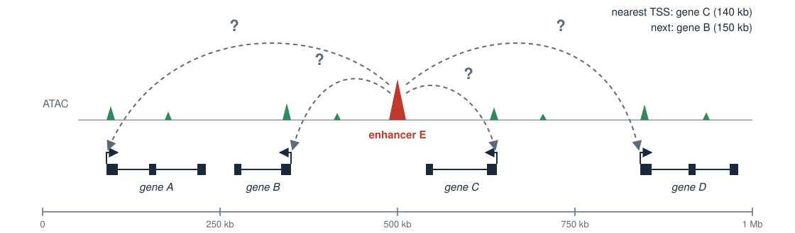{width="92%" fig-align="center"}

- An enhancer is a peak of ATAC-seq and H3K27ac. Nothing in the peak says which promoter it talks to.
- Candidate targets: every gene within about a megabase. The nearest TSS is the obvious guess, and the one most papers report.
- We need a target to interpret a differential peak, a motif in it, or a disease variant in it.

::: notes
Read the figure from the enhancer outwards: four genes within 500 kb on either side, the nearest TSS 140 kb away, the next one 150 kb away. Which gene would you pick? Students usually pick gene C. Ask what information they would want: is gene C expressed in these cells, is the enhancer in contact with its promoter, does the enhancer's activity rise and fall with the gene's expression across cell types, and what happens to each gene when the enhancer is switched off? These are exactly the four kinds of evidence of the lecture. One enhancer can also regulate several genes, and one gene usually has several enhancers; the question is about pairs, not about a single answer per enhancer.
:::

## Enhancers skip genes {.smaller}

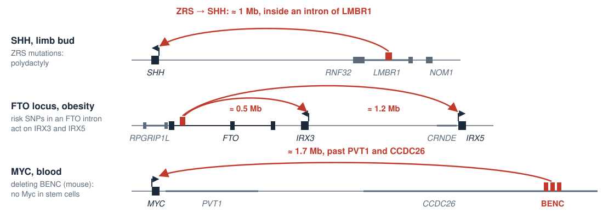{width="95%" fig-align="center"}

- **ZRS**: the limb enhancer of *SHH* sits about 1 Mb away, inside an intron of *LMBR1*; point mutations in it cause polydactyly.
- **FTO**: the strongest obesity GWAS signal lies in an *FTO* intron but acts on *IRX3* and *IRX5*, 0.5 and 1.2 Mb away.
- **BENC**: a cluster of blood enhancers 1.7 Mb downstream of *MYC*; deleting it in mice removes *Myc* from haematopoietic stem cells.

::: notes
Three classic cases, each discovered the hard way. The ZRS (zone of polarising activity regulatory sequence) controls Shh in the posterior limb bud; it is about a megabase from Shh and inside a gene that has nothing to do with limb patterning. The FTO story is the cautionary tale of GWAS interpretation: years of work on FTO before Smemo et al. 2014 showed that the obesity-associated region contacts and regulates IRX3, and Claussnitzer et al. 2015 traced one variant (rs1421085) to IRX3 and IRX5 in adipocyte progenitors. BENC (Bahr et al. 2018) is a blood-specific enhancer cluster 1.7 Mb from MYC; in K562 and in leukaemias, other distant MYC enhancers are used. The examples are extreme on purpose. The next slides show how often this happens in a systematic experiment.
:::

## How far away are real targets? {.smaller}

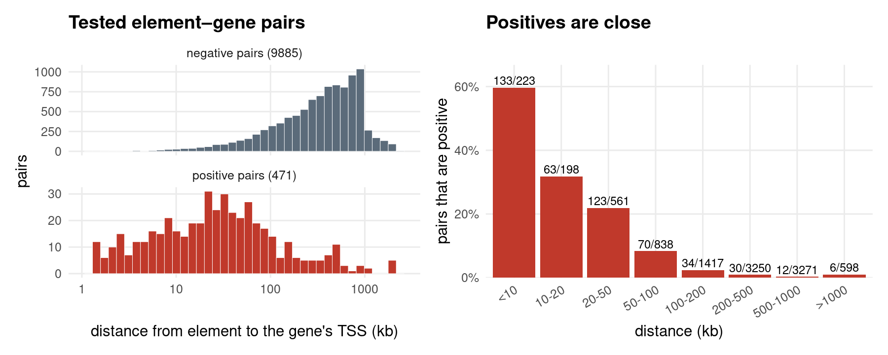{width="92%" fig-align="center"}

- 10 356 element–gene pairs tested by **CRISPRi in K562**; 471 are positive (silencing the element lowers the gene).
- Positives: median **26 kb** from the TSS, 90% within 207 kb. Negatives: median 387 kb.
- Within 10 kb, 60% of tested pairs are positive; at 200–500 kb, 0.9%.

::: notes
This is the benchmark used throughout the lecture (Gschwind et al. 2023 combined several published screens, details later). Left: the tested pairs; right: the fraction positive by distance bin. Two lessons. First, distance is a very strong predictor: most real links are short-range, tens of kilobases. Second, the tail is real: some positives are hundreds of kilobases away (the K562 set includes MYC enhancers 1.8–2.0 Mb away). Be careful with the right panel: it describes what the screens tested, which was mostly elements within about 1 Mb of each gene; it is not the probability that a random element regulates a random gene. And a negative here means "no effect detected", which for small effects can be a false negative.
:::

## The nearest gene is right about half the time {.smaller}

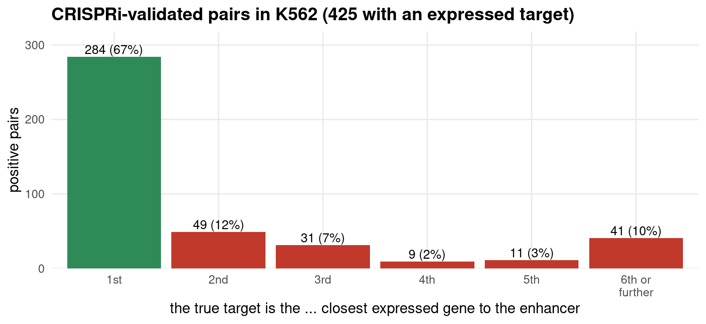{width="80%" fig-align="center"}

- Of 425 positive pairs whose target is expressed, the target is the closest **expressed** gene for 67%; for 33% it is the 2nd, 3rd … or a gene further away.
- As a predictor, "nearest gene" has **precision 0.41, recall 0.54** (all protein-coding genes): it misses half of the links and half of its calls are wrong.

::: notes
How to read the bar chart: for each validated pair, rank the expressed genes (TPM ≥ 1 in K562) by the distance of their TSS from the element; the bar shows where the true target falls. Two thirds of the targets are the nearest expressed gene, 12% the second nearest, and one in ten is beyond the fifth. (46 positive targets have TPM < 1 in our K562 RNA-seq and are left out of the chart: a reminder that "expressed" depends on the threshold and the dataset.) As a rule applied to all 10 356 tested pairs, "the element regulates its nearest protein-coding gene" calls 630 links, 256 of them right: precision 0.41. It finds 256 of the 471 true links: recall 0.54. Restricting to expressed genes raises recall to 0.60 but lowers precision to 0.35, because more elements are now assigned to some expressed gene. Note also that an element can regulate more than one gene; nearest-gene allows only one. Keep these two numbers: every better method should beat them.
:::

## Four kinds of evidence {.smaller}

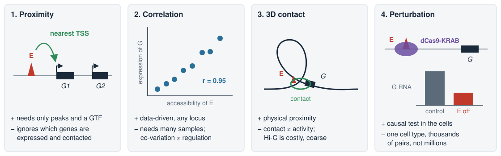{width="95%" fig-align="center"}

- They fail in different ways, so they are most useful **combined**.
- Only perturbation tests regulation directly; the others are predictions that perturbations are used to evaluate.

::: notes
Proximity is free and always available. Correlation uses natural variation between samples: if an element is open in exactly the cell types that express a gene, that is evidence for a link, but correlated programmes produce many false links (next slides). Contact asks whether the element and the promoter touch in 3D: Hi-C and its variants, covered in *3D genome organisation* and *Hi-C: from reads to contact matrices*; contact is necessary in most models of enhancer function, but not sufficient (a contacted element can be inactive). Perturbation (CRISPR interference, deletion) tests the causal question in the cell type of interest but scales to thousands of pairs, not the millions of candidate pairs in a genome. A fifth source, human genetics (a variant in the element changes the gene's expression across people), is the topic of *Epigenomics and genetic variation*.
:::

## Correlation across samples {.smaller}

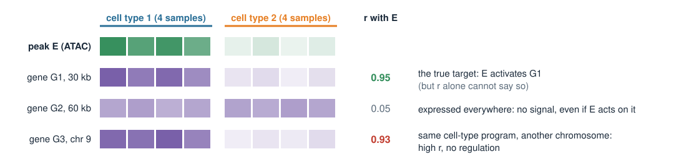{width="95%" fig-align="center"}

- Measure accessibility (ATAC) and expression (RNA-seq) in the **same** set of samples, and correlate each element with each gene nearby.
- With two groups of samples, everything specific to one group correlates with everything else specific to that group: **co-variation is not regulation**.
- Test only pairs within a window (e.g. ±500 kb), use many **diverse** samples, and compare with a **null** of random pairs.

::: notes
The idea is the same as an eQTL with cell types or individuals instead of genotypes. It needs no 3D data and uses data the students already have (the Corces atlas, *Differential accessibility*). The danger is in the figure: gene G3 on another chromosome correlates as well as the true target, because both belong to the cell-type-1 programme. With only two cell types the correlation is just a group difference, and every group-specific element is linked to every group-specific gene. More and more varied samples help: dozens of cell types, hundreds of individuals, or thousands of single cells (next slide). Gene G2 shows the opposite failure: a gene expressed everywhere gives no correlation, even if the element contributes to it. Correlation finds regulation that varies across the samples, nothing else.
:::

## Real data: 13 blood cell types {.smaller}

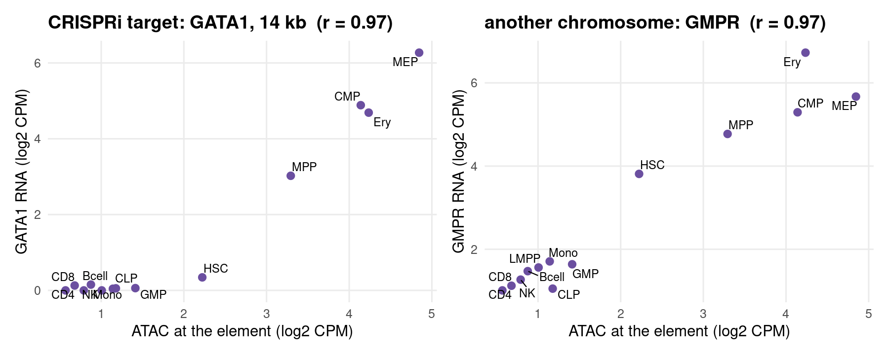{width="92%" fig-align="center"}

- Corces et al. 2016: ATAC and RNA for 13 sorted cell types. Left: a CRISPRi-validated enhancer of **GATA1** (14 kb), r = 0.97 across the cell types.
- Right: the same element against *GMPR*, on another chromosome: also r = 0.97. 118 of 15 660 genes on other chromosomes reach r > 0.8.

::: notes
Each point is a cell type: mean accessibility of the element (log2 CPM over donors) against mean expression of the gene. The GATA1 enhancer is open in MEPs, CMPs and erythroblasts, where GATA1 is expressed, and closed in lymphocytes: a textbook correlation, and a real link (silencing it in K562 lowers GATA1 by 33%). But GMPR, an erythroid-expressed gene on chromosome 6, correlates just as well, and so do about a hundred other genes elsewhere in the genome. With 13 points that fall into an erythroid group and a non-erythroid group, r ≈ 1 is easy to get. This is why correlation-based methods restrict to a cis window, compare with a null and, ideally, use many more samples than cell types.
:::

## Correlation needs a null {.smaller}

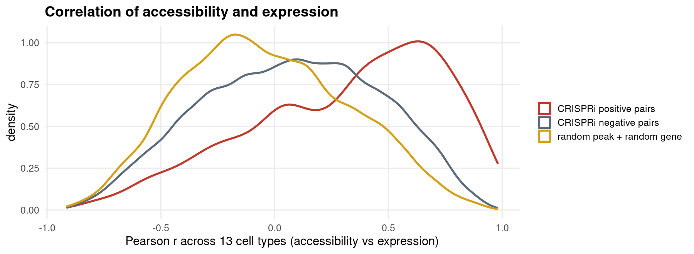{width="92%" fig-align="center"}

- Positive pairs have higher r (median **0.39**) than negative pairs (0.09). But for **random** peak–gene pairs, 5% have r > 0.59 and 1% r > 0.77.
- As a score on the benchmark, correlation alone reaches AUPRC **0.14**: three times random, far below distance (0.44).
- Single-cell multiome (RNA + ATAC in the same cells) gives thousands of samples; tools such as ArchR and Signac use the same test with a background of trans or GC-matched peaks.

::: notes
The correlation distribution of random pairs is the null: it is wide because 13 cell types give 13 points, and cell-type programmes make many unrelated pairs co-vary. A p-value from the usual correlation test assumes independent samples and would be badly anti-conservative here; an empirical null (random or trans pairs, or permuted cell-type labels) is the honest comparison. Single-cell multiome data (10x Multiome, SHARE-seq) are the modern version: correlation across thousands of cells or "metacells", with a background of peaks matched for GC and accessibility, as in ArchR's peak-to-gene links and Signac's LinkPeaks. More samples narrow the null, but the confounding by cell-type programme remains: it is still correlation. On our benchmark the correlation was computed in normal blood cell types and evaluated in K562 cells, which is part of why it is weak; see the exercise for how it combines with distance.
:::

## Contact falls with distance {.smaller}

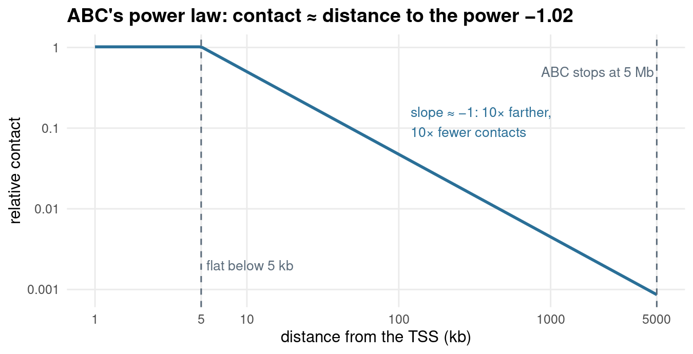{width="76%" fig-align="center"}

- In Hi-C, contact frequency falls roughly as a **power law** of genomic distance: $C(d) \propto d^{-\gamma}$ with $\gamma \approx 1$ (*3D genome organisation*).
- ABC can use measured Hi-C or this curve; the published average is $\gamma = 1.02$, flat below 5 kb (Hi-C cannot resolve shorter distances), and elements beyond 5 Mb are ignored.

::: notes
Students meet the distance decay properly in the 3D units, where they compute it from a contact matrix. Here we only need its shape: on a log–log plot it is a straight line with slope about −1, so an element 10 times farther from the promoter has about 10 times fewer contacts. The ABC code (Fulco et al. 2019, Nasser et al. 2021) fits the power law to an average of Hi-C maps from several cell types: contact = exp(5.96 − 1.024 × ln(d + 1)); the scale factor cancels in ABC, only the exponent matters. Below 5 kb the curve is held flat. A power law is cell-type agnostic and has no domains, boundaries or loops: everything specific to the cell type then has to come from the activity term. That is a simplification we return to after the benchmark.
:::

## The activity-by-contact model {.smaller}

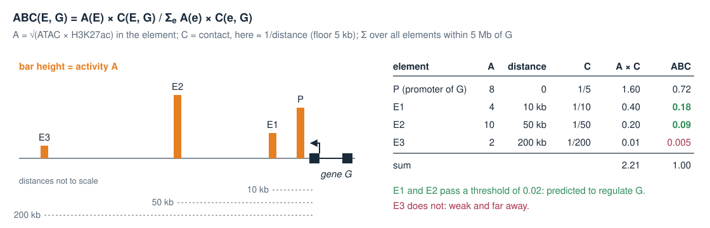{width="95%" fig-align="center"}

- An element's effect on a gene ∝ its **activity** × its **contact** with the promoter; ABC is that product as a **fraction** of all such products near the gene (including the promoter itself).
- Predict a link when ABC ≥ about 0.02 (2% of the gene's regulatory input).

::: notes
Go through the table: the promoter of G has the largest share, 72% (promoters are active and at distance 0). E1 is moderately active and close: 18%. E2 is the most active element but five times farther: 9%. E3 is weak and far: 0.5%. The denominator makes ABC a relative measure: a moderately active element near a gene with few other elements can score higher than a very active one near a gene with many. That is the model's main idea: an element competes with all other elements for the gene. Fulco et al. 2019 tested the idea against thousands of CRISPRi perturbations; the published thresholds are 0.016–0.027 depending on the inputs (the 2% we use is in that range). Activity in the original paper is the geometric mean of DNase-seq and H3K27ac read counts; ATAC-seq can replace DNase-seq.
:::

## Activity: accessibility and acetylation {.smaller}

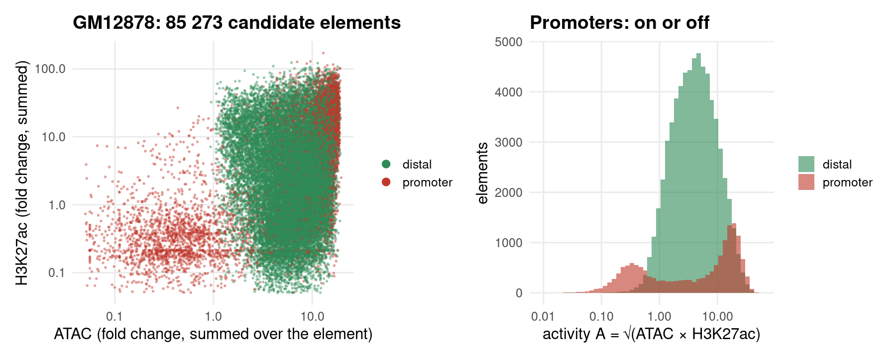{width="92%" fig-align="center"}

- Candidate elements: ATAC peaks (summit ± 250 bp, merged) plus all protein-coding promoters: **85 273** in GM12878.
- Activity $A = \sqrt{\text{ATAC} \times \text{H3K27ac}}$: an element needs **both** to score high. The geometric mean damps the noise of either assay.
- Promoters are **on or off**: 2 337 promoters have no signal at all (genes silent in B cells); active promoters are the most active elements.

::: notes
The two marks are correlated but far from redundant (Spearman 0.37 in GM12878). An open element without acetylation may be bound by CTCF, a repressor or a poised factor; acetylation without accessibility is mostly the flanks of active elements. The geometric mean penalises elements weak in either. Two technical points that matter in the exercise. First, our ATAC signal is ENCODE's fold change over the local background; the strongest sites saturate (the vertical edge at the right of the scatter) because the local background rises around them. ABC uses read counts, which do not saturate; with K562 DNase-seq read-depth signal instead of ATAC fold change the benchmark improves (0.52 vs 0.48 AUPRC). Second, the H3K27ac signal is taken in a window 250 bp wider on each side, because the acetylated nucleosomes flank the open site.
:::

## Real data: ABC at the PPIF locus in GM12878 {.smaller}

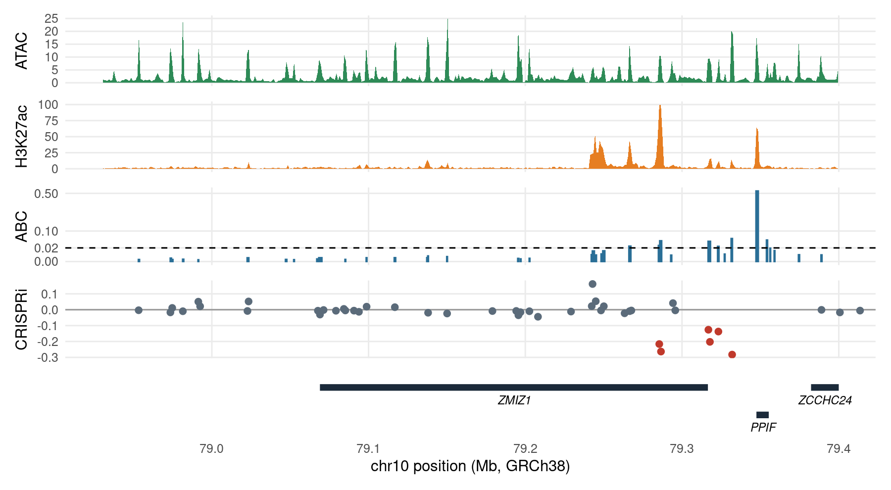{width="92%" fig-align="center"}

- ABC for *PPIF* from the course GM12878 ATAC and H3K27ac, against CRISPRi of 52 elements (Nasser et al. 2021).
- All **6** positives (red) have ABC ≥ 0.02; they lie 15–62 kb upstream, inside *ZMIZ1*. The nearest gene of four of them is *ZMIZ1*, not *PPIF*.
- Of the 46 negatives, 2 pass the threshold (80 kb, effects of 1%).

::: notes
This locus matters for disease: Nasser et al. 2021 linked an inflammatory bowel disease risk variant to one of these enhancers and showed that it regulates PPIF, which affects mitochondrial membrane potential in macrophages. Here we compute ABC ourselves from course data (ENCODE GM12878 ATAC and H3K27ac fold-change tracks, the power law), and compare with the CRISPRi effects measured on PPIF in GM12878. Read top to bottom: the H3K27ac track already points to the cluster of strong elements between 79.24 and 79.33 Mb; ABC ranks them; the CRISPRi panel confirms the six closest strong ones and shows no effect for the many elements further away, including active ones in ZMIZ1. Over all 68 GM12878 pairs in the benchmark (9 genes), ABC ≥ 0.02 gives 13 true positives, 3 false positives and 3 false negatives (a MYC enhancer 525 kb away is one of them). A small sample, but a real test on course data.
:::

## Ground truth: CRISPRi screens {.smaller}

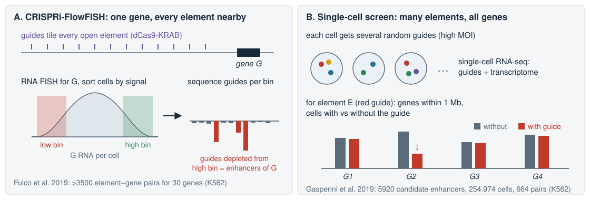{width="95%" fig-align="center"}

- **dCas9-KRAB** (CRISPR interference) deposits H3K9me3 at the guide's target and silences an enhancer without cutting DNA.
- **A**: tile every element near one gene, sort cells by the gene's RNA (FlowFISH), see which guides are depleted from the high bin.
- **B**: many random guides per cell, single-cell RNA-seq, compare every nearby gene between cells with and without each guide.

::: notes
Two designs give most of the data. In CRISPRi-FlowFISH (Fulco et al. 2019) one gene is measured by RNA FISH; a library of guides tiles all accessible elements within a few hundred kb; cells are sorted into bins of FISH signal; guides that silence an enhancer of the gene are depleted from the high-expression bin. It tests every element near one gene, but one gene at a time: 3500 pairs for 30 genes. In the single-cell design (Gasperini et al. 2019) each cell receives tens of random guides (a high multiplicity of infection), and single-cell RNA-seq reads out the whole transcriptome plus the guides: 5920 candidate enhancers in 254 974 cells, 664 significant pairs. Every gene within 1 Mb is tested against every element, but with less power per pair. KRAB silences roughly a 1–2 kb region, so a guide can also hit a nearby element; and an effect could in principle be indirect (the element regulates a TF that regulates the gene), which is why benchmarks keep only pairs within a few Mb.
:::

## The benchmark {.smaller}

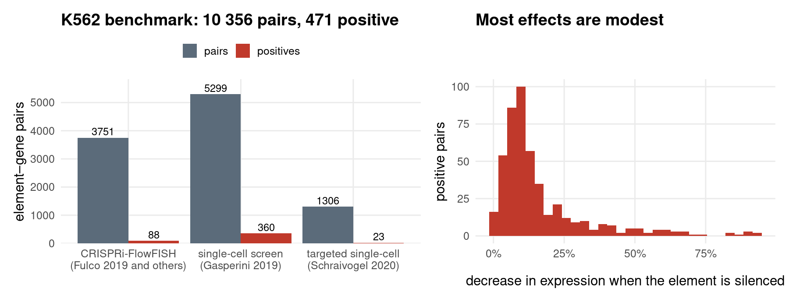{width="92%" fig-align="center"}

- Combined and re-processed by Gschwind et al. (ENCODE-rE2G): **10 356** pairs in K562, **471** positives = significant **decrease** (FDR 5%).
- Most effects are modest: median **10%** decrease; 77% of positives below 20%.
- A negative is "no effect detected": pairs without power for a 25% effect were removed, but small effects are missed.

::: notes
The table is in the course data (crispr_benchmark_k562.tsv.gz) with element coordinates, gene, effect size, adjusted p-value and power. "Regulated" = significant and negative; 75 significant positive effects (silencing an element raised a gene) are not counted as links: they can be real (a silencer, or competition between promoters) but most models do not predict them. Small effects dominate: a typical enhancer contributes 10–20% of a gene's expression, because genes have several enhancers that act partly additively. That is one reason the benchmark is hard: an element can regulate a gene by 5% and still be called negative. Imbalance matters too: 4.5% positives means that a useless score already has 4.5% precision, the baseline of the next slide. The paper also provides a held-out set in five other cell types, including the 68 GM12878 pairs of the previous slide.
:::

## Precision and recall {.smaller}

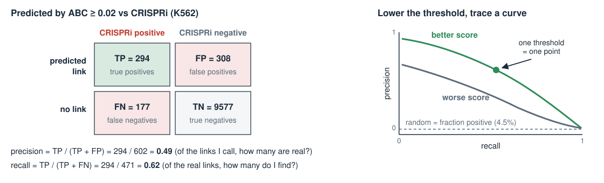{width="95%" fig-align="center"}

- **Precision**: of the links I call, how many are real? **Recall**: of the real links, how many do I find?
- Any score + a threshold gives one point; all thresholds give the **PR curve**. Its area (**AUPRC**) summarises it; random = the fraction of positives.
- With 4.5% positives, prefer PR to ROC: a ROC curve looks good even when most calls are wrong.

::: notes
These numbers are for ABC at 0.02 on the K562 benchmark: 602 calls, 294 correct. Precision 0.49, recall 0.62: half of the links we call are real, and we find six in ten real links. For comparison, the nearest gene had 0.41 and 0.54. Why not a ROC curve? Its x axis is the false positive rate, FP / (FP + TN); with 9885 negatives, 308 false positives are only 3% of the negatives, so the ROC point looks excellent even though half of the calls are wrong. The precision is what a biologist experiences when following up predictions. The same reasoning appears in the machine-learning units, which also stress comparing with a simple baseline: here the baseline is distance.
:::

## Real data: which score finds the links? {.smaller}

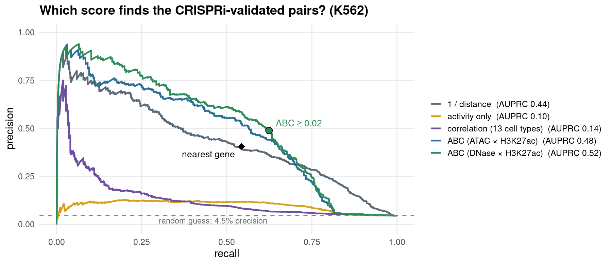{width="95%" fig-align="center"}

- **Distance alone** is a strong baseline (AUPRC 0.44). **Activity alone** is useless (0.10): strong elements are not more likely to regulate a *given* gene.
- **ABC** beats distance (0.48 with ATAC, 0.52 with DNase) and beats the nearest gene at both precision and recall.
- At high recall all methods converge: 19% of positives overlap no candidate element at all.

::: notes
Each curve ranks all 10 356 pairs by one score. Distance (1/distance to the TSS) is what most papers implicitly use; it is hard to beat because, as we saw, real links are mostly close. Activity alone ranks pairs by how strong the element is, regardless of the gene: an active element is tested against many genes and regulates at most a few. ABC combines the two and normalises per gene, and gains most at moderate recall: at the left of the plot, its top-ranked pairs are right about 80–90% of the time. Precision at 70% recall: distance 0.32, ABC 0.35. Our ABC is a simplified re-implementation (no quantile normalisation, fold-change tracks, ATAC peaks as candidates); the published ABC and the supervised ENCODE-rE2G do better on this benchmark. The flat end of the ABC curves: 87 positive pairs have ABC = 0 because the tested element overlaps none of our candidate elements (not called as an ATAC peak), so no threshold can find them.
:::

## What ABC captures, and what it misses {.smaller}

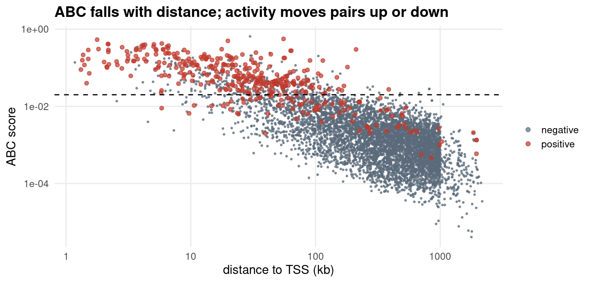{width="80%" fig-align="center"}

- ABC falls with distance; activity moves a pair up or down by up to 100-fold at a given distance.
- Missed positives (ABC < 0.02) are farther away (median **51 kb** vs 22 kb for those found) and often weakly marked.
- Not modelled: **silencers**, insulation by **CTCF boundaries**, promoter–promoter competition, which TFs bind, and cell-type-specific 3D structure (when the power law is used).

::: notes
Each point is a tested pair with a non-zero ABC score. Above the dashed line ABC predicts a link. Most positives (red) are close and above the line; the far ones are mostly below it. ABC assumes that an element's contribution is additive and proportional to its activity and contact: strong evidence from CRISPRi supports this on average, but there are well-known exceptions. Elements with H3K27me3 or CTCF binding rarely behave as ABC predicts (the benchmark annotates these categories, and they are almost never positive). Housekeeping and ubiquitously expressed genes depend less on distal enhancers, so ABC over-predicts links to them; the ABC authors handle this partly by also reporting promoter class. Finally, ABC predicts which elements regulate a gene, not how strongly the gene will respond to a change in the element.
:::

## Hi-C or a power law? {.smaller}

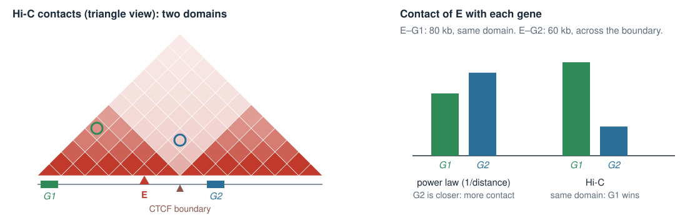{width="95%" fig-align="center"}

- A power law knows only distance. Measured contacts know domains: elements in the same TAD contact more, across a **CTCF boundary** less.
- ABC with Hi-C uses the contact of each element with the promoter (at 5 kb resolution, normalised and scaled to the power law).
- In the published comparisons, Hi-C improves ABC modestly; distance carries most of the information. Your own Hi-C of the *3D genome* units can be plugged in.

::: notes
The cartoon shows the case where the two disagree: G2 is closer but across a boundary, G1 is farther but in the same domain. Domains and boundaries are covered in *Calling compartments, TADs and loops*. In practice, ABC with cell-type-specific Hi-C and ABC with an average Hi-C map or the power law perform similarly on the CRISPR benchmarks, with Hi-C ahead mainly at large distances; deep Hi-C (or Micro-C, HiChIP for H3K27ac) is expensive, while a power law is free. Two cautions when using Hi-C directly. A loop called between an enhancer and a promoter is not proof of regulation (many contacts are structural, from CTCF/cohesin), and absence of a called loop is not proof against it (most enhancer–promoter contacts are weaker than loop-calling thresholds). The resolution also matters: at 5 kb, all elements within a bin share the same contact.
:::

## Computing ABC in R

```r
el[, activity := sqrt(dnase * h3k27ac)]                         # one row per candidate element
win <- GRanges(genes$chr, IRanges(pmax(genes$tss - 5e6, 1), genes$tss + 5e6))
hw  <- findOverlaps(win, elg)                                   # every element within 5 Mb of each gene
abc <- data.table(gene = genes$gene[queryHits(hw)], e = subjectHits(hw))
abc[, d   := abs(el$mid[e] - genes$tss[queryHits(hw)])]
abc[, C   := (pmax(d, 5000) + 1)^-1.024]                        # power-law contact, flat below 5 kb
abc[, ABC := el$activity[e] * C / sum(el$activity[e] * C), by = gene]
abc[ABC >= 0.02]                                                # predicted enhancer–gene links
```

- Ten lines on top of *Genomic intervals*: a window per gene, an overlap, a weighted share.
- The full pipeline (ABC on GitHub, Snakemake) adds peak calling, read counting, quantile normalisation and Hi-C.

::: notes
This is the code of the exercise (R5). el is a table of candidate elements with their signals, elg the same as GRanges, genes one row per gene with chromosome and TSS. findOverlaps gives all element–gene pairs within 5 Mb (about 760 000 for the 2113 genes of the benchmark); the rest is arithmetic in data.table, with sum(...) by = gene giving the denominator per gene. On a laptop the whole computation takes seconds. Compared with this, the production ABC pipeline calls peaks with MACS2 on DNase or ATAC, keeps the 150 000 strongest, counts reads (not fold change), quantile-normalises activity to a reference, and optionally reads Hi-C at 5 kb. The idea is unchanged. The output, genome-wide predictions for a cell type, is what you would intersect with your differential peaks or with disease variants.
:::

## Beyond ABC {.smaller}

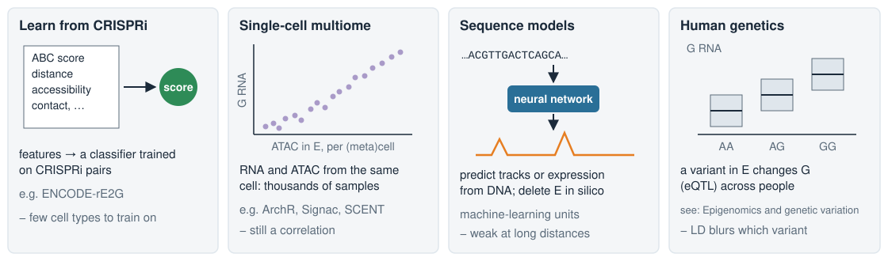{width="95%" fig-align="center"}

- **Supervised** models learn how to weigh ABC, distance and other features from CRISPRi data (ENCODE-rE2G, Gschwind et al.).
- **Single-cell multiome** brings correlation to thousands of cells; **sequence models** predict expression from DNA; **genetics** asks whether a variant in the element changes the gene across people.

::: notes
ENCODE-rE2G trains a logistic regression on the CRISPRi benchmark with ABC-like features (accessibility, contact, distance, numbers of nearby elements, promoter class) and is the current reference predictor; the risk is overfitting to the few cell types and loci that have been screened, so it is evaluated on held-out cell types (the GM12878 set we used is one of them). Sequence-based deep learning models (Enformer-type networks, see *What people try to predict, and how to tell if it works*) predict expression or chromatin tracks from DNA and can score the effect of deleting an element in silico; their accuracy at distances beyond tens of kilobases is still limited. Human genetics, the topic of the next unit, provides an independent kind of evidence: an eQTL in the element, colocalised with the GWAS signal. None of these replaces a perturbation, but each is cheaper.
:::

## In your own study {.smaller}

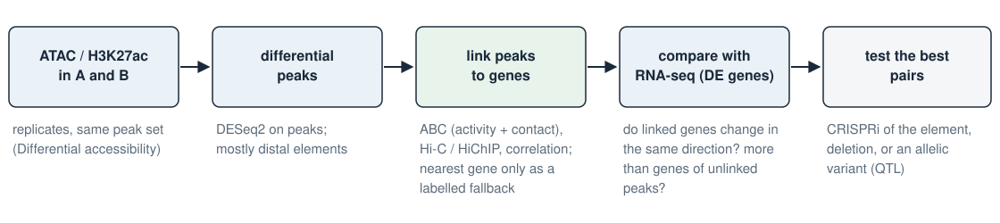{width="95%" fig-align="center"}

- Link differential peaks to genes with an ABC-type score (or contacts), keep the distance in the table, and report the method.
- Test **concordance** with RNA-seq: do genes linked to opening elements go up, more than expected? A promoter peak and its gene agree better than a distal peak and its nearest gene (*Differential accessibility*: Spearman 0.69 vs 0.42).

::: notes
This is how the pieces of the course fit together in an applied project with two conditions. The differential accessibility analysis gives the regions; a linking method turns them into candidate genes; RNA-seq from the same samples tests whether the predicted targets move in the expected direction. Concordance is evidence that the links are mostly right, not proof for any single pair. Keep the distance and the score in the result table, so a reader can see that "target of peak 1234" means "ABC 0.03, 180 kb", not "nearest gene, 5 kb". For the few pairs that matter (a disease variant, a key regulator), test them: CRISPRi of the element in the relevant cells, or a deletion. Without that, write "predicted target".
:::

## Judging claims {.smaller}

- "The enhancer regulates its nearest gene." Correct about half the time; say "nearest gene" and give the distance.
- "Hi-C shows a loop between the enhancer and the promoter, so the enhancer regulates the gene." Contact is necessary in most models but not sufficient; many loops are structural (CTCF–CTCF).
- "Accessibility of the element correlates with expression of the gene across 20 cell types (r = 0.9)." Compare with the correlation of random pairs; check genes on other chromosomes.
- "CRISPRi of the element had no effect, so it is not an enhancer of the gene." Check the power: a 10% effect is easy to miss; the element may be redundant with others (shadow enhancers).
- "ABC predicts 40 000 enhancer–gene links." A prediction with about 50% precision on benchmarks; useful for prioritisation, not proof.

::: notes
These are the questions to ask when reading papers, and the kind of question the written exam asks (judge the claim). The last two are often forgotten. Negative CRISPRi results depend on power and redundancy: many genes have several enhancers with overlapping function, and silencing one may have little effect while silencing two has a large one (Osterwalder et al. 2018 showed this for limb enhancers in mice). Positive results can also be indirect if the element regulates a transcription factor that then regulates the measured gene; distance filters reduce, but do not remove, this possibility.
:::

## Summary {.smaller}

| idea | key fact |
|---|---|
| the problem | enhancers act over tens of kb, sometimes Mb; the target is not written in the peak |
| nearest gene | right for about half of CRISPRi links (precision 0.41, recall 0.54 in K562) |
| correlation | needs many diverse samples and a null; cell-type programmes create false links |
| contact | Hi-C contact ∝ distance^−1 (power law); domains and boundaries modify it |
| ABC | activity (√(ATAC or DNase × H3K27ac)) × contact, as a share of all elements of the gene; link if ≥ ~0.02 |
| ground truth | CRISPRi screens (FlowFISH, single-cell); 471 of 10 356 K562 pairs positive, effects mostly 5–20% |
| evaluation | precision–recall, not ROC; compare with distance |
| this benchmark | AUPRC: activity 0.10, correlation 0.14, distance 0.44, ABC 0.48–0.52 |

::: notes
Students should leave able to: compute an ABC score by hand for a small locus; compute precision and recall from a confusion matrix and read a PR curve; explain why correlation across a handful of cell types links unrelated genes; and judge a claim that an enhancer regulates a gene. Next: *Epigenomics and genetic variation*, where the elements carry disease variants and these links become the bridge from a GWAS signal to a gene.
:::

## Key papers (optional further reading) {.smaller}

*Not required reading and not examined. For those who want the primary literature.*

- Fulco et al. 2016, *Science*. [Systematic mapping of functional enhancer–promoter connections with CRISPR interference](https://doi.org/10.1126/science.aag2445). CRISPRi tiling of the MYC and GATA1 loci: the first systematic enhancer–gene map.
- Gasperini et al. 2019, *Cell*. [A genome-wide framework for mapping gene regulation via cellular genetic screens](https://doi.org/10.1016/j.cell.2018.11.029). 5920 candidate enhancers silenced at random in single cells.
- Fulco et al. 2019, *Nat Genet*. [Activity-by-contact model of enhancer–promoter regulation from thousands of CRISPR perturbations](https://doi.org/10.1038/s41588-019-0538-0). CRISPRi-FlowFISH and the ABC model.
- Nasser et al. 2021, *Nature*. [Genome-wide enhancer maps link risk variants to disease genes](https://doi.org/10.1038/s41586-021-03446-x). ABC in 131 cell types and tissues, applied to GWAS; the PPIF enhancer.
- Gschwind et al. 2023, *bioRxiv*. [An encyclopedia of enhancer-gene regulatory interactions in the human genome](https://doi.org/10.1101/2023.11.09.563812). ENCODE-rE2G and the CRISPR benchmark used here.
- Schoenfelder & Fraser 2019, *Nat Rev Genet*. [Long-range enhancer–promoter contacts in gene expression control](https://doi.org/10.1038/s41576-019-0128-0). Review of how enhancers reach their promoters.
