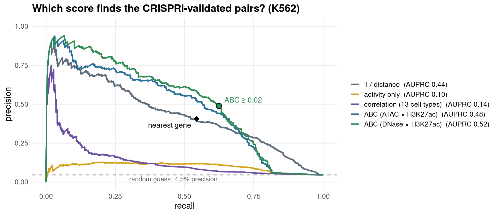

Short questions on nearest genes, correlation, the activity-by-contact model and how to evaluate enhancer–gene predictions. Try each on paper first, then open the answer.

---

**Q1.** Give two reasons why the nearest gene of a distal ATAC peak is often not the gene it regulates.

::: {.callout-tip collapse="true" title="Hint"}
Think about 3D structure, and about whether the nearest gene is even expressed.
:::

::: {.callout-note collapse="true" title="Answer"}
(1) Enhancers act through 3D contact, which can skip genes: the element may be in the same domain as a gene further away and separated from the nearest gene by a boundary (examples: the ZRS acting on *SHH* 1 Mb away, the *FTO* intron acting on *IRX3*). (2) The nearest gene may be silent in the cell type, or expressed from its own promoter without needing this element. Also: one element can regulate several genes. In the K562 CRISPRi benchmark the nearest protein-coding gene is right for about half the links (precision 0.41, recall 0.54).
:::

---

**Q2.** Gene G has three elements besides its promoter. Promoter: activity 10 at distance 0; E1: activity 4 at 10 kb; E2: activity 8 at 40 kb; E3: activity 1 at 100 kb. With contact $C = 1/\max(d, 5\text{ kb})$, compute the ABC score of E2. Is it predicted to regulate G at a threshold of 0.02?

::: {.callout-tip collapse="true" title="Hint"}
$A \times C$: promoter $10/5$, E1 $4/10$, E2 $8/40$, E3 $1/100$.
:::

::: {.callout-note collapse="true" title="Answer"}
$A \times C$: promoter 2.0, E1 0.4, E2 0.2, E3 0.01; sum 2.61. ABC(E2) = 0.2/2.61 = **0.077**: yes, above 0.02. (E1 0.15, E3 0.004, the promoter 0.77.)
:::

---

**Q3.** In Q2, gene G's promoter becomes silent (activity 0). What happens to the ABC scores of the enhancers, and why is this a problem?

::: {.callout-note collapse="true" title="Answer"}
The sum drops to 0.61 and every enhancer's share rises (E2: 0.2/0.61 = 0.33). ABC is a relative measure and does not know that the gene is off: a silent gene gets large ABC scores from any active element nearby. Predictions should be restricted to expressed genes (or reported with expression), as the published ABC does.
:::

---

**Q4.** Why is activity computed as $\sqrt{\text{ATAC} \times \text{H3K27ac}}$ rather than as ATAC alone?

::: {.callout-note collapse="true" title="Answer"}
Accessibility alone does not distinguish active enhancers from other open sites (CTCF sites, repressor-bound or poised elements); H3K27ac marks active elements. The geometric mean requires both to be high: an element with no acetylation (or no accessibility) gets a low score. It also damps noise: a factor 4 error in one assay changes the activity by a factor 2.
:::

---

**Q5.** A method calls 200 enhancer–gene links; 120 are confirmed by CRISPRi. The screen contains 300 true links among 6000 tested pairs. Compute precision and recall. What precision would a random set of 200 pairs have?

::: {.callout-note collapse="true" title="Answer"}
Precision 120/200 = **0.60**; recall 120/300 = **0.40**. A random set has, on average, the fraction of positives: 300/6000 = **0.05**.
:::

---

**Q6.** On a benchmark with 4.5% positives, a predictor has a false positive rate of 0.04 and a true positive rate of 0.55. A colleague says "it is excellent, the ROC point is near the top-left corner". What is its precision? Comment.

::: {.callout-tip collapse="true" title="Hint"}
Take 10 000 pairs: 450 positives, 9550 negatives.
:::

::: {.callout-note collapse="true" title="Answer"}
TP = 0.55 × 450 ≈ 248; FP = 0.04 × 9550 = 382. Precision = 248/630 ≈ **0.39**: most calls are wrong, although the ROC point looks good. With rare positives, the many negatives make the false positive rate small even when false positives outnumber true ones. Use precision–recall curves and compare with a baseline such as distance.
:::

---

**Q7.** Accessibility of an element and expression of a gene on another chromosome correlate at r = 0.95 across 6 samples (3 B-cell, 3 T-cell). Is this evidence for regulation? What would make a correlation-based link more convincing?

::: {.callout-note collapse="true" title="Answer"}
No. With two groups, any B-specific element correlates with any B-specific gene, anywhere in the genome: the correlation reflects the cell-type programme, not regulation, and $r$ is easily near ±1 with 6 points in 2 groups. More convincing: restrict to cis pairs (e.g. within 500 kb), use many diverse samples (dozens of cell types, hundreds of individuals, or thousands of single cells), compare with a null (random or trans pairs), combine with distance or contact, and validate by perturbation.
:::

---

**Q8.** Read the figure: in the K562 benchmark, what are the AUPRCs of "1 / distance", "activity only" and ABC? What do they say about where the information in ABC comes from?

{width="100%"}

::: {.callout-note collapse="true" title="Answer"}
1/distance 0.44, activity only 0.10, ABC 0.48 (ATAC) and 0.52 (DNase); random 0.045. Most of the information is in distance (contact): real links are mostly close. Activity alone is nearly useless because an element's activity is the same for every gene it is tested against. Combined and normalised per gene, activity improves on distance, mainly in the top of the ranking (higher precision at low and moderate recall).
:::

---

**Q9.** A CRISPRi screen silences an enhancer predicted by ABC and finds no significant change in the target gene. Give three possible explanations other than "the prediction is wrong".

::: {.callout-note collapse="true" title="Answer"}
(1) Insufficient power: real effects are often 5–20%, and too few cells or guides miss them. (2) Redundancy: other enhancers of the same gene compensate (shadow enhancers). (3) Incomplete silencing: the guides did not cover the functional part of the element, or KRAB did not silence it fully. Also: the effect exists only in another state (stimulation, another cell type), or the gene is measured poorly (low expression).
:::

---

**Q10.** Your study finds 5000 peaks more open after a drug treatment. Outline how you would go from these peaks to candidate target genes, and how RNA-seq from the same samples can test whether your links are reasonable.

::: {.callout-note collapse="true" title="Answer"}
Link each peak to genes with an ABC-type score (activity from ATAC + H3K27ac in the treated cells, contact from Hi-C or a power law), restricted to expressed genes; keep the score and the distance in the table and treat nearest gene only as a labelled fallback. Then test concordance: genes linked to opening peaks should go up after treatment more often than genes linked to unchanged peaks (or than the nearest genes of random peaks). Concordance supports the links on average; for the key pairs, validate by CRISPRi or deletion of the element.
:::
