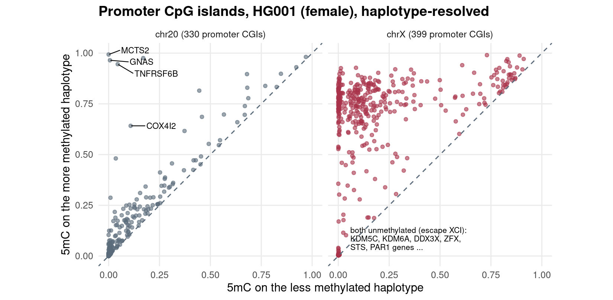

## Goal

After this exercise you will be able to:

- Decode the **MM/ML tags** of a modBAM record by hand, and turn per-read call probabilities into a methylation level.
- Run [modkit](https://github.com/nanoporetech/modkit) to make a **bedMethyl** table from nanopore reads, and compare it with WGBS of the same cell line.
- **Phase** heterozygous SNPs from a trio by Mendelian logic, **haplotag** reads with [WhatsHap](https://whatshap.readthedocs.io/), and compute methylation **per parental allele**.
- Recognise the methylation patterns of **imprinting control regions** and of **X inactivation**, and tell them apart from sequence-dependent allele-specific methylation.
- Measure chromatin accessibility from **m6A marks** left by a methyltransferase (Fiber-seq-style data), against an untreated control.

## Background

**Modified-base calls in a BAM.** Each read carries an `MM` tag (which bases have calls) and an `ML` tag (one probability per call). `MM:Z:C+m?,3,0,1;` means: modification `m` (5mC) on base C of the read's top strand; the numbers are how many Cs to **skip** before the next call (3: skip three Cs, call the fourth; 0: call the next C; and so on). `?` means Cs without a call are unknown; `.` would mean they are unmodified. `ML:B:C,...` holds one byte per call: probability ≈ (ML + 0.5) / 256. Nanopore reads called with a 5mC+5hmC model carry two lists, `C+h?` and `C+m?`, each with its own ML values; P(C) = 1 − P(5mC) − P(5hmC).

**From calls to a level.** For every call the most likely state is taken (C, 5mC or 5hmC). `modkit` estimates a threshold (the 10th percentile of the confidence of all calls) and drops calls below it as *fail*. The level at a CpG is then a count, like C/(C+T) in WGBS:

$$ \text{5mC level} = \frac{N_\text{5mC}}{N_\text{valid}}, \qquad N_\text{valid} = N_\text{5mC} + N_\text{5hmC} + N_\text{C} $$

Bisulfite and EM-seq read both 5mC and 5hmC as C, so compare them with $(N_\text{5mC} + N_\text{5hmC}) / N_\text{valid}$.

**Phasing by transmission.** A child receives one allele of each SNP from each parent. When a parent is homozygous, we know which allele that parent passed on, and the other allele of the child came from the other parent. If both parents are heterozygous the SNP is not informative. On chrX a father has only one allele (hemizygous) and passes his X to a daughter.

**Haplotagging.** WhatsHap compares each read with the phased heterozygous SNPs it covers and writes `HP:i:1` or `HP:i:2` into the read; reads without informative SNPs stay untagged. In our VCF the first allele of every genotype is the **paternal** one, so HP 1 = paternal, HP 2 = maternal.

**Imprinting control regions** in this exercise (*DNA methylation biology*): the **H19 ICR** (chr11) is methylated on the paternal allele; **KvDMR** (the *KCNQ1OT1* promoter, chr11) and the **PWS-IC** (the *SNURF/SNRPN* promoter, chr15) on the maternal allele.

**Fiber-seq-style accessibility.** Nuclei are treated with an adenine methyltransferase (here EcoGII) that methylates A wherever DNA is not protected by nucleosomes or bound proteins. Human DNA has essentially no 6mA of its own, so m6A calls mark accessible DNA. An untreated sample measures the false-positive rate of the 6mA model.

## Data

All files are made by `data/prepare-meth2.sh longreads` (see `data/README.md`); you also need `hg38.fa.bgz`, the GENCODE GTF and the GM12878 ATAC-seq peaks from `data/download.sh`.

```bash
mkdir -p ~/epi/longread && cd ~/epi/longread
D=/path/to/course/data                     # where the course data are
```

| file | what |
|---|---|
| `hg001_ont_regions.bam` | HG001 (= NA12878, the donor of GM12878) nanopore R10.4.1 reads with 5mC and 5hmC calls, 4 flow cells (ONT open data `giab_2023.05`), cut to 5 regions: chr11:1.96–2.05 Mb (H19), chr11:2.69–2.71 Mb (KvDMR), chr15:24.94–24.97 Mb (SNRPN), chrX:53.15–53.34 Mb (KDM5C), chr21:33–34 Mb |
| `longread_regions.bed` | the 5 regions |
| `hg001_trio_regions.vcf.gz` | SNP genotypes of NA12878, her father NA12891 and her mother NA12892 in the regions (1000 Genomes 30×, 2022 release) |
| `gm12878_wgbs_regions.bed.gz`, `gm12878_wgbs_rep2_regions.bed.gz` | ENCODE WGBS of GM12878, replicates 1 and 2 (ENCFF570TIL, ENCFF614QHA), the same regions; one row per CpG and strand; column 10 coverage, 11 percent methylated |
| `hg001_hp1_chrX_chr20_5mc.bed.gz`, `..._hp2_...` | ONT's own haplotype-resolved 5mC pileups of HG001 (`giab_2025.01`, wf-human-variation, read-based phasing) for chrX and chr20: chrom, start, end, valid calls, 5mC calls |
| `hg38_cpgIslandExt.txt.gz` | UCSC CpG islands, hg38 |
| `hg002_ecogii_regions.bam`, `hg002_native_regions.bam` | HG002 nanopore reads, chr21:33–34 Mb, from nuclei treated with EcoGII and from untreated DNA (ONT `chrom_acc_2025.06`), with 5mC, 5hmC and 6mA calls |

**Shortcuts, said plainly.** The reads were basecalled and aligned by ONT; we start from the modBAM (basecalling needs the raw signal and GPUs). We cut 1.35 Mb out of genome-wide files by indexed remote access. The haplotypes of the chrX/chr20 pileups come from ONT's pipeline (read-based phasing), not from our trio. The chromatin data are from HG002, a different person than GM12878 (both are lymphoblastoid cell lines), so GM12878 ATAC peaks are only a guide.

You need samtools (≥ 1.15), bcftools, tabix, [modkit](https://github.com/nanoporetech/modkit) (≥ 0.6) and [WhatsHap](https://whatshap.readthedocs.io/) (≥ 2.0); see *Install the software you need* (`conda install -c bioconda ont-modkit whatshap`). The command-line part takes about 5 minutes, the R part about 3 minutes.

## By hand

Do these on paper.

**B1. Decode a read.** A read (top strand) has

```
SEQ   T C G A C G T T C A C G A A C G
MM:Z:C+m?,0,0,1,0;
ML:B:C,250,10,240,120
```

(a) Number the Cs of the read. Which Cs have a 5mC call, and which C is skipped? Why might the basecaller skip that one?

(b) Convert the ML values to probabilities of 5mC.

(c) Assume P(5hmC) = 0 for these calls. The confidence of a call is the probability of its most likely state. With modkit's threshold of 0.87, which calls pass, and which state does each passing call get?

(d) What would `MM:Z:C+m.,0,0,1,0;` mean for the skipped C?

**B2. A methylation level.** At one CpG, 12 reads have calls: 7 called 5mC, 3 called C, 1 called 5hmC, and 1 failed the threshold.

(a) What are N_valid, the 5mC level and the 5hmC level?

(b) What would WGBS of the same DNA report at this CpG (expected value)?

(c) With 12 calls, roughly what is the standard deviation of the 5mC level (binomial)? Would you call a difference of 0.1 between two samples at this single CpG?

**B3. Phase by transmission.** Genotypes of a child (heterozygous at all five SNPs) and her parents:

| SNP | chrom | REF/ALT | father | mother | child |
|---|---|---|---|---|---|
| s1 | chr11 | C/T | C/C | C/T | C/T |
| s2 | chr11 | G/A | A/A | G/A | G/A |
| s3 | chr11 | T/C | T/C | T/C | T/C |
| s4 | chr11 | A/G | A/G | G/G | A/G |
| s5 | chrX | C/T | T | C/C | C/T |

(a) For each SNP, which allele did the child get from her father? Write the child's genotype as paternal|maternal in 0/1 notation (0 = REF), or say "not informative".

(b) Read 1 covers s1 and s2 and carries C at s1 and A at s2. Read 2 carries T at s1 and G at s2. Which haplotag (HP 1 = paternal) does each get? Read 3 carries T at s1 and A at s2: what could explain it?

(c) Why does the father have only one allele at s5?

**B4. Haplotypes at an imprinting control region.** At one CpG inside an ICR you count:

| reads | 5mC calls | valid calls |
|---|---:|---:|
| HP 1 (paternal) | 1 | 22 |
| HP 2 (maternal) | 19 | 20 |
| untagged | 9 | 18 |

(a) Compute the level for each haplotype and for all reads together.

(b) Which of the three ICRs of this exercise could this be? Which could it not be?

(c) A colleague without phased data sees a level of 0.48 at this CpG in blood and concludes that "half the cells are methylated". Give the alternative explanation and a way to test it.

**B5. X inactivation in a cell line and in a tissue.** Look at the chrX panel of the lecture figure:

{width="100%"}

(a) Why do most chrX promoter CpG islands sit near the top-left of the panel, while chr20 islands sit near the origin?

(b) Draw where you would expect the same chrX islands in haplotype-resolved data from **whole blood** of a woman (a mixture of many clones). And from a **man**?

(c) Some chrX islands sit at the origin. What does that mean for the genes they belong to? Why are pseudoautosomal (PAR1) genes among them?

(d) Two chr20 islands (*GNAS*, *MCTS2*) are far from the diagonal. Which kind of allele-specific methylation is most likely, and what would you check?

**B6. Accessibility from m6A.** In 1 Mb of chr21, the EcoGII-treated sample has 12 778 m6A calls out of 264 993 valid adenine calls inside GM12878 ATAC peaks, and 33 840 out of 9 078 130 outside. The untreated sample has 159 of 409 716 inside and 2 589 of 12 463 344 outside.

(a) Compute the m6A fraction inside and outside peaks for the treated sample, and the fold enrichment.

(b) Subtract the untreated background. Does the enrichment change much? Why is the untreated sample still essential?

(c) In an open promoter, about 13% of adenines are marked. A nucleosome-free region of 200 bp contains about 50 adenines (on the read's strand). How many marks do you expect on one open fibre? What is the chance (Poisson) that an open fibre has none?

**B7. Judge the claims.**

(a) "Nanopore sequencing of human brain DNA finds 6mA at 0.03% of adenines; 6mA is therefore an epigenetic mark in human neurons."

(b) "Patients were sequenced in 2024 (dorado v5 models) and controls in 2022 (Guppy); 1 200 differentially methylated regions were found."

(c) "This CpG has 50% methylation in every person we measured, so it is imprinted."

## On the command line

### C1 — Look at the modBAM

```bash
samtools view -H $D/hg001_ont_regions.bam | grep '^@PG' | cut -c1-120 | head -3
samtools flagstat $D/hg001_ont_regions.bam | head -4
samtools view -F 0x904 $D/hg001_ont_regions.bam | awk '{ n++; s += length($10) } END { print n, "primary reads, mean length", s / n }'
samtools view -F 0x904 $D/hg001_ont_regions.bam chr11:2000000-2000100 | head -1 | tr '\t' '\n' | grep -E '^(MM|ML)' | cut -c1-80
```

(a) Which programs made this file? How many primary reads are there, and how long are they on average?

(b) What do the flags `-F 0x904` remove?

(c) Look at the MM tag of the first read: which modification lists does it have?

### C2 — A bedMethyl table with modkit

modkit and WhatsHap read many random positions of the reference; an uncompressed reference of the four chromosomes is much faster than the bgzipped genome.

```bash
samtools faidx $D/hg38.fa.bgz chr11 chr15 chr21 chrX > hg38_lr.fa
samtools faidx hg38_lr.fa
modkit pileup $D/hg001_ont_regions.bam hg001_cpg.bed --ref hg38_lr.fa \
  --cpg --modified-bases 5mC 5hmC --combine-strands \
  --include-bed $D/longread_regions.bed --sampling-frac 1 -t 4 --log-filepath pileup.log
grep 'setting threshold' pileup.log | sed 's/.*INFO\] //'
grep -w m hg001_cpg.bed | head -3
awk '$4 == "m" { n++; v += $10; m += $12; o += $14 } END { print n, "CpGs; mean valid calls", v / n, "; 5mC", m / v, "; 5hmC", o / v }' hg001_cpg.bed
```

(a) What threshold did modkit use? What fraction of calls did it drop?

(b) For the first CpG: how many calls are valid, methylated, unmethylated and failed? Check the percentage.

(c) How many CpGs, what mean coverage, and what fractions of all valid calls are 5mC and 5hmC?

### C3 — Phase the SNPs by transmission and tag the reads

```bash
bcftools query -l $D/hg001_trio_regions.vcf.gz
bcftools query -f '%CHROM\t%POS\t%REF\t%ALT[\t%GT]\n' $D/hg001_trio_regions.vcf.gz \
| awk 'BEGIN { OFS = "\t"
         print "##fileformat=VCFv4.2"
         print "##FORMAT=<ID=GT,Number=1,Type=String,Description=\"Genotype, paternal|maternal\">"
         print "##contig=<ID=chr11,length=135086622>"; print "##contig=<ID=chr15,length=101991189>"
         print "##contig=<ID=chr21,length=46709983>";  print "##contig=<ID=chrX,length=156040895>"
         print "#CHROM", "POS", "ID", "REF", "ALT", "QUAL", "FILTER", "INFO", "FORMAT", "NA12878" }
       { gsub(/\|/, "/", $5); gsub(/\|/, "/", $6); gsub(/\|/, "/", $7)   # ignore the panel phase
         if ($5 != "0/1" && $5 != "1/0") next                            # child must be heterozygous
         f = $6; m = $7; pat = ""
         if (f == "0/0" || f == "0") pat = 0; else if (f == "1/1" || f == "1") pat = 1
         else if (m == "0/0") pat = 1; else if (m == "1/1") pat = 0       # mother passed the other allele
         if (pat == "") next                                              # both parents het: uninformative
         print $1, $2, ".", $3, $4, ".", "PASS", ".", "GT", pat "|" 1 - pat }' > trio_phased.vcf
grep -vc '^#' trio_phased.vcf
bgzip -f trio_phased.vcf && tabix -f -p vcf trio_phased.vcf.gz
whatshap haplotag --ignore-read-groups --reference hg38_lr.fa --output-haplotag-list haplotags.tsv \
  -o hg001_tagged.bam trio_phased.vcf.gz $D/hg001_ont_regions.bam 2> haplotag.log
samtools index hg001_tagged.bam
tail -4 haplotag.log
cut -f 2 haplotags.tsv | sort | uniq -c
```

(a) In which order are the samples in the VCF? Why do we replace `|` by `/` before using the genotypes?

(b) How many SNPs are informative? How many reads got a haplotag, and how many per haplotype?

(c) Look at `awk '$1 == "chr11" && $2 > 1980000 && $2 < 2010000' <(zcat trio_phased.vcf.gz)`. How far is the nearest informative SNP from the H19 ICR (chr11:1 998 000–2 003 000)? What does that mean for reads of 5 kb?

### C4 — Methylation per haplotype

```bash
modkit pileup hg001_tagged.bam phased/ --phased --ref hg38_lr.fa \
  --cpg --modified-bases 5mC 5hmC --combine-strands \
  --include-bed $D/longread_regions.bed --sampling-frac 1 -t 4 --log-filepath phased.log
ls phased/
for icr in "chr11 1998000 2003000 H19_ICR" "chr11 2699000 2701000 KvDMR" "chr15 24954000 24957000 PWS-IC"; do
  set -- $icr
  for hp in hp1 hp2; do
    awk -v c=$1 -v s=$2 -v e=$3 -v name=$4 -v hp=$hp '$4 == "m" && $1 == c && $2 >= s && $2 <= e && $10 >= 5 {
          n++; f += $12 / $10 } END { printf "%s %s: %d CpGs, mean 5mC %.2f\n", name, hp, n, f / n }' phased/$hp.bedmethyl
  done
done
```

(a) Which haplotype is methylated at each ICR? Does it match the expectation in the Background?

(b) Why do we require at least 5 valid calls per CpG per haplotype?

### C5 — Per-read calls for single-molecule plots

```bash
modkit extract calls hg001_tagged.bam h19_calls.tsv --region chr11:1997000-2004000 \
  --reference hg38_lr.fa --mapped-only --cpg --sampling-frac 1 -t 4 --log-filepath extract.log
head -2 h19_calls.tsv | cut -f 1-4,13,14,20
awk 'NR > 1 { n++; f += ($20 == "true") } END { print n, "calls,", f / n, "failed" }' h19_calls.tsv
```

(a) What is one row of this table? (b) What fraction of calls failed the threshold?

### C6 — m6A in treated and untreated chromatin

```bash
for s in ecogii native; do
  modkit pileup $D/hg002_${s}_regions.bam m6a_$s.bed --ref hg38_lr.fa --modified-bases 6mA \
    --region chr21:33000000-34000000 --sampling-frac 1 -t 4 --log-filepath m6a_$s.log
  grep 'setting threshold' m6a_$s.log | sed 's/.*INFO\] //'
  awk -v s=$s '{ v += $10; m += $12 } END { printf "%s: %d A positions, %.4f%% m6A\n", s, NR, 100 * m / v }' m6a_$s.bed
done
```

(a) What fraction of adenines is called m6A in each sample? (b) What is the threshold for A, and why is it higher than for C?

## In R

You need data.table, ggplot2, GenomicRanges and rtracklayer.

```r
suppressPackageStartupMessages({
  library(data.table); library(ggplot2); library(GenomicRanges); library(rtracklayer)
})
D <- "/path/to/course/data"
setwd("~/epi/longread")          # where you ran the command-line part
cols <- c("chrom", "start", "end", "code", "score", "strand", "s2", "e2", "color",
          "nvalid", "pct", "nmod", "ncanon", "nother", "ndel", "nfail", "ndiff", "nnocall")
readbm <- function(f) { x <- fread(f, header = FALSE); setnames(x, cols[seq_len(ncol(x))]); x }
```

### R1 — Nanopore vs WGBS

```r
a <- readbm("hg001_cpg.bed")
ont <- merge(a[code == "m", .(chrom, start, nvalid, m = nmod)], a[code == "h", .(chrom, start, h = nmod)],
             by = c("chrom", "start"))
rdw <- function(f) {
  w <- fread(file.path(D, f), header = FALSE)
  w[, pos := ifelse(V6 == "+", V2, V2 - 1)]               # the C of the - strand is 1 bp to the right
  w[, .(cov = sum(V10), meth = sum(V10 * V11 / 100)), by = .(chrom = V1, pos)]
}
wg <- merge(rdw("gm12878_wgbs_regions.bed.gz"), rdw("gm12878_wgbs_rep2_regions.bed.gz"),
            by = c("chrom", "pos"), suffixes = c("1", "2"))
j <- merge(ont, wg, by.x = c("chrom", "start"), by.y = c("chrom", "pos"))
j[, `:=`(ont = (m + h) / nvalid, wgbs = (meth1 + meth2) / (cov1 + cov2), rep1 = meth1 / cov1, rep2 = meth2 / cov2)]
k <- j[nvalid >= 10 & cov1 >= 10 & cov2 >= 10]
nrow(k); cor(k$ont, k$wgbs); median(abs(k$ont - k$wgbs))
cor(k$rep1, k$rep2); cor(k$ont, k$rep1); cor(k$ont, k$rep2)
ggplot(k, aes(wgbs, ont)) + geom_bin2d(bins = 40) + scale_fill_viridis_c(trans = "log10") +
  geom_abline(colour = "red") + coord_equal() + labs(x = "WGBS", y = "nanopore 5mC + 5hmC")
```

(a) How many CpGs are compared, and how well do they agree?

(b) Compare the two WGBS replicates with each other and with the nanopore data. Which data set is the noisiest? What does this tell you about interpreting a correlation between two assays?

(c) Why do we combine the two strands of the WGBS data, and why is the − strand position shifted by one?

### R2 — Methylation per parental allele

```r
hp <- merge(readbm("phased/hp1.bedmethyl")[code == "m", .(chrom, start, n1 = nvalid, pat = nmod / nvalid)],
            readbm("phased/hp2.bedmethyl")[code == "m", .(chrom, start, n2 = nvalid, mat = nmod / nvalid)],
            by = c("chrom", "start"))[n1 >= 5 & n2 >= 5]
hp[chrom == "chr11" & start >= 1998000 & start <= 2003000, .(CpGs = .N, pat = mean(pat), mat = mean(mat))]
hp[chrom == "chr11" & start >= 2699000 & start <= 2701000, .(CpGs = .N, pat = mean(pat), mat = mean(mat))]
hp[chrom == "chr15" & start >= 24954000 & start <= 24957000, .(CpGs = .N, pat = mean(pat), mat = mean(mat))]
h19 <- melt(hp[chrom == "chr11" & start >= 1994000 & start <= 2006000], id.vars = "start",
            measure.vars = c("pat", "mat"), variable.name = "allele", value.name = "f")
ggplot(h19, aes(start, f, colour = allele)) + geom_point(alpha = 0.4) +
  stat_summary_bin(fun = mean, geom = "line", binwidth = 400, linewidth = 1) +
  annotate("rect", xmin = 1998000, xmax = 2003000, ymin = 0, ymax = 1, alpha = 0.1) +
  labs(x = "chr11", y = "5mC", title = "H19: paternal vs maternal")
```

(a) Report the three ICRs. (b) Plot the SNRPN region (chr15:24 948 000–24 966 000) the same way. What happens downstream of the PWS-IC on the paternal allele, and why?

### R3 — Single molecules

```r
ex <- fread("h19_calls.tsv")
ht <- fread("haplotags.tsv")[, .(read_id = `#readname`, haplotype)]
r <- merge(ex[fail == FALSE & ref_position >= 1997000 & ref_position <= 2004000 &
              alignment_start <= 1999000 & alignment_end >= 2001500], ht, by = "read_id")[haplotype != "none"]
r[, y := as.integer(factor(read_id, levels = unique(read_id[order(haplotype)])))]
r[, .(reads = uniqueN(read_id), methylated = mean(call_code %in% c("m", "h"))), by = haplotype]
ggplot(r, aes(ref_position, y, fill = call_code %in% c("m", "h"))) +
  geom_point(shape = 21, size = 1.8) + scale_fill_manual(values = c(`TRUE` = "black", `FALSE` = "white"), name = "5mC/5hmC") +
  facet_grid(haplotype ~ ., scales = "free_y", space = "free") + labs(x = "chr11", y = "read")
```

(a) How many reads per haplotype span the ICR? Why so few, given ~80× coverage? (Hint: C3c.)

(b) Are there unmethylated reads on the paternal side or methylated reads on the maternal side? How would you decide whether they are real?

### R4 — X inactivation from haplotype-resolved pileups

```r
rd <- function(f) setnames(fread(f), c("chrom", "start", "end", "n", "m"))
h1 <- rd(file.path(D, "hg001_hp1_chrX_chr20_5mc.bed.gz")); h2 <- rd(file.path(D, "hg001_hp2_chrX_chr20_5mc.bed.gz"))
cgi <- fread(file.path(D, "hg38_cpgIslandExt.txt.gz"))[V2 %in% c("chrX", "chr20")]
cg <- GRanges(cgi$V2, IRanges(cgi$V3 + 1, cgi$V4))
genes <- import(file.path(D, "gencode.v46.basic.annotation.gtf.gz"), feature.type = "gene")
genes <- genes[genes$gene_type == "protein_coding" & seqnames(genes) %in% c("chrX", "chr20")]
tss <- promoters(genes, upstream = 1000, downstream = 1000)
pcg <- cg[overlapsAny(cg, tss)]
o <- findOverlaps(pcg, tss); pcg$gene <- NA_character_; pcg$gene[queryHits(o)] <- tss$gene_name[subjectHits(o)]
agg <- function(h) {
  ov <- findOverlaps(GRanges(h$chrom, IRanges(h$start + 1, width = 1)), pcg)
  data.table(i = subjectHits(ov), n = h$n[queryHits(ov)], m = h$m[queryHits(ov)])[n >= 5, .(f = sum(m) / sum(n), k = .N), by = i]
}
x <- merge(agg(h1), agg(h2), by = "i", suffixes = c("1", "2"))[k1 >= 5 & k2 >= 5]
x[, `:=`(chrom = as.character(seqnames(pcg))[i], gene = pcg$gene[i], hi = pmax(f1, f2), lo = pmin(f1, f2))]
x[, .(CGIs = .N, one_methylated = mean(hi - lo > 0.5), both_unmethylated = mean(hi < 0.2)), by = chrom]
x[chrom == "chrX" & hi < 0.2, sort(unique(gene))]
x[chrom == "chr20" & hi - lo > 0.5, gene]
ggplot(x, aes(lo, hi)) + geom_point(alpha = 0.5) + geom_abline(linetype = 2) + facet_wrap(~ chrom) + coord_equal()
```

(a) What fraction of promoter CpG islands is methylated on one haplotype only, on chrX and on chr20?

(b) Which chrX genes have islands unmethylated on both haplotypes? Look up two of them: do they escape X inactivation?

(c) Why can we not say from these files whether the paternal or the maternal X is inactive in GM12878? What would you need?

### R5 — Accessibility: m6A at ATAC peaks

```r
rdA <- function(f) setnames(fread(f, header = FALSE, select = c(1, 2, 10, 12)), c("chrom", "pos", "nvalid", "nmod"))
e6 <- rdA("m6a_ecogii.bed"); n6 <- rdA("m6a_native.bed")
atac <- fread(file.path(D, "gm12878_atac_peaks.bed.gz"))[V1 == "chr21" & V2 >= 33e6 & V3 <= 34e6]
pk <- reduce(GRanges("chr21", IRanges(atac$V2 + 1, atac$V3)))
frac <- function(x) {
  i <- overlapsAny(GRanges(x$chrom, IRanges(x$pos + 1, width = 1)), pk)
  c(in_peaks = sum(x$nmod[i]) / sum(x$nvalid[i]), outside = sum(x$nmod[!i]) / sum(x$nvalid[!i]))
}
round(100 * rbind(EcoGII = frac(e6), untreated = frac(n6)), 3)
summits <- atac$V2 + atac$V10
prof <- rbindlist(lapply(summits, function(cc) e6[pos >= cc - 1000 & pos <= cc + 1000, .(d = pos - cc, nvalid, nmod)]))
prof[, bin := floor(d / 25) * 25][, .(m6A = 100 * sum(nmod) / sum(nvalid)), by = bin][order(bin)] |>
  ggplot(aes(bin, m6A)) + geom_line() + labs(x = "distance to ATAC summit (bp)", y = "% m6A")
```

(a) Report the m6A fractions and the enrichment in peaks. (b) Describe the profile around summits. What could the shoulders at ±200–400 bp be?

## Hints

::: {.callout-tip collapse="true" title="Hint 1 — MM/ML tags (B1, C1)"}
The [SAM tags specification](https://samtools.github.io/hts-specs/SAMtags.pdf), section "Base modifications", defines MM and ML with worked examples. Count Cs in the read sequence from the left (for a reverse-strand alignment the stored SEQ is reverse-complemented, and tools undo that for you). The 5mCG model only calls Cs followed by G. [pysam](https://pysam.readthedocs.io/) gives the calls in Python with `read.modified_bases`.
:::

::: {.callout-tip collapse="true" title="Hint 2 — modkit (B2, C2, C4, C5, C6)"}
[modkit pileup](https://nanoporetech.github.io/modkit/intro_pileup.html) documents the bedMethyl columns and the threshold ([filtering](https://nanoporetech.github.io/modkit/filtering.html)); `--phased` needs `HP` tags. [modkit extract](https://nanoporetech.github.io/modkit/intro_extract.html) writes one row per call: `call_code` is `m`, `h`, `a` or `-` (canonical), `fail` marks calls below the threshold. `--sampling-frac 1` uses all reads to estimate the threshold, so that the result is the same every time.
:::

::: {.callout-tip collapse="true" title="Hint 3 — phasing and haplotags (B3, C3)"}
Mendelian logic: a homozygous parent can only pass on that allele. On chrX a father is hemizygous (one allele) and gives his X to every daughter. [WhatsHap haplotag](https://whatshap.readthedocs.io/en/latest/guide.html#whatshap-haplotag) uses the first allele of a phased genotype as haplotype 1. [bcftools query](https://samtools.github.io/bcftools/bcftools.html#query) prints genotypes; `-l` lists sample names. SAM flag 0x904 = secondary (0x100) + QC fail (0x200) + supplementary (0x800): the [SAM flags explainer](https://broadinstitute.github.io/picard/explain-flags.html) decodes it.
:::

::: {.callout-tip collapse="true" title="Hint 4 — binomial noise and levels (B2, B4)"}
A level from $n$ calls with true value $p$ has standard deviation $\sqrt{p(1-p)/n}$. With 12 calls and $p = 0.6$ that is about 0.14.
:::

::: {.callout-tip collapse="true" title="Hint 5 — imprinting and X inactivation (B4, B5, R2, R4)"}
Recap in *DNA methylation biology*. Lists of genes that escape X inactivation: [Tukiainen et al. 2017](https://doi.org/10.1038/nature24265). Pseudoautosomal regions (PAR1, PAR2) are shared between X and Y. GNAS is a complex imprinted locus with maternal and paternal DMRs; MCTS2 (a retrogene in an intron of *HM13*) is imprinted too.
:::

::: {.callout-tip collapse="true" title="Hint 6 — R (R1–R5)"}
[`data.table::fread`](https://rdatatable.gitlab.io/data.table/reference/fread.html) reads gzipped files; `merge`, `.N` and `by =` are in the [data.table intro](https://rdatatable.gitlab.io/data.table/articles/datatable-intro.html). [`GenomicRanges`](https://bioconductor.org/packages/release/bioc/vignettes/GenomicRanges/inst/doc/GenomicRangesIntroduction.html): `overlapsAny`, `findOverlaps`, `reduce`, `promoters`, as in *Genomic intervals*. BED and bedMethyl starts are 0-based: add 1 for a GRanges.
:::

::: {.callout-tip collapse="true" title="Hint 7 — Poisson (B6)"}
If a fibre has on average $\lambda$ marks in a region, the chance of zero marks is $e^{-\lambda}$.
:::

## Solutions

::: {.callout-note collapse="true" title="Solutions — by hand"}

**B1.** (a) Cs at read positions 2, 5, 9, 11, 15 (C1–C5). Skip counts 0,0,1,0: call C1 (pos 2, CG), call C2 (pos 5, CG), skip C3 (pos 9, followed by A: not a CpG, the 5mCG model does not call it), call C4 (pos 11, CG), call C5 (pos 15, CG). (b) P(5mC) ≈ (ML + 0.5)/256: 0.98, 0.04, 0.94, 0.47. (c) With P(5hmC) = 0, P(C) = 1 − P(5mC): C1 5mC with confidence 0.98 (pass); C2 C with 0.96 (pass, unmethylated); C4 5mC with 0.94 (pass); C5: most likely C with 0.53 < 0.87: **fail**, dropped. (d) `.` would mean the skipped C (pos 9) is called unmodified (with high confidence), instead of "no information".

**B2.** (a) N_valid = 7 + 3 + 1 = 11 (the failed call is excluded); 5mC = 7/11 = 0.64; 5hmC = 1/11 = 0.09. (b) WGBS reads 5mC and 5hmC as C: (7 + 1)/11 = 0.73. (c) $\sqrt{0.64 \cdot 0.36 / 11} \approx 0.14$. A difference of 0.1 is smaller than the noise of a single CpG; average over a region or use many CpGs (*Differential methylation*).

**B3.** (a) s1: father C/C passed C (0); the child's T (1) is maternal: **0|1**. s2: father A/A passed A (1); maternal G (0): **1|0**. s3: both parents T/C: **not informative**. s4: mother G/G passed G (1), so the child's A (0) is paternal: **0|1**. s5 (chrX): the father has only T (1) and gives his X to his daughter: **1|0**. (b) Read 1: C at s1 and A at s2 are both paternal: **HP 1**. Read 2: T at s1 and G at s2 are both maternal: **HP 2**. Read 3 mixes a maternal allele (T at s1) with a paternal one (A at s2). Within one person the two homologues do not mix, so this is most likely a sequencing error at one of the two SNPs (or, if many reads show it, a wrong genotype). WhatsHap assigns such a read by the majority of its SNP alleles (weighted by quality) or leaves it untagged. (c) Males have one X (hemizygous): his single allele is shown as a haploid genotype.

**B4.** (a) Paternal 1/22 = 0.05; maternal 19/20 = 0.95; untagged 9/18 = 0.50; all reads (1 + 19 + 9)/(22 + 20 + 18) = 29/60 = 0.48. (b) Maternal methylation: KvDMR or the PWS-IC; not the H19 ICR, which is paternally methylated. (c) Every cell could carry one methylated (maternal) and one unmethylated (paternal) copy: allele-specific methylation, not a mixture of cells. Test: haplotype-resolved data (long reads with SNPs, or bisulfite reads that overlap a heterozygous SNP), or sorted cell types (if methylation were cell-type specific, sorted cells would be near 0 or 1).

**B5.** (a) In GM12878 nearly all cells inactivated the same X (a clonal line), so at most chrX promoter CGIs one haplotype (the inactive X) is methylated and the other (active X) unmethylated: top-left. Autosomal promoter CGIs are unmethylated on both copies: origin. (b) Whole blood of a woman: different clones inactivated different X chromosomes, so each haplotype is a mixture: both near 0.5 (on the diagonal at ~0.5), or skewed if XCI is skewed (common in older women). A man has one X: no second haplotype; the active X promoter CGIs are unmethylated. (c) Both copies unmethylated: the gene is expressed from both X chromosomes, it **escapes** X inactivation (KDM5C, KDM6A, DDX3X, EIF2S3, ZFX, USP9X, STS…). PAR1 genes have a copy on the Y and pair with it in meiosis; they behave like autosomal genes and are not silenced. (d) Imprinting (both are known imprinted loci). Check which parent carries the methylated allele (trio phasing as in C3) and whether the same allele is methylated in other people with different SNP alleles.

**B6.** (a) Inside 12 778/264 993 = 4.82%; outside 33 840/9 078 130 = 0.373%; enrichment 12.9-fold. (b) Untreated: 0.039% inside and 0.021% outside. Background-subtracted: 4.78% and 0.352%, 13.6-fold: hardly different, because the model background is small compared with the treated signal. The control is essential to know the false-positive rate (it would matter for a weak treatment or for low-accessibility regions) and to show that m6A is not a natural mark here. (c) λ = 0.13 × 50 ≈ 6.5 marks; P(0) = e^{−6.5} ≈ 0.0015. Nearly every open fibre is detected; a fibre without marks over an NDR is most likely closed (or the enzyme failed on that molecule).

**B7.** (a) 0.03% is the false-positive rate of the 6mA model on untreated human DNA (0.02–0.04% here). Without an untreated or 6mA-free control (whole-genome amplified DNA), bacterial contamination and RNA controls, this is indistinguishable from noise. (b) Basecaller and model differ completely between groups: any difference can be technical. Re-basecall both groups from the raw signal with the same model, or treat it as a batch effect that cannot be separated from disease. (c) 50% in every person is also what a CpG that is 50% methylated in every cell, a mixture of two cell types in stable proportions, or a sequence-dependent ASM in people who are all heterozygous would give. Imprinting requires showing that the methylated allele is the one from the same parent in every person.
:::

::: {.callout-note collapse="true" title="Solutions — command line"}

**C1.** (a) minimap2 (2.24) aligned the reads, samtools 1.17 sorted and split them into pass/fail (q ≥ 10), and samtools merged our slices. 11 748 records, 10 462 primary reads (249 secondary, 1 037 supplementary), mean length about 11 300 bases (median 4.6 kb: many short reads, a few very long). (b) Secondary (0x100), QC-fail (0x200) and supplementary (0x800) records: each read is counted once, and secondary records have no sequence. (c) Two lists: `C+h?` (5hmC) and `C+m?` (5mC).

**C2.** (a) `setting threshold 0.8652344 (qual: 221) for base C, percentile 10, 1357745 total probabilites`: the least confident 10% of calls are dropped. (b) First line: `chr11 1960033 ... m 45 ... 45 13.33 6 39 0 1 3 1 2`: 45 valid, 6 5mC, 39 C, 0 5hmC (column 14), 1 deletion, 3 failed; 6/45 = 13.33%. (c) 20 367 CpGs, mean 60 valid calls, 5mC 0.549 and 5hmC 0.0074 of all valid calls.

**C3.** (a) NA12878, NA12891 (father), NA12892 (mother). The 1000 Genomes panel is statistically phased; we want to derive the phase ourselves from transmission, so we treat the genotypes as unphased. (b) 562 informative SNPs (508 on chr21, 29 near H19/KvDMR, 2 at SNRPN, 23 on chrX). 5 575 of 11 748 alignments tagged (`Alignments that could be tagged: 5575`); `uniq -c` on the haplotag list (primary reads) gives 2 880 H1, 2 695 H2 and 4 887 none (plus one header line). (c) The nearest informative SNPs are at 1 983 675 and 1 992 105 on the left and 2 041 821 on the right: 6 kb and 39 kb from the ICR. A 5-kb read inside the ICR covers no informative SNP and stays untagged.

**C4.** (a) H19_ICR: hp1 (paternal) 200 CpGs, 0.71; hp2 153 CpGs, 0.01. KvDMR: hp1 0.00, hp2 0.90 (177 CpGs each). PWS-IC: hp1 0.04, hp2 0.75. (The CpG counts differ between haplotypes because the ≥ 5 call filter is applied to each haplotype separately; R2 requires both.) As expected: H19 paternal; KvDMR and PWS-IC maternal. (b) With fewer calls a single CpG's level is very noisy (B2c); 5 is a minimum, more is better.

**C5.** (a) One CpG call on one read: read id, position in the read, reference position, chromosome, probability of the call, call code (`m`, `h`, `-`), and whether it failed. (b) About 197 000 calls (all CpGs of every read that overlaps the window, including parts outside it), about 10% failed (the threshold is the 10th percentile).

**C6.** (a) EcoGII: 0.50% of adenines (561 337 A positions); untreated: 0.021%. (b) Thresholds 0.975 (EcoGII) and 0.982 (untreated) for A, vs 0.865 for C: almost all A calls are confidently "unmodified", so the 10th percentile of confidence is very high. The same rule (drop the least confident 10%) gives very different thresholds for different modifications.
:::

::: {.callout-note collapse="true" title="Solutions — R"}

**R1.** (a) 9 779 CpGs with ≥ 10 calls in the nanopore data and in each WGBS replicate; r = 0.92 with the pooled WGBS, median absolute difference 0.05. (b) The WGBS replicates agree with each other at r = 0.80; nanopore agrees with replicate 2 at r = 0.94 and with replicate 1 at r = 0.82, so replicate 1 is the noisiest data set. A correlation between two assays is limited by the noisier one; a replicate-vs-replicate comparison shows what agreement to expect. (c) CpG methylation is almost always symmetric, so adding strands doubles the coverage. bedMethyl gives the position of the C; on the − strand the C of a CpG is the second base, one to the right of the + strand C.

**R2.** (a) As in C4: H19 paternal 0.72 / maternal 0.01; KvDMR 0.00 / 0.90; PWS-IC 0.04 / 0.75. (b) Downstream of the PWS-IC the paternal allele becomes highly methylated (~1.0) over the gene body while the maternal allele stays low. The paternal SNRPN copy is transcribed, and gene-body methylation follows transcription (H3K36me3 recruits DNMT3B).

**R3.** (a) 9 paternal and 6 maternal reads that span the central 2.5 kb and carry an informative SNP; few, because the nearest informative SNP is 6 kb away (C3c), so only reads longer than ~6–10 kb are tagged. Paternal reads: 67% of calls methylated; maternal: 8%. (b) Yes, a few isolated calls. Compare with the false-positive rate of the model (unmethylated control DNA), check whether they cluster at the ICR edges (where methylation changes), and check the call probabilities.

**R4.** (a) chrX: 62% of 399 promoter CGIs methylated on one haplotype only; chr20: 1.5% of 330. (b) 37 chrX CGIs: GTPBP6, PPP2R3B, SHOX, SLC25A6, ASMTL, P2RY8, AKAP17A, ZBED1, CD99 (all PAR1), and STS, PRKX, KDM6A, KDM5C, DDX3X, EIF1AX, EIF2S3, ZFX, USP9X, RPS4X, TXLNG, … known escapees. (c) The haplotypes in these files come from read-based phasing within phase blocks; hp1 in one block is unrelated to hp1 in the next, and none carries a parental label. You would need trio phasing of SNPs along the whole X (as in C3) or a haplotype-resolved assembly with parental data.

**R5.** (a) EcoGII 4.82% in peaks, 0.37% outside (13-fold); untreated 0.04% and 0.02%. (b) A sharp peak of ~8.5% within ±50 bp of the summit, then a plateau of ~3–3.7% out to ±400 bp and a decline to ~1.5–2.5% at ±1 kb: the summit is the nucleosome-free core; the plateau is the wider open region with linker DNA between positioned nucleosomes; far away the chromatin is closed.
:::

## Where this leads

- *Differential methylation*: the per-haplotype or per-sample bedMethyl counts go into the same beta-binomial models (DSS) as WGBS; `modkit dmr` does a two-sample comparison directly.
- *Epigenomics and genetic variation*: sequence-dependent allele-specific methylation and meQTLs.
- *Motifs, motif enrichment and TF footprinting*: Fiber-seq gives footprints per molecule rather than averaged ATAC cuts.
- Whole-genome analyses run the same commands on the full modBAM; ONT's `wf-human-variation` and PacBio's `HiFi-human-WGS` pipelines produce phased bedMethyl files directly.

## Key papers (optional further reading)

*Not required reading and not examined.*

- Flusberg et al. 2010, *Nat Methods*. [Direct detection of DNA methylation during single-molecule, real-time sequencing](https://doi.org/10.1038/nmeth.1459).
- Simpson et al. 2017, *Nat Methods*. [Detecting DNA cytosine methylation using nanopore sequencing](https://doi.org/10.1038/nmeth.4184).
- Gigante et al. 2019, *Nucleic Acids Res*. [Using long-read sequencing to detect imprinted DNA methylation](https://doi.org/10.1093/nar/gkz107).
- Stergachis et al. 2020, *Science*. [Single-molecule regulatory architectures captured by chromatin fiber sequencing](https://doi.org/10.1126/science.aaz1646).
- Lee et al. 2020, *Nat Methods*. [Simultaneous profiling of chromatin accessibility and methylation on human cell lines with nanopore sequencing](https://doi.org/10.1038/s41592-020-01000-7).
- Gershman et al. 2022, *Science*. [Epigenetic patterns in a complete human genome](https://doi.org/10.1126/science.abj5089).
