## About this lecture

*Bisulfite and enzymatic sequencing* reads methylation from converted, short DNA fragments. Long-read sequencers read the **native molecule**, so the modification itself is part of the signal, on reads of 10 to 100 kb.

- **How** a nanopore and a PacBio instrument see 5mC, 5hmC and 6mA without conversion.
- **The modBAM**: MM and ML tags, call probabilities, and `modkit pileup` to a bedMethyl table.
- **Agreement with WGBS** on the same cell line.
- **Haplotype-resolved methylation**: phasing reads, imprinted loci, X inactivation.
- **Chromatin accessibility on single molecules**: Fiber-seq and its nanopore relatives.
- Running example: **HG001 = GM12878** (nanopore, ~80×) and an EcoGII-treated nanopore run of HG002.

::: notes
This lecture builds on two others: *DNA methylation biology* (imprinting, X inactivation, 5mC and 5hmC) and *Bisulfite and enzymatic sequencing* (what a bedMethyl file is, how WGBS measures methylation). Here the question is what changes when the instrument reads the original DNA strand. Three things change. First, there is no conversion, so 5mC and 5hmC can be told apart and the reference genome stays a four-letter genome. Second, reads are long, so one read carries many CpGs and usually several SNPs, which lets us assign each read to a parental chromosome. Third, any other modification on the same molecule is read at the same time, including adenine methylation that we add on purpose to mark accessible chromatin. The data are real: Oxford Nanopore's open data for HG001, which is the Genome in a Bottle name for NA12878, the woman whose cells are the GM12878 cell line used throughout this course, and a 2025 nanopore chromatin-accessibility release on HG002.
:::

## Short converted reads vs long native molecules {.smaller}

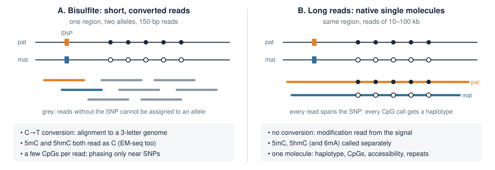{width="95%" fig-align="center"}

- WGBS and EM-seq: reads of 150 bp, converted, aligned to a three-letter genome; 5mC and 5hmC both read as C.
- Long reads: tens of kilobases of native DNA; every CpG on the molecule, its SNP alleles and other modifications in **one record**.

::: notes
Walk through panel A: a region with a heterozygous SNP and an allele-specific methylated stretch. With 150-bp reads only the reads that happen to overlap the SNP can be assigned to an allele, and those reads usually do not reach the CpGs we care about. In panel B every read spans both the SNP and the CpGs, so every methylation call is labelled with a haplotype. This is the main scientific advantage; the practical advantages are no bisulfite damage (bisulfite fragments DNA heavily), no conversion-related biases, and the ability to map into repeats that short reads cannot place. The costs: more DNA input (micrograms of high-molecular-weight DNA), higher cost per genome than arrays, and calls that come from a neural network rather than from a chemical conversion we can count directly.
:::

## Two ways to see a modification without conversion {.smaller}

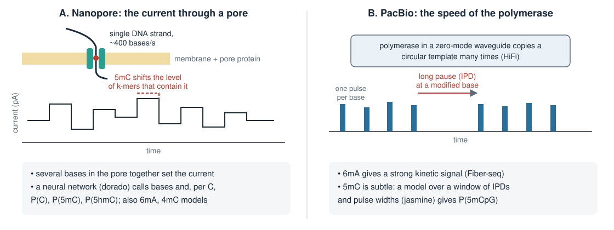{width="95%" fig-align="center"}

- **Nanopore**: the ionic current through the pore depends on the few bases inside it; a methyl group changes it slightly. A neural network (dorado) turns the signal into bases and, for each candidate base, modification probabilities.
- **PacBio HiFi**: the polymerase pauses longer at a modified template base (inter-pulse duration). 6mA gives a strong signal; 5mC at CpG is learned from the kinetics around it.

::: notes
Nanopore: a single strand of DNA is pulled through a protein pore by a motor protein at about 400 bases per second; the current is sampled thousands of times per second. Because several bases sit in the constriction at once, the current reflects a k-mer, and a 5mC in that k-mer shifts the level by a few picoamperes. Modern basecallers (dorado) are neural networks that output bases plus modification calls in one pass; separate models exist for 5mC and 5hmC in CpG context, 5mC in all contexts, 6mA in all contexts and 4mC (bacteria). PacBio: the polymerase copies a circular molecule many times; each incorporated base gives a fluorescent pulse. The time between pulses (IPD) and the pulse width depend on the template base and its modifications. 6mA slows the polymerase a lot, which is why the original Fiber-seq used PacBio. 5mC is subtle and is called by a model (jasmine) over a window of kinetics. Both platforms report the result in the same way, which is the next topic.
:::

## What can be called today {.smaller}

| modification | context | nanopore (R10.4.1, dorado) | PacBio HiFi |
|---|---|---|---|
| 5mC | CpG | yes, routine | yes, routine (jasmine) |
| 5hmC | CpG | yes, together with 5mC | not routinely |
| 5mC | all contexts (CHG, CHH: plants) | yes (all-context model) | limited |
| 6mA | all contexts | yes | yes (strong kinetic signal) |
| 4mC | bacteria | yes | yes |

- Every call is a **probability per base per read**, from a model trained on control DNA (unmethylated PCR products, fully methylated by M.SssI, synthetic oligos).
- Model and basecaller **versions matter**: always report them, and compare samples called with the same model.

::: notes
The table is a snapshot (2025–2026); models are added frequently. Two consequences for analysis. First, a modification call is only as good as the model's training data: models are trained on DNA of known state, for example PCR-amplified DNA (all unmethylated) and DNA treated with the CpG methyltransferase M.SssI (all CpGs methylated), so accuracy is best for contexts and modification densities that resemble the training data. Second, because calls come from a model, a new basecaller version can shift methylation levels by a few percent. Comparing a patient called with model v4 to controls called with v5 is like comparing arrays from two different platforms without normalisation. The HG001 data in this lecture were called in 2023 with a 5mCG_5hmCG model; the EcoGII data in 2025 with dorado 1.0 and the 5mCG_5hmCG and 6mA models (both recorded in the BAM header @PG and @RG lines).
:::

## The data of this lecture {.smaller}

| sample | what | region | where from |
|---|---|---|---|
| HG001 (GM12878 DNA) | nanopore R10.4.1, 4 flow cells, 5mC + 5hmC calls | 5 regions, 1.35 Mb: H19, KvDMR, SNRPN, chrX (KDM5C), chr21 33–34 Mb | ONT open data, giab_2023.05 |
| HG001 | ONT's haplotype-resolved pileups (5mC) | chrX and chr20 | ONT open data, giab_2025.01 |
| NA12878, father, mother | SNP genotypes | same regions | 1000 Genomes 30× (2022) |
| GM12878 | WGBS (ENCODE ENCFF570TIL) | same regions | ENCODE |
| HG002 | nanopore, nuclei treated with EcoGII (6mA), and untreated | chr21 33–34 Mb | ONT open data, chrom_acc_2025.06 |

- 10 462 reads, median length 4.6 kb (mean 11 kb) in the slices; about 80× coverage. The reads were cut out of the genome-wide CRAMs by **indexed remote access** (`samtools view -M -L regions.bed https://...cram`).

::: notes
HG001 is the Genome in a Bottle reference sample made from a large batch of GM12878 cells, so these nanopore data come from the same cell line as the ENCODE data used elsewhere in the course. The 1000 Genomes high-coverage release includes NA12878's parents (NA12891, the father, and NA12892, the mother), which lets us label haplotypes as paternal and maternal: rare and valuable, because most individuals do not have parents sequenced. The read lengths in a regional slice underestimate the run's read lengths, because long reads that start outside the slice are kept but short reads are more numerous. Remote access: CRAM and BAM files with an index can be queried over https without downloading the whole file, which is how a 60-GB CRAM becomes a 120-MB teaching file. The HG002 chromatin data are a different person (HG002 is a man, NA24385, also from a lymphoblastoid cell line), so we compare with GM12878 ATAC peaks only as a rough guide.
:::

## The modBAM: MM and ML tags

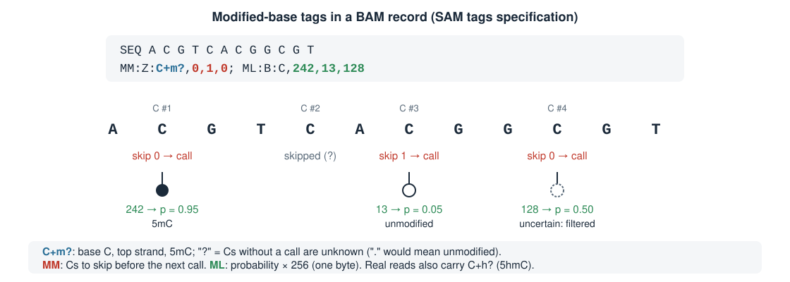{width="95%" fig-align="center"}

- `MM` lists which bases carry calls (as skip counts); `ML` gives one probability per call, scaled to 0–255.
- Calls refer to the **read sequence as sequenced** (SEQ is reverse-complemented for reverse-strand alignments: tools handle this).

::: notes
The SAM tags specification defines MM and ML so that modification calls travel with the read through alignment, sorting and merging. Decode the example: C+m? says the calls are for C, on the top strand of the read, modification code m (5mC). The question mark means that Cs without a call are unknown, not unmethylated: the model only calls Cs in a CpG context, so the C in CA is simply skipped. The numbers 0,1,0 are skip counts over the Cs of the read: call the first C, skip one and call the third, skip none and call the fourth. ML gives one byte per call: 242/256 is about 0.95, so the first CpG is confidently methylated, the second (13) confidently unmethylated, and the third (128) is a coin flip, which modkit will filter. Real nanopore reads carry two lists, C+h? for 5hmC and C+m? for 5mC, with one ML value per call for each; the probability of plain C is what is left over. You will decode one by hand in the exercise; in practice nobody parses these strings, modkit and pysam do.
:::

## Probabilities, and the threshold {.smaller}

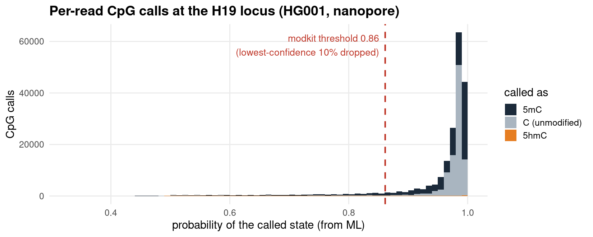{width="88%" fig-align="center"}

- Most calls are confident (probability > 0.95). `modkit` estimates a threshold so that the **least confident 10%** of calls are discarded: **0.865** for these reads.
- A methylation level is then a **count**: methylated calls / valid calls, exactly like C/(C+T) in WGBS.

::: notes
Every CpG call has a probability for each state (C, 5mC, 5hmC); the call is the most likely state and its probability is the confidence. modkit samples reads, takes the 10th percentile of the confidence values, and drops calls below it as "fail". Here that threshold is 0.865 for cytosines (computed from all 1.36 million calls in the region BAM; on a whole genome modkit samples a subset). Why not just average the probabilities? You could (some tools do), but thresholded counts behave like the binomial counts of bisulfite data and can be fed into the same statistics (*Differential methylation*). Dropping 10% of calls costs a little coverage but removes the calls that are most likely wrong, often at the read ends, in homopolymers or near other modifications. In the exercise you will compute a methylation level from a handful of read calls with a threshold by hand.
:::

## From reads to a bedMethyl table

```bash
samtools faidx $D/hg38.fa.bgz chr11 chr15 chr21 chrX > hg38_lr.fa && samtools faidx hg38_lr.fa
modkit pileup $D/hg001_ont_regions.bam hg001_cpg.bed --ref hg38_lr.fa \
  --cpg --modified-bases 5mC 5hmC --combine-strands --sampling-frac 1 -t 4
grep -w m hg001_cpg.bed | head -2
```
```
chr11  1960033  1960034  m  45  .  1960033  1960034  255,0,0  45  13.33   6  39  0  1   3  1  2
chr11  1960060  1960061  m  36  .  1960060  1960061  255,0,0  36  94.44  34   2  0  1  12  2  1
```

| column | meaning |
|---|---|
| 4 | modification code: `m` 5mC, `h` 5hmC |
| 10 | N valid: calls that passed the threshold |
| 11, 12, 13 | percent modified, N modified, N canonical (C) |
| 14 | N other modification (here: 5hmC calls, for the `m` row) |
| 16 | N fail: calls below the confidence threshold |

::: notes
This is the long-read counterpart of the Bismark methylation extractor from *Bisulfite and enzymatic sequencing*. --cpg restricts to CpG sites in the reference, --combine-strands adds the two Cs of a CpG together (the methylation of the two strands is almost always the same, and it doubles the coverage), --sampling-frac 1 makes the threshold estimate use every read so that the result is reproducible. The output is bedMethyl: one row per CpG and modification code. For the m row, percent modified = N modified / N valid. Note that the 5hmC calls are counted in "N other" for the m row and vice versa, and that the denominator includes them: 5mC% + 5hmC% + C% = 100%. The first example line: 45 valid calls, 6 methylated, 39 unmethylated, no 5hmC, so 13.33%; 3 more calls failed the threshold and are not in the denominator. The second CpG, 27 bp away, is 94% methylated: neighbouring CpGs can differ, and both are at the edge of a region. On a laptop this step takes under a minute for the course data. The first line prepares an uncompressed reference for the four chromosomes we need: modkit and WhatsHap read random positions of the reference many times, and that is much faster from an uncompressed file.
:::

## Nanopore and WGBS agree {.smaller}

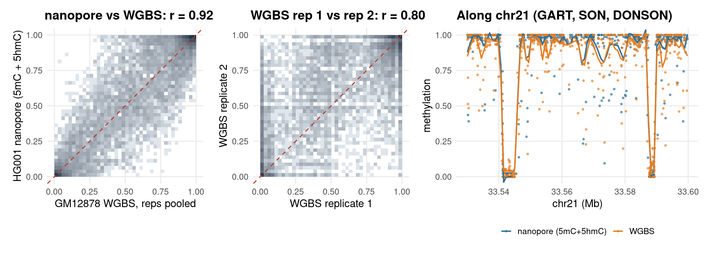{width="95%" fig-align="center"}

- 9 779 CpGs with ≥ 10 calls in nanopore and in each of two ENCODE WGBS replicates: nanopore vs pooled WGBS **r = 0.92** (median absolute difference 0.05).
- The two **WGBS replicates agree less with each other (r = 0.80)** than nanopore agrees with them. Along the chromosome the profiles are almost identical.

::: notes
Left: per-CpG comparison of the nanopore level (5mC + 5hmC, because bisulfite cannot separate them) with ENCODE WGBS of GM12878 (two replicates pooled) in our regions. Most CpGs sit in the corners: fully methylated or unmethylated in both. Middle: the two WGBS replicates against each other on the same CpGs: more scatter, including CpGs that read 0 in one replicate and 1 in the other. Nanopore agrees with replicate 2 at r = 0.94 and with replicate 1 at r = 0.82: replicate 1 is the noisier library. The lesson is not that one technology is "right": a correlation between two assays is limited by the noisier of the two, and a replicate-to-replicate comparison tells you what agreement to expect. Right: along 70 kb of chr21 around GART, SON and DONSON, both show the same unmethylated CpG islands at the promoters. Remember also that the samples are different DNA preparations of the same cell line, made years apart; a cell line that keeps dividing can change its methylation.
:::

## 5mC and 5hmC: what bisulfite cannot separate {.smaller}

- In our HG001 slices: mean **5mC 55%**, mean **5hmC 0.8%** of CpG calls. Blood cells and cell lines have little 5hmC; brain has 10–20 times more.
- Bisulfite (and EM-seq) report 5mC + 5hmC as "methylated". TAB-seq, oxBS or 5hmC-specific enzymatic methods are needed to split them; the nanopore model does it in the same run.
- Caution: at 1% the 5hmC calls are close to the **false-positive rate** of the model. Small 5hmC differences between samples need validation.

::: notes
5hmC is the first oxidation product of TET enzymes (*DNA methylation biology*). In most cell types it is a small fraction of the modified cytosines; in neurons it can be 20–40% of the modified CpGs in gene bodies. A nanopore 5hmC call is a model prediction between three classes; for a class that is rare, even a small error rate produces many false calls relative to the true ones, the same base-rate problem as a screening test for a rare disease. The practical rule: 5hmC levels from nanopore are useful in tissues where 5hmC is abundant, and should be interpreted with care where it is not. For comparison with WGBS, always add 5mC and 5hmC (as in the previous slide).
:::

## Haplotypes: which copy is methylated? {.smaller}

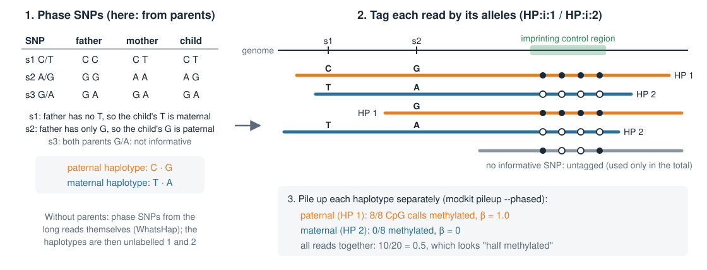{width="95%" fig-align="center"}

- A level of 0.5 can mean **half of the cells**, or **one of the two alleles** in every cell. Only reads assigned to haplotypes tell them apart.
- With the parents' genotypes (a trio) the haplotypes get **parental labels**; without them they are just 1 and 2.

::: notes
Step 1, Mendelian logic: at s1 the father is C/C and the child C/T, so the child's T came from the mother. At s2 the mother is A/A, so the child's G is paternal. At s3 both parents are heterozygous and the child is too: we cannot tell which allele came from whom. Step 2: a read that carries C at s1 and G at s2 is on the paternal chromosome. WhatsHap does this assignment for every read and writes the tag HP:i:1 or HP:i:2. Step 3: count calls per haplotype. In the toy example the paternal copy is fully methylated and the maternal copy unmethylated: the pattern of an imprinting control region. In most studies there are no parents: then SNPs are phased from the long reads themselves (read-based phasing, WhatsHap or LongPhase); haplotypes are consistent within a phase block (often hundreds of kilobases) but carry no parental label and may flip between blocks.
:::

## Phasing in practice

```bash
# child heterozygous, phase by transmission -> VCF with GT = paternal|maternal (awk in the exercise)
bcftools query -f '%CHROM\t%POS\t%REF\t%ALT[\t%GT]\n' $D/hg001_trio_regions.vcf.gz | awk '...' > trio_phased.vcf
bgzip trio_phased.vcf && tabix -p vcf trio_phased.vcf.gz
whatshap haplotag --ignore-read-groups --reference hg38_lr.fa \
  --output-haplotag-list haplotags.tsv -o hg001_tagged.bam trio_phased.vcf.gz $D/hg001_ont_regions.bam
samtools index hg001_tagged.bam
modkit pileup hg001_tagged.bam phased/ --phased --ref hg38_lr.fa \
  --cpg --modified-bases 5mC 5hmC --combine-strands --sampling-frac 1 -t 4
```

- 562 heterozygous SNPs informative in the trio; **5 575 of 10 462 reads** (53%) carry at least one and get a tag: 2 880 paternal, 2 695 maternal.
- `phased/hp1.bedmethyl` and `phased/hp2.bedmethyl`: one bedMethyl per haplotype.

::: notes
The awk program (written out in the exercise) keeps the child's heterozygous SNPs and writes the paternal allele first in the genotype (for example 1|0 when the father passed on the ALT allele). WhatsHap haplotag reads that VCF and assigns each read to haplotype 1 (here: the first allele = paternal) or 2, using the alleles the read carries at those SNPs; reads that cover no informative SNP stay untagged. Half the reads are tagged here: the SNPs are not dense enough near some loci for reads of a few kb (the median read in our slice is 4.6 kb). Longer reads tag more. modkit pileup --phased then writes three bedMethyl files: hp1, hp2 and combined. In a production pipeline (ONT wf-human-variation) the SNPs come from the same reads (Clair3), are phased by WhatsHap or LongPhase, and the pileup is done per haplotype automatically.
:::

## Single molecules at the H19 imprinting control region {.smaller}

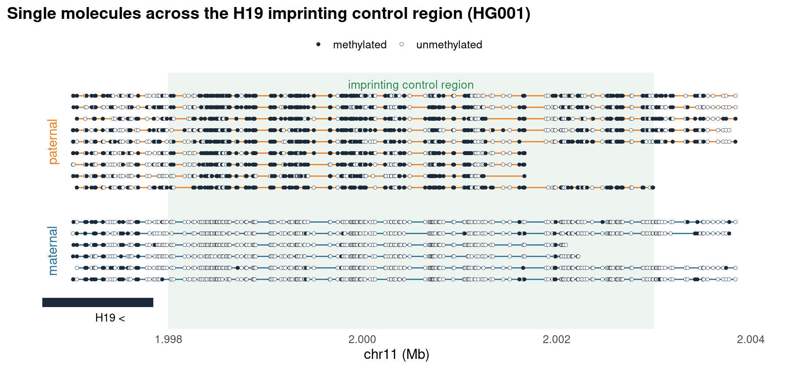{width="88%" fig-align="center"}

- Paternal reads: **67%** of CpG calls methylated; maternal reads: **8%**, and across the 5-kb ICR **0.72 vs 0.01**. The methylated copy is the paternal one, as the textbook says.
- Outside the ICR (left, over the H19 gene) both alleles are partly methylated.

::: notes
Each row is one nanopore read assigned to a parent; each circle a CpG call (filled = 5mC). The shaded region is the H19/IGF2 imprinting control region (ICR, also called IC1), about 2–7 kb upstream of the H19 transcription start. On the paternal allele the ICR is methylated, CTCF cannot bind, and the downstream enhancers reach IGF2 (expressed from the paternal allele); on the maternal allele the ICR is unmethylated, CTCF binds and insulates IGF2, and H19 is expressed. Recap from *DNA methylation biology*. The maternal reads are not completely unmethylated: a few isolated filled circles are either real (the ICR edges) or false-positive calls. Note that only 15 reads are shown: few reads reach both the ICR and an informative SNP (the nearest is 6 kb away), a real limitation of phasing in SNP-poor regions.
:::

## Three imprinted loci, both directions {.smaller}

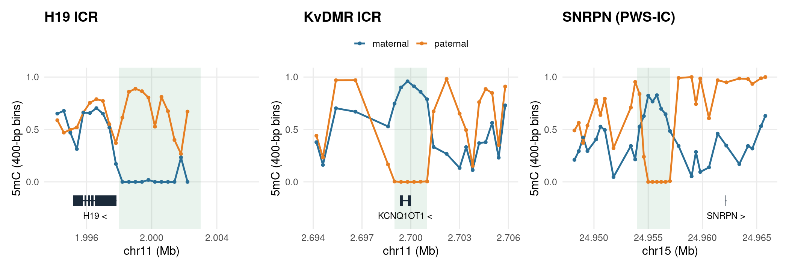{width="95%" fig-align="center"}

| ICR (shaded) | methylated allele, expected | paternal | maternal |
|---|---|---:|---:|
| H19 ICR (chr11) | paternal | 0.72 | 0.01 |
| KvDMR, KCNQ1OT1 promoter (chr11) | maternal | 0.00 | 0.90 |
| PWS-IC, SNURF/SNRPN promoter (chr15) | maternal | 0.04 | 0.75 |

::: notes
Mean 5mC of CpGs in the shaded region per haplotype, from modkit pileup --phased. The three ICRs behave exactly as expected, and in both directions: H19 is methylated on the paternal copy, KvDMR and the Prader–Willi imprinting centre on the maternal copy. Look also at the gene bodies: downstream of the SNRPN promoter the paternal allele (the expressed one) is highly methylated over the gene body while the maternal allele is not. Gene-body methylation follows transcription (DNMT3B is recruited by H3K36me3), so the silent maternal copy has a methylation-free promoter-to-body pattern turned inside out. This is the same assay that clinical labs now use to diagnose imprinting disorders (Prader–Willi, Angelman, Beckwith–Wiedemann, Silver–Russell) and to see the parent of origin of a deletion in one run.
:::

## Three reasons for allele-specific methylation

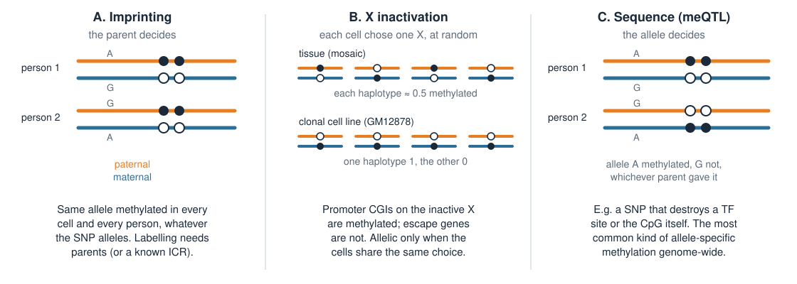{width="95%" fig-align="center"}

- Phasing finds **allele-specific methylation** (ASM); the cause must be inferred: parent of origin, random X choice, or the DNA sequence.
- Test: does the methylated allele follow the **parent** (imprinting) or the **SNP allele** across people (meQTL)?

::: notes
Panel A: imprinting. In every person, the paternal (or maternal) copy is methylated, whatever the SNP alleles on it. Panel B: X inactivation. Each cell of the early female embryo chooses one X; its descendants keep the choice. In a tissue, half the cells silenced each X, so each haplotype looks half methylated; in a clonal population such as a cell line, all cells made the same choice and the inactive X is the same haplotype everywhere. Panel C: sequence-dependent ASM. A SNP changes a TF binding site or removes the CpG itself; the methylated allele is the one carrying a particular base, regardless of which parent passed it on. Sequence-dependent ASM is the most common type genome-wide and is the molecular basis of methylation QTLs (meQTLs, *Epigenomics and genetic variation*). With one person you cannot tell A from C; with trios or many people you can.
:::

## X inactivation, on one cell line's two X chromosomes {.smaller}

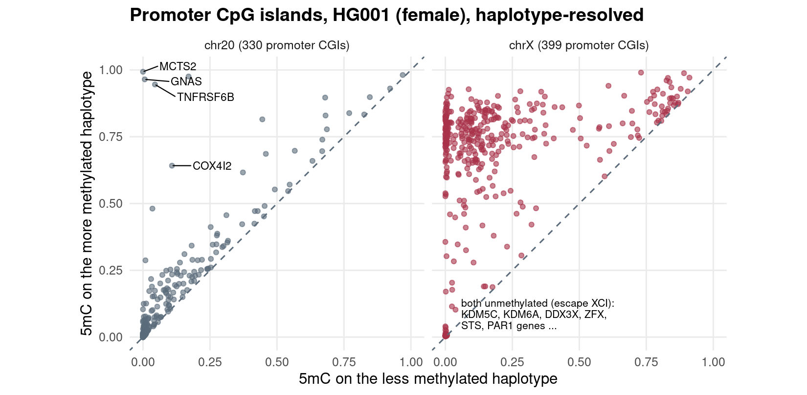{width="88%" fig-align="center"}

- **62%** of 399 chrX promoter CpG islands are methylated on one haplotype only (difference > 0.5), against **1.5%** of 330 on chr20; the chr20 exceptions include the imprinted *GNAS* and *MCTS2*.
- 37 chrX islands are unmethylated on **both**: *KDM5C, KDM6A, DDX3X, EIF2S3, ZFX, USP9X, STS*, the PAR1 genes, all known to **escape** X inactivation.

::: notes
ONT's own haplotype-resolved pileups of HG001 (another flow cell, 2025), one point per promoter CpG island, averaged over its CpGs. On chr20 nearly all islands lie on the diagonal near zero: promoter CpG islands are unmethylated on both alleles. On chrX most islands are off the diagonal: one copy unmethylated (the active X) and one methylated (the inactive X). That GM12878 shows this so clearly means most of its cells inactivated the same X, as expected for a clonal (or nearly clonal) cell line (*Three reasons*, panel B). The points at the origin of the chrX panel are the escape genes; the pseudoautosomal genes (SHOX, CD99, SLC25A6, ASMTL…) have a Y-linked copy in males and are not subject to X inactivation, and genes like KDM5C, KDM6A and DDX3X are the classic escapees with Y homologues. A cluster near the diagonal at high methylation are islands methylated on both X chromosomes, not promoters of expressed genes in lymphoblasts. Caveat: here the haplotypes come from read-based phasing within phase blocks, so we cannot say whether the paternal or the maternal X is inactive.
:::

## Accessibility on the same molecules: Fiber-seq {.smaller}

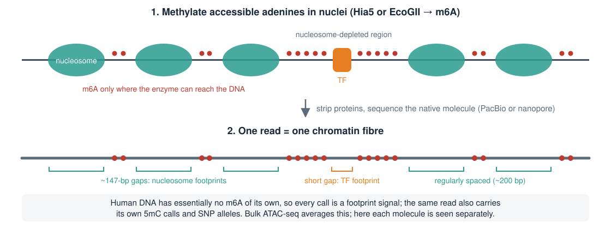{width="95%" fig-align="center"}

- Treat nuclei with a non-specific **adenine methyltransferase** (Hia5, EcoGII): it methylates A wherever the DNA is reachable. Then sequence the native DNA.
- One read = one chromatin fibre: **nucleosome footprints** (~147 bp without m6A), linkers, and nucleosome-free regulatory elements, plus the read's own 5mC and SNP alleles.

::: notes
Fiber-seq (Stergachis et al. 2020, PacBio) and its relatives (SAMOSA with EcoGII on PacBio, NanoNOMe with a GpC methyltransferase on nanopore, SMAC-seq with several enzymes on nanopore, and the ONT EcoGII protocol used here) all write accessibility into the DNA as a modification that mammalian cells do not make themselves. Human DNA has essentially no 6mA of its own, so (apart from false-positive calls) every m6A is a mark left by the enzyme. Compare with ATAC-seq (*ATAC-seq: Tn5, fragment sizes, nucleosome ladder*): ATAC counts cuts in a population of cells; Fiber-seq shows on each molecule whether this element was open, how its neighbouring nucleosomes were placed, and whether the CpGs of the same molecule were methylated. That allows questions ATAC cannot answer: are two enhancers open on the same molecule? Is the open copy the unmethylated allele?
:::

## Real fibres at a promoter {.smaller}

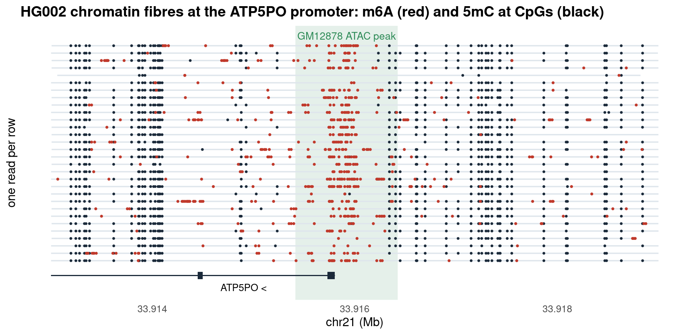{width="88%" fig-align="center"}

- At the *ATP5PO* promoter (an LCL ATAC peak), **12.9%** of adenines are m6A in the nucleosome-free region, against 0.5% in the flanks; the CpG island on the same reads is **unmethylated** (9.5% vs 82%).
- Fibres differ: some are open over the whole element, some only partly, a few not at all.

::: notes
30 reads that span the 6-kb window, one per row. Red: adenines called m6A (EcoGII marks); black: CpGs called 5mC. Two things are visible on the same molecules. The promoter of ATP5PO, a mitochondrial ATP synthase subunit expressed in every cell, is nucleosome-free and accessible (dense red), and its CpG island has no methylation (no black). Away from the promoter, CpGs are methylated and m6A is sparse: here the DNA is wrapped in nucleosomes. The green band is the GM12878 ATAC peak; HG002 is a different person but also a lymphoblastoid cell line, and housekeeping promoters are open in both. Note the efficiency: even in the open region only about one adenine in eight is marked, because the enzyme is used at a limited dose and each A is a chance event. Footprint calling therefore uses the spacing of marks, not individual bases.
:::

## The signal in aggregate {.smaller}

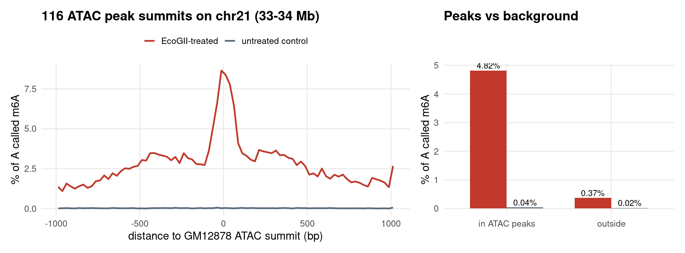{width="92%" fig-align="center"}

- Over 116 ATAC summits on chr21 (33–34 Mb): m6A peaks at the summit (~8.5% of A), on a plateau of ~3% that extends ±400 bp.
- Treated: **4.8%** in peaks vs **0.37%** outside (13-fold). Untreated control: **0.04%** and **0.02%**, the false-positive background of the 6mA model.

::: notes
Left: the fraction of adenines called m6A as a function of distance to GM12878 ATAC summits, in the treated sample (red) and the untreated native DNA of the same individual (grey). Right: totals inside and outside peaks. Three lessons. First, the treated sample reproduces the accessibility landscape of ATAC-seq from a completely different chemistry. Second, the background outside peaks (0.37%) is ten times higher than in untreated DNA: linker DNA between nucleosomes is accessible too, so closed chromatin is not unmarked, only sparsely marked. Third, the untreated control is essential: 0.02–0.04% of adenines are called m6A in DNA that never saw the enzyme, which is the model's false-positive rate. Claims of naturally occurring 6mA in mammalian genomes have been made with methods that could not exclude such artefacts, bacterial contamination or RNA; a control like this is the minimum.
:::

## From m6A marks to footprints and elements {.smaller}

- **Nucleosomes**: stretches of ~100–200 bp without m6A between marked linkers. **Methyltransferase-sensitive patches (MSPs)**: longer marked stretches, i.e. nucleosome-free regions.
- **Accessible regulatory elements** per fibre (e.g. FIREs in the fibertools pipeline), then aggregated into peaks, like ATAC peaks but with a per-molecule fraction: "this element is open on 62% of fibres".
- **TF footprints**: short protected stretches inside an open element (CTCF, ~40 bp).
- Tools: [fibertools](https://github.com/fiberseq/fibertools-rs) (PacBio and nanopore), `modkit open-chromatin predict` (nanopore EcoGII), NanoNOMe/`nanopolish` for GpC data.

::: notes
The raw calls are sparse and noisy, so footprinting uses a hidden Markov model or a classifier over the pattern of marks along each read: long unmarked runs are nucleosomes, runs with dense marks are open. This is the long-read version of the nucleosome ladder from MNase-seq and ATAC fragment sizes (*ATAC-seq: Tn5, fragment sizes, nucleosome ladder*), but per molecule. Two caveats: the methyltransferases are not perfectly uniform (both EcoGII and Hia5 methylate A in almost any sequence context, but with some preferences), and AT-rich DNA has more targets, so raw m6A density must be normalised by the number of As. And a "closed" fibre at a peak can be a molecule from a cell where the element is closed, or a molecule where the enzyme simply did not act: the per-fibre fraction is a lower bound.
:::

## Caveats and pitfalls {.smaller}

- **Models**: accuracy depends on context and on the training data; compare samples called with the **same** basecaller and model version.
- **Thresholds**: modkit drops the least confident 10% of calls; low-confidence regions (homopolymers, read ends) lose more coverage.
- **Strand and context**: CpG models do not call CpH methylation; `--combine-strands` assumes symmetric CpG methylation (not true for hemimethylated DNA).
- **Mapping**: long reads map into repeats short reads cannot, but MAPQ still matters; supplementary and secondary alignments are skipped by default.
- **Phasing**: only reads with informative SNPs get a haplotype; switch errors between phase blocks mix haplotypes; parental labels need a trio or a known ICR.
- **Coverage**: 30× genome ≈ 15× per haplotype: allele-specific calls are noisy at single CpGs, average over regions.

::: notes
These are the questions to ask of any long-read methylation paper. The model point is the most common source of artefacts in published comparisons: a disease cohort sequenced in 2022 and controls sequenced in 2024 with a different basecaller is a batch effect by design. Hemimethylation: right after replication the new strand is unmethylated until DNMT1 catches up; strand-specific calling (without --combine-strands) can show this. Phasing switch errors: if the haplotype assignment flips halfway along a region, each "haplotype" becomes a mixture and allele-specific differences shrink. For per-haplotype analysis at 30× you have about 15 reads per allele, so binomial noise at a single CpG is large (standard deviation 0.13 at a level of 0.5); region-level averages or a DMR caller (modkit dmr, DSS on per-haplotype counts, *Differential methylation*) are the way to go.
:::

## The workflow, end to end

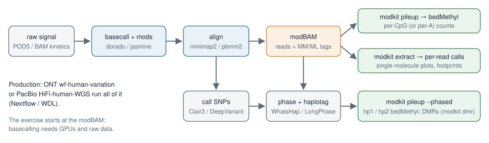{width="95%" fig-align="center"}

- Basecalling with modification models needs the raw signal and a GPU; most users start from the **modBAM**.
- Production pipelines run every box: ONT [wf-human-variation](https://github.com/epi2me-labs/wf-human-variation), PacBio [HiFi-human-WGS](https://github.com/PacificBiosciences/HiFi-human-WGS-WDL).

::: notes
The raw nanopore signal (POD5) of a 30× human genome is on the order of a terabyte, and basecalling with the most accurate models takes hours to days on GPUs. That is why public data and most core facilities hand out modBAMs: basecalled, aligned reads with MM/ML tags. From there the steps are the ones in the exercise: modkit pileup for aggregate levels, modkit extract for per-read calls, SNP calling and phasing for haplotypes, and pileup per haplotype. The Nextflow workflow wf-human-variation does it all (and calls structural variants, copy number and repeat expansions from the same reads); the bedMethyl files per haplotype we used for the chrX analysis come from that workflow. modkit dmr compares two samples or two haplotypes; for replicated designs, the beta-binomial models of *Differential methylation* (DSS, methylKit) take modkit counts as input.
:::

## Where long reads change the answer {.smaller}

- **Repeats and centromeres**: the first complete human genome (T2T-CHM13) came with a complete methylome, including centromeric satellites invisible to short reads (Gershman et al. 2022).
- **Imprinting disorders**: parent-of-origin methylation and the variant in one test.
- **X inactivation, escape and erosion** in female cells and cell lines.
- **Allele-specific methylation** and meQTLs without population arrays.
- **Single-molecule co-occurrence**: is the open enhancer on the unmethylated copy? Are two elements open together?
- **Cancer**: haplotype-specific methylation at amplified or deleted alleles; structural variants and their methylation from the same reads.

::: notes
A short tour of where the long-read view is not just a cheaper or more convenient WGBS but answers questions short reads cannot. Gershman et al. (2022) mapped methylation across the centromeres of CHM13, which consist of megabases of near-identical alpha-satellite repeats, and found a hypomethylated "centromere dip region" that marks where the kinetochore assembles. Clinical genetics is moving towards a single long-read test that reports SNVs, structural variants, repeat expansions and imprinting methylation together. For the rest of this course: the chromatin accessibility from Fiber-seq connects to *ATAC-seq* and *Motifs, motif enrichment and TF footprinting*; the per-haplotype methylation to *Epigenomics and genetic variation*; cfDNA methylation from nanopore to *Epigenetic clocks and biomarkers*.
:::

## Summary {.smaller}

| idea | key fact |
|---|---|
| detection | nanopore: current through a pore; PacBio: polymerase kinetics; no conversion |
| what is called | 5mC and 5hmC at CpG, 6mA, 4mC; probabilities per base per read from a model |
| modBAM | MM: which bases (skip counts); ML: probability × 256; `?` vs `.` for skipped bases |
| pileup | modkit drops the least confident 10%; level = modified / valid calls (bedMethyl) |
| vs WGBS | r = 0.92 per CpG (WGBS rep vs rep: 0.80); compare 5mC + 5hmC with bisulfite |
| phasing | het SNPs on reads → HP tags (WhatsHap); trio gives parental labels |
| imprinting | H19 ICR paternal 0.72 / maternal 0.01; KvDMR and PWS-IC maternal |
| X inactivation | 62% of chrX promoter CGIs methylated on one haplotype vs 1.5% on chr20; escapees on neither |
| Fiber-seq | m6A from an added methyltransferase marks accessible DNA on each fibre; untreated control essential |

::: notes
Students should leave able to: explain how each platform detects a modification without bisulfite; decode an MM/ML pair by hand; compute a methylation level from thresholded read calls; phase a SNP by Mendelian logic and say what a haplotag is; read a single-molecule plot and a per-haplotype methylation profile; distinguish imprinting, X inactivation and sequence-dependent ASM; and say why Fiber-seq needs an untreated control. In the exercise you run all of this on the course data: modkit pileup, trio phasing, haplotagging, per-haplotype pileups, the chrX analysis and the m6A analysis.
:::

## Key papers (optional further reading) {.smaller}

*Not required reading and not examined. For those who want the primary literature.*

- Flusberg et al. 2010, *Nat Methods*. [Direct detection of DNA methylation during single-molecule, real-time sequencing](https://doi.org/10.1038/nmeth.1459). Polymerase kinetics reveal modified bases.
- Simpson et al. 2017, *Nat Methods*. [Detecting DNA cytosine methylation using nanopore sequencing](https://doi.org/10.1038/nmeth.4184). The first 5mC calls from nanopore current.
- Gigante et al. 2019, *Nucleic Acids Res*. [Using long-read sequencing to detect imprinted DNA methylation](https://doi.org/10.1093/nar/gkz107). Haplotype-resolved methylation at imprinted loci.
- Stergachis et al. 2020, *Science*. [Single-molecule regulatory architectures captured by chromatin fiber sequencing](https://doi.org/10.1126/science.aaz1646). Fiber-seq.
- Lee et al. 2020, *Nat Methods*. [Simultaneous profiling of chromatin accessibility and methylation on human cell lines with nanopore sequencing](https://doi.org/10.1038/s41592-020-01000-7). NanoNOMe, on GM12878.
- Gershman et al. 2022, *Science*. [Epigenetic patterns in a complete human genome](https://doi.org/10.1126/science.abj5089). Methylation of the whole T2T genome, centromeres included.
