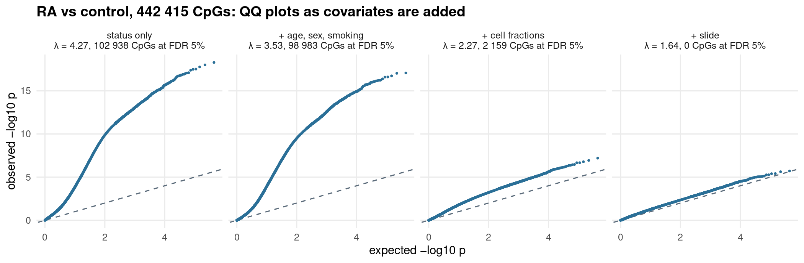

## Goal

After this exercise you will be able to:

- Compute **β and M values** from methylated and unmethylated signals by hand, for Infinium I and II probes, and a **detection p-value** from negative controls.
- Read IDAT files with [minfi](https://bioconductor.org/packages/release/bioc/html/minfi.html), run **quality control** (failed probes, sex check), and compare **normalisations**.
- **Filter probes** (failed, SNP, cross-reactive, sex chromosomes) and say why.
- Estimate **blood cell composition** (Houseman method) and show that it is a **confounder**.
- Run an **EWAS** with [limma](https://bioconductor.org/packages/release/bioc/html/limma.html), read **QQ plots** and the **genomic inflation factor λ**, and use a **positive control**.

## Background

**Signals.** For each CpG the array gives a methylated signal $M$ and an unmethylated signal $U$. Infinium I: $M$ and $U$ are the intensities of two bead types, read in the same colour (red or green, set by the base after the CpG). Infinium II: one bead; $M$ is its green and $U$ its red intensity.

$$ \beta = \frac{M}{M + U + 100}, \qquad M\text{-value} = \log_2\frac{M + 1}{U + 1} \approx \log_2 \frac{\beta}{1 - \beta}, \qquad \beta = \frac{2^{M\text{-value}}}{1 + 2^{M\text{-value}}}. $$

**Detection p-value** (minfi): the probability that background alone gives a total signal $M + U$ at least as large as observed; background is modelled as a normal distribution with the mean and SD of the ~600 negative control probes (for the probe's colour channel). Probes with $p > 0.01$ "fail".

**Mixtures.** A bulk sample's β at a CpG is the fraction-weighted average of the cell types' β: $\beta = \sum_k w_k \beta_k$. Reference-based deconvolution (Houseman) estimates $w$ from a reference of sorted cells at marker CpGs.

**EWAS.** A linear model per CpG on M-values with the same design for all CpGs (limma). Covariates go into the design formula, as in RNA-seq. Because fractions sum to about 1, one cell type is left out.

**Genomic inflation.** Convert each p-value to a 1-df chi-square statistic, $\chi^2 = F^{-1}_{\chi^2_1}(1 - p)$, and divide the median by its expected value under the null, 0.455: $\lambda = \text{median}(\chi^2)/0.455$. λ ≈ 1: most CpGs behave as null; λ ≫ 1: confounding, batch, or a very widespread true effect.

## Data

From `data/prepare-meth2.sh arrays`:

```bash
mkdir -p ~/epi/arrays && cd ~/epi/arrays
D=/path/to/course/data                     # where the course data are
```

| file | what |
|---|---|
| `gse42861_samples.tsv` | 151 samples of GEO [GSE42861](https://www.ncbi.nlm.nih.gov/geo/query/acc.cgi?acc=GSE42861) (Liu et al. 2013): peripheral blood leukocytes of rheumatoid arthritis (RA) patients and controls; columns `gsm`, `basename`, `slide`, `array`, `status`, `age`, `sex`, `smoking` |
| `gse42861_idat/` | two IDAT files per sample (`<basename>_Grn.idat.gz`, `_Red.idat.gz`), 450k array |
| `hm450_hg38_manifest.tsv.gz` | 450k probe annotation on GRCh38 (Zhou, Laird & Shen 2017): probe ID, CpG position, probe type |
| `hm450_hg38_mask.tsv.gz` | probe masks (Zhou et al. 2017); `M_general` = recommended general mask (non-unique mapping, common SNPs at the target or extension base) |

**Shortcuts, said plainly.** We use the 151 samples on the 14 BeadChips that hold both patients and controls (the full study has 689); the RA analysis therefore has less power than the original. The 450k is an older array than EPIC, with the same chemistry; EPIC v2 needs newer manifests (sesame handles them).

You need minfi, `IlluminaHumanMethylation450kmanifest`, `IlluminaHumanMethylation450kanno.ilmn12.hg19`, `FlowSorted.Blood.450k`, limma, data.table and ggplot2 (see *Install the software you need*). The R part takes about 25 minutes and needs about 10 GB of memory (run it on the cluster in an interactive job or with `Rscript` in an `sbatch` script). If `preprocessFunnorm` stops with *return code from pthread_create() is 22*, reinstall preprocessCore without threading: `BiocManager::install("preprocessCore", configure.args = "--disable-threading", force = TRUE)`.

## By hand

Do these on paper.

**B1. β and M.** (a) A probe has M = 3 000 and U = 1 000. Compute β and the M-value. (b) Another has M = 200, U = 5 000. (c) Convert β = 0.9 to an M-value, and an M-value of −2 to β. (d) Two groups differ by Δβ = 0.05 at two CpGs: from 0.50 to 0.55, and from 0.90 to 0.95. Compute the difference in M-values in each case. Why does this matter for a linear model?

**B2. Two probe designs.** (a) A Type II probe has green intensity 4 200 and red intensity 900. What is β? (b) A Type I probe designed for the red channel has red intensities 3 000 (M bead) and 800 (U bead), and green intensities 260 (M bead) and 240 (U bead). What is β, and what are the green values useful for? (c) Why are Type I and Type II β distributions different, and what does SWAN or BMIQ do about it?

**B3. Detection p-value.** In one array the negative control probes have mean 600 and SD 150 (both channels together). (a) A probe has M = 500 and U = 400. Using a normal approximation, what is its detection p-value (one-sided)? Does it fail at 0.01? (b) Another probe has M = 100, U = 2 900: p-value? (c) Why should a probe that fails in many samples be removed from all of them?

**B4. A CpG that only measures cell composition.** At a CpG, β = 0.85 in granulocytes and 0.15 in lymphocytes (all lymphocytes alike), in every person; no other cell types.

(a) Controls have 58% granulocytes, patients 70%. Compute the expected β in each group and the difference.

(b) The patients' β is also 0.03 higher at a second CpG where granulocytes and lymphocytes are both 0.60. Which of the two differences can be explained by composition?

(c) Write the design formula of an EWAS that adjusts for granulocytes, CD4 and CD8 T cells, NK cells, B cells and monocytes (six estimated fractions that sum to ~1). Why leave one out?

**B5. Genomic inflation.** (a) If the median p-value across 400 000 CpGs is 0.5, what is λ? (b) If it is 0.05? (The 95th percentile of $\chi^2_1$ is 3.84.) (c) Look at the QQ plots of the lecture:

{width="100%"}

What changes between the second and the third panel, and why does adding five covariates remove 97% of the hits?

**B6. Batch and design.** In the full GSE42861 study, 36 of the 72 BeadChips (12 positions each) hold only patients or only controls.

(a) Why is this a problem that statistics cannot fix afterwards?

(b) You plan a new study of 96 patients and 96 controls on EPIC arrays (8 positions per BeadChip). How would you assign samples to chips and positions?

**B7. A SNP in the probe.** At a CpG, β across 300 people clusters at 0.02, 0.48 and 0.93, with 180, 100 and 20 people.

(a) What is the most likely explanation? (b) Estimate the allele frequency of the "unmethylated" allele (Hardy–Weinberg). (c) Why would this CpG show up as associated with ancestry, and possibly with disease?

**B8. Judge the claims.**

(a) "Patients with RA have 102 938 differentially methylated CpGs in blood (FDR 5%)."

(b) "After adjusting for cell composition, methylation at CpG X is lower in RA; therefore hypomethylation at X causes RA."

(c) "Smokers have lower methylation at AHRR cg05575921; this CpG can be used to verify self-reported smoking."

## On the command line

### C1 — The sample table and annotation

```bash
head -3 $D/gse42861_samples.tsv
tail -n +2 $D/gse42861_samples.tsv | cut -f 5 | sort | uniq -c
tail -n +2 $D/gse42861_samples.tsv | cut -f 5,7 | sort | uniq -c
tail -n +2 $D/gse42861_samples.tsv | cut -f 5,8 | sort | uniq -c
tail -n +2 $D/gse42861_samples.tsv | awk -F'\t' '{ n[$3]++; if ($5 == "RA") ra[$3]++ } END { for (s in n) print s, n[s], ra[s] + 0 }' | sort
ls $D/gse42861_idat | wc -l; du -sh $D/gse42861_idat
zcat $D/hm450_hg38_mask.tsv.gz | awk -F'\t' 'NR > 1 && $4 == "TRUE"' | wc -l
zcat $D/hm450_hg38_manifest.tsv.gz | awk -F'\t' 'NR > 1 { n[$1]++ } END { print "chrX", n["chrX"], "chrY", n["chrY"], "unmapped", n["NA"] }'
zcat $D/hm450_hg38_manifest.tsv.gz | awk -F'\t' 'NR > 1 { t[$28]++ } END { for (k in t) print "type", k, t[k] }'
```

(a) How many patients and controls, women and men, current and never smokers?

(b) How many samples per BeadChip, and how many RA patients on each? Is chip confounded with disease in our subset?

(c) How many probes does the general mask remove, how many are on the sex chromosomes, and how many probes of each type are there?

## In R

```r
suppressPackageStartupMessages({ library(minfi); library(limma); library(data.table); library(ggplot2) })
D <- "/path/to/course/data"
s <- fread(file.path(D, "gse42861_samples.tsv"))
s$Basename <- file.path(D, "gse42861_idat", s$basename)
```

### R1 — Read the arrays

```r
rg <- read.metharray.exp(targets = as.data.frame(s))     # about 4 minutes
rg
dim(getRed(rg))
table(getProbeInfo(rg, type = "Control")$Type)
mset <- preprocessRaw(rg); dim(mset)
```

(a) How many bead addresses and how many CpGs? (b) Which kinds of control probes are on the array, and what is each for?

### R2 — Quality control

```r
dp <- detectionP(rg)                                      # about 7 minutes
fail <- colMeans(dp > 0.01)
summary(fail); sum(fail > 0.01); sum(fail > 0.05)
sum(rowMeans(dp > 0.01) > 0.05)
sx <- getSex(mapToGenome(mset))
table(reported = s$sex, predicted = sx$predictedSex)
ggplot(data.frame(x = sx$xMed, y = sx$yMed, sex = s$sex), aes(x, y, colour = sex)) + geom_point() +
  labs(x = "median log2 chrX intensity", y = "median log2 chrY intensity")
```

(a) How many arrays have more than 1% and more than 5% failed probes? Would you remove any?

(b) Does the predicted sex match the records?

### R3 — Normalisations, on two BeadChips

```r
two <- s$slide %in% c(7800246040, 7800246034)
rg2 <- rg[, two]
nb <- list(raw = getBeta(preprocessRaw(rg2), offset = 100), noob = getBeta(preprocessNoob(rg2)),
           SWAN = getBeta(preprocessSWAN(rg2)), funnorm = getBeta(preprocessFunnorm(rg2)))
ti <- getProbeInfo(rg2, type = "I")$Name; tii <- getProbeInfo(rg2, type = "II")$Name
peak <- function(x) { d <- density(x[x > 0.6], na.rm = TRUE); d$x[which.max(d$y)] }
sapply(nb, function(x) c(typeI = peak(x[ti, 1]), typeII = peak(x[tii, 1])))
d <- rbindlist(lapply(names(nb), function(m) rbind(data.table(beta = nb[[m]][ti, 1], type = "I"),
                                                   data.table(beta = nb[[m]][tii, 1], type = "II"))[, method := m]))
ggplot(d, aes(beta, colour = type)) + geom_density() + facet_wrap(~ method, nrow = 1)
```

(a) Where is the methylated peak for Type I and Type II probes in the raw data and after each method? (b) Which methods are within-array and which between-array?

### R4 — noob for all arrays, and probe filtering

```r
b <- getBeta(preprocessNoob(rg))                           # about 3 minutes
man  <- fread(file.path(D, "hm450_hg38_manifest.tsv.gz"), select = c("Probe_ID", "CpG_chrm", "CpG_beg"))
mask <- fread(file.path(D, "hm450_hg38_mask.tsv.gz"))
k1 <- rownames(b)[rowMeans(dp[rownames(b), ] > 0.01) <= 0.05]
k2 <- setdiff(k1, mask[M_general == TRUE, Probe_ID])
k3 <- setdiff(k2, man[CpG_chrm %in% c("chrX", "chrY") | is.na(CpG_chrm), Probe_ID])
c(all = nrow(b), detection = length(k1), mask = length(k2), autosomes = length(k3))
b <- b[k3, ]
M <- log2(pmax(b, 1e-3) / pmax(1 - b, 1e-3))
```

(a) How many probes are removed at each step? (b) Why compute M-values from β with a floor of 0.001?

### R5 — Cell composition

```r
cc <- estimateCellCounts(rg, compositeCellType = "Blood",
                         cellTypes = c("CD8T", "CD4T", "NK", "Bcell", "Mono", "Gran"))   # about 3 minutes
s <- cbind(s, as.data.table(cc))
s[, lapply(.SD, function(x) round(mean(x), 3)), by = status, .SDcols = colnames(cc)]
t.test(Gran ~ status, data = s)$p.value
summary(rowSums(cc))
```

(a) How do patients and controls differ? (b) Do the fractions sum to 1?

### R6 — What drives the variation?

```r
v <- order(apply(M, 1, var), decreasing = TRUE)[1:20000]
pc <- prcomp(t(M[v, ]), rank. = 3)
round(100 * pc$sdev[1:3]^2 / sum(pc$sdev^2), 1)
s[, `:=`(PC1 = pc$x[, 1], PC2 = pc$x[, 2], series = substr(slide, 1, 7))]
summary(lm(PC1 ~ factor(slide), data = s))$r.squared
s[, .(n = .N, PC1 = mean(PC1)), by = series]
cor(s$PC1, s$Gran); cor(s$PC2, s$Gran)
ggplot(s, aes(PC1, PC2, colour = series, shape = status)) + geom_point(size = 2)
```

(a) What does PC1 capture? (b) What does PC2 capture? Where are the patients?

### R7 — The EWAS: adding covariates

```r
s[, status := factor(status, levels = c("control", "RA"))]
s[, smoking := factor(smoking, levels = c("never", "ex", "occasional", "current"))]   # "na" becomes NA
s[, `:=`(slide = factor(slide), sex = factor(sex))]
keep <- !is.na(s$smoking); s2 <- s[keep]; M2 <- M[, keep]
lam <- function(p) median(qchisq(p, 1, lower.tail = FALSE)) / qchisq(0.5, 1)
ewas <- function(f, coef = "statusRA") {
  fit <- eBayes(lmFit(M2, model.matrix(f, s2)))
  topTable(fit, coef = coef, number = Inf, sort.by = "none")
}
models <- list(m0 = ~ status,
               m1 = ~ status + age + sex + smoking,
               m2 = ~ status + age + sex + smoking + CD8T + CD4T + NK + Bcell + Mono,
               m3 = ~ status + age + sex + smoking + CD8T + CD4T + NK + Bcell + Mono + slide)
res <- lapply(models, ewas)
sapply(res, function(t) c(lambda = lam(t$P.Value), fdr05 = sum(t$adj.P.Val < 0.05)))
qq <- function(p, main) { p <- sort(p); plot(-log10(ppoints(length(p))), -log10(p), pch = 20, cex = 0.4,
  xlab = "expected -log10 p", ylab = "observed -log10 p", main = main); abline(0, 1, col = "red") }
par(mfrow = c(1, 4)); for (n in names(res)) qq(res[[n]]$P.Value, n)
```

(a) Report λ and the number of CpGs at FDR 5% for each model. (b) Which covariate makes the largest difference? (c) Is any RA association left after adjusting for the chip? What would you need to find one?

### R8 — A positive control: smoking

```r
sm <- ewas(models$m2, coef = "smokingcurrent")
c(lambda = lam(sm$P.Value), fdr05 = sum(sm$adj.P.Val < 0.05))
head(sm[order(sm$P.Value), c("logFC", "P.Value", "adj.P.Val")], 8)
which(rownames(sm)[order(sm$P.Value)] == "cg05575921")
tapply(b["cg05575921", keep], s2$smoking, mean)
ggplot(data.frame(smoking = s2$smoking, beta = b["cg05575921", keep]), aes(smoking, beta)) +
  geom_boxplot() + geom_jitter(width = 0.15) + labs(title = "AHRR cg05575921")
```

(a) Which CpGs are at the top, and do you recognise them? (b) What is the mean β of the AHRR CpG in never, ex- and current smokers? What does the ex-smoker value suggest?

## Hints

::: {.callout-tip collapse="true" title="Hint 1 — β, M and the probe designs (B1, B2)"}
$\log_2 x = \ln x / \ln 2$. For a Type I probe, use the two beads in the probe's own colour; the other colour ("out-of-band") is background. Du et al. 2010 compared [β and M values](https://doi.org/10.1186/1471-2105-11-587); the minfi [user's guide](https://bioconductor.org/packages/release/bioc/vignettes/minfi/inst/doc/minfi.html) explains `getBeta` and `getM`.
:::

::: {.callout-tip collapse="true" title="Hint 2 — detection p-values and QC (B3, R2)"}
$z = (\text{signal} - \text{mean}) / \text{SD}$; one-sided $p = 1 - \Phi(z)$ ($\Phi(2) = 0.977$, $\Phi(3) = 0.9987$, $\Phi(4.67) \approx 0.999998$). [`detectionP`](https://rdrr.io/bioc/minfi/man/detectionP.html), [`getSex`](https://rdrr.io/bioc/minfi/man/getSex.html).
:::

::: {.callout-tip collapse="true" title="Hint 3 — normalisation (R3, R4)"}
[`preprocessNoob`](https://rdrr.io/bioc/minfi/man/preprocessNoob.html) (Triche et al. 2013), [`preprocessSWAN`](https://rdrr.io/bioc/minfi/man/preprocessSWAN.html), [`preprocessFunnorm`](https://rdrr.io/bioc/minfi/man/preprocessFunnorm.html) (Fortin et al. 2014), `preprocessQuantile`. BMIQ is in [wateRmelon](https://bioconductor.org/packages/release/bioc/html/wateRmelon.html).
:::

::: {.callout-tip collapse="true" title="Hint 4 — probe masks (B7, C1, R4)"}
Zhou, Laird & Shen 2017, [Comprehensive characterization, annotation and innovative use of Infinium DNA methylation BeadChip probes](https://doi.org/10.1093/nar/gkw967); the annotation files are on [GitHub](https://github.com/zhou-lab/InfiniumAnnotationV1). For B7: with allele frequency $q$, genotype frequencies are $p^2$, $2pq$, $q^2$.
:::

::: {.callout-tip collapse="true" title="Hint 5 — cell composition (B4, R5)"}
[`estimateCellCounts`](https://rdrr.io/bioc/minfi/man/estimateCellCounts.html) uses the [FlowSorted.Blood.450k](https://bioconductor.org/packages/release/data/experiment/html/FlowSorted.Blood.450k.html) reference (Reinius et al. 2012) and the method of [Houseman et al. 2012](https://doi.org/10.1186/1471-2105-13-86). A design matrix with all fractions plus an intercept is (almost) not of full rank, like including all levels of a factor.
:::

::: {.callout-tip collapse="true" title="Hint 6 — limma and inflation (B5, R7, R8)"}
[limma user's guide](https://bioconductor.org/packages/release/bioc/vignettes/limma/inst/doc/usersguide.pdf): `lmFit`, `eBayes`, `topTable(coef = ...)`. `model.matrix` drops samples with `NA` in a covariate. `qchisq(p, 1, lower.tail = FALSE)` converts a p-value to a chi-square statistic. For reference smoking CpGs see Joehanes et al. 2016, [Epigenetic signatures of cigarette smoking](https://doi.org/10.1161/CIRCGENETICS.116.001506).
:::

## Solutions

::: {.callout-note collapse="true" title="Solutions — by hand"}

**B1.** (a) β = 3000/4100 = **0.73**; M = log2(3001/1001) = **1.58**. (b) β = 200/5300 = **0.038**; M = log2(201/5001) = **−4.64**. (c) β 0.9 → log2(9) = **3.17**; M −2 → 2^{−2}/(1 + 2^{−2}) = 0.25/1.25 = **0.2**. (d) 0.50 → 0.55: M from 0 to log2(0.55/0.45) = 0.29, ΔM = **0.29**. 0.90 → 0.95: M from 3.17 to log2(19) = 4.25, ΔM = **1.08**. The same Δβ is a much larger change in M near the extremes, where β has little room and small variance; on the M scale variances are more similar across CpGs, as linear models assume.

**B2.** (a) β = 4200/(4200 + 900 + 100) = **0.81** (green = M, red = U). (b) β = 3000/(3000 + 800 + 100) = **0.77**, using the red beads only. The green values of a red Type I probe are out-of-band: pure background, used by noob to estimate the background distribution of the array. (c) Type II probes have a smaller dynamic range (different chemistry, two colours, degenerate bases), so their methylated peak is lower and unmethylated peak higher. SWAN quantile-normalises Type I and II probes against each other within an array; BMIQ maps the Type II distribution onto the Type I one with a beta-mixture model.

**B3.** (a) M + U = 900; z = (900 − 600)/150 = 2; p = 1 − 0.977 = **0.023 > 0.01: fails**. (b) M + U = 3000; z = 16: p ≈ 0: passes (the signal is strong, whether methylated or not). (c) A probe that fails often is unreliable (poor hybridisation, deleted region, SNP in the probe); keeping it in some samples but not others creates missing data and noise that differs between samples.

**B4.** (a) Controls 0.58·0.85 + 0.42·0.15 = 0.493 + 0.063 = **0.556**; patients 0.70·0.85 + 0.30·0.15 = 0.595 + 0.045 = **0.640**; Δβ = **0.084** from composition alone. (b) At the second CpG both cell types are 0.60, so any mixture gives 0.60: the difference of 0.03 cannot be composition (with these two cell types) and may be a change within cells (or another confounder). (c) `~ status + age + sex + smoking + CD8T + CD4T + NK + Bcell + Mono` (granulocytes left out). The six fractions sum to ~1, so together with the intercept they are (almost) collinear: the model would not be identifiable. Leaving one out makes the coefficients relative to the omitted cell type.

**B5.** (a) A median p of 0.5 gives χ² = 0.455: **λ = 1**. (b) p = 0.05 gives χ² = 3.84: λ = 3.84/0.455 = **8.4**. (c) Panel 2 (age, sex, smoking) is almost as inflated as panel 1 (λ 3.53 vs 4.27). Panel 3 adds the five cell fractions: λ falls to 2.27 and hits from 98 983 to 2 159. Most "RA" CpGs differ between granulocytes and lymphocytes, and patients have 12 percentage points more granulocytes; once composition is in the model, these CpGs are no longer associated with RA.

**B6.** (a) Chip effects (hybridisation, scanning, reagent batch) are then perfectly confounded with disease on those chips: no model can separate them. Only chips with both groups carry information on disease free of chip. (b) Randomise: put 4 patients and 4 controls on each chip, with positions randomised (and balanced for sex and age if possible), and process chips in random order. Record chip and position and include chip in the model.

**B7.** (a) A SNP in the probe (at the CpG or the extension base): the three clusters are the three genotypes, not methylation states. (b) The "unmethylated" (low-β) allele: genotype frequencies 180/300 = 0.6 (homozygous low), 100/300 (het), 20/300 (homozygous high); allele frequency q = (2·180 + 100)/600 = **0.77**; check HWE: q² = 0.59 ✓, 2pq = 0.35 ✓, p² = 0.05 ✓ (observed 0.60, 0.33, 0.07). (c) Allele frequencies differ between populations, so β tracks ancestry; any disease or trait that differs between ancestries (or is genetically associated with that SNP) will appear associated with "methylation". Remove such probes (masks) or analyse genotype explicitly.

**B8.** (a) This is the unadjusted model (λ = 4.3): almost all of these CpGs reflect the higher granulocyte fraction in patients, plus chip effects, not methylation changes within cells. Report the adjusted model, λ and a QQ plot. (b) Association, not causation: RA, its inflammation, its treatment (methotrexate, steroids) or smoking can change methylation (reverse causation, confounding). Causal claims need genetics (Mendelian randomisation), longitudinal data (methylation before disease) or experiments. (c) Reasonable: AHRR hypomethylation in smokers is one of the most replicated EWAS findings, dose-dependent, and partly reversible after quitting; it is used as a smoking biomarker. Caveats: it is not perfectly specific (other exposures, cell composition) and it does not recover to never-smoker levels for years.
:::

::: {.callout-note collapse="true" title="Solutions — command line"}

**C1.** (a) 79 RA, 72 controls; 107 women and 44 men (RA 61 F / 18 M; controls 46 F / 26 M); smokers: RA 25 current, 31 ex, 18 never, 5 occasional; controls 12, 25, 25, 8 and 2 unknown (`na`). (b) 8–12 samples per chip, 4–8 of them RA (each chip has at least 4 of each group); chip is not confounded with disease in our subset, but not perfectly balanced either. (c) 302 IDAT files (1.3 GB). General mask: 29 504 probes. The GRCh38 manifest has 11 241 chrX, 418 chrY and 858 unmapped probes, 135 501 Type I and 350 926 Type II (it includes the 65 SNP probes, so the totals differ slightly from minfi's).
:::

::: {.callout-note collapse="true" title="Solutions — R"}

**R1.** (a) 622 399 bead addresses (`RGChannelSet`), 485 512 CpGs in the `MethylSet`. (b) Staining, extension, hybridisation, target removal, bisulfite conversion I and II, specificity I and II, non-polymorphic, negative (613), normalisation (NORM_A/C/G/T) and restoration controls: they check each step of the assay; the negative controls give the background for detection p-values, the NORM controls are used for dye-bias correction, and funnorm uses all of them.

**R2.** (a) Median 0.08% failed probes per array; 4 arrays above 1%, none above 5% (worst 3.9%); 3 784 probes fail in more than 5% of arrays. With a 5% cut-off we keep all arrays and note the four. (b) Yes: 107 F and 44 M, all match.

**R3.** (a) Methylated peak Type I / Type II for the first array: raw 0.95 / 0.81, noob 0.97 / 0.92, SWAN 0.92 / 0.88, funnorm 0.97 / 0.91. Normalisation shrinks the gap from ~0.14 to ~0.04–0.05; none removes it completely. (b) noob and SWAN are within-array; funnorm (and quantile) are between-array.

**R4.** (a) 485 512 → 481 728 (−3 784 failed) → 452 974 (−28 754 masked) → 442 415 (−10 559 on chrX/chrY or unmapped). (b) β of exactly 0 or 1 would give M = ±∞.

**R5.** (a) RA: granulocytes 0.70, CD4 T 0.09, CD8 T 0.06, NK 0.05, B 0.04, monocytes 0.07; controls: 0.58, 0.14, 0.09, 0.09, 0.06, 0.06; granulocytes p ≈ 10⁻¹³. (b) Between 0.98 and 1.05 (median 1.007): minfi constrains each fraction to be non-negative but, by default, not their sum (`projectCellType(..., lessThanOne = FALSE)`), and the reference does not cover every cell type exactly (eosinophils and basophils are lumped with "granulocytes").

**R6.** (a) PC1 (25% of variance) separates the four 5730053… BeadChips (36 samples) from the other ten: the slide explains R² = 0.85 of PC1, a batch effect between chip lots. (b) PC2 (11%) is cell composition: r ≈ −0.8 with the granulocyte fraction; RA patients lie at the high-granulocyte end.

**R7.** (a) m0: λ 4.27, 102 938 CpGs; m1: 3.53, 98 983; m2: 2.27, 2 159; m3: 1.64, 0. (b) The cell fractions. (c) No CpG passes FDR 5% after adding the chip; with 149 people the study is underpowered for small within-cell effects. The full data set (689 samples) or a meta-analysis would be needed, and λ = 1.64 suggests remaining structure (other confounders or a diffuse true effect).

**R8.** (a) cg21566642 and cg05575921 at the top, then cg01940273, cg05951221, cg03636183, cg06126421: the 2q37.1 region (cg21566642, cg01940273, cg05951221), *AHRR* (cg05575921), *F2RL3* (cg03636183) and 6p21.33 (cg06126421), the classic smoking CpGs. 13 CpGs at FDR 5%, λ 1.95. AHRR is rank 2. (b) Never 0.847, ex 0.778, current 0.655. Ex-smokers are in between: methylation recovers partly after quitting, over years.
:::

## Where this leads

- *Epigenetic clocks and biomarkers* uses the same arrays (and these 151 samples) to predict age and asks what such predictors measure.
- *Differential methylation* covers sequencing-based methylation (WGBS), beta-binomial models and region-level tests; DMRcate and bumphunter do the region-level analysis for arrays.
- *Epigenomics and genetic variation*: meQTLs and why SNPs near CpGs matter beyond probe design.
- Large cohorts use pipelines such as [meffil](https://github.com/perishky/meffil) or [sesame](https://bioconductor.org/packages/release/bioc/html/sesame.html), and reference panels with more cell types (FlowSorted.Blood.EPIC).

## Key papers (optional further reading)

*Not required reading and not examined.*

- Bibikova et al. 2011, *Genomics*. [High density DNA methylation array with single CpG site resolution](https://doi.org/10.1016/j.ygeno.2011.07.007).
- Du et al. 2010, *BMC Bioinformatics*. [Comparison of Beta-value and M-value methods for quantifying methylation levels by microarray analysis](https://doi.org/10.1186/1471-2105-11-587).
- Houseman et al. 2012, *BMC Bioinformatics*. [DNA methylation arrays as surrogate measures of cell mixture distribution](https://doi.org/10.1186/1471-2105-13-86).
- Jaffe & Irizarry 2014, *Genome Biol*. [Accounting for cellular heterogeneity is critical in epigenome-wide association studies](https://doi.org/10.1186/gb-2014-15-2-r31).
- Zhou, Laird & Shen 2017, *Nucleic Acids Res*. [Comprehensive characterization, annotation and innovative use of Infinium DNA methylation BeadChip probes](https://doi.org/10.1093/nar/gkw967).
- Liu et al. 2013, *Nat Biotechnol*. [Epigenome-wide association data implicate DNA methylation as an intermediary of genetic risk in rheumatoid arthritis](https://doi.org/10.1038/nbt.2487).
