## About this lecture

Most human DNA methylation data do not come from sequencing but from **Illumina Infinium arrays**: hundreds of thousands of preselected CpGs, measured cheaply in thousands of people. Epidemiology, biobanks, epigenetic clocks and tumour classification all run on them.

- **The chemistry**: bisulfite, Infinium I and II probes, two colours.
- **The numbers**: β and M values, detection p-values, quality control.
- **Normalisation** (noob, SWAN, BMIQ, functional normalisation) and **probe filtering**.
- **Cell composition**: blood is a mixture, and the mixture changes with disease. Estimating it, and adjusting for it.
- **The epigenome-wide association study (EWAS)**: limma with covariates, genomic inflation, a positive control.
- Running example: **GSE42861**, blood of rheumatoid arthritis patients and controls on the 450k array (151 samples).

::: notes
Students know from *Bisulfite and enzymatic sequencing* how bisulfite turns methylation into a C/T difference, and from RNA-seq how a linear model per feature with a design matrix works. This lecture puts the two together. The array is the most used methylation assay in human studies by far: GEO holds more than 230 000 450k and EPIC samples, cohorts like Framingham, Generation Scotland or the Swedish twin registries have tens of thousands, and the brain tumour classifier used in clinical neuropathology runs on EPIC arrays. The analysis is quite different from sequencing: no reads, no alignment, but two fluorescence intensities per CpG, with their own artefacts. The second half is about the single most important confounder in blood studies: cell composition. The data are real: a subset of the 689-sample rheumatoid arthritis study of Liu et al. 2013.
:::

## Why arrays? {.smaller}

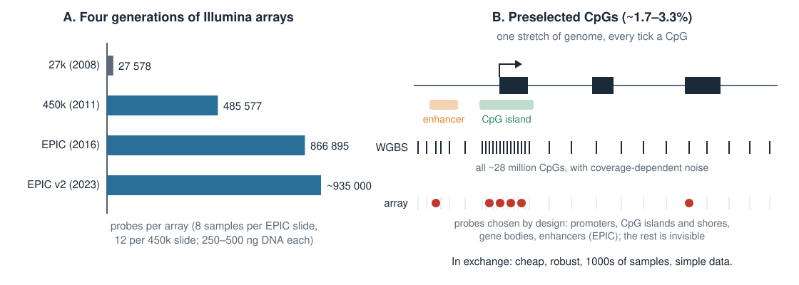{width="95%" fig-align="center"}

- About 1.7% (450k) to 3.3% (EPIC v2) of the ~28 million CpGs, chosen in advance: promoters and CpG islands (450k), plus enhancers (EPIC).
- In exchange: low cost per sample, 250–500 ng DNA, a few days from DNA to data, and highly standardised data across labs and decades.

::: notes
Four generations: 27k (2008, almost only promoter CpG islands), 450k (2011, 485 577 probes covering 99% of RefSeq genes and 96% of CpG islands, with several probes per island including the shores), EPIC (2016, 866 895 probes, adding about 350 000 enhancer CpGs from ENCODE and FANTOM5), EPIC v2 (2023, about 935 000, with problematic probes removed and more enhancers). Most probes are shared between generations, which is why clocks trained on 450k data still run on EPIC. The cost of an array is a fraction of a deep WGBS genome, and the output is a fixed table: CpG × sample, no alignment decisions. The price: you only see the CpGs on the array, mostly in regions that are either fully methylated or unmethylated in most tissues, and the probe design brings its own artefacts, which is what most of this lecture is about.
:::

## Bisulfite turns methylation into a C/T "genotype"

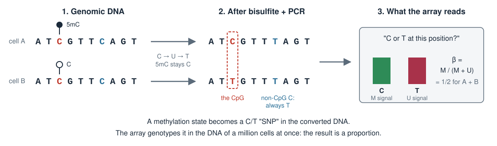{width="95%" fig-align="center"}

- After bisulfite conversion and amplification, each CpG of each molecule reads **C (was methylated)** or **T (was unmethylated)**.
- The array measures the C and T signals of millions of molecules together: the result is a **proportion** per CpG, not a per-molecule state.

::: notes
Recap from *Bisulfite and enzymatic sequencing*: sodium bisulfite deaminates unmethylated cytosine to uracil, which PCR copies as thymine; 5-methylcytosine (and 5-hydroxymethylcytosine) is protected. So a CpG becomes a SNP-like site: C/T. The Infinium assay was developed for SNP genotyping, and the methylation array is that genotyping assay applied to bisulfite-converted DNA. Two consequences. First, the readout is the fraction of methylated copies in the sample: for blood, that is averaged over all the white blood cells in the tube. Second, like bisulfite sequencing, the array cannot tell 5mC from 5hmC. Non-CpG Cs are converted almost always; that is also how the array checks the completeness of the conversion (bisulfite conversion control probes).
:::

## Infinium I and Infinium II probes

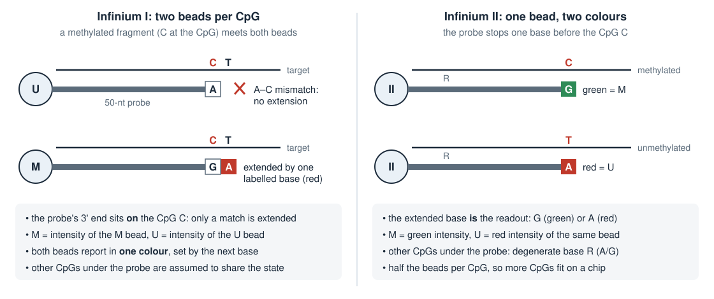{width="95%" fig-align="center"}

- **450k**: 135 476 Type I and 350 036 Type II probes; **EPIC**: 142 262 and 724 574.
- The two designs have **different dynamic ranges**: a source of technical variation that normalisation must handle.

::: notes
Each probe is a 50-nucleotide oligo on a bead; the bisulfite-converted, amplified DNA hybridises, and a single labelled base is added to the probe's 3' end. Infinium I uses two bead types per CpG: the U bead's probe ends with a base that matches the converted (T) version, the M bead's probe ends with a base that matches C; only a perfectly matched 3' end is extended. Both report in the same colour, set by the base after the CpG (A or T: red; C or G: green). Infinium II uses one bead per CpG: the probe ends right before the CpG C, and the added base itself reports the state: G (green) for C, A (red) for T. Type II needs half the beads, so most probes are Type II, but it has a compressed range (fully methylated CpGs give lower β than with Type I) and is more sensitive to dye bias. Another difference: Type I probes assume that the other CpGs under the probe have the same state as the target (the probe sequence is written for all-methylated or all-unmethylated); Type II uses a degenerate base (R = A/G) for up to three other CpGs. These counts are from the minfi manifests.
:::

## From IDAT files to β values

```r
library(minfi)
targets <- read.delim(file.path(D, "gse42861_samples.tsv"))
targets$Basename <- file.path(D, "gse42861_idat", targets$basename)
rg   <- read.metharray.exp(targets = targets)    # RGChannelSet: red and green intensities per bead type
mset <- preprocessRaw(rg)                         # MethylSet: M and U per CpG
beta <- getBeta(mset, offset = 100)               # beta = M / (M + U + 100)
```

| object | rows | contains |
|---|---|---|
| IDAT files | — | two binary files per array (Grn, Red): mean intensity per bead type |
| `RGChannelSet` | 622 399 addresses | raw red and green intensities, including control probes |
| `MethylSet` | 485 512 CpGs | methylated (M) and unmethylated (U) signal per CpG |
| `GenomicRatioSet` | CpGs with positions | β, M values, genome coordinates |

::: notes
An IDAT file is the scanner's output: for every bead type (address), the mean and SD of its intensity in one colour. minfi reads them into an RGChannelSet, the most raw object, which also holds about 850 control probes (staining, extension, hybridisation, bisulfite conversion, negative controls). preprocessRaw maps bead addresses to CpGs: for a Type I probe, M and U are the two beads in the probe's colour; for Type II, M is the green and U the red signal of the one bead. Reading 151 450k arrays takes about 4 minutes. The objects behave like the SummarizedExperiment you know from DESeq2: assays, colData (the sample table) and rowData. sesame (Zhou et al.) is the main alternative to minfi, with its own preprocessing (openSesame) and probe masks; its defaults are well suited to EPIC v2.
:::

## β values and M values {.smaller}

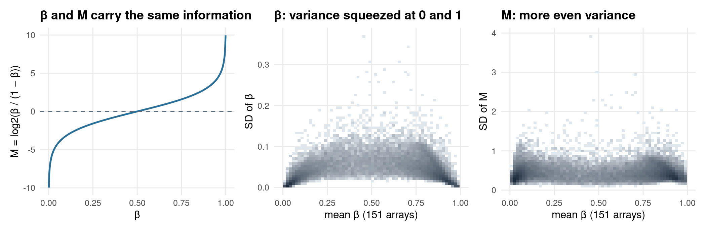{width="95%" fig-align="center"}

$$ \beta = \frac{M}{M + U + 100} \qquad\qquad M\text{-value} = \log_2 \frac{M + 1}{U + 1} \approx \log_2 \frac{\beta}{1 - \beta} $$

- **β**: interpretable (a proportion, 0–1), but its variance depends on the mean: little room near 0 and 1.
- **M-value**: unbounded, roughly constant variance: better for **linear models**. Report effects in β, test on M.

::: notes
The offset of 100 in β protects against division by tiny numbers when both signals are near background. The M-value is a log ratio, like a log fold change of methylated over unmethylated signal; M = 0 means β = 0.5, M = 2 means β = 0.8, M = −2 means β = 0.2. The middle and right panels are real: across the 151 arrays, the SD of β is small for CpGs near 0 or 1 and largest for intermediate CpGs, while the SD of M is more even (it is inflated at the extremes instead, where tiny differences in U or M signal become large log ratios). Du et al. 2010 showed that tests on M-values have better statistical properties; limma assumes roughly constant variance. The convention in EWAS papers: test on M, report the difference in β (Δβ), because "2% more methylated" means something to a reader and "0.1 more in M" does not. By hand: β = 0.8 gives M = log2(0.8/0.2) = 2.
:::

## Quality control: detection p-values and sex {.smaller}

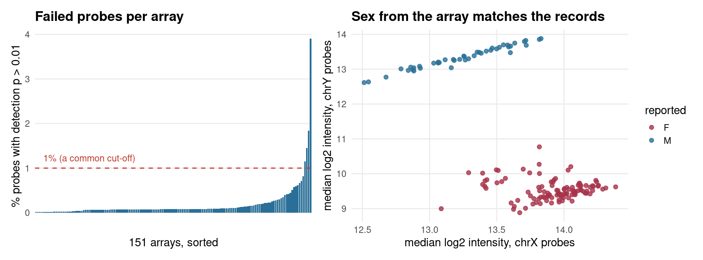{width="92%" fig-align="center"}

- **Detection p-value**: is M + U of a probe above the background of ~600 negative control probes? Here 0.08% of probes fail (p > 0.01) in a typical array, 3.9% in the worst; 3 784 probes fail in > 5% of arrays.
- **Sex check**: median signal of chrX vs chrY probes. All 151 arrays agree with the records; a mismatch means a sample swap.

::: notes
minfi's detectionP compares the total signal of each probe with the distribution of the negative control probes of the same array (sesame's pOOBAH uses out-of-band Type I signal instead). Common rules: drop arrays with more than 1–5% failed probes, and drop probes that fail in more than a few percent of arrays. Here 4 of 151 arrays exceed 1% failed probes and none exceeds 5% (the worst: 3.9%); with the more lenient cut-off we keep all of them, and note the four in the methods. The sex check is the cheapest sample-identity test there is: women have two X chromosomes and no Y, so chrY probes give background signal; men have one X. Here 107 women and 44 men, all matching the GEO annotation. Other QC: bisulfite conversion controls (incomplete conversion makes everything look methylated), the overall β distribution (should be bimodal), and for repeated samples, SNP probes (59–65 rs probes on the array give a genotype fingerprint).
:::

## Background and dye bias: noob

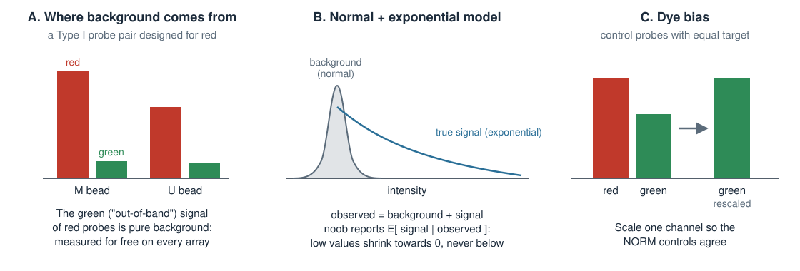{width="95%" fig-align="center"}

- Fluorescence = **background** (normal) + **signal** (exponential); the Type I "wrong colour" channel estimates the background on every array.
- **Dye bias**: the red and green channels have different gains; control probes with equal target let us rescale.

::: notes
noob (normal-exponential using out-of-band probes, Triche et al. 2013) is a within-array correction and the recommended first step in most pipelines. It models the observed intensity of each probe as background plus signal; the out-of-band intensities of Type I probes (the colour they are not designed for) are pure background and give its mean and spread. The corrected value is the expected signal given the observed one, which is always positive and shrinks low values towards zero. Dye-bias correction rescales one channel so that control probes (NORM_A/T in red and NORM_C/G in green, which should give equal signal) agree. Because each array is corrected on its own, noob is safe when global methylation differs between groups (a property between-array methods do not have, see the next slides).
:::

## Type I vs Type II, and what normalisation does {.smaller}

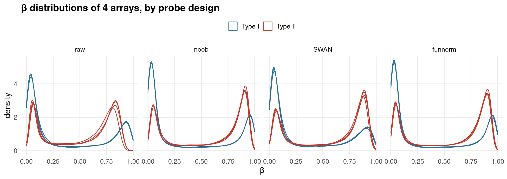{width="95%" fig-align="center"}

- Raw data: the methylated peak sits at β ≈ 0.95 for Type I probes and **0.84** for Type II. After noob, SWAN or functional normalisation the gap shrinks to ~0.04.
- Between-array methods (**quantile**, **functional normalisation**) also align arrays to each other.

::: notes
Four arrays from two BeadChips, densities of β by probe design. In the raw data the Type II distribution is compressed: methylated CpGs read lower and unmethylated CpGs higher than with Type I. noob (within-array) and SWAN (subset-quantile within-array normalisation, Maksimovic 2012: quantile-normalise Type I and II probes against each other on a subset matched for CpG content) reduce the gap; BMIQ (Teschendorff 2013) fits a three-component beta mixture to each design and maps Type II onto the Type I distribution. Functional normalisation (Fortin et al. 2014) is a between-array method: it quantile-normalises arrays but uses the first principal components of the control probes to decide how much of the difference between arrays is technical. These peak positions are from the real data and printed by make-arrays-figs.R.
:::

## Which normalisation, when? {.smaller}

| method | type | assumption / use |
|---|---|---|
| **noob** | within array | background + dye bias; safe default; first step of most pipelines |
| **SWAN, BMIQ** | within array | Type I vs II design bias |
| **quantile** (`preprocessQuantile`) | between arrays | all arrays have the same β distribution: same tissue, small effects |
| **functional normalisation** | between arrays | technical variation captured by control probes; keeps real global differences (e.g. tumour vs normal) |
| **sesame** (`openSesame`) | within array | pOOBAH detection, noob, dye bias, masking; the default for EPIC v2 |

- As in RNA-seq: a normalisation is an **assumption**. Quantile normalisation would erase a true global loss of methylation (cancer).
- On these 151 arrays: noob 2.7 min, SWAN 2.0, funnorm 6.5 (16 GB RAM), quantile 1.8.

::: notes
There is no universally best method, and benchmark papers disagree because they measure different things (replicate agreement, preservation of known differences, removal of batch effects). A sensible default for blood EWAS is noob (perhaps followed by BMIQ for analyses that mix Type I and II probes, like clocks), with batch handled in the model. Quantile normalisation forces all arrays to have identical β distributions; that is fine for a study of one tissue with small expected effects, and wrong for tumour vs normal, where tumours lose methylation globally: the same issue as global changes in ChIP-seq and ATAC-seq (*Differential accessibility*). Functional normalisation was designed for exactly that case. Run times are for one CPU core on a server; funnorm needed 16 GB of memory for 151 arrays, which is why the exercise compares methods on 24 arrays.
:::

## Probes that measure something else {.smaller}

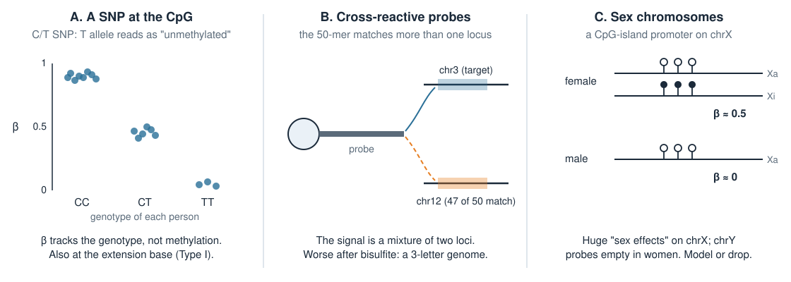{width="95%" fig-align="center"}

- Here: 485 512 → **481 728** (detection) → **452 974** (Zhou et al. general mask: 20 010 non-unique probes, common SNPs at the target or extension base) → **442 415** (drop chrX, chrY).

::: notes
Three classic problems. A: a SNP at the CpG (or at the extension base of a Type I probe) makes the probe report genotype: people cluster at β ≈ 0, 0.5 and 1 by genotype. A real example is visible as trimodal β distributions in any EWAS. These probes create false associations with ancestry and with any trait correlated with ancestry. B: cross-reactive probes. After bisulfite conversion the genome is mostly a three-letter alphabet, so many 50-mers match several places; the signal mixes loci. Chen et al. 2013 listed about 6% of 450k probes; Pidsley et al. 2016 did the same for EPIC; Zhou et al. 2017 provide masks per array and genome build, which we use (the M_general column). C: sex chromosomes: in women one X is inactivated and its CpG-island promoters methylated, so chrX probes differ hugely by sex, and chrY probes are empty in women. Most EWAS of autosomal traits drop chrX and chrY or analyse them separately with sex in the model. Filtering removes 9% of probes here; all filtering choices go in the methods section.
:::

## The dataset: GSE42861 {.smaller}

| | RA patients | controls |
|---|---:|---:|
| samples (14 BeadChips with both groups) | 79 | 72 |
| women / men | 61 / 18 | 46 / 26 |
| age (median) | 55 | 54 |
| current / ex / never / occasional smokers | 25 / 31 / 18 / 5 | 12 / 25 / 25 / 8 (2 unknown) |

- Peripheral blood leukocytes, 450k array, Liu et al. 2013 (689 samples in total, Sweden).
- In the full study many BeadChips carry **only patients or only controls**: chip and disease are confounded. We took the 14 chips with both.

::: notes
The full study (Liu et al. 2013) used 354 patients with rheumatoid arthritis and 335 controls from the Swedish EIRA study, and asked whether methylation mediates genetic risk in the MHC region. For teaching we use 151 samples, which runs on a laptop. A design point: in the full GEO series, 36 of the 72 BeadChips contain only patients or only controls. Any chip effect (and chip effects are real: hybridisation, scanning, reagent batch) would then look like a disease effect, and no statistics can separate the two afterwards. Randomising samples over chips and positions before hybridisation is the cheapest protection there is. Our subset is balanced per chip, but not perfectly; we will still include the chip in the model. Note also the covariates: RA is more common in women and in smokers, and both sex and smoking change blood methylation.
:::

## What drives the variation? {.smaller}

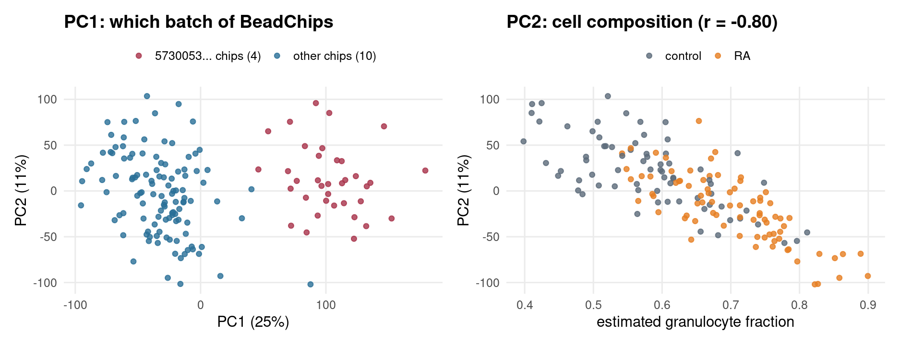{width="92%" fig-align="center"}

- PCA of the 20 000 most variable autosomal CpGs (M-values after noob). **PC1 (25%) is a batch**: four BeadChips of one older lot (5730053…) vs the other ten; the slide explains 85% of PC1.
- **PC2 (11%) is cell composition** (r = −0.80 with the granulocyte fraction), and patients sit at the high-granulocyte end. Disease itself is not a principal component.

::: notes
Left: the 151 arrays on the first two principal components, coloured by the series of the BeadChip. The four 5730053… chips (36 samples) are separated from the rest along PC1, even after noob normalisation; these chips also have more failed probes (PC1 correlates 0.58 with the failed-probe fraction), so this is a technical batch: an older lot of chips, processed at a different time. Because we chose chips with both patients and controls, the batch is not confounded with disease here; it adds noise, and putting the chip in the model removes it. In the full study, where many chips hold only one group, the same batch would be a disaster. Right: PC2 against the estimated granulocyte fraction (estimated on a later slide): almost a straight line. Neutrophils and lymphocytes differ at tens of thousands of CpGs, and the neutrophil share of blood varies between people (more with inflammation, infection, stress, steroids). RA patients (orange) sit at the high-granulocyte end. This is the RNA-seq lesson "look at the PCA before you test", with two very specific answers for blood arrays: batch and cell composition.
:::

## Blood is a mixture, and the mixture changes {.smaller}

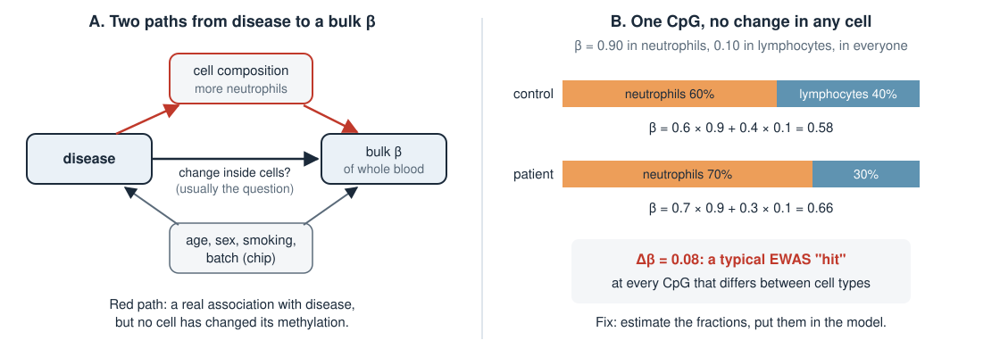{width="95%" fig-align="center"}

- A CpG that differs between cell types changes its bulk β whenever the **proportions** change, even if no cell changed anything.
- Inflammatory disease, age, smoking, sex, stress and drugs all change blood composition: **cell composition is a confounder** in almost every blood EWAS.

::: notes
Panel B is a by-hand calculation: β = 0.9 in neutrophils and 0.1 in lymphocytes, in every person. Control: 60% neutrophils gives 0.58; patient: 70% gives 0.66. A difference of 0.08 in β is a typical EWAS effect size, and it would appear at every one of the tens of thousands of CpGs that differ between neutrophils and lymphocytes, with tiny p-values in a large study. Whether that is "wrong" depends on the question: the association with disease is real, but it is not evidence that the disease changes methylation inside cells. Jaffe and Irizarry (2014) showed that a large fraction of published blood EWAS hits (for age and other traits) could be explained this way. In the language of linear models (which students know from RNA-seq design formulas): composition is a variable that affects the outcome and is associated with the exposure, so it belongs in the model.
:::

## Estimating the fractions: reference-based deconvolution

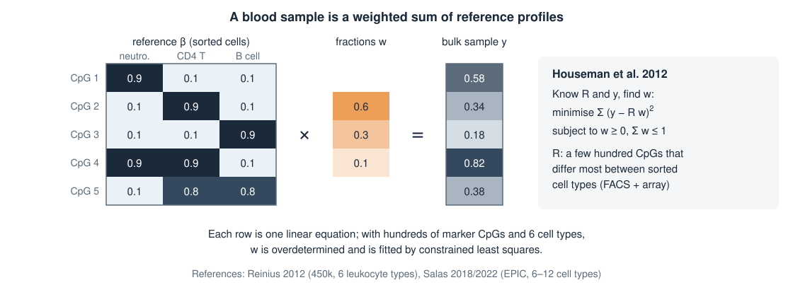{width="95%" fig-align="center"}

- A reference of **sorted cells** gives β of marker CpGs per cell type; each sample is fitted as a non-negative mixture (Houseman et al. 2012).
- minfi: `estimateCellCounts(rg, compositeCellType = "Blood")`; EpiDISH and sesame offer the same idea with other references.

::: notes
Houseman's method has two steps. In a reference data set (here Reinius et al. 2012: blood of 6 men, sorted by FACS into granulocytes, monocytes, B cells, CD4 and CD8 T cells and NK cells, each on a 450k array), select the CpGs that best separate the cell types (minfi picks the 50 most hypo- and 50 most hypermethylated CpGs per cell type, about 600 in total). Then for every sample, solve a constrained least-squares problem: find non-negative fractions w so that the reference profiles times w best match the sample's β at those CpGs. This is the same linear algebra as fitting a design matrix, with the reference as the design and the constraint that fractions are non-negative and (in Houseman's formulation) sum to at most one; minfi enforces only non-negativity by default, so its estimates can sum to slightly more than one (0.98–1.05 here). minfi normalises the samples together with the reference (quantile normalisation) before fitting. Newer references (FlowSorted.Blood.EPIC, Salas et al. 2018; and a 12-cell-type version in 2022) use EPIC arrays and more cell types, including neutrophils separately from eosinophils and naive vs memory lymphocytes. Reference-free methods (RefFreeEWAS, ReFACTor, surrogate variable analysis) estimate hidden structure without a reference.
:::

## The reference: marker CpGs of sorted cells {.smaller}

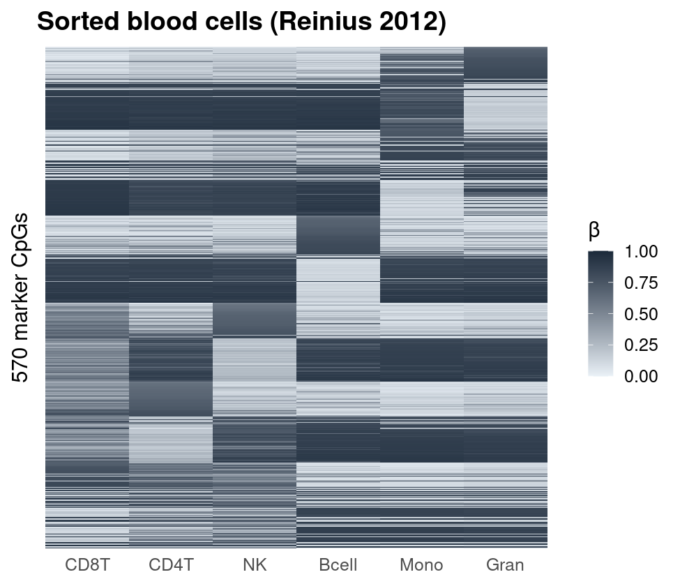{width="50%" fig-align="center"}

- Each cell type has CpGs that are unmethylated only in it (its enhancers and lineage genes): the dark/light blocks.
- Granulocytes (neutrophils) and lymphocytes differ the most; CD4 and CD8 T cells the least.

::: notes
The heat map shows the reference profiles that estimateCellCounts selected (rows: marker CpGs, columns: sorted cell types, colour: mean β in the reference). Cell-type-specific unmethylation is the typical pattern: a CpG in an enhancer of a myeloid gene is unmethylated in granulocytes and monocytes and methylated in lymphocytes. This is the same biology as the cell-type-specific open chromatin of *Differential accessibility*: lineage-specific enhancers are open, bound by TFs and unmethylated. Hard pairs (CD4 vs CD8 T cells, NK vs CD8) have fewer and weaker markers, so their estimates are noisier. A practical point: if the samples are from a tissue the reference does not cover (cord blood, saliva, tumour), the estimates are biased; use a matching reference.
:::

## Estimated fractions: patients have more granulocytes {.smaller}

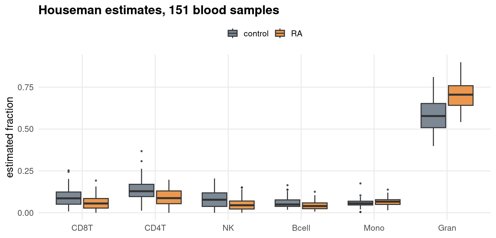{width="80%" fig-align="center"}

- Granulocytes **70% in RA vs 58% in controls** (p ≈ 10⁻¹³); every lymphocyte type is lower in patients.
- Exactly the situation of the toy example, at real scale.

::: notes
Mean estimated fractions: RA patients 70% granulocytes, 9% CD4 T cells, 6% CD8 T cells, 5% NK, 4% B cells, 7% monocytes; controls 58%, 14%, 9%, 9%, 6%, 6%. Systemic inflammation and treatment (glucocorticoids raise neutrophil counts and lower lymphocytes) both shift the blood towards granulocytes. The fractions sum to about one, so they are not independent: when modelling, leave one out (here granulocytes) to avoid a design matrix that is not of full rank, just as you drop one level of a factor. With the fractions in hand, adding them to the model is a one-line change, next slide.
:::

## An EWAS is a linear model per CpG

```r
library(limma)
M <- log2(beta / (1 - beta))                         # M-values, CpGs x samples (after filtering)
design <- model.matrix(~ status + age + sex + smoking + CD8T + CD4T + NK + Bcell + Mono, data = samples)
fit <- eBayes(lmFit(M, design))
res <- topTable(fit, coef = "statusRA", number = Inf)
```

- **The same machinery as limma for RNA-seq**: one linear model per CpG, the same design matrix for all, moderated t-statistics, Benjamini–Hochberg FDR.
- Covariates: age, sex, smoking, cell fractions (one left out), batch (chip). The coefficient of `statusRA` is the RA effect **at fixed composition**.

::: notes
This is exactly the limma students know (limma-voom for RNA-seq), with M-values instead of log-CPM and no voom weights needed (M-values are roughly homoscedastic). Each CpG gets its own coefficients; eBayes borrows variance information across CpGs, which matters for small studies. Reading the design formula: the RA coefficient now compares patients and controls with the same age, sex, smoking status and cell composition. Factor smoking has four levels (never, ex, occasional, current), so it uses three columns. With 149 samples and up to 27 columns (with chip), the residual degrees of freedom drop from 147 to 124, which is fine at this sample size but would not be in a study of 20 people. Two samples without smoking status are dropped. An alternative to M-values is a beta regression per CpG; in practice limma on M-values is the standard.
:::

## Genomic inflation: read the QQ plot {.smaller}

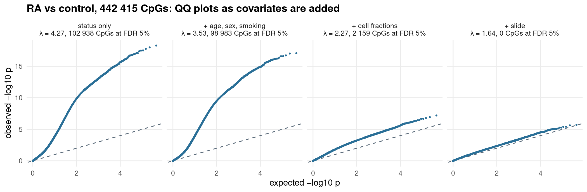{width="95%" fig-align="center"}

- $\lambda = \dfrac{\text{median}(\chi^2_1 \text{ of the observed } p)}{0.455}$: 1 if most CpGs follow the null. RA: **4.27 → 3.53 → 2.27 → 1.64** as covariates are added.
- CpGs at FDR 5%: **102 938 → 98 983 → 2 159 → 0**. Most of the "RA signal" was cell composition (and chip).

::: notes
A QQ plot compares the observed −log10 p-values with those expected if no CpG were associated. In a genome-wide test where most features are null, the bulk of the points should lie on the diagonal and only the top deviate; a cloud that rises everywhere means the test statistics are inflated, by confounding, batch effects, or a truly genome-wide effect. λ condenses this into one number: the median chi-square statistic divided by its expected value (0.455). Here, status alone gives λ = 4.3 and over 100 000 "significant" CpGs: a quarter of the array. Adding age, sex and smoking barely helps. Adding the five cell fractions removes 98% of the hits. Adding the chip removes the rest at this sample size. With 151 people we lack the power of the full study; Liu et al. used all 689 samples. Should λ be 1 after adjustment? Not necessarily: a disease that truly changes methylation at many CpGs inflates λ legitimately, which is why some authors use the bacon method (van Iterson 2017) to estimate the null distribution empirically rather than dividing by λ.
:::

## A positive control: smoking {.smaller}

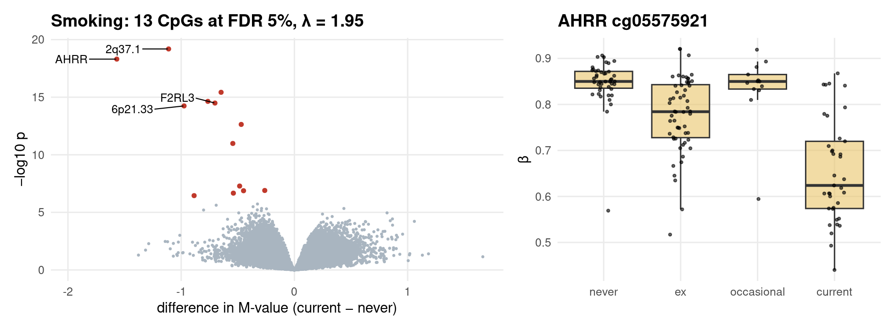{width="92%" fig-align="center"}

- Same model, coefficient current vs never smokers (37 vs 43 people): **13 CpGs at FDR 5%**, λ = 1.95.
- Top hits are the textbook smoking CpGs: *AHRR* cg05575921 (β **0.85** never → **0.66** current; rank 2), 2q37.1 (ALPPL2), *F2RL3*, 6p21.33.

::: notes
Before believing a new result, reproduce an old one. Smoking has the most replicated EWAS signature there is (Joehanes et al. 2016: thousands of CpGs in a meta-analysis of 16 000 people), and the top CpGs reappear here with only 80 people in the comparison: AHRR cg05575921 is hypomethylated in smokers (the aryl hydrocarbon receptor repressor responds to the polycyclic aromatic hydrocarbons in smoke), as are CpGs at 2q37.1, F2RL3 and 6p21.33. The AHRR CpG is so reliable that it is used as a biomarker of smoking exposure (and partly recovers after quitting: note the ex-smokers in the middle). Seeing these in the top ten tells us that the pipeline (normalisation, filtering, model) works. If your own EWAS cannot find AHRR in smokers, look for a bug before you look for biology.
:::

## Interpreting EWAS hits {.smaller}

- **Effect sizes are small**: typical Δβ of 1–5%. Real, but often less than the technical noise of a single array: replicate in an independent cohort.
- **Direction of causation**: disease → methylation is as plausible as the reverse. RA treatment (methotrexate, steroids) changes both cell composition and methylation.
- **Genetics**: many CpGs are controlled by nearby SNPs (meQTLs, *Epigenomics and genetic variation*); a disease-associated SNP can drive both. Mendelian randomisation can test the direction.
- **Tissue**: blood is accessible, not necessarily relevant (the joint synovium is where RA happens).
- **450k covers about 1.7% of CpGs; EPIC about 3%**: "no hit" does not mean "no methylation change".

::: notes
EWAS results are associations, like GWAS results but with an extra problem: methylation can be a consequence of the disease, its treatment or its lifestyle correlates. For RA: patients take drugs (methotrexate is a folate antagonist and affects one-carbon metabolism, which supplies methyl groups), have chronic inflammation and smoke more. Liu et al. 2013 addressed direction by asking whether methylation mediates the effect of MHC risk SNPs. Good practice: pre-register covariates, report λ and QQ plots, include a positive control, replicate, and say clearly whether cell composition was adjusted for. Note also the difference between statistical and biological significance: with 10 000 people a Δβ of 0.5% can be significant, but significance alone does not show a functional effect. A small bulk difference can also reflect a larger change in a small cell population; functional claims need further evidence.
:::

## Tools and choices {.smaller}

| step | minfi (this lecture) | alternatives |
|---|---|---|
| read IDATs | `read.metharray.exp` | `sesame::openSesame`, `meffil` |
| QC | `detectionP`, `getSex`, control probes | sesame `pOOBAH`, `ewastools`, `meffil` QC report |
| normalise | `preprocessNoob`, `preprocessSWAN`, `preprocessFunnorm`, `preprocessQuantile` | `wateRmelon::BMIQ`, `ChAMP` |
| filter | detection p, Zhou masks, SNPs (`dropLociWithSnps`), sex chromosomes | sesame masks (built in) |
| cell composition | `estimateCellCounts` (Houseman) | `EpiDISH`, `FlowSorted.Blood.EPIC`, reference-free (RefFreeEWAS, SVA) |
| test | limma on M-values | DMRcate, bumphunter (regions), `bacon` (inflation) |

- EPIC v2 (2023) needs updated manifests and masks (sesame supports it; check minfi annotation versions).

::: notes
A map of the ecosystem so that students can read methods sections. ChAMP and meffil are pipelines that wrap many of these steps; meffil is built for very large cohorts (it normalises on summary statistics instead of loading every array into memory). DMRcate and bumphunter find differentially methylated regions from array data, the counterpart of the DMR callers in *Differential methylation*. For EPIC v2 several probes have duplicates (replicate probes with suffixes in their names) and the manifest differs; sesame handles it natively. Whatever the tools, the decisions are the same: which normalisation, which probes, which covariates, which test, and how to check that it worked.
:::

## Summary {.smaller}

| idea | key fact |
|---|---|
| assay | bisulfite + Infinium genotyping chemistry; Type I (two beads) and Type II (two colours) |
| platforms | 27k → 450k (485 577) → EPIC (866 895) → EPIC v2 (~935 000); ~1.7–3.3% of CpGs |
| β and M | β = M/(M+U+100); M = log2 ratio; test on M, report Δβ |
| QC | detection p vs negative controls; sex from chrX/chrY; conversion controls |
| normalisation | noob (background, dye), SWAN/BMIQ (design), quantile/funnorm (between arrays) |
| filtering | failed probes, SNPs, cross-reactive (Zhou masks), sex chromosomes: 485 512 → 442 415 |
| composition | blood = mixture; Houseman deconvolution; RA: granulocytes 70% vs 58% |
| EWAS | limma per CpG with covariates; λ 4.27 → 1.64 and 102 938 → 0 hits as composition and chip enter |
| positive control | smoking: AHRR cg05575921, β 0.85 → 0.66 |

::: notes
Students should leave able to: explain how a Type I and a Type II probe report methylation; compute β and M from M and U signals by hand; read a detection-p and sex-check plot; say what each normalisation assumes; explain why SNP-overlapping and cross-reactive probes are removed; compute a bulk β from cell fractions and cell-type β values; write the design formula of an EWAS with cell fractions and say why one fraction is left out; read a QQ plot and compute λ; and judge an EWAS claim. Next: *Epigenetic clocks and biomarkers* uses the same arrays to predict age and asks what such predictors mean.
:::

## Key papers (optional further reading) {.smaller}

*Not required reading and not examined. For those who want the primary literature.*

- Bibikova et al. 2011, *Genomics*. [High density DNA methylation array with single CpG site resolution](https://doi.org/10.1016/j.ygeno.2011.07.007). The 450k array.
- Du et al. 2010, *BMC Bioinformatics*. [Comparison of Beta-value and M-value methods for quantifying methylation levels by microarray analysis](https://doi.org/10.1186/1471-2105-11-587). Why to test on M-values.
- Houseman et al. 2012, *BMC Bioinformatics*. [DNA methylation arrays as surrogate measures of cell mixture distribution](https://doi.org/10.1186/1471-2105-13-86). Reference-based deconvolution.
- Jaffe & Irizarry 2014, *Genome Biol*. [Accounting for cellular heterogeneity is critical in epigenome-wide association studies](https://doi.org/10.1186/gb-2014-15-2-r31). How composition fakes EWAS hits.
- Zhou, Laird & Shen 2017, *Nucleic Acids Res*. [Comprehensive characterization, annotation and innovative use of Infinium DNA methylation BeadChip probes](https://doi.org/10.1093/nar/gkw967). Probe masks; the annotation we use.
- Liu et al. 2013, *Nat Biotechnol*. [Epigenome-wide association data implicate DNA methylation as an intermediary of genetic risk in rheumatoid arthritis](https://doi.org/10.1038/nbt.2487). The dataset of this unit.
