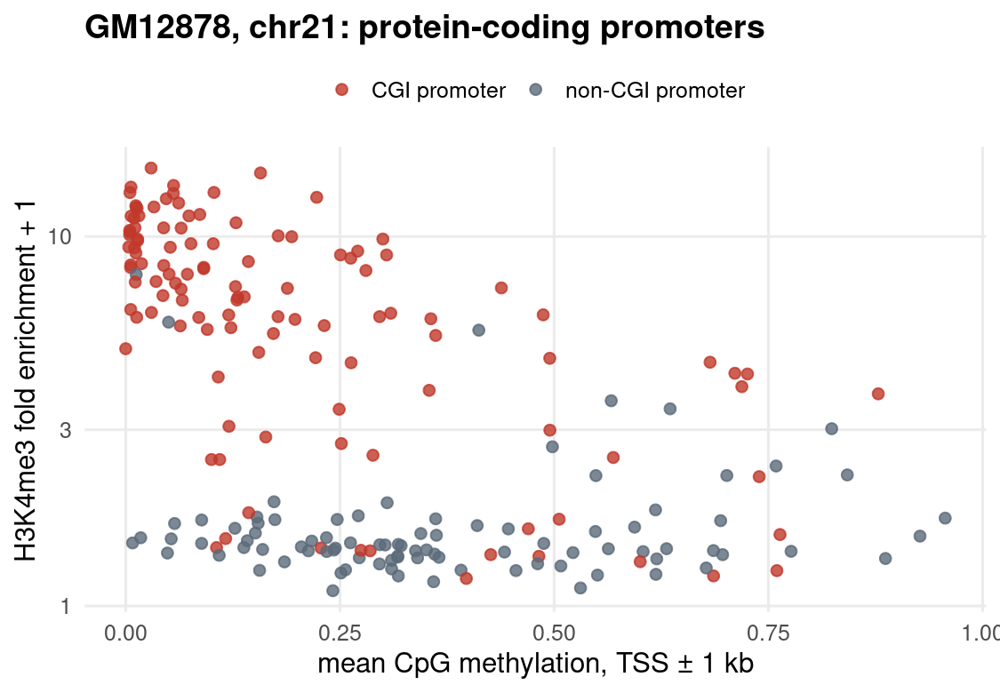
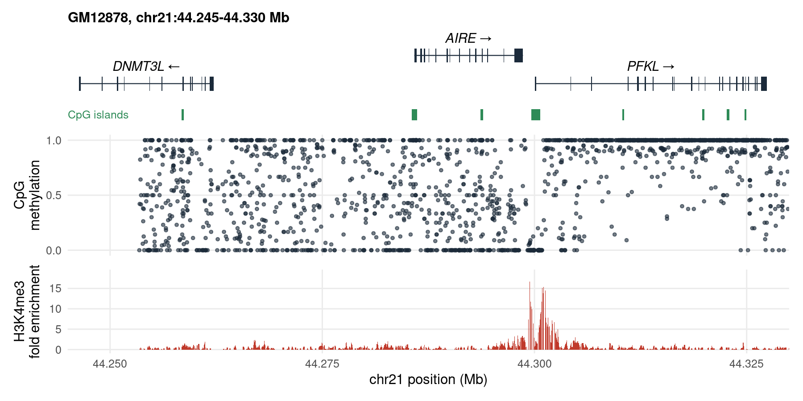

## Goal

After this exercise you will be able to:

- Compute a **methylation level** from read counts, combine the two strands of a CpG, and say how precise a single-CpG estimate is.
- Calculate what **passive dilution** and imperfect maintenance do to methylation over cell divisions.
- Decide whether a stretch of DNA is a **CpG island**, and classify cytosines into the plant contexts CG, CHG and CHH.
- Predict the effect of **imprinting** defects at the *H19/IGF2* locus.
- Read real whole-genome bisulfite data on the command line and in R: the **bimodal** distribution, **CpG islands**, **promoters vs gene bodies**, the link to **H3K4me3** and to **expression**, and **partially methylated domains**.

## Background

**Methylation level.** At one cytosine, bisulfite sequencing gives $M$ reads with a C (methylated) and $U$ reads with a T (unmethylated). The level, often called **β**, is

$$ \beta = \frac{M}{M + U} = \frac{M}{N}, $$

a number between 0 and 1 (or a percentage). A CpG is palindromic, so it has a C on each strand; in mammals both are usually in the same state, and the counts of the two strands are often added. How the reads are made and counted is the topic of *Bisulfite and enzymatic sequencing (WGBS, RRBS, EM-seq)*.

**Precision.** If the true level is $p$ and we observe $N$ reads, the number of methylated reads is roughly binomial, with standard error of $\hat\beta$ equal to $\sqrt{p(1-p)/N}$.

**Passive dilution.** Without maintenance, each replication halves the fraction of methylated strands: after $n$ divisions a fully methylated site is at $0.5^n$. If maintenance copies a methylated site onto the new strand with probability $e$, the level is multiplied by $(1+e)/2$ per division.

**CpG island** (Gardiner-Garden & Frommer 1987): at least 200 bp with GC content above 50% and an observed/expected CpG ratio above 0.6, where

$$ \text{CpG o/e} = \frac{\#\text{CpG} \times \text{length}}{\#\text{C} \times \#\text{G}}. $$

**Plant contexts.** For a C on one strand, look at the next two bases on the same strand: CG; CHG; CHH (H = A, C or T).

## Data

From the course repository:

```bash
data/download.sh methylation-biology            # about 30 MB (plus the GTF and H3K4me3 bigWig if not yet present)
mkdir -p ~/epi/methbio && cd ~/epi/methbio
D=/path/to/course/data                          # where download.sh put the files
```

- `gm12878_wgbs_rep1_chr21.bed.gz`, `k562_wgbs_rep1_chr21.bed.gz`: ENCODE whole-genome bisulfite sequencing (WGBS), per-CpG calls for chr21 (GRCh38), GM12878 ([ENCSR890UQO](https://www.encodeproject.org/experiments/ENCSR890UQO/), file ENCFF570TIL) and K562 ([ENCSR765JPC](https://www.encodeproject.org/experiments/ENCSR765JPC/), ENCFF660IHA). One line per cytosine of a CpG **per strand**. Columns: 1–3 position (BED, 0-based start), 6 strand, **10 number of reads**, **11 percent methylated** (an integer, rounded down), 12 reference context, 13 context called in this genome (not `CG` where the cell line has a SNP).
- `hg38_cpgIslandExt.txt.gz`: UCSC CpG islands; columns 2–4 are chromosome, start (0-based), end.
- `gencode.v46.basic.annotation.gtf.gz`: gene annotation; `gm12878_h3k4me3_fc.bigWig`: H3K4me3 fold enrichment over input (both used since *What is epigenetics?*).
- `gm12878_rna_rep1_genes.tsv`: ENCODE RNA-seq gene quantifications for GM12878 (columns `gene_id`, `TPM`, …).

**Shortcuts, said plainly.** We start from ENCODE's methylation calls, not from reads (the reads are processed in *Bisulfite and enzymatic sequencing*), and we use one chromosome. GM12878 and K562 are cell lines: both carry large hypomethylated domains that a primary tissue would not have, which is part of what this exercise is about.

The R part runs in about 1–2 minutes and needs about 2 GB of memory.

## By hand

Do these on paper.

**B1. A methylation level.** At one CpG, the reads covering the C on the + strand show 9 C and 3 T; the reads covering the C on the − strand show 5 C and 3 T.

(a) What is the methylation level of each strand? Of the CpG, combining the strands?

(b) The ENCODE file stores coverage and a percentage rounded down. A line says coverage 7, percent 42. How many reads were methylated?

(c) Give two situations in which the two strands of a CpG should *not* be combined.

(d) With 14 reads and a true level of 0.5, what is the standard error of $\hat\beta$? Could you tell a CpG at 0.5 from one at 0.8 with 14 reads?

**B2. Dilution.** (a) A primordial germ cell starts at 75% methylated CpGs and maintenance is switched off. What is the level after 1, 2, 3 and 4 divisions? How many divisions until it is below 5%?

(b) In a somatic cell, DNMT1 copies each methylated CpG with probability $e = 0.95$ and nothing else acts. What is the level after 20 and after 50 divisions, starting from 0.8? (Hint: $\ln 0.975 \approx -0.0253$.)

(c) Repeat (b) for $e = 0.999$ after 50 divisions. Which two mechanisms keep real tissues near 0.75–0.8? Where in the genome would you expect slow loss to show first?

**B3. Is it a CpG island?** Two 400-bp windows:

| window | #C | #G | #CpG |
|---|---:|---:|---:|
| A | 110 | 106 | 30 |
| B | 90 | 92 | 8 |

(a) Compute GC content and CpG o/e for each. Which meets the island criteria?

(b) How many CpGs would you expect in window B if dinucleotides were random? Why is the bulk of the human genome at an o/e of about 0.2–0.25?

**B4. Plant contexts.** The top strand of a piece of a transposon reads 5'-ACGTTCAGCCATTCGCAG-3' (positions 1–18).

(a) Give the context (CG, CHG or CHH) of every C on this strand.

(b) Which enzyme maintains methylation at each of these Cs in Arabidopsis?

(c) In a *drm2 cmt2* double mutant, which of these Cs lose methylation? Why can they not be copied at replication like the CGs?

**B5. Imprinting at *H19/IGF2*.** Use the lecture figure (the ICR is methylated on the paternal allele; CTCF binds the unmethylated ICR).

(a) A child inherits a maternal chromosome 11 on which the ICR is (wrongly) methylated. Which of *H19* and *IGF2* is expressed from each allele? What growth phenotype do you predict?

(b) A child has paternal uniparental disomy (UPD) of 11p15. Same questions.

(c) A deletion of the CTCF sites in the ICR has no effect when inherited from the father, but activates *IGF2* when inherited from the mother. Explain.

(d) Mouse embryos without maternal and zygotic ZFP57 lose methylation at several ICRs during preimplantation development. What happens to *Igf2* expression if the *H19* ICR loses its methylation?

**B6. Read the figures.** Use the lecture plots of promoter methylation against H3K4me3 and the *PFKL* locus.

{width="65%"}

(a) How many promoters with methylation above 0.6 have strong H3K4me3? What does that suggest?

(b) Give two reasons why a promoter can be unmethylated and still have no H3K4me3.

{width="100%"}

(c) *AIRE* is silent in B cells, yet the CpGs around it are not unmethylated. *PFKL* is active, yet its body is highly methylated. Explain both.

(d) Many dots around *AIRE* sit at 0.3–0.7. Give a biological and a technical reason for intermediate values.

**B7. Judge the claim.** A paper reports: "In tumours the promoter CpG island of gene *X* is methylated (β = 0.7 vs 0.1 in normal tissue) and *X* is expressed 10-fold less. Methylation silences *X* and drives tumour formation."

Give three reasons why the data do not show this, and describe one experiment for each of the two halves of the claim (silencing; driving the tumour).

**B8. Plants, mammals, flies.** (a) Why can an epiallele in *Arabidopsis* last for many generations, while a methylation change in a mouse rarely reaches the grandchildren? (b) Fruit flies have essentially no DNA methylation. How do they keep a gene silent through cell divisions?

## On the command line

You need `bedtools` (see *Install the software you need*).

### C1 — Look at the per-CpG file

```bash
zcat $D/gm12878_wgbs_rep1_chr21.bed.gz | head -3
zcat $D/gm12878_wgbs_rep1_chr21.bed.gz | wc -l
zcat $D/gm12878_wgbs_rep1_chr21.bed.gz | cut -f6 | sort | uniq -c
zcat $D/gm12878_wgbs_rep1_chr21.bed.gz | awk -F'\t' '$13 != "CG"' | wc -l
zcat $D/gm12878_wgbs_rep1_chr21.bed.gz | awk -F'\t' '{ n++; s += $10 } END { print n, s / n }'
```

(a) How many lines are there, and how many per strand? Why does the − strand line of a CpG start 1 bp after the + strand line?

(b) How many lines have a called context other than CG? What could that mean?

(c) What is the mean number of reads per line? Is that enough to measure a single CpG well (B1d)?

### C2 — One line per CpG

Combine the strands: the − strand C at position $s$ belongs to the CpG that starts at $s-1$.

```bash
zcat $D/gm12878_wgbs_rep1_chr21.bed.gz \
  | awk -F'\t' -v OFS='\t' '$13 == "CG" { s = ($6 == "+") ? $2 : $2 - 1
        N[s] += $10; M[s] += int($10 * $11 / 100 + 0.5) }
      END { for (s in N) print "chr21", s, s + 2, M[s], N[s] }' \
  | sort -k2,2n > gm12878_cpg.bed
head -3 gm12878_cpg.bed; wc -l < gm12878_cpg.bed
awk '{ m += $4; n += $5 } END { printf "read-weighted methylation %.3f\n", m / n }' gm12878_cpg.bed
awk '$5 >= 10 { k++; b = $4 / $5; if (b < 0.2) lo++; else if (b > 0.8) hi++; else mid++ }
     END { printf "CpGs with >= 10 reads: %d  low %.3f  mid %.3f  high %.3f\n", k, lo/k, mid/k, hi/k }' gm12878_cpg.bed
```

(a) How many CpGs are left? What is the overall methylation of chr21 in GM12878?

(b) What fraction of well-covered CpGs is below 0.2, between, and above 0.8?

### C3 — Inside and outside CpG islands

```bash
zcat $D/hg38_cpgIslandExt.txt.gz | awk -F'\t' -v OFS='\t' '$2 == "chr21" { print $2, $3, $4 }' \
  | sort -k2,2n > cgi_chr21.bed
wc -l < cgi_chr21.bed
awk '{ print $3 - $2 }' cgi_chr21.bed | sort -n | awk '{ a[NR] = $1 } END { print "median length", a[int(NR/2)], "min", a[1], "max", a[NR] }'
bedtools intersect -u -a gm12878_cpg.bed -b cgi_chr21.bed \
  | awk '$5 >= 10 { m += $4/$5; k++ } END { printf "in CGIs: %d CpGs, mean %.3f\n", k, m/k }'
bedtools intersect -v -a gm12878_cpg.bed -b cgi_chr21.bed \
  | awk '$5 >= 10 { m += $4/$5; k++ } END { printf "outside: %d CpGs, mean %.3f\n", k, m/k }'
```

(a) How many CpG islands are on chr21, and how long are they?

(b) Compare the mean methylation in and outside islands. Is the difference as large as you expected? (R2 explains why not.)

## In R

You need data.table, GenomicRanges, rtracklayer and ggplot2 (see *Install the software you need*).

```r
suppressPackageStartupMessages({
  library(data.table); library(GenomicRanges); library(rtracklayer); library(ggplot2)
})
D <- "/path/to/course/data"
```

### R1 — Read the calls and combine the strands

```r
read_cpg <- function(file) {
  x <- fread(file, header = FALSE, select = c(1, 2, 6, 10, 11, 13),
             col.names = c("chr", "start", "strand", "N", "pct", "call"))
  x <- x[call == "CG"]
  x[, M := round(N * pct / 100)]
  x[, pos := ifelse(strand == "+", start + 1L, start)]      # 1-based C of the + strand
  x[, .(N = sum(N), M = sum(M)), by = .(chr, pos)]
}
gm <- read_cpg(file.path(D, "gm12878_wgbs_rep1_chr21.bed.gz"))
nrow(gm)
summary(gm$N)
mean(gm$N >= 10)
sum(gm$M) / sum(gm$N)
gm10 <- gm[N >= 10][, beta := M / N]
mean(gm10$beta)
```

(a) Why is `round(N * pct / 100)` exact here for coverage below 50, even though the percentage was rounded down?

(b) How many CpGs, what median coverage, and what fraction with at least 10 reads? Compare the read-weighted level (`sum(M)/sum(N)`) with the mean of β over well-covered CpGs. Why can they differ?

### R2 — CpG islands

```r
cgi <- fread(file.path(D, "hg38_cpgIslandExt.txt.gz"), header = FALSE)[V2 == "chr21"]
cgi <- GRanges(cgi$V2, IRanges(cgi$V3 + 1, cgi$V4))
gr <- GRanges(gm10$chr, IRanges(gm10$pos, width = 2), beta = gm10$beta)
gr$cgi <- overlapsAny(gr, cgi)
table(gr$cgi)
tapply(gr$beta, gr$cgi, mean)
ggplot(as.data.frame(mcols(gr)), aes(beta)) +
  geom_histogram(breaks = seq(0, 1, 0.05)) +
  facet_wrap(~ cgi, scales = "free_y", labeller = label_both)
ov <- findOverlaps(cgi, gr)
cgi_meth <- tapply(gr$beta[subjectHits(ov)], queryHits(ov), mean)
length(cgi_meth)
summary(cgi_meth)
mean(cgi_meth < 0.2); mean(cgi_meth > 0.6)
```

(a) Describe the two histograms. (b) How many islands have a mean below 0.2, and how many above 0.6? Why might so many chr21 islands be methylated? (Think about where they lie; R3 helps.)

### R3 — Promoters, gene bodies, intergenic DNA

```r
gtf <- import(file.path(D, "gencode.v46.basic.annotation.gtf.gz"))
genes <- gtf[gtf$type == "gene" & gtf$gene_type == "protein_coding" & seqnames(gtf) == "chr21"]
prom <- promoters(genes, upstream = 1000, downstream = 1000)
length(genes); sum(overlapsAny(prom, cgi))
gr$region <- "intergenic"
gr$region[overlapsAny(gr, genes)] <- "gene body"
gr$region[overlapsAny(gr, prom)] <- "promoter"
tab <- as.data.table(mcols(gr))
tab[, .(n = .N, mean = mean(beta), median = median(beta)), by = .(region, cgi)][order(region, cgi)]
```

(a) What fraction of chr21 protein-coding genes has a CGI promoter? (b) Rank the six groups by median methylation. Which group is lowest, which highest? (c) Which group would you expect to be the most methylated in a primary tissue, and why is it not here?

### R4 — Promoter methylation and H3K4me3

```r
pm <- findOverlaps(prom, gr)
prom$meth <- NA_real_; prom$ncpg <- 0L
m <- tapply(gr$beta[subjectHits(pm)], queryHits(pm), mean)
n <- tapply(gr$beta[subjectHits(pm)], queryHits(pm), length)
prom$meth[as.integer(names(m))] <- m
prom$ncpg[as.integer(names(n))] <- n
pr <- prom[prom$ncpg >= 5]
pr$cgi <- overlapsAny(pr, cgi)
k4 <- rtracklayer::summary(BigWigFile(file.path(D, "gm12878_h3k4me3_fc.bigWig")), pr, type = "mean")
pr$k4 <- sapply(k4, function(z) z$score)
length(pr)
cor(pr$meth, pr$k4, method = "spearman")
table(methylated = pr$meth > 0.6, H3K4me3 = pr$k4 > 5)
ggplot(as.data.frame(mcols(pr)), aes(meth, k4 + 1, colour = cgi)) + geom_point() + scale_y_log10()
```

(a) What is the Spearman correlation? Fill in the 2 × 2 table in words. (b) Why do we require at least 5 covered CpGs per promoter?

### R5 — Gene bodies and expression

```r
rna <- fread(file.path(D, "gm12878_rna_rep1_genes.tsv"))[grepl("^ENSG", gene_id)]
rna[, id := sub("\\..*", "", gene_id)]
body <- genes[width(genes) > 5000]
body <- resize(body, width(body) - 2000, fix = "end")     # drop the first 2 kb
body$tpm <- rna$TPM[match(sub("\\..*", "", body$gene_id), rna$id)]
bo <- findOverlaps(body, gr)
body$meth <- NA_real_
bm <- tapply(gr$beta[subjectHits(bo)], queryHits(bo), mean)
body$meth[as.integer(names(bm))] <- bm
b <- as.data.table(mcols(body))[!is.na(tpm) & !is.na(meth)]
b[, expr := cut(tpm, c(-Inf, 0.5, 10, Inf), labels = c("off", "low", "high"))]
b[, .(genes = .N, body_meth = mean(meth)), by = expr][order(expr)]
cor(b$meth, log1p(b$tpm), method = "spearman")
```

(a) Is body methylation higher or lower in expressed genes? Give the correlation. (b) Why do we drop the first 2 kb of each gene? (c) Does this show that gene-body methylation activates genes?

### R6 — Partially methylated domains

```r
k5 <- read_cpg(file.path(D, "k562_wgbs_rep1_chr21.bed.gz"))
sum(k5$M) / sum(k5$N)
bins <- rbind(gm[, .(meth = sum(M) / sum(N), n = .N), by = .(bin = pos %/% 1e5)][, cell := "GM12878"],
              k5[, .(meth = sum(M) / sum(N), n = .N), by = .(bin = pos %/% 1e5)][, cell := "K562"])[n >= 50]
ggplot(bins, aes(bin / 10, meth, colour = cell)) + geom_point(size = 0.8) + geom_line() +
  labs(x = "chr21 (Mb)", y = "mean methylation per 100 kb")
w <- dcast(bins, bin ~ cell, value.var = "meth")[!is.na(GM12878) & !is.na(K562)]
nrow(w); sum(w$K562 < 0.1)
w[, .(GM12878 = mean(GM12878)), by = .(K562_low = K562 < 0.1)]
cor(w$GM12878, w$K562)
genes$bin <- start(genes) %/% 1e5
genes$tpm <- rna$TPM[match(sub("\\..*", "", genes$gene_id), rna$id)]
g <- as.data.table(mcols(genes))[, .(bin, tpm)][w, on = "bin", nomatch = 0]
g[, .(genes = .N, median_tpm = median(tpm, na.rm = TRUE), expressed = mean(tpm > 1, na.rm = TRUE)),
  by = .(K562_low = K562 < 0.1)]
```

(a) What is the overall methylation of chr21 in K562? (b) How many 100-kb bins are below 0.1 in K562, and how methylated are the same bins in GM12878? (c) Are genes in those domains expressed in GM12878? What does that suggest about the domains? (d) Name two properties of partially methylated domains that are not in these data.

## Hints

::: {.callout-tip collapse="true" title="Hint 1 — levels, strands and precision (B1, C2, R1)"}
β = methylated / all reads. A percentage rounded down hides at most 1 percentage point, so $N \cdot \text{pct}/100$ is within $N/100$ of the true count. The binomial standard error is $\sqrt{p(1-p)/N}$. The [ENCODE WGBS pipeline](https://www.encodeproject.org/data-standards/wgbs/) describes the files; `data.table`'s [`fread`](https://rdatatable.gitlab.io/data.table/reference/fread.html) reads gzipped files directly.
:::

::: {.callout-tip collapse="true" title="Hint 2 — dilution (B2)"}
Each division multiplies the level by $(1+e)/2$. So after $n$ divisions: $\beta_n = \beta_0 \left(\frac{1+e}{2}\right)^n$, and $x^n = e^{n \ln x}$. The lecture slides on maintenance and on partially methylated domains give the biology.
:::

::: {.callout-tip collapse="true" title="Hint 3 — CpG islands and contexts (B3, B4)"}
Expected CpGs = #C × #G / length. The criteria are from [Gardiner-Garden & Frommer 1987](https://doi.org/10.1016/0022-2836(87)90689-9); UCSC's [CpG island track](https://genome.ucsc.edu/cgi-bin/hgTrackUi?db=hg38&g=cpgIslandExt) explains its variant. For a C, read the next two bases on the **same** strand, 5' to 3'. The plant enzymes are reviewed in [Law & Jacobsen 2010](https://doi.org/10.1038/nrg2719).
:::

::: {.callout-tip collapse="true" title="Hint 4 — imprinting (B5)"}
Draw the two alleles as in the lecture and ask, for each: is the ICR methylated, does CTCF bind, which gene do the enhancers reach? UPD = both copies from one parent. [Bell & Felsenfeld 2000](https://doi.org/10.1038/35013100) is short and readable.
:::

::: {.callout-tip collapse="true" title="Hint 5 — intervals in R (R2–R6)"}
`overlapsAny`, `findOverlaps` and `promoters` are explained in the [GenomicRanges vignette](https://bioconductor.org/packages/release/bioc/vignettes/GenomicRanges/inst/doc/GenomicRangesIntroduction.html) and in *Genomic intervals*. The UCSC table has a 0-based start; add 1 for `GRanges`. [`rtracklayer::summary`](https://rdrr.io/bioc/rtracklayer/man/BigWigFile.html) on a `BigWigFile` returns the mean signal in each range. `bedtools intersect -u/-v` keeps features with/without an overlap ([manual](https://bedtools.readthedocs.io/en/latest/content/tools/intersect.html)).
:::

::: {.callout-tip collapse="true" title="Hint 6 — interpretation (B6, B7, R5, R6)"}
Correlation across genes is not cause. For each claim ask: what came first, is there a confounder (cell type, tumour purity, proliferation), and which perturbation would test it (demethylating drugs, dCas9-TET1, dCas9-DNMT3A)? Partially methylated domains: [Lister et al. 2009](https://doi.org/10.1038/nature08514), [Zhou et al. 2018](https://doi.org/10.1038/s41588-018-0073-4).
:::

## Solutions

::: {.callout-note collapse="true" title="Solutions — by hand"}

**B1.** (a) + strand $9/12 = 0.75$; − strand $5/8 = 0.625$; combined $14/20 = 0.70$.
(b) $7 \times 0.42 = 2.94$, so **3** methylated reads ($3/7 = 42.9\%$, rounded down to 42).
(c) Hemimethylation (e.g. just after replication, or where maintenance failed), and a SNP that destroys the CpG on one allele or one strand (the C/T or G/A change then looks like a methylation call). Also non-CpG contexts in plants, which are not symmetric.
(d) $\sqrt{0.5 \cdot 0.5/14} = 0.134$. A 95% interval of about ±0.26 around 0.5 reaches 0.76: a single CpG at 14 reads cannot reliably tell 0.5 from 0.8. This is why analyses average over neighbouring CpGs (*Differential methylation*).

**B2.** (a) 37.5%, 18.8%, 9.4%, 4.7%: **4 divisions**. Mouse PGCs divide several times between E7.5 and E13.5, so passive dilution alone can explain most of the erasure; TET1/2 finish specific regions such as imprints.
(b) Factor per division $(1 + 0.95)/2 = 0.975$. After 20: $0.975^{20} = e^{-0.506} = 0.60$, so $0.8 \times 0.60 = $ **0.48**. After 50: $e^{-1.27} = 0.28$, so **0.23**.
(c) $(1.999/2)^{50} = 0.9995^{50} \approx 0.975$: **0.78**. Real tissues stay methylated because maintenance is very accurate in most of the genome, and DNMT3A/3B re-methylate sites that maintenance missed. Slow loss shows first where maintenance is least efficient: late-replicating heterochromatin, i.e. partially methylated domains, which deepen with the number of divisions.

**B3.** (a) A: GC $= 216/400 = 54\%$; o/e $= 30 \times 400/(110 \times 106) = 12\,000/11\,660 = $ **1.03**: an island. B: GC $= 182/400 = 45.5\%$; o/e $= 8 \times 400/(90 \times 92) = 3200/8280 = $ **0.39**: not an island (fails both criteria).
(b) $90 \times 92/400 = 20.7$ expected, 8 observed. Methylated CpGs mutate to TpG (and CpA on the other strand) by spontaneous deamination of 5mC to T, which repair does not always fix; over evolutionary time CpGs that were methylated in the germ line are lost. Islands were unmethylated in the germ line and kept theirs.

**B4.** (a) C2: **CG** (CGT); C6: **CHG** (CAG); C9: **CHH** (CCA); C10: **CHH** (CAT); C14: **CG** (CGC); C16: **CHG** (CAG).
(b) C2 and C14: MET1; C6 and C16: CMT3 (with H3K9me2); C9 and C10: DRM2 (RdDM) or CMT2.
(c) C9 and C10 (CHH). A CHH site has no C on the opposite strand at the mirrored position (the complement of HH is DD, never a G-paired C), so after replication there is no methylated template strand to copy: the mark must be re-made by targeting (siRNAs for DRM2, H3K9me2 for CMT2) every cycle. CG and CHG are symmetric and copied from the old strand.

**B5.** (a) Both alleles now look paternal: no CTCF, enhancers reach *IGF2* on both, *H19* silent on both. **Two active *IGF2* copies: overgrowth** (a cause of Beckwith–Wiedemann syndrome).
(b) The same: two paternal copies, biallelic *IGF2*, no *H19*: overgrowth (paternal UPD of 11p15 is a common cause of Beckwith–Wiedemann).
(c) On the paternal allele the ICR is methylated and CTCF does not bind anyway, so deleting its sites changes nothing. On the maternal allele CTCF binding is what insulates *IGF2*; without the sites the enhancers reach *IGF2*, which is now expressed from both alleles.
(d) The paternal ICR becomes unmethylated, CTCF binds it, and the paternal allele behaves maternally: *Igf2* is silenced on both alleles (and *H19* expressed from both), giving growth restriction (a Silver–Russell-like pattern).

**B6.** (a) **None** of the 28 promoters above 0.6 has H3K4me3 enrichment above 5. Promoter methylation and H3K4me3 are mutually exclusive, consistent with H3K4me3 blocking DNMT3 and methylation excluding CFP1/SET1, but the plot alone does not say which comes first.
(b) A silent CpG-island promoter covered by Polycomb (H3K27me3, unmethylated thanks to KDM2B/TET); a non-CGI promoter that is simply inactive; an alternative promoter of a gene that uses another TSS.
(c) *AIRE*/*DNMT3L* lie in a partially methylated domain: late-replicating, inactive DNA where maintenance slowly fails, giving scattered intermediate levels rather than "unmethylated". *PFKL* is transcribed: H3K36me3 from elongation recruits DNMT3B and the body is methylated; only its promoter island is unmethylated.
(d) Biological: cells in the population differ (heterogeneity), allele-specific methylation, or partial loss in a PMD. Technical: few reads (with 10–20 reads, 0.3–0.7 is within sampling error of each other; B1d), and mapping errors.

**B7.** Reasons: (1) correlation only: methylation may follow silencing (e.g. the gene was already Polycomb-repressed in the cell of origin; CGI methylation often comes last); (2) confounding by cell composition: the tumour and the normal tissue contain different cell types and different tumour purity, so methylation and expression differences may both reflect composition; (3) the gene may be silenced by other means (deletion, mutation, a transcription factor lost), and methylation is a passenger; (4) with one gene and many tested, selection bias. Experiments: for silencing, demethylate the promoter in tumour cells (decitabine, or targeted dCas9-TET1) and see if *X* comes back, or methylate it in normal cells (dCas9-DNMT3A) and see if *X* goes off; for driving the tumour, restore *X* in tumour cells (or knock it out in normal cells) and measure growth, ideally in vivo.

**B8.** (a) Mammals erase almost all methylation twice per generation (early embryo, germ line), so a change rarely survives; Arabidopsis maintains CG methylation through meiosis and gametogenesis and reinforces non-CG methylation by RdDM, so an epiallele can persist (and occasionally revert). (b) By Polycomb repression (H3K27me3 written by PRC2, read and spread by the read–write loop), by H3K9 methylation and HP1 heterochromatin, and in the germ line by small RNAs (piRNAs).
:::

::: {.callout-note collapse="true" title="Solutions — command line"}

**C1.** (a) 711 175 lines: 355 322 on +, 355 853 on −. A CpG is 5'-CG-3' on the top strand; on the bottom strand the C pairs with the G, which is 1 bp to the right (also 5'-CG-3' when read on that strand). (b) 29 999 lines have another called context (e.g. `CR`, `YG`, `CA`, `TG`): the cell line carries a SNP at that CpG on one or both alleles. A C→T SNP looks exactly like an unmethylated C in bisulfite data (*Bisulfite and enzymatic sequencing*), so these are best removed. (c) 7.3 reads per line, i.e. about 14 per CpG after combining strands: enough for broad patterns, not for precise single-CpG values.

**C2.** (a) **350 466** CpGs; read-weighted methylation **0.458** (a typical somatic tissue is 0.7–0.8; this cell line is low). (b) 260 663 CpGs with ≥ 10 reads: 38.5% low, 27.4% intermediate, 34.2% high.

**C3.** (a) **446** islands on chr21, median 476 bp (202 bp to 9 174 bp). (b) In islands 6 130 CpGs with mean **0.350**; outside 254 533 CpGs with mean **0.469**. The difference is smaller than the textbook picture because many chr21 islands are not at promoters and are methylated, and because much of the DNA outside islands is in hypomethylated domains.
:::

::: {.callout-note collapse="true" title="Solutions — R"}

Run time about 1 minute on one core.

**R1.** (a) The stored percentage is $\lfloor 100 M/N \rfloor$, so $N \cdot \text{pct}/100$ lies in $(M - N/100, M]$; for $N < 50$ that interval is narrower than 0.5 and rounding recovers $M$ exactly. (b) 350 466 CpGs; coverage median 14 (range 1–143); 74% have ≥ 10 reads. Read-weighted level **0.458**; mean β over CpGs with ≥ 10 reads **0.466**. The first weights each CpG by its coverage, the second weights all well-covered CpGs equally; they differ if coverage correlates with methylation (e.g. GC-rich, unmethylated islands are covered differently).

**R2.** (a) Outside islands: a peak at 0, a broad shoulder of intermediate values and a peak near 1. Inside islands: a tall peak at 0 and a smaller one near 1. (b) Of 308 islands with covered CpGs, 39% have a mean below 0.2 and 45% above 0.6 (median 0.52). Many chr21 islands are not at promoters: 126 of 446 overlap a protein-coding promoter. Others are intragenic, intergenic or in repeats near the centromere, and such "orphan" islands are often methylated, especially in cell lines.

**R3.** (a) 126 of 220 = **57%**. (b) Median: CGI promoter **0.00** < non-CGI promoter 0.11 < intergenic non-CGI 0.29 < gene body CGI 0.60 ≈ intergenic CGI 0.62 < gene body non-CGI **0.69**. (c) In a primary tissue intergenic DNA is as high as gene bodies (about 0.8). Here it is low because much of chr21's intergenic DNA lies in partially methylated domains (R6).

**R4.** (a) 208 promoters, Spearman **−0.60**. Of promoters with methylation ≤ 0.6, 73 have strong H3K4me3 and 107 do not; of the 28 above 0.6, **none** has strong H3K4me3. (b) A promoter mean over 1–4 CpGs, each with 10–20 reads, is very noisy (B1d); and promoters with few CpGs are mostly non-CGI, where the averaging also mixes very different sites.

**R5.** (a) Higher: off 0.46 (57 genes), low 0.82 (74), high 0.84 (19); Spearman **+0.69** between body methylation and log expression. (b) The first 2 kb contain the promoter and the unmethylated start of the gene, which go the opposite way and would dilute the body signal. (c) No: body methylation follows transcription (H3K36me3 recruits DNMT3B). Also, many silent genes lie in hypomethylated domains (R6), which is a third factor behind the correlation.

**R6.** (a) **0.230**. (b) 203 of 374 bins are below 0.1 in K562; the same bins average **0.32** in GM12878 vs 0.52 in the others (correlation between the cell lines across bins 0.66). (c) No: 94 genes lie in these bins, median TPM 0, only 7% with TPM > 1, against 68% of 126 genes elsewhere. The domains are gene-poor, inactive heterochromatin, and both cell lines lost methylation there, K562 much more. (d) They replicate late in S phase, are associated with the nuclear lamina, carry H3K9me3 or H3K27me3, and get deeper with the number of cell divisions (Zhou et al. 2018).
:::

## Where this leads

- *Bisulfite and enzymatic sequencing (WGBS, RRBS, EM-seq)* makes per-CpG calls like these from raw reads, and shows why a C→T SNP looks like an unmethylated C.
- *Differential methylation* compares the two GM12878 and two K562 replicates statistically and finds the regions that differ.
- *Methylation arrays* measure 450 000–900 000 selected CpGs cheaply in thousands of people; *Epigenetic clocks and biomarkers* uses the slow drift of B2.
- *Methylation and chromatin from long reads* reads 5mC (and 5hmC) on single molecules, which separates alleles and cells where bulk β cannot.

## Key papers (optional further reading)

*Not required reading and not examined.*

- Okano et al. 1999, *Cell*. [DNA methyltransferases Dnmt3a and Dnmt3b are essential for de novo methylation and mammalian development](https://doi.org/10.1016/S0092-8674(00)81656-6).
- Tahiliani et al. 2009, *Science*. [Conversion of 5-methylcytosine to 5-hydroxymethylcytosine in mammalian DNA by MLL partner TET1](https://doi.org/10.1126/science.1170116).
- Bell & Felsenfeld 2000, *Nature*. [Methylation of a CTCF-dependent boundary controls imprinted expression of the Igf2 gene](https://doi.org/10.1038/35013100).
- Domcke et al. 2015, *Nature*. [Competition between DNA methylation and transcription factors determines binding of NRF1](https://doi.org/10.1038/nature16462).
- Smith & Meissner 2013, *Nat Rev Genet*. [DNA methylation: roles in mammalian development](https://doi.org/10.1038/nrg3354).
- Law & Jacobsen 2010, *Nat Rev Genet*. [Establishing, maintaining and modifying DNA methylation patterns in plants and animals](https://doi.org/10.1038/nrg2719).
