## About this lecture

*What is epigenetics?* introduced 5-methylcytosine, its copying by DNMT1 and UHRF1, and CpG islands. This lecture goes one level deeper.

- The **enzymes**: DNMT1, DNMT3A/3B/3L that write, TET enzymes that oxidise, and the two routes to removal.
- **Reprogramming**: the two waves of near-total erasure, in the early embryo and in the germ line.
- The **methylation landscape** in real data (GM12878 and K562, chr21): bimodal levels, unmethylated CpG islands, methylated gene bodies, partially methylated domains.
- How methylation interacts with **transcription factors**; **imprinting** and **X inactivation** in more depth.
- **Plants** (CG, CHG, CHH; RNA-directed DNA methylation) and organisms with no 5mC at all.

::: notes
This is the biology unit of the DNA methylation block. The next units are *Bisulfite and enzymatic sequencing (WGBS, RRBS, EM-seq)*, which explains how the data shown here are made, and *Differential methylation*, which compares GM12878 with K562 statistically. Arrays (*Methylation arrays*), clocks (*Epigenetic clocks and biomarkers*) and long reads (*Methylation and chromatin from long reads*) come after. The real-data figures in this lecture use ENCODE whole-genome bisulfite data from the two cell lines of the course, chromosome 21 only, so students can redo every plot in the exercise. Keep the focus on mechanisms and on reading the data; the catalogue of proteins is there for reference, not to memorise.
:::

## Five forms of cytosine {.smaller}

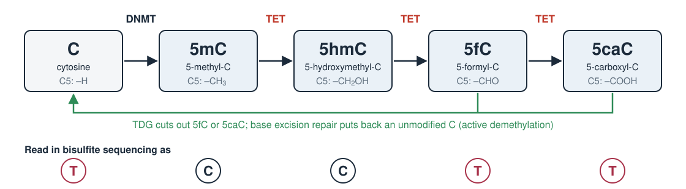{width="92%" fig-align="center"}

- **DNMTs** add a methyl group to carbon 5 of cytosine: **5mC**. In mammals almost only at CpG.
- **TET** enzymes (TET1, TET2, TET3) oxidise 5mC step by step to **5hmC**, **5fC** and **5caC**.
- **TDG** (a DNA glycosylase) cuts out 5fC and 5caC; base excision repair puts back a plain C.
- Bisulfite sequencing cannot tell 5mC from 5hmC: both read as C.

::: notes
The chemistry in one picture. The TET enzymes are Fe(II)- and 2-oxoglutarate-dependent dioxygenases, discovered as 5mC oxidases by Tahiliani et al. 2009 (key paper); 5hmC in Purkinje neurons was reported in the same issue of Science (Kriaucionis & Heintz 2009). The bottom row is the bridge to *Bisulfite and enzymatic sequencing*: bisulfite deaminates C, 5fC and 5caC (read as T) but not 5mC or 5hmC (read as C). So "methylation" from bisulfite data is really 5mC + 5hmC. In most cells 5hmC is small compared with 5mC; in brain it is not, and methods that separate them exist (oxidative bisulfite, TAB-seq, long reads). Because 2-oxoglutarate is a cofactor, metabolism matters: mutant IDH1/2 in gliomas and leukaemias makes 2-hydroxyglutarate, which inhibits TETs and leads to hypermethylation (*Epigenetics in disease and therapy*).
:::

## The DNA methyltransferases {.smaller}

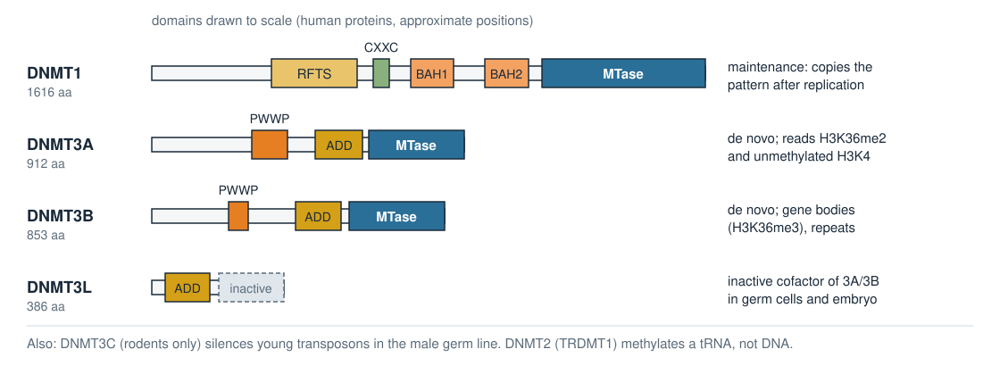{width="92%" fig-align="center"}

- **DNMT1** maintains: it prefers hemimethylated CpG and copies the pattern after replication.
- **DNMT3A** and **DNMT3B** methylate *de novo*; their PWWP and ADD domains read histone marks.
- **DNMT3L** has no catalytic activity but stimulates DNMT3A/3B in the germ line and early embryo.

::: notes
The division into maintenance and de novo enzymes is the textbook one and mostly holds: Dnmt1 knockout mouse embryos lose most methylation and die; Dnmt3a/3b double knockouts cannot establish methylation (Okano et al. 1999, key paper). In reality the roles overlap: DNMT3A/3B also repair errors left by DNMT1 in dividing cells, and DNMT1 has some de novo activity. Disease links help students remember: DNMT3A is one of the most frequently mutated genes in clonal haematopoiesis and acute myeloid leukaemia; DNMT3B mutations cause ICF syndrome (immunodeficiency, centromeric instability, facial anomalies), with hypomethylated pericentromeric satellites. DNMT2 is a misnomer: it methylates cytosine 38 of tRNA-Asp. DNMT3C exists only in rodents (Barau et al. 2016) and targets young retrotransposons in the male germ line. Domain lengths are drawn approximately to scale from the human proteins.
:::

## Maintenance: how DNMT1 finds its target {.smaller}

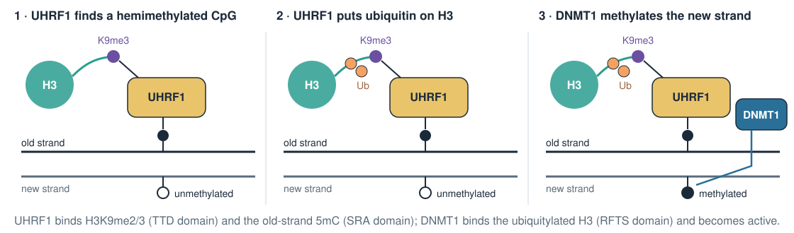{width="95%" fig-align="center"}

- After replication each CpG is **hemimethylated**. UHRF1 binds it, and binds H3K9me2/3 nearby.
- UHRF1 **ubiquitylates histone H3**; DNMT1 binds ubiquitylated H3, is activated and methylates the new strand.
- Copying is accurate but not perfect: roughly **95–99.9%** per CpG per division, depending on the region.

::: notes
*What is epigenetics?* showed the outcome (hemimethylated → fully methylated). Here is the mechanism, worked out over the last 15 years. UHRF1 has several reader domains: SRA flips the 5mC of the old strand out of the helix; TTD binds H3K9me2/3; PHD binds the unmodified H3 N-terminus. Its RING domain ubiquitylates H3 at K14, K18 and K23 (and PAF15); DNMT1's RFTS domain binds ubiquitylated H3, which releases its auto-inhibition. The coupling to H3K9me explains why heterochromatin is copied very faithfully and why loss of H3K9 methylation can cause loss of DNA methylation. Fidelity estimates vary between studies and regions; the numbers on the slide are a range, not a constant. The by-hand exercise asks what imperfect maintenance does over many divisions: it decays geometrically unless de novo methylation compensates, which is one origin of the slow drift that *Epigenetic clocks and biomarkers* exploits.
:::

## De novo methylation reads chromatin {.smaller}

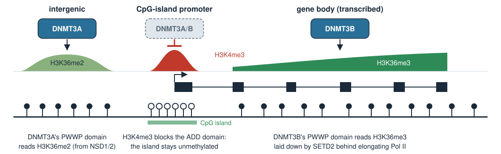{width="92%" fig-align="center"}

- The **ADD** domain binds histone H3 only when **K4 is unmethylated**: H3K4me3 at active promoters keeps DNMT3s away.
- The **PWWP** domain binds **H3K36me2/3**: DNMT3B follows SETD2's H3K36me3 into transcribed gene bodies; DNMT3A follows H3K36me2 in intergenic DNA.
- So the methylation pattern partly *follows* transcription and histone marks rather than leading them.

::: notes
Two structural facts explain much of the landscape you will see in the data slides. ADD–H3K4me0 binding (Ooi et al. 2007 for DNMT3L; also shown for DNMT3A) explains why promoters with H3K4me3 stay unmethylated. PWWP–H3K36me3 binding (Baubec et al. 2015) explains why gene bodies of transcribed genes are methylated: SETD2 travels with elongating RNA polymerase II and leaves H3K36me3 behind, which recruits DNMT3B. H3K36me2, made by NSD1 and NSD2, recruits DNMT3A to intergenic regions; mutations in NSD1 (Sotos syndrome) or in the DNMT3A PWWP domain change methylation of these regions. This "methylation follows chromatin" view is important for interpreting correlations: a methylated gene body is a sign of transcription, not its cause.
:::

## Removing methylation: passive and active {.smaller}

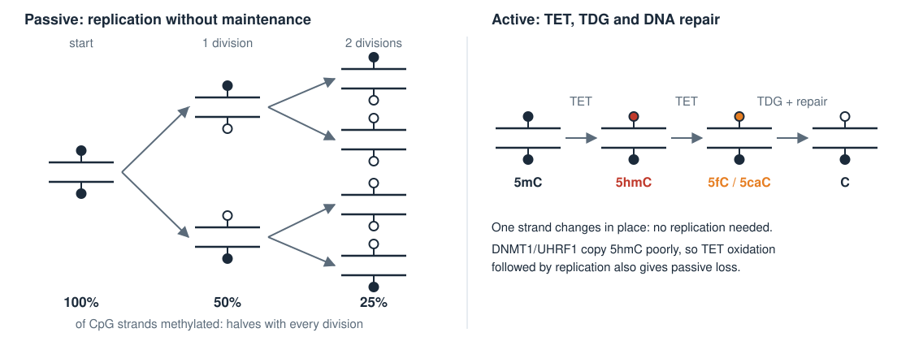{width="95%" fig-align="center"}

- **Passive**: if DNMT1/UHRF1 do not act at replication, each division halves the methylated strands.
- **Active**: TET oxidation, then TDG excision and repair, removes the mark without replication.
- In practice they combine: TET oxidation makes 5hmC, which maintenance copies poorly, so it is diluted.

::: notes
Passive loss needs cell division: after n divisions without maintenance the fraction left is 0.5 to the power n (by-hand exercise). It is the main route in primordial germ cells, where UHRF1 is repressed, and for the maternal genome in the early embryo. Active loss is fast and local: TET enzymes are recruited to enhancers by transcription factors, keeping them unmethylated in a dynamic balance with DNMT3s; turnover at enhancers is fast in embryonic stem cells. Note that "active" in mammals means oxidation plus excision repair; plants have DNA glycosylases that excise 5mC directly (ROS1, DME), as we will see. Deamination of 5mC by AID/APOBEC was proposed as another route but is now thought to play a minor role.
:::

## 5hmC: an intermediate, and sometimes a mark {.smaller}

| | 5mC | 5hmC |
|-----|----------|----------|
| made by | DNMT1, DNMT3A/B | TET1/2/3, from 5mC |
| abundance | 70–80% of CpGs in somatic cells | a few % of 5mC in most tissues; up to ~40% in some neurons |
| where | repeats, gene bodies, intergenic DNA | gene bodies of active genes, enhancers |
| copied by DNMT1/UHRF1 | yes | poorly |
| bisulfite readout | C | C (indistinguishable from 5mC) |
| in disease | CGI hypermethylation in cancer | lost in many cancers; *TET2* mutated in clonal haematopoiesis |

- In neurons, 5hmC is stable and bound by readers (e.g. MeCP2): it is more than a short-lived intermediate.

::: notes
The table is for reference. Points to make: 5hmC is not uniformly rare; it is high in post-mitotic neurons (Kriaucionis & Heintz 2009 found it at about 40% of the 5mC level in Purkinje cells) and low in proliferating cells, consistent with loss by dilution at replication. Much 5hmC is stable over weeks, so it is partly a mark of its own, not only an intermediate. 5fC and 5caC are much rarer (orders of magnitude below 5hmC) because TDG removes them quickly. For data analysis the key point is the last row: bisulfite and EM-seq data report 5mC + 5hmC together. In blood or cell lines that is a small error; in brain it is not. Oxidative bisulfite (oxBS), TAB-seq and nanopore sequencing can separate them.
:::

## Two waves of reprogramming {.smaller}

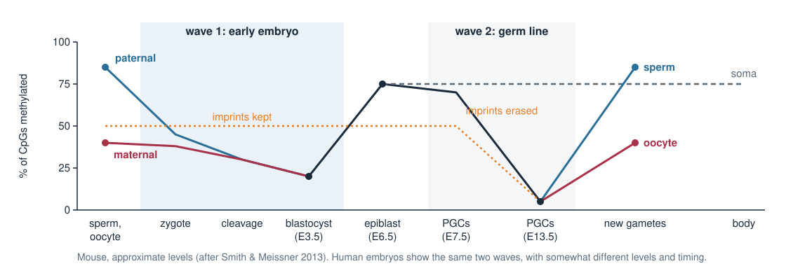{width="95%" fig-align="center"}

- **Wave 1, early embryo**: after fertilisation both parental genomes lose most methylation (the paternal one fastest). Re-methylation by DNMT3A/3B at implantation.
- **Wave 2, germ line**: primordial germ cells (PGCs) erase almost everything, **including imprints**, then gametes re-methylate in a sex-specific way.
- Erasure resets the epigenome each generation; a few sequences (some retrotransposons) partly escape.

::: notes
The curves are the classic picture for mouse (Smith & Meissner 2013, key paper; PGC data from Seisenberger et al. 2012). The paternal genome loses methylation within hours of fertilisation by TET3 oxidation plus replication; the maternal genome loses it over several divisions, mostly passively, protected from TET3 by DPPA3 (STELLA). At the blastocyst the inner cell mass has about 20% methylated CpGs in mouse. At implantation, DNMT3B and DNMT3A re-methylate the epiblast to the somatic level. PGCs are specified from the epiblast around E7; PRDM14 and BLIMP1 repress UHRF1 and the DNMT3s, so methylation falls by dilution, and TET1/TET2 finish off imprints and germline genes; by E13.5 only a few % remain. Male germ cells re-methylate before birth (with DNMT3A/3L, and piRNA-guided DNMT3C at young transposons); oocytes re-methylate after birth during growth, mainly in transcribed gene bodies, ending at about 40%. Human embryos show the same two waves with different numbers and timing. The escapees and the question of transgenerational inheritance are taken up in *Epigenetic inheritance: what is really shown?*.
:::

## Why imprints survive the first wave {.smaller}

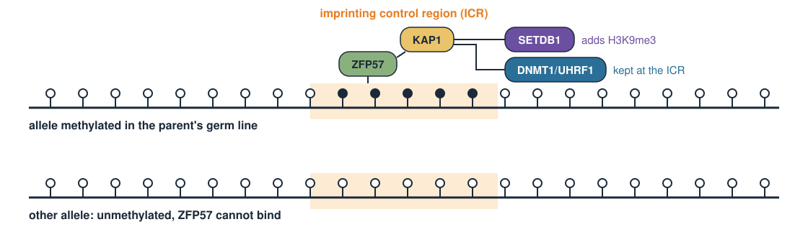{width="95%" fig-align="center"}

- An **imprinting control region (ICR)** is methylated on one parental allele only, set in the egg or the sperm.
- The KRAB zinc-finger protein **ZFP57** (and ZNF445 in human) binds its methylated motif and recruits **KAP1**, **SETDB1** (H3K9me3) and maintenance enzymes.
- So imprints survive the embryo's erasure (wave 1), but **not** the germ line's (wave 2): they are reset according to the sex of the new parent.

::: notes
Imprints must do two contradictory things: survive the genome-wide erasure in the early embryo, and be erased and rewritten in the germ line so that a male passes on paternal imprints even on the chromosome he got from his mother. Protection in wave 1 relies on sequence-specific readers of the methylated allele. ZFP57 recognises the hexanucleotide TGCCGC only when its CpG is methylated; it recruits KAP1 (TRIM28), which brings SETDB1, H3K9me3, HP1 and keeps DNMT1/UHRF1 at the locus. Zfp57 mutant mouse embryos lose methylation at several imprints; human ZFP57 mutations cause transient neonatal diabetes with multi-locus imprinting defects. In human, ZNF445 seems to play the main role in early embryos. In wave 2, PGCs lose imprints with the rest of the genome. Most germline ICRs are methylated in the oocyte; only a few (including H19/IGF2) are methylated in sperm.
:::

## The methylation landscape is bimodal {.smaller}

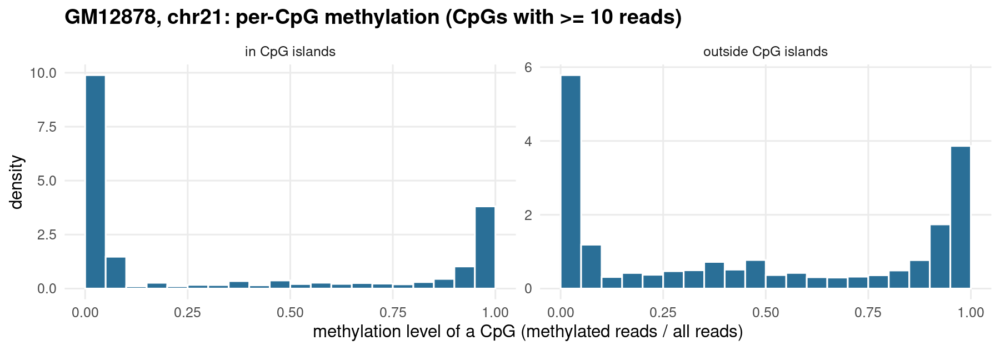{width="90%" fig-align="center"}

- ENCODE whole-genome bisulfite sequencing of GM12878, chr21, 260 663 CpGs with ≥ 10 reads: **38%** below 0.2, **34%** above 0.8.
- Most CpGs are either methylated on (almost) every copy or on none. CpG islands are mostly at 0.
- GM12878 is less methylated (0.46 overall) than a typical somatic cell (0.7–0.8): see *partially methylated domains* below.

::: notes
These are real data: per-CpG calls from ENCODE (ENCSR890UQO, replicate 1, both strands of each CpG combined). The level of a CpG is the fraction of reads that show a C (methylated) rather than a T (unmethylated) after bisulfite conversion. In a cell population a level of 0.5 can mean half of the cells fully methylated, or every cell with one allele methylated (imprinting, X inactivation), or a random mix; bulk data cannot tell these apart, but long reads can (*Methylation and chromatin from long reads*). The intermediate values here are more frequent than in a primary tissue: lymphoblastoid cell lines like GM12878 have large hypomethylated blocks acquired during EBV immortalisation and culture (Hansen et al. 2014). Many chr21 CpG islands are methylated (right peak of the left panel): chr21 has many islands that are not at promoters (in repeats and near the centromere), and these are often methylated.
:::

## Where methylation is, and where it is not {.smaller}

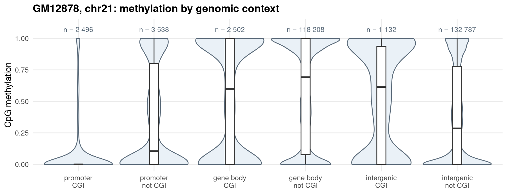{width="90%" fig-align="center"}

- **CpG-island promoters**: median 0.00 (2 496 CpGs). **Gene bodies**: median 0.69.
- **Non-CGI promoters** are intermediate (median 0.11, but spread across the whole range).
- **Intergenic** CpGs are low here (median 0.29), because much intergenic DNA of chr21 lies in partially methylated domains.

::: notes
Promoter = protein-coding TSS ± 1 kb (GENCODE v46); gene body = the rest of the gene; CGI = UCSC cpgIslandExt. Of 220 protein-coding genes on chr21, 126 have a CGI promoter (57%), close to the genome-wide 60–70%. The violin shapes are the message: CGI promoters are almost all at 0; gene bodies are mostly high; non-CGI promoters can be anything, and their methylation follows tissue-specific activity more closely. Ask the students why intergenic DNA is not "the most methylated" here, as textbooks suggest: the answer is on the PMD slide. The exercise reproduces this plot (R2–R3).
:::

## Why CpG islands stay unmethylated {.smaller}

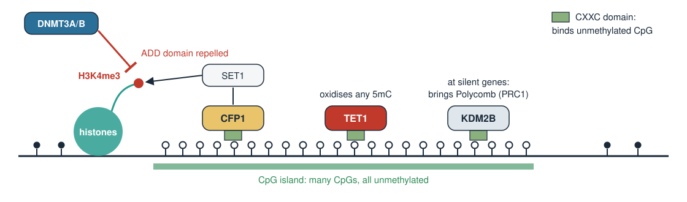{width="95%" fig-align="center"}

- **CXXC-domain** proteins bind unmethylated CpG: CFP1 brings SET1 (→ H3K4me3), TET1 removes stray 5mC, KDM2B brings Polycomb at silent genes.
- H3K4me3 repels the DNMT3 ADD domain, and transcription factors bound at the island block DNMTs.
- A self-reinforcing loop: unmethylated CpGs attract the proteins that keep them unmethylated.

::: notes
CpG islands are about 28 000 in the human genome (27 949 in the UCSC track on the main chromosomes). Their high CpG density is itself a consequence of being unmethylated in the germ line: methylated CpGs mutate to TpG by deamination over evolutionary time (covered in *What is epigenetics?*). Protection uses several redundant mechanisms. CFP1 (CXXC1) is part of the SET1/COMPASS complex that deposits H3K4me3; KDM2B targets PRC1 to islands of silent developmental genes, which is why Polycomb marks (H3K27me3) and unmethylated islands go together. TET1 also has a CXXC domain. Transcription-factor binding (e.g. SP1 sites) was shown to protect islands in transgene experiments in the 1990s. Islands do get methylated in specific cases: on the inactive X, at imprinted genes, at germline-specific genes in somatic cells, and aberrantly in cancer (CIMP).
:::

## Promoter methylation and H3K4me3 exclude each other {.smaller}

:::: {.columns}
::: {.column width="58%"}
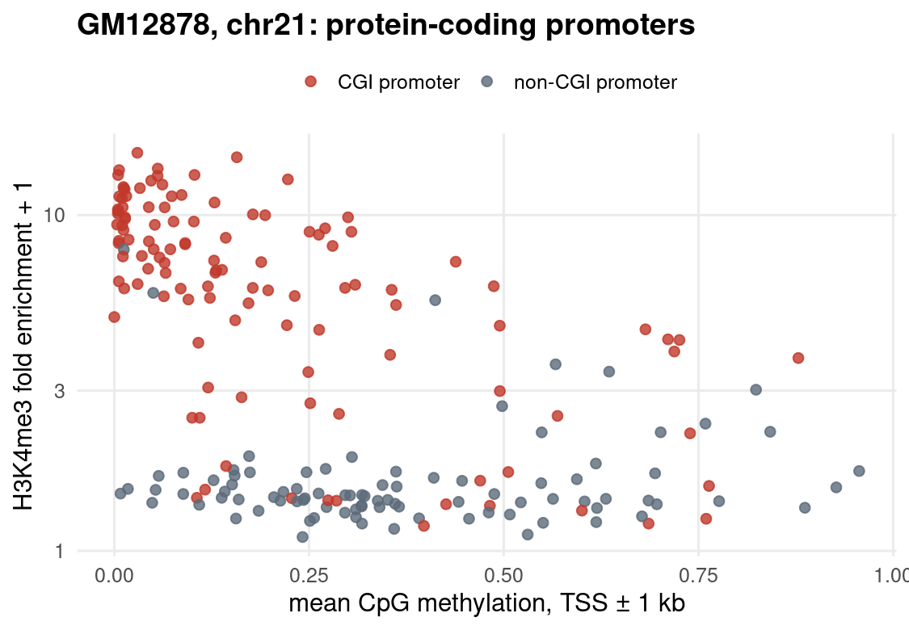{width="100%"}
:::
::: {.column width="42%"}
- 208 chr21 promoters with ≥ 5 covered CpGs (GM12878).
- Spearman correlation of methylation with H3K4me3: **−0.60**.
- 28 promoters with methylation > 0.6: **none** has H3K4me3 enrichment > 5. Of 97 promoters below 0.2, 62 do.
- Non-CGI promoters (grey) rarely carry strong H3K4me3, methylated or not.
:::
::::

::: notes
This plot combines two course datasets: the WGBS calls and the H3K4me3 fold-enrichment bigWig from ENCODE used since *What is epigenetics?*. The upper-left cluster is the classic active CGI promoter: unmethylated and marked. The empty upper-right corner is the mutual exclusion. Unmethylated promoters without H3K4me3 also exist (lower left): silent CGI promoters marked by Polycomb, or inactive non-CGI promoters. The exclusion is consistent with the mechanisms of the last two slides, but this plot alone cannot say which comes first; experiments that methylate a promoter artificially (CRISPR-dCas9-DNMT3A) show that methylation can remove H3K4me3, and experiments that force transcription show the reverse.
:::

## Gene bodies of active genes are methylated {.smaller}

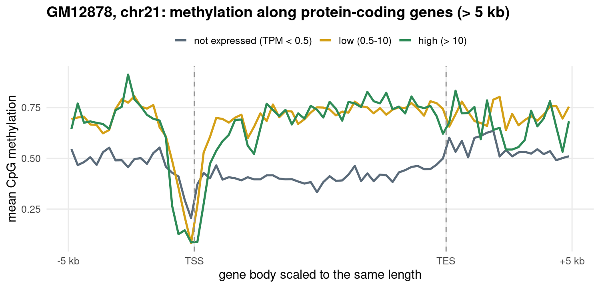{width="92%" fig-align="center"}

- Methylation dips at the TSS, more deeply for expressed genes, and is **high along the body of expressed genes** (about 0.73) but not of silent ones (0.42).
- Mechanism: H3K36me3 from elongation recruits DNMT3B. Gene-body methylation suppresses spurious transcription from inside genes.
- Correlation is **positive** in the body and **negative** at the promoter: "methylation = silencing" is only true at promoters.

::: notes
GM12878 RNA-seq (ENCODE total RNA, TPM) splits the 155 chr21 protein-coding genes longer than 5 kb into silent, low and high. Body methylation in the plot is the mean of all CpGs in bins 8–40 (excluding the region near the TSS); per gene, excluding the first 2 kb, the means are 0.82–0.84 for expressed and 0.46 for silent genes (exercise R5). The Spearman correlation between body methylation and expression across genes is +0.69 in the exercise (R5). The silent genes are low partly because many of them sit in partially methylated domains, which are gene-poor and inactive. Neri et al. 2017 showed in mouse ES cells that DNMT3B-dependent gene-body methylation prevents cryptic transcription initiation inside genes. In plants, CG-only gene-body methylation of moderately expressed genes is also common; its function is debated. This is a good place to stress the general lesson for interpreting methylation data: the sign of the correlation with expression depends on where you look.
:::

## One locus: an active gene next to silent ones {.smaller}

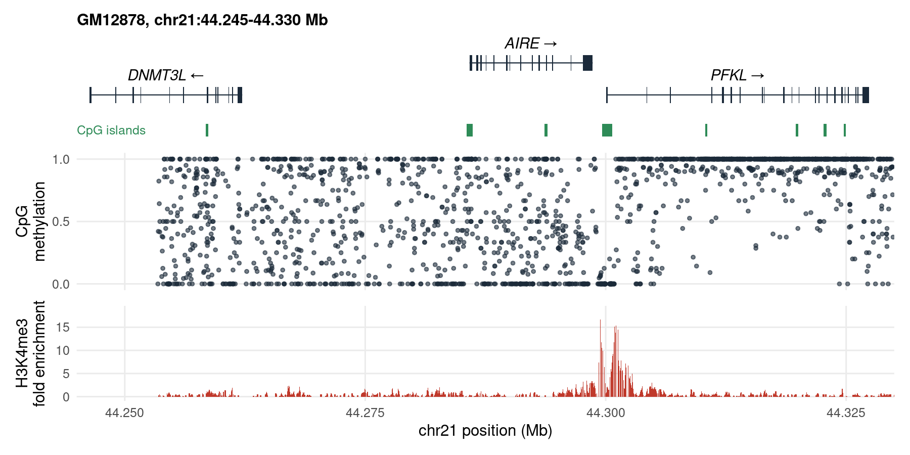{width="88%" fig-align="center"}

- *PFKL* (expressed, TPM 26): unmethylated CGI promoter with H3K4me3, highly methylated gene body.
- *AIRE* and *DNMT3L* (not expressed in B cells): scattered, intermediate values: a partially methylated domain.

::: notes
A genome-browser view built from the same three data types (chr21:44.245–44.330 Mb; per-CpG methylation with at least 5 reads). Each dot is one CpG. Note how noisy single CpGs are at 10–20 reads: a CpG at 0.5 may be 7 of 14 reads. Two patterns sit side by side: the sharp, unmethylated promoter island of PFKL with the H3K4me3 peak, and a fully methylated body to the right; and on the left a stretch where every CpG has some intermediate value. AIRE is expressed in thymic epithelium and DNMT3L in germ cells and early embryo, so neither is active here. The AIRE promoter island is not cleanly unmethylated: islands inside PMDs can gain partial methylation in culture and in cancer.
:::

## Partially methylated domains {.smaller}

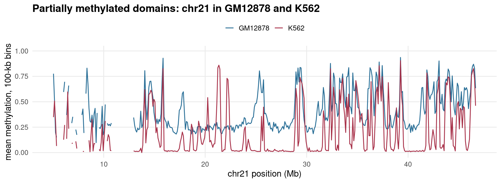{width="92%" fig-align="center"}

- **PMDs**: domains of 100 kb to several Mb where CpGs are partially and variably methylated. Common in cultured cells, cancers and placenta.
- They are **late-replicating, lamina-associated, gene-poor** heterochromatin. In K562, 203 of 374 bins on chr21 are below 0.1; the same bins are at 0.32 in GM12878 (0.52 elsewhere).
- Genes in these domains are mostly silent: 7% expressed in GM12878, vs 68% elsewhere.

::: notes
PMDs were discovered in the first human base-resolution methylomes (Lister et al. 2009, fibroblasts vs ES cells). The current explanation (Zhou et al. 2018): in late-replicating heterochromatin, maintenance is less efficient, so methylation is lost slowly with every division; CpGs flanked by A/T ("solo-WCGW") lose most. PMD depth therefore records a cell's mitotic history: cancers and long-term cell lines have deep PMDs, short-lived tissues shallow ones. K562 is an extreme case, near 0 in large domains; GM12878 has milder, EBV-associated hypomethylated blocks (Hansen et al. 2014). For analysis this matters: differences between samples are dominated by PMDs (see *Differential methylation*), and a "global hypomethylation" of cancer is mostly PMD loss. The CGIs inside PMDs, by contrast, tend to gain methylation in cancer.
:::

## Methylation and DNA-binding proteins {.smaller}

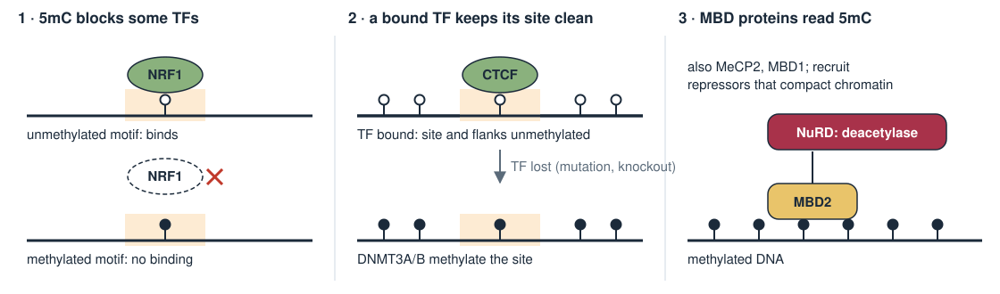{width="95%" fig-align="center"}

- Many TFs (CTCF, NRF1, MYC/MAX and other bHLH, ETS) **cannot bind** a methylated CpG in their motif; a few (some homeodomain, POU) **prefer** it.
- Binding works the other way too: a bound TF keeps its site unmethylated; lose the TF and the site is methylated.
- **Methyl-CpG binding proteins** (MeCP2, MBD1, MBD2) read 5mC and recruit repressors such as NuRD.

::: notes
Two landmark studies. Domcke et al. 2015 (key paper): NRF1 binds only unmethylated motifs; in mouse ES cells lacking all three DNMTs, NRF1 occupies thousands of new sites, and many of them are re-methylated when DNMTs are restored and NRF1 is lost. Methylation therefore restricts where a methyl-sensitive TF can bind, and TFs shape methylation. Yin et al. 2017 tested hundreds of human TFs in vitro: many are inhibited by mCpG, and a subset prefers it. Most TFs whose motifs contain no CpG are indifferent. Low-methylated regions (LMRs) at distal enhancers are "footprints" of TF binding (Stadler et al. 2011). MeCP2 is mutated in Rett syndrome; MBD2 is part of the NuRD deacetylase complex; MBD4 is a glycosylase that repairs T:G mismatches from 5mC deamination. CTCF is the methyl-sensitive TF of the imprinting slide next.
:::

## Does methylation silence genes, or follow silencing? {.smaller}

- **Follows**: at many CGI promoters, methylation comes *after* silencing by other means (X inactivation, Polycomb in cancer); de novo enzymes need H3K4 to be unmethylated.
- **Causes**: methylating a CGI promoter with **dCas9-DNMT3A** (with KRAB, as in CRISPRoff) silences it, and the silence can persist through many divisions after the editor is gone.
- **Locks**: once a CGI is methylated, re-activation needs DNA demethylation (DNMT inhibitors such as decitabine, or TET).
- So: methylation is a **stabiliser** of a silent state more often than its first cause.

::: notes
No figure: this is the conceptual slide that ties the data slides together. Evidence for "follows": on the inactive X, CGI methylation is the last step (next slides); in cancer, genes that become hypermethylated are often Polycomb targets that were already silent in the normal tissue. Evidence for "causes": targeted methylation experiments; the CRISPRoff system (Nuñez et al. 2021) combines DNMT3A, DNMT3L and a KRAB domain and gives heritable silencing of CGI genes over hundreds of divisions, which shows that the methylated state can be self-sustaining. Evidence for "locks": demethylating drugs (5-azacytidine, decitabine) reactivate silenced genes and are used to treat myelodysplastic syndrome. In correlation-only data, like the scatter plot two slides back, none of these can be distinguished: say "associated with", not "causes".
:::

## Imprinting: the H19/IGF2 switch {.smaller}

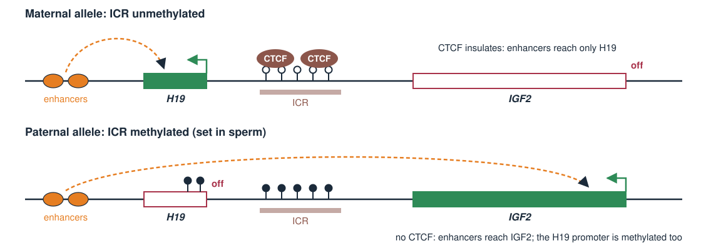{width="95%" fig-align="center"}

- The ICR between *H19* and *IGF2* is methylated on the **paternal** allele only (set in sperm).
- On the maternal allele, **CTCF** binds the unmethylated ICR and insulates *IGF2*: shared enhancers activate *H19*.
- On the paternal allele, methylation blocks CTCF: the enhancers reach *IGF2*, the growth factor.

::: notes
The textbook example, worked out in two back-to-back papers (Bell & Felsenfeld 2000; Hark et al. 2000; key paper). Both genes are on the minus strand of chr11p15.5 and the drawing keeps genome orientation (coordinates increasing to the right, genes pointing left). The enhancers downstream of H19 are shared; CTCF bound at the unmethylated maternal ICR creates an insulator (in today's terms, a CTCF-anchored loop that separates IGF2 from the enhancers; *3D genome organisation*). On the paternal allele the ICR and, secondarily, the H19 promoter are methylated, so H19 is silent and IGF2 is expressed. One CpG-methylation difference, read by one methyl-sensitive protein, decides which parent's gene is used.
:::

## Imprinting in disease {.smaller}

| disorder | locus | typical defect | effect |
|--------|-----|--------------|----------|
| Beckwith–Wiedemann | 11p15.5 | loss of methylation at the *KCNQ1OT1* ICR; gain at the *H19/IGF2* ICR on the maternal allele; paternal UPD | overgrowth (two active *IGF2* copies), tumour risk |
| Silver–Russell | 11p15.5 | loss of methylation at the *H19/IGF2* ICR on the paternal allele; maternal UPD7 | growth restriction (*IGF2* low) |
| Prader–Willi | 15q11–q13 | paternal deletion, maternal UPD, imprinting defect | no paternal expression of *SNORD116* etc. |
| Angelman | 15q11–q13 | maternal deletion, paternal UPD, *UBE3A* mutation | no maternal *UBE3A* in neurons |

- About 100–200 imprinted genes in mouse and human, mostly in ~25–35 clusters, each controlled by one germline ICR.
- **UPD** (uniparental disomy): both copies from one parent. Normal sequence, wrong imprint.

::: notes
A table rather than a figure. These disorders show that imprinting is dosage-critical. Opposite methylation defects at the same ICR give opposite phenotypes: gain at the H19/IGF2 ICR (both alleles look paternal, IGF2 doubled) gives overgrowth; loss (both alleles look maternal) gives growth restriction. Prader–Willi and Angelman syndromes come from the same deletion inherited from different parents, the classic demonstration that the two parental genomes are not equivalent. Clinical diagnosis is by methylation testing of the ICR (methylation-specific PCR, MLPA, or arrays: *Methylation arrays*). Assisted reproduction has been associated with a small increase in imprinting disorders; the absolute risk remains low and causality is debated.
:::

## X inactivation: methylation as the late lock {.smaller}

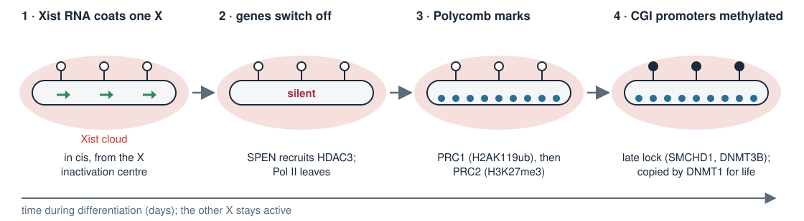{width="95%" fig-align="center"}

- In female cells *Xist* RNA coats one X; genes are silenced, then Polycomb marks the chromosome.
- **CGI promoters on the inactive X become methylated last** (SMCHD1, DNMT3B) and keep it silent in all descendants.
- Without methylation the inactive X can partly reactivate; in culture some genes "erode".

::: notes
The order matters for the cause-or-consequence question: methylation of Xi promoters comes days after silencing in differentiating mouse ES cells, and it is required to keep genes silent long-term, not to silence them initially. The inactive X is otherwise less methylated than the active X outside islands (gene bodies on the Xa are transcribed and methylated). About 15–25% of human X-linked genes escape inactivation to some degree. Mouse and human differ: mouse has imprinted (paternal) X inactivation in extra-embryonic tissues and random inactivation in the embryo; human X inactivation is random from the start of the embryo proper. GM12878 is female, so its chrX would show intermediate (about 0.5) methylation at CGI promoters of X-inactivated genes; our exercise data are chr21 only. A good exam question: what methylation level do you expect at a CGI promoter on chrX in female and male cells?
:::

## Transposons: the oldest job of DNA methylation {.smaller}

- About **45%** of the human genome derives from transposable elements. Most copies are dead, but some L1 and endogenous retrovirus copies can still jump.
- Methylation of their promoters keeps them silent; in somatic cells **KRAB zinc-finger proteins + KAP1 + SETDB1** set H3K9me3 and recruit DNMTs to young copies.
- In the male germ line, **piRNAs** guide de novo methylation of young transposons (via DNMT3C in mouse); without it, transposons are expressed and meiosis fails.
- "Genome defence" may be why DNA methylation evolved; gene regulation came later.

::: notes
No figure; this slide connects mammals to plants. Yoder, Walsh & Bestor (1997) proposed that methylation evolved to suppress parasitic DNA; most methylated CpGs in a mammalian genome are in repeats. Evidence: Dnmt1 mutant embryos express IAP retrotransposons strongly; in mice lacking piRNA pathway components or DNMT3C, young L1s and IAPs are demethylated in spermatogonia and spermatogenesis arrests. The KRAB-ZFP family expanded in step with the transposons it silences, an arms race. In cancers with deep PMDs, transposon promoters can become active and create new transcripts. Plants rely even more heavily on methylation to silence transposons, which is the topic of the next three slides.
:::

## Plants methylate three contexts {.smaller}

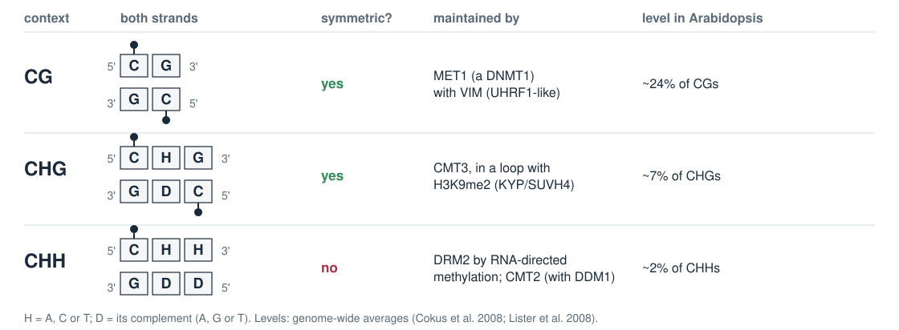{width="92%" fig-align="center"}

- **CG** is copied like in mammals (MET1). **CHG** is maintained by CMT3 in a loop with H3K9me2. **CHH** is asymmetric: there is no template, so it is re-made every cell cycle.
- Transposons are methylated in all three contexts; gene bodies of many genes in CG only.

::: notes
Arabidopsis numbers from the first plant methylomes (Cokus et al. 2008; Lister et al. 2008): about 24% of CG, 7% of CHG and 2% of CHH sites methylated genome-wide; transposons are much higher. The CHG loop: CMT3 binds H3K9me2 through its BAH and chromo domains and methylates CHG; the H3K9 methyltransferase KRYPTONITE (KYP/SUVH4) binds methylated CHG through its SRA domain and makes H3K9me2. Each mark recruits the writer of the other. CHH has two routes: CMT2 at long transposons in pericentromeric heterochromatin (with the remodeller DDM1, which lets the enzymes reach H1-containing chromatin; Zemach et al. 2013), and DRM2 via RNA-directed DNA methylation at short transposons and transposon edges in euchromatin. The bisulfite unit shows that non-CG methylation is why plant analyses must report all three contexts, while mammalian analyses use CHH as a conversion control.
:::

## RNA-directed DNA methylation (RdDM) {.smaller}

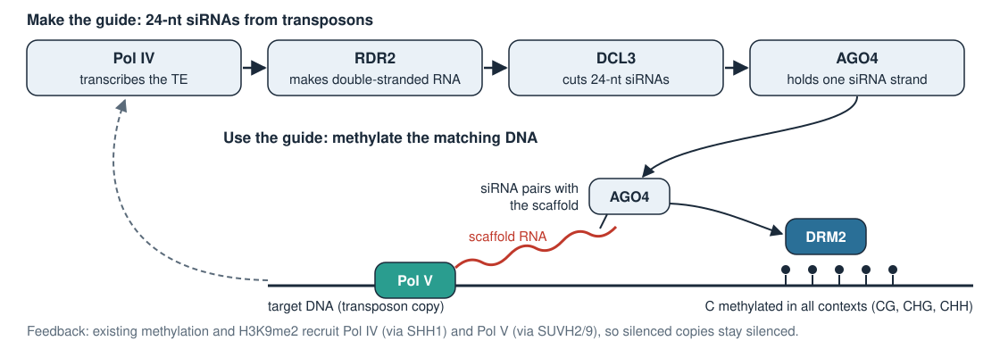{width="95%" fig-align="center"}

- **Pol IV** transcripts → **RDR2** → **DCL3** → 24-nt siRNAs loaded into **AGO4**.
- **Pol V** makes a scaffold RNA at the target; AGO4 pairs with it and recruits **DRM2**, which methylates C in every context.
- Existing methylation recruits Pol IV and Pol V again: a sequence-guided, self-reinforcing silencing system.

::: notes
RdDM is the plant pathway that has no exact mammalian counterpart, although piRNA-guided methylation in the mouse male germ line is analogous: in both, small RNAs provide sequence specificity for de novo methylation of transposons. Pol IV and Pol V are plant-specific RNA polymerases derived from Pol II. SHH1 recruits Pol IV to chromatin with H3K9me2 and unmethylated H3K4; SUVH2/9 bind methylated DNA and recruit Pol V. RdDM can also act in trans: siRNAs from one copy can silence other copies, including transgenes, which is how RdDM was discovered (Matzke and colleagues, in tobacco). Review: Matzke & Mosher 2014; broader comparison of plants and animals in Law & Jacobsen 2010 (key paper).
:::

## Plants: active demethylation and epialleles {.smaller}

- Plants remove 5mC directly: the DNA glycosylases **ROS1**, **DME**, DML2/3 excise it and repair fills in C.
- **DME** demethylates the maternal genome in the endosperm: the basis of plant imprinting (*MEA*, *FWA*).
- Plants do **not** erase their methylome in every generation the way mammals do, so methylation states (**epialleles**) can be inherited for many generations.
- Examples: the peloric *Linaria* flower (a methylated *CYCLOIDEA* gene); natural methylation variation among 1001 Arabidopsis accessions.

::: notes
No figure. This is where plants and mammals differ most for inheritance: CG methylation is largely maintained through plant meiosis and gametogenesis; only partial reprogramming happens in companion cells of the gametes (vegetative nucleus, central cell). Linnaeus described the peloric (radially symmetric) toadflax in 1744; Cubas, Vincent & Coen (1999) showed it is caused by heritable hypermethylation of the Lcyc gene, with no sequence change, and that it occasionally reverts. The 1001 Epigenomes project (Kawakatsu et al. 2016) mapped methylation in hundreds of natural Arabidopsis accessions and found both genetically and epigenetically driven variation. Plant research at Umeå (Arabidopsis, aspen, spruce) builds on these mechanisms; trees are long-lived and clonally propagated, which makes questions of epigenetic memory especially relevant. Whether epialleles drive adaptation is debated: see *Epigenetic inheritance: what is really shown?*.
:::

## 5mC across the tree of life {.smaller}

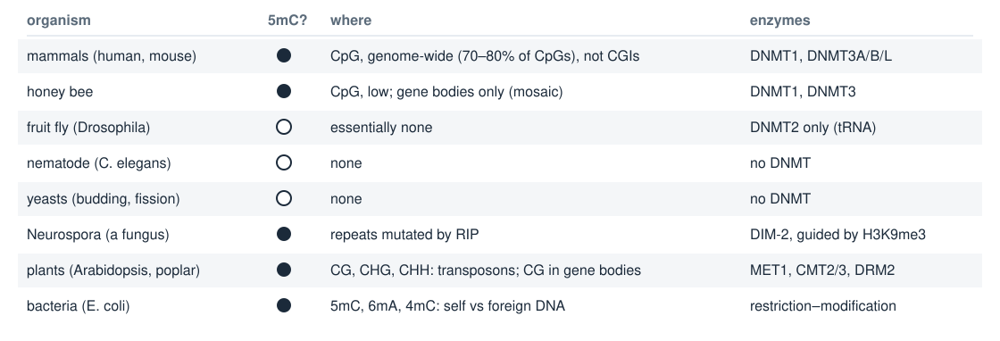{width="92%" fig-align="center"}

- DNA methylation is ancient (bacteria use it to mark their own DNA) but has been **lost many times**: fruit flies, *C. elegans* and yeasts have essentially none.
- Patterns differ: vertebrates methylate almost the whole genome; most invertebrates only gene bodies; plants and fungi target transposons and repeats.

::: notes
Model organisms without DNA methylation are a reminder that heritable gene silencing does not require it: flies and worms use Polycomb, H3K9 methylation and small RNAs. Fruit flies have DNMT2, which methylates tRNA, not DNA. In bacteria, restriction–modification systems methylate the host's own DNA (5mC, N6-methyladenine, N4-methylcytosine) so that a restriction enzyme cuts only foreign DNA; E. coli Dam (GATC, 6mA) also marks the old strand for mismatch repair. Claims of 6mA as a widespread mark in animals have been contested, often traced to bacterial contamination or antibody artefacts; it is well established in some unicellular eukaryotes. The honey bee is a popular example of gene-body-only methylation; a knockdown of Dnmt3 was reported to bias larvae towards queen development (Kucharski et al. 2008), but the role of methylation in caste remains debated.
:::

## Summary {.smaller}

| idea | key fact |
|-----|--------------------|
| writers | DNMT1 maintains (with UHRF1); DNMT3A/3B write de novo, reading H3K36me2/3 and unmethylated H3K4 |
| erasers | passive dilution at replication; active: TET oxidation → TDG → repair. 5hmC reads as C in bisulfite data |
| reprogramming | two waves: early embryo (imprints protected by ZFP57/KAP1) and germ line (imprints erased and reset) |
| landscape | bimodal; CGI promoters unmethylated with H3K4me3; active gene bodies methylated |
| PMDs | large, late-replicating domains that lose methylation with divisions; deep in K562, mild in GM12878 |
| TFs | many TFs cannot bind methylated motifs; bound TFs keep sites unmethylated; MBD proteins read 5mC |
| imprinting | ICR methylation on one parental allele; H19/IGF2: CTCF insulator; disease from UPD or ICR defects |
| X inactivation | CGI methylation is a late lock after Xist and Polycomb |
| plants | CG, CHG, CHH; MET1, CMT3/CMT2, DRM2 via RdDM; glycosylases remove 5mC; epialleles can be inherited |

::: notes
Students should leave able to: name the writers and erasers and say what each does; explain passive dilution with a calculation; draw the two waves of reprogramming and say where imprints survive; read a methylation-vs-context plot and a browser view; explain why CGI promoters are unmethylated and gene bodies methylated; explain the H19/IGF2 switch; contrast plant and mammalian methylation. Next: *Bisulfite and enzymatic sequencing (WGBS, RRBS, EM-seq)*, which makes the data behind every plot today.
:::

## Key papers (optional further reading) {.smaller}

*Not required reading and not examined. For those who want the primary literature.*

- Okano et al. 1999, *Cell*. [DNA methyltransferases Dnmt3a and Dnmt3b are essential for de novo methylation and mammalian development](https://doi.org/10.1016/S0092-8674(00)81656-6). The de novo enzymes.
- Tahiliani et al. 2009, *Science*. [Conversion of 5-methylcytosine to 5-hydroxymethylcytosine in mammalian DNA by MLL partner TET1](https://doi.org/10.1126/science.1170116). TET oxidation, the start of active demethylation.
- Bell & Felsenfeld 2000, *Nature*. [Methylation of a CTCF-dependent boundary controls imprinted expression of the Igf2 gene](https://doi.org/10.1038/35013100). The H19/IGF2 switch.
- Domcke et al. 2015, *Nature*. [Competition between DNA methylation and transcription factors determines binding of NRF1](https://doi.org/10.1038/nature16462). Methylation and TF binding, both directions.
- Smith & Meissner 2013, *Nat Rev Genet*. [DNA methylation: roles in mammalian development](https://doi.org/10.1038/nrg3354). Review: reprogramming waves and the landscape.
- Law & Jacobsen 2010, *Nat Rev Genet*. [Establishing, maintaining and modifying DNA methylation patterns in plants and animals](https://doi.org/10.1038/nrg2719). Review: plants and animals side by side.
