## About this lecture

*DNA methylation biology* showed per-CpG methylation levels of GM12878. This lecture shows how such numbers are made, and what can go wrong on the way.

- **Bisulfite chemistry**: unmethylated C becomes T; 5mC (and 5hmC) stay C.
- **Libraries and alignment**: four strands, directional libraries, alignment in a three-letter alphabet with **Bismark**.
- **Quality control**: M-bias, conversion efficiency, duplicates, coverage.
- From reads to **per-CpG calls**, and how they compare with ENCODE's.
- **Pitfalls**: SNPs that look like unmethylated CpGs.
- The alternatives: **RRBS**, **EM-seq**, **TAPS**, and where arrays and long reads fit.

::: notes
This is the processing unit of the methylation block, the counterpart of *From reads to coverage for enrichment assays* for ChIP and ATAC. Everything shown on the real-data slides comes from the exercise: 360 142 reads from ENCODE's GM12878 whole-genome bisulfite sequencing (WGBS), the reads that ENCODE aligned to a 2 Mb region of chr21, processed end to end with fastp and Bismark in about five minutes. The general logic (trim, align, deduplicate, count) is the one students know from enrichment assays; spend the time on what is different: the chemistry, the three-letter alignment, and the QC plots specific to bisulfite.
:::

## 5mC is invisible to sequencing {.smaller}

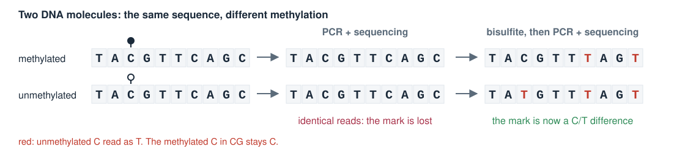{width="92%" fig-align="center"}

- Polymerases copy 5mC as C, and sequencers read it as C: the methylation of a molecule is lost in PCR and in sequencing.
- Either turn methylation into a **sequence difference** first (bisulfite, enzymes), or read the **native molecule** (nanopore, PacBio: *Methylation and chromatin from long reads*).
- Older methods used methylation-sensitive restriction enzymes or antibodies against 5mC (MeDIP); they give regional, not single-base, information.

::: notes
The problem in one picture. The two molecules have the same sequence and differ only in the methyl group at one CpG; after PCR the information is gone. After bisulfite treatment the unmethylated molecule has a T where the methylated one keeps a C. Methylation-sensitive restriction (HpaII vs its methylation-insensitive isoschizomer MspI) was the first genome-scale approach; MeDIP (immunoprecipitation with an anti-5mC antibody) is like ChIP for methylated DNA and was used before WGBS became affordable. Both survive in niche uses; WGBS is the reference method, arrays are the workhorse of population studies (*Methylation arrays*).
:::

## Bisulfite chemistry {.smaller}

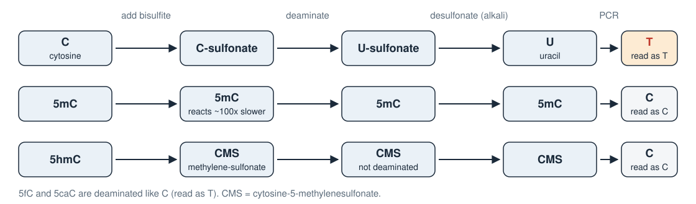{width="95%" fig-align="center"}

- Bisulfite adds to C; the adduct **deaminates** to uracil-sulfonate; alkali removes the sulfonate; PCR copies U as **T**.
- 5mC reacts about 100 times more slowly and stays C. 5hmC forms a stable adduct (CMS) and also reads as C.
- Harsh conditions (low pH, heat, hours): most of the DNA is fragmented and lost, and conversion must be **> 99%** to be useful.

::: notes
Frommer et al. 1992 (key paper) introduced bisulfite genomic sequencing. Conditions differ between kits, but typically DNA is denatured and incubated with sodium bisulfite at pH 5 and 50–65 °C for hours. The damage is real: depurination and strand breaks destroy 80–95% of input DNA, which is why bisulfite libraries need more input or post-bisulfite adapter tagging (PBAT), and why enzymatic alternatives were developed. Two consequences for data analysis follow from this slide. Incomplete conversion turns unmethylated C into apparent methylation, so it must be measured (conversion slide). And 5hmC is counted as methylated (*DNA methylation biology*); 5fC and 5caC convert like C.
:::

## One molecule, four strands {.smaller}

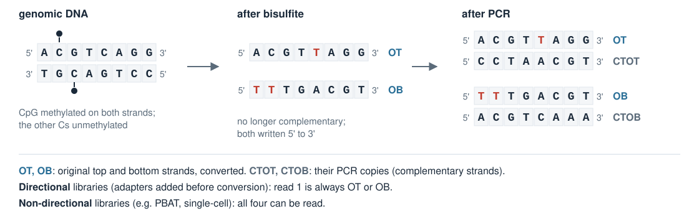{width="92%" fig-align="center"}

- After conversion the two strands are **no longer complementary**: each is its own template.
- PCR makes a complementary copy of each: four possible strands in the library.
- Standard WGBS kits are **directional**: read 1 always comes from OT or OB, which halves the alignment work.

::: notes
This slide explains a choice students will see as a flag in Bismark (--directional, the default, versus --non_directional or --pbat). In a directional library methylated adapters are ligated before bisulfite treatment, so the adapter orientation records which original strand a fragment came from; read 1 reads OT or OB, read 2 reads the complementary strands. In post-bisulfite adapter tagging (PBAT, common in single-cell methods) adapters are added after conversion and all four strands occur. Aligning a non-directional library as directional throws away half the reads. Our exercise reads are read 1 of a directional library: Bismark finds only OT and OB alignments, as expected (158 877 and 157 074).
:::

## Reading a converted read {.smaller}

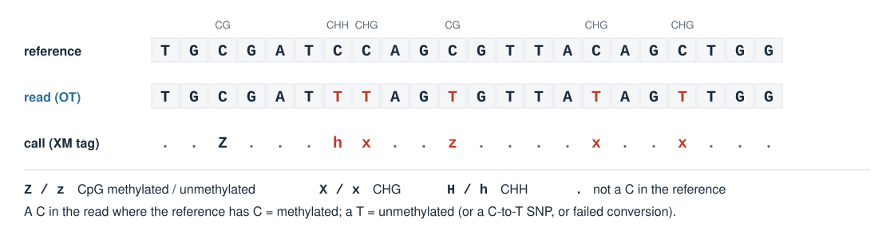{width="95%" fig-align="center"}

- Compare each read with the reference: where the reference has a C, a **C** in the read means **methylated**, a **T** means **unmethylated**.
- Bismark writes one symbol per base in the **XM** tag of the BAM file; upper case = methylated.
- The level of a CpG is the fraction of reads with C: $\beta = M / (M + U)$.

::: notes
This is the core of every by-hand question in this unit: given a reference and some aligned reads, count C and T at each CpG. The XM string is a compact record of every call in a read: z/Z for CpG, x/X for CHG, h/H for CHH, u/U for unknown context, a dot for non-C positions. Note that a T can also be a C-to-T SNP or a sequencing error, and a C at a non-CpG position is usually a failure of conversion rather than methylation in mammals. For reads from the bottom strand (OB), the comparison is done on the bottom strand: Bismark handles that and reports the call at the genomic position.
:::

## Bisulfite reads look strange {.smaller}

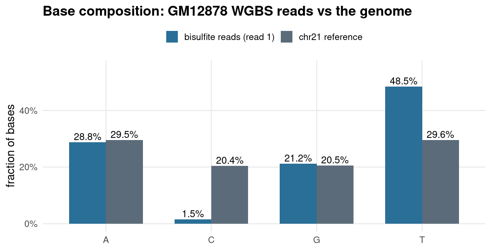{width="80%" fig-align="center"}

- Our 360 142 reads (GM12878, read 1): **1.5% C** and **48.5% T**, against 20.4% C and 29.6% T in the genome.
- Almost all remaining Cs are in CpG context: the methylated ones.
- Low complexity breaks normal tools: quality metrics complain, and a normal aligner sees many mismatches.

::: notes
A quick check that every student should do on any bisulfite FASTQ (exercise C1). Read 1 of a directional library comes from OT or OB, which are both C-depleted; G content stays near the genome's. Read 2 would show the complement: few G, many A. If a "bisulfite" FASTQ has normal base composition, it was not converted, or it is read 2 of the complementary strands. FastQC flags these libraries as failing per-base content; that is expected. The low complexity also means that fewer reads align uniquely than in a normal library: two regions that differ only at C positions become identical after conversion.
:::

## Alignment in three letters {.smaller}

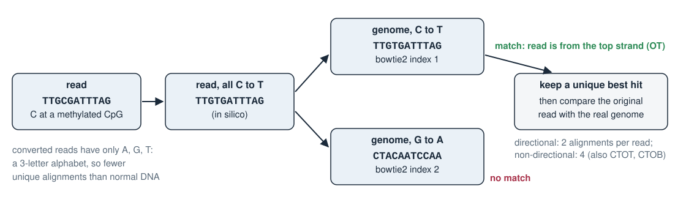{width="95%" fig-align="center"}

- Convert all C to T in the read, and make two converted copies of the genome (C→T and G→A).
- Align with a normal aligner (bowtie2) to both; keep the read only if it has a **unique best** alignment.
- Then compare the *original* read with the *original* genome to call methylation.

::: notes
This is the Bismark strategy (Krueger & Andrews 2011, key paper). By converting both sides, methylation no longer causes mismatches, so the aligner is unbiased between methylated and unmethylated reads. The cost is a reduced alphabet, more multi-mapping reads, and twice the index (two converted genomes; four alignments for non-directional libraries). An alternative family of aligners (bwa-meth, BSMAP, gemBS which ENCODE used for these data) use similar in-silico conversion with different aligners or seeding tricks. bwa-meth is often faster and maps a few % more reads; in practice results are very similar, as the comparison with ENCODE later in this lecture shows.
:::

## Bismark: from FASTQ to per-CpG calls

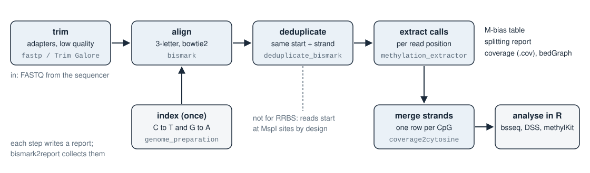{width="78%" fig-align="center"}

```bash
bismark_genome_preparation genome                  # once per genome
bismark --genome genome trimmed.fastq.gz
deduplicate_bismark --bam trimmed_bismark_bt2.bam
bismark_methylation_extractor --gzip --bedGraph trimmed_bismark_bt2.deduplicated.bam
coverage2cytosine --merge_CpG --genome_folder genome -o gm_cpg *.bismark.cov.gz
```

::: notes
The whole exercise pipeline. Run times on 8 server threads for our 360 000 reads: index 48 s, alignment 59 s, deduplication 11 s, extraction 26 s, strand merging 69 s; a laptop is two to three times slower. A full human WGBS sample (300–600 million read pairs) takes one to two days on a node with Bismark, which is why production pipelines (later slide) parallelise over chunks. The extractor writes one file per context and strand, an M-bias table, a splitting report with conversion statistics, and a coverage file (chromosome, position, % methylated, count methylated, count unmethylated). coverage2cytosine with --merge_CpG adds up the two strands of each CpG. The trimming step comes first and is shown in the exercise (fastp with the Illumina adapter).
:::

## What happened to our reads {.smaller}

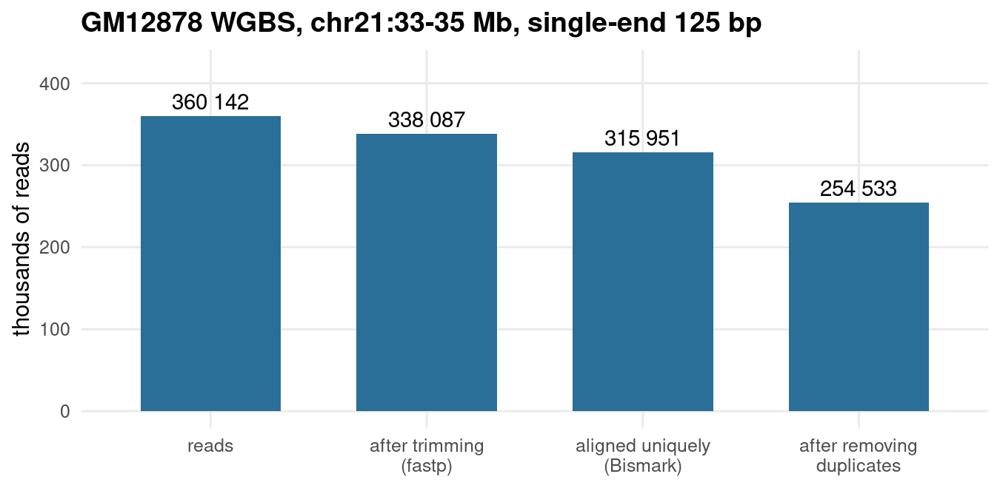{width="72%" fig-align="center"}

- fastp removed 6% (low quality), and trimmed adapters from 36 808 reads.
- Bismark aligned **93.5%** uniquely; only 379 reads were ambiguous.
- **19.4%** were duplicates (same start and strand); 254 533 reads remain.

::: notes
Honesty about the shortcut: 93.5% is much higher than a real WGBS library (typically 60–80% unique alignment to the whole genome), because these reads were selected as the ones ENCODE had already aligned to this region, and we align them to chr21 only. Reads from elsewhere in the genome are not in our file, so they cannot mis-align to chr21; in a real analysis always align to the whole genome. The duplicate rate is also inflated: the region is small and deeply covered, so independent fragments share start positions by chance more often than across the whole genome. The 21 757 reads with no alignment are reads that ENCODE's aligner (GEM3) placed, often with MAPQ 0, but bowtie2 under Bismark's stricter scoring did not.
:::

## Duplicates {.smaller}

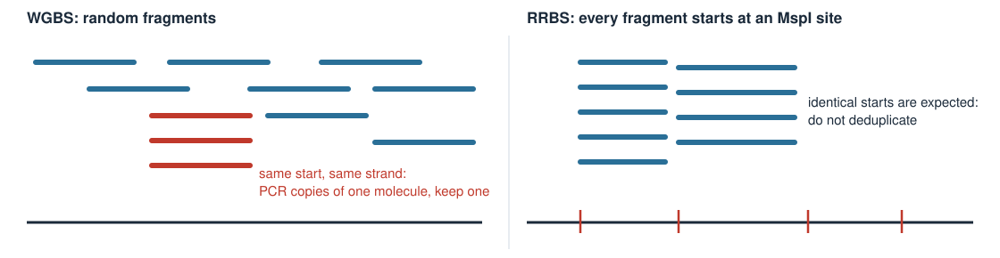{width="92%" fig-align="center"}

- In **WGBS**, reads with the same start and strand are probably PCR copies of one molecule: keep one (`deduplicate_bismark`).
- In **RRBS** (and amplicon methods), fragments start at the same restriction site by design: **do not** deduplicate.
- Duplicates inflate coverage without adding information: a CpG seen 20 times in one molecule's copies has really one observation.

::: notes
The same logic as in *From reads to coverage for enrichment assays*, with one twist: deduplication matters more for methylation than for coverage tracks, because the statistic is a proportion. Ten PCR copies of one methylated molecule look like ten independent methylated reads and give false confidence (a β of 1 with "20 reads" instead of 2). For paired-end data, both ends define a duplicate, which is more reliable. Unique molecular identifiers (UMIs) solve the RRBS problem in some protocols.
:::

## Where M-bias comes from {.smaller}

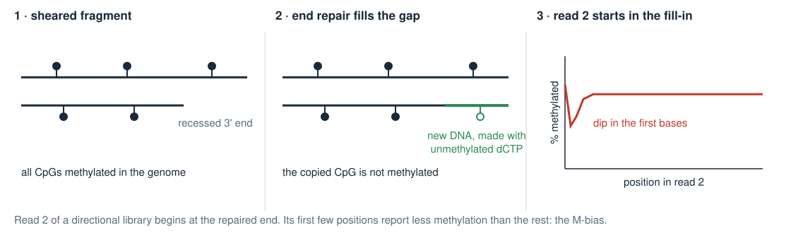{width="95%" fig-align="center"}

- Sheared fragments are **end-repaired** before adapter ligation; the polymerase fills gaps with **unmethylated** dCTP.
- The filled-in bases are read at the start of **read 2**: their CpGs look unmethylated.
- Other read-end artefacts: adapter remnants, random-primer bias (PBAT), low quality at 3' ends.

::: notes
Methylation of a CpG cannot depend on where in the read it is observed, so any trend of methylation along the read is a technical artefact: that is the idea of the M-bias plot (Hansen et al. 2012 introduced it with BSmooth; Bismark computes it). The end-repair artefact is the classic one: fragment ends are blunted by a polymerase that synthesises new DNA, and new DNA is unmethylated; in a directional library this new DNA sits at the start of read 2. The fix is to ignore those positions when calling methylation, not to throw away the reads.
:::

## Reading an M-bias plot {.smaller}

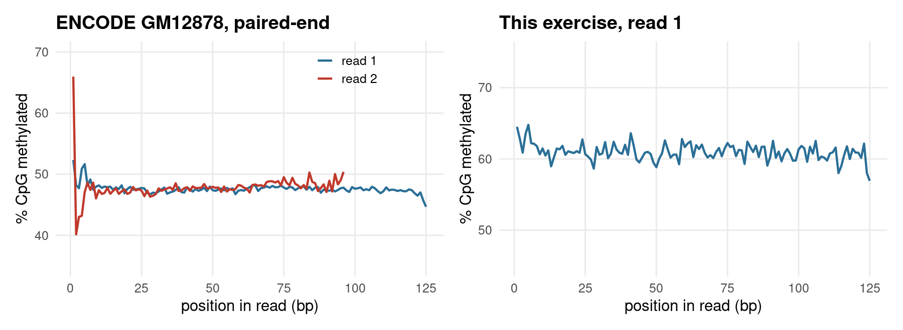{width="95%" fig-align="center"}

- ENCODE paired-end data (left): **read 2** positions 2–4 are at 40–43% vs a plateau of 48%; position 1 jumps to 66%. Read 1 is nearly flat.
- Our single-end read 1 (right): flat at about 61% (this region is more methylated than the genome average).
- Fix: ignore the biased positions at extraction, e.g. `--ignore_r2 4`, and check the plot again.

::: notes
The left plot uses about 3 million random read pairs from ENCODE's older Bismark alignment of the same GM12878 replicate (the first 800 MB of a 121 GB BAM; data file gm12878_wgbs_pe_mbias.txt). The curve of read 2 drops towards the end because few reads are that long after ENCODE's trimming, so the estimate gets noisy. The lesson for reading an M-bias plot: find the plateau, find where the curve departs from it, and ignore those positions in both reads. Typical choices are 2–10 bp at the 5' end of read 2 and sometimes a few at the 3' end of both. Also check the CHH curve: it should be flat near 0; a rise at the read ends signals the same artefact. Do not trim for wiggles in the middle of the read: with few calls per position they are sampling noise, not bias.
:::

## Conversion efficiency {.smaller}

:::: {.columns}
::: {.column width="48%"}
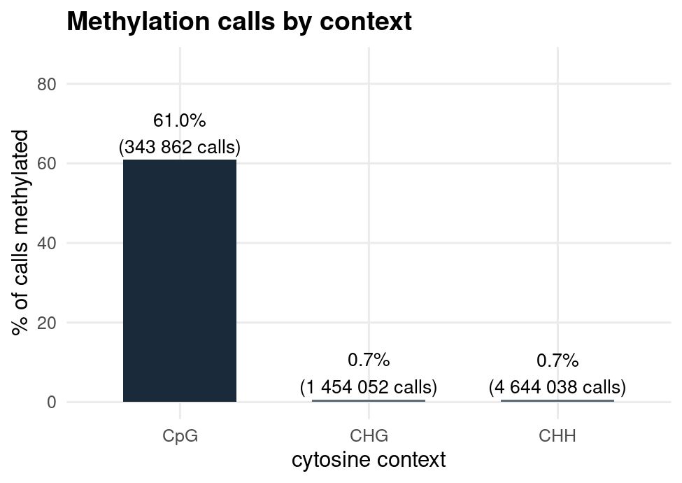{width="100%"}
:::
::: {.column width="52%"}
- In most mammalian cells non-CpG methylation is near 0. So methylated CHH calls measure **failed conversion**: here **0.66%**, a conversion rate of **99.34%**.
- A spike-in of unmethylated **lambda phage** DNA measures it directly, also where CpH methylation is real (neurons, ES cells, plants).
- Effect: an unmethylated CpG appears 0.7% methylated; β = 0.5 appears 0.503. ENCODE requires conversion ≥ 98%.
:::
::::

::: notes
The splitting report gives the numbers: 30 824 methylated of 4 644 038 CHH calls. Incomplete conversion adds a small upward bias to every β: observed = β + (1 − β) × non-conversion rate. At 99.3% this is negligible for most purposes; at 95% (a failed batch) every unmethylated CpG island looks 5% methylated, which can create false differences between batches. Caution: non-CpG methylation is real and abundant in neurons (mCA, written by DNMT3A) and in embryonic stem cells, and of course in plants (CHG, CHH), so there the CHH estimate is not a conversion estimate; use lambda or another unmethylated spike-in. A methylated control (e.g. fully methylated pUC19) checks the opposite error, over-conversion of 5mC.
:::

## Coverage and precision {.smaller}

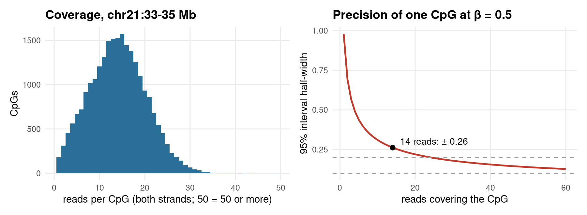{width="95%" fig-align="center"}

- After merging strands, 24 675 CpGs; median **14 reads**, 75% with at least 10.
- With 14 reads a CpG at β = 0.5 has a 95% interval of about **± 0.26**: single CpGs are imprecise.
- Remedies: more depth, more replicates, or averaging neighbouring CpGs (*Differential methylation*).

::: notes
The binomial standard error is sqrt(β(1 − β)/N); at N = 14 and β = 0.5 that is 0.13, so the 95% interval spans about 0.24 to 0.76. ENCODE's standard for WGBS is at least 30x coverage per replicate (both strands combined), which halves the interval width compared with 14 reads. Strand merging is valid for CpGs because they are symmetrically methylated almost everywhere; it doubles the reads per site. Never merge strands for non-CpG contexts. A few CpGs have unusually high coverage (copy number gains, repeats, PCR jackpots); analyses often remove the top 0.1% of coverage.
:::

## Do our calls agree with ENCODE's? {.smaller}

:::: {.columns}
::: {.column width="52%"}
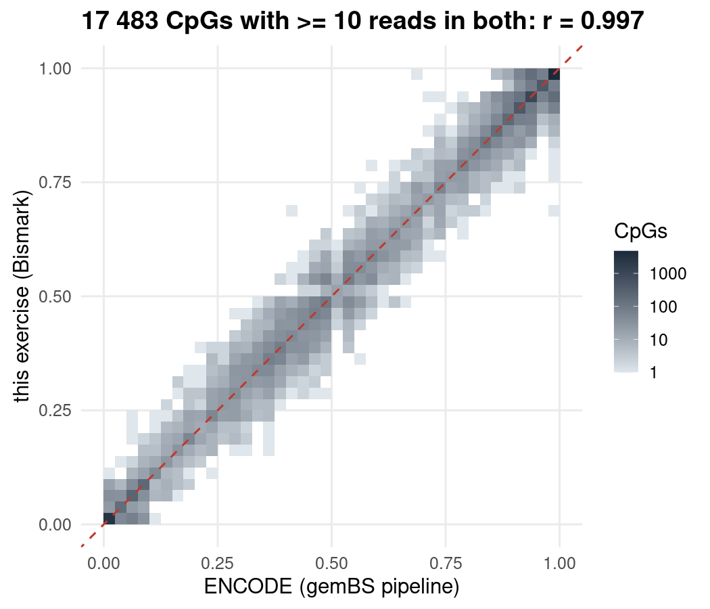{width="100%"}
:::
::: {.column width="48%"}
- Same reads, different pipelines: ENCODE used gemBS (GEM3 aligner, its own caller), we used fastp + Bismark.
- 23 567 CpGs in both; 17 483 with ≥ 10 reads in both: **r = 0.997**, mean \|Δβ\| = **0.016**.
- Only 28% of CpGs have identical counts: trimming, duplicate removal and alignment filters differ slightly.
:::
::::

::: notes
A reassuring and realistic result: pipelines agree closely on well-covered CpGs, and differences come from details (which reads were filtered as low quality, which duplicates were removed, how soft-clipped ends and MAPQ 0 reads are treated, how the first and last bases are used). Mean read coverage is nearly the same (13.9 vs 14.2 per CpG). The comparison is fair because ENCODE's per-CpG file for this replicate was made from the same read-1 FASTQ. In a methods section, say which pipeline and which filters you used, and do not mix calls from different pipelines in one differential analysis without checking for a pipeline effect.
:::

## SNPs at CpGs look like unmethylated Cs {.smaller}

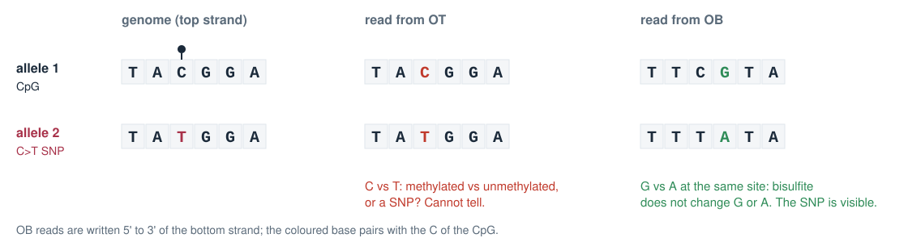{width="95%" fig-align="center"}

- On the strand with the C, a **C→T SNP** gives exactly the same read as an unmethylated C.
- On the **other strand** the same site is G vs A, which bisulfite does not change: the genotype is visible there.
- Tools that use both strands can call SNPs and methylation together (Bis-SNP, gemBS, BISCUIT).

::: notes
This is the most important bisulfite-specific pitfall for differential analyses between individuals: a CpG that carries a C/T SNP in some people looks partially or fully unmethylated in them, and appears as a "differentially methylated" site that is really a genotype difference. CpG-SNPs are common because CpG is the most mutable dinucleotide in the genome. Practical remedies: remove CpGs that overlap known SNPs (dbSNP above some frequency) or that are called as SNPs in the samples themselves (ENCODE's gemBS output contains the genotype; column 13 of our per-CpG file); for arrays, manufacturers flag probes over SNPs (*Methylation arrays*). meQTL studies (*Epigenomics and genetic variation*) deliberately model genotype effects on methylation.
:::

## SNPs in real data {.smaller}

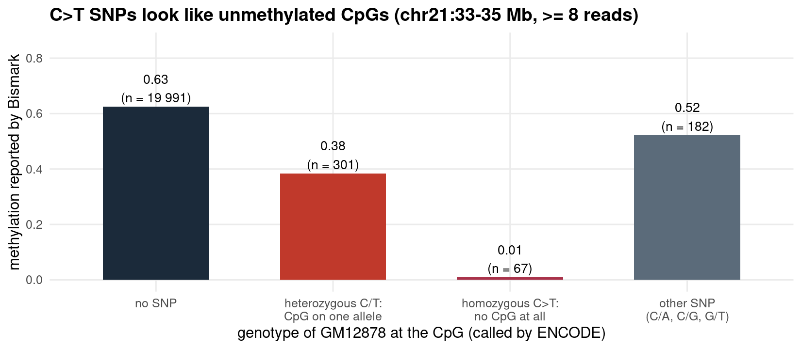{width="90%" fig-align="center"}

- ENCODE called the genotype of GM12878 at every CpG. In our Bismark calls, CpGs with a **heterozygous C/T** SNP average **0.38** (vs 0.63), and **homozygous C>T** sites **0.01**.
- Other SNPs (C/A, C/G, G/T) change the base to one bisulfite cannot produce, so they are seen as mismatches, not as unmethylated.

::: notes
Real numbers from the exercise region (CpGs with at least 8 reads). The homozygous sites are not CpGs in this genome at all: there is no cytosine to methylate, yet a naive analysis reports "unmethylated". The heterozygous sites lose roughly half their methylation signal (0.63 to 0.38; a bit more than half remains because the reference allele reads are unaffected). In a comparison of GM12878 with another person's cells, all these sites would appear as differences. This is exercise R5.
:::

## Reduced representation bisulfite sequencing (RRBS) {.smaller}

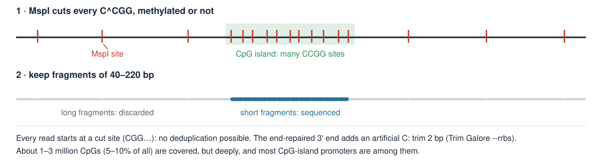{width="95%" fig-align="center"}

- MspI (C^CGG) cuts regardless of methylation; short fragments come from **CpG-dense** DNA: islands and promoters.
- Cheap and deep for 1–3 million CpGs, ideal for many samples; blind to most enhancers, gene bodies and PMDs.
- Analysis differences: Trim Galore `--rrbs`, **no deduplication**, and only regions covered in all samples can be compared.

::: notes
RRBS (Meissner et al. 2005, key paper) enriches CpG-rich sequence with a restriction enzyme whose site contains a CpG; size selection of 40–220 bp keeps the fragments from dense regions. A small fraction of the sequencing cost of WGBS for 5–10% of CpGs, but those include most CpG-island promoters, which is why RRBS was used in many cancer and mouse studies, and in ENCODE's early phase (GM12878 and K562 have RRBS data too). Its main limitations: low coverage of the regulatory regions that differ most between cell types (distal enhancers are CpG-poor), and fragment-start artefacts handled by the --rrbs trimming mode. Enhanced RRBS uses several enzymes for broader coverage.
:::

## EM-seq and TAPS: without bisulfite {.smaller}

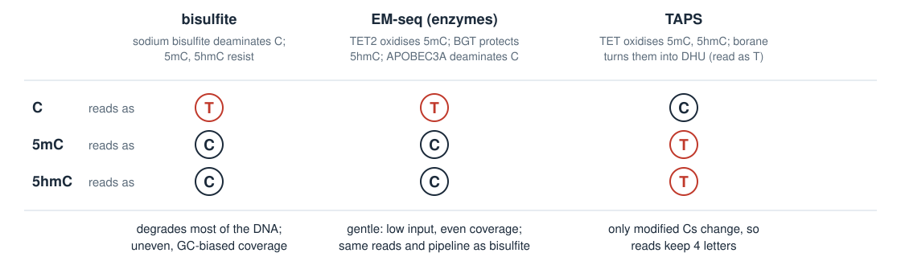{width="95%" fig-align="center"}

- **EM-seq**: TET2 and T4-BGT protect 5mC and 5hmC; APOBEC3A deaminates the unprotected C. Same readout as bisulfite, so the same pipeline (Bismark works unchanged).
- **TAPS**: only modified Cs change (to T). Reads keep four letters: better alignment, less sequencing wasted.
- Both damage DNA much less: lower input, more uniform coverage, fewer duplicates.

::: notes
EM-seq (Vaisvila et al. 2021, key paper) is now widely used where input is limited (cell-free DNA, clinical samples, single cells) and is a drop-in replacement for bisulfite in analysis. TAPS (Liu et al. 2019, key paper) reverses the logic: TET oxidation of 5mC and 5hmC to 5caC, then pyridine borane reduction to dihydrouracil, which polymerases read as T. Because only the 2–5% of cytosines that are modified change, the reads stay close to the reference; variants (TAPSβ, CAPS) separate 5mC from 5hmC. Newer "6-base" methods read A, C, G, T, 5mC and 5hmC in one library. Whatever the chemistry, per-CpG output is the same table of methylated and unmethylated counts.
:::

## Telling 5mC from 5hmC {.smaller}

| method | how | 5mC | 5hmC |
|------|----------------------------|-----|-----|
| bisulfite (BS) | standard | C | C |
| oxidative BS (oxBS) | oxidise 5hmC to 5fC first, then BS | C | **T** |
| TAB-seq | protect 5hmC (glucose), oxidise 5mC with TET, then BS | **T** | C |
| EM-seq / ACE-seq variants | enzymatic, with or without 5hmC protection | C / T | C |
| nanopore, PacBio | direct signal from the native base | 5mC call | 5hmC call (nanopore) |

- **BS − oxBS** estimates 5hmC per CpG (two libraries, so noisy where 5hmC is low).
- In blood and cell lines 5hmC is small; in brain it is not.

::: notes
No figure: a reference table. The subtraction approach needs deep coverage because the 5hmC estimate is the difference of two binomial proportions. TAB-seq gives 5hmC directly but needs very efficient TET oxidation. Long reads call 5mC and (on nanopore) 5hmC from the raw signal with neural-network models; *Methylation and chromatin from long reads* covers them, including haplotype-resolved methylation, which no short-read method gives easily.
:::

## Choosing an assay {.smaller}

| assay | CpGs measured | typical use | cost per sample |
|------|------------------|------------------------------|------|
| WGBS / EM-seq (30x) | ~28 million (all) | reference methylomes, DMRs anywhere, PMDs | high |
| RRBS | 1–3 million, CGI-rich | many samples, promoter methylation | low |
| EPIC array | ~900 000 selected | epidemiology, clinical, clocks | lowest |
| targeted (capture, amplicons) | chosen regions | validation, diagnostics | low |
| nanopore / PacBio | all, on long single molecules | haplotypes, repeats, 5hmC | high |

- More replicates usually beat more depth: biological variation between samples is larger than sampling noise at 10–15x.

::: notes
Help students match questions to assays; it is a classic exam question ("you have 2 ng of cell-free DNA from 200 patients..."). WGBS is the only unbiased method; RRBS and arrays answer most questions about promoters and CpG islands cheaply; arrays dominate population studies (*Methylation arrays*, *Epigenetic clocks and biomarkers*). Ziller et al. (2015, Nat Methods) recommended, for DMR detection, two or more replicates at 5–15x over one deeply sequenced sample, which matches what *Differential methylation* will show about biological variation.
:::

## Per-CpG file formats {.smaller}

| format | columns | from |
|------|--------------------------------------|------|
| Bismark coverage (`.cov`) | chr, start, end, % methylated, count methylated, count unmethylated | `bismark_methylation_extractor` |
| merged CpG evidence | the same, one row per CpG (both strands) | `coverage2cytosine --merge_CpG` |
| CpG report | chr, position, strand, count methylated, count unmethylated, context, trinucleotide | `--cytosine_report` |
| ENCODE bed9+ | BED9 + coverage, % methylated, reference and called context, genotype quality | gemBS (ENCODE4) |
| bedMethyl | BED9 + coverage, % methylated (+ more in modkit's version) | ENCODE3 pipeline, modkit |

- Always check: 0- or 1-based? per strand or per CpG? % or counts? rounded?

::: notes
The format zoo is a practical source of errors. The Bismark coverage file is 1-based and has no strand column; the merged file with --zero_based is BED-like; ENCODE's bed9+ is BED (0-based start) per strand, and the percentage is an integer rounded down, so counts are recovered as round(N × pct / 100), exact for coverage below 50 (*DNA methylation biology* exercise). Most R packages (bsseq, DSS, methylKit) want, for each CpG and sample, the number of methylated reads and the total: everything else is bookkeeping.
:::

## Production pipelines and QC

- **nf-core/methylseq**: trimming, Bismark *or* bwa-meth + MethylDackel, deduplication, M-bias, MultiQC report; runs on SLURM.
- **gemBS** (used by ENCODE for these data), **BISCUIT**: fast, call SNPs and methylation together.
- QC numbers to report: reads, unique alignment rate, duplication, **conversion rate**, **M-bias** decision, mean coverage per CpG, fraction of CpGs ≥ 10x.

```bash
nextflow run nf-core/methylseq -profile singularity --input samples.csv --genome GRCh38 --outdir results
```

::: notes
After doing every step by hand on 360 000 reads, students should know what the pipeline does with 500 million. nf-core/methylseq is the standard: its default aligner is Bismark (as in the exercise); bwa-meth with MethylDackel is a faster alternative that also produces M-bias plots and lets the user set inclusion bounds per read position. The QC list is the bisulfite equivalent of the enrichment-assay QC in *Experimental design and QC for epigenomic assays*. For our exercise: 93.5% unique (inflated by preselection), 19.4% duplicates, 99.34% conversion, no M-bias trimming needed for read 1, median 14 reads per CpG.
:::

## Summary {.smaller}

| idea | key fact |
|-----|--------------------|
| chemistry | bisulfite: C → U → T; 5mC and 5hmC stay C; DNA is degraded |
| libraries | four strands (OT, OB, CTOT, CTOB); directional kits read OT/OB in read 1 |
| alignment | three-letter: C→T reads against C→T and G→A genomes; unique best hit (Bismark) |
| calls | C = methylated, T = unmethylated at a reference C; β = M/(M+U); merge CpG strands |
| M-bias | end repair makes read-2 starts look unmethylated; ignore those positions |
| conversion | CHH methylation (mammals) or lambda spike-in; here 99.34% |
| duplicates | remove in WGBS, keep in RRBS |
| SNPs | C>T at a CpG looks unmethylated; the other strand shows G/A |
| alternatives | RRBS (CpG-rich subset), EM-seq (same readout, gentle), TAPS (modified C → T) |
| this dataset | 360 142 reads → 254 533; median 14x; r = 0.997 with ENCODE |

::: notes
Students should leave able to: convert a sequence by hand (both strands) and call methylation from aligned reads; read an M-bias plot and decide what to ignore; compute conversion efficiency and its effect on β; explain why SNPs and duplicates matter; choose between WGBS, RRBS, EM-seq, arrays and long reads for a given question. Next: *Differential methylation*, which takes per-CpG counts from several samples and asks where they differ.
:::

## Key papers (optional further reading) {.smaller}

*Not required reading and not examined. For those who want the primary literature.*

- Frommer et al. 1992, *PNAS*. [A genomic sequencing protocol that yields a positive display of 5-methylcytosine residues in individual DNA strands](https://doi.org/10.1073/pnas.89.5.1827). Bisulfite sequencing.
- Meissner et al. 2005, *Nucleic Acids Res*. [Reduced representation bisulfite sequencing for comparative high-resolution DNA methylation analysis](https://doi.org/10.1093/nar/gki901). RRBS.
- Lister et al. 2009, *Nature*. [Human DNA methylomes at base resolution show widespread epigenomic differences](https://doi.org/10.1038/nature08514). The first human WGBS methylomes; non-CpG methylation and PMDs.
- Krueger & Andrews 2011, *Bioinformatics*. [Bismark: a flexible aligner and methylation caller for Bisulfite-Seq applications](https://doi.org/10.1093/bioinformatics/btr167). The aligner of the exercise.
- Vaisvila et al. 2021, *Genome Res*. [Enzymatic methyl sequencing detects DNA methylation at single-base resolution from picograms of DNA](https://doi.org/10.1101/gr.266551.120). EM-seq.
- Liu et al. 2019, *Nat Biotechnol*. [Bisulfite-free direct detection of 5-methylcytosine and 5-hydroxymethylcytosine at base resolution](https://doi.org/10.1038/s41587-019-0041-2). TAPS.
