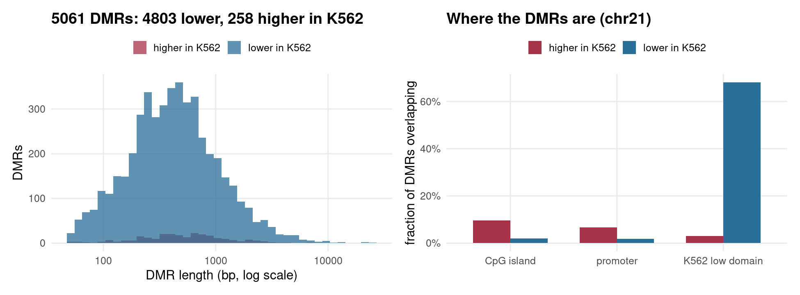

## Goal

After this exercise you will be able to:

- Compute binomial and **beta-binomial** variances by hand, and explain why biological replicates, not more reads, limit power.
- Test a difference in methylation at one CpG, and explain why **pooling reads** across replicates is wrong.
- Turn a list of differential CpGs into **DMRs** with explicit merging rules, and judge a DMR table (Δβ, length, direction, multiple testing).
- Run a differential methylation analysis with [DSS](https://bioconductor.org/packages/release/bioc/html/DSS.html) on real WGBS data (GM12878 vs K562, two replicates each, chr21), annotate the DMRs and relate them to expression.
- Judge the design of a methylation study: what do the replicates represent, and what else could explain a difference?

## Background

**Data.** For CpG $i$ and sample $j$: $X_{ij}$ methylated reads out of $N_{ij}$ reads. The level is $\beta_{ij} = X_{ij}/N_{ij}$; Δβ = mean β of group 2 − mean β of group 1.

**Binomial** (sampling only): $\text{Var}(X) = N p (1-p)$. **Beta-binomial** (sampling + biological variation between samples with overdispersion $\varphi$):

$$ \text{Var}(X) = N p (1-p)\,[1 + (N-1)\varphi], \qquad \text{SD}(\hat\beta) = \sqrt{p(1-p)\,[1 + (N-1)\varphi]/N}. $$

This is the methylation counterpart of the negative binomial of RNA-seq (Poisson + gamma).

**Comparing two replicates.** With pooled level $p$, $z = (\hat\beta_1 - \hat\beta_2)\,/\,\sqrt{p(1-p)(1/N_1 + 1/N_2)}$ has variance about 1 if the replicates differ only by sampling.

**DSS** fits a beta-binomial per CpG, shrinks $\varphi$ across CpGs (empirical Bayes, like DESeq2's dispersions), optionally smooths each sample over neighbouring CpGs (500-bp window), and uses a Wald test. `callDML` reports differential CpGs (DMLs); `callDMR` merges significant CpGs less than 100 bp apart into regions of at least 3 CpGs and 50 bp in which at least 50% of CpGs are significant.

## Data

From the course repository:

```bash
data/download.sh methylation-differential     # about 80 MB (plus the GTF if not yet present)
mkdir -p ~/epi/diffmeth && cd ~/epi/diffmeth
D=/path/to/course/data                        # where download.sh put the files
```

- `gm12878_wgbs_rep{1,2}_chr21.bed.gz`, `k562_wgbs_rep{1,2}_chr21.bed.gz`: ENCODE WGBS per-CpG calls, chr21, two replicates per cell line (GM12878 [ENCSR890UQO](https://www.encodeproject.org/experiments/ENCSR890UQO/), K562 [ENCSR765JPC](https://www.encodeproject.org/experiments/ENCSR765JPC/)). Format as in *DNA methylation biology* (column 10 coverage, 11 % methylated rounded down, 13 called genotype).
- `hg38_cpgIslandExt.txt.gz`, `gencode.v46.basic.annotation.gtf.gz`: CpG islands and genes.
- `gm12878_rna_rep{1,2}_genes.tsv`, `k562_rna_rep{1,2}_genes.tsv`: ENCODE total RNA-seq gene quantifications (TPM).

**Shortcuts, said plainly.** One chromosome; per-CpG calls from ENCODE's pipeline rather than our own alignment (*Bisulfite and enzymatic sequencing* shows they agree closely). The "replicates" are independent cultures of two cell lines from two different people, so this is a demonstration of the method, not a comparison of B cells and erythroid cells in a population (B7).

Install DSS with `BiocManager::install("DSS")` (it brings bsseq). The R part runs in about 3 minutes and needs about 4 GB of memory.

## By hand

Do these on paper.

**B1. Sampling vs biology.** A CpG has true mean level $p = 0.5$.

(a) With $N = 20$ reads, what is the SD of $\hat\beta$ under the binomial? Under the beta-binomial with $\varphi = 0.1$?

(b) Repeat for $N = 200$. By what factor did the SD fall in each model?

(c) You can afford 400 reads per CpG in total for each group. Is it better to sequence 2 samples at 200x or 20 samples at 20x? Why?

**B2. One CpG, two groups.** Group A (GM12878): replicate 1 has 9/10 methylated reads, replicate 2 has 16/20. Group B (K562): 2/10 and 5/20.

(a) Compute β per sample, the mean β per group (average of the samples), and Δβ (B − A).

(b) Pool the reads per group and write the 2 × 2 table that Fisher's exact test would use. What does this test assume about the reads?

(c) Use the $z$ formula of the Background to compare the two A replicates. Is their difference compatible with sampling noise alone?

**B3. Overdispersion in real data.** For CpGs with ≥ 10 reads in both replicates, the variance of $z$ is 1.05 for the two K562 replicates and 3.44 for the two GM12878 replicates.

(a) What would you expect under pure binomial sampling? (b) Which pair behaves like two sequencing runs of one sample? (c) Give two biological reasons why two cultures of the same cell line can differ. (d) Pooled-read Fisher tests on GM12878 rep1 vs rep2 give $p < 0.05$ for 17% of CpGs. What should that fraction be?

**B4. Merge DMLs into DMRs.** Significant CpGs (all with Δβ of the same sign) at positions: 5000, 5060, 5110, 5150, 5400, 5430, 5470, 5900, 6000, 6080, 6150, 6230, 6260, 6290. Non-significant CpGs lie between 5150 and 5400 (at 5200, 5250, 5300, 5350) and nowhere else.

(a) Apply: merge significant CpGs less than 100 bp apart; keep regions with ≥ 3 CpGs and ≥ 50 bp. Which regions do you get?

(b) Would the first two regions merge if the gap rule were 300 bp? What would the "fraction significant" of that merged region be, counting the four non-significant CpGs?

**B5. Multiple testing.** (a) A WGBS study tests 25 million CpGs. How many have $p < 10^{-3}$ by chance if nothing differs? (b) DSS calls 5 061 DMRs at a CpG-level threshold. Why is "5 061 DMRs at FDR 5%" not a correct statement? (c) How does dmrseq obtain region-level inference even with only 2 vs 2 samples, where a separate permutation test for each region would have very coarse p-values?

**B6. Read the results.** Use the lecture figures.

{width="100%"}

(a) How many DMRs are lower and how many higher in K562? (b) Where are the losses, and where are the gains enriched, relative to all tested CpGs (CGI 7.1%, promoter 4.9%, K562 low domain 46.5%)? (c) Why might counting DMRs overstate the number of "events" for the losses?

**B7. Judge the design.** (a) In our data, what population do the two groups represent? What does a significant DMR tell you? (b) A study compares blood WGBS of 4 smokers and 4 non-smokers and reports DMRs at genes of the immune response. Name four confounders or artefacts to rule out. (c) Methylation differences between cell types are often Δβ 0.3–1, between exposed and unexposed people often 0.01–0.05. What does that mean for the number of samples and for the choice of platform?

**B8. Expression.** Of 11 chr21 genes whose promoter is more methylated in K562, 5 are expressed more than 2-fold lower in K562 and 1 higher. Of 63 genes whose promoter is less methylated in K562, 7 are higher and 7 lower. Explain the asymmetry, and say what experiment would test whether methylation of the *ITGB2* promoter silences it in K562.

## On the command line

### C1 — Input tables for DSS

DSS wants, per sample, a table with columns `chr pos N X` (position of the CpG, reads, methylated reads). Combine the two strands as in *DNA methylation biology* and drop CpGs with a SNP:

```bash
for s in gm12878_wgbs_rep1 gm12878_wgbs_rep2 k562_wgbs_rep1 k562_wgbs_rep2; do
  zcat $D/${s}_chr21.bed.gz \
    | awk -F'\t' -v OFS='\t' '$13 == "CG" { p = ($6 == "+") ? $2 + 1 : $2
          N[p] += $10; X[p] += int($10 * $11 / 100 + 0.5) }
        END { print "chr", "pos", "N", "X"; for (p in N) print "chr21", p, N[p], X[p] }' \
    | (read h; echo "$h"; sort -k2,2n) > $s.dss.txt
  echo "$s $(tail -n +2 $s.dss.txt | wc -l) CpGs, methylation $(awk 'NR > 1 { n += $3; x += $4 } END { printf "%.3f", x / n }' $s.dss.txt)"
done
head -3 gm12878_wgbs_rep1.dss.txt
```

(a) Why is `pos` the start + 1 for the + strand line and the start for the − strand line? (b) Compare the overall methylation of the four samples. What stands out?

### C2 — How many CpGs are well covered in all samples?

```bash
for s in gm12878_wgbs_rep1 gm12878_wgbs_rep2 k562_wgbs_rep1 k562_wgbs_rep2; do
  awk 'NR > 1 && $3 >= 10 { print $2 }' $s.dss.txt > $s.cov10
done
sort gm12878_wgbs_rep1.cov10 gm12878_wgbs_rep2.cov10 k562_wgbs_rep1.cov10 k562_wgbs_rep2.cov10 | uniq -c \
  | awk '{ n[$1]++ } END { for (k = 1; k <= 4; k++) print k, "samples:", n[k] }'
```

How many CpGs have at least 10 reads in all four samples? Why would a per-CpG test that requires 10 reads everywhere lose many CpGs, and how does smoothing help?

## Explore: why pooling reads gives false DMLs {#explore}

The demo simulates 5 000 CpGs in two groups of replicates. Every replicate has its own true level, drawn from a beta distribution around the group mean with overdispersion **φ** (the beta-binomial of the Background), and its reads are a binomial draw from that level. By default nothing differs between the groups; **differential CpGs** and **their true Δβ** make a fraction of CpGs truly different. Three tests are run on every CpG: **Fisher's exact test on reads pooled per group** (it ignores the replicates), a **beta-binomial** Wald test with one φ estimated from the replicates of all CpGs (what DSS does, without its per-CpG part), and a **t-test on the per-sample β values**. **(a)** shows the p-values of one test, with the CpGs that truly differ stacked in orange; for CpGs that do not differ, a valid test gives a flat histogram. **(b)** shows how many CpGs each test calls at a Benjamini–Hochberg FDR of 5%, split into true and false calls.

```{=html}
<link rel="stylesheet" href="../demos/dist/demo.css">
<div data-demo="betabinom"></div>
<script src="../demos/dist/betabinom.js"></script>
```

**E1.** (links to **B3**) With the defaults (20 reads, 3 vs 3 samples, φ = 0.1, nothing differs): how many CpGs does Fisher's test call at FDR 5%, and what fraction of CpGs get $p < 0.05$? Describe the p-value histogram. Switch the histogram to the beta-binomial and the t-test: what do they give? Scale Fisher's result up to the 28 million CpGs of a genome.

**E2.** Set φ to 0, then 0.02 and 0.2, and note Fisher's calls and its fraction of $p < 0.05$. Then return to φ = 0.1 and set the reads to 5, 50 and 100. Why does the problem of the pooled test grow with sequencing depth? Use $\text{Var}(X) = Np(1-p)[1 + (N-1)\varphi]$.

**E3.** (links to **B1**) Set φ = 0.05 and click **10% differ** (Δβ = 0.2; 453 CpGs truly differ). With 3 vs 3 samples at 20 reads, how many true CpGs does the beta-binomial test find, and how many of Fisher's calls are false? Raise the reads to 100. Then go back to 20 reads and raise the replicates to 6 and to 8. Which helps more, and why? Compare the total reads per group.

**E4.** Still at φ = 0.05, 10% differ, 20 reads: (a) set the replicates to 1. Which tests can still be run, and can you trust Fisher's list? (b) Set 6 replicates and compare the beta-binomial with the t-test. Both are valid (few false calls); why does the t-test find fewer CpGs?

::: {.callout-note collapse="true" title="Solutions (E1–E4)"}
**E1.** Fisher calls **340 CpGs, all false**, and **21.6%** of CpGs have $p < 0.05$ instead of 5%. The histogram piles up near 0 instead of being flat; the spike at $p = 1$ comes from CpGs near 0 or 100% methylation, where Fisher's discrete test can rarely give anything else. The beta-binomial test gives **0 calls** with 4.0% below 0.05, the t-test **0 calls** with 4.2%: both use the variation between replicates, and both have flat histograms. 340 of 5 000 is 6.8%; over 28 million CpGs that is about **1.9 million false DMLs**. The real GM12878 replicates of the lecture behave the same way (20 902 Fisher calls on chr21 between two replicates, 17% with $p < 0.05$ in B3).

**E2.** φ = 0: Fisher gives **0 calls** and 3.7% below 0.05 (slightly conservative, as discrete tests are): without biological variation, reads really are independent draws and pooling is fine. φ = 0.02: 0 calls, 7.0%. φ = 0.2: **1 050 calls**, 32.6%. At φ = 0.1 with 5 reads: 0 calls (4.8%); 50 reads: **1 525 calls** (40.3%); 100 reads: **2 406 calls** (54.1%). The pooled test assumes the binomial variance $Np(1-p)$, so its standard error of β shrinks as $1/\sqrt{N}$. The real variance is larger by the factor $1 + (N-1)\varphi$, which *grows* with $N$: at 5 reads it is 1.4, at 100 reads 10.9. With more reads the biological differences between replicates become "significant", although they are the same in both groups. Depth cannot remove biological variation; only a test that measures it can.

**E3.** 3 vs 3 at 20 reads: the beta-binomial finds **4%** of the 453 differential CpGs (22 calls, 2 false); Fisher makes 305 calls of which **116 (38%) are false**. At 100 reads: beta-binomial **25%**; Fisher finds 94% but 1 470 of its 1 895 calls (78%) are false. At 20 reads with 6 replicates: beta-binomial **43%** (201 calls, 8 false); with 8 replicates **58%**. Six samples at 20 reads (120 reads per group) beat three samples at 100 reads (300 reads per group): each extra replicate gives an independent draw of the biological level, while extra reads only measure the same three samples more precisely (B1(c)).

**E4.** (a) With one sample per group only Fisher can run: there is no replicate to estimate φ or a variance from. Its 43 calls contain **19 false (44%)**, and nothing in the data tells you which. A 1 vs 1 comparison can say that two samples differ, not that two groups do. (b) At 6 vs 6 the t-test finds **10%** (46 calls, 0 false), the beta-binomial **43%**. The t-test estimates the variance of each CpG from only 12 values (10 degrees of freedom) and ignores how many reads each β is based on; the beta-binomial uses the read counts and borrows φ from all CpGs, as DSS (and DESeq2 for RNA-seq) shrink dispersions towards a common value.
:::

## In R

You need data.table, GenomicRanges, rtracklayer, DSS and ggplot2 (see *Install the software you need*). Run R in the folder where C1 wrote the `.dss.txt` files.

```r
suppressPackageStartupMessages({
  library(data.table); library(GenomicRanges); library(rtracklayer); library(DSS); library(ggplot2)
})
D <- "/path/to/course/data"
```

### R1 — Read the samples

```r
samples <- c(gm1 = "gm12878_wgbs_rep1", gm2 = "gm12878_wgbs_rep2", k1 = "k562_wgbs_rep1", k2 = "k562_wgbs_rep2")
dat <- lapply(samples, function(s) fread(paste0(s, ".dss.txt")))
sapply(dat, function(x) c(CpGs = nrow(x), median_N = median(x$N), meth = sum(x$X) / sum(x$N)))
bs <- makeBSseqData(lapply(dat, as.data.frame), names(samples))
bs
```

How many CpGs does the `BSseq` object contain, and why more than any single sample?

### R2 — Are the replicates overdispersed?

```r
zrep <- function(a, b, minN = 10) {
  m <- merge(a, b, by = c("chr", "pos"))[N.x >= minN & N.y >= minN]
  p <- (m$X.x + m$X.y) / (m$N.x + m$N.y)
  m <- m[p > 0 & p < 1]; p <- p[p > 0 & p < 1]
  m[, z := (X.x / N.x - X.y / N.y) / sqrt(p * (1 - p) * (1 / N.x + 1 / N.y))][]
}
zg <- zrep(dat$gm1, dat$gm2); zk <- zrep(dat$k1, dat$k2)
c(GM12878 = var(zg$z), K562 = var(zk$z))
c(GM12878 = mean(abs(zg$z) > 1.96), K562 = mean(abs(zk$z) > 1.96))
```

(a) Compare the variances with 1. (b) What fraction of CpGs has $|z| > 1.96$ in each pair, and what would you expect without overdispersion?

### R3 — The price of pooling reads

Fisher's exact test between the two GM12878 replicates, on 50 000 random CpGs with ≥ 5 reads in both (there is no group difference here):

```r
set.seed(1)
nul <- merge(dat$gm1, dat$gm2, by = c("chr", "pos"))[N.x >= 5 & N.y >= 5][sample(.N, 50000)]
nul[, p := mapply(function(a, n1, b, n2) fisher.test(matrix(c(a, n1 - a, b, n2 - b), 2))$p.value, X.x, N.x, X.y, N.y)]
sum(p.adjust(nul$p, "BH") < 0.05)
mean(nul$p < 0.05)
```

How many "significant" CpGs at FDR < 0.05? What fraction has $p < 0.05$? What does this say about tests that pool reads over replicates?

### R4 — DSS: differential CpGs

```r
dml <- DMLtest(bs, group1 = c("gm1", "gm2"), group2 = c("k1", "k2"), smoothing = TRUE, ncores = 4)
head(dml, 3)
summary(dml$phi1); summary(dml$phi2)
dmls <- callDML(dml, delta = 0.2, p.threshold = 1e-5)
nrow(dmls); table(dmls$diff > 0)
ggplot(dml[sample(nrow(dml), 50000), ], aes(-diff, -log10(pval))) + geom_point(size = 0.4, alpha = 0.3) +
  geom_vline(xintercept = c(-0.2, 0.2), linetype = 2) + labs(x = "Δβ (K562 − GM12878)", y = "−log10 p")
```

(a) What are `mu1`, `mu2`, `diff` and `phi1`/`phi2`? (b) Compare the median dispersion of the two groups with your answer to R2. (c) How many DMLs, and in which direction? (On 4 cores about 1 minute.)

### R5 — DSS: differential regions

```r
dmrs <- as.data.table(callDMR(dml, delta = 0.2, p.threshold = 1e-5))
nrow(dmrs)
dmrs[, dir := ifelse(diff.Methy > 0, "lower in K562", "higher in K562")]
dmrs[, .(n = .N, median_bp = median(length), median_CpGs = median(nCG), total_kb = sum(length) / 1e3), by = dir]
head(dmrs[, .(chr, start, end, length, nCG, meanMethy1, meanMethy2, diff.Methy, areaStat)], 5)
```

(a) How many DMRs in each direction, how long, and how much of chr21 do they cover? (b) What do the top five by `areaStat` have in common? Look up their positions in the PMD plot of *DNA methylation biology*.

### R6 — Where are the DMRs?

```r
cgi <- fread(file.path(D, "hg38_cpgIslandExt.txt.gz"), header = FALSE)[V2 == "chr21"]
cgi <- GRanges(cgi$V2, IRanges(cgi$V3 + 1, cgi$V4))
gtf <- import(file.path(D, "gencode.v46.basic.annotation.gtf.gz"))
genes <- gtf[gtf$type == "gene" & gtf$gene_type == "protein_coding" & seqnames(gtf) == "chr21"]
prom <- promoters(genes, 1000, 1000)
kb <- dat$k1[, .(m = sum(X) / sum(N), n = .N), by = .(bin = pos %/% 1e5)][n >= 50]
low <- reduce(GRanges("chr21", IRanges(kb[m < 0.1]$bin * 1e5 + 1, width = 1e5)))
dg <- GRanges(dmrs$chr, IRanges(dmrs$start, dmrs$end))
dmrs[, `:=`(cgi = overlapsAny(dg, cgi), promoter = overlapsAny(dg, prom), k562_low = overlapsAny(dg, low))]
dmrs[, .(n = .N, cgi = mean(cgi), promoter = mean(promoter), k562_low = mean(k562_low)), by = dir]
bg <- GRanges("chr21", IRanges(dml$pos, width = 1))
c(cgi = mean(overlapsAny(bg, cgi)), promoter = mean(overlapsAny(bg, prom)), k562_low = mean(overlapsAny(bg, low)))
```

(a) Compare each direction with the background of tested CpGs. Which features are enriched for losses, which for gains? (b) Why do we compare with all tested CpGs rather than with the whole chromosome?

### R7 — Promoter DMRs and expression

```r
tpm <- function(f) { x <- fread(file.path(D, f))[grepl("^ENSG", gene_id)]; setNames(x$TPM, sub("\\..*", "", x$gene_id)) }
id <- sub("\\..*", "", genes$gene_id)
ex <- data.table(id, gene = genes$gene_name,
                 gm = (tpm("gm12878_rna_rep1_genes.tsv")[id] + tpm("gm12878_rna_rep2_genes.tsv")[id]) / 2,
                 k5 = (tpm("k562_rna_rep1_genes.tsv")[id] + tpm("k562_rna_rep2_genes.tsv")[id]) / 2)
ex[, lfc := log2((k5 + 1) / (gm + 1))]
po <- findOverlaps(prom, dg)
pd <- data.table(id = id[queryHits(po)], dB = -dmrs$diff.Methy[subjectHits(po)], cgi = dmrs$cgi[subjectHits(po)])
pd <- pd[, .SD[which.max(abs(dB))], by = id]
ex <- merge(ex, pd, by = "id", all.x = TRUE)
ex[, cls := ifelse(is.na(dB), "none", ifelse(dB > 0, "higher in K562", "lower in K562"))]
ex[!is.na(lfc), .(genes = .N, median_lfc = median(lfc), down = sum(lfc < -1), up = sum(lfc > 1)), by = cls]
ex[cls == "higher in K562"][order(lfc), .(gene, gm = round(gm, 1), k5 = round(k5, 1), lfc = round(lfc, 2), dB = round(dB, 2), cgi)]
cor(ex$dB, ex$lfc, method = "spearman", use = "complete.obs")
```

(a) Fill in the table of B8 from the output. (b) Which genes lose expression with a promoter gain? Are they plausible B-cell genes? (c) What is the overall correlation, and why is it weak?

### R8 — How much do the choices matter?

```r
dml0 <- DMLtest(bs, group1 = c("gm1", "gm2"), group2 = c("k1", "k2"), smoothing = FALSE)
c(smoothed = sum(dml$fdr < 0.05, na.rm = TRUE), not_smoothed = sum(dml0$fdr < 0.05, na.rm = TRUE))
nrow(callDMR(dml0, delta = 0.2, p.threshold = 1e-5))
nrow(callDMR(dml, delta = 0.4, p.threshold = 1e-5))
fwrite(dmrs[, .(chr, start = start - 1, end, name = dir, score = round(1000 * abs(diff.Methy)))],
       "dmrs_gm12878_vs_k562.bed", sep = "\t", col.names = FALSE)
```

(a) How do smoothing and the delta threshold change the results? (b) Why do we subtract 1 from `start` when writing BED?

## Hints

::: {.callout-tip collapse="true" title="Hint 1 — variances (B1, B3, R2)"}
Plug into $\text{SD}(\hat\beta) = \sqrt{p(1-p)[1+(N-1)\varphi]/N}$. As $N \to \infty$ the beta-binomial SD tends to $\sqrt{p(1-p)\varphi}$. Under the binomial, about 5% of $|z|$ exceed 1.96. The DSS model is in [Feng, Conneely & Wu 2014](https://doi.org/10.1093/nar/gku154).
:::

::: {.callout-tip collapse="true" title="Hint 2 — tests and pooling (B2, R3)"}
[`fisher.test`](https://rdrr.io/r/stats/fisher.test.html) takes a 2 × 2 table of methylated and unmethylated reads in two groups. Pooling makes every read an independent observation; replicates disappear. Compare with pseudo-replication in *Differential accessibility*.
:::

::: {.callout-tip collapse="true" title="Hint 3 — DSS (R1, R4, R5, R8)"}
The [DSS vignette](https://bioconductor.org/packages/release/bioc/vignettes/DSS/inst/doc/DSS.html) explains `makeBSseqData`, `DMLtest`, `callDML`, `callDMR` and their columns (`mu1`, `mu2`, `diff`, `phi1`, `phi2`, `areaStat`). `diff` is group 1 − group 2, here GM12878 − K562.
:::

::: {.callout-tip collapse="true" title="Hint 4 — regions and multiple testing (B4, B5)"}
Walk along the positions and start a new region whenever the gap is ≥ 100 bp. Expected false positives = number of tests × threshold. Region-level FDR: [dmrseq (Korthauer et al. 2019)](https://doi.org/10.1093/biostatistics/kxy007) permutes sample labels; with 2 + 2 samples there are only 3 distinct splits.
:::

::: {.callout-tip collapse="true" title="Hint 5 — annotation and expression (B6, B8, R6, R7)"}
[`overlapsAny`, `findOverlaps`](https://rdrr.io/bioc/GenomicRanges/man/findOverlaps-methods.html) and [`promoters`](https://rdrr.io/bioc/GenomicRanges/man/intra-range-methods.html) are as in *Genomic intervals*. A DMR in a domain that is silent in both cell lines cannot change expression. dCas9 fused to TET1 or DNMT3A edits methylation at one locus.
:::

::: {.callout-tip collapse="true" title="Hint 6 — design (B7)"}
Think of everything that differs between the groups besides the variable of interest: cell-type composition, age, sex, genotype, batch, conversion, coverage. *Methylation arrays* covers composition in blood ([Jaffe & Irizarry 2014](https://doi.org/10.1186/gb-2014-15-2-r31)).
:::

## Solutions

::: {.callout-note collapse="true" title="Solutions — by hand"}

**B1.** (a) Binomial: $\sqrt{0.25/20} = 0.112$. Beta-binomial: $\sqrt{0.25 \times (1 + 19 \times 0.1)/20} = \sqrt{0.25 \times 2.9/20} = 0.190$. (b) $N = 200$: binomial $\sqrt{0.25/200} = 0.035$ (3.2-fold lower); beta-binomial $\sqrt{0.25 \times 20.9/200} = 0.162$ (only 1.2-fold lower). (c) 20 samples at 20x: the biological variance ($\approx p(1-p)\varphi = 0.025$ per sample) shrinks only with the number of samples. The SD of a group mean is about $0.19/\sqrt{20} = 0.042$ with 20 samples at 20x versus $0.16/\sqrt{2} = 0.11$ with 2 samples at 200x; and with 2 samples φ itself can hardly be estimated.

**B2.** (a) A: 0.90 and 0.80, mean **0.85**. B: 0.20 and 0.25, mean **0.225**. Δβ $= 0.225 - 0.85 = $ **−0.625**. (b) Pooled: A 25 methylated, 5 unmethylated; B 7 methylated, 23 unmethylated. Fisher assumes all 60 reads are independent draws from two binomial populations, one per group: it ignores that reads come in samples with their own levels. (c) Pooled $p = 25/30 = 0.833$; $z = (0.90 - 0.80)/\sqrt{0.833 \times 0.167 \times (1/10 + 1/20)} = 0.10/\sqrt{0.0208} = 0.10/0.144 = 0.69$: compatible with sampling noise.

**B3.** (a) 1. (b) K562. (c) The two cultures had different numbers of divisions since thawing (methylation in partially methylated domains drifts with divisions), and subclones can take over a culture (different epialleles, copy-number changes); EBV-transformed lines are oligoclonal. (Different handling and DNA extraction add technical variation.) (d) 5% (by definition of a valid test under the null); 17% means the test is badly anticonservative.

**B4.** (a) Gaps: 60, 50, 40, | 250 |, 30, 40, | 430 |, | 100 |, 80, 70, 80, 30, 30. Regions: {5000–5150}: 4 CpGs, 150 bp → **DMR**; {5400–5470}: 3 CpGs, 70 bp → **DMR**; {5900}: 1 CpG → rejected (the gap to 6000 is exactly 100, not less than 100); {6000–6290}: 6 CpGs, 290 bp → **DMR**. (b) Yes: with a 300-bp rule 5150 and 5400 (gap 250) merge into 5000–5470 with 7 significant and 4 non-significant CpGs: 7/11 = 64% significant, above DSS's 50% rule, so one region. The rules decide whether one long or two short regions are reported.

**B5.** (a) $25 \times 10^6 \times 10^{-3} = 25\,000$. (b) DSS's threshold is applied to CpGs; DMRs are built afterwards from the significant CpGs, so the proportion of false DMRs is not controlled (one false region can contain many correlated false CpGs, and region boundaries are chosen after seeing the data). (c) dmrseq scores candidate regions with generalised least squares on transformed proportions, accounting for spatial correlation. It pools null statistics across regions and label permutations rather than testing each region against its own few permutations. This supports region-level inference with at least two samples per group; more replicates improve power and robustness. See the [dmrseq documentation](https://bioconductor.org/packages/release/bioc/html/dmrseq.html).

**B6.** (a) 4 803 lower, 258 higher in K562. (b) Losses: 68% overlap K562 low domains (background 46.5%); depleted at CGIs (2.0% vs 7.1%) and promoters (1.8% vs 4.9%). Gains: enriched at CGIs (9.7%) and promoters (6.6%), almost absent from low domains (3.1%). (c) A low domain of several hundred kb is one event (one region that lost methylation), but the merging rule cuts it into many DMRs wherever two significant CpGs are 100 bp or more apart.

**B7.** (a) Each group is one cell line; the replicates are cultures of the same cells. A significant DMR means that the two cultures differ more than replicate cultures do; it says nothing about B cells vs erythroid cells in general, or about which of the many differences between the lines (donor, lineage, EBV, leukaemia, karyotype) causes it. (b) Blood cell-type composition (smoking raises neutrophils), age, sex, genotype at CpG-SNPs/meQTLs, batch/processing day, conversion and coverage differences, and with 4 vs 4 the weak region-level error control. (c) Small effects need many samples (hundreds) for power, which favours cheap per-sample platforms (arrays, targeted methods) over WGBS; large cell-type effects are found with a few samples.

**B8.** Gains of methylation at CpG-island promoters go with silencing: once a CGI promoter is methylated it is stably off (or it was silenced first and then methylated). Most losses of promoter methylation lie in large domains that lost methylation in K562 at genes silent in both lines; losing methylation does not activate a gene without the right transcription factors. To test *ITGB2* in K562: demethylate its promoter with dCas9-TET1 (or treat with decitabine, less specific) and measure expression; conversely methylate it in GM12878 with dCas9-DNMT3A(-3L) and see if expression drops.
:::

::: {.callout-note collapse="true" title="Solutions — command line"}

**C1.** (a) The file is BED (0-based start) and lists each strand's C. The + strand C at 0-based start $s$ is at 1-based position $s+1$; the − strand C of the same CpG is one base to the right, at 0-based $s+1$, so its start is already the 1-based position of the + strand C. Both get the same `pos`. (b) GM12878 rep1 350 466 CpGs, 0.458; rep2 349 682, 0.511; K562 rep1 346 903, 0.230; rep2 350 620, 0.256. K562 is half as methylated as GM12878; the GM12878 replicates differ by 0.05 overall, the K562 replicates by 0.03. (17 s.)

**C2.** 168 666 CpGs have ≥ 10 reads in all four samples (31 710 in only one, 44 932 in two, 68 990 in three). A per-CpG test requiring 10 reads everywhere discards about half of the CpGs. Smoothing uses the reads of neighbouring CpGs, so CpGs with few reads still contribute to a regional estimate.
:::

::: {.callout-note collapse="true" title="Solutions — R"}

**R1.** 366 640 CpGs: the union of all CpGs covered in at least one sample (samples with 0 reads at a CpG get N = 0).

**R2.** (a) GM12878 **3.44**, K562 **1.05**. (b) $|z| > 1.96$: GM12878 30%, K562 3% (expected 5%; slightly below because small integer counts make the test conservative).

**R3.** **3 569** of 50 000 CpGs at FDR < 0.05 (7%), and 17% with $p < 0.05$, between two replicates of the same cell line. Pooling turns sample-to-sample variation into "significance"; a model with a dispersion parameter and samples as replicates is needed.

**R4.** (a) `mu1`, `mu2`: smoothed mean levels of group 1 (GM12878) and 2 (K562); `diff` = `mu1 − mu2`; `phi1`, `phi2`: estimated (shrunken) dispersions per group. (b) Median φ 0.15 for GM12878 and 0.05 for K562: GM12878's replicates are more variable, as in R2. (c) **87 108** DMLs (|Δβ| > 0.2, p < $10^{-5}$); 82 788 lower in K562 (`diff > 0`), 4 320 higher. About 1 minute on 4 cores.

**R5.** (a) **5 061** DMRs: 4 803 lower in K562 (median 416 bp, 10 CpGs, 3.25 Mb in total) and 258 higher (median 495 bp, 7 CpGs, 0.19 Mb). (b) All five are long (9–25 kb, 187–337 CpGs) and lower in K562 (≈ 0.9 in GM12878 vs 0.03–0.14 in K562): stretches near 36.2 Mb and 41.4 Mb, in domains that K562 lost almost completely.

**R6.** (a) Losses: CGI 2.0%, promoter 1.8%, low domain 68% vs background 7.1%, 4.9%, 46.5%: enriched in low domains, depleted at islands and promoters. Gains: CGI 9.7%, promoter 6.6%, low domain 3.1%: enriched at islands and promoters, nearly absent from low domains. (b) Only tested CpGs could become DMRs; the tested set is not uniform over the chromosome (coverage, CpG density), so the fair comparison is with what could have been found.

**R7.** (a) No DMR: 143 genes, median log2 FC 0.02, 2 down and 26 up. Lower in K562: 63 genes, median 0, 7 down and 7 up. Higher in K562: 11 genes, median 0, **5 down** and 1 up. (b) *ITGB2* (16.8 → 0.2 TPM; CD18, a leukocyte integrin expressed in B cells), *IFNGR2*, *CBR3*, *CBR1*, *MAP3K7CL*; *ITGB2*, *CBR1* and *CBR3* have CGI promoters. Five other genes with promoter gains (e.g. *OLIG1*, *RIPK4*) are silent in both lines. (c) Spearman 0.14 between promoter Δβ and expression change: most promoter DMRs are at genes silent in both lines, and expression has many other determinants.

**R8.** (a) FDR < 0.05: 255 128 CpGs with smoothing vs 125 863 without; DMRs without smoothing: 2 127 (instead of 5 061); with delta 0.4: 1 880. Smoothing roughly doubles the power on 10–20x data; a stricter delta keeps the large differences. The direction and location of the main changes do not depend on these choices. (b) DSS reports 1-based positions; BED starts are 0-based.
:::

## Where this leads

- *Methylation arrays* uses the same ideas with a linear model on M-values (limma) and region finders such as DMRcate; cell-type composition is handled there.
- *Epigenetic clocks and biomarkers* uses many small, consistent differences (age, disease) rather than DMRs.
- *Epigenetics in disease and therapy* returns to CpG-island hypermethylation and domain hypomethylation in cancer.
- *Linking regulatory elements to genes* asks which distal DMRs (enhancers) regulate which genes.

## Key papers (optional further reading)

*Not required reading and not examined.*

- Hansen, Langmead & Irizarry 2012, *Genome Biol*. [BSmooth: from whole genome bisulfite sequencing reads to differentially methylated regions](https://doi.org/10.1186/gb-2012-13-10-r83).
- Feng, Conneely & Wu 2014, *Nucleic Acids Res*. [A Bayesian hierarchical model to detect differentially methylated loci from single nucleotide resolution sequencing data](https://doi.org/10.1093/nar/gku154).
- Akalin et al. 2012, *Genome Biol*. [methylKit: a comprehensive R package for the analysis of genome-wide DNA methylation profiles](https://doi.org/10.1186/gb-2012-13-10-r87).
- Korthauer et al. 2019, *Biostatistics*. [Detection and accurate false discovery rate control of differentially methylated regions from whole genome bisulfite sequencing](https://doi.org/10.1093/biostatistics/kxy007).
- Hansen et al. 2011, *Nat Genet*. [Increased methylation variation in epigenetic domains across cancer types](https://doi.org/10.1038/ng.865).
- Ziller et al. 2015, *Nat Methods*. [Coverage recommendations for methylation analysis by whole-genome bisulfite sequencing](https://doi.org/10.1038/nmeth.3152).
