## About this lecture

*Bisulfite and enzymatic sequencing* turned reads into a table of methylated and total reads per CpG. This lecture compares such tables between groups of samples.

- The data: **two count matrices**, methylated reads and all reads, CpGs × samples.
- The models: **binomial** sampling and **beta-binomial** biological variation, the analogue of Poisson and negative binomial in RNA-seq.
- **Smoothing**: borrowing strength from neighbouring CpGs.
- **DMLs and DMRs**: single CpGs vs regions; multiple testing; effect sizes in Δβ.
- Real data: ENCODE GM12878 vs K562, two replicates each, chr21, with **DSS**; annotation and expression.
- Design: what replicates of a cell line can and cannot tell you.

::: notes
Students know DESeq2. The structure of this unit mirrors *Differential accessibility*: a count model with a dispersion parameter, shrinkage of that parameter across features, a Wald test, multiple testing, then annotation. What is different: the data are proportions with known denominators (no library-size normalisation), neighbouring features are strongly correlated (so smoothing and regions make sense), and global differences between samples are common and biologically meaningful. The data are the same four ENCODE files used in *DNA methylation biology*; DSS runs on chr21 in about a minute.
:::

## The data: methylated reads out of all reads {.smaller}

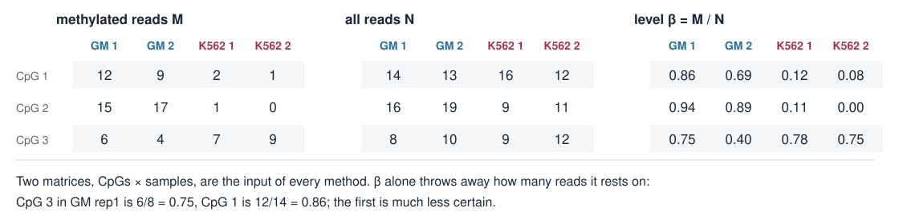{width="95%" fig-align="center"}

- For every CpG and sample: **M** methylated reads and **N** reads in total (both strands combined).
- β = M/N is the level, but its precision depends on N: 6/8 and 60/80 are both 0.75.
- No library-size normalisation is needed: each CpG is its own denominator.

::: notes
Compared with RNA-seq, each entry of the matrix is a pair, and that pair already contains its own normalisation: sequencing depth changes N, not the expected β. This is why methylation analyses do not use size factors. They do need coverage filters (too few reads give no information; extreme coverage suggests copy-number changes or repeats) and they need to keep N in the model rather than analysing β alone. The toy numbers are illustrative; the real matrix has 366 640 CpGs that are covered in at least one of our four samples.
:::

## Two sources of variation {.smaller}

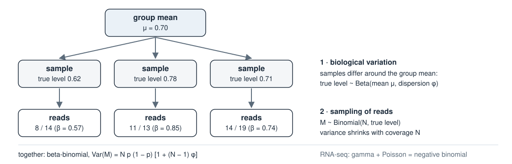{width="92%" fig-align="center"}

- **Biological**: each sample has its own true level around the group mean (cell mix, individual, culture history).
- **Sampling**: given the true level, reads are a binomial draw; this noise shrinks as N grows, the biological part does not.
- The **beta-binomial** combines them, with an overdispersion parameter φ per CpG.

::: notes
The hierarchy is exactly that of the negative binomial in RNA-seq: there a gamma-distributed true expression and Poisson counts; here a beta-distributed true proportion and binomial counts. φ (DSS uses φ, other papers ρ) is the intra-class correlation: the variance of the count is N p (1−p) [1 + (N − 1) φ]. With φ = 0 we are back at the binomial. Two practical consequences. First, sequencing deeper does not reduce the biological part: beyond about 10–20 reads per CpG, more replicates help more than more depth (Ziller et al. 2015). Second, tests that ignore φ, such as Fisher's exact test on pooled reads, treat the reads as the replicates.
:::

## Binomial and beta-binomial {.smaller}

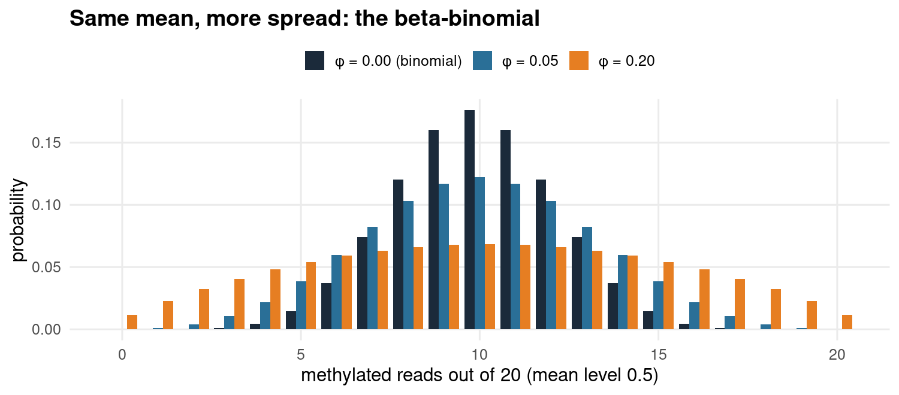{width="85%" fig-align="center"}

- With 20 reads and a mean level of 0.5: the binomial gives SD 2.2 reads (β ± 0.11).
- With φ = 0.2 the SD is 4.9 reads (β ± 0.24): the same mean, more than twice the spread, and 0 or 20 of 20 is no longer rare.

::: notes
Read the numbers off the variance formula N p (1−p) [1 + (N − 1) φ]. With N = 20 and p = 0.5, N p (1−p) = 5, so the binomial SD is √5 = 2.2 reads. With φ = 0.05 the variance is 5 × 1.95 = 9.75 (SD 3.1 reads); with φ = 0.2 it is 5 × 4.8 = 24 (SD 4.9 reads, or 0.24 in β). The point for students: a test that assumes the black bars will call many CpGs significant whose difference is well within the orange spread. Exam calculations use the variance formula, not the density.
:::

## Real replicates are overdispersed {.smaller}

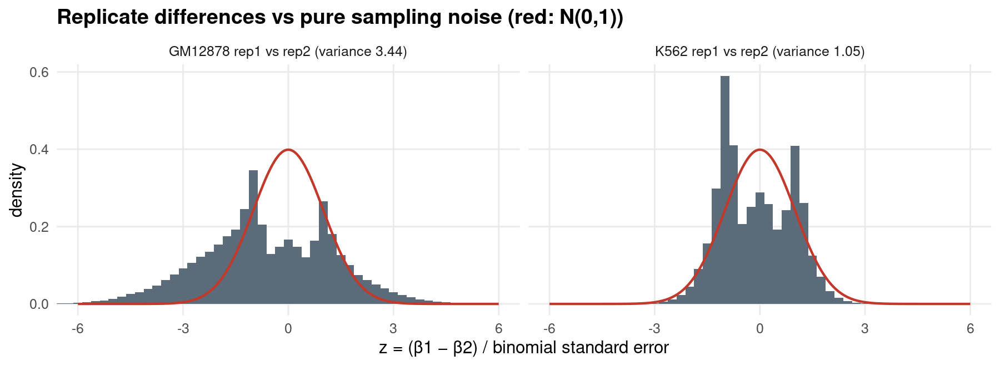{width="95%" fig-align="center"}

- Compare the two replicates of each cell line, CpG by CpG, scaled by the binomial standard error. Pure sampling noise would give a variance of 1.
- **K562**: 1.05, close to binomial. **GM12878**: 3.44: the two cultures really differ.
- The spiky shape comes from small integer counts (10–20 reads).

::: notes
z = (β1 − β2) / sqrt(p(1−p)(1/N1 + 1/N2)) with p the pooled level; CpGs with at least 10 reads in both replicates and 0 < p < 1 (169 163 for GM12878, 137 943 for K562). K562's two replicates behave like two sequencing runs of one sample. The GM12878 replicates are independent growths of a lymphoblastoid line, and rep2 is about 0.07 more methylated than rep1 across most of chr21 (next slide). This is the biological variation of the previous slides in action: estimating it requires replicates, and a test that ignores it is anticonservative.
:::

## Replicates in 100-kb bins {.smaller}

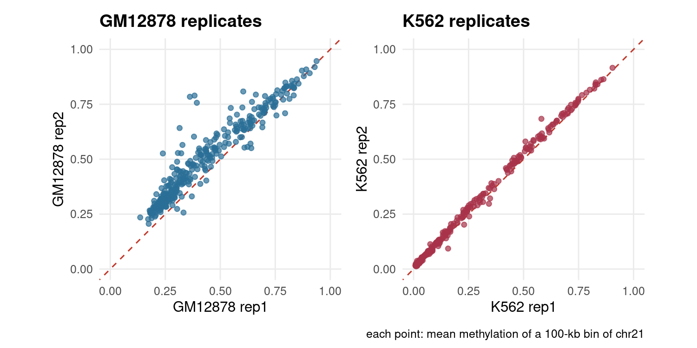{width="80%" fig-align="center"}

- K562 replicates agree almost perfectly (r = 0.999). GM12878 rep2 is **0.067 higher** on average than rep1, most in partially methylated domains.
- A global shift between replicates is real variation between cultures, not noise. In human samples it can come from age, cell composition or proliferation.

::: notes
Correlations of bin means: GM12878 replicates 0.957, K562 replicates 0.999, GM12878 vs K562 about 0.64. Global shifts matter in two ways. They inflate dispersion and so reduce power; and if they are confounded with the groups (for example all cases processed in one batch, or cases older than controls), they create thousands of "DMRs" that are not about the question asked. Note that β needs no normalisation, but that does not protect against biological or technical global shifts; there is no "median of ratios" fix for them, only design.
:::

## Testing one CpG {.smaller}

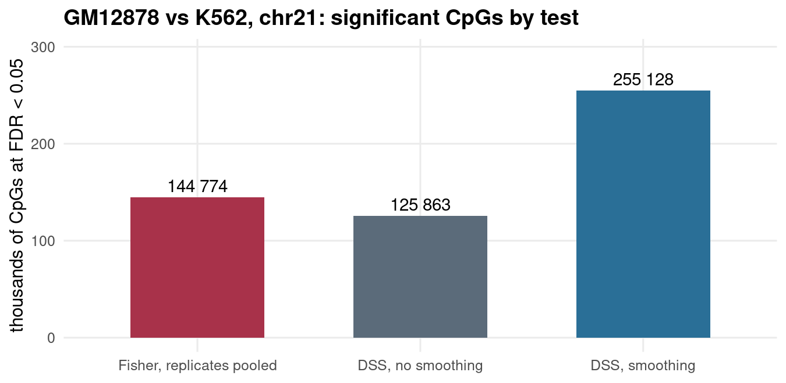{width="80%" fig-align="center"}

- **Fisher's exact test on pooled reads** treats reads as independent: between the two GM12878 replicates, where there is no group difference, it calls **20 902** CpGs at FDR < 0.05.
- **DSS** fits a beta-binomial per CpG, shrinks φ towards a common prior (empirical Bayes, as DESeq2 does), and uses a Wald test.
- Smoothing (next slide) adds information from neighbours and raises the number of significant CpGs.

::: notes
The bar chart compares three tests of GM12878 vs K562 on chr21 at FDR < 0.05. All three find very many CpGs, because the two cell lines differ in about two thirds of chr21's 100-kb bins. The telling number is in the bullet: the same Fisher test applied to rep1 vs rep2 of GM12878 calls 20 902 CpGs (7% of those tested), which are false positives by construction. With only two replicates per group the dispersion of a single CpG cannot be estimated well; DSS borrows information across CpGs with a prior on φ, just like DESeq2's dispersion shrinkage. methylKit offers logistic regression with an overdispersion correction; RADmeth and MACAU use beta-binomial regression with covariates.
:::

## Neighbouring CpGs are correlated: smoothing {.smaller}

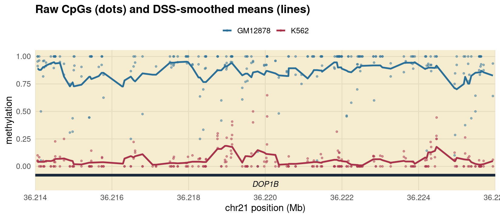{width="92%" fig-align="center"}

- Methylation changes over hundreds of bp, but each CpG has only 10–20 reads. Averaging neighbours trades resolution for precision.
- **BSmooth** fits a local likelihood smoother per sample; **DSS** smooths with a moving average (default window 500 bp) before testing.
- Smoothing assumes neighbours share a level: it blurs sharp boundaries and single-CpG events (e.g. at a TF site).

::: notes
Dots are raw per-CpG levels (CpGs with at least 5 reads) of all four samples, lines are DSS's smoothed group means (mu1, mu2 of DMLtest). The raw values of one sample jump between 0 and 1 because 1 of 2 and 9 of 10 are both possible; the smoothed curve recovers the regional level. Hansen, Langmead & Irizarry 2012 (key paper) showed that smoothing lets 4x coverage WGBS detect DMRs reliably, which made large WGBS studies affordable. Smoothing should be switched off when the question is about single CpGs (e.g. a CpG in a TF motif or an imprinting control CpG) or when CpGs are sparse (RRBS, arrays).
:::

## DSS in a few lines

```r
library(DSS)
dat <- lapply(files, fread)                      # each: chr, pos, N, X (X = methylated reads)
bs  <- makeBSseqData(dat, c("gm1", "gm2", "k1", "k2"))
dml <- DMLtest(bs, group1 = c("gm1", "gm2"), group2 = c("k1", "k2"), smoothing = TRUE)
dmls <- callDML(dml, delta = 0.2, p.threshold = 1e-5)    # single CpGs
dmrs <- callDMR(dml, delta = 0.2, p.threshold = 1e-5)    # regions
DMLfit.multiFactor(bs, design = df, formula = ~ group + sex)  # general designs
```

- `delta`: test |Δβ| > delta rather than Δβ ≠ 0 (an effect-size threshold built into the test).
- Run time for chr21 (366 640 CpGs, 4 samples): **under 1 minute**.

::: notes
DSS (Feng, Conneely & Wu 2014, key paper) is light to install and fast. The input is one table per sample with chromosome, position, total reads (N) and methylated reads (X): exactly what the command-line part of the exercise builds from the ENCODE files. DMLtest handles two groups; DMLfit.multiFactor handles designs with covariates (Park & Wu 2016), the equivalent of a DESeq2 design formula. With delta set, callDML reports the posterior probability that |Δβ| exceeds delta, which avoids calling tiny but significant differences. The p threshold of 1e-5 is DSS's default for callDMR.
:::

## Single CpGs: the volcano {.smaller}

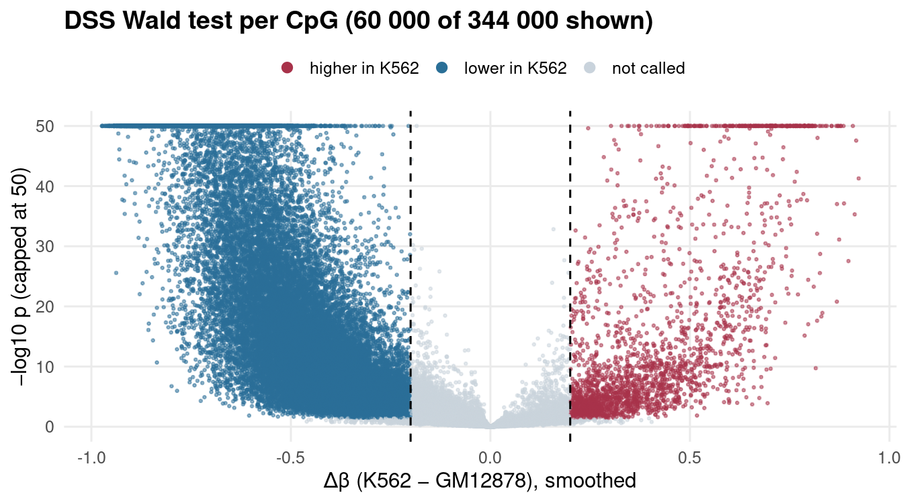{width="72%" fig-align="center"}

- 87 108 differential CpGs (|Δβ| > 0.2, p < 10⁻⁵); **82 788 (95%) are lower in K562**.
- The asymmetry is biology: K562 lost methylation in large domains; gains are few and focal.

::: notes
A volcano plot of DSS's Wald test, x axis K562 minus GM12878 (smoothed), 60 000 random CpGs shown. The left arm is dense because large domains lost methylation together; the right arm is sparse. Unlike an RNA-seq volcano there is a hard limit at ±1. With so many CpGs, p-values become tiny for small Δβ; the vertical lines at ±0.2 are the effect-size threshold. What Δβ is "biologically relevant" depends on the question: 0.05 can matter in a population study of blood (*Methylation arrays*), while cell-type differences are typically 0.3 or more.
:::

## From CpGs to regions {.smaller}

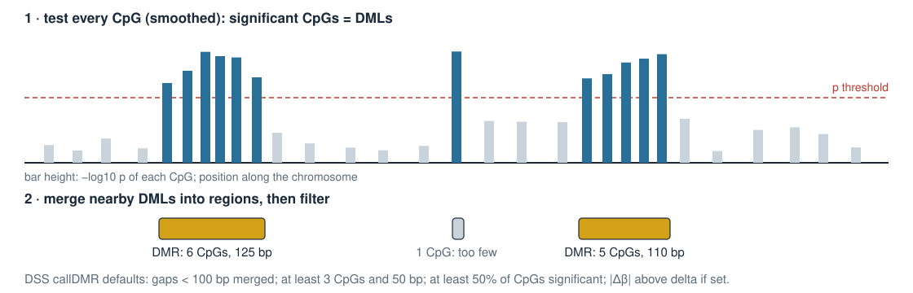{width="95%" fig-align="center"}

- A **DMR** is a run of nearby differential CpGs: fewer, more interpretable units than single CpGs, closer to the scale of regulatory elements.
- Each tool has its own rules (gap, minimum CpGs, minimum length, fraction significant) and the results depend on them.

::: notes
Why regions: biological changes in methylation usually span many CpGs (an enhancer, a CGI shore, a PMD); single-CpG calls are noisy and redundant; and regions can be annotated and validated. DSS merges CpGs below the p threshold that are less than 100 bp apart, then keeps regions with at least 3 CpGs, 50 bp and 50% significant CpGs. BSmooth uses runs of t-statistics above a cutoff; metilene uses a segmentation algorithm; dmrseq (next slides) defines candidate regions and tests them as units.
:::

## DMRs between GM12878 and K562 {.smaller}

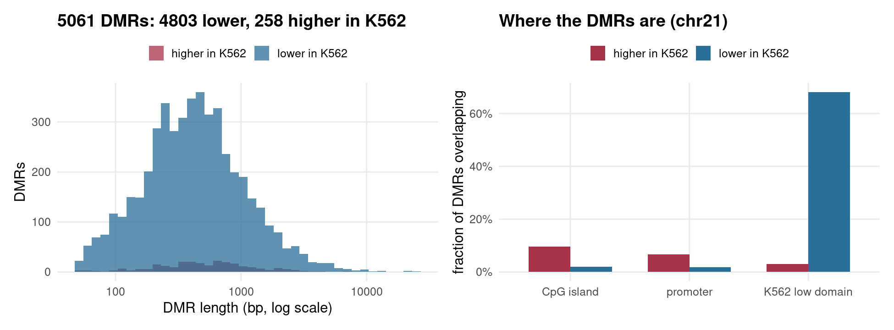{width="98%" fig-align="center"}

- **5 061 DMRs** on chr21: 4 803 lower in K562 (3.3 Mb in total) and 258 higher.
- 68% of the losses lie in K562's hypomethylated domains (46% of tested CpGs do). Gains are **enriched at CpG islands** (9.7% vs 7.1% of CpGs) and promoters (6.6% vs 4.9%).

::: notes
Median DMR: 416 bp and 10 CpGs for losses, 495 bp and 7 CpGs for gains. Many of the "losses" are pieces of the same megabase domains, cut into hundreds of DMRs by DSS's 100-bp merging rule: counting DMRs inflates the number of "events". Report the total length and the domain structure, or call large-scale blocks separately (BSmooth's block finder; PMD callers such as MethylSeekR). The gains at CpG islands are the classic cancer pattern, CGI hypermethylation on a background of global hypomethylation (*Epigenetics in disease and therapy*), visible even on one chromosome of a leukaemia cell line.
:::

## Multiple testing: CpGs vs regions {.smaller}

- Whole genome: ~28 million CpGs. At p < 0.001 you expect ~28 000 false positives: control the **FDR** (Benjamini–Hochberg), as in RNA-seq.
- But an FDR over CpGs is **not** an FDR over regions: one false region can contain 10 false CpGs, and regions are defined after looking at the data.
- **dmrseq** defines candidate regions, scores each as a unit, and estimates a **pooled regional null** from permuted sample labels: region-level FDR with as few as two samples per group.

::: notes
No figure. With 2 vs 2 samples there are only three distinct unlabelled splits, so a separate permutation test for each fixed region has very coarse p-values. dmrseq overcomes this by pooling null region statistics across the genome and permutations; its [documentation](https://bioconductor.org/packages/release/bioc/html/dmrseq.html) supports at least two samples per group. It fits generalised least squares to transformed methylation proportions, accounting for spatial correlation. The DMR list from DSS here has no calibrated region-level FDR because callDMR merges CpG-level calls; that limitation is not a prohibition on region-level inference with 2 vs 2. More biological replicates still improve power and robustness.
:::

## A promoter DMR {.smaller}

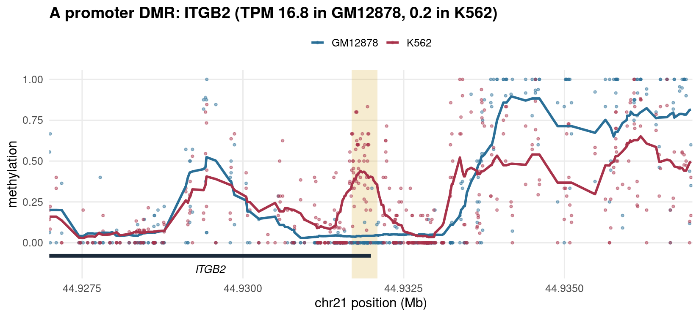{width="92%" fig-align="center"}

- *ITGB2* (integrin β2, CD18, a leukocyte gene): CpG-island promoter at **0.04** in GM12878 and **0.40** in K562 (DMR of 399 bp).
- Expression: **16.8 TPM** in GM12878, **0.2** in K562. Gain of promoter methylation, loss of expression.

::: notes
Chosen by a rule in the figure script, not by eye: among genes whose CpG-island promoter overlaps a DMR higher in K562 and that are expressed in GM12878 (TPM > 2), the one with the largest drop in K562. Dots: per-CpG levels of the four samples (at least 5 reads); lines: DSS smoothed means; shaded: DSS DMRs. ITGB2 encodes the β chain of the leukocyte integrins (LFA-1), expressed in lymphocytes, so silence in an erythroleukaemia line is expected. The methylation in K562 is partial (0.4): the island may be methylated on one allele or in a subset of cells, which bulk data cannot tell apart (*Methylation and chromatin from long reads*). As always, this is consistent with methylation silencing ITGB2 in K562, and equally with methylation following silencing caused by lineage.
:::

## Do promoter DMRs change expression? {.smaller}

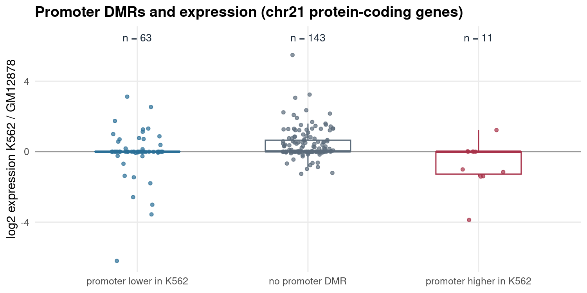{width="80%" fig-align="center"}

- Promoters **higher in K562**: 5 of 11 genes are down more than 2-fold in K562, 1 up.
- Promoters **lower in K562**: 7 up, 7 down of 63: no consistent direction (many are silent genes in domains that lost methylation).
- Expression is weakly linked to promoter methylation genome-wide; strongly at CGI promoters that become methylated.

::: notes
ENCODE total RNA-seq, two replicates per cell line (mean TPM), log2 (TPM + 1) ratio; promoter = TSS ± 1 kb. On one chromosome the numbers are small and the conclusions are tentative. The pattern is the one expected from *DNA methylation biology*: a methylated CpG-island promoter is a stable silent state, so gains at CGI promoters go with loss of expression; losses of methylation in PMDs happen at genes that are silent in both cell lines and stay silent, so they are not followed by activation. Never conclude causality from this kind of plot: methylation could follow silencing (most likely for many CGIs), and the two cell lines differ in everything (lineage, transformation, karyotype).
:::

## Design: what are the replicates? {.smaller}

- **Cell-line replicates** (our data) measure technical and culture variation. The p-values say "these two cultures differ", not "B cells differ from erythroleukaemia".
- In **human samples**, differences can come from **cell-type composition**, age, sex, genotype (SNPs, meQTLs), smoking, batch and conversion efficiency. Put them in the model or in the design.
- Methylation differences between cell types are large (Δβ 0.3–1); between exposed and unexposed people often small (Δβ 0.01–0.05): they need many samples, which is why population studies use arrays.

::: notes
The judgement slide. Cell-type composition is the classic confounder of methylation studies in blood and tissue: if cases have more neutrophils, every neutrophil-specific CpG looks differentially methylated (Houseman et al. 2012; Jaffe & Irizarry 2014; covered in *Methylation arrays*). Sex matters for chrX (and chrY) CpGs; age changes thousands of CpGs (*Epigenetic clocks and biomarkers*); genotype changes methylation at CpG-SNPs and meQTLs (*Bisulfite and enzymatic sequencing*, *Epigenomics and genetic variation*). Our GM12878 vs K562 comparison is a teaching example of the method only: the two lines come from different people, different lineages, and one was immortalised by EBV while the other is a leukaemia. Any DMR could be due to any of these differences.
:::

## Tools {.smaller}

| tool | model | regions | notes |
|------|------------------|----------------|------------------|
| DSS | beta-binomial, shrunken dispersion, Wald test; smoothing | callDMR merges DMLs | fast; multi-factor designs |
| BSmooth (bsseq) | local-likelihood smoothing, t-statistics | runs of large t; blocks | low coverage OK; needs ≥ 2–3 per group |
| dmrseq | generalised least squares on transformed proportions; spatial correlation | pooled permutation null; region FDR | ≥ 2 samples per group |
| methylKit | logistic regression (+ overdispersion) | tiles or merged CpGs | popular for RRBS |
| metilene | segmentation, no model per CpG | yes | very fast, few assumptions |
| limma on M-values | linear model | DMRcate, bumphunter | arrays (*Methylation arrays*) |

::: notes
A reference table. What matters for choosing: does the model account for overdispersion (all modern tools do), does it allow covariates (DSS multi-factor, dmrseq, methylKit, limma), does it control a region-level error rate (dmrseq), and does it suit the coverage pattern (smoothing for WGBS; tiles or per-CpG tests for RRBS). Results differ between tools mostly in borderline regions; strong DMRs are found by all.
:::

## Summary {.smaller}

| idea | key fact |
|-----|--------------------|
| data | methylated and total reads per CpG and sample; no library-size normalisation |
| model | binomial sampling + beta biological variation = beta-binomial; Var = Np(1−p)[1+(N−1)φ] |
| replicates | K562 replicates ~binomial (z variance 1.05); GM12878 overdispersed (3.44) |
| pooling | Fisher on pooled reads calls 20 902 false CpGs between two GM12878 replicates |
| smoothing | borrows neighbours (BSmooth, DSS); blurs sharp single-CpG changes |
| DML vs DMR | CpG tests, then merging rules; region FDR needs region-level methods (dmrseq) |
| effect size | report Δβ; use a delta threshold |
| this dataset | 5 061 DMRs; 95% lower in K562, mostly in hypomethylated domains; gains at CGIs |
| design | cell lines ≠ populations; composition, age, sex, genotype, batch confound |

::: notes
Students should leave able to: write the beta-binomial variance and compute it; explain why pooling reads over replicates is wrong; say what smoothing buys and costs; apply DMR merging rules to a list of CpGs; interpret a DMR table with Δβ and length; list the confounders of a methylation study. Next: *Methylation arrays*, the platform of most human population studies, where the same questions are asked with a linear model on M-values.
:::

## Key papers (optional further reading) {.smaller}

*Not required reading and not examined. For those who want the primary literature.*

- Hansen, Langmead & Irizarry 2012, *Genome Biol*. [BSmooth: from whole genome bisulfite sequencing reads to differentially methylated regions](https://doi.org/10.1186/gb-2012-13-10-r83). Smoothing; low coverage, many samples.
- Feng, Conneely & Wu 2014, *Nucleic Acids Res*. [A Bayesian hierarchical model to detect differentially methylated loci from single nucleotide resolution sequencing data](https://doi.org/10.1093/nar/gku154). DSS: beta-binomial with shrunken dispersion.
- Akalin et al. 2012, *Genome Biol*. [methylKit: a comprehensive R package for the analysis of genome-wide DNA methylation profiles](https://doi.org/10.1186/gb-2012-13-10-r87). A widely used alternative, especially for RRBS.
- Korthauer et al. 2019, *Biostatistics*. [Detection and accurate false discovery rate control of differentially methylated regions from whole genome bisulfite sequencing](https://doi.org/10.1093/biostatistics/kxy007). dmrseq: region-level FDR.
- Hansen et al. 2011, *Nat Genet*. [Increased methylation variation in epigenetic domains across cancer types](https://doi.org/10.1038/ng.865). Large hypomethylated blocks in cancer.
- Ziller et al. 2015, *Nat Methods*. [Coverage recommendations for methylation analysis by whole-genome bisulfite sequencing](https://doi.org/10.1038/nmeth.3152). Replicates vs depth.
