## About this lecture

Many recent papers in epigenomics train a model to **predict** something: is this region open, is this site bound, how old is this blood sample. This unit teaches the ideas behind all of them, from scratch, with one running example: **can we tell open from closed chromatin in GM12878 from the DNA sequence alone?**

- **Supervised learning**: examples, features, labels, and a model with parameters.
- **Logistic regression**: the linear model you know, for a yes/no outcome; fitting it by walking downhill on a loss.
- **Overfitting**, held-out data, **regularisation** and **cross-validation**.
- **Measuring a classifier**: confusion matrix, precision and recall, ROC and PR curves, class imbalance, baselines.

::: notes
No machine learning is assumed. Everything here is built on two things students already have: linear models with a design matrix (from DESeq2 and limma), and the idea of a likelihood. The running example uses the GM12878 ATAC-seq peaks from the ATAC units as labels, and simple sequence features: GC content, CpG observed/expected and counts of three motifs from Gene regulation (CTCF, PU.1 and EBF1). The model is deliberately simple so that every step can be done by hand. The next units replace the hand-made features with a convolutional neural network that learns its own features; the evaluation ideas of this unit carry over unchanged.
:::

## Learning from examples {.smaller}

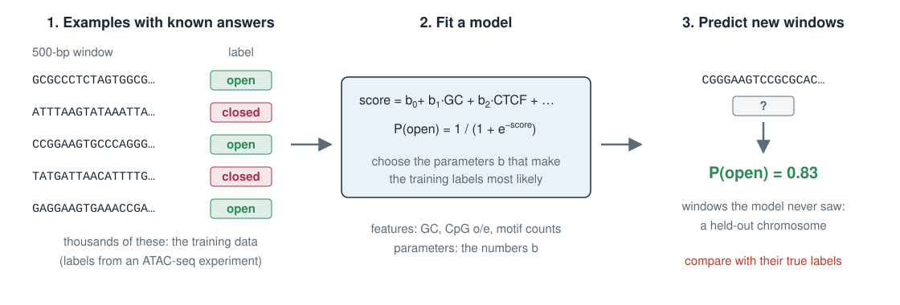{width="95%" fig-align="center"}

- **Supervised learning**: we have examples with known answers (**labels**), turn each example into numbers (**features**), and choose a model's **parameters** so that it reproduces the labels.
- Then we use the model on examples it has never seen, and check its answers against the truth.
- Different words for things you know: features = covariates / predictors; labels = response; fitting = estimation.

::: notes
The word "learning" hides nothing mysterious: it is estimating parameters from data, as in any regression. What is different from the statistics they know is the goal. In DESeq2 the goal is to estimate and test a coefficient (is gene X differentially expressed?). In machine learning the goal is usually prediction on new data, and success is measured on data that were not used for fitting. That shift of goal explains most of the vocabulary of this lecture: training and test sets, overfitting, cross-validation. The probability 0.83 on the right is illustrative.
:::

## The running example: open or closed? {.smaller}

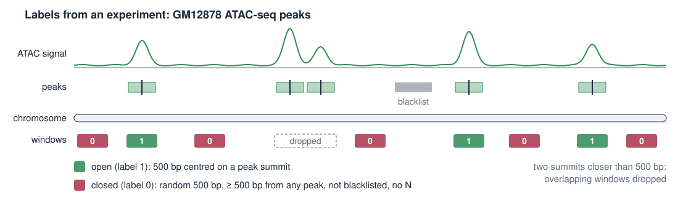{width="95%" fig-align="center"}

- **Label 1 (open)**: 500 bp around the summit of a GM12878 ATAC-seq peak. **Label 0 (closed)**: random 500-bp windows at least 500 bp from any peak.
- 20 000 of each, on chr1–22, blacklist and runs of N removed.
- The question: how much of "open in a B cell line" can be read from the sequence of the window alone?

::: notes
The labels come from an experiment, so they inherit its errors: a weak peak below the IDR threshold is labelled closed, and a few peaks are artefacts. Every label set in this field has such noise; it puts a ceiling on how well any model can do. Two details matter for later. First, the ENCODE peak file lists many regions several times with different summits (155 153 lines but 75 409 distinct regions); we keep one window per region and drop overlapping windows, otherwise near-identical windows end up as separate examples (the leakage problem of the next unit). Second, the negatives are random genome, which is mostly AT-rich, gene-poor sequence. That choice makes the task easier than it sounds, and the next unit shows how much easier.
:::

## Features: turning a window into numbers {.smaller}

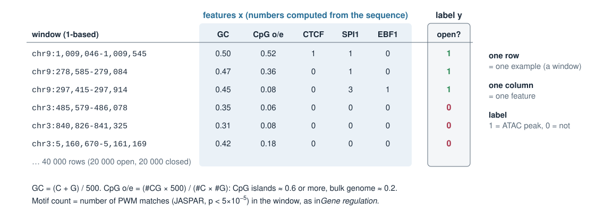{width="95%" fig-align="center"}

- One **row** per example, one **column** per feature, plus the label: the same layout as a design matrix.
- Here 5 hand-made features: **GC**, **CpG o/e** (CpG islands are open at promoters), and **motif counts** for CTCF, PU.1 (SPI1) and EBF1, TFs that open chromatin in B cells.
- Choosing features is where biology enters the model. (A CNN learns its own: *How a CNN reads DNA*.)

::: notes
Read the first rows aloud. The first window has a CTCF and a PU.1 match and a high CpG o/e; the closed windows have no motif match and lower GC. The motif counts come from motifmatchr with the JASPAR 2024 matrices (MA0139.2 CTCF, MA0080.7 Spi1, MA0154.5 EBF1) at p < 5e-5, exactly as in Gene regulation and Motifs, motif enrichment and footprinting. They are counts of matches, on purpose; a continuous motif score is a different feature and needs p.cutoff = 1 in motifmatchr, otherwise every window without a match gets score 0 (the next unit and How a CNN reads DNA show what that does to a baseline). CpG o/e is the number of CG dinucleotides relative to what the C and G counts would predict; the genome is depleted of CpG (about 0.2) because methylated C mutates to T, while CpG islands, most of which are unmethylated promoters, reach 0.6 or more.
:::

## Look at the data first {.smaller}

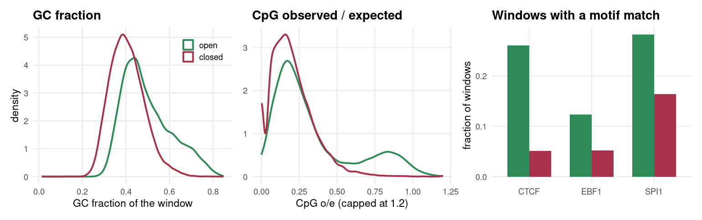{width="100%" fig-align="center"}

- Open windows are **GC-richer** (mean 0.50 vs 0.41) and more **CpG-rich** (0.34 vs 0.20).
- **26%** of open windows contain a CTCF match, against **5%** of closed ones; PU.1 28% vs 16%, EBF1 12% vs 5%.
- Every feature separates the classes a little, none cleanly: the distributions overlap.

::: notes
Always look before fitting. The overlap is the important thing: no single threshold on GC separates open from closed, so any classifier will make mistakes, and the question is how many. Note the long tail of CpG o/e in open windows: those are CpG-island promoters. Note too that 74% of open windows have no CTCF match: CTCF is one of several reasons a region is open. The motif fractions are in exercise R2.
:::

## Why not a straight line? {.smaller}

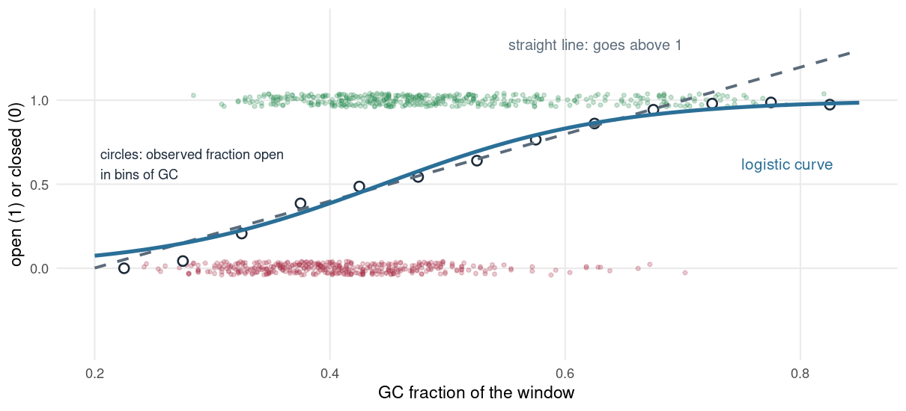{width="88%" fig-align="center"}

- A linear model `open ~ gc` predicts values **below 0 and above 1**: not probabilities.
- The fraction open (circles) rises in an **S-shape** with GC. The logistic curve has that shape and stays between 0 and 1.

::: notes
The dots are 800 training windows, jittered vertically so you can see them; they are all at 0 or 1. The circles are the observed fraction of open windows in bins of GC: this is what we want the model to capture. A straight line fitted to 0/1 data (a "linear probability model") can work in the middle but makes impossible predictions at the extremes. The fix is the same one as in a GLM for counts: model a transformed mean. For counts, DESeq2 models log(mean); for a probability, logistic regression models the log-odds.
:::

## Logistic regression: a linear model for yes/no {.smaller}

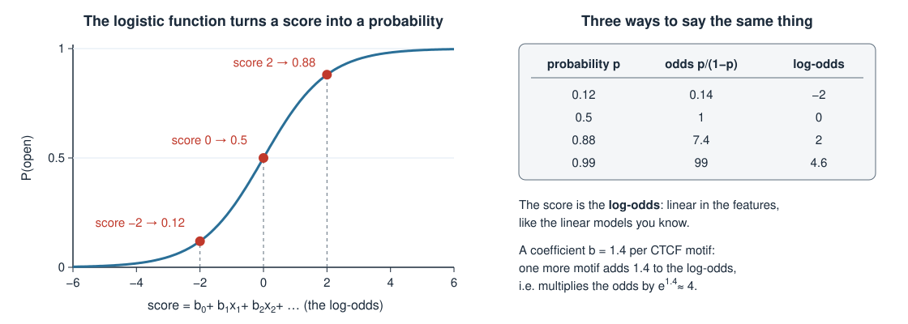{width="95%" fig-align="center"}

$$\text{score} = b_0 + b_1 x_1 + \dots + b_p x_p, \qquad P(\text{open}) = \frac{1}{1 + e^{-\text{score}}}$$

- The **score is linear** in the features, exactly like `lm`. The logistic function squeezes it into (0, 1).
- The score is the **log-odds**; $e^{b}$ is an **odds ratio**. In R: `glm(open ~ gc + ..., family = binomial)`.

::: notes
This is a generalised linear model with a binomial family and logit link, the same machinery as DESeq2's negative binomial GLM with a log link. Work through the table: probability 0.88 means odds of 7.4 to 1 and log-odds 2. The interpretation of a coefficient is additive on the log-odds scale and multiplicative on the odds scale. With our data, each additional CTCF match multiplies the odds of being open by about 4 (coefficient 1.41, holding the other features fixed). The fitted GC-only model is score = −4.57 + 10.28 × GC: a window with GC 0.4 gets score −0.46 and P(open) = 0.39; with GC 0.6, score 1.60 and P = 0.83.
:::

## Two features: a straight decision boundary {.smaller}

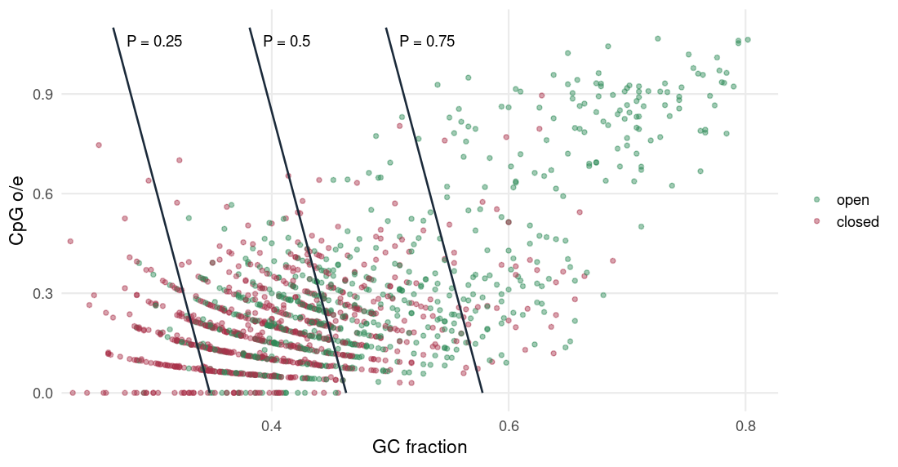{width="85%" fig-align="center"}

- With two features, the points with equal predicted probability lie on **straight lines**. The P = 0.5 line is the **decision boundary**.
- Here the lines are steep: the model leans mostly on GC; once GC is known, CpG o/e adds little.
- A linear model can only draw straight boundaries; more flexible models (and neural networks) can bend them.

::: notes
Points are 1500 test windows. Each contour is where b0 + b1 GC + b2 CpG = constant, which is a straight line in this plane (fitted: −4.42 + 9.54 GC + 0.71 CpG o/e). The steep lines say that the model leans mostly on GC: the CpG o/e coefficient is small relative to its spread, and the two features are correlated (CpG-rich windows are GC-rich). This is a general lesson: correlated features share credit, and adding a feature that is mostly redundant changes performance little (exercise R7: ROC AUC 0.712 with GC alone, 0.713 with GC and CpG o/e). It also previews the CNN unit: stacking layers of linear scores with non-linear functions in between lets a model draw curved boundaries.
:::

## How wrong is a prediction? The loss {.smaller}

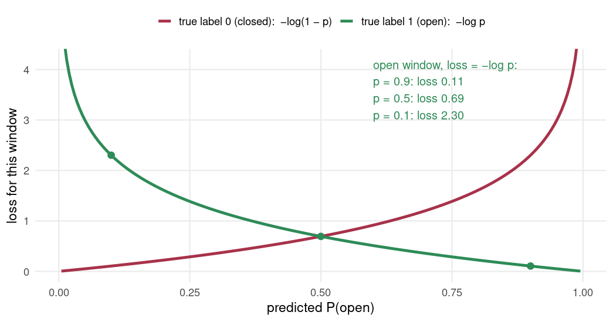{width="80%" fig-align="center"}

- For each window, **log-loss** = $-\log p$ if it is open, $-\log(1-p)$ if it is closed, where $p$ is the predicted P(open).
- Confident and right: near 0. Confident and wrong: large. The model's loss is the **mean over the training windows**.
- Minimising log-loss = **maximising the likelihood**: what `glm` does.

::: notes
The loss is the number we try to make small; everything about "training" is about this number. Log-loss is also called cross-entropy. It punishes overconfidence: predicting 0.01 for a window that turns out to be open costs 4.6, while predicting 0.5 costs 0.69 whatever happens. A model that always says 0.5 has mean loss 0.693 (log 2), which is a useful reference: our GC model reaches 0.590 on the training data. Students who know likelihoods can check that the mean log-loss is minus the binomial log-likelihood divided by n, so the glm estimate is exactly the minimum-loss estimate.
:::

## Fitting = walking downhill {.smaller}

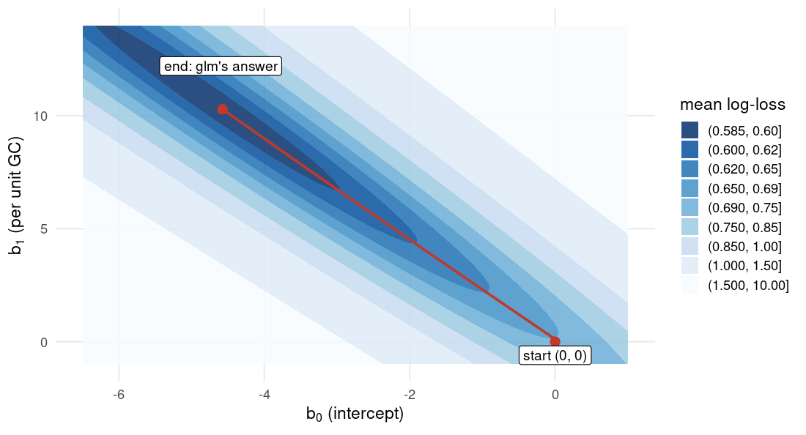{width="85%" fig-align="center"}

- Colours: the mean log-loss for every pair of parameters $(b_0, b_1)$ of the GC model. The best pair is at the bottom of the valley.
- **Gradient descent**: start anywhere, compute the slope of the loss, take a small step downhill, repeat. The red path is 2000 such steps.
- It ends where `glm` ends (−4.57, 10.28). Neural networks are fitted the same way, with millions of parameters.

::: notes
The gradient of the mean log-loss for logistic regression is remarkably simple: for each parameter, the average over windows of (predicted p − label) × feature. Each step moves the parameters a little against the gradient; the step size is the learning rate. The path first runs fast down the steep wall, then slowly along the narrow valley floor: the intercept and the GC coefficient trade off against each other (raising one and lowering the other gives almost the same predictions), which makes the valley long and thin. glm uses a smarter method (iteratively reweighted least squares) that gets there in a handful of steps, but it only works for models like this one. For a neural network there is no shortcut: gradient descent, on random subsets of the data ("stochastic"), is how every deep model is trained. Exercise R4 has the ten-line loop; students find the same coefficients as glm to four digits.
:::

## In R

```r
test  <- dat$chrom %in% c("chr8", "chr9")        # hold out two whole chromosomes
train <- dat[!test, ]; tst <- dat[test, ]

m <- glm(open ~ gc + cpg_oe + ctcf + spi1 + ebf1, family = binomial, data = train)
round(summary(m)$coefficients, 2)
#             Estimate Std. Error z value Pr(>|z|)
# (Intercept)    -4.20       0.07  -62.11        0
# gc              8.04       0.17   47.60        0
# cpg_oe          0.97       0.08   12.74        0
# ctcf            1.41       0.04   36.62        0
# spi1            0.60       0.02   26.18        0
# ebf1            0.24       0.03    8.06        0

p <- predict(m, newdata = tst, type = "response")  # P(open) for unseen windows
```

- Fit on **training** chromosomes, predict on **test** chromosomes (36 317 and 3683 windows).

::: notes
This is the whole model in three lines. Every coefficient is "significant" with p near 0, because we have 36 000 windows; that says the effects are not zero, not that the model predicts well. Prediction quality is a separate question, answered on the test chromosomes in the second half of the lecture. Why chromosomes 8 and 9 and not a random 10% of windows: neighbouring windows are related, and whole chromosomes are the simplest way to keep related windows on the same side; the next unit shows what goes wrong otherwise.
:::

## A model can fit the training data too well {.smaller}

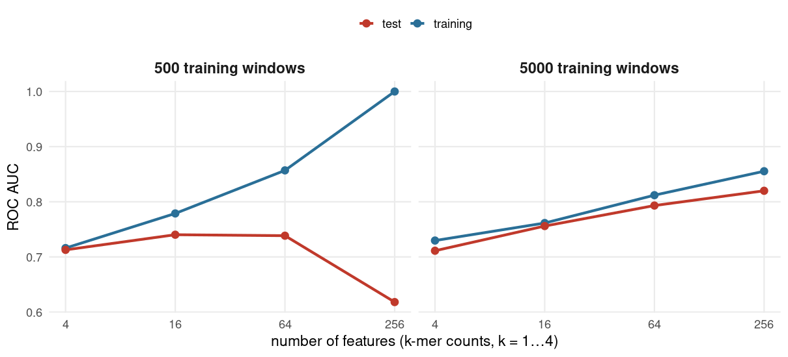{width="88%" fig-align="center"}

- Features: counts of every k-mer (k = 1…4: 4 to 256 features). With **500** training windows, 256 features fit the training data **perfectly** (AUC 1.00) but do worst on the test chromosomes (0.62).
- With **5000** windows the same 256 features generalise (test 0.82). Overfitting = many parameters relative to data.

::: notes
This is overfitting with real data. Training AUC is measured on the same 500 windows used for fitting; test AUC on chromosomes 8 and 9. With 256 parameters and 500 examples, the model can memorise noise: the training curve keeps rising, the test curve falls. The ROC AUC measure is explained later; for now read it as "higher is better, 0.5 is guessing, 1 is perfect". The lesson that matters: performance on the training data says nothing about performance on new data. And the gap depends on the ratio of parameters to examples: with ten times more data the same 256 features are useful. Methylation clocks and expression predictors routinely have more features (CpGs, SNPs) than samples, which is why the next slides matter.
:::

## Three sets, three jobs {.smaller}

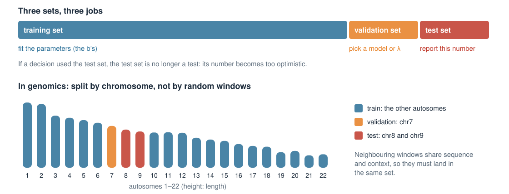{width="92%" fig-align="center"}

- **Training** fits the parameters; **validation** (or cross-validation) chooses between models and settings; **test** is used **once**, at the end.
- In genomics, split by **chromosome**, so that neighbouring and overlapping windows cannot sit on both sides.

::: notes
The test set estimates how the final model will perform on new data. Every time a decision is based on test performance (keep this feature? this model? this threshold?), the test set becomes part of the training process, and its number becomes optimistic. With enough such decisions you can overfit the test set as easily as the training set. The validation set exists so the test set can stay untouched. In genomics the standard is to hold out whole chromosomes: here chr8 and chr9 for testing, as in DeepSEA and many later papers, and chr7 could serve as validation. Within the training chromosomes, cross-validation (next slides) replaces a fixed validation set.
:::

## Regularisation: penalise large coefficients {.smaller}

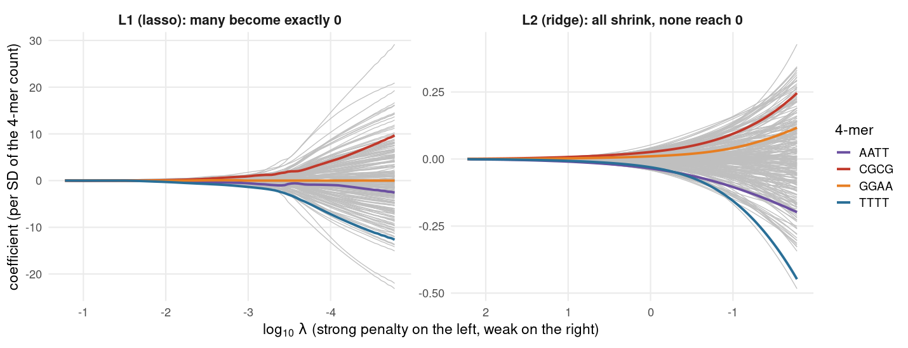{width="100%" fig-align="center"}

- Minimise **loss + λ × penalty**. **L2 (ridge)**: penalty $\sum b_j^2$, all coefficients shrink. **L1 (lasso)**: $\sum |b_j|$, many become **exactly 0**: feature selection.
- **Elastic net** mixes both. λ is a **hyperparameter**: not fitted from the training loss, chosen on held-out data.

::: notes
Read the plot from left (strong penalty, all coefficients near 0) to right (weak penalty, close to the unpenalised fit that overfitted). Coloured lines are four example 4-mers: CGCG (CpG-rich), TTTT, GGAA (the core of the ETS motif bound by PU.1), AATT. With ridge they all shrink smoothly; with lasso they enter the model one by one, and at the λ chosen by cross-validation only 47 of 256 4-mers have a non-zero coefficient (exercise R9). This is exactly how epigenetic clocks are built: Horvath's clock is an elastic-net regression of age on about 21 000 CpGs (450K and 27K array overlap), which selected 353 CpGs. With more features than samples, an unpenalised fit is impossible or meaningless, and the penalty is what makes the model generalise. In R: glmnet, with alpha = 0 (ridge), 1 (lasso) or in between (elastic net).
:::

## Cross-validation {.smaller}

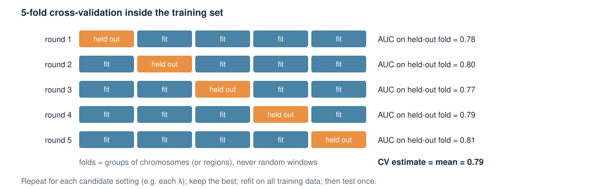{width="92%" fig-align="center"}

- Split the **training** data into k folds; fit on k − 1, evaluate on the held-out fold; rotate; average.
- Every training window is used for evaluation once, and the test set is never touched.
- In genomics, make folds from **groups of chromosomes**, for the same reason as the test split.

::: notes
Cross-validation estimates performance on new data using only the training set, which is what we need to choose λ, compare feature sets, or decide between models. With 5 folds, each model is fitted 5 times. The AUC values in the figure are illustrative. Two traps: first, the folds must respect the structure of the data, so here folds are groups of chromosomes (glmnet's foldid argument), not random windows. Second, the CV estimate of the chosen setting is slightly optimistic, because we picked the best of many; the untouched test set corrects for that. For final-year students: if they ever see "we selected features on the whole data set, then cross-validated the classifier", that is leakage; the selection must happen inside each fold.
:::

## Choosing λ by cross-validation {.smaller}

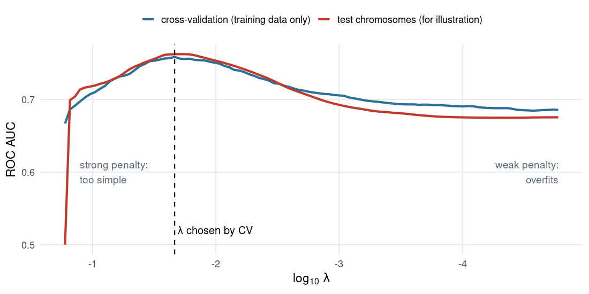{width="85%" fig-align="center"}

- Blue: cross-validated AUC on the 500 training windows, for each λ of the lasso. Red: AUC on the test chromosomes, shown only for illustration.
- Strong penalty: too simple. Weak penalty: overfits. The CV curve finds the useful middle, and tracks the test curve.

::: notes
cv.glmnet fits the whole path of λ values on each fold and reports the mean held-out AUC. The dashed line marks lambda.min, the λ with the best cross-validated AUC. The test curve is drawn to show that cross-validation is a good guide; in a real analysis we would not compute it for all λ, only for the chosen one. Here CV picks a λ that keeps 59 of the 256 4-mers, with cross-validated AUC 0.76 and test AUC 0.76: the CV estimate is honest. Read the right-hand end: as the penalty weakens, the lasso approaches the unpenalised 256-feature model and the test AUC falls to about 0.68, on its way to the 0.62 of the overfitting slide (glmnet stops its path before the penalty reaches zero). The CV curve here uses AUC as its measure; exercise R9 uses the default (deviance) and keeps 47 4-mers.
:::

## From probabilities to calls {.smaller}

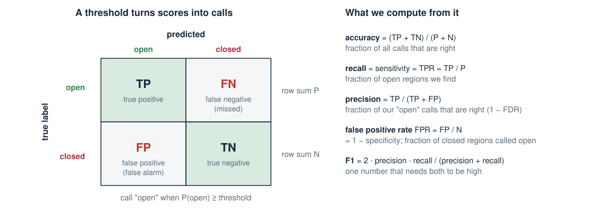{width="95%" fig-align="center"}

- A model gives a **score** or probability. A **threshold** turns it into calls, and the calls into a **confusion matrix**.
- GC model, threshold 0.5, test chromosomes: TP 936, FN 756, FP 550, TN 1441: accuracy 0.65, precision 0.63, recall 0.55.

::: notes
These four numbers are the basis of every metric. Recall (sensitivity, true positive rate) is about the open regions: how many we find. Precision is about our calls: how many of the regions we call open really are; it is 1 minus the false discovery rate, the quantity students know from multiple testing. The false positive rate is about the closed regions. Compute the example on the board: precision 936/(936 + 550) = 0.63, recall 936/(936 + 756) = 0.55, FPR 550/(550 + 1441) = 0.28, accuracy (936 + 1441)/3683 = 0.65. These come from exercise R5.
:::

## The threshold is a choice {.smaller}

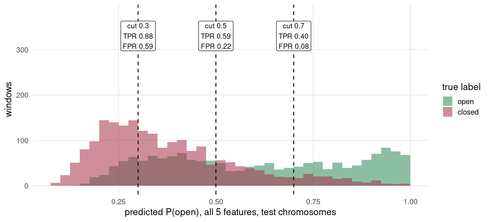{width="88%" fig-align="center"}

- Predicted P(open) from all five features, for open and closed test windows. The two distributions **overlap**.
- A low threshold finds more open regions (higher TPR) but calls more closed ones open (higher FPR); a high threshold the reverse.

::: notes
No threshold gives perfect calls because the distributions overlap. Which threshold to use depends on the cost of each error: to choose candidate enhancers for an expensive CRISPR screen you want high precision; to make sure no candidate is missed you want high recall. The three labels give the TPR and FPR for thresholds 0.3, 0.5 and 0.7 (printed by the figure script). Since the threshold is a choice, we want a summary of the model that does not depend on it: the ROC and PR curves.
:::

## The ROC curve, by hand {.smaller}

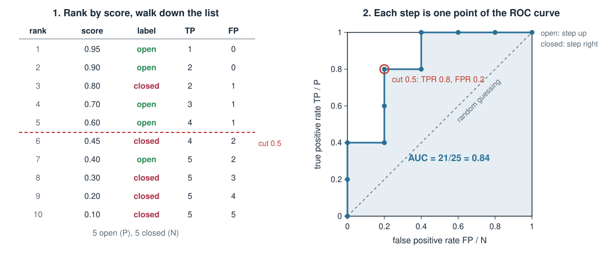{width="95%" fig-align="center"}

- Sort by score; walk down the list. Each **open** window moves the curve **up** (one more TP), each **closed** window **right** (one more FP).
- **AUC** (area under the ROC curve) = the probability that a random open window scores higher than a random closed one: here 21 of the 25 (open, closed) pairs are ordered correctly.

::: notes
This is the exam version: be able to draw the ROC curve from a ranked list and compute the AUC by counting pairs. Ten windows: 5 open, 5 closed. Each threshold between two neighbouring scores gives one point (FPR, TPR). Pair counting: the open windows at 0.95 and 0.90 beat all 5 closed ones (10 pairs), those at 0.70 and 0.60 beat 4 each (8), the one at 0.40 beats 3: 21 of 25 = 0.84. AUC 0.5 is random ordering, 1.0 is perfect. Ties count as half a pair. The red circle is the threshold-0.5 point: TPR 0.8, FPR 0.2.
:::

## ROC curves on real data {.smaller}

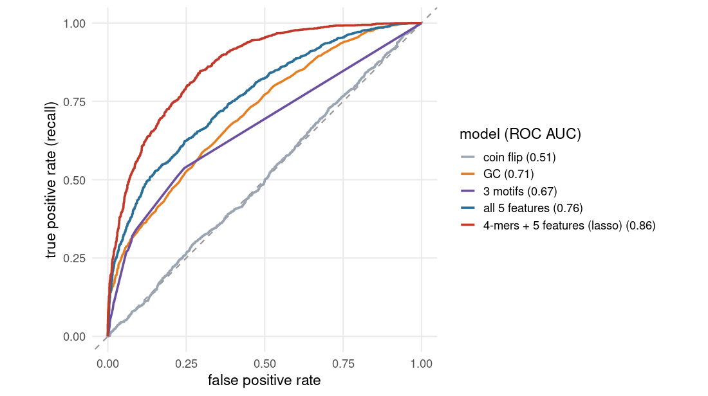{width="80%" fig-align="center"}

- GC alone: **0.71**. Three motif counts: 0.67. All five features: **0.76**. Lasso on 256 4-mers: 0.83; plus the five features: **0.86**. Coin flip: 0.51.
- The ROC curve does not depend on a threshold or on how many open vs closed windows there are.

::: notes
All curves are on the 3683 test windows of chr8 and chr9. Features combine: GC and motifs each carry part of the information, together more. The lasso on 4-mer counts captures many short motifs at once (including the ETS core GGAA, CpG-containing words, AT-rich words that mark closed DNA) and is the best of these models. Note that the motif model's curve ends in one long straight segment: 62% of test windows have zero matches for all three motifs and get exactly the same score. Tied scores move up and right together (a diagonal), which is why the exercise's ROC code has to handle ties; a naive implementation that breaks ties by row order reports 0.86 for the motif model instead of 0.67, because all open windows come first in the table.
:::

## Precision–recall curves {.smaller}

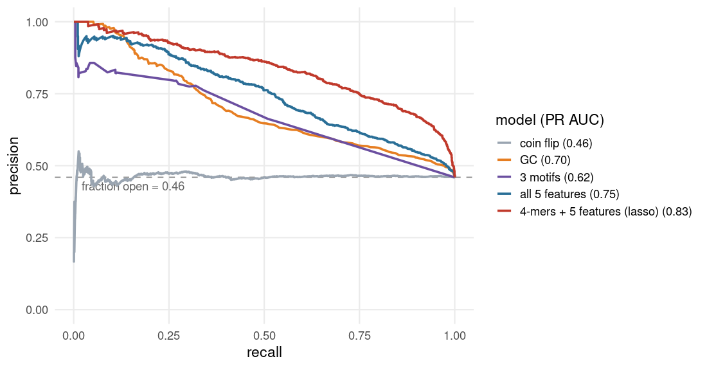{width="80%" fig-align="center"}

- Precision against recall over all thresholds. A random model sits at the **fraction of positives** (0.46 here), not at 0.5.
- **PR AUC** (average precision) answers: when the model calls something open, how often is it right?

::: notes
The PR curve uses the same ranked list as the ROC curve, but plots precision (TP / calls) instead of FPR. Where the ROC curve looks at the closed windows through FPR, the PR curve looks at our calls. At the far left, the model calls only its most confident windows: for the lasso model precision is near 1, for the motif model it is lower because the top-scoring windows (two or three motif matches) are a mix. The baseline of a random model is the prevalence, here 1692 open of 3683 test windows = 0.46. This matters on the next slide.
:::

## Class imbalance {.smaller}

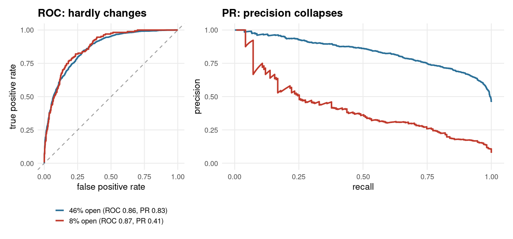{width="95%" fig-align="center"}

- In the genome, open regions are a few per cent, not half. Keep all closed test windows and only 10% of open ones (**8% open**): ROC AUC barely moves (0.86 → 0.87); **PR AUC falls from 0.83 to 0.41**.
- Always predicting "closed" now has **92% accuracy**. Accuracy is useless when classes are imbalanced.

::: notes
The model is the same; only the test set changed. TPR and FPR are each computed within one class, so the ROC curve does not care about the ratio of classes (the small difference is sampling noise). Precision mixes the classes: with 11 closed windows per open one, even a small FPR produces many false positives, so precision drops. Which one to report? In genomics the real task is usually imbalanced (finding binding sites in a genome, finding the causal variant among thousands), so the PR curve is closer to what a user experiences; Saito and Rehmsmeier (2015) make this point. Always report the prevalence with a PR AUC, and never compare PR AUCs across data sets with different prevalence. The balanced 50:50 test sets of many papers make precision look much better than it would be genome-wide.
:::

## Always compare with a baseline {.smaller}

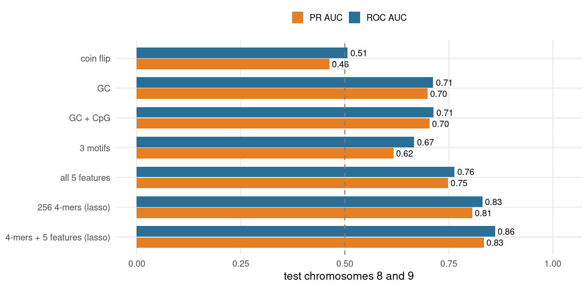{width="85%" fig-align="center"}

- A number like "AUC 0.86" means nothing alone. Compare with: a **coin flip** (0.5), the **majority class**, and the **simplest sensible model** (here GC alone: 0.71).
- The question is never "is the AUC high?" but "how much does the model add over the simple explanation?"

::: notes
The ladder of models on chr8 and chr9: coin flip, GC, GC plus CpG o/e, three motifs, all five, 256 4-mers with lasso, and 4-mers plus the five features. GC alone already gets 0.71, so a fancy model reporting 0.75 has added little. In this data set, GC is a strong baseline partly because of how we chose the negatives: random genome is AT-rich, and the open windows include many GC-rich CpG-island promoters. The next unit shows that with GC-matched negatives the GC model drops to chance, and only sequence features beyond GC remain. A good paper reports its baselines; a reviewer asks for them when they are missing.
:::

## What do the coefficients say about biology? {.smaller}

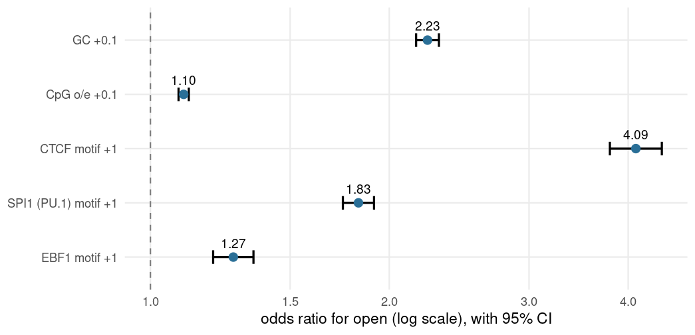{width="70%" fig-align="center"}

- Odds ratios from the five-feature model: each CTCF match ×**4.1** odds of being open, PU.1 ×**1.8**, EBF1 ×**1.3**, +0.1 GC ×**2.2**.
- These are **associations given the other features**, not causal effects: a coefficient changes when correlated features are added or removed.

::: notes
It is tempting to read a model as biology: "CTCF opens chromatin four times more than PU.1". Be careful. The coefficient of each feature is conditional on the others in the model; GC and CpG o/e are correlated, and so are motif counts and GC (the CTCF motif is GC-rich). The data are observational: a motif match in an open region does not show that the motif opened it. Still, the ranking is biologically sensible: CTCF sites are among the most consistently accessible sites across cell types, PU.1 is a pioneer factor in B cells and macrophages, and EBF1 is a B-cell factor whose motif is rarer. Causal tests need perturbation: mutating the motif (in silico in the variant-effect unit, in cells by CRISPR). The confidence intervals are narrow because n is large; that is precision, not truth.
:::

## Summary {.smaller}

| idea | key fact |
|---|---|
| supervised learning | examples with labels → features → model parameters fitted to reproduce labels |
| logistic regression | linear score = log-odds; $P = 1/(1+e^{-\text{score}})$; $e^b$ is an odds ratio |
| loss, fitting | log-loss = −log likelihood; gradient descent walks downhill; glm finds the same minimum |
| overfitting | many parameters, few examples: perfect on training, poor on new data |
| train / validation / test | fit / choose / report once; split by chromosome in genomics |
| regularisation | L2 shrinks, L1 selects (elastic net: both); λ chosen by cross-validation |
| confusion matrix | precision = TP/(TP+FP), recall = TPR = TP/P, FPR = FP/N |
| ROC AUC | P(random positive outranks random negative); 0.5 = chance; insensitive to class balance |
| PR AUC | baseline = fraction of positives; drops with imbalance; closer to real genome-wide use |
| baselines | always report the simple model (coin flip, GC, motif) next to the fancy one |

::: notes
Students should leave able to: write the logistic model and turn a score into a probability; explain why training performance is not evidence; compute precision, recall, FPR and accuracy from a confusion matrix; draw an ROC curve from a short ranked list and compute its AUC by counting pairs; explain why PR AUC falls with class imbalance while ROC AUC does not; and ask for the baseline. Next: What people try to predict, and how to tell if it works, which applies these tools to the field's big models and to the traps specific to genomic data.
:::

## Key papers (optional further reading) {.smaller}

*Not required reading and not examined. For those who want the primary literature.*

- Libbrecht & Noble 2015, *Nat Rev Genet*. [Machine learning applications in genetics and genomics](https://doi.org/10.1038/nrg3920). A readable overview for biologists: supervised vs unsupervised, features, evaluation.
- Greener et al. 2022, *Nat Rev Mol Cell Biol*. [A guide to machine learning for biologists](https://doi.org/10.1038/s41580-021-00407-0). From logistic regression to deep learning, with practical advice on data splits.
- Friedman, Hastie & Tibshirani 2010, *J Stat Softw*. [Regularization paths for generalized linear models via coordinate descent](https://doi.org/10.18637/jss.v033.i01). The glmnet paper: lasso, ridge and elastic net in practice.
- Horvath 2013, *Genome Biol*. [DNA methylation age of human tissues and cell types](https://doi.org/10.1186/gb-2013-14-10-r115). An elastic-net model that selected 353 CpGs: regularisation making a famous biological predictor.
- Saito & Rehmsmeier 2015, *PLoS ONE*. [The precision-recall plot is more informative than the ROC plot when evaluating binary classifiers on imbalanced datasets](https://doi.org/10.1371/journal.pone.0118432). Why the PR curve matters for genome-wide tasks.
