## About this lecture

*Machine learning from scratch* fitted a logistic regression on features we chose (GC content, motif counts). A **convolutional neural network** (CNN) learns its own features directly from the DNA sequence. This lecture opens the box:

- **One-hot encoding**: DNA as a matrix of numbers.
- A **convolutional filter is a PWM** that slides along the sequence; ReLU and **max pooling** turn its scores into "is the motif there?".
- A dense layer with a sigmoid on top: **logistic regression on learned features**.
- **Training**: loss, gradient descent, epochs, validation, early stopping, in pictures.
- Real data: a small CNN that tells **GM12878 CTCF peaks** from GC-matched background, its test performance, and **what its filters learned**.

::: notes
This is the third unit of the machine-learning block. Students have seen supervised learning, logistic regression, train/validation/test splits by chromosome, overfitting and ROC curves in Machine learning from scratch, and the map of prediction tasks and the evaluation traps in What people try to predict, and how to tell if it works. Here we take one task, TF binding from sequence, and one model class, the CNN, and look inside it. No equations beyond what they know from logistic regression: the point is that every piece of a CNN maps onto something from the motif units (Gene regulation; Motifs, motif enrichment and TF footprinting). The exercise trains exactly the model described here, in R with the torch package, on a laptop CPU in about five minutes. The next unit, What did the model learn? Variant effects, interprets this trained model and uses it to score genetic variants.
:::

## The task: is this 200 bp bound by CTCF? {.smaller}

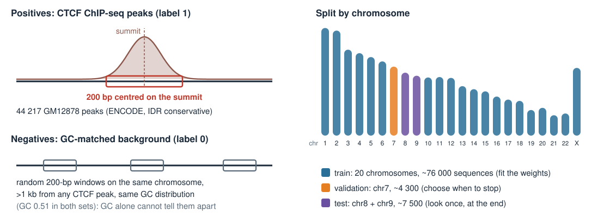{width="95%" fig-align="center"}

- **Positives**: 200 bp centred on each of the 44 217 GM12878 CTCF peak summits. **Negatives**: random windows with the **same GC distribution**, more than 1 kb from any peak.
- Split by **chromosome**: train on 20, validate on chr7, test on chr8 + chr9, as in *Machine learning from scratch*.
- Balanced classes: 44 217 positives, 43 586 negatives.

::: notes
Same framing as the earlier ML units: GM12878, held-out chromosomes, GC-matched negatives. Why GC-matched: CTCF peaks are GC-rich (51% against a genome average of 41%), so with random background a model can score well by learning GC content alone; What people try to predict showed this with logistic regression. With matched negatives, GC content has a test AUC of 0.51: whatever the model learns must be sequence beyond composition. Why whole chromosomes: neighbouring windows share sequence and repeats; splitting by chromosome keeps any test sequence far from every training sequence. Numbers per split: train 38 270 positives and 37 745 negatives, validation (chr7) 2169 and 2141, test (chr8 + chr9) 3778 and 3700. A few GC bins have fewer candidate background windows than peaks, which is why there are 631 fewer negatives than positives. Simplification: the labels come from one ChIP-seq experiment thresholded by IDR, so some "negatives" are weakly bound sites and some peaks are noise; every model inherits this label noise.
:::

## The baseline: scan with the CTCF PWM {.smaller}

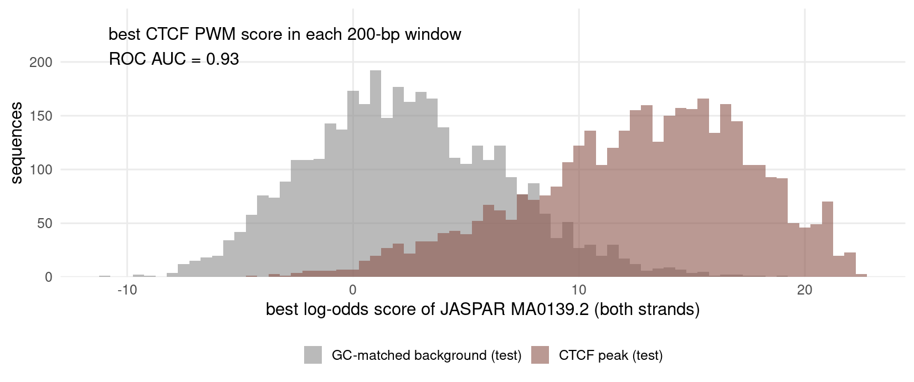{width="88%" fig-align="center"}

- Score each window by its **best match** to the JASPAR CTCF matrix (both strands): test AUC **0.93**.
- A strong baseline, but the distributions overlap: some peaks have only a weak match, and some background windows a good one.
- Can a model that **learns** its motifs from the 76 000 training sequences do better?

::: notes
This is the PWM from Gene regulation: log-odds weights summed over 15 positions, maximum over all windows and both strands. motifmatchr reports that maximum with out = "scores", but only for windows that contain a match above its p-value cutoff, unless p.cutoff = 1: with the default, 62% of test windows get a score of 0 and the AUC drops to 0.84, a trap the exercise shows. Medians: 13.1 in peaks and 2.0 in background. The AUC of 0.93 is the number to beat; any CNN result should be reported next to such a simple baseline, as the earlier ML units insisted. Why the PWM is imperfect: it was built from 913 sites and summarises CTCF in 15 independent columns; it ignores the flanks (CTCF has an upstream motif module bound by more zinc fingers), it cannot use any other sequence features of bound sites, and a peak without a strong match may be bound through a weaker site or indirectly. A model trained on these peaks can learn all of that, but it can also learn the biases of this experiment; we come back to that.
:::

## DNA as numbers: one-hot encoding {.smaller}

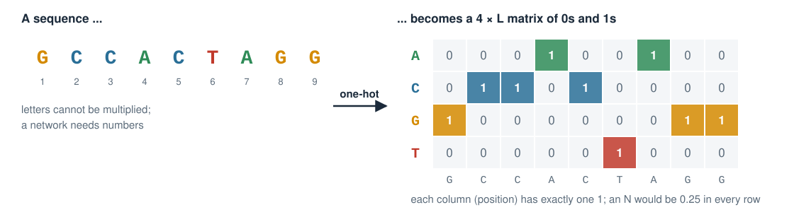{width="92%" fig-align="center"}

- Each base becomes a column with one 1 and three 0s: a 200-bp sequence is a **4 × 200 matrix**.
- No base is "bigger" than another (coding A = 1, C = 2, G = 3, T = 4 would invent an order).
- This is the input to every sequence model in this lecture, from our 2 500-parameter CNN to AlphaGenome.

::: notes
One-hot encoding is the same idea as dummy variables for a factor in a linear model: a factor with four levels becomes indicator columns. Here we keep all four (no reference level) because we never fit an intercept per position. An N is either all zeros (Enformer) or 0.25 in every row; we removed windows with N. The order of rows does not matter, but must be fixed: A, C, G, T in this course, like a PWM. A batch of sequences is a 3-dimensional array: sequences × 4 × positions. In torch this is the layout that nn_conv1d expects (batch, channels, length): the four bases are the input channels, like the red, green and blue channels of an image.
:::

## A convolutional filter is a PWM {.smaller}

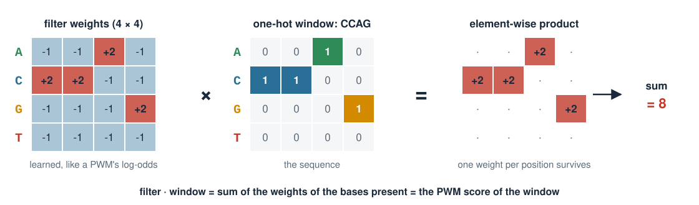{width="95%" fig-align="center"}

- A filter is a **4 × k matrix of weights**, like a PWM. Multiply it element-wise with a one-hot window and add everything up.
- Only the weight of the base that is present survives in each column: the result **is the PWM score** of the window.
- Difference: a PWM is computed from known sites; a filter's weights are **learned** from labelled sequences.

::: notes
Work through the figure: the toy filter prefers C, C, A, G (+2 each), and every other base costs −1. The window CCAG scores 2 + 2 + 2 + 2 = 8, the maximum. This is the scalar product of two 4 × 4 matrices, which is why a convolutional layer is just many such products. The link to Gene regulation is exact: there, a PWM weight was log2(p/q) from counts; here the weights can be any real numbers, chosen by training so that the network's predictions are good. Nothing forces them to look like log-odds, and they are on an arbitrary scale; that is why, to compare a filter with JASPAR, we later look at the sequences that activate it rather than at the raw weights. The exercise B2 does this calculation by hand.
:::

## Sliding the filter: convolution {.smaller}

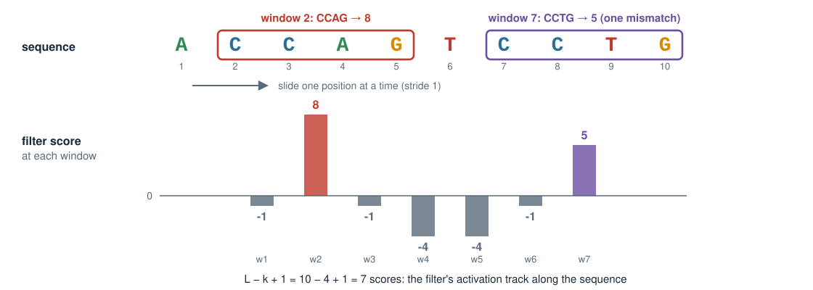{width="95%" fig-align="center"}

- Slide the filter one base at a time and record the score at each position: an **activation track**. A width-19 filter on 200 bp gives 182 scores.
- A match scores high (CCAG: 8); one mismatch scores less (CCTG: 5); unrelated sequence is negative.
- A filter reads **one strand**. A site on the other strand needs another filter (the reverse complement), which the network learns too.

::: notes
"Convolution" is the name from signal processing (strictly, deep-learning libraries compute a cross-correlation; the difference is only whether the filter is flipped and does not matter when the weights are learned). The same weights are used at every position: this weight sharing is why a CNN can find a motif anywhere in the window with few parameters, and it is exactly what a PWM scan does. Length: L − k + 1 positions without padding. Strands: the toy filter does not see CTGG, the reverse complement of CCAG. CTCF sites occur in both orientations, so the trained network ends up with filters for both: we will see that in its filters. Some models build in strand symmetry (for example by scoring the reverse complement too and averaging); ours simply learns both.
:::

## Bias, ReLU and max pooling {.smaller}

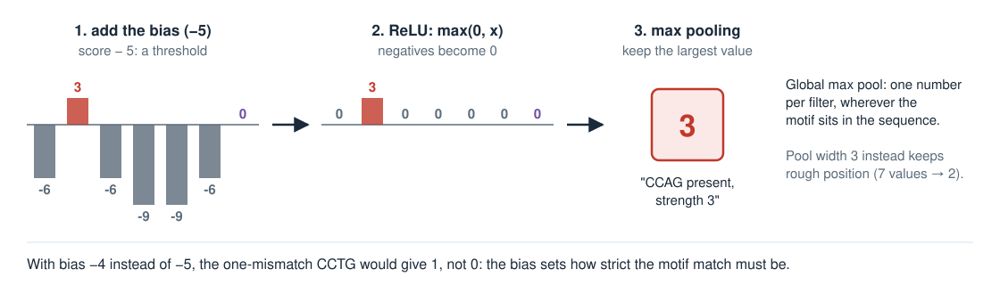{width="95%" fig-align="center"}

- Add a **bias** (one per filter): a learned threshold. **ReLU**, max(0, x), keeps only the positions that pass it.
- **Max pooling** keeps the largest value: with global max pooling, one number per filter says how well its motif is present anywhere in the window.
- This is a PWM scan with a threshold, as in *Gene regulation*, except that threshold and weights are learned.

::: notes
ReLU (rectified linear unit) is the simplest non-linearity: without it, stacking layers would collapse into one linear function. The bias of −5 makes the toy filter strict: only a perfect CCAG passes. With −4, the one-mismatch CCTG would also count, with activation 1. Max pooling over a short window (say 4 or 10 positions) keeps rough positions and is used between layers in deeper networks (DeepSEA, Basset); global max pooling throws position away completely, which suits a question like "is there a CTCF site anywhere in these 200 bp?". Our exercise model uses global max pooling. Other choices: average pooling (how much motif overall), or keeping all positions for a dense layer (position-specific, more parameters).
:::

## The whole network {.smaller}

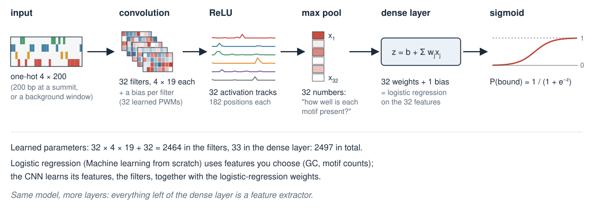{width="95%" fig-align="center"}

- 32 filters of width 19 → ReLU → global max pool → 32 numbers → a **dense layer** with a sigmoid → P(bound).
- The last step is **logistic regression**, with the 32 filter outputs as its features. Training learns the filters and the regression weights **together**.
- 2 497 parameters, trained on 76 015 sequences.

::: notes
This is the exact model of the exercise. Count the parameters: each filter has 4 × 19 = 76 weights and one bias, so 32 × 77 = 2464; the dense layer has 32 weights and one bias. That is tiny by deep-learning standards (DeepSEA had tens of millions, Enformer about 250 million), which is why it trains on a laptop. Compare with Machine learning from scratch: there, the features were chosen by hand (GC, CpG o/e, three motif counts, or 256 4-mer counts) and only the regression weights were fitted. Here the features themselves are fitted. The word "deep" means more layers between the input and the final regression; each layer is the same kind of operation. The output is a logit z (log-odds of being bound), turned into a probability by the sigmoid, exactly as in logistic regression; in the next unit we will work on the logit scale.
:::

## Deeper layers combine motifs {.smaller}

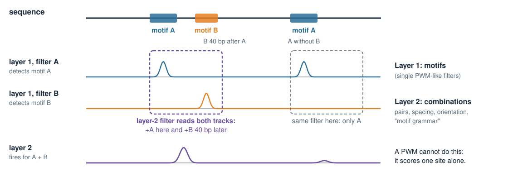{width="95%" fig-align="center"}

- A second convolutional layer reads the **activation tracks** of the first layer: its filters respond to **combinations** of motifs at a given spacing and orientation.
- That is the "**motif grammar**" a PWM cannot represent: pairs of TFs, helical spacing, a required partner.
- More layers also see further: each layer widens the stretch of DNA that one output depends on (its **receptive field**).

::: notes
Layer 1 learns motifs; layer 2 learns arrangements of motifs; further layers, arrangements of arrangements. This is the general architecture of DeepSEA, Basset and their successors (three or more convolutional layers with pooling in between). For CTCF a second layer could, for example, learn the core motif together with the upstream motif module that some CTCF sites have about 20 bp away. Our exercise model has a single convolutional layer on purpose: it is easy to interpret (each filter is a motif, and the output is a weighted sum of motif presence), and for CTCF most of the information is in one long motif. The receptive field of a stack of layers grows with depth and with pooling; BPNet and Enformer grow it with dilated convolutions or attention, as we will see at the end and in the next unit.
:::

## How wrong is a prediction? The loss {.smaller}

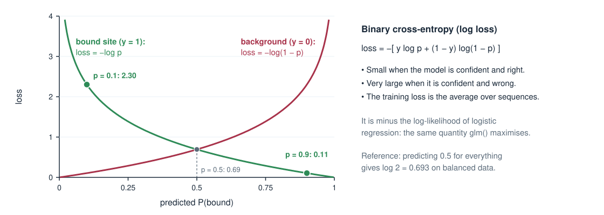{width="95%" fig-align="center"}

- The **binary cross-entropy** (log loss) from *Machine learning from scratch*: small when confident and right, very large when confident and wrong.
- The network's loss is the **average** over the sequences. Training = finding weights that make it small.
- Reference values: 0.693 for always predicting 0.5; our trained CNN reaches about **0.20** on the validation chromosome.

::: notes
This is the same loss that glm() minimises for logistic regression (it is minus the log-likelihood of the Bernoulli model). Two examples: a bound site predicted at 0.9 costs −log 0.9 = 0.11; predicted at 0.1 it costs 2.30. A balanced data set predicted at 0.5 everywhere costs log 2 = 0.693 per sequence: the starting point of training, since an untrained network predicts close to 0.5. The validation loss of the trained model is 0.197 (exercise R5). In torch the sigmoid and the loss are computed together (nn_bce_with_logits_loss) because that is numerically more stable than computing p first and then its logarithm. Logistic regression has a unique optimum; a neural network has many, which is the next slide.
:::

## Gradient descent {.smaller}

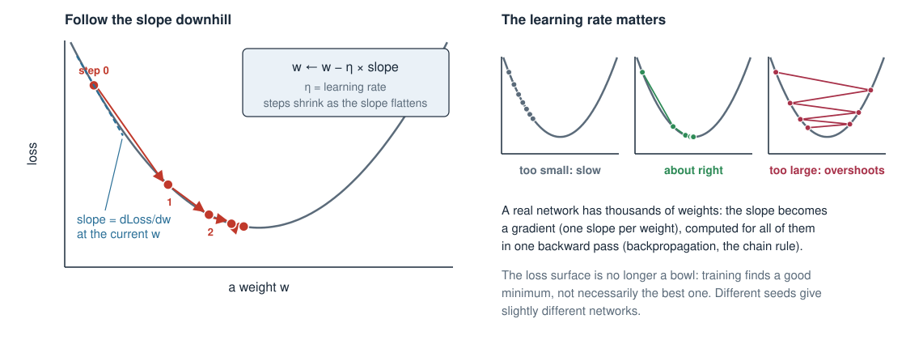{width="95%" fig-align="center"}

- Compute the **slope** of the loss with respect to each weight (the **gradient**) and take a small step downhill. Repeat.
- The **learning rate** η sets the step size: too small is slow, too large overshoots and never settles.
- **Backpropagation** computes all 2 497 slopes in one pass backwards through the network: the chain rule, done by the computer.

::: notes
For logistic regression the gradient has a simple form that students can compute by hand: for one sequence, the derivative of the loss with respect to the logit is p − y (prediction minus label), and with respect to a weight w_j it is (p − y) x_j. The exercise B4 does one update by hand. In a CNN the same chain rule passes this error signal back through the dense layer, the max pooling (only the winning position gets a gradient), the ReLU (only positions above the threshold) and into the filter weights: the filter weights at the bases of the best-scoring window move towards "more of this" in bound sequences and "less of this" in background. torch records the operations of the forward pass and computes all gradients with loss$backward(). We use Adam, a variant of gradient descent that adapts the step size for each weight; the idea is the same. Because the loss surface of a network is not a bowl, the result depends on the random starting weights; we fix the seed so that everyone gets the same model.
:::

## Training: mini-batches and epochs {.smaller}

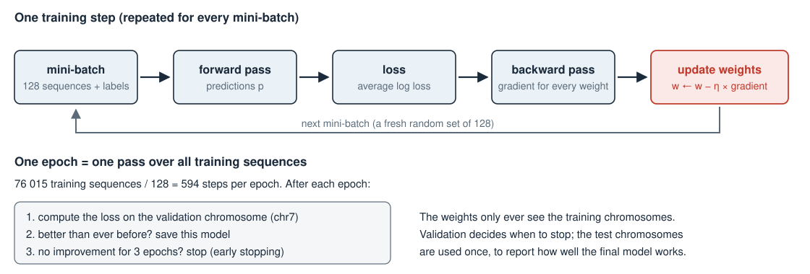{width="95%" fig-align="center"}

- Each step uses a random **mini-batch** of 128 sequences: cheap, slightly noisy gradient steps. One **epoch** is one pass over all training sequences.
- After each epoch, compute the loss on the **validation** chromosome; keep the best model; stop when it no longer improves (**early stopping**).
- The test chromosomes are not touched until the very end.

::: notes
Why mini-batches: the gradient over all 76 000 sequences would be exact but expensive, and the noise of small batches even helps to escape poor regions of the loss surface. Batch size, learning rate, number of filters and filter width are hyperparameters: they are set by us, not by gradient descent, and are chosen on the validation set (or with cross-validation over chromosomes). In the exercise: Adam with learning rate 0.001, batches of 128, at most 20 epochs, patience 3. One epoch is 594 steps; on four CPU threads an epoch takes about 15–20 seconds. Early stopping is a form of regularisation: it stops before the network starts to memorise the training sequences. Saving the best model (torch_save) is also how we pass the model to the next unit.
:::

## Real data: learning curves {.smaller}

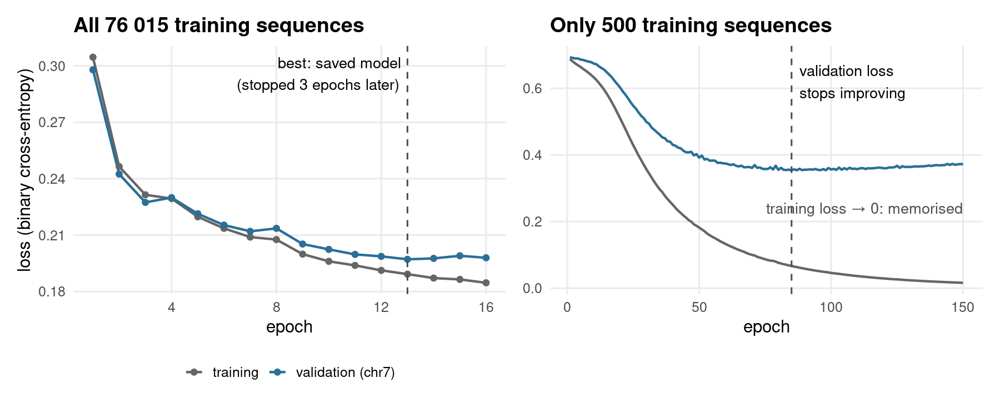{width="95%" fig-align="center"}

- **Left**: with 76 015 training sequences the validation loss follows the training loss; best at epoch 13 (validation loss 0.197), stopped at epoch 16.
- **Right**: the same network with only **500** training sequences memorises them (training loss → 0.02) while validation stalls at about 0.36: **overfitting**.
- The gap between the curves, not the training loss, tells you how well the model will do on new DNA.

::: notes
Both runs use the same seed and architecture (exercise R5 and R7). Left: training and validation loss start at about 0.30 after the first epoch and drop to 0.19 and 0.20; the curves stay together because 2 497 parameters are few compared with 76 000 training sequences. The model stopped at epoch 16 after three epochs without improvement and the saved model is the one from epoch 13. Right: with 500 sequences the network has five training sequences per parameter; it can fit them almost perfectly (training loss 0.016 at epoch 150) but the validation loss levels off around 0.36 and creeps up again after its minimum at epoch 85 (0.354; 0.372 at epoch 150); the test AUC of this model is 0.919 against 0.972. Students should read this plot in the exam: which curve is which, where to stop, is the model overfitting? This is the same picture as the overfitting slide of Machine learning from scratch, now for a neural network.
:::

## Choices you make (hyperparameters)

| choice | in our model | what it controls |
|---|---|---|
| number of filters | 32 | how many motifs the first layer can learn |
| filter width | 19 bp | longest motif one filter can see (CTCF core: ~15–20 bp) |
| pooling | global max | presence anywhere vs position |
| layers | 1 convolutional + 1 dense | motif combinations, receptive field |
| learning rate, batch size | 0.001, 128 | speed and stability of training |
| regularisation | early stopping | dropout, weight decay are common alternatives |
| input length | 200 bp | how much context the model sees |

- Choose them on the **validation** set, never on the test set. The data (positives, negatives, splits) matter more than most of these.

::: notes
A text slide to collect the knobs. Dropout randomly switches off units during training so that the network cannot rely on any single one; weight decay adds an L2 penalty to the weights, exactly the ridge penalty of Machine learning from scratch. More filters than motifs is normal: the network learns redundant copies and some filters that are barely used, as we will see. A practical rule from the literature (Koo and Eddy 2019): first-layer filters are most interpretable as motifs when the network pools heavily after the first layer, as ours does; deeper networks with little pooling spread a motif over several filters. The single most important choice is the data: what counts as a positive (IDR threshold, peak width), which negatives (What people try to predict showed how they change the task), and which chromosomes are held out.
:::

## Real data: test performance {.smaller}

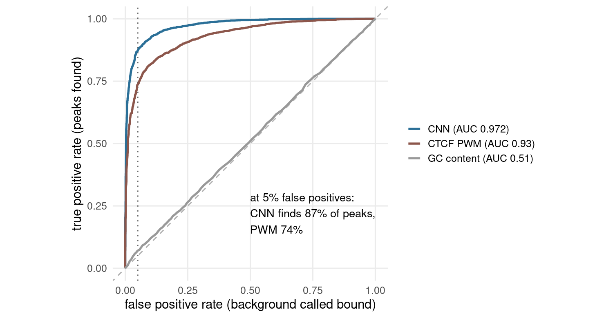{width="80%" fig-align="center"}

- On the held-out chr8 and chr9: **CNN AUC 0.972**, CTCF PWM 0.929, GC content 0.511.
- At a 5% false positive rate the CNN recovers **87%** of the peaks, the PWM 74%.
- The CNN learns more than the core motif; the next slides show what.

::: notes
The ROC curves are drawn with ties handled (GC content has many tied values), as in Machine learning from scratch. The test set was used exactly once, after the model was chosen on chr7. The validation AUC of the saved model was 0.977, close to the test AUC: no sign that the choice of epoch overfitted the validation chromosome. GC content at 0.51 confirms that the negatives are matched: the gain of the CNN over the PWM comes from sequence, not composition. Is 0.97 "good"? Relative to the PWM, clearly; in absolute terms it says that a 200-bp window around a strong CTCF summit is easy to recognise. It does not mean the model can find CTCF peaks in the whole genome: there, unbound motif matches outnumber bound ones many times (Gene regulation: 4% of chr21 CTCF matches are bound), the classes are very imbalanced, and precision would be much lower (precision–recall curves, Machine learning from scratch).
:::

## Real data: the filters learned the CTCF motif {.smaller}

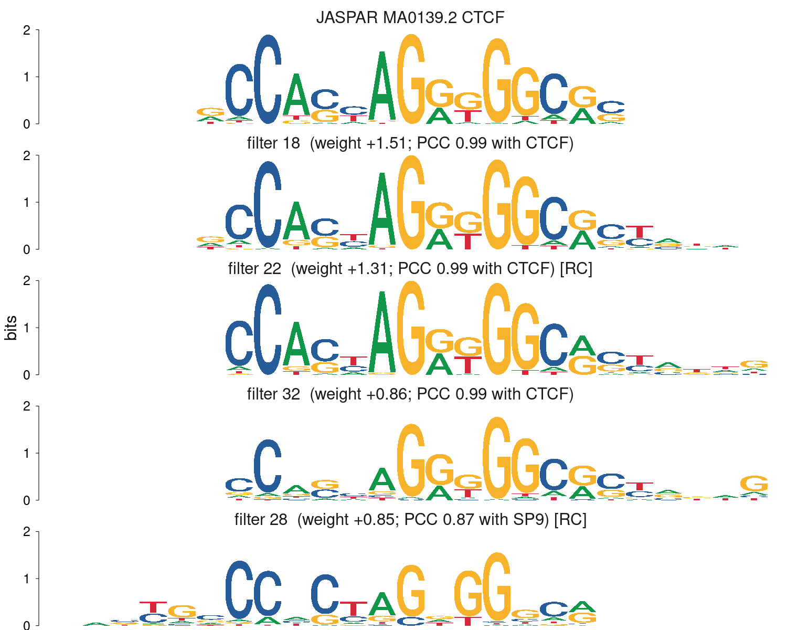{width="62%" fig-align="center"}

- For each filter, collect the 19-bp windows where it fires strongly in the test sequences and draw them as a **logo**.
- The filters with the largest output weights are the **CTCF motif**, on both strands, matched to JASPAR by correlation (as TOMTOM does).
- The network was never told about CTCF: it found the motif from labelled sequences alone.

::: notes
Method (exercise R8): for filter k, take every test sequence whose maximum activation exceeds half of the filter's overall maximum, cut out the 19 bases at the best position, and count bases: a position frequency matrix, drawn as an information-content logo. Comparing it with all 879 JASPAR 2024 vertebrate CORE matrices by Pearson correlation of the columns, trying all offsets and both strands (universalmotif::compare_motifs, the same idea as TOMTOM in the MEME suite), the top matches are CTCF or its paralogue CTCFL (BORIS), which binds the same motif. The logos are drawn aligned to the JASPAR matrix; some filters are the reverse complement, which is why the alignment flips them. Filters often cover only part of the motif or are shifted, because the 19-bp window does not need to be centred on it. The filter weights themselves can also be drawn as a logo, but they are on an arbitrary scale; activation-based logos are easier to compare with databases (Alipanahi et al. 2015; Koo and Eddy 2019).
:::

## Real data: all 32 filters {.smaller}

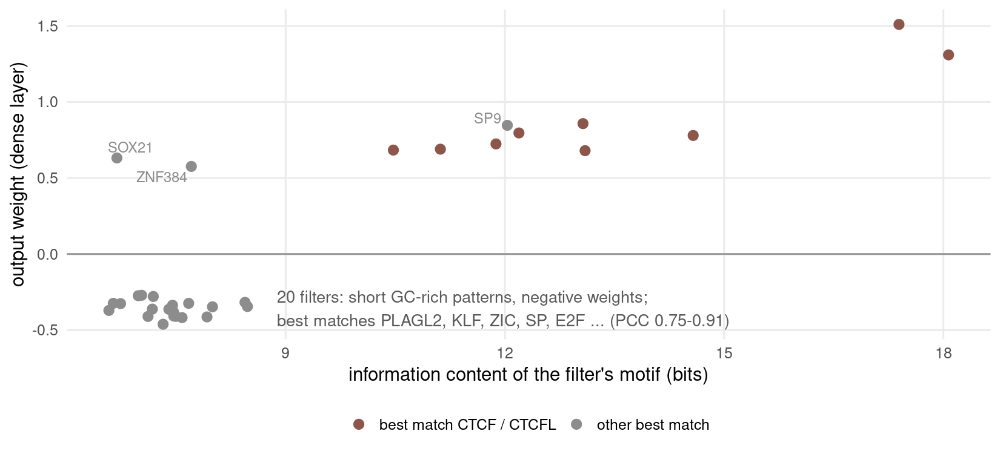{width="88%" fig-align="center"}

- **9 of 32** filters match CTCF or CTCFL (correlation ≥ 0.9), all with **positive** output weights: they are the evidence for "bound".
- Most others are short, GC-rich, low-information patterns with **negative** weights: "GC-rich, but no CTCF motif" points to background.
- Their best JASPAR matches (ZIC, KLF, PLAGL2 …) are weak; with 879 matrices to compare, some match is always found.

::: notes
The x axis is the information content of each filter's activation logo, the y axis its weight in the dense layer. Interpretation of the negative-weight filters: because the negatives have the same GC content as the peaks, GC-rich windows without a CTCF motif are mostly background, and the network uses generic GC-rich patterns as evidence against binding. That is a property of how we built the data set, not a discovery about B cells. Two filters with AT-rich patterns get small positive weights. A filter matching ZIC4 with p = 1e-4 among 879 comparisons is not a new motif: multiple testing applies to motif matching too (exam question). Redundancy is normal: nine filters learn variants and shifts of one motif in both orientations. If you want one filter per motif, use fewer filters or tools that cluster learned patterns (TF-MoDISco, next unit).
:::

## Real data: where and which filters matter {.smaller}

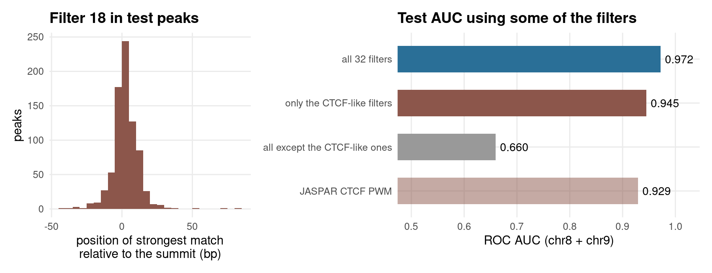{width="95%" fig-align="center"}

- **Left**: the strongest CTCF filter fires at the **summit**, like the motif scan in *Gene regulation*. The network was not given positions.
- **Right**: the 9 CTCF-like filters alone give AUC 0.945, a little better than the JASPAR PWM; the other 23 together only 0.660.

::: notes
Left: positions of the strongest match of the top filter, relative to the summit, in the test peaks where it fires (numbers printed by make-mlcnn-figs.R). The centrality is the same signature as the CTCF motif-centrality plot of Gene regulation, here rediscovered by the network. Right: an ablation. We compute the max-pooled outputs of all 32 filters, then recompute the network's logit using only a subset of filters (the contribution of the others set to zero) and measure the test AUC. Only the CTCF-like filters: 0.945, between the JASPAR PWM (0.929) and the full model (0.972): nine learned filters cover the motif and its variants a little better than one matrix, and the remaining gain comes from the other filters working together with them. Without the CTCF-like filters the rest reach only 0.660 (GC-rich background patterns). The strongest filter fires in about a fifth of test peaks at our strict threshold (half its maximum) and almost never in background (0.2%), with a median distance of 4 bp from the summit. Ablation is the simplest way to ask what a model relies on; the next unit asks the same question for single bases.
:::

## What this model does not know

- **Cell type**: trained on GM12878 only. CTCF binding is largely shared between cell types; most TFs' binding is not.
- **Chromatin**: it sees 200 bp of sequence, not accessibility or DNA methylation. Two copies of the same motif, one methylated, get the same score.
- **Context**: nothing beyond ±100 bp; no information on where the window lies in the genome.
- **The labels**: peaks above an IDR threshold of one experiment, and negatives chosen by us. It learns the boundary we drew, including our biases.
- **Prediction ≠ mechanism**: high accuracy does not show that the learned features cause binding.

::: notes
A text slide on honest limits, worth a minute in the video. The methylation example connects to Gene regulation (CTCF does not bind methylated CpGs in its motif, as at the H19/IGF2 imprinting control region): a sequence model cannot see an epigenetic state, so the same DNA in two cell types or on two alleles gets the same prediction. Models that add accessibility as an input, or that are trained per cell type (Basset, chromBPNet), address part of this. Labels: changing the negatives changes the task; random genomic background teaches GC content, accessible-but-unbound background teaches what distinguishes CTCF sites from other open chromatin (What people try to predict). Finally, a classifier with AUC 0.97 can still rely on features that merely correlate with binding in this data set; whether a feature matters causally needs experiments (mutating the site), which the next unit mimics in silico.
:::

## The models that made this popular {.smaller}

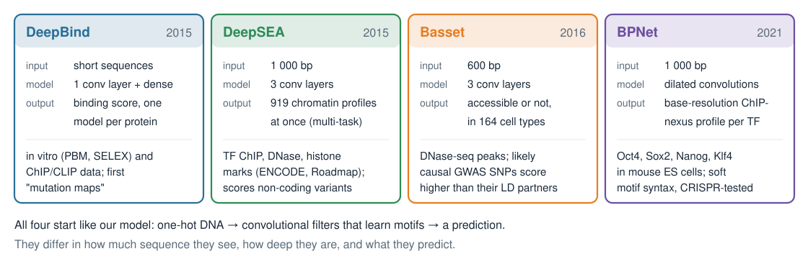{width="95%" fig-align="center"}

- DeepBind and DeepSEA (2015) showed that CNNs learn TF specificities from data and can score **non-coding variants**.
- Basset (2016) did the same for **accessibility** in 164 cell types; BPNet (2021) predicts **base-resolution** binding profiles.

::: notes
DeepBind (Alipanahi et al. 2015) trained one small CNN per protein on in vitro (protein-binding microarrays, HT-SELEX) and in vivo (ChIP-seq, CLIP-seq) data and visualised what a model learned as "mutation maps", the in-silico mutagenesis of the next unit. DeepSEA (Zhou and Troyanskaya 2015) trained one network on 1 kb of sequence to predict 919 chromatin profiles at once (TF ChIP-seq, DNase-seq and histone marks from ENCODE and Roadmap): multi-task learning, where the filters are shared between all outputs, and showed that the model scores single-nucleotide changes. Basset (Kelley et al. 2016) predicted DNase-seq accessibility in 164 cell types from 600 bp and found that likely causal GWAS SNPs had larger predicted effects than the SNPs in linkage disequilibrium with them. BPNet (Avsec et al. 2021) is on the next slide. Note the held-out chromosomes in all of them: DeepSEA used chr8 and chr9 as test chromosomes, the convention we follow.
:::

## BPNet: predicting the profile, not just "bound" {.smaller}

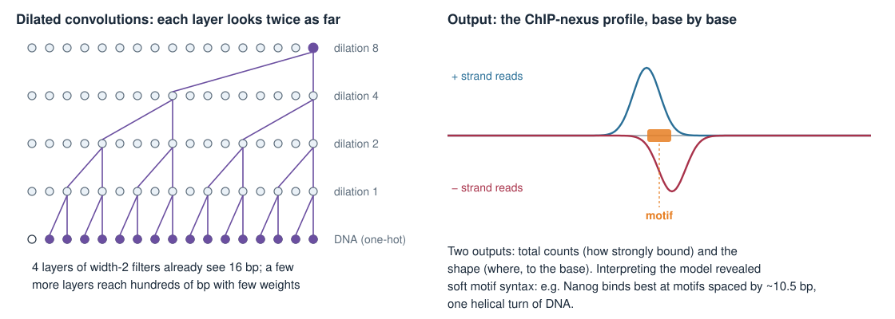{width="95%" fig-align="center"}

- BPNet predicts the **number and positions of reads** at every base (ChIP-nexus), not a yes/no label.
- **Dilated convolutions** see 1 kb with few parameters. Interpreting the model revealed **soft motif syntax**, tested by CRISPR point mutations.
- The same design, applied to ATAC-seq, is **chromBPNet** (next unit).

::: notes
Avsec et al. 2021 trained BPNet on ChIP-nexus (ChIP-exo-like, base-resolution) profiles of Oct4, Sox2, Nanog and Klf4 in mouse embryonic stem cells. Each output is the read coverage on both strands at every base of the central 1 kb: the strand-specific shape (reads stack on either side of the bound protein) contains the exact position of binding, and the total count says how strongly the region is bound. Predicting profiles gives far more training signal per region than one label. Dilated convolutions skip inputs (spacing 1, 2, 4, 8 …) so the receptive field doubles with each layer. With the interpretation methods of the next unit (contribution scores, TF-MoDISco) the authors found that Nanog binds preferentially to sites spaced by about 10.5 bp (a helical turn) and that some TF pairs cooperate only in one direction, and confirmed predictions with CRISPR-induced point mutations in the motifs. This is the model family to which chromBPNet belongs; the next unit uses it as an example of variant-effect prediction for accessibility.
:::

## Summary {.smaller}

| idea | key fact |
|---|---|
| one-hot encoding | 4 × L matrix, one 1 per position |
| convolutional filter | 4 × k weights = a learned PWM; score of a window = sum of weights of its bases |
| bias + ReLU | learned threshold: max(0, score + b) |
| max pooling | "is the motif present?" (global) or rough position (local) |
| dense + sigmoid | logistic regression on the pooled filter outputs |
| deeper layers | motif combinations, spacing, longer receptive field |
| training | log loss; gradient descent with backpropagation; mini-batches, epochs |
| validation | choose epoch and hyperparameters; early stopping; test used once |
| our CTCF CNN | test AUC 0.972 vs PWM 0.929 vs GC 0.511 (chr8 + chr9) |
| filters | 9 of 32 learn the CTCF motif, both strands, at the summit |

::: notes
Students should be able to: one-hot encode a sequence; compute a filter's activation track, apply a bias and ReLU, and max-pool, by hand; explain why the last layer is a logistic regression; compute a log loss and one gradient step for a weight of the last layer; read learning curves and say where to stop and whether a model overfits; explain why the test set must be held out by chromosome and used once; interpret first-layer filters as motifs and judge a claimed motif match. Next: What did the model learn? Variant effects, where we ask which bases in a sequence drive the prediction, and what happens when we change one of them.
:::

## Key papers (optional further reading) {.smaller}

*Not required reading and not examined. For those who want the primary literature.*

- Alipanahi et al. 2015, *Nat Biotechnol*. [Predicting the sequence specificities of DNA- and RNA-binding proteins by deep learning](https://doi.org/10.1038/nbt.3300). DeepBind: CNNs as learned motif scanners.
- Zhou & Troyanskaya 2015, *Nat Methods*. [Predicting effects of noncoding variants with deep learning–based sequence model](https://doi.org/10.1038/nmeth.3547). DeepSEA: one network, 919 chromatin profiles, variant effects.
- Kelley, Snoek & Rinn 2016, *Genome Res*. [Basset: learning the regulatory code of the accessible genome with deep convolutional neural networks](https://doi.org/10.1101/gr.200535.115). Accessibility in 164 cell types from sequence.
- Avsec et al. 2021, *Nat Genet*. [Base-resolution models of transcription-factor binding reveal soft motif syntax](https://doi.org/10.1038/s41588-021-00782-6). BPNet: profiles, interpretation, motif syntax.
- Koo & Eddy 2019, *PLoS Comput Biol*. [Representation learning of genomic sequence motifs with convolutional neural networks](https://doi.org/10.1371/journal.pcbi.1007560). When first-layer filters are (and are not) interpretable as motifs.
- Eraslan et al. 2019, *Nat Rev Genet*. [Deep learning: new computational modelling techniques for genomics](https://doi.org/10.1038/s41576-019-0122-6). A readable review of the whole field.
