## About this lecture

*How a CNN reads DNA* trained a small network that tells GM12878 CTCF peaks from GC-matched background (test AUC 0.97). Two questions follow:

- **What did it learn?** Which bases of a sequence drive its prediction: **in-silico mutagenesis** (ISM), gradients, DeepLIFT/SHAP; from many sequences to motifs (TF-MoDISco).
- **What does a variant do?** Predicted effect = prediction(alt) − prediction(ref), checked against **real SNPs** with allele-specific CTCF binding.
- **The big models** (Enformer, Borzoi, AlphaGenome, chromBPNet): what they add, and what they **still get wrong**.

::: notes
This is the last unit of the machine-learning block. It uses the model the students trained in How a CNN reads DNA, saved as ctcf_cnn.pt, so every real-data figure here can be reproduced in the exercise in a couple of minutes on a laptop. The second half connects to Epigenomics and genetic variation, which introduces allele-specific signals and QTLs for chromatin: here we ask whether a sequence model can predict those effects. The big published models appear as examples of what is being attempted, not as tools to learn. The exam questions for this unit are concept questions: compute an ISM effect from given scores, explain why saturation hides an important motif, convert a logit difference into a change in probability, and judge a claim about a predicted variant effect.
:::

## Two questions about a trained model {.smaller}

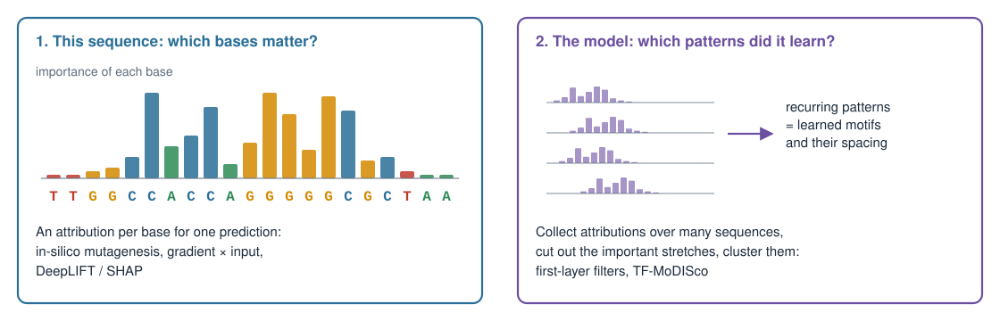{width="95%" fig-align="center"}

- **Local**: for *this* sequence, which bases matter for *this* prediction? (an **attribution** per base)
- **Global**: across all sequences, which patterns does the model rely on? (motifs and their arrangement)
- The first-layer filters of *How a CNN reads DNA* answered the global question for a one-layer model. Attribution works for any model, however deep.

::: notes
Filters are only directly interpretable in shallow models with heavy pooling; in deep networks a motif is spread over many filters and layers, and the meaningful unit is the contribution of input bases to the output. That is why the field moved from inspecting filters (DeepBind, Basset) to attribution maps (DeepLIFT, ISM, gradients) and then to clustering attribution patterns into motifs (TF-MoDISco). The left panel is what a sequence-level attribution looks like for a CTCF site: tall letters where the model's output depends on the base. The right panel is the idea of TF-MoDISco: cut out the high-attribution stretches from thousands of sequences and cluster them. Both are post-hoc: they describe the model, not the biology, and a model can be right for the wrong reasons.
:::

## In-silico mutagenesis {.smaller}

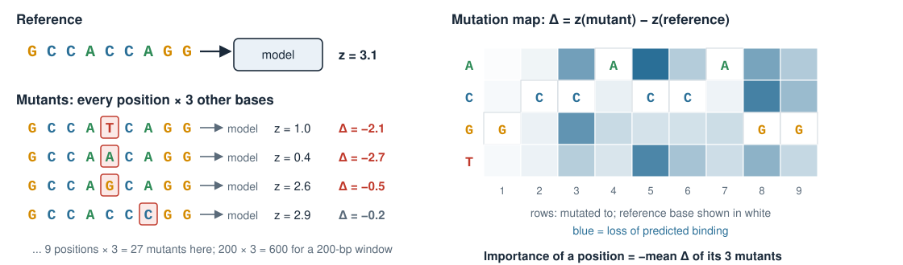{width="95%" fig-align="center"}

- Change every base to each of the 3 others, run the model again, record **Δ = z(mutant) − z(reference)** on the logit scale.
- The result is a **mutation map** (4 × L). The **importance** of a position is −mean Δ of its three mutants.
- An experiment *in silico*: exactly what a saturation mutagenesis assay does in the lab, at the cost of 3L + 1 predictions.

::: notes
ISM is the most direct attribution method and needs no knowledge of the model's internals: any black box that returns a number will do. DeepBind (2015) already showed "mutation maps". Using the logit z (log-odds of bound) rather than the probability p avoids saturation of the sigmoid: a strongly bound site with p = 0.9999 hardly changes in p after a mutation, but its logit does. The importance as −mean Δ is a convention: it is positive when the reference base is better than the alternatives on average and negative when the reference base is worse than average (a mutation would increase binding). Other conventions take the largest drop, or the drop to the worst base. The numbers in the figure are illustrative; the next slide does one by hand. Experimental counterparts: saturation mutagenesis with massively parallel reporter assays, and CRISPR base editing screens.
:::

## ISM by hand {.smaller}

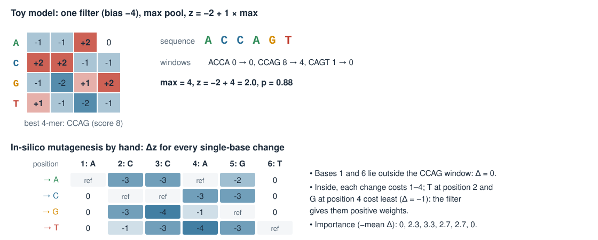{width="88%" fig-align="center"}

- One filter (best 4-mer CCAG), bias −4, max pooling, $z = -2 + \max$. For `ACCAGT`: $z = 2.0$.
- Mutating a base outside the best window changes nothing; inside, the cost follows the **filter weights**.
- This is the kind of calculation asked in the exam: given a model and a sequence, compute Δ for a mutation.

::: notes
Work through one entry: position 3 is C; mutating it to G turns CCAG into CGAG, which scores 2 − 2 + 2 + 2 = 4 instead of 8; after the bias −4 the activation is 0 instead of 4, so z drops from 2 to −2: Δ = −4. Mutating position 4 (A) to G gives CCGG: 2 + 2 + 1 + 2 = 7, activation 3, z = 1, Δ = −1, because the filter tolerates G at its third position. Bases 1 and 6 are outside the CCAG window; changing them can only matter if they create a better window elsewhere, which none of these mutations does. Importances (−mean Δ): 0, 2.33, 3.33, 2.67, 2.67, 0. Note the asymmetry: the attribution is zero outside the window not because these bases "do nothing" in biology but because this model ignores them. The exercise B1 repeats this with a different sequence.
:::

## Real data: a mutation map of a CTCF peak {.smaller}

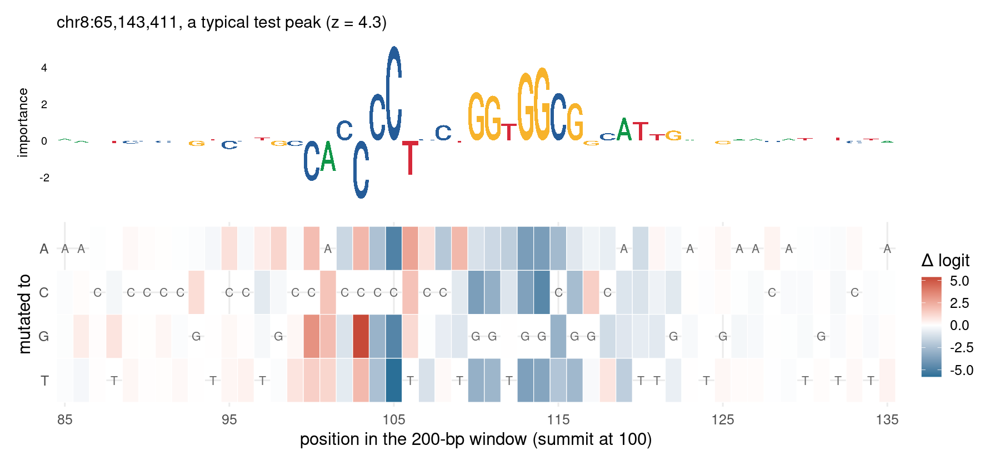{width="88%" fig-align="center"}

- A typical test peak on chr8 (z = 4.3, the median of the test peaks). 48 of 600 mutations change z by more than 1; the strongest (C→T at position 105) by −5.8.
- The important bases form the **CTCF motif** a few bases from the summit; the rest of the window hardly matters.
- Some reference bases have **negative** importance: there, a mutation would **strengthen** the predicted binding.

::: notes
From make-mlinterp-figs.R and exercise R1. The window is 200 bp centred on the summit (position 100); we zoom on 85–135. The top panel is the importance logo: letter height is −mean Δ at that position, drawn as the reference base. The motif is on the minus strand here: the window reads ACCCCTCCTGGTGGC at positions 101–115, the reverse complement of GCCACCAGGAGGGGT, close to the JASPAR consensus GCCACCAGGGGGCGC; the strongest bases are its high-information positions. Negative letters below the axis: the reference base is worse than the average alternative, i.e. the site is not perfect, which is the normal state of a real binding site. Only about 8% of all mutations matter at all (|Δ| > 1), which is typical for a TF site: a short motif in a long window. The mutation map is also the model's prediction for every possible SNP in this window, which is the link to variant effects later.
:::

## Real data: attribution logos of three more peaks {.smaller}

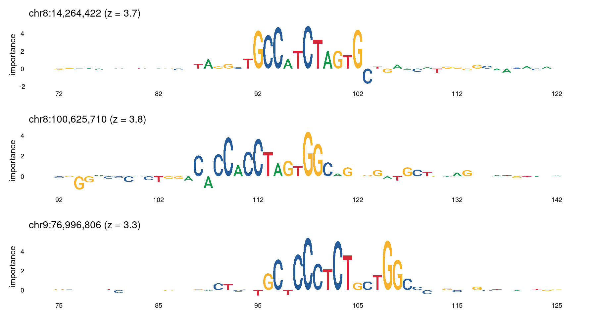{width="82%" fig-align="center"}

- Three random test peaks with a good PWM match: in each, the model's attribution **is the CTCF motif**, in either orientation.
- Outside the motif the letters are tiny: the model barely uses the flanks (quantified two slides on).

::: notes
Each logo is centred on the position of highest importance, ±25 bp. Students should be able to read these as CTCF sites by comparison with the JASPAR logo: the CCA(C/G)(C/T)AG(A/G)(G/T)GG(C/A) core, on the plus or minus strand. An attribution logo is not a PWM: it describes one sequence (one base per position), and its heights are effects on the model's output, not frequencies. The aggregate over many peaks, later, is what we compare with the PWM. Coordinates are the starts of the 200-bp windows (hg38).
:::

## When ISM fails: redundancy {.smaller}

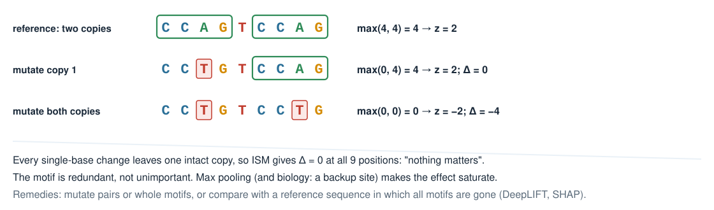{width="92%" fig-align="center"}

- With two copies of the motif and max pooling, no single mutation changes the output: ISM says **nothing matters**.
- Biology has the same problem: **redundant** (shadow) enhancers and backup sites hide each other in single knock-outs.
- Remedies: mutate **pairs** or whole motifs, or measure contributions against a **reference** in which all motifs are removed.

::: notes
The toy model again, with CCAG twice. Each copy alone gives activation 4; max pooling takes the larger, so destroying one copy leaves the other and z stays at 2. Only when both are mutated does z fall to −2. The same happens in real models with any OR-like logic (max pooling, saturating non-linearities), and with an output that is already at its ceiling (very high logit). This is a direct exam question: why can ISM report zero importance for a motif that matters? The biological parallel is real: many developmental genes have shadow enhancers whose individual deletion has little effect, and double deletions reveal the phenotype. The reference-based methods (DeepLIFT, SHAP, integrated gradients) on the coming slides are designed to share the credit between redundant copies.
:::

## Gradients: attribution in one pass {.smaller}

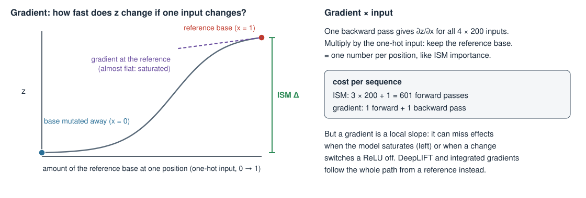{width="95%" fig-align="center"}

- The **gradient** ∂z/∂x says how fast the output changes with each input: one backward pass gives it for all 4 × 200 inputs.
- **Gradient × input** keeps the value at the reference base: one number per position, a linear approximation of ISM.
- Cheap, but **local**: where the model saturates, the slope is flat although the effect of a mutation is large.

::: notes
This is the same backpropagation that trains the network, now taking derivatives with respect to the input instead of the weights; in torch, set requires_grad on the input tensor and call backward() on the scalar model output (exercise R2). For a one-hot input, gradient × input at position i equals the gradient at the reference base. The gradient at the alternative base minus the gradient at the reference base is a first-order estimate of the ISM Δ for that substitution. Cost matters for big models: ISM of a 200-kb Enformer input would need 600 000 forward passes per sequence; gradients need one. Integrated gradients (Sundararajan et al. 2017) average the gradient along a path from a reference to the input, which fixes the saturation problem in the figure.
:::

## Real data: gradient × input agrees with ISM {.smaller}

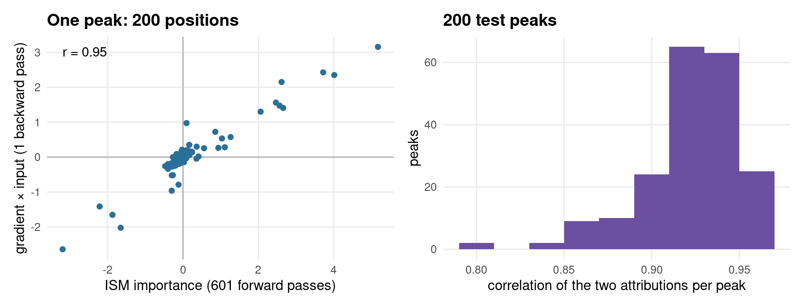{width="92%" fig-align="center"}

- For the peak of the mutation map: correlation **0.95** between gradient × input and ISM importance.
- Over 200 test peaks: median correlation **0.93**; the lowest 10% still above 0.89.
- For our shallow model they agree; for deep models and saturated outputs they can differ, and ISM is the reference.

::: notes
Both attributions computed with the trained CTCF model (make-mlinterp-figs.R; exercise R2). The agreement is high because the model is nearly linear in the region that matters: one convolutional layer with ReLU, global max pooling and a linear output. The points off the diagonal are bases where a mutation would change which window of a filter wins the max pooling, or switch a ReLU on or off: the gradient cannot see such jumps. In deeper models, studies comparing attribution methods (see Novakovsky et al. 2022) find that gradients are noisier and that ISM, DeepLIFT/SHAP and integrated gradients tend to agree better with each other. A practical rule: use gradients or DeepLIFT for screening many sequences, ISM to check the few that matter.
:::

## DeepLIFT and SHAP: compare with a reference {.smaller}

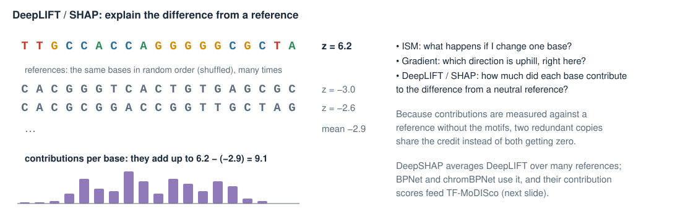{width="95%" fig-align="center"}

- Explain the **difference** between the prediction for the sequence and for a neutral **reference** (often shuffled versions of the same sequence).
- Contributions of all bases **add up** to that difference, so redundant motifs **share** the credit instead of both getting zero.
- DeepSHAP (DeepLIFT averaged over many references) is the standard for BPNet and chromBPNet.

::: notes
DeepLIFT (Shrikumar, Greenside and Kundaje 2017) propagates the difference from the reference backwards through the network with rules that keep the total equal to f(x) − f(reference) (summation to delta). SHAP values (Lundberg and Lee 2017) come from game theory: the fair share of each input in the difference from a baseline; DeepSHAP approximates them with DeepLIFT over a set of references. The choice of reference matters: all-zero input is unnatural for DNA; shuffled sequences that keep the base composition (often dinucleotide-shuffled) are common, so that contributions measure sequence order (motifs), not composition. In the figure the reference predictions (around −3) are invented for illustration. We do not run DeepLIFT in the exercise: it needs Python tooling (tangermeme, shap); gradient × input and ISM, which we do run, are the two ends it sits between.
:::

## From attributions to motifs: TF-MoDISco {.smaller}

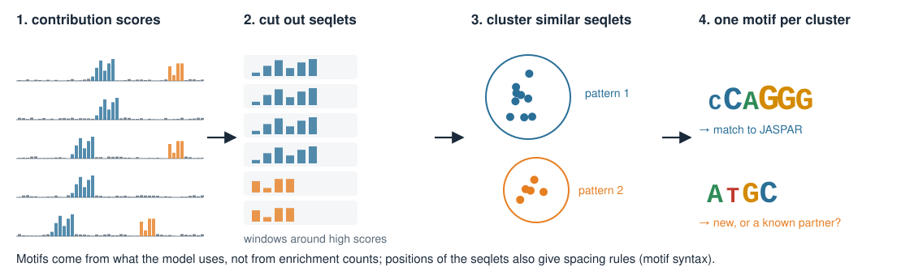{width="95%" fig-align="center"}

- Collect contribution scores over thousands of sequences, cut out the high-scoring stretches (**seqlets**), cluster them, and average each cluster into a motif.
- The motifs are what the **model uses**, and their positions give spacing and orientation rules (**motif syntax**).
- Match them to JASPAR; patterns that match nothing are candidates for new motifs, or for artefacts of the data.

::: notes
TF-MoDISco (Shrikumar et al. 2018, technical note on arXiv; used in BPNet, chromBPNet and many later papers) answers the global question with local attributions. Compared with de novo motif discovery on peak sequences (HOMER, MEME; Motifs, motif enrichment and TF footprinting), it finds only patterns that the model needed for its predictions, and it finds them at the positions where they act. It also reports motifs with negative contributions (repressive patterns). BPNet's soft syntax (Nanog sites spaced by 10.5 bp, in How a CNN reads DNA) was found this way: TF-MoDISco motifs, then the model queried with designed sequences in which two motifs were placed at varying distances. In our exercise, the aggregate over peaks aligned on the CTCF match (next slide) is a simple version of the same idea.
:::

## Real data: what the model uses around the motif {.smaller}

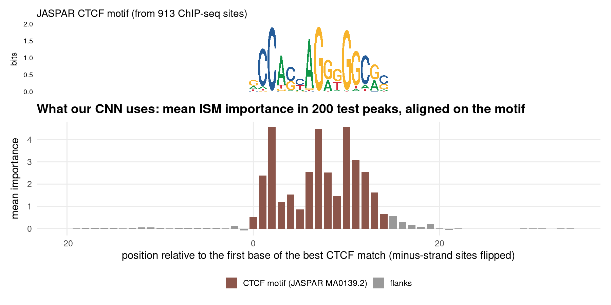{width="85%" fig-align="center"}

- ISM importance in 200 test peaks, aligned on the best CTCF match (minus-strand sites flipped), averaged.
- The model's importance profile has the **shape of the JASPAR logo**: peaks at motif positions 3, 8 and 11.
- Outside the 15-bp motif importance drops to almost zero within a few bases.

::: notes
From make-mlinterp-figs.R; exercise R3 reproduces it. The peaks were chosen at random (seed 2) among the 2236 test peaks whose best PWM score exceeds 12, so that each has a clear site to align on; 96 of the 200 sites are on the minus strand. The JASPAR logo above is drawn on the same x axis (positions 0–14 of the bar plot are columns 1–15 of the matrix). Nothing in training told the network about JASPAR: the agreement is independent evidence that the network learned the CTCF motif as biochemists defined it. A small shoulder after the motif (positions 15–19) suggests some use of the 3' flank; there is no sign of the upstream motif module that some CTCF sites have, perhaps because it is present in a minority of sites or because 19-bp filters cannot span it together with the core.
:::

## Real data: core versus flanks {.smaller}

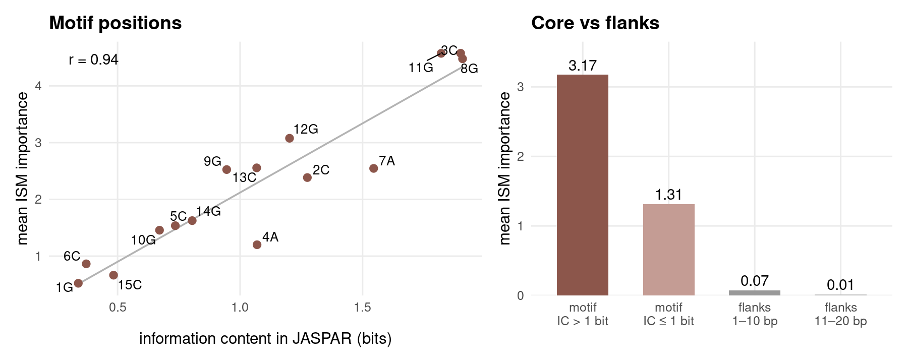{width="92%" fig-align="center"}

- Per motif position, the model's importance follows the information content of the JASPAR column (**r = 0.94**).
- Mutating a high-information core base costs on average **3.2** logit units, a low-information motif position 1.3, the flanks **0.07** (1–10 bp) and 0.01 (11–20 bp).

::: notes
Left: each point is one of the 15 motif positions, labelled with position and consensus base. The positions with more than 1 bit of information in JASPAR are 2, 3, 4, 7, 8, 11, 12 and 13; the highest (C3, G8, G11, about 1.9 bits) are also where mutations hurt the model most. Position 4 (A, 1.1 bits) is less important to the model than its information content suggests, and position 12 (G) more; differences between ChIP-derived matrices and what a model learned from one experiment are expected. Right: averages over positions. The answer to the exam-style question "does mutating the flanks matter?" is: for this model and this TF, almost not; for TFs with longer or more degenerate binding preferences (and in deeper models with longer context), flanks matter more. In units of odds: losing 3.2 logits divides the odds of binding by about 25 (e^3.2).
:::

## Variant effect = prediction(alt) − prediction(ref) {.smaller}

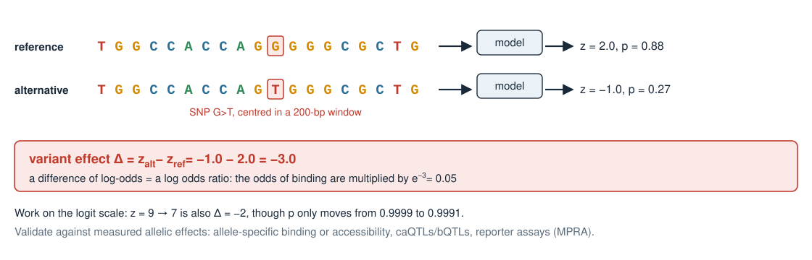{width="95%" fig-align="center"}

- Put the reference and the alternative allele in the same sequence context, predict both, subtract: **Δ = z(alt) − z(ref)**, a log odds ratio.
- One ISM entry *is* a variant effect: the mutation map predicts every possible SNP in the window.
- To check predictions, compare with measured **allelic effects**: allele-specific binding, QTLs, reporter assays (*Epigenomics and genetic variation*).

::: notes
The same definition is used by DeepSEA, Basset, Enformer, chromBPNet and AlphaGenome: run the model on both alleles and compare the outputs (for multi-output models, per output track, often summarised as the change in total signal at a site or a gene). Working on the logit scale makes effects comparable for strong and weak sites; on the probability scale, a site predicted at 0.9999 cannot change much. The sign tells the direction (which allele binds more), the magnitude how much. Two things a variant effect is not: it is not the probability that the variant is causal for a trait, and it is not specific to the person or cell type unless the model is. For insertions and deletions the sequences differ in length, and windows must be aligned; we only score SNPs.
:::

## Allele-specific binding: a natural experiment {.smaller}

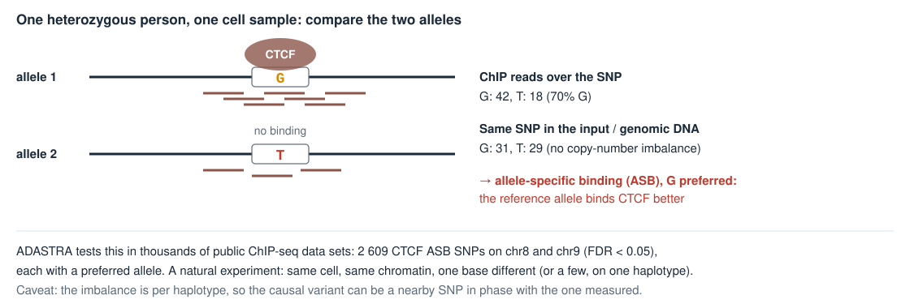{width="92%" fig-align="center"}

- In a heterozygous person, both alleles share the same trans environment. After controlling technical biases and allelic dosage, ChIP imbalance supports a **cis effect**: a sequence difference on the haplotype or an allele-specific epigenetic state.
- **ADASTRA** collects such allele-specific binding (ASB) events from thousands of public ChIP-seq experiments: **29 519** CTCF ASB SNPs at FDR < 0.05.

::: notes
The read counts in the figure are an example (42 vs 18 is significant by a binomial test, p ≈ 0.003; exercise B5). Real ASB calling must correct for reference mapping bias (reads with the alternative allele map slightly worse), copy-number differences between the alleles (ADASTRA estimates a background allelic dosage per region), and multiple testing; ADASTRA aggregates evidence across experiments and cell types with a logit method and reports an FDR per allele (Abramov et al. 2021). The release we use (Mabel v6.1, Nov 2024, downloaded through the ADASTRA web API) has 29 519 CTCF ASB SNPs; 2611 of them are on chr8 and chr9, our test chromosomes, and for 2609 exactly one allele is preferred. These come from many cell types, not only GM12878; CTCF binding is largely shared between cell types, which makes this acceptable for a CTCF model. The haplotype caveat is important: the imbalance is measured at the SNP, but any variant on the same haplotype nearby could cause it.
:::

## Real data: does the model predict the preferred allele? {.smaller}

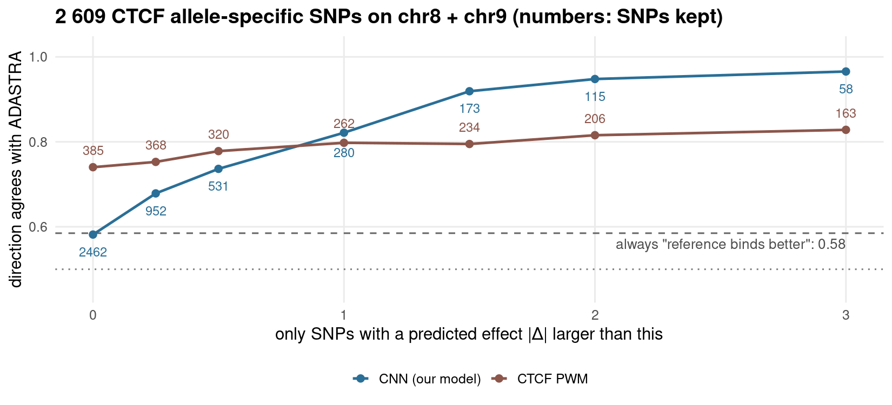{width="82%" fig-align="center"}

- Over **all** 2609 SNPs the CNN gets the direction right **58%** of the time: no better than always guessing "reference binds better" (58.5%).
- Where it predicts a **large** effect it is mostly right: **82%** for |Δ| > 1 (280 SNPs), **95%** for |Δ| > 2 (115 SNPs).
- The PWM only scores the 385 SNPs that change the best motif match: 74–83% correct.

::: notes
Numbers from exercise R5 and make-mlinterp-figs.R. Reading the plot: x is a threshold on the model's own predicted effect; y the fraction of SNPs kept whose sign agrees with the allele preferred in ChIP-seq. The dashed line is the trivial baseline: 1526 of 2609 ASB SNPs prefer the reference allele (reference mapping bias, which ASB callers try to correct, and ascertainment probably push this above 50%), so a "model" that always says the reference binds better reaches 58.5%. Overall our model is at that level: most ASB SNPs are not in a CTCF motif, and for them the model predicts small effects of random sign. Where the SNP hits the motif, both model and PWM say so, and the model is right more often than the PWM at the same number of SNPs (it was trained on real binding, including partial matches and both strands). The correlation of the two predicted effects is 0.70. ADASTRA itself reports that most motif-hitting ASBs are concordant with motif scores (85% for their v5 release), consistent with what we see. This is the honest summary of most sequence-based variant scoring: good at large, motif-disrupting effects, weak elsewhere.
:::

## Real data: one SNP up close {.smaller}

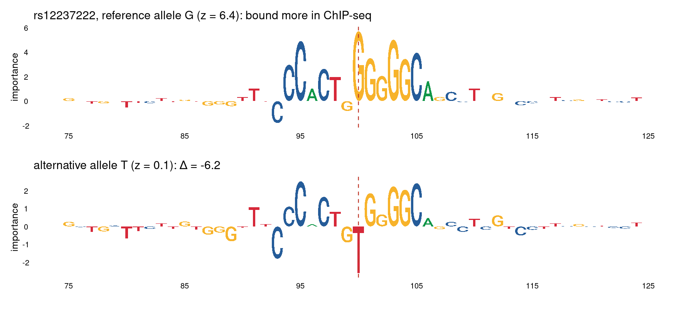{width="88%" fig-align="center"}

- rs12237222 (chr9), G>T: the **reference G** is preferred in ChIP-seq in many cell types. The model predicts z = 6.4 → 0.1 (Δ = −6.2); the PWM agrees (−8.1).
- The G is **motif position 8**, one of the three most informative (1.9 bits); with T, the core loses its importance around the SNP (red line).

::: notes
The SNP with the largest predicted effect on the test chromosomes (exercise R6). ADASTRA lists it as a reference-allele ASB in many cell types and tissues (ChIP-seq from adrenal gland, liver, glioblastoma, LNCaP, MCF-7, HUVEC and others), which is what one expects for a strong CTCF site whose motif is broken. Top: attribution of the reference sequence; bottom: the alternative. The red dashed line marks the SNP (base 100 of the window). Δ = −6.2 logits is a factor of about 500 in the odds of binding. Such cases, a common variant destroying a core position of a strong motif, are where sequence models and PWMs are reliable. Whether this SNP affects any gene is a different question: CTCF sites can be loop anchors (Gene regulation; the 3D genome units), and losing one can rewire contacts, but the consequence depends on the locus.
:::

## Why most allele-specific SNPs are not explained

- **The SNP is not causal**: allelic imbalance is per haplotype; the causal variant may be a neighbour in linkage disequilibrium.
- **Outside the model's view**: effects on nearby sites, cofactors or DNA methylation (a SNP that creates or destroys a CpG can change methylation, and CTCF is methylation-sensitive).
- **Small effects**: modest imbalances need modest predicted Δ, where model noise dominates.
- **The model's limits**: 200 bp, one cell line, one experiment, and a training set with no variants at all: it learned from reference sequences only.
- **Measurement**: mapping bias, copy number and cell-type differences in the ASB calls.

::: notes
A text slide summarising the reasons, worth reading slowly in the video. The last point of the model's limits deserves emphasis: our CNN, like most sequence models, was trained on one genome (hg38) and never saw two versions of the same site. Learning across sites is not the same as learning the effect of a change at one site; the next slides show this matters most for gene expression. The methylation point links to the chromatin side of the course: CTCF binding at the H19/IGF2 imprinting control region is blocked by methylation of the paternal allele, an allele-specific effect with no sequence difference at all. Teams that predict variant effects well (chromBPNet, AlphaGenome) evaluate on exactly these kinds of data: caQTLs, bQTLs, allele-specific accessibility and reporter assays.
:::

## Bigger models read more DNA {.smaller}

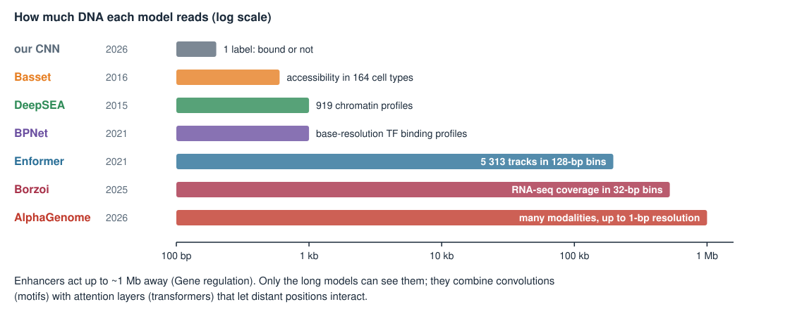{width="92%" fig-align="center"}

- From hundreds of bp (motifs) to **196 kb** (Enformer), **524 kb** (Borzoi) and **1 Mb** (AlphaGenome): long enough to include distal enhancers.
- Outputs grow too: thousands of tracks (expression, accessibility, histone marks, TF binding, contacts) predicted at once.

::: notes
All numbers from the papers: Enformer reads 196 608 bp and predicts 5313 human tracks in 128-bp bins (Avsec et al. 2021); Borzoi reads 524 kb and predicts RNA-seq coverage in 32-bp bins, which captures transcription, splicing and polyadenylation (Linder et al. 2025); AlphaGenome reads 1 Mb and predicts thousands of tracks across modalities, from gene expression and splicing to accessibility, histone marks, TF binding and contact maps, up to base-pair resolution (Avsec et al. 2026). Why longer inputs: Gene regulation showed enhancers acting up to 1 Mb away (the ZRS and SHH). Convolutions alone see only short distances unless the network is very deep; attention layers let every position exchange information with every other. These are examples, not tools for this course: they need GPUs or an online service, and are best understood as very large versions of the model we trained.
:::

## Enformer: convolutions + attention {.smaller}

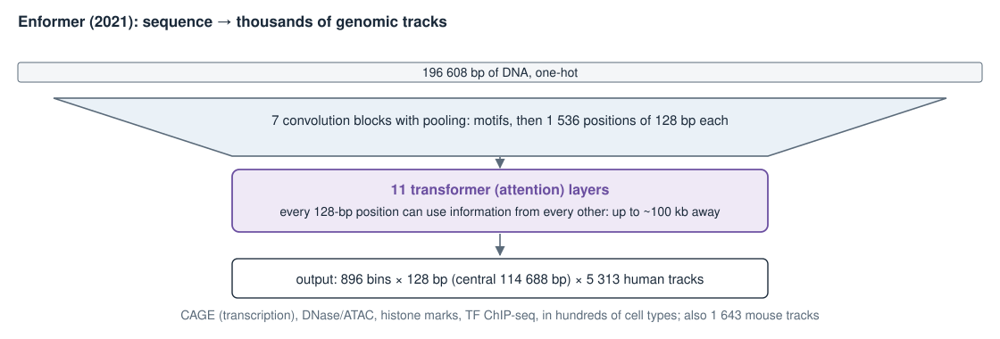{width="92%" fig-align="center"}

- Convolutions find motifs and compress 196 kb into 1 536 positions of 128 bp; **transformer** layers let each position use information up to ~100 kb away.
- Trained on thousands of human and mouse tracks; variant effects = predicted tracks for alt minus ref, for example CAGE at a gene's TSS.

::: notes
Architecture as described in the paper: 7 convolutional blocks with pooling, 11 transformer blocks, a cropping layer and two organism-specific output heads (human 5313 tracks, mouse 1643), predicting the central 114 688 bp in 896 bins of 128 bp. Training data: the ENCODE, Roadmap and FANTOM tracks of the earlier Basenji models. Enformer improved expression prediction across genes and variant-effect prediction on eQTLs and MPRA saturation mutagenesis, and its attention weights pointed to enhancers validated by CRISPRi screens. The key word for students: it is still "a CNN that reads DNA" at its base; attention is added so that distant motifs can be combined. Borzoi uses the same idea with a U-net that restores 32-bp resolution; AlphaGenome extends to 1 Mb with base-pair output for some modalities.
:::

## chromBPNet: accessibility at base resolution {.smaller}

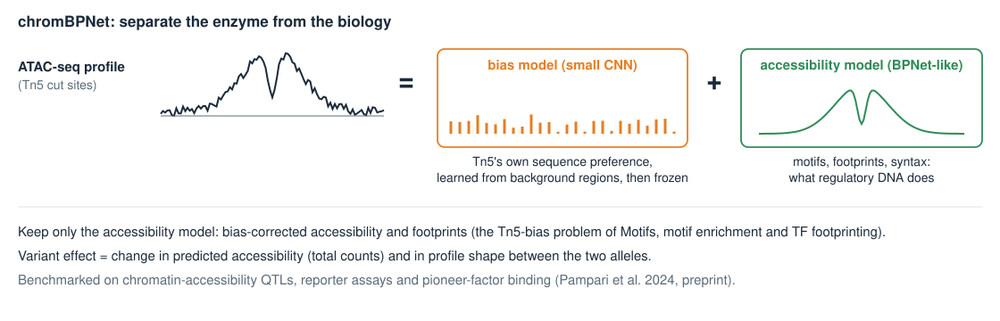{width="92%" fig-align="center"}

- A small model learns the **enzyme bias** (Tn5 or DNase); a BPNet-like model learns the rest: TF motifs, footprints, syntax.
- Variant effects on **accessibility** are scored per allele and benchmarked on caQTLs, reporter assays and pioneer-factor binding.

::: notes
chromBPNet (Pampari et al. 2024, bioRxiv preprint) applies BPNet to ATAC-seq and DNase-seq. The bias model is trained on regions without peaks, where the cut pattern reflects only the enzyme's sequence preference (the Tn5 bias problem of Motifs, motif enrichment and TF footprinting); it is then frozen, and the main model is trained to explain what the bias model cannot. The "=" in the figure is a simplification: the two outputs are combined inside the model. Removing the bias model gives bias-corrected accessibility profiles in which TF footprints are visible. The preprint reports that this lightweight model is competitive with much larger models at predicting variant effects on accessibility; models of this kind are trained per cell type or cell state, which also addresses the cell-type limitation of our CNN.
:::

## What they still get wrong: differences between people {.smaller}

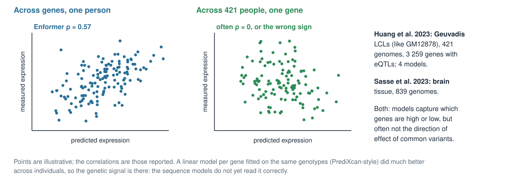{width="92%" fig-align="center"}

- Across genes, models predict expression well (Enformer ρ ≈ 0.57 in LCLs). Across **people**, for the same gene, correlations are centred near **zero**.
- The predicted **direction** of a person's regulatory variants is often wrong (Huang et al. 2023; Sasse et al. 2023).

::: notes
Two papers in the same issue of Nature Genetics, December 2023. Huang et al. took 421 individuals from the Geuvadis project with whole genomes and RNA-seq of lymphoblastoid cell lines (the cell type of GM12878), inserted each person's SNVs into the sequence around 3259 genes with significant eQTLs, and predicted expression with Enformer, Basenji2, ExPecto and Xpresso. Across genes, Enformer's predictions correlated with measured expression (Spearman 0.57 for the reference genome, 0.55 on average per individual); across individuals, for each gene, the correlation was centred near zero, with tails of positively and negatively correlated genes, and the models often disagreed with each other on the sign. A per-gene linear model of nearby genotypes did much better, so the genetic signal exists. Sasse et al. reached the same conclusion with 839 individuals from the ROSMAP brain cohort and traced it to insufficiently learned motif grammar. Lesson: a model that learned "which sequences are active" across the genome has not necessarily learned "what a single change does", the same gap we saw with the ASB SNPs. Newer models report improvements on such benchmarks; whether they close the gap is open.
:::

## Using predicted variant effects responsibly

- A predicted effect is a **hypothesis about one molecular readout** (binding, accessibility, expression) **in the cell types the model was trained on**.
- Check it against the evidence: is the variant in a **motif** (does a PWM agree)? Is there **allele-specific** signal or a **QTL**? Is the effect **large** compared with the model's typical noise?
- Ask how the model was **evaluated**: held-out chromosomes, variant benchmarks (caQTLs, ASB, MPRA), **across individuals**, not just across genes.
- Never read Δ as the probability that the variant **causes a disease**: that needs genetics (fine-mapping) and experiments (editing, reporter assays).

::: notes
A text slide that turns the unit into a checklist students can apply to a paper or a variant report. The first point is about scope: a CTCF-binding model says nothing about expression; an LCL model says little about neurons. The second point is what we did with the ADASTRA SNPs: predictions are most credible when they are large and backed by an independent line of evidence (a motif, allelic imbalance in a heterozygote). The third point summarises the evaluation traps of What people try to predict, and how to tell if it works, plus the across-individuals test of the previous slide. The fourth is the most common misreading in clinical settings: a variant can change binding strongly and have no phenotype (redundant sites, buffering), or change it weakly and matter. Exam material: judge claims of the form "the model predicts that this variant reduces expression, so it causes the disease".
:::

## Summary {.smaller}

| idea | key fact |
|---|---|
| attribution | importance of each input base for one prediction |
| in-silico mutagenesis | Δ = z(mutant) − z(ref) for all 3L substitutions; importance = −mean Δ |
| saturation | redundant motifs (or a saturated output) hide each other from single mutations |
| gradient × input | one backward pass, linear approximation of ISM (r ≈ 0.93 for our model) |
| DeepLIFT / SHAP | contributions relative to a reference; they sum to f(x) − f(ref) |
| TF-MoDISco | cluster high-attribution seqlets into motifs and syntax |
| our CTCF CNN | importance follows JASPAR information content (r = 0.94); flanks ≈ 0 |
| variant effect | Δ = z(alt) − z(ref), a log odds ratio |
| ASB SNPs (ADASTRA) | 58% right overall (= baseline); 82% for \|Δ\| > 1, 95% for \|Δ\| > 2 |
| big models | Enformer 196 kb, Borzoi 524 kb, AlphaGenome 1 Mb; still poor across individuals |

::: notes
Students should be able to: compute ISM effects and importances for a small model by hand; explain why redundant motifs get zero ISM importance and what to do about it; say what gradient × input and DeepLIFT compute and when they differ from ISM; define a variant effect on the logit scale and convert it to a change in probability or an odds ratio; describe allele-specific binding and why it is a natural experiment; read a concordance-versus-threshold plot and compare it with a trivial baseline; list reasons why sequence models fail to explain variation between individuals. This closes the machine-learning block.
:::

## Key papers (optional further reading) {.smaller}

*Not required reading and not examined. For those who want the primary literature.*

- Novakovsky et al. 2022, *Nat Rev Genet*. [Obtaining genetics insights from deep learning via explainable artificial intelligence](https://doi.org/10.1038/s41576-022-00532-2). A clear review of attribution methods (ISM, gradients, DeepLIFT, TF-MoDISco) for genomics.
- Avsec et al. 2021, *Nat Methods*. [Effective gene expression prediction from sequence by integrating long-range interactions](https://doi.org/10.1038/s41592-021-01252-x). Enformer.
- Avsec et al. 2026, *Nature*. [Advancing regulatory variant effect prediction with AlphaGenome](https://doi.org/10.1038/s41586-025-10014-0). 1 Mb of sequence, many modalities, variant effects.
- Abramov et al. 2021, *Nat Commun*. [Landscape of allele-specific transcription factor binding in the human genome](https://doi.org/10.1038/s41467-021-23007-0). ADASTRA, the allele-specific binding data used here.
- Huang et al. 2023, *Nat Genet*. [Personal transcriptome variation is poorly explained by current genomic deep learning models](https://doi.org/10.1038/s41588-023-01574-w). The across-individuals test, in LCLs.
- Sasse et al. 2023, *Nat Genet*. [Benchmarking of deep neural networks for predicting personal gene expression from DNA sequence highlights shortcomings](https://doi.org/10.1038/s41588-023-01524-6). The same conclusion in brain, and why.
