## About this lecture

*Machine learning from scratch* built a small classifier and measured it. This unit looks outward: **what does the field try to predict** from sequence, chromatin and methylation, and **how do we know whether a reported performance is real?**

- **A map of tasks**: binding and accessibility, expression, variant effects, enhancer–gene links, imputation, 3D contacts, age and tumour type. The big models appear as examples, not as tools.
- **Traps specific to genomic data**: leakage between overlapping or similar sequences, held-out chromosomes, the choice of negatives, baselines, other cell types, other individuals.
- Each trap demonstrated **with real data** from GM12878 and K562.

::: notes
The first half is a tour: for each task, what is the input, where do the labels come from, what has been achieved. Students do not need to remember model names; they need to recognise the shape of each problem so they can read a paper about it. The second half is the critical part and the exam-relevant part: judging whether an evaluation is sound. Every claim is backed by a small experiment that students repeat in the exercise, using the same data framing as the two following units (How a CNN reads DNA, and What did the model learn? Variant effects): positives are GM12878 peaks, negatives are matched genomic windows, and whole chromosomes (8 and 9) are held out for testing.
:::

## A map of prediction tasks {.smaller}

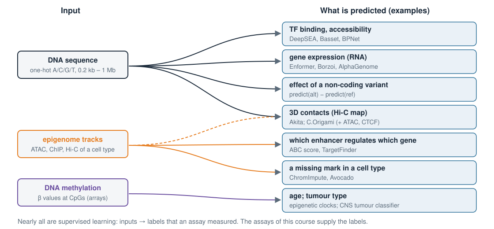{width="92%" fig-align="center"}

- Inputs: **DNA sequence**, **epigenomic tracks** of a cell type, or **DNA methylation**. Labels: what an assay measured.
- Same structure as in the last unit: examples, features, labels, a model with parameters, a held-out test.

::: notes
Read the map from left to right. Sequence-based models are the most active area: from a window of reference sequence they predict what assays would measure there. Models that take epigenomic tracks as input predict things that are expensive to measure directly (enhancer–gene links, 3D contacts) or fill in experiments that were never done. Methylation-based predictors are the oldest and most used in practice: epigenetic clocks and the methylation classifier for brain tumours are used clinically or in large cohort studies. The ABC model in the enhancer–gene box is not machine learning in the strict sense (it is a formula: activity × contact), but it is the baseline that learned models are compared against. C.Origami takes sequence plus ATAC and CTCF tracks, hence the dashed arrow.
:::

## Binding and accessibility from sequence {.smaller}

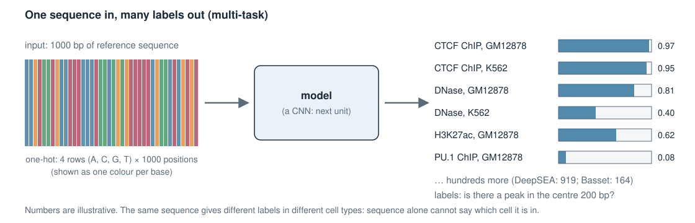{width="95%" fig-align="center"}

- Input: a window of **reference sequence** (0.5–2 kb), one-hot encoded. Output: is there a peak in the centre, for **hundreds of assays at once** (multi-task).
- DeepSEA (2015) and Basset (2016) started this with CNNs; BPNet and chromBPNet predict the base-resolution profile.
- **The same sequence gives different labels in different cells**: the cell type enters only through the label, as a separate output per cell type.

::: notes
This is the task of the next two units, in miniature: students will train a CNN to tell CTCF peaks from background. DeepSEA predicted 919 chromatin features (TF ChIP, DNase, histone marks across ENCODE and Roadmap cell types) from 1 kb; Basset predicted DNase accessibility in 164 cell types from 600 bp. Multi-task training shares one sequence model across many outputs, which helps when some outputs have few positives. A key limitation is on the slide: the model sees only the reference sequence, so differences between cell types must be learned as separate outputs; it cannot predict a cell type it has never seen. The numbers in the bars are illustrative.
:::

## Expression from sequence: long context {.smaller}

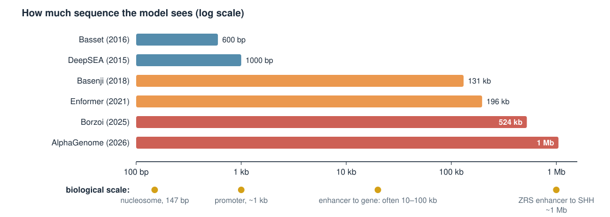{width="90%" fig-align="center"}

- Genes are regulated by enhancers **tens to hundreds of kb** away. Basenji, **Enformer**, **Borzoi** and **AlphaGenome** read 131 kb to 1 Mb and predict thousands of tracks at once: CAGE, RNA-seq coverage, ChIP, ATAC, contacts.
- Trained on the reference genome, across many cell types; evaluated on held-out chromosomal regions.

::: notes
The trend over ten years has been longer input and more outputs. Enformer (2021) added attention layers so that distant positions can interact, with a 196 kb input; Borzoi (2025, preprint 2023) predicts RNA-seq coverage from 524 kb, and so also splicing and polyadenylation; AlphaGenome (2026) reads 1 Mb and predicts several thousand human tracks at up to base-pair resolution. These are large models trained on hundreds of GPU/TPU-days; nobody in this course will train one, and that is not the point. What students should take away: these models predict how much a gene is expressed, in a given cell type, from the reference sequence around it, and they are good at it across genes (for example, Sasse et al. 2023 found r = 0.58 between Enformer's predictions and measured brain expression across 13 000 genes). Later in this lecture: what they are not good at. The ZRS limb enhancer of SHH sits about 1 Mb from its gene, at the edge of even the longest model.
:::

## Variant effects: one model, two sequences {.smaller}

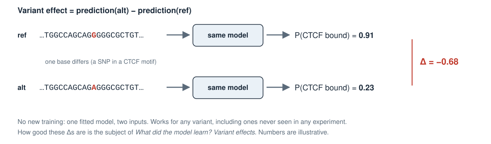{width="95%" fig-align="center"}

- A trained sequence model can score **any** variant: predict the reference and the alternative sequence, take the difference.
- Used to prioritise non-coding GWAS variants, rare variants in patients, and to design experiments.

::: notes
This is the main practical use of sequence models today, and the topic of What did the model learn? Variant effects. The appeal is that no experiment is needed for the particular variant: the model has learned general rules (motifs, their spacing, GC preferences) and applies them to the new sequence. In the illustrative example the alternative base destroys a high-information position of the CTCF motif, and the predicted binding drops. Whether these predicted effects match measured effects (allele-specific binding, eQTLs, massively parallel reporter assays) is an empirical question; the answer is "often for strong effects at strong motifs, much less for subtle effects", and the last part of this lecture shows the most striking failure.
:::

## Which enhancer regulates which gene? {.smaller}

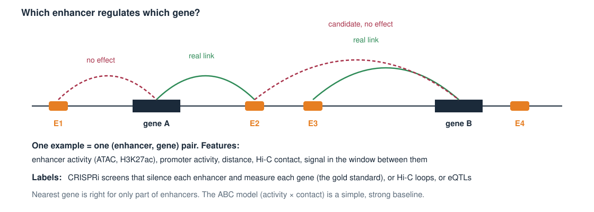{width="92%" fig-align="center"}

- One example = one **(enhancer, gene) pair**; features from chromatin (activity, contact, distance); labels from **CRISPRi screens**, eQTLs or Hi-C loops.
- The task the nearest-gene rule does badly. Covered in *Linking regulatory elements to genes*.

::: notes
Most GWAS hits are in enhancers, so connecting enhancers to their target genes is central to interpreting them. The best labels come from CRISPR interference screens that silence each candidate enhancer and measure expression of nearby genes; there are a few thousand tested pairs, mostly in K562. The ABC model (Fulco et al. 2019) multiplies enhancer activity by Hi-C contact frequency and normalises over all enhancers near the gene; it is a simple formula, and learned models have to beat it. This task is also the source of one of the best-known evaluation failures, which we look at below (TargetFinder).
:::

## Imputation: experiments nobody did {.smaller}

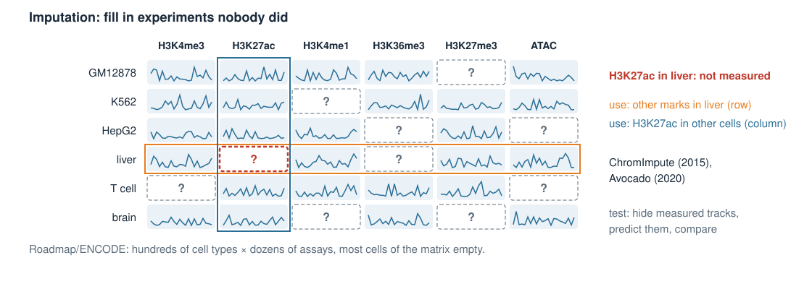{width="95%" fig-align="center"}

- Large consortia measure many marks in many cell types, but the matrix is **mostly empty**. Imputation predicts a missing track from the **same mark in other cells** and **other marks in the same cell**.
- ChromImpute (2015), Avocado (2020). Evaluated by hiding tracks that were measured.

::: notes
Roadmap Epigenomics (127 epigenomes) and ENCODE measured only a few marks in most cell types. ChromImpute trained one regression model per target track using features from related tracks; Avocado factorises the whole three-dimensional tensor (cell type × assay × genomic position) into learned embeddings. Imputed tracks were good enough that Roadmap used them for chromatin-state annotation. Two cautions to discuss: an imputed track is a prediction, not a measurement, and is most reliable where the cell type resembles others in the training set; and imputation is evaluated on tracks that exist, which are the commonly measured marks in commonly studied cells, so the hardest cases are the least tested.
:::

## 3D contacts from sequence {.smaller}

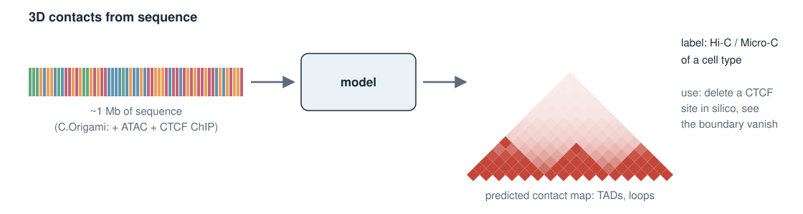{width="92%" fig-align="center"}

- **Akita** predicts a Hi-C / Micro-C contact map from ~1 Mb of sequence; **C.Origami** adds a cell type's ATAC and CTCF tracks to predict cell-type-specific maps.
- Use: **in-silico experiments**, e.g. delete a CTCF site and predict whether a TAD boundary disappears.

::: notes
The 3D genome units show how CTCF and cohesin form loops and domains through loop extrusion, which depends on CTCF motif orientation. Akita (Fudenberg et al. 2020) learned much of this from sequence alone, including the importance of CTCF motifs. Because a sequence-only model cannot know which cell type it is in, C.Origami (Tan et al. 2023) adds cell-type-specific inputs. The appeal of both is the in-silico screen: mutate thousands of sites computationally and predict which matter, then test the few interesting ones in cells.
:::

## Predictions from DNA methylation {.smaller}

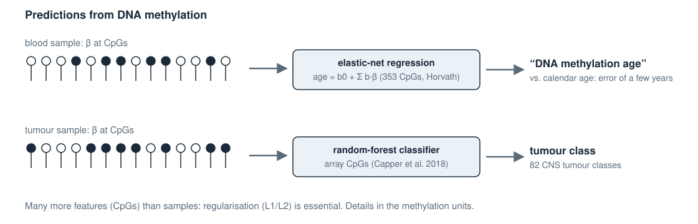{width="95%" fig-align="center"}

- **Epigenetic clocks**: elastic-net regression of age on CpG methylation (Horvath 2013: 353 CpGs). The difference between predicted and real age is studied as "age acceleration".
- **Tumour classification**: a random forest on array methylation assigns brain tumours to 82 classes (Capper et al. 2018), now part of diagnosis.

::: notes
These are the oldest and most clinically used predictors in epigenetics, and they are covered in Epigenetic clocks and biomarkers and in Epigenetics in disease and therapy. They are not sequence models: the input is a methylation profile measured in a sample. Both have many more features (hundreds of thousands of CpGs) than samples (thousands), so regularisation and careful validation are essential: the clock was validated in independent data sets; the tumour classifier in a prospective cohort, where it changed the diagnosis for about 12% of cases. A point for discussion: the clock's prediction error is partly what makes it interesting (age acceleration), which is unusual for a predictor.
:::

## What they have in common {.smaller}

| task | input | labels from | the test should be |
|---|---|---|---|
| binding, accessibility | sequence window | ChIP-seq, ATAC/DNase peaks | held-out chromosomes; other cell types |
| expression | 100 kb – 1 Mb sequence | CAGE, RNA-seq | held-out regions; **other individuals** |
| variant effect | ref and alt sequence | allelic imbalance, eQTL, MPRA | variants never seen in training |
| enhancer–gene | pair features | CRISPRi screens, eQTL | held-out **genes** and chromosomes |
| imputation | other tracks | measured tracks | hidden tracks; other cell types |
| 3D contacts | sequence (+ tracks) | Hi-C, Micro-C | held-out regions; other cell types |
| age, tumour type | CpG methylation | age, pathology | independent cohorts, other labs |

::: notes
The last column is the important one, and is the bridge to the second half. A test is only meaningful if it resembles the use we have in mind. If we want to predict expression for a person's genome, the test must contain people the model has not seen. If we want to apply an enhancer–gene model genome-wide, the test must contain genes and enhancers not in the training set. The general principle: decide what "new" means for the intended use, and make the test set new in exactly that sense.
:::

## How do we know a prediction is real? {.smaller}

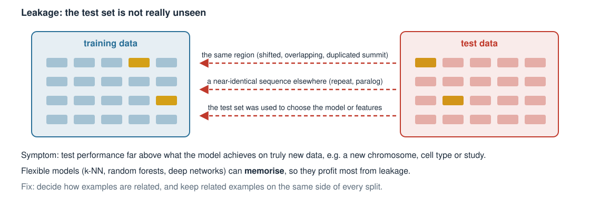{width="92%" fig-align="center"}

- **Leakage**: information about the test examples reached the training. The model looks better than it is.
- In genomics the usual routes: **overlapping or duplicated regions**, **similar sequences** on different chromosomes, and **decisions made using the test set**.

::: notes
Three questions to ask of every evaluation: Is the test set really unseen (leakage)? Is the comparison fair (what are the negatives)? Is there a baseline? The figure shows the leakage question. Gold examples are pairs of near-identical examples, one on each side of the split. A model that can memorise, such as a nearest-neighbour classifier, a random forest or a deep network, will recognise the test copy and get it right without having learned anything general. The third arrow is the subtle one: choosing features, architectures or thresholds by looking at test performance also leaks.
:::

## Overlapping windows leak {.smaller}

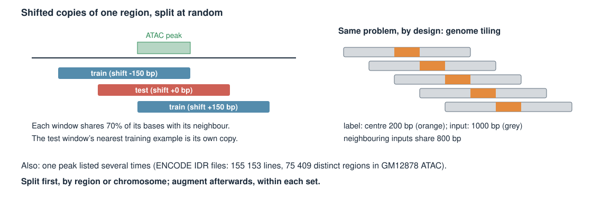{width="95%" fig-align="center"}

- Shifting windows to create more training data (**augmentation**), tiling the genome with overlapping inputs, or a peak listed twice: all create **near-copies**.
- If near-copies are split at random, the test set contains copies of the training set.

::: notes
These are not exotic mistakes. Shifting a window by a few bases and adding the reverse complement are standard ways to augment training data for CNNs; the trap is doing it before splitting. Tiling the genome into 200-bp bins with 1 kb of context, as DeepSEA and many later models do, makes neighbouring inputs share 800 bp; it is safe only because those models split by chromosome. The ENCODE IDR peak files list many peaks several times, once per summit: the GM12878 ATAC file has 155 153 lines but only 75 409 distinct regions. The rule: define the groups of related examples first (a region with all its shifted copies; a chromosome), and split by group.
:::

## Leakage, measured {.smaller}

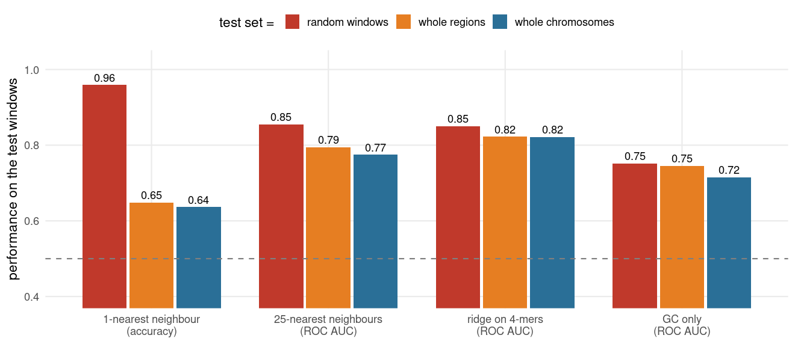{width="92%" fig-align="center"}

- 6000 GM12878 open/closed regions, each as **three windows shifted by 150 bp**; 4-mer counts as features. Test sets: random windows, whole regions, or whole chromosomes (8, 9).
- **1-nearest neighbour: 96% accuracy with a random split, 65% when whole regions are held out.** For 87% of test windows, the nearest training window is a shifted copy of itself.

::: notes
This is the experiment of exercise R1. The 1-nearest-neighbour classifier gives each test window the label of the most similar training window; it is the purest memoriser. With a random split it looks excellent, because a shifted copy of almost every test window is in the training set. Holding out whole regions or whole chromosomes removes the copies, and its accuracy collapses to 64–65%. The 25-nearest-neighbour model is less extreme (AUC 0.86 vs 0.79 vs 0.78), ridge regression on 4-mers moves least (0.85 vs 0.82), and the GC model hardly at all. The lesson: leakage inflates flexible models most, which is exactly why it matters for deep learning. A second lesson hides in the last group: GC drops from 0.75 to 0.72 between the region split and the chromosome split, without any leakage, simply because chromosomes 8 and 9 differ from the genome average. Test sets differ; compare models on the same test set.
:::

## Held-out chromosomes, and their limit {.smaller}

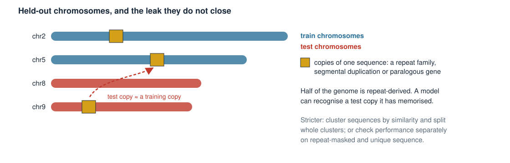{width="92%" fig-align="center"}

- Holding out **whole chromosomes** is the field's standard: overlapping windows, neighbouring peaks and shared domains all stay on one side.
- It does not stop **similar sequences on other chromosomes**: repeats (half of the genome), segmental duplications, paralogous genes.

::: notes
A held-out chromosome is a good test for most purposes, and it is what students do in the exercises and in the CNN units (chr8 and chr9). The remaining leak is sequence similarity across chromosomes. A model can learn to recognise an Alu or L1 subfamily, or a duplicated promoter, from training copies on other chromosomes. Whether this matters depends on the claim: if the claim is "the model learned regulatory grammar", test also on unique sequence or on clusters of similar sequences held out together. Two more points: in a cross-species setting (training on mouse, testing on human), orthologous regions play the same role; and a held-out chromosome is not a held-out cell type or a held-out individual, which come next.
:::

## Case study: enhancer–promoter prediction {.smaller}

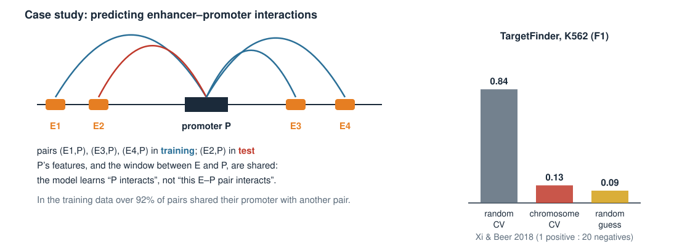{width="95%" fig-align="center"}

- TargetFinder (2016) predicted which enhancer–promoter pairs interact, F1 ≈ 0.83 with random cross-validation.
- With pairs split by **chromosome**, F1 fell to **0.13** in K562 (Xi & Beer 2018): the model had learned which **promoters** interact, from pairs that shared them.

::: notes
The example in the figure: four enhancers of one promoter, three in training and one in test. The promoter's features are identical in all four pairs, and the "window" features between enhancer and promoter overlap heavily. The model learns that this promoter has many interactions, and correctly guesses that the test pair interacts, without learning anything about which enhancer is used. Xi and Beer showed that more than 92% of training pairs shared a promoter with another pair. With a 1:20 ratio of positive to negative pairs, random guessing gives F1 = 1/11 ≈ 0.09, so the chromosome-split result is barely above chance. This is a published, well-cited model, which is why it is a good warning: the original authors were careful in many respects, and the leak was still there.
:::

## The negatives decide the question {.smaller}

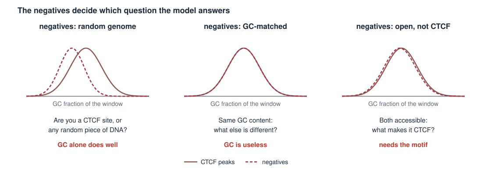{width="95%" fig-align="center"}

- **Random genome** as negatives: "is this a CTCF site or any piece of DNA?" GC content alone helps a lot.
- **GC-matched** negatives remove that shortcut. **Accessible but unbound** negatives ask what makes a site CTCF rather than just open.

::: notes
A classifier learns whatever separates the positives from the negatives, including differences we did not intend. Random genomic windows are AT-rich and gene-poor; peaks are GC-rich and near genes. So "GC content" can do much of the work, and a model can report a high AUC by learning GC. Matching the negatives on GC (sampling negatives with the same GC distribution, as in the motif-enrichment unit) or on accessibility forces the model to use other information. None of the three is wrong: they answer different questions. The questions to ask of a paper: what were the negatives, and does the conclusion match that question? The curves in the figure are schematic; the real ones are on the next slide.
:::

## Negatives, measured: CTCF in GM12878 {.smaller}

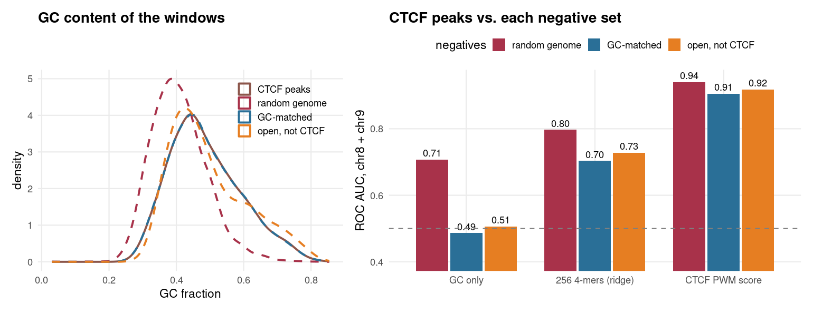{width="100%" fig-align="center"}

- 10 000 CTCF peaks against 10 000 windows of each kind; models trained on chr1–22 except 8 and 9, tested on 8 and 9.
- **GC only: ROC AUC 0.71 with random negatives, 0.49 with GC-matched** (chance), 0.51 with accessible ones. The best CTCF PWM score in the window: **0.91–0.94 whatever the negatives**. 256 4-mers: 0.80 → 0.70.

::: notes
Left: the GC distributions. Random windows have mean GC 0.41, CTCF peaks 0.49; the GC-matched set has the same distribution as the peaks by construction, so its curve hides the peaks' curve; ATAC peaks without CTCF are GC-rich too (0.50). Right: three models, each trained and tested separately against each negative set. The GC model is useful only against random negatives. The PWM model, which uses one number (the best CTCF motif score in the window), is barely affected (0.94, 0.91, 0.92), because it measures what actually distinguishes CTCF sites. One technical trap: motifmatchr reports a score of 0 for any window without a match passing p.cutoff, so with the usual cutoff of 5e-5 most negatives tie at 0 and this baseline drops to about 0.84; the continuous score needs p.cutoff = 1 (How a CNN reads DNA discusses the same trap). The 4-mer ridge model is the interesting one: it loses 0.1 of AUC when GC is matched, which shows that a good part of what it had learned was GC content, not CTCF. A CNN trained against random negatives can make the same mistake, which is why the CNN units use GC-matched negatives. Accessible negatives are slightly easier for the 4-mer model than GC-matched ones (0.73 vs 0.70): open regions without CTCF have their own sequence character (other TF motifs) that the model can use to reject them.
:::

## The simplest baseline is often strong {.smaller}

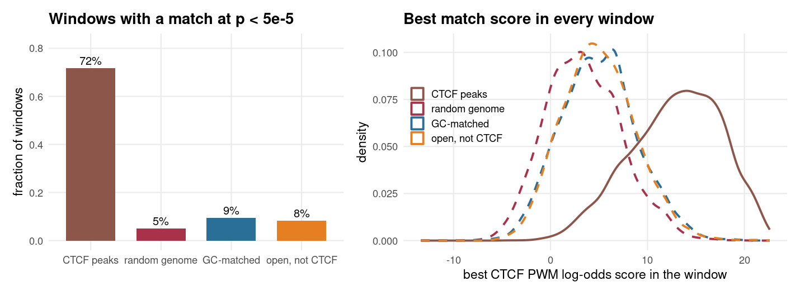{width="88%" fig-align="center"}

- One known motif, scored with one PWM: **72%** of CTCF peaks have a match (p < 5 × 10⁻⁵), against **5%** of random, **9%** of GC-matched and **8%** of accessible windows.
- Ranked by its **best score** in each window, the PWM reaches ROC AUC **0.91** against GC-matched negatives. Trap: motifmatchr gives score 0 to windows without a match at the cutoff; use `p.cutoff = 1` for a continuous score (else 0.83; see *How a CNN reads DNA*).
- Any model of CTCF binding must be compared with this. The CNN in *How a CNN reads DNA* is: same kind of data, same test chromosomes.

::: notes
CTCF is the easiest TF for this kind of baseline: its motif is long (about 19 bp) and highly informative, and most of its peaks contain it. So the best PWM score gets an AUC above 0.9 against any negatives, and the 4-mer model, with 256 parameters, is far worse than this single number once GC is matched (0.70 vs 0.91). Two things limit the PWM: 28% of peaks have no match at this threshold (weaker or non-canonical sites, or indirect binding), and 5–9% of non-peak windows do have a match (sites that are methylated, in closed chromatin, or simply not bound in this cell type; compare Motifs, motif enrichment and TF footprinting). A model that improves on the PWM has to learn something about these cases: flanking sequence, motif strength beyond a threshold, co-occurring motifs. For TFs with short, degenerate motifs the PWM baseline is much weaker and learned models gain more. The right panel shows the best score in every window (scanned with p.cutoff = 1, so that windows without a significant match keep their best, weak score): median 13.3 in CTCF peaks against 3–5 in the negative sets. Ranking by this continuous score is what gives the baseline its AUC of 0.91; using only presence at p < 5e-5, or a score that is 0 below the cutoff, throws most of that information away.
:::

## Does the model work in another cell type? {.smaller}

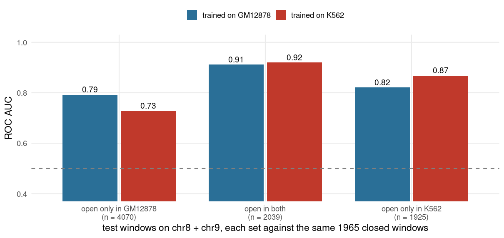{width="90%" fig-align="center"}

- 4-mer models of "open vs closed" trained in GM12878 or in K562, tested on chr8–9 on regions open **in both**, **only in GM12878**, or **only in K562**.
- Regions open **in both** are easy for either model (0.91–0.92). Each model is best on its **own** cell type's specific regions and loses 0.05–0.06 on the other's (0.87 → 0.82 for K562-only; 0.79 → 0.73 for GM12878-only).

::: notes
Two ridge models on 4-mer counts: one trained on GM12878 open regions, one on K562 open regions, both against the same closed-in-both windows, on all chromosomes except 8 and 9. Test sets on chr8–9: GM12878 peaks not overlapping any K562 peak (4070), GM12878 peaks overlapping a K562 peak (2039), K562 peaks not overlapping a GM12878 peak (1925), against 1965 windows closed in both. The shared regions are mostly CpG-island promoters and CTCF sites, whose sequence is distinctive in any cell type. The drop for the cell-type-specific regions is real but smaller than one might expect, for an honest reason: much of what a sequence model learns about "open" is generic (GC, CpG, AT-rich closed DNA), and both cell types' specific regions share it. The cell-type-specific part (PU.1, EBF1 and IRF motifs in GM12878; GATA1 and TAL1 motifs in K562) is what is lost. Note the negatives here are random genome; with GC-matched negatives the cell-type-specific part would be a larger share and the drop larger. The general lesson: a model can only predict cell types like those it was trained on, and a held-out chromosome in the training cell type does not test this.
:::

## Across genes is not across people {.smaller}

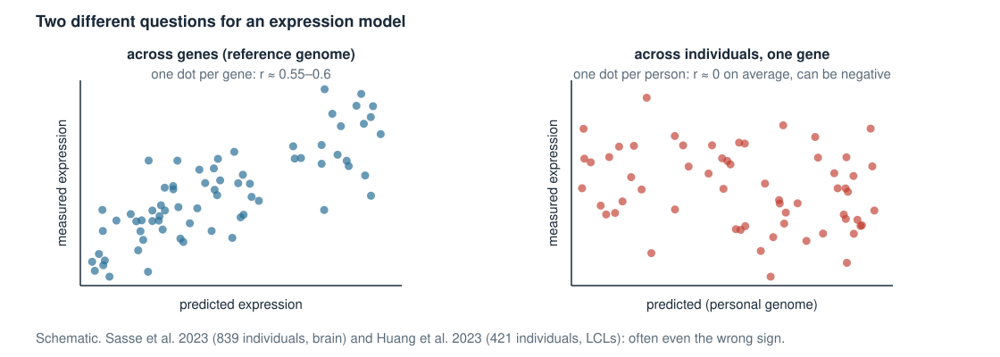{width="95%" fig-align="center"}

- Expression models predict **which genes** are highly expressed well (Enformer: r ≈ 0.55–0.6 across genes).
- But for **one gene across people**, with each person's own variants inserted, predictions barely correlate with measured expression (mean r ≈ 0), and often have the **wrong sign** (Sasse et al. 2023; Huang et al. 2023).

::: notes
This is the best-documented failure of the large sequence models, published in two papers in the same issue of Nature Genetics. Both inserted each individual's variants into the reference sequence, predicted expression with Enformer (and other models), and correlated predicted with measured expression across people. Sasse et al. used 839 individuals with whole-genome sequencing and brain RNA-seq (ROSMAP): across genes the correlation was good, but across individuals the mean correlation was about zero; where it was significant, about a third of genes had the wrong sign, while PrediXcan (a simple elastic net trained on genotypes and expression of people) did much better on the same genes and was never anti-correlated. Huang et al. found the same for four models with 421 Geuvadis individuals (lymphoblastoid cell lines, close relatives of GM12878): cross-individual correlations centred near zero, and frequent disagreement on the direction of effect. Why? The models were trained across genes in one reference genome, so they learned what makes genes differ, which is dominated by promoters and large-scale features, not the small effects of common variants. The test that matters for personal genomics (new individuals) was not the test used in training. Newer models (Borzoi, AlphaGenome) improve variant-effect benchmarks, but this remains the standard check.
:::

## Reading a machine-learning paper: a checklist {.smaller}

| question | warning signs |
|---|---|
| What exactly is predicted, and for what use? | test set does not match the intended use (new cell type, new person) |
| How were the data split? | random windows; shifted or overlapping windows; features chosen on all data |
| What are the negatives? | random genome for a GC-rich target; negatives from other experiments or batches |
| Which baselines? | no GC / k-mer / known-motif / nearest-gene baseline; only other deep models |
| Which metric, at which class balance? | accuracy on imbalanced data; PR AUC without the prevalence; balanced test sets only |
| Was the test set used once? | many architectures tried on the test set; no independent validation |
| Does it generalise? | one cell type, one cohort, one lab; no external data set |

::: notes
This is the practical summary of the second half and a good template for exam questions of the "judge the design" kind. It is adapted from Whalen et al. 2022 (Navigating the pitfalls of applying machine learning in genomics), which is the recommended further reading for this unit. Students should be able to take a methods paragraph and say which of these questions it answers and which it does not.
:::

## Summary {.smaller}

| idea | key fact |
|---|---|
| sequence → binding, accessibility | CNNs on 0.5–2 kb; one output per assay and cell type (DeepSEA, Basset, BPNet) |
| sequence → expression | long context (131 kb – 1 Mb): Basenji, Enformer, Borzoi, AlphaGenome |
| variant effects | predict(alt) − predict(ref) with any trained sequence model |
| other tasks | enhancer–gene links (ABC, CRISPRi labels), imputation, 3D contacts, clocks, tumour classes |
| leakage | near-copies across the split; memorising models gain most (1-NN: 96% → 65%) |
| splits | group related examples; hold out chromosomes; mind repeats and paralogs |
| negatives | define the question; GC-matched negatives remove the GC shortcut |
| baselines | GC, k-mers, one PWM, nearest gene; report them |
| generalisation | other cell types and other individuals are harder tests than other chromosomes |

::: notes
Students should leave able to place a new paper on the map (input, labels, intended use), to spot the main evaluation traps in a methods section, and to explain with an example why a high AUC can be meaningless (leakage, easy negatives, no baseline). Next: How a CNN reads DNA, where they train their own sequence model on CTCF peaks against GC-matched background and compare it with the PWM baseline from this unit.
:::

## Key papers (optional further reading) {.smaller}

*Not required reading and not examined. For those who want the primary literature.*

- Whalen, Schreiber, Noble & Pollard 2022, *Nat Rev Genet*. [Navigating the pitfalls of applying machine learning in genomics](https://doi.org/10.1038/s41576-021-00434-9). The evaluation traps of this unit, with many examples.
- Zhou & Troyanskaya 2015, *Nat Methods*. [Predicting effects of noncoding variants with deep learning–based sequence model](https://doi.org/10.1038/nmeth.3547). DeepSEA: chromatin features and variant effects from sequence.
- Avsec et al. 2021, *Nat Methods*. [Effective gene expression prediction from sequence by integrating long-range interactions](https://doi.org/10.1038/s41592-021-01252-x). Enformer: long-context expression prediction.
- Xi & Beer 2018, *PLoS Comput Biol*. [Local epigenomic state cannot discriminate interacting and non-interacting enhancer–promoter pairs with high accuracy](https://doi.org/10.1371/journal.pcbi.1006625). A clear case of leakage in a published model.
- Sasse et al. 2023, *Nat Genet*. [Benchmarking of deep neural networks for predicting personal gene expression from DNA sequence highlights shortcomings](https://doi.org/10.1038/s41588-023-01524-6). Good across genes, poor across individuals.
- Huang et al. 2023, *Nat Genet*. [Personal transcriptome variation is poorly explained by current genomic deep learning models](https://doi.org/10.1038/s41588-023-01574-w). The same finding in lymphoblastoid cell lines.
