## About this lecture {.smaller}

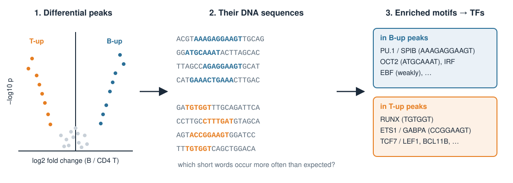{width="88%" fig-align="center"}

*Differential accessibility* gave us thousands of peaks that are more open in B cells than in CD4 T cells, and the reverse. A list of peaks is not yet biology: **which transcription factors (TFs) open these regions?**

- **Motif enrichment:** which TF motifs are over-represented in a set of peaks (a 2×2 test, and the choice of background).
- **chromVAR:** how open the peaks with a given motif are, **per sample** (or per cell).
- **Footprinting:** whether a TF actually **sits on** its site, from the pattern of Tn5 insertions.

::: notes
This is the last unit of the ATAC-seq block. The running example continues from Differential accessibility: the Corces et al. 2016 haematopoiesis ATAC-seq data, B cells versus CD4 T cells from the same three donors. Of 211 824 peaks tested, 19 404 are more open in B cells (B-up) and 16 897 more open in CD4 T cells (T-up), at adjusted p below 0.05 and an absolute apeglm-shrunken log2 fold change above 1. The exercise reads the saved differential_peaks.tsv table from that analysis; the remaining 175 523 ns peaks form the background for both differential groups. The question for this unit is which TFs are behind those differences. Three ideas, in increasing resolution: enrichment over a set of peaks, accessibility per sample, and protection of single sites. The motif sequences in the middle panel are real consensus sites (PU.1, OCT, IRF in blue; RUNX, TCF/LEF, ETS1 in orange); the lists on the right are what we actually find later in this lecture.
:::

## Recap: a PWM finds motif matches {.smaller}

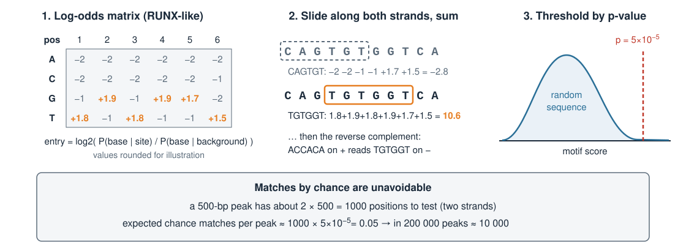{width="92%" fig-align="center"}

- A **position weight matrix** (PWM) gives a log-odds score for each base at each position (from *Gene regulation*). The score of a window is the sum; scan both strands.
- A **match** is a window whose score is unlikely in random sequence: here $p < 5 \times 10^{-5}$ (the motifmatchr default).
- Short motifs match **by chance** everywhere. A 500-bp peak has ~1000 windows, so about 5% of peaks match any given motif by chance alone.

::: notes
Only a recap: Gene regulation introduced counts, frequencies, log-odds and logos. What matters here is the threshold. Tools convert the score into a p-value: the probability that a random window with the background base composition scores at least this high. With p = 5e-5 and 1000 windows per peak, the expected number of chance matches is 0.05 per peak. In our 211 824 Corces peaks, the median JASPAR motif matches 6.4% of peaks, close to that expectation. This is why "my peak has a GATA motif" means very little on its own; the question is always whether there are more matches than expected.
:::

## Motif databases, and TF families {.smaller}

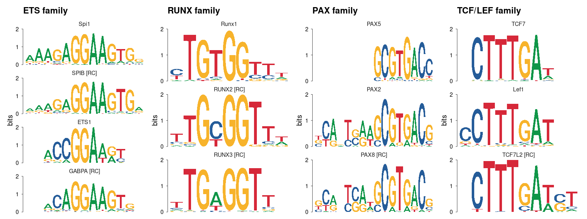{width="100%" fig-align="center"}

- **JASPAR 2024** (open, curated; 879 vertebrate CORE motifs), **CIS-BP** (motifs inferred for ~1600 human TFs), **HOCOMOCO** (from ChIP-seq). HOMER and MEME ship their own collections.
- TFs of one **family** share a DNA-binding domain and bind almost the **same motif**. A motif hit names a family, not a TF.
- Matrices for the same TF differ between databases and versions. JASPAR's PAX5 matrix is only the 8-bp core; its PAX2 and PAX8 matrices are longer.

::: notes
The logos are JASPAR 2024 matrices, aligned (RC = shown as reverse complement). PU.1 (SPI1) and SPIB are almost identical, and both share the GGAA core with ETS1 and GABPA; the flanks differ (an A-rich 5' flank for PU.1/SPIB, CCGGAAGT for ETS1/GABPA), and this turns out to matter for B vs T cells. RUNX1, 2 and 3 all bind TGTGGT. TCF7, LEF1 and TCF7L2 all bind CTTTGAT. Humans have about 1600 TFs but only a few hundred distinct motifs, so a large motif collection is highly redundant: 28 of the 879 JASPAR motifs are ETS. Pick the TF within a family with other evidence: is it expressed (RNA-seq), is there ChIP-seq. The PAX example is real and will come back: a short matrix can fail where the family's longer matrices work.
:::

## Motif enrichment is a 2×2 table {.smaller}

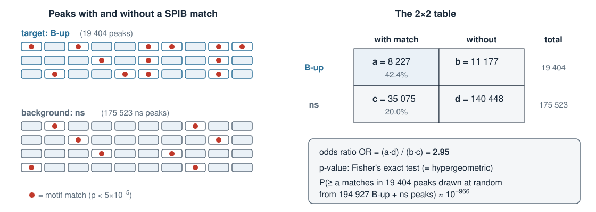{width="92%" fig-align="center"}

- Count target and background peaks **with** and **without** a match. Effect size: the **odds ratio**; with 42% vs 20%, OR = 2.95.
- p-value: **Fisher's exact test**, which is the **hypergeometric** test: how surprising is it to draw this many motif peaks if the 19 404 B-up peaks were a random draw from B-up plus ns peaks?
- Expected matches in B-up under the null: 19 404 × 43 302 / 194 927 ≈ 4310. Observed: 8227.

::: notes
The numbers are real: SPIB in B-up peaks. a = 8227 of 19 404 B-up peaks contain a SPIB match, against c = 35 075 of the 175 523 ns peaks. The odds ratio (a·d)/(b·c) is 2.95. The one-sided hypergeometric p-value is about 10^-966, which R can only represent on the log scale. The null draws the B-up group from the combined B-up and ns pool; the 16 897 T-up peaks are excluded. HOMER reports this hypergeometric p-value (or a binomial approximation); MEME's SEA uses Fisher's exact test as well. The background contains tested peaks that did not meet the differential thresholds, rather than random genomic DNA. Students did the same kind of 2×2 table for gene-set enrichment in RNA-seq; here genes are peaks and the gene set is "has a motif".
:::

## Choosing the background {.smaller}

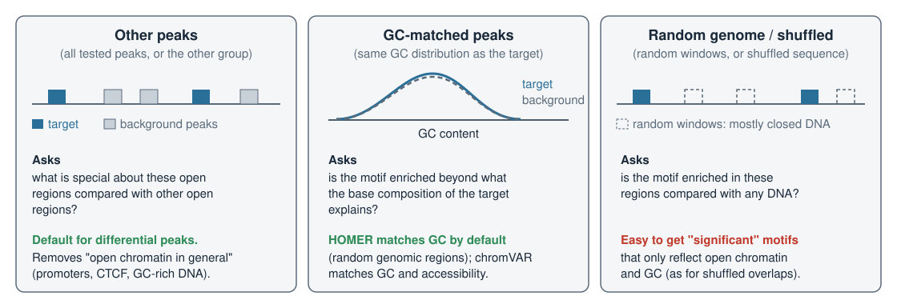{width="90%" fig-align="center"}

- The background decides the **question**. Here each differential group is compared with the tested **ns peaks**, excluding both B-up and T-up from the background.
- **GC content** is the classic confounder: motifs differ in GC, and so do peak sets (promoters are GC-rich, distal enhancers AT-richer).
- The random-genome background is the motif version of the naive shuffle in *Genomic intervals*: it answers "open vs closed DNA", not "B vs T".

::: notes
Three choices. (1) The ns peaks: what distinguishes B-up or T-up regions from peaks that are not differential by the course thresholds. We use the same background for both groups, excluding the opposite differential group. The ns label includes peaks with insufficient evidence or a small effect; it does not prove that accessibility is identical. Features common to open chromatin tend to cancel. (2) GC-matched: draw background regions with the same GC distribution as the target, so motifs that are GC-rich or AT-rich do not win simply because the target is GC-rich or AT-rich. HOMER does this by default, from random genomic regions (findMotifsGenome.pl), and normalises k-mer content as well. chromVAR, later, matches on both GC and average accessibility. (3) Random genome or shuffled sequence: the target is compared with closed, AT-rich DNA, so every motif of open chromatin looks enriched. Same lesson as the shuffle test in Genomic intervals: the null decides the answer. Shuffled sequences (preserving dinucleotide content) are what MEME tools use by default when no background is given.
:::

## Real data: the background changes the answer {.smaller}

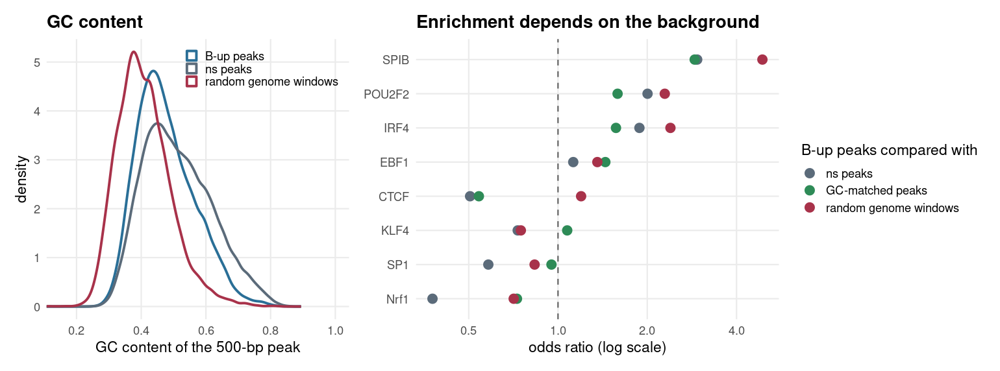{width="100%" fig-align="center"}

- B-up peaks are **AT-richer** than ns peaks (mean GC 0.48 vs 0.51) but GC-richer than random DNA (0.41).
- Against ns peaks, GC-rich motifs (SP1, KLF4, NRF1) look **depleted**; GC matching removes most of this. EBF1 (GC-rich) gains: OR 1.13 → 1.44.
- Against random genome, SPIB looks more enriched (OR 4.89 versus 2.95 against ns) and CTCF flips from depleted to enriched.

::: notes
Real numbers from make-motifs-figs.R. For the GC-matched background, we sampled ns peaks without replacement in the same 2%-GC bins as B-up peaks, taking at most one partner per target. Bins with insufficient ns peaks contribute fewer partners; report the resulting background size and GC distribution. Here all 19 404 targets find partners: both the target and the GC-matched background have mean GC 0.477, versus 0.513 in all ns peaks. For the random background, 19 404 random 500-bp windows from chr1–22 and X without Ns or blacklisted regions. Read the plot motif by motif. SPIB: enriched against any background, the robust finding. CTCF: depleted against peaks (many CTCF sites are shared across cell types, so they are not B-specific), but enriched against random DNA (CTCF sites are open chromatin). SP1, KLF4, NRF1: their apparent depletion against ns peaks is mostly GC: B-up peaks are distal, AT-richer elements, while the background contains GC-rich promoters. EBF1 is the reverse: its motif is GC-rich, so the AT-rich target hides its enrichment until GC is matched. Always report which background you used.
:::

## Real data: motifs in B-up and T-up peaks {.smaller}

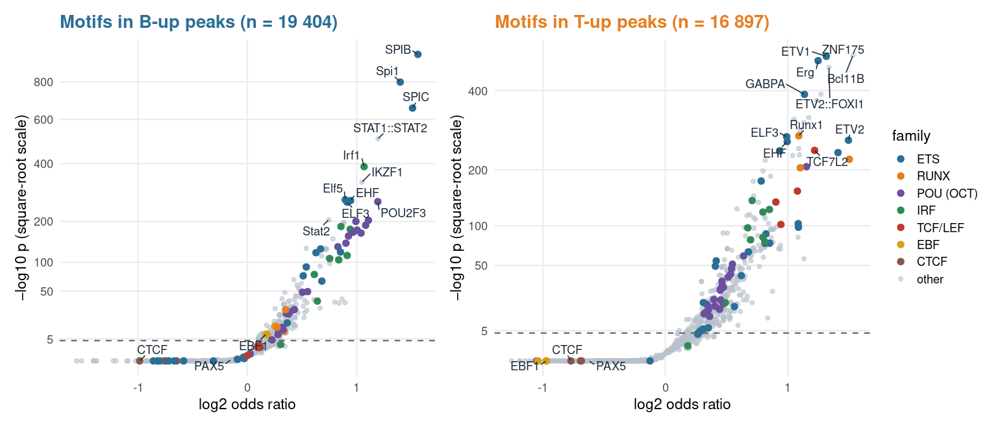{width="100%" fig-align="center"}

- **B-up:** PU.1 / SPIB / SPIC (ETS), IRF and STAT, OCT (POU2F2 = OCT2), IKZF1, MEF2, NF-κB. **T-up:** ETS1 / GABPA / ERG-type ETS, **RUNX**, **TCF7/LEF1**, BCL11B, GATA3 (OR 1.5).
- EBF1 is only weakly enriched (OR 1.13) and PAX5's JASPAR matrix not at all, although both are B-cell master regulators. EBF is clearly **depleted** in T-up peaks (OR 0.51).

::: notes
Each point is one of 879 JASPAR motifs, B-up or T-up compared with the same ns background; the dashed line is the Bonferroni threshold. The B-cell list is textbook: PU.1 and SPIB, the ETS–IRF composite elements bound by PU.1 or SPIB with IRF4/IRF8, OCT2 with its coactivator OBF1, IKAROS, MEF2C, and NF-κB. The T-cell list: RUNX1/3 with CBFβ, TCF1 (TCF7) and LEF1, the ETS factors ETS1 and GABPA, BCL11B and GATA3. Where expectations fail is instructive. EBF1 is enriched only weakly with this matrix and background (better with GC matching, previous slide). PAX5, the B-cell identity factor, is not enriched with JASPAR MA0014.4, while the longer PAX2/PAX8 matrices give OR about 1.86: matrix choice and background can mask a known regulator. And a motif being absent from the list does not mean the TF does not act there: TFs bind as partners, and many sites are weak matches below the threshold.
:::

## One family, two lineages {.smaller}

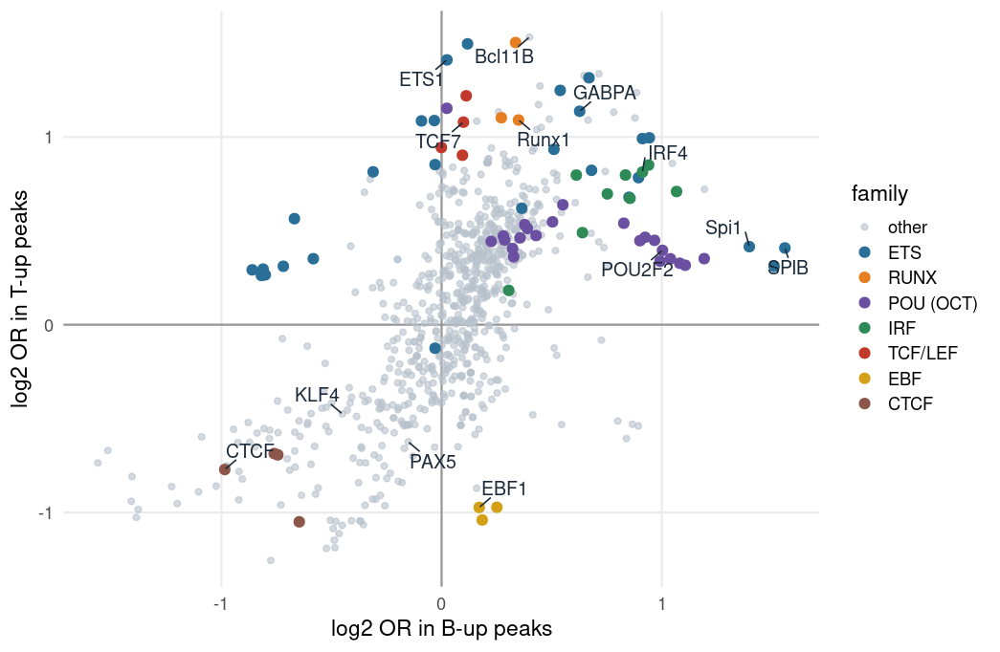{width="78%" fig-align="center"}

- Each point is a motif: enrichment in B-up (x) against enrichment in T-up (y).
- The **ETS family splits**: PU.1/SPIB motifs (A-rich flank) go with B cells, ETS1/GABPA motifs (CCGGAAGT) with T cells. The flanks seen in the logos carry the lineage information.
- CTCF and GC-rich promoter motifs (SP1, KLF4) are below 1 in both: constitutively open, not lineage-specific.

::: notes
Points on the diagonal are enriched in both, points in the lower right only in B, upper left only in T. RUNX and TCF/LEF are T-specific, EBF is depleted in T-up, the POU and IRF motifs are positive in both sets (both are lymphoid, and the ns background includes peaks accessible in either cell type that did not meet the differential thresholds). This plot is a good way to see the redundancy problem: you cannot tell from the motif alone whether PU.1 or SPIB is the factor in B cells; both are expressed in B cells. To name the TF, combine motif enrichment with expression (RNA-seq of the same cells), with ChIP-seq, or with perturbation. This is the logic of Heinz et al. 2010 (key papers): a few lineage-determining TFs, PU.1 with C/EBP or with E2A/EBF/OCT, select the enhancers of a cell type.
:::

## Hundreds of motifs: p-values and effect sizes {.smaller}

| | B-up | T-up |
|---|---|---|
| motifs tested | 879 | 879 |
| enriched at BH FDR 5% (OR > 1) | 511 | 507 |
| enriched at Bonferroni 5% (p < 0.05 / 879 = 5.7 × 10⁻⁵) | 361 | 432 |
| strongest odds ratio | 2.95 (SPIB) | 2.89 (BCL11B) |

- With ~19 000 target peaks, **tiny effects are significant**. Half of all motifs pass FDR 5%; most are family members of a few real signals, or GC.
- Correct for the number of motifs (BH or Bonferroni, as for genes in RNA-seq), then **rank by effect size** (odds ratio, or fraction of target vs background), and group motifs by family.
- With few target peaks (say 200), the opposite problem: little power, and multiple testing matters more.

::: notes
The multiple-testing part is the same as in RNA-seq: 879 tests, so a nominal p of 0.05 would give about 44 false positives. BH controls the false discovery rate; Bonferroni the family-wise error rate (threshold 0.05/879). But with nearly 20 000 peaks in the target set, statistical significance is almost guaranteed for any motif with even a few percent difference, as with a huge RNA-seq experiment where every gene is "significant". So report the odds ratio and the two fractions (42% vs 20% for SPIB), not only −log10 p, and look at the top of the list by effect size. Correlated tests: motifs of the same family give nearly the same answer, so "511 significant motifs" is many fewer independent findings. For this reason many analyses first cluster similar motifs into non-redundant 'archetypes' and report one per cluster.
:::

## Known motifs vs de novo discovery {.smaller}

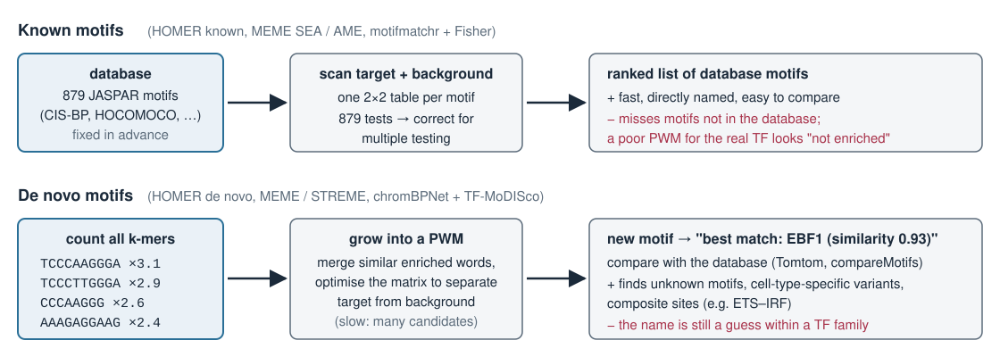{width="92%" fig-align="center"}

- **Known-motif enrichment** tests each database motif: fast, names come for free, but limited to the database and to the quality of each matrix (PAX5 above).
- **De novo** discovery finds the words that best separate target from background, builds a PWM, then compares it with the database: "looks like EBF1".
- Both give a **motif**, not a TF: the family problem remains.

::: notes
HOMER (Heinz et al. 2010) does both in one run: known motifs first, then de novo motifs of length 8, 10, 12, then matches each new motif to its database. The MEME suite (Bailey et al. 2015) has separate tools: SEA or AME for known motifs (enrichment), STREME and MEME for discovery, Tomtom for comparing a new motif with a database. De novo results are useful when the TF is unknown, when the cell type uses an unusual variant, or for composite elements such as the ETS–IRF composite in B cells, which appears as one longer motif. Newer approaches train a neural network on the sequence of peaks (chromBPNet) and extract the learned motifs (TF-MoDISco): see the machine-learning units.
:::

## HOMER and MEME on the command line

```bash
# HOMER: known + de novo motifs, 200 bp at the peak centre,
# GC-matched random genomic background (default) ...
findMotifsGenome.pl b_up.bed hg38.fa homer_b_up/ -size 200 -p 8
# ... or the saved ns peaks as background for differential peaks
findMotifsGenome.pl b_up.bed hg38.fa homer_bg/ -size 200 -bg ns.bed -p 8

# MEME suite: known motifs (SEA) and de novo (STREME) vs the saved ns peaks
bedtools getfasta -fi hg38.fa -bed b_up.bed   > b_up.fa
bedtools getfasta -fi hg38.fa -bed ns.bed > ns.fa
sea    --p b_up.fa --n ns.fa --m JASPAR2024_CORE_vertebrates.meme
streme --p b_up.fa --n ns.fa --dna
```

- Not installed in this course: the exercise does the known-motif test in R (**motifmatchr** + Fisher), which shows every step.

::: notes
These are the commands a student would run on a cluster with HOMER or the MEME suite installed (both are in Bioconda). HOMER's -size 200 uses 200 bp around the peak centre: for summit-centred TF peaks, a narrow window raises the signal-to-noise ratio, because the motif sits near the summit. Our Corces peaks are fixed 500-bp windows around summits. Without -bg, HOMER picks GC-matched random genomic regions as background, which is the "random genome" question with GC matching. With -bg ns.bed it asks what distinguishes B-up from the tested ns peaks, as in our exercise. SEA wants a motif file in MEME format, which JASPAR provides for download. The output in each case is a ranked table like ours: motif, fraction of target and background with a match, p-value, q-value.
:::

## chromVAR: motif accessibility per sample {.smaller}

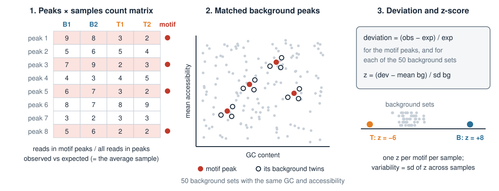{width="95%" fig-align="center"}

- Enrichment needs a **set** of peaks. chromVAR asks the question **per sample**: are the peaks with motif X more open in this sample than in the average sample?
- Compare with **background peaks** matched for GC content and average accessibility, so technical differences between samples (GC bias, signal-to-noise) cancel.
- Output: a **deviation z-score** per motif and sample, and the **variability** of each motif across samples.

::: notes
chromVAR (Schep et al. 2017) starts from the peak-by-sample count matrix, the same matrix used for DESeq2. For each motif and sample: observed = reads in peaks with the motif divided by all reads in peaks; expected = the same fraction in the pooled data. The raw deviation is (observed − expected)/expected. The same is computed for many background peak sets: for each motif peak, a background peak with similar GC and similar mean accessibility, sampled 50 times. The z-score says how many standard deviations the motif's deviation lies away from those background sets. It is robust to sample-level biases: if one library has more GC-rich fragments, all GC-rich peak sets go up, background included, so the z-score does not. Variability is the standard deviation of the z-scores across samples: high for motifs whose accessibility differs between cell types.
:::

## Real data: chromVAR across haematopoiesis {.smaller}

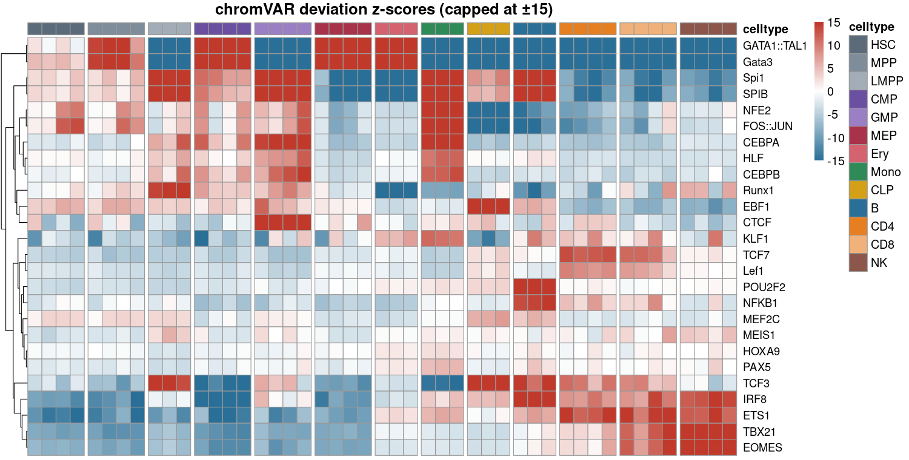{width="100%" fig-align="center"}

- 13 cell types, 47 donor × cell-type samples from Corces et al. 2016; the 100 000 most-read peaks; 879 JASPAR motifs.
- Motifs of 26 known regulators. **GATA** in MEPs and erythroblasts (and rising from HSC to MPP to CMP); **CEBP** in GMPs and monocytes; **PU.1/SPIB** in LMPPs, GMPs, monocytes and B cells; **EBF1** in CLPs (less in B cells); the E-box (**TCF3**, E2A) in LMPPs, CLPs, B and T cells; **POU2F2** and **NF-κB** in B cells; **TCF7/LEF1** in CD4 and CD8 T cells; **T-box** (TBX21, EOMES) and **ETS1** in NK and CD8 T cells.
- The motif called **Gata3** behaves exactly like GATA1: it is highest in erythroid cells, not in T cells. Same family, same motif.

::: notes
Each column is one donor and cell type (technical replicates summed), 47 columns over 13 cell types; z-scores capped at ±15 for colour. The data are the Corces et al. 2016 count matrix lifted to hg38, the 100 000 peaks with the most reads, 879 JASPAR motifs, 50 background iterations; the whole computation takes under a minute after motif matching. This is essentially the analysis of the chromVAR paper, which used the same haematopoiesis data. The picture recovers the textbook regulators of each lineage without any differential analysis: GATA1/TAL1 along the erythroid branch, C/EBP along the myeloid branch, PU.1 in myeloid and B cells, EBF in common lymphoid progenitors, E2A across lymphoid cells, TCF1/LEF1 in T cells, T-bet and Eomes in NK and CD8 T cells. Point at the Gata3 row: chromVAR cannot know that GATA3 is the T-cell GATA factor; the motif is the motif. HLF and HOXA9, HSC regulators, do not stand out here: their motifs are weak or shared with other factors. The z-scores of the same cell type from different donors agree well, which is what you want before trusting a difference.
:::

## Variability, and single cells {.smaller}

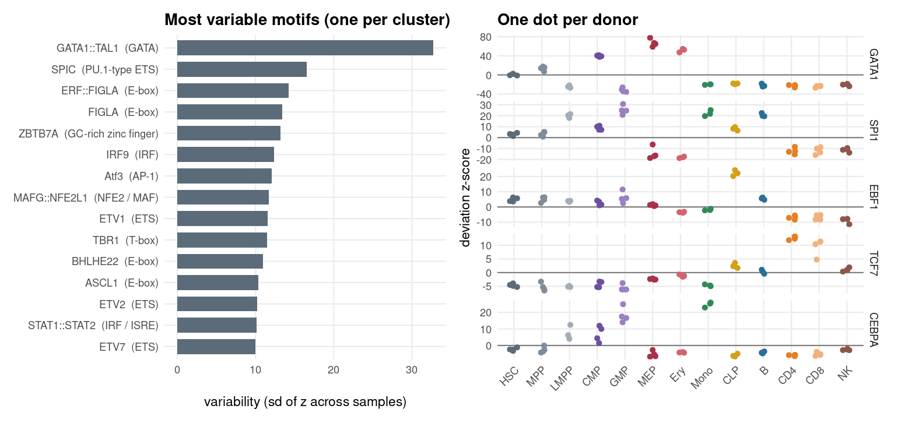{width="100%" fig-align="center"}

- Variability ranks motifs by how much their accessibility differs between samples: an unsupervised way to find the **TFs that distinguish cell types**.
- The top of the list is dominated by families, often under unexpected names: **FIGLA, ASCL1, BHLHE22** are E-box motifs (E2A/TCF3 in lymphoid cells), **TBR1** is a T-box motif (T-bet, Eomes), **MAFG::NFE2L1** is the erythroid NFE2 motif.
- chromVAR was built for **single-cell ATAC-seq**, where each cell has a few thousand fragments: no single peak is informative, but summed over the thousands of peaks with a motif, each cell gets a z-score (ArchR, Signac).

::: notes
Left: the 15 most variable motifs, keeping one motif per group of motifs whose z-scores correlate above 0.9; the label in brackets says what kind of motif it is. GATA is far ahead (variability 33): erythroid and megakaryocyte-erythroid progenitors differ most from everything else. Right: one dot per donor for five motifs, along the haematopoietic tree. GATA1 rises from HSC (about 0) through MPP and CMP to MEP (about 65); PU.1 is high in LMPP, GMP, monocytes and B cells and negative in erythroid, T and NK cells; EBF1 peaks in CLPs, TCF7 in T cells, CEBPA in GMPs and monocytes. The names on the left are a lesson in the family problem: JASPAR names a matrix after the protein it was measured for, which is often not the factor active in blood. In single cells, chromVAR z-scores are used to cluster cells, to annotate clusters, and to follow TF activity along differentiation trajectories; the Schep et al. paper did this for single-cell ATAC-seq of the same haematopoietic populations.
:::

## Footprints: a bound TF protects its site {.smaller}

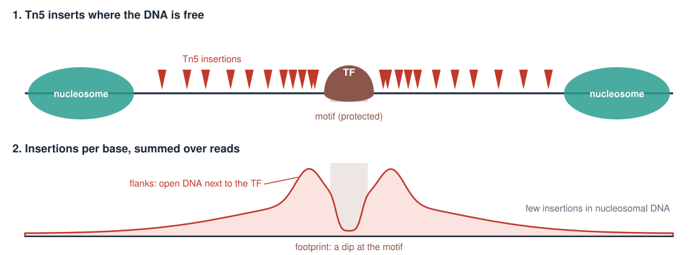{width="92%" fig-align="center"}

- Tn5 cannot insert where a protein sits. A TF bound for long enough leaves a **dip** of insertions over its motif (the **footprint**), flanked by high insertion rates in the free DNA next to it.
- Footprinting needs **base-resolution insertion sites** (the +4/−5 shifted read ends of *ATAC-seq processing and peak calling*), not coverage, and deep sequencing: ~10⁸ reads for single sites.

::: notes
The idea is old: DNase I footprinting on gels since 1978, then genome-wide with DNase-seq, and with ATAC-seq: the first ATAC-seq paper (Buenrostro et al. 2013) already showed an aggregate CTCF footprint. The two features: the flanks are high because the TF keeps the neighbourhood free of nucleosomes, and the centre is low because the protein blocks Tn5. For a single site you need many insertions within ±100 bp, so footprinting individual sites requires very deep libraries; aggregating over thousands of sites of the same motif (next slide) works with ordinary depth.
:::

## From reads to an aggregate footprint {.smaller}

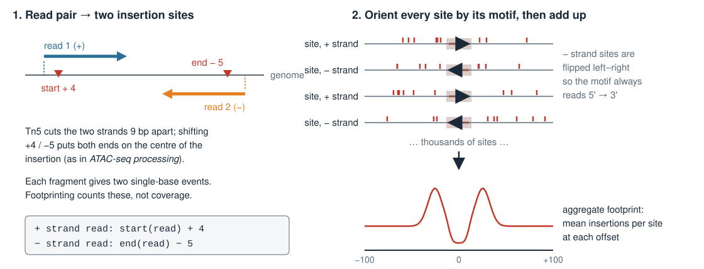{width="92%" fig-align="center"}

- Each read end is one Tn5 insertion: in **BED coordinates**, start + 4 for reads on +, end − 5 for reads on −. In 1-based R coordinates, use start + 4 and end − 4.
- Take every motif match, cut a window of ±100 bp around its centre, **flip** sites on the − strand, and average the insertion counts position by position.

::: notes
The +4/−5 shift comes from the 9-bp duplication Tn5 creates when it inserts: the two strands are cut 9 bp apart, so the two read ends of a fragment are offset; shifting puts both on the centre of the insertion event (ATAC-seq processing unit). Orientation matters because motifs are not palindromic: the protein's contacts, and Tn5's sequence preference, are asymmetric relative to the motif. Without flipping, the footprint of a non-palindromic motif is smeared. In R this is coverage() on single-base GRanges, a Views/matrix of windows, and colMeans. deepTools computeMatrix on a bigWig of insertions does the same on the command line.
:::

## Real data: CTCF footprint in GM12878 {.smaller}

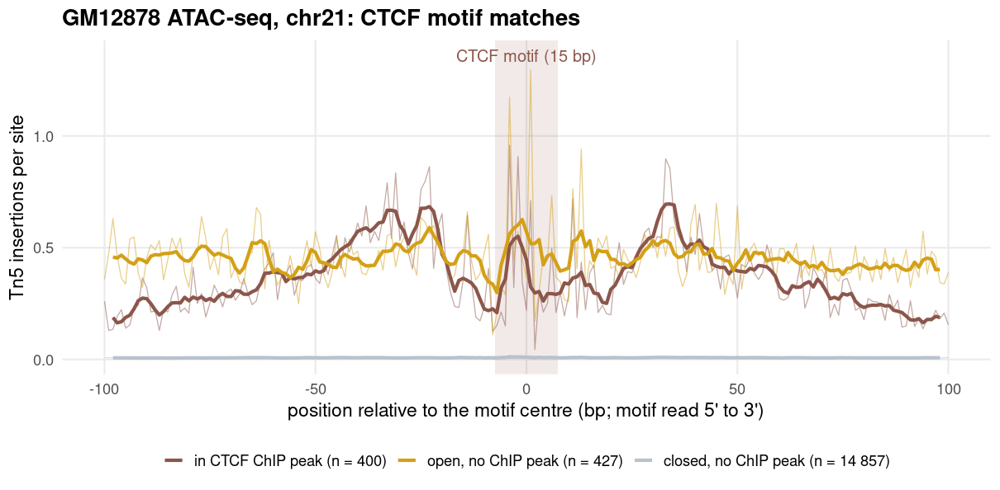{width="92%" fig-align="center"}

- **Bound** sites (motif in a ChIP peak, n = 400): high flanks peaking at about −23 and +34 bp, and a dip over the motif. **Open but unbound** motif sites (n = 427): flat, no flanks, no dip. **Closed** sites: almost no insertions.
- The narrow spike at the motif centre appears in bound **and** unbound sites: it is Tn5's sequence preference, not protein.

::: notes
Real data from the exercise: GM12878 ATAC-seq replicate 1, chr21 only, 505 000 insertions after removing duplicates. CTCF motif matches on chr21 at p < 1e-4 (JASPAR MA0139.2), oriented by motif strand, averaged per site; thin lines are 1-bp values, thick lines a 5-bp running mean. Bound sites: insertions rise to about 0.7 per site at the flanks and fall to about 0.2 on either side of the centre; averaged over ±10 bp the centre is 0.34 against 0.48 at 30–60 bp, a ratio of 0.69. Three lessons. The flanks: CTCF positions nucleosomes and keeps the neighbourhood open. The dip: the protein blocks Tn5 over roughly 20–40 bp, wider than the 15-bp motif because CTCF's zinc fingers and the protein bulk cover more DNA. The spike at the centre: the unbound open sites have it too, so it comes from the motif sequence itself, which Tn5 prefers to cut (next slide). With one chromosome and 400 sites the profile is noisy; genome-wide it is very clean.
:::

## Tn5 has a sequence preference {.smaller}

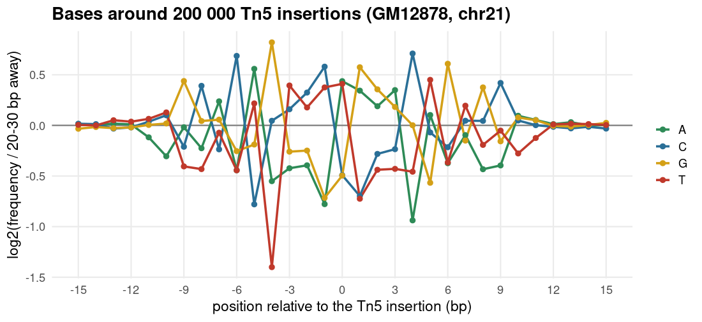{width="88%" fig-align="center"}

- Base composition around 200 000 insertion sites in the GM12878 reads, relative to the same reads 20–30 bp away. Within ±10 bp of the insertion, bases are up to **1.8-fold enriched** or **2.6-fold depleted**, in a structured pattern around the 9-bp duplication.
- Tn5 does not cut at random: some sequences are cut more often **whatever is bound**. A motif has nearly the same sequence at every site, so this preference repeats at every site and does not average out.

::: notes
The +4/−5 shift puts position 0 at the centre of the 9-bp target-site duplication. The pattern is a weak, roughly palindromic preference, as expected for an enzyme that binds DNA as a dimer. The same kind of bias exists for DNase I, MNase and the restriction enzymes: every enzyme has a sequence preference. Comparing with positions 20–30 bp away removes the general GC richness of open chromatin, which would otherwise dominate. The consequence for footprinting: averaged over thousands of copies of the same motif, Tn5's preference for the motif's own sequence produces a reproducible shape, a spike or a dip, that has nothing to do with binding. The central spike in the CTCF footprint is an example.
:::

## Correcting for Tn5 bias {.smaller}

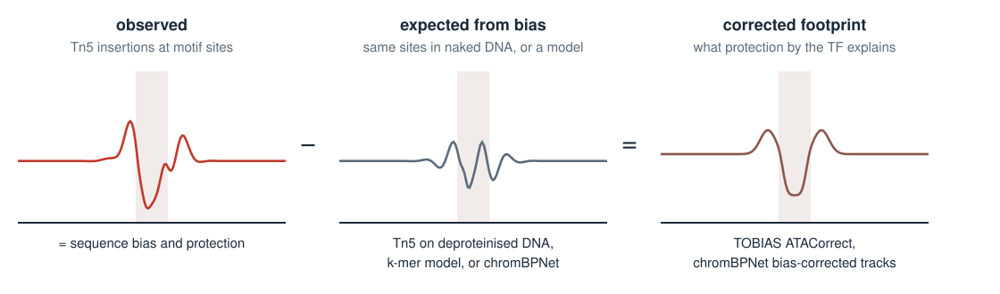{width="92%" fig-align="center"}

- Observed insertions = **Tn5 sequence preference × protection**. Inside a motif the sequence is the same at every site, so the bias is the same at every site and adds up in the aggregate: it can create a **fake footprint**, or hide a real one.
- Correct by comparing with insertions expected from sequence alone: Tn5 on naked DNA, a k-mer model (**TOBIAS** ATACorrect), or a neural network bias model (**chromBPNet**).

::: notes
Sung et al. 2014 showed for DNase-seq that much of the fine structure inside "footprints" comes from the enzyme's sequence preference, not from protein contacts; Tn5 has the same problem. TOBIAS (Bentsen et al. 2020) estimates Tn5's preference from the data with a position-weight model around insertion sites, computes the expected insertions at every position, and subtracts them (ATACorrect); then it scores footprints (ScoreBigwig) and compares conditions per site (BINDetect). chromBPNet (Kundaje lab) trains a small network on insertions in closed regions to learn the bias, and a second network for the rest; the bias-corrected predictions show footprints. Commands in the exercise "Where this leads". The key point for the exam: an aggregate dip is evidence of binding only after bias correction, or with a control set of unbound sites with the same motif.
:::

## Which TFs leave footprints? {.smaller}

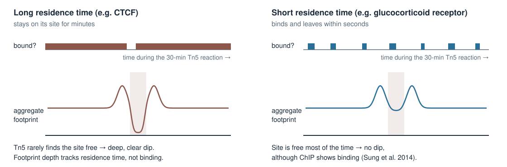{width="92%" fig-align="center"}

- Footprint depth reflects how long the TF stays on DNA (**residence time**), not just whether it binds.
- **CTCF** (minutes) footprints well. Many TFs exchange within **seconds** and leave little or no footprint even where ChIP-seq shows binding (Sung et al. 2014).
- "No footprint" is therefore **not** evidence of no binding; compare conditions (TOBIAS BINDetect) rather than reading single sites.

::: notes
Live-cell imaging measures residence times: about 10 seconds for the glucocorticoid receptor, two orders of magnitude longer for CTCF. Sung et al. 2014 compared DNase-seq footprints with these kinetics: GR and SOX2 showed little or no protection at sites bound in ChIP-seq, AP-1 and CREB1 were intermediate, CTCF strong; the same logic applies to Tn5. In a 30-minute tagmentation, a site with a short residence time is free most of the time, so Tn5 cuts it almost as often as the flanks. The TF still opens the chromatin (high flanks), but leaves no dip. This is why footprinting works beautifully for CTCF and a few others, and poorly for many important regulators. A practical consequence: compare the same motif between conditions (B vs T), where bias and residence time cancel, rather than claiming binding at individual sites.
:::

## A motif is not a binding event {.smaller}

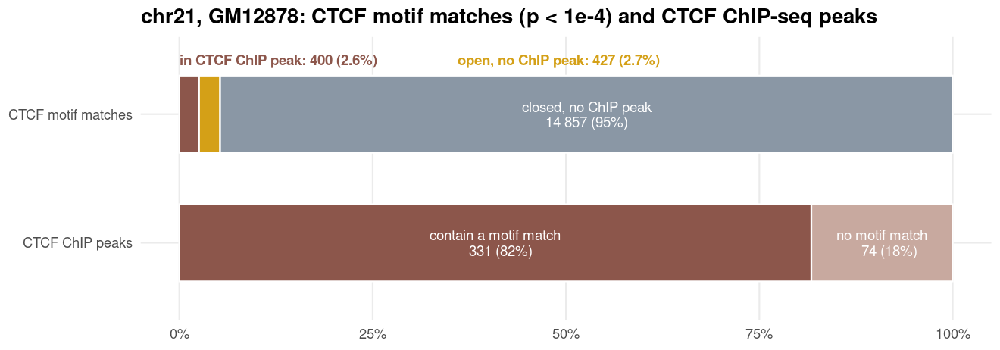{width="92%" fig-align="center"}

- Of 15 684 CTCF motif matches on chr21, only **400 (2.6%)** lie in a CTCF ChIP-seq peak; 95% are in closed chromatin. Conversely, **82%** of the 405 chr21 CTCF ChIP peaks contain a match.
- CTCF has one of the longest, most informative motifs. For short motifs (GATA: WGATAR) the fraction bound is far smaller. A match says where a TF **could** bind; chromatin and partners decide where it **does** (*Gene regulation*).

::: notes
Real numbers from the exercise. Motif matches at p < 1e-4 on chr21, after removing blacklisted regions; ChIP peaks are the ENCODE conservative IDR peaks for GM12878 CTCF. Even for CTCF, which binds a long motif with high specificity and is bound at about 44 000 sites in this GM12878 ChIP-seq experiment (all chromosomes), the vast majority of motif matches in the genome are not bound: most lie in closed chromatin, in DNA methylated at the motif's CpGs, or are weak matches. The 18% of ChIP peaks without a match are weaker motifs below the threshold, indirect binding, or noise. This is why enrichment, chromVAR and footprinting all restrict motif analysis to open chromatin, and why the step from motif to binding needs direct evidence. The 427 open but unbound sites in the previous figure show no footprint: being in open chromatin is not enough either.
:::

## Three questions, three tools {.smaller}

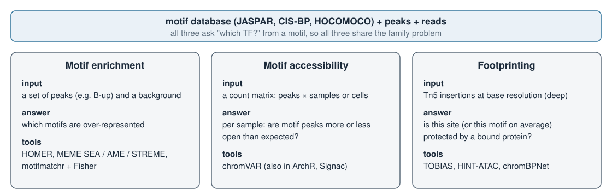{width="95%" fig-align="center"}

- **Enrichment** for a set of peaks (differential peaks, a cluster); **chromVAR** for samples or single cells; **footprinting** for sites, with deep data and bias correction.
- All three start from motifs, so all three inherit the motif's limits: family redundancy, imperfect matrices, and motif ≠ binding.

::: notes
A map for choosing. If you have a list of differential peaks: enrichment. If you have many samples or cells and want a per-sample activity score, for clustering or for plotting along a trajectory: chromVAR. If you want to know which sites are occupied, or how occupancy changes between conditions: footprinting, with deep data and a bias-corrected tool. Each answer is still about a motif, and naming the TF needs other evidence: expression, ChIP or CUT&RUN for the candidate TF, or perturbation. The ChIP and CUT&RUN units come next.
:::

## Summary {.smaller}

| idea | key fact |
|---|---|
| motif match | PWM log-odds score above a p-value threshold; ~5% of 500-bp peaks match any motif by chance |
| databases | JASPAR, CIS-BP, HOCOMOCO; families share motifs, so a motif names a family |
| enrichment | 2×2 table: target vs background × match vs no match; odds ratio; Fisher = hypergeometric |
| background | decides the question; tested ns peaks for differential sets; match GC; random genome inflates |
| multiple testing | ~900 motifs: BH or Bonferroni, then rank by effect size and group by family |
| de novo | find enriched words, build a PWM, compare with the database (HOMER, STREME, Tomtom) |
| chromVAR | per-sample deviation of motif peaks vs GC/accessibility-matched background; z-score; variability; single cells |
| footprint | dip of Tn5 insertions at a bound motif, high flanks; aggregate over oriented sites |
| caveats | Tn5 sequence bias makes fake footprints (correct: TOBIAS, chromBPNet); short residence time leaves none |

::: notes
Students should leave able to fill in and evaluate a 2×2 motif table by hand, explain why the background matters, read a chromVAR heatmap, read an aggregate footprint and say what the flanks and the dip mean, and explain why neither a motif match nor a missing footprint settles whether a TF binds. Next: ChIP-seq, which measures the binding of one TF directly.
:::

## Key papers (optional further reading) {.smaller}

*Not required reading and not examined. For those who want the primary literature.*

- Heinz et al. 2010, *Mol Cell*. [Simple combinations of lineage-determining transcription factors prime cis-regulatory elements required for macrophage and B cell identities](https://doi.org/10.1016/j.molcel.2010.05.004). HOMER, and PU.1 with partners selecting cell-type enhancers.
- Bailey et al. 2015, *Nucleic Acids Res*. [The MEME Suite](https://doi.org/10.1093/nar/gkv416). The other standard motif toolkit (MEME, STREME, SEA, Tomtom).
- Rauluseviciute et al. 2024, *Nucleic Acids Res*. [JASPAR 2024: 20th anniversary of the open-access database of transcription factor binding profiles](https://doi.org/10.1093/nar/gkad1059). The motif database we use.
- Schep et al. 2017, *Nat Methods*. [chromVAR: inferring transcription-factor-associated accessibility from single-cell epigenomic data](https://doi.org/10.1038/nmeth.4401). chromVAR, demonstrated on the same Corces haematopoiesis data.
- Sung et al. 2014, *Mol Cell*. [DNase footprint signatures are dictated by factor dynamics and DNA sequence](https://doi.org/10.1016/j.molcel.2014.08.016). Why many bound TFs leave no footprint, and why enzyme bias shapes the ones you see.
- Bentsen et al. 2020, *Nat Commun*. [ATAC-seq footprinting unravels kinetics of transcription factor binding during zygotic genome activation](https://doi.org/10.1038/s41467-020-18035-1). TOBIAS: bias correction and differential footprinting.
