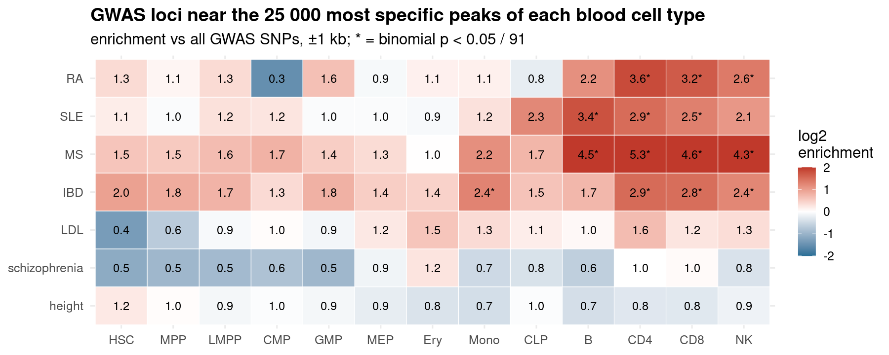

## Goal

After this exercise you will be able to:

- Compute **linkage disequilibrium** ($r^2$) from haplotype frequencies and explain why a lead SNP is a tag.
- Set up an **enrichment** test of disease loci in a chromatin annotation as a 2×2 table, choose a background, and see what the background and the window size do to the answer.
- Compute **posterior inclusion probabilities** and a **credible set** from Bayes factors, with and without a functional prior.
- Score both alleles of a variant with a **PWM** and judge what a motif change means.
- Test **allele-specific accessibility** at heterozygous SNPs and recognise reference mapping bias.
- In R and on the command line: take GWAS Catalog associations for autoimmune diseases and LDL cholesterol, test their enrichment in GM12878, K562, HepG2 and 13 blood cell types, scan the alleles of autoimmune SNPs for motif changes, and measure allelic imbalance in your own GM12878 ATAC-seq alignments.

## Background

**GWAS Catalog.** Published genome-wide significant associations (p ≤ 5 × 10⁻⁸): one row per SNP–trait–study, with the reported SNP, its GRCh38 position, the risk allele, the functional context and the mapped (EFO) trait.

**Loci.** Many rows describe the same signal (several studies, several SNPs in LD). To count each signal once we **prune**: sort SNPs by p-value, keep the strongest, drop any SNP within 250 kb of a kept one. A proper analysis uses LD from a reference panel (`plink --clump`).

**LD.** For two biallelic SNPs with allele frequencies $p_A$, $p_B$ and haplotype frequency $p_{AB}$: $D = p_{AB} - p_A p_B$ and $r^2 = D^2 / \left(p_A(1-p_A)p_B(1-p_B)\right)$. If SNP B is causal, the association statistic at SNP A is expected to be about $r^2$ times that at B.

**Enrichment.** Of $n$ loci, $k$ are near the annotation; in the background a fraction $p_0$ is. Enrichment $= (k/n)/p_0$; under no enrichment $k \sim \text{Binomial}(n, p_0)$.

**Fine-mapping with one causal variant.** With Bayes factors $BF_i$ and prior probabilities $\pi_i$, the posterior inclusion probability is $\text{PIP}_i = \pi_i BF_i / \sum_j \pi_j BF_j$. A 95% credible set is the smallest set of SNPs (highest PIP first) whose PIPs sum to ≥ 0.95.

**Motif change.** The score of a window is the sum of the log-odds weights of its bases (*Gene regulation and the cis-regulatory code*). For a variant, compute the best score over all windows containing it, on both strands, for each allele: $\Delta = \text{score}_{alt} - \text{score}_{ref}$ (bits; $2^{|\Delta|}$ is the fold change in odds).

**Allelic imbalance.** At a heterozygous SNP, reads with the reference allele $k$ out of $n$; without a cis effect $k \sim \text{Binomial}(n, 0.5)$, or $\text{Binomial}(n, \hat{p})$ with $\hat{p}$ the genome-wide reference fraction, which adjusts for an overall reference excess but does not correct site-specific mapping bias.

## Data

From the course data folder (`data/download.sh noncoding-variants`; the GWAS, allele and VCF files are made by `data/prepare-integ.sh`):

```bash
mkdir -p ~/epi/variants && cd ~/epi/variants
D=/path/to/course/data
```

- `gwas_catalog_gws.tsv.gz`: all genome-wide significant associations of the [GWAS Catalog](https://www.ebi.ac.uk/gwas/) (release of 2026-10-29), 10 columns: `snp chr pos risk_allele context trait trait_uri mlog10p study pubmed` (GRCh38, 1-based positions).
- `gwas_autoimmune_gm12878_alleles.tsv`: dbSNP reference and alternative alleles of the autoimmune GWAS SNPs that lie in GM12878 ATAC peaks (plus rs12740374), from the [NCBI Variation API](https://api.ncbi.nlm.nih.gov/variation/v0/).
- `gm12878_atac_peaks.bed.gz`, `k562_atac_peaks.bed.gz`, `hepg2_atac_peaks.bed.gz`: ENCODE ATAC-seq IDR peaks (narrowPeak) of a B-lymphoblastoid, an erythroleukaemia and a liver cancer cell line, same lab and pipeline.
- `na12878_chr21_het_snps.vcf.gz`: heterozygous SNVs of GM12878 (individual NA12878) on chr21 from the [Genome in a Bottle](https://www.nist.gov/programs-projects/genome-bottle) v4.2.1 benchmark.
- From earlier units: `corces2016_atac_counts.txt.gz`, `hg19ToHg38.over.chain.gz`, `hg38.chrom.sizes`, `hg38.fa.bgz` (+ index), `hg38_chr21_chrM.fa`, and **your** `rep1.dedup.bam` and `rep2.dedup.bam` from the exercise of *ATAC-seq processing and peak calling* (chr21, filtered, duplicates removed).

**Shortcuts, said plainly.** We use reported lead SNPs and a window (±1 kb) instead of LD proxies or fine-mapped credible sets; loci are pruned by distance, not by LD; the background is "all GWAS SNPs", not SNPs matched for allele frequency and LD; annotations are the 50 000 strongest peaks of three cell lines. The proper tools (S-LDSC, GREGOR, fine-mapping with SuSiE) need full summary statistics and an LD reference panel, which we do not use here. Allelic imbalance is measured on chr21 only, without WASP correction. The GWAS Catalog grows every week: a newer release gives slightly different counts.

The R part runs in about 4 minutes and needs about 4 GB of memory.

## By hand

**B1. Linkage disequilibrium.** Two SNPs with alleles A/a and B/b. In a population the haplotype frequencies are AB 0.4, Ab 0.1, aB 0.1, ab 0.4.

(a) Compute $p_A$, $p_B$, $D$ and $r^2$.

(b) What would the haplotype frequencies be for $r^2 = 1$ (with the same allele frequencies)?

(c) SNP B is causal and its association chi-square is 100. About what chi-square do you expect at SNP A in (a)? Would A be genome-wide significant (chi-square ≈ 30 for p = 5 × 10⁻⁸)?

**B2. An enrichment test.** Of 774 LDL-cholesterol loci, 39 lie within 1 kb of a HepG2-specific ATAC peak. Of all GWAS SNPs, 2.8% do.

(a) How many loci would you expect without enrichment? What is the enrichment?

(b) Approximate the binomial by a normal distribution (mean $np_0$, variance $np_0(1-p_0)$): what is the z-score?

(c) Suppose that, of random genomic positions, only 1.2% lie within 1 kb of such a peak. What enrichment would you report against this background? Which number is more honest, and why?

(d) Why must the loci be pruned before the test? What would happen if all 3636 LDL SNPs (many in LD with each other) were counted?

**B3. Fine-mapping.** A locus has four SNPs in strong LD, with approximate Bayes factors 50, 30, 15 and 5 (one causal variant assumed).

(a) With equal priors, compute the PIPs and the 95% credible set.

(b) SNP 3 is the only one inside an ATAC peak of the relevant cell type. Give it a prior 10 times higher than the others. Recompute the PIPs and the credible set.

(c) A paper then states: "the fine-mapped causal variant lies in an enhancer". What would you want to know about how the prior was chosen?

**B4. Score both alleles.** A 5-bp log-odds matrix (bits):

| | 1 | 2 | 3 | 4 | 5 |
|---|---:|---:|---:|---:|---:|
| A | +1.2 | −2.0 | +1.5 | +1.8 | −1.0 |
| C | −1.5 | −2.0 | −1.0 | −2.0 | +1.6 |
| G | −1.5 | +1.9 | −1.0 | −2.0 | −1.0 |
| T | +0.2 | −2.0 | −1.0 | −0.5 | −1.0 |

The reference sequence is `AGAAC`; a SNP changes position 4 from A to G.

(a) Score the reference and the alternative window. What is Δ, and by what factor does the match weaken?

(b) A match is called at a score ≥ 6 bits. Is the site "lost"?

(c) Why must the minus strand and all windows that overlap the SNP be scored too?

(d) In the lecture, 85% of autoimmune SNPs in GM12878 peaks gained or lost some JASPAR match, and so did 81% of random positions in the same peaks. What does this imply for a paper that reports "the risk allele disrupts a motif"?

**B5. Allelic imbalance.** At a heterozygous SNP in an ATAC peak of one individual, 30 reads carry the reference allele and 10 the alternative.

(a) Test against 0.5 with the normal approximation. Is it significant at 5%?

(b) Over all heterozygous SNPs, 51.6% of reads carry the reference allele. Repeat the test against 0.516. Why does this matter more for highly covered sites?

(c) A neighbouring SNP 50 bp away in the same peak shows 28 reference and 9 alternative reads. Does this strengthen or weaken the case? What would you check?

(d) Another SNP shows 79 reference and 0 alternative reads, although the genotype is heterozygous. Give two explanations other than a regulatory variant.

**B6. Read the heatmap.** Use the figure from the lecture:

{width="100%"}

(a) In which cell types are MS loci most enriched? SLE loci?

(b) Why are LDL, schizophrenia and height loci not enriched in any blood cell type?

(c) A student concludes "SLE starts in B cells". What does the heatmap show, and what does it not show?

**B7. Judge the claims.**

(a) "The lead SNP rs123 lies in a GM12878 enhancer and changes an IRF4 motif; it is the causal variant for lupus at this locus."

(b) "Height loci are not enriched in any blood cell type, so these annotations are useless for height."

(c) "Autoimmune loci overlap open chromatin of GM12878 4 times more often than random genomic positions do; therefore B cells are the key cell type for autoimmunity."

## On the command line

### C1 — The GWAS Catalog with awk

```bash
zcat $D/gwas_catalog_gws.tsv.gz | head -3
zcat $D/gwas_catalog_gws.tsv.gz | tail -n +2 | cut -f6 | sort | uniq -c | sort -k1,1nr | head -10
zcat $D/gwas_catalog_gws.tsv.gz | awk -F'\t' -v OFS='\t' '
  $6 == "rheumatoid arthritis" || $6 == "systemic lupus erythematosus" || $6 == "multiple sclerosis" ||
  $6 == "inflammatory bowel disease" || $6 == "Crohn disease" || $6 == "ulcerative colitis" { print $2, $3 - 1, $3, $1 }' \
  | sort -k1,1 -k2,2n -u > autoimmune_snps.bed
zcat $D/gwas_catalog_gws.tsv.gz | awk -F'\t' -v OFS='\t' '$6 == "low density lipoprotein cholesterol measurement" { print $2, $3 - 1, $3, $1 }' \
  | sort -k1,1 -k2,2n -u > ldl_snps.bed
zcat $D/gwas_catalog_gws.tsv.gz | tail -n +2 | awk -F'\t' -v OFS='\t' '{ print $2, $3 - 1, $3, $1 }' \
  | sort -k1,1 -k2,2n -u > all_gwas_snps.bed
wc -l autoimmune_snps.bed ldl_snps.bed all_gwas_snps.bed
```

(a) Which traits have the most associations? Why does "body height" have so many?

(b) How many unique autoimmune and LDL SNPs are there? Why is `$3 - 1` used for the BED start?

### C2 — Overlap with peaks of three cell lines

```bash
for cl in gm12878 k562 hepg2; do
  for s in autoimmune ldl all_gwas; do
    n=$(wc -l < ${s}_snps.bed)
    k=$(bedtools intersect -u -a ${s}_snps.bed -b $D/${cl}_atac_peaks.bed.gz | wc -l)
    echo $cl $s $k $n | awk '{ printf "%-8s %-11s %6d / %6d = %.3f\n", $1, $2, $3, $4, $3 / $4 }'
  done
done
```

(a) Fill in a table: fraction of autoimmune, LDL and all GWAS SNPs inside the peaks of each cell line. Compute the enrichment of autoimmune and LDL SNPs relative to all GWAS SNPs.

(b) Why is this analysis weaker than the one in R (think about pruning and about peaks shared between cell lines)?

### C3 — Allele counts at heterozygous SNPs

Run where your `rep1.dedup.bam` and `rep2.dedup.bam` from *ATAC-seq processing and peak calling* are:

```bash
zcat $D/gm12878_atac_peaks.bed.gz | awk -v OFS='\t' '$1 == "chr21" { print $1, $2, $3 }' \
  | sort -k1,1 -k2,2n | bedtools merge > peaks21.bed
bcftools view -H -R peaks21.bed $D/na12878_chr21_het_snps.vcf.gz | wc -l
bcftools mpileup -f $D/hg38_chr21_chrM.fa -R peaks21.bed -T $D/na12878_chr21_het_snps.vcf.gz \
    -a AD -q 30 -Q 20 -d 1000 rep1.dedup.bam rep2.dedup.bam 2> /dev/null \
  | bcftools query -f '%CHROM\t%POS\t%REF\t%ALT\t[%AD\t]\n' > allele_counts.txt
wc -l < allele_counts.txt
head -5 allele_counts.txt
```

(a) How many heterozygous SNPs of GM12878 lie in chr21 ATAC peaks? For how many does `mpileup` report counts?

(b) Explain the options `-T`, `-a AD`, `-q 30`, `-Q 20`. What do the two `AD` columns contain, and what does an ALT of `<*>` mean?

(c) Why do we merge the peaks before using them as regions?

## In R

You need data.table, GenomicRanges, rtracklayer, Rsamtools, Biostrings, JASPAR2024, TFBSTools, motifmatchr and ggplot2 (see *Install the software you need*).

```r
suppressPackageStartupMessages({
  library(data.table); library(GenomicRanges); library(rtracklayer); library(Rsamtools); library(Biostrings)
  library(JASPAR2024); library(TFBSTools); library(motifmatchr); library(ggplot2)
})
D <- "/path/to/course/data"
set.seed(1)
```

### R1 — Traits, loci and the share of non-coding hits

```r
gw <- fread(file.path(D, "gwas_catalog_gws.tsv.gz"))
c(associations = nrow(gw), snps = uniqueN(gw$snp), traits = uniqueN(gw$trait))
snp <- gw[, .(chr = chr[1], pos = pos[1], context = context[1]), by = snp]
coding <- c("missense_variant", "synonymous_variant", "stop_gained", "frameshift_variant", "inframe_insertion",
            "inframe_deletion", "start_lost", "stop_lost", "stop_retained_variant", "protein_altering_variant",
            "coding_sequence_variant", "splice_donor_variant", "splice_acceptor_variant")
round(100 * mean(snp$context %in% coding), 1)
head(sort(table(snp$context), decreasing = TRUE), 8)
sets <- list(autoimmune = c("rheumatoid arthritis", "systemic lupus erythematosus", "multiple sclerosis",
                            "inflammatory bowel disease", "Crohn disease", "ulcerative colitis"),
             LDL = "low density lipoprotein cholesterol measurement", schizophrenia = "schizophrenia",
             height = "body height")
prune <- function(x, w = 250000) {               # keep the strongest SNP, drop SNPs within w of a kept one
  x <- x[order(-mlog10p)]; keep <- logical(nrow(x))
  for (ch in unique(x$chr)) {
    i <- which(x$chr == ch); kept <- integer(0)
    for (j in i) if (!length(kept) || all(abs(x$pos[kept] - x$pos[j]) > w)) kept <- c(kept, j)
    keep[kept] <- TRUE
  }
  x[keep]
}
leads <- rbindlist(lapply(names(sets), function(s) {
  x <- gw[trait %in% sets[[s]], .(chr = chr[1], pos = pos[1], mlog10p = max(mlog10p)), by = snp]
  y <- prune(x); y[, set := s]; y }))
leads[, .N, by = set]
```

(a) What fraction of unique GWAS SNPs is coding or at a splice site? Which contexts dominate?

(b) How many SNPs and how many pruned loci does each trait set have? Why is the ratio so different for height?

(c) What does `prune` do when two SNPs are 200 kb apart but in no LD at all? When two SNPs are 300 kb apart but in perfect LD?

### R2 — Enrichment in cell-type-specific peaks

```r
chroms <- paste0("chr", c(1:22, "X"))
top_peaks <- function(f, n = 50000) {            # the n strongest peaks, 500 bp around the summit
  p <- fread(file.path(D, f))[V1 %in% chroms][order(-V7)][1:n]
  GRanges(p$V1, IRanges(p$V2 + p$V10 + 1 - 250, width = 500))
}
atac <- list(GM12878 = top_peaks("gm12878_atac_peaks.bed.gz"), K562 = top_peaks("k562_atac_peaks.bed.gz"),
             HepG2 = top_peaks("hepg2_atac_peaks.bed.gz"))
spec <- list(GM12878_only = atac$GM12878[!overlapsAny(atac$GM12878, c(atac$K562, atac$HepG2))],
             K562_only    = atac$K562[!overlapsAny(atac$K562, c(atac$GM12878, atac$HepG2))],
             HepG2_only   = atac$HepG2[!overlapsAny(atac$HepG2, c(atac$GM12878, atac$K562))],
             all_three    = atac$GM12878[overlapsAny(atac$GM12878, atac$K562) & overlapsAny(atac$GM12878, atac$HepG2)])
sapply(spec, length)
bg <- snp[, .(snp, chr, pos)]
near <- function(chr, pos, a, w = 1000) overlapsAny(GRanges(chr, IRanges(pmax(pos - w, 1), pos + w)), a)
enrich <- function(a, s, w = 1000) {
  l <- leads[set == s]; k <- sum(near(l$chr, l$pos, a, w)); p0 <- mean(near(bg$chr, bg$pos, a, w))
  data.table(set = s, n = nrow(l), k = k, frac = k / nrow(l), bg = p0, enrichment = k / nrow(l) / p0,
             p = binom.test(k, nrow(l), p0, alternative = "greater")$p.value)
}
res <- rbindlist(lapply(names(spec), function(a) rbindlist(lapply(names(sets), function(s) cbind(annot = a, enrich(spec[[a]], s))))))
dcast(res, set ~ annot, value.var = "enrichment")
res[p < 0.05]
cs <- fread(file.path(D, "hg38.chrom.sizes"))[V1 %in% chroms]
rp <- data.table(chr = sample(cs$V1, 1e5, TRUE, prob = cs$V2))
rp[, pos := floor(runif(.N, 1e6, cs$V2[match(chr, cs$V1)] - 1e6))]
c(random = mean(near(rp$chr, rp$pos, atac$GM12878)), all_gwas = mean(near(bg$chr, bg$pos, atac$GM12878)),
  autoimmune = leads[set == "autoimmune", mean(near(chr, pos, atac$GM12878))])
```

(a) How many peaks are specific to each cell line, and how many shared by all three?

(b) Which trait set is enriched in which annotation? Report enrichment and p for the significant ones.

(c) What fraction of random positions, of all GWAS SNPs and of autoimmune loci lies near a GM12878 peak (all 50 000)? Compute the enrichment of autoimmune loci against each background.

### R3 — Thirteen blood cell types

```r
cc <- fread(file.path(D, "corces2016_atac_counts.txt.gz"))
code2type <- c(`1` = "HSC", `2` = "MPP", `3` = "LMPP", `4` = "CMP", `5` = "GMP", `6` = "MEP", `7` = "Mono",
               `9` = "CD4", `10` = "CD8", `11` = "NK", `13` = "B", `14` = "CLP", `15` = "Ery")
healthy <- grep("^(Donor)?[0-9]+-", names(cc), value = TRUE)
re <- "^(?:Donor)?([0-9]+)-(?:[A-Za-z][A-Za-z0-9]*-)?([0-9]+)([A-C]?)(?:-[0-9]+)?$"
ct <- code2type[sapply(regmatches(healthy, regexec(re, healthy, perl = TRUE)), `[`, 3)]
m  <- as.matrix(cc[, ..healthy])
lc <- sapply(split(seq_along(ct), ct), function(i)
  log2(rowMeans(sweep(m[, i, drop = FALSE], 2, colSums(m[, i, drop = FALSE]), "/")) * 1e6 + 1))
z  <- lc - rowMeans(lc)                                   # specificity: above the mean of all cell types
chainf <- tempfile(fileext = ".chain")
writeLines(readLines(gzfile(file.path(D, "hg19ToHg38.over.chain.gz"))), chainf)
lo  <- liftOver(GRanges(cc$Chr, IRanges(cc$Start + 1, cc$End)), import.chain(chainf))
one <- which(lengths(lo) == 1); p38 <- unlist(lo[one])
ctres <- rbindlist(lapply(colnames(z), function(k) {
  A <- p38[order(-z[one, k])[1:25000]]
  rbindlist(lapply(c("autoimmune", "LDL"), function(s) cbind(celltype = k, enrich(A, s)))) }))
dcast(ctres, celltype ~ set, value.var = "enrichment")
ctres[p < 0.05 / nrow(ctres)]
```

(a) What does `z` measure? Why take the 25 000 most *specific* peaks rather than the most accessible?

(b) In which cell types are autoimmune loci most enriched? Is LDL enriched anywhere after Bonferroni correction?

### R4 — Window size

```r
win <- rbindlist(lapply(c(0, 500, 1000, 2000, 5000, 10000, 20000), function(w)
  cbind(w = w, enrich(spec$GM12878_only, "autoimmune", w))))
win[, .(w, k, frac = round(frac, 3), bg = round(bg, 3), enrichment = round(enrichment, 2), p = signif(p, 2))]
```

(a) How do the number of loci near a peak, the background rate and the enrichment change with the window?

(b) Which window gives the smallest p-value? Why is that not necessarily the best choice?

### R5 — Motif changes

```r
al <- fread(file.path(D, "gwas_autoimmune_gm12878_alleles.tsv"))
risk <- gw[trait %in% sets$autoimmune | snp == "rs12740374", .(risk = paste(unique(risk_allele), collapse = ",")), by = snp]
al <- merge(al, risk, by = "snp", all.x = TRUE)
pick_alt <- function(alt, risk) {                # one alternative allele: the only one, or the risk allele
  a <- strsplit(alt, ",")[[1]]; if (length(a) == 1) return(a)
  x <- intersect(strsplit(risk, ",")[[1]], a); if (length(x) == 1) x else NA_character_
}
al[, alt1 := mapply(pick_alt, alt, risk)]
table(resolved = !is.na(al$alt1))
al <- al[!is.na(alt1)]
fa <- FaFile(file.path(D, "hg38.fa.bgz"))
jdb  <- RSQLite::dbConnect(RSQLite::SQLite(), db(JASPAR2024()))
pfms <- getMatrixSet(jdb, opts = list(collection = "CORE", tax_group = "vertebrates", all_versions = FALSE))
names(pfms) <- paste(name(pfms), ID(pfms), sep = "_")
wd <- sapply(pfms, function(p) ncol(Matrix(p))); L <- max(wd)
allele_seqs <- function(chr, pos, ref, alt) {    # sequences of both alleles, the variant at position L
  s <- getSeq(fa, GRanges(chr, IRanges(pos - L + 1, pos + L - 1)))
  stopifnot(all(as.character(subseq(s, L, L)) == ref))
  a <- s; subseq(a, L, L) <- DNAStringSet(alt)
  list(ref = s, alt = a)
}
motif_change <- function(sq) {                   # per motif width: windows that contain the variant only
  out <- lapply(split(seq_along(pfms), wd), function(i) {
    k <- wd[i[1]]
    r <- motifMatches(matchMotifs(pfms[i], subseq(sq$ref, L - k + 1, L + k - 1), bg = "even", p.cutoff = 1e-4))
    a <- motifMatches(matchMotifs(pfms[i], subseq(sq$alt, L - k + 1, L + k - 1), bg = "even", p.cutoff = 1e-4))
    list(lost = as.matrix(r & !a), gained = as.matrix(!r & a))
  })
  list(lost = do.call(cbind, lapply(out, `[[`, "lost")), gained = do.call(cbind, lapply(out, `[[`, "gained")))
}
mc <- motif_change(allele_seqs(al$chr, al$pos, al$ref, al$alt1))
nchg <- rowSums(mc$lost | mc$gained)
c(snps = nrow(al), with_change = sum(nchg > 0), fraction = mean(nchg > 0))
p <- fread(file.path(D, "gm12878_atac_peaks.bed.gz"))[V1 %in% paste0("chr", 1:22)][sample(.N, 2000)]
cpos <- p$V2 + p$V10 + sample(-100:100, nrow(p), TRUE)       # random positions near peak summits
cref <- as.character(getSeq(fa, GRanges(p$V1, IRanges(cpos, width = 1))))
ok   <- cref %in% c("A", "C", "G", "T")
calt <- sapply(cref[ok], function(b) sample(setdiff(c("A", "C", "G", "T"), b), 1))
mcc  <- motif_change(allele_seqs(p$V1[ok], cpos[ok], cref[ok], calt))
mean(rowSums(mcc$lost | mcc$gained) > 0)
i <- which(al$snp == "rs12740374")
list(gained = colnames(mc$gained)[mc$gained[i, ]], lost = colnames(mc$lost)[mc$lost[i, ]])
```

(a) For how many SNPs can one alternative allele be chosen? Why do dbSNP records often list several?

(b) Why are the sequences cut to $2k - 1$ bp for a motif of width $k$?

(c) What fraction of autoimmune SNPs and of random positions gains or loses at least one motif match? What do you conclude?

(d) Which motifs does the T allele of rs12740374 gain? Compare with the lecture.

### R6 — Allelic imbalance

Use `allele_counts.txt` from C3 (copy it into the R working directory).

```r
ad  <- fread("allele_counts.txt", header = FALSE, sep = "\t", select = 1:6,
             col.names = c("chr", "pos", "ref", "alts", "ad1", "ad2"))
het <- fread(cmd = paste("bcftools query -f '%POS\\t%ALT\\n'", file.path(D, "na12878_chr21_het_snps.vcf.gz")),
             col.names = c("pos", "het_alt"))
ad  <- merge(ad, het, by = "pos")
alt_count <- function(adv, alts, a) mapply(function(x, al, h) {    # reads for the genotyped ALT allele
  v <- as.integer(strsplit(x, ",")[[1]]); k <- match(h, strsplit(al, ",")[[1]])
  if (is.na(k)) 0L else v[k + 1] }, adv, alts, a)
ad[, refc := as.integer(sub(",.*", "", ad1)) + as.integer(sub(",.*", "", ad2))]
ad[, altc := alt_count(ad1, alts, het_alt) + alt_count(ad2, alts, het_alt)]
ad[, n := refc + altc]
ad <- ad[n >= 10]
p_ref <- sum(ad$refc) / sum(ad$n)
c(sites = nrow(ad), median_depth = median(ad$n), pooled_ref_fraction = p_ref)
ad[, p   := mapply(function(k, n) binom.test(k, n, 0.5)$p.value, refc, n)]
ad[, p_b := mapply(function(k, n) binom.test(k, n, p_ref)$p.value, refc, n)]
c(fdr10_vs_0.5 = sum(p.adjust(ad$p, "BH") < 0.1), fdr10_vs_pooled = sum(p.adjust(ad$p_b, "BH") < 0.1),
  one_allele_only = sum(ad$refc == 0 | ad$altc == 0))
ad[order(p)][1:10, .(pos, ref, het_alt, refc, altc, p = signif(p, 2))]
ggplot(ad, aes(refc / n)) + geom_histogram(breaks = seq(0, 1, 0.05)) + geom_vline(xintercept = c(0.5, p_ref))
```

(a) How many heterozygous SNPs have at least 10 reads? What is the pooled reference fraction, and what does it tell you?

(b) How many SNPs show imbalance at FDR 10%, testing against 0.5 and against the pooled fraction?

(c) Look at the top 10. Which ones cluster in the same peak, and do they agree in direction? What could explain sites with all reads from one allele?

(d) Name one way to remove reference mapping bias before counting.

## Hints

::: {.callout-tip collapse="true" title="Hint 1 — LD and fine-mapping (B1, B3)"}
$D = p_{AB} - p_A p_B$; with all four haplotypes, $p_A = p_{AB} + p_{Ab}$. For PIPs: multiply each Bayes factor by its prior weight, divide by the sum; sort and accumulate until 0.95. [Schaid et al. 2018](https://doi.org/10.1038/s41576-018-0016-z) review fine-mapping; [SuSiE](https://stephenslab.github.io/susieR/) allows several causal variants. [LDlink](https://ldlink.nih.gov/) gives $r^2$ between SNPs in each 1000 Genomes population.
:::

::: {.callout-tip collapse="true" title="Hint 2 — enrichment and backgrounds (B2, R2–R4, C2)"}
The 2×2 logic is the same as motif enrichment in *Motifs, motif enrichment and TF footprinting*. [`binom.test`](https://rdrr.io/r/stats/binom.test.html) with `alternative = "greater"` gives a one-sided p. [`overlapsAny`](https://rdrr.io/bioc/IRanges/man/findOverlaps-methods.html) asks whether each range overlaps any range of another set; [`bedtools intersect -u`](https://bedtools.readthedocs.io/en/latest/content/tools/intersect.html) reports each feature of `-a` once if it overlaps `-b`. Matched backgrounds: [GREGOR](https://doi.org/10.1093/bioinformatics/btv201), [SNPsnap](https://doi.org/10.1093/bioinformatics/btu848); heritability: [S-LDSC](https://github.com/bulik/ldsc/wiki/Partitioned-Heritability) ([Finucane et al. 2015](https://doi.org/10.1038/ng.3404)).
:::

::: {.callout-tip collapse="true" title="Hint 3 — motifs and alleles (B4, R5)"}
Score windows as in *Gene regulation and the cis-regulatory code*: sum the weights of the bases. [`matchMotifs`](https://bioconductor.org/packages/motifmatchr) with `p.cutoff = 1e-4` and `bg = "even"` calls a match per sequence; a sequence of $2k - 1$ bp centred on the variant contains exactly the $k$ windows that overlap it. [`getSeq`](https://rdrr.io/bioc/Biostrings/man/getSeq.html) reads sequence from the indexed FASTA ([`FaFile`](https://rdrr.io/bioc/Rsamtools/man/FaFile-class.html)). [motifbreakR](https://bioconductor.org/packages/motifbreakR) does the same with more options.
:::

::: {.callout-tip collapse="true" title="Hint 4 — allele counts (B5, C3, R6)"}
[`bcftools mpileup`](https://samtools.github.io/bcftools/bcftools.html#mpileup): `-R` restricts to regions (fast, with an index), `-T` to the sites of a VCF, `-a AD` adds allelic depths per sample (REF first, then each ALT in order), `-q`/`-Q` are minimum mapping and base quality, `-d` the maximum depth. `<*>` is the symbolic "any other allele" that `mpileup` always adds. Normal approximation: $z = (k - np)/\sqrt{np(1-p)}$; $|z| > 1.96$ is significant at 5% (two-sided). [WASP](https://doi.org/10.1038/nmeth.3582) removes mapping bias by re-mapping reads with the other allele.
:::

::: {.callout-tip collapse="true" title="Hint 5 — judging claims (B6, B7)"}
Ask of each: is the variant a tag or fine-mapped? Is the background other GWAS SNPs or the genome? Is the motif change more than chance (B4d)? Is there QTL or allelic evidence? Was the relevant cell state profiled? [Farh et al. 2015](https://doi.org/10.1038/nature13835) is a good model of how to combine these.
:::

## Solutions

::: {.callout-note collapse="true" title="Solutions — by hand"}

**B1.** (a) $p_A = 0.4 + 0.1 = 0.5$, $p_B = 0.5$; $D = 0.4 - 0.25 = 0.15$; $r^2 = 0.15^2 / (0.5 \cdot 0.5 \cdot 0.5 \cdot 0.5) = 0.0225 / 0.0625 = $ **0.36**. (b) AB 0.5, ab 0.5, Ab 0, aB 0: A always with B. (c) About $0.36 \times 100 = 36$: yes, above 30. A SNP in moderate LD with the causal variant can itself be genome-wide significant; with $r^2 = 0.9$ it would be almost as significant as the causal one and, with noise, could be the lead SNP.

**B2.** (a) $774 \times 0.028 = 21.7$ expected; enrichment $(39/774)/0.028 = 0.0504/0.028 = $ **1.8**. (b) SD $= \sqrt{774 \cdot 0.028 \cdot 0.972} = 4.6$; $z = (39 - 21.7)/4.6 = $ **3.8** (one-sided p ≈ 10⁻⁴; the exact binomial p is 4 × 10⁻⁴). (c) $0.0504/0.012 = $ **4.2**. The 1.8 against other GWAS SNPs is more honest: GWAS SNPs as a group are in active, gene-rich regions, so part of the 4.2 is ascertainment, not liver specificity. (d) SNPs in LD are not independent: one signal with 30 SNPs in LD would be counted 30 times, inflating both the counts and the significance (pseudo-replication), and loci with many reported SNPs would dominate.

**B3.** (a) Sum 100; PIPs **0.50, 0.30, 0.15, 0.05**. Credible set: 0.50 + 0.30 + 0.15 = 0.95 → SNPs **1, 2, 3**. (b) Weighted: 50, 30, 150, 5; sum 235; PIPs **0.21, 0.13, 0.64, 0.02**. Credible set: 0.64 + 0.21 = 0.85, + 0.13 = 0.98 → SNPs **3, 1, 2** (same three SNPs, but SNP 3 is now the most likely). (c) Whether the prior was set from independent data (e.g. heritability enrichment estimated genome-wide, not from this locus) and how strong it was: with a prior of 10×, the "enhancer" conclusion is partly assumed. Report PIPs with and without the prior.

**B4.** (a) Reference `AGAAC`: 1.2 + 1.9 + 1.5 + 1.8 + 1.6 = **8.0**. Alternative `AGAGC`: 1.2 + 1.9 + 1.5 − 2.0 + 1.6 = **4.2**. Δ = **−3.8 bits**: $2^{3.8} \approx 14$ times weaker. (b) Yes: 8.0 ≥ 6 (match) and 4.2 < 6 (no match): lost. (c) TFs bind double-stranded DNA: the motif can be on either strand, so score the reverse complement too; and the variant can sit at any position of the motif, so all $k$ windows overlapping it must be scored (the best match may start upstream). (d) Gaining or losing *some* match is the norm: with ~900 motifs, almost any base change does it. The claim needs more: the TF expressed and bound in those cells (ChIP-seq, footprint), a large Δ at a strong site, and evidence that the variant changes binding or accessibility (allele-specific ChIP or ATAC, a QTL, a reporter assay).

**B5.** (a) $z = (30 - 20)/\sqrt{40 \cdot 0.25} = 10/3.16 = $ **3.16**, p ≈ 0.002: significant. (b) Expected $40 \times 0.516 = 20.6$; SD $= \sqrt{40 \cdot 0.516 \cdot 0.484} = 3.16$; $z = 9.4/3.16 = $ **2.97**, p ≈ 0.003: still significant. The bias is a fixed shift of the expected fraction; its effect on $z$ grows with $\sqrt{n}$, so at deep sites a 1.6% bias alone produces "significant" imbalance. (c) It strengthens it if the two SNPs are on the same haplotypes as predicted (here both favour the reference; check phasing: are the two reference alleles on the same chromosome copy?). But the counts are not independent: the same fragments often cover both SNPs, so do not multiply the evidence. (d) A deletion or loss of heterozygosity of one haplotype in this cell line (copy-number change), a genotyping error (the site is not heterozygous here), imprinting or another monoallelic mechanism, or severe mapping bias (a cluster of variants on the alternative haplotype).

**B6.** (a) MS: CD4 T cells (5.3×), CD8 (4.6×), B (4.5×), NK (4.3×). SLE: B cells (3.4×), then CD4 T cells (2.9×). (b) Their relevant cells are not in the panel: hepatocytes for LDL, neurons for schizophrenia, chondrocytes/growth plate for height. (c) It shows that SLE risk variants are concentrated in elements specifically open in B cells (and T cells), so they likely act there; it does not show where the disease starts, it misses unprofiled cells and states (e.g. activated cells, plasmacytoid dendritic cells), and enrichment is relative to other GWAS SNPs.

**B7.** (a) The lead SNP is a tag (LD); a motif change is common by chance (B4d); the enhancer is in a cell line. Ask for fine-mapping (PIP), allelic or QTL evidence for that SNP, IRF4 binding in the relevant cells, and a reporter or editing experiment. (b) Absence of enrichment in these cells says only that height variants do not act there; annotations of growth plate or bone cells would show enrichment. (c) The 4× is against random positions; against other GWAS SNPs it is 1.8× (all GM12878 peaks). Also GM12878 is the only immune cell in that comparison: in the Corces data T cells show stronger enrichment for most autoimmune diseases. "Key cell type" needs comparison across many cell types and states.
:::

::: {.callout-note collapse="true" title="Solutions — command line"}

**C1.** (a) Top traits: body height (36 075 associations), fatty acid amount (18 110), body mass index (16 766), triglycerides (15 507), then blood protein, haematological and bone density traits. Height is extremely polygenic and has been studied in samples of millions, so thousands of loci reach significance (metabolite and protein traits come from a few very large studies). (b) 3594 autoimmune and 3629 LDL SNP positions (332 630 in all; R counts rsIDs and finds slightly more, because a few rsIDs share a position). The catalogue positions are 1-based; BED starts are 0-based, so a SNP at position $p$ is the interval $[p-1, p)$ (*Genomic intervals*).

**C2.** (a)

| peaks of | autoimmune | LDL | all GWAS |
|---|---:|---:|---:|
| GM12878 | 0.083 | 0.041 | 0.038 |
| K562 | 0.036 | 0.037 | 0.031 |
| HepG2 | 0.042 | 0.055 | 0.035 |

Enrichment vs all GWAS SNPs: autoimmune **2.2×** in GM12878 peaks (1.2× in K562, 1.2× in HepG2); LDL **1.6×** in HepG2 peaks (1.1× in GM12878, 1.2× in K562). (b) The SNPs are not pruned (one locus can contribute dozens of correlated SNPs, so there is no valid test), the window is 0 bp, and all peaks are used, including those shared by every cell type (promoters), which dilute the cell-type signal.

**C3.** (a) 494 heterozygous SNPs in the merged chr21 peaks; `mpileup` reports 493 (one without a single read). (b) `-T` restricts output to the sites in the VCF (`-R` to the regions, using the BAM index); `-a AD` adds allelic depths; `-q 30` minimum mapping quality, `-Q 20` minimum base quality. Each AD column belongs to one BAM (rep1, rep2) and lists the counts for REF and each ALT in the ALT column; `<*>` means "any other allele": when it is the only ALT, no read carried a non-reference base. (c) Overlapping regions make `mpileup` report the same site several times (one per overlapping region).
:::

::: {.callout-note collapse="true" title="Solutions — R"}

Run times are from one server core; a laptop is 1.5–3 times slower.

**R1.** (a) **3.3%** coding or splice site; intron variants (219 000) and intergenic variants (78 000) dominate, then missense, 3′ UTR, non-coding transcript exon and regulatory region variants. (b) Autoimmune 3599 SNPs → **770** loci; LDL 3636 → **774**; schizophrenia 1361 → 504; height 27 841 → 4745. Height has many more SNPs per study and more loci; LDL has many SNPs per locus (strong loci reported by many studies). (c) Two SNPs 200 kb apart are merged even if independent (lost signal); two 300 kb apart in perfect LD are both kept (double counting). Distance is a crude proxy for LD.

**R2.** (a) GM12878 only 24 271, K562 only 17 904, HepG2 only 22 526, shared by all three 17 873. (b) Significant: autoimmune in GM12878-only peaks, **2.33×** (51 of 770 loci, background 2.8%, p = 4 × 10⁻⁸); LDL in HepG2-only peaks **1.80×** (p = 4 × 10⁻⁴) and in K562-only peaks 1.53× (p = 0.02). Shared peaks: nothing. (c) Random positions **3.6%**, all GWAS SNPs **6.6%**, autoimmune loci **11.8%**: enrichment 3.3× against random positions, 1.8× against GWAS SNPs.

**R3.** (a) `z` is a cell type's log2 CPM minus the mean over all 13 cell types: how much more open the peak is in that cell type than on average. The most accessible peaks of any cell type are mostly shared promoters; the most specific ones carry the cell-type identity. (b) Autoimmune (the four diseases together): CD4 T cells **2.9×**, CD8 2.6×, B cells 2.3×, NK 2.2×, monocytes 1.8×; these five are significant after Bonferroni correction (p from 2 × 10⁻¹⁵ to 2 × 10⁻⁵). Progenitors 1.1–1.6×. LDL: at most 1.6× (CD4) and 1.5× (erythroblasts), nothing significant after correction.

**R4.** (a)

| window (±bp) | loci near a peak | background | enrichment | p |
|---:|---:|---:|---:|---:|
| 0 | 16 | 0.006 | 3.42 | 3 × 10⁻⁵ |
| 500 | 38 | 0.017 | 2.82 | 2 × 10⁻⁸ |
| 1000 | 51 | 0.028 | 2.33 | 4 × 10⁻⁸ |
| 2000 | 71 | 0.050 | 1.84 | 9 × 10⁻⁷ |
| 5000 | 132 | 0.111 | 1.54 | 4 × 10⁻⁷ |
| 10 000 | 226 | 0.198 | 1.48 | 2 × 10⁻¹⁰ |
| 20 000 | 357 | 0.332 | 1.40 | 2 × 10⁻¹⁴ |

More loci and a higher background as the window widens; enrichment falls from 3.4 to 1.4. (b) ±20 kb gives the smallest p, because it counts many more loci; but most of those "hits" are chance proximity (a third of all GWAS SNPs have such a peak within 20 kb), so the enrichment, the interpretable quantity, is smallest. Choose the window before looking (or use LD proxies), and report the enrichment, not only p.

**R5.** (a) 211 of 296: 115 have one alternative allele in dbSNP; 96 more are resolved because the risk allele is one of several listed alternatives; 85 remain ambiguous. dbSNP merges all alleles ever observed, including rare ones. (b) A $(2k-1)$-bp sequence centred on the variant contains exactly the $k$ windows of width $k$ that overlap it; longer sequences would also contain windows that do not include the variant, which could hide or create a match unrelated to the allele. (c) Autoimmune SNPs **85%** (180 of 211); random positions **81%**. Almost every position in a peak changes some JASPAR match when mutated, so a motif change on its own is weak evidence. (d) Gained: CEBPA, CEBPD, CEBPG (C/EBP family), RUNX3, Nr1h3::Rxra; lost: TFAP2A, TFAP2E. The C/EBP gain matches Musunuru et al. 2010 and the lecture.

**R6.** (a) **437** sites with ≥ 10 reads (median 49 reads); pooled reference fraction **0.516**: a small excess of reference reads, the expected signature of mapping bias. (b) **62** at FDR 10% against 0.5; 68 against 0.516 (shifting the expectation makes some alternative-biased sites more significant and some reference-biased sites less; with a median depth of 49 the net change is small); 7 sites have reads from one allele only. (c) 42 107 843, 42 107 916 and 42 107 962 lie in one peak and all favour the reference (27:0, 52:4, 88:8): one haplotype is more open, consistent with a cis effect (or a copy-number change) acting on the whole element; likewise 26 169 588 and 26 169 626 both favour the alternative. Sites at 44 196 392 and 44 196 441 with 78:0 and 79:0 suggest a deletion or loss of one haplotype in the cell line, or a genotype error, rather than a regulatory variant. (d) WASP: re-align each read with the allele swapped and discard reads that do not map to the same position; a personal diploid genome can reduce reference mismatches, but unequal allelic mappability still needs checking ([van de Geijn et al. 2015](https://doi.org/10.1038/nmeth.3582)).
:::

## Where this leads

- *Linking regulatory elements to genes* gives the enhancer–gene links that turn an enriched element into a candidate gene.
- *What did the model learn? Variant effects* predicts the effect of a variant on accessibility directly from sequence with a neural network: an alternative to PWM scoring.
- The methylation units return to meQTLs and allele-specific methylation.
- For real projects: full summary statistics, LD reference panels (1000 Genomes), [S-LDSC](https://github.com/bulik/ldsc), fine-mapping with [SuSiE](https://stephenslab.github.io/susieR/), colocalisation with [coloc](https://chr1swallace.github.io/coloc/), and WASP-corrected allele counts.

## Key papers (optional further reading)

*Not required reading and not examined.*

- Musunuru et al. 2010, *Nature*. [From noncoding variant to phenotype via SORT1 at the 1p13 cholesterol locus](https://doi.org/10.1038/nature09266).
- Maurano et al. 2012, *Science*. [Systematic localization of common disease-associated variation in regulatory DNA](https://doi.org/10.1126/science.1222794).
- Degner et al. 2012, *Nature*. [DNase I sensitivity QTLs are a major determinant of human expression variation](https://doi.org/10.1038/nature10808).
- Finucane et al. 2015, *Nat Genet*. [Partitioning heritability by functional annotation using genome-wide association summary statistics](https://doi.org/10.1038/ng.3404).
- Farh et al. 2015, *Nature*. [Genetic and epigenetic fine mapping of causal autoimmune disease variants](https://doi.org/10.1038/nature13835).
- Schaid, Chen & Larson 2018, *Nat Rev Genet*. [From genome-wide associations to candidate causal variants by statistical fine-mapping](https://doi.org/10.1038/s41576-018-0016-z).
