## About this lecture

Genome-wide association studies (GWAS) have found tens of thousands of loci for diseases and traits. Almost all of them are **non-coding**. This lecture shows how chromatin maps turn such a locus into a testable hypothesis.

- GWAS in one slide; why the **lead SNP** is a tag, not the cause (linkage disequilibrium).
- **Enrichment** of disease loci in cell-type regulatory elements: the 2×2 test, the background, windows vs LD, partitioned heritability.
- **Fine-mapping**, and functional priors from chromatin.
- **Mechanisms**: a variant in a TF motif; chromatin QTLs; **allele-specific** accessibility in one person.
- From variant to **gene**: colocalisation and enhancer–gene links.

::: notes
This unit is the meeting point of human genetics and epigenomics, and the reason a lot of chromatin data is generated today. Students know what a SNP is and probably what a GWAS is; we recap the minimum and spend the time on what chromatin adds. All real-data figures come from make-variants-figs.R: the GWAS Catalog (one file of genome-wide significant associations), ENCODE ATAC-seq peaks of GM12878, K562 and HepG2, the Corces et al. 2016 blood cell types, JASPAR motifs, and the GM12878 ATAC reads the students aligned in *ATAC-seq processing and peak calling*. The links from elements to genes come from the previous unit, *Linking regulatory elements to genes*.
:::

## A GWAS in one slide {.smaller}

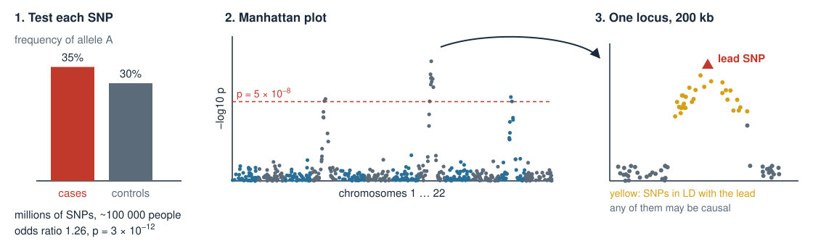{width="95%" fig-align="center"}

- Genotype millions of SNPs in many people; test each SNP for association with the trait; plot −log10 p along the genome.
- Genome-wide significance: p < 5 × 10⁻⁸ (about one million independent tests). Typical odds ratios are 1.05–1.3.
- A significant locus contains **many** associated SNPs; the most significant one is reported as the **lead SNP**.

::: notes
A case–control GWAS compares allele frequencies between cases and controls (here 35% vs 30%, an odds ratio of about 1.26); quantitative traits use regression. The 5 × 10⁻⁸ threshold is a Bonferroni correction for roughly one million independent common variants in European genomes. Effects are small, so GWAS need tens to hundreds of thousands of people, and the result is a list of loci, each a peak of correlated SNPs. The GWAS Catalog (EBI/NHGRI) collects the reported associations from published studies: about 845 000 genome-wide significant SNP–trait associations, 334 000 unique SNPs, in the release we use. It records lead SNPs as reported by the authors, not the full summary statistics; for most analyses in research you would use full summary statistics.
:::

## Most GWAS hits are non-coding {.smaller}

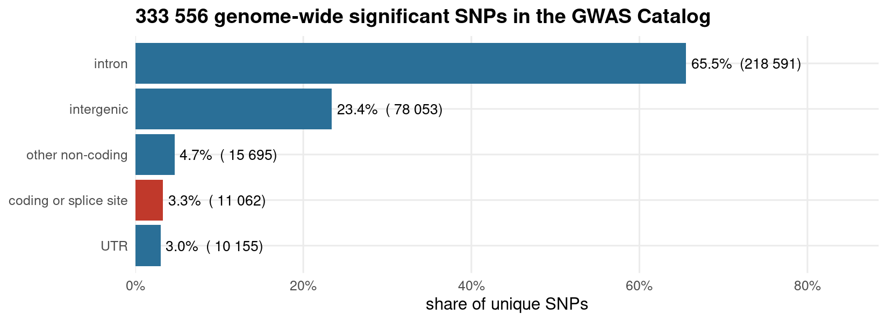{width="85%" fig-align="center"}

- Only **3.3%** of the 333 556 genome-wide significant SNPs in the GWAS Catalog change a protein or a splice site; 65% are intronic, 23% intergenic.
- Fine-mapping of 21 autoimmune diseases came to the same conclusion: about **90%** of causal variants are non-coding (Farh et al. 2015).
- So most disease variants must act by changing **gene regulation**: which elements, in which cells, controlling which genes?

::: notes
Context is the annotation of the reported SNP relative to genes (Ensembl variant consequence). Intronic does not mean "in the gene that matters": introns contain enhancers for distant genes (*FTO* and *IRX3* in the previous unit). Two caveats make 3.3% an underestimate of coding mechanisms: the reported SNP is a tag, and a coding variant in LD with it may be the cause; and coding variants with large effects are rare and often missed by GWAS arrays. Even so, careful fine-mapping (Farh et al. 2015) finds that about 90% of causal autoimmune variants are non-coding, and about 60% fall in immune-cell enhancers. This is why epigenomic maps are now a standard part of interpreting GWAS.
:::

## The lead SNP is a tag {.smaller}

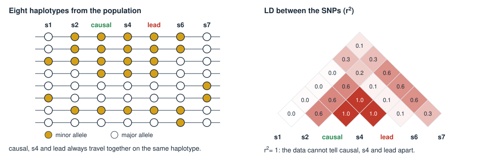{width="95%" fig-align="center"}

- Nearby variants are inherited together on haplotypes: **linkage disequilibrium** (LD), measured by $r^2$.
- A causal variant makes every SNP in LD with it look associated. The lead SNP is the best-measured tag, often not the cause.
- In Europeans, LD blocks span tens of kb (sometimes > 100 kb), so a locus holds 10–100 candidate variants.

::: notes
Walk through the haplotypes: "causal", s4 and "lead" carry the minor allele on exactly the same haplotypes, so their correlation is 1 and no association test can tell them apart; s2 is correlated with them (r² = 0.6) and will also be associated, more weakly. LD comes from shared ancestry: recombination has not yet separated nearby variants. It depends on the population (African genomes have shorter LD blocks, which is why multi-ancestry GWAS help fine-mapping). For annotation this means: checking whether the lead SNP lies in a peak is not enough; we must consider all the variants in LD with it. We will use a crude stand-in for this (a window around the lead SNP), and name the real tools (fine-mapping, S-LDSC).
:::

## From a locus to a mechanism {.smaller}

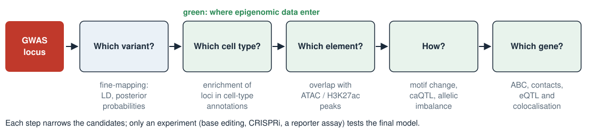{width="95%" fig-align="center"}

- The questions are distinct, and each uses different data. Chromatin maps enter at almost every step (green).
- The end point is a hypothesis: variant → element → TF → gene → cell type, which an experiment can test.

::: notes
This is the map of the lecture. "Which variant" is statistical fine-mapping, helped by functional priors. "Which cell type" is enrichment: are the loci of a disease concentrated in the open chromatin of a particular cell type? "Which element" is the overlap of candidate variants with peaks. "How" asks what the variant does to the element: break a motif, change accessibility (a chromatin QTL), and whether we can see that within one person (allelic imbalance). "Which gene" uses the enhancer–gene methods of *Linking regulatory elements to genes* plus eQTL colocalisation. Experiments at the end: base editing of the variant, CRISPRi of the element, massively parallel reporter assays (MPRA) of both alleles.
:::

## GWAS SNPs sit in open chromatin {.smaller}

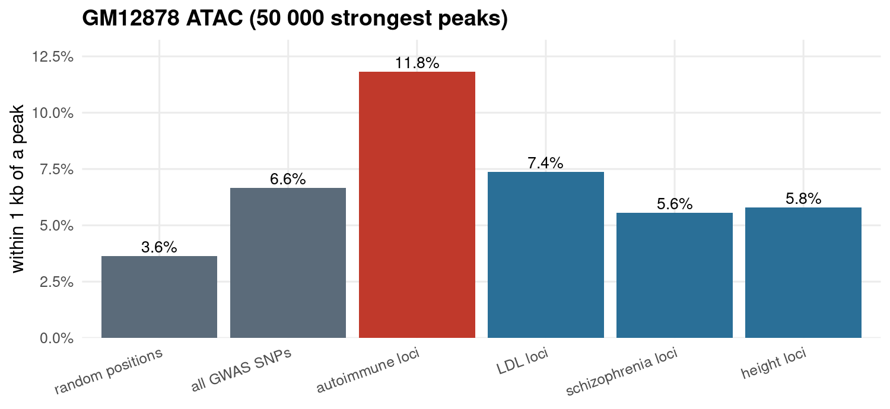{width="80%" fig-align="center"}

- Fraction of SNPs within 1 kb of the 50 000 strongest GM12878 ATAC peaks: random positions **3.6%**, all GWAS SNPs **6.6%**, autoimmune loci **11.8%**.
- GWAS SNPs of *any* trait are near open chromatin more often than random positions: they sit in gene-rich, active regions. The right background is **other GWAS SNPs**, not the genome.

::: notes
This is Maurano et al. 2012 in miniature: disease and trait variants are concentrated in DNase I hypersensitive sites. But the second bar is the important one. All GWAS SNPs together are 1.8 times more often near a GM12878 peak than random positions, because GWAS arrays and associations concentrate near genes and in active regions, and because many traits involve blood. A test of "autoimmune loci vs random positions" would give 3.3-fold enrichment and would overstate the specificity; "autoimmune vs other GWAS SNPs" gives 1.8-fold for all GM12878 peaks, and more for cell-type-specific ones (next slides). LDL, schizophrenia and height loci are close to the background: their relevant cells are liver, brain and growth plate, not B cells. Loci are pruned so that each counts once (the strongest SNP; others within 250 kb dropped).
:::

## Enrichment is a 2×2 table {.smaller}

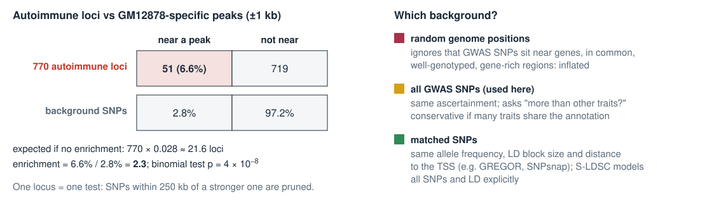{width="95%" fig-align="center"}

- Count loci near and not near the annotation; compare with the background rate. Binomial or Fisher test; report the **enrichment** and its uncertainty.
- The test is only as good as its background: matched for allele frequency, LD and distance to genes, or modelled genome-wide (S-LDSC).

::: notes
The same 2×2 logic as motif enrichment in *Motifs, motif enrichment and TF footprinting*: a property is more frequent in the foreground than in a background. Expected 21.6 of 770 loci near a GM12878-specific peak; observed 51. The binomial test treats loci as independent, which is why we prune them first. Tools: GREGOR and SNPsnap pick background SNPs matched for allele frequency, number of LD proxies and distance to the nearest gene; GARFIELD and S-LDSC (next slides) model LD explicitly. In a research project, use one of these rather than the crude version we run in the exercise; the crude version is good for understanding what the tools do.
:::

## Real data: which cell's open chromatin? {.smaller}

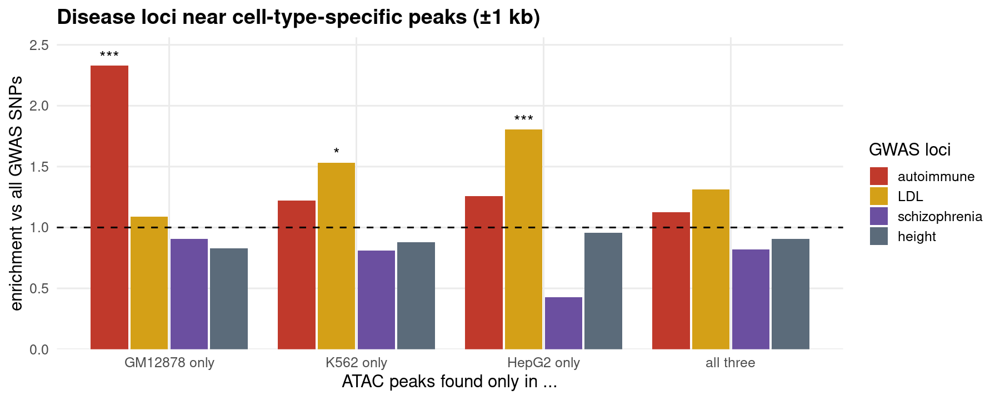{width="92%" fig-align="center"}

- Peaks among the 50 000 strongest that are found **only** in GM12878 (B cells), only in K562 (erythroid) or only in HepG2 (liver).
- Autoimmune loci: **2.3×** in GM12878-only peaks (p = 4 × 10⁻⁸). LDL loci: **1.8×** in HepG2-only peaks (p = 4 × 10⁻⁴). Peaks shared by all three: no enrichment.

::: notes
A double dissociation: autoimmune loci prefer B-cell-specific elements, LDL-cholesterol loci prefer liver-specific elements, schizophrenia and height prefer neither (their cell types are not here). Shared elements, mostly promoters and CTCF sites active everywhere, carry little cell-type information and no enrichment. LDL loci show a weaker signal in K562-only peaks (1.5×, p = 0.02); hepatocyte-like and erythroid cells share some programmes, and with ~40 loci per cell, the numbers are small. This is the logic Maurano et al. used to identify pathogenic cell types without prior knowledge, and Finucane et al. 2015 did systematically with heritability.
:::

## Real data: 13 blood cell types {.smaller}

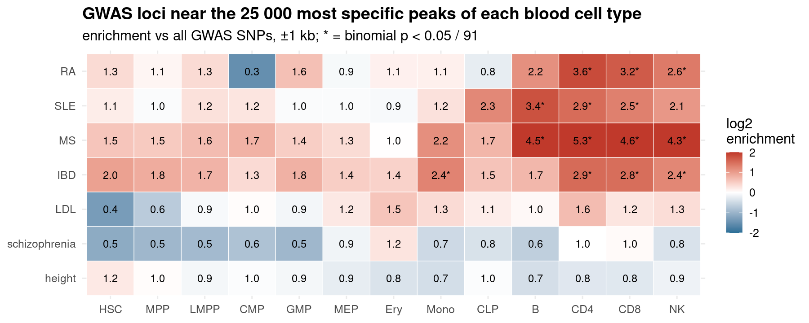{width="95%" fig-align="center"}

- The 25 000 most specific peaks of each cell type (Corces et al. 2016). Lymphocytes light up for all four autoimmune diseases: **MS 5.3×** and **RA 3.6×** in CD4 T cells, **SLE 3.4×** in B cells.
- IBD also in monocytes (2.4×); LDL, schizophrenia and height: nothing in blood.

::: notes
The cell-type pattern matches what is known about these diseases: multiple sclerosis and rheumatoid arthritis loci are strongest in T cells (and MS also in B cells, consistent with the effect of B-cell depletion therapy); lupus is a B-cell disease with autoantibodies; IBD involves innate immune cells, and its monocyte signal fits Nasser et al.'s finding of the strongest enrichment in dendritic cells and macrophages. Progenitors show weak, mostly non-significant enrichment. Stars mark binomial p < 0.05/91. Two warnings. Enrichment says where the variants act, not where the disease starts: a T-cell enrichment in MS does not prove that T cells initiate MS. And resting sorted cells miss states: many autoimmune variants act in stimulated T cells (Farh et al. 2015), which were not profiled here.
:::

## Windows instead of LD {.smaller}

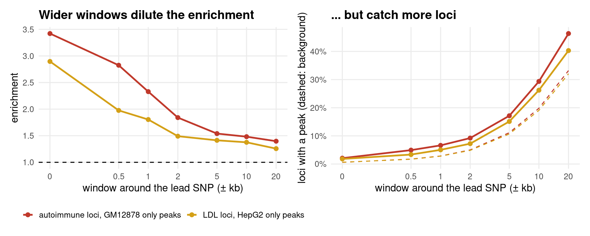{width="92%" fig-align="center"}

- The lead SNP itself in a peak: few loci (16 of 770), strongest enrichment (3.4×). A ±20 kb window: 46% of loci, enrichment 1.4×.
- A window is a crude proxy for LD: it includes unlinked SNPs and misses distant ones. Proper analyses use the LD proxies of each lead SNP (r² > 0.8 in a reference panel) or fine-mapped credible sets.

::: notes
Why the trade-off: a narrow window misses causal variants that are in LD with the lead SNP but a few kb away, so the counts are small and noisy; a wide window catches them but also many peaks that are near by chance (the dashed background curve rises fast because peaks are common), so the enrichment drops towards 1. Every published method has to deal with this: Maurano et al. used LD proxies from the 1000 Genomes project; S-LDSC uses LD scores of all SNPs; fine-mapping replaces the lead SNP with a set of candidates and their probabilities. In the exercise we use ±1 kb and say so. A reference panel such as 1000 Genomes or the LDlink web service gives the r² of each proxy, ancestry by ancestry.
:::

## Partitioned heritability (S-LDSC) {.smaller}

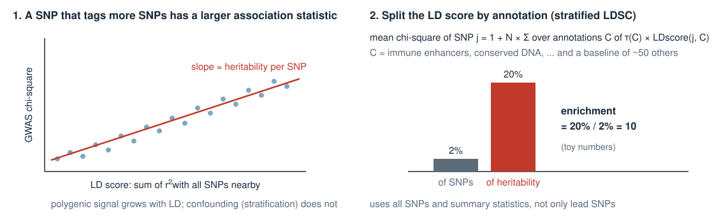{width="95%" fig-align="center"}

- Under polygenicity, a SNP's association statistic grows with how many SNPs it tags (its **LD score**). Split the LD score by annotation to estimate the share of heritability from each.
- Uses **all** SNPs (summary statistics), conditions on ~50 baseline annotations, and reports enrichment = % heritability / % SNPs.

::: notes
This is the method behind most "which cell type" results in modern papers (Finucane et al. 2015). Instead of counting lead SNPs, it regresses the chi-square statistics of all SNPs on their LD scores, split into annotation categories; the coefficient τ of an annotation measures the extra heritability per SNP. Because the model includes a baseline of general annotations (coding, conserved, promoters, all enhancers...), a cell-type-specific annotation must add information beyond "active chromatin in general". Finucane et al. found large enrichment for conserved regions across traits, very large immune-disease enrichment in FANTOM5 enhancers, and central nervous system enrichment for traits such as BMI and educational attainment. The bars here are toy numbers to show the definition. The software (ldsc) needs full summary statistics and an LD reference, beyond the scope of the exercise.
:::

## Fine-mapping {.smaller}

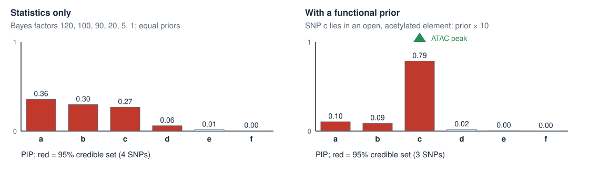{width="95%" fig-align="center"}

- Assume one causal variant: its **posterior inclusion probability** PIP = BF / Σ BF over the SNPs in the locus. A **95% credible set** collects the top SNPs until their PIPs sum to 0.95.
- A **functional prior** (higher prior for SNPs in open, acetylated elements of the relevant cells) can shrink the set. Here: 4 SNPs → 3, and SNP c gets PIP 0.79.

::: notes
The Bayes factor of a SNP compares the data under "this SNP is causal" with "no SNP is causal", computed from the effect estimate and its standard error (Wakefield's approximate Bayes factor). With a single causal variant and equal priors, PIPs are the Bayes factors normalised to sum to one. Methods such as SuSiE and FINEMAP allow several causal variants per locus; PAINTOR and PolyFun bring in functional annotations as priors, learned from data (for example from S-LDSC enrichment). Caution: if you then report "the fine-mapped variant lies in an enhancer", part of that came from the prior; say how the prior was chosen. The by-hand exercise repeats this computation.
:::

## A variant can change a TF motif {.smaller}

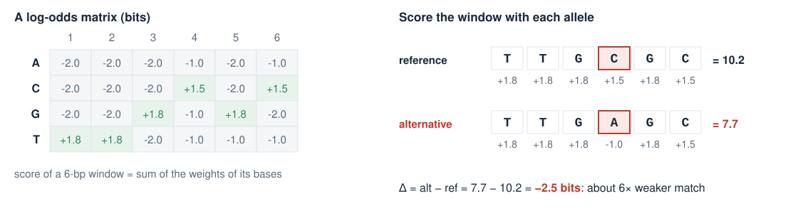{width="95%" fig-align="center"}

- Score the window with each allele, on both strands, over all windows that contain the variant; compare the best scores: Δ = alt − ref.
- A difference of −2.5 bits means the alternative allele matches $2^{2.5} \approx 6$ times worse (in odds against the background).
- Tools: motifbreakR, FIMO on both alleles; the PWMs and their scoring are from *Gene regulation and the cis-regulatory code*.

::: notes
This is the PWM scoring students did by hand in *Gene regulation and the cis-regulatory code*, applied twice. Only windows that overlap the variant can change; a motif of width w has w such windows per strand. A change from a strong match to a weak one suggests loss of binding, from no match to a match a gain. The log-odds difference is not a binding energy, but it correlates with changes in binding measured in allele-specific ChIP-seq. motifbreakR implements exactly this for a list of variants and a motif database, with thresholds on the relative score of the better allele. In the next two slides: one famous success, and a sober look at how often motif changes happen by chance.
:::

## A classic: rs12740374 at the *SORT1* locus {.smaller}

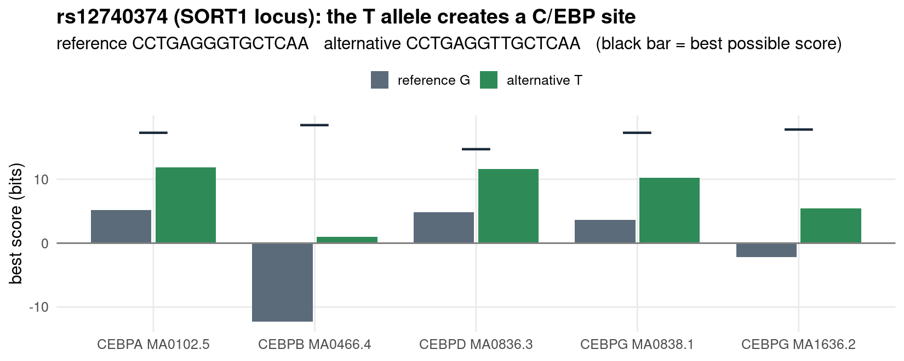{width="85%" fig-align="center"}

- The minor allele **T** of rs12740374 (chr1:109 274 968, 3′ UTR region of *CELSR2*) creates a C/EBP binding site in a liver enhancer.
- More C/EBP binding → more *SORT1* in hepatocytes → lower LDL cholesterol and less myocardial infarction (Musunuru et al. 2010).

::: notes
This was one of the first complete stories from a non-coding GWAS signal to a mechanism. The 1p13 locus is strongly associated with LDL cholesterol and coronary disease. Musunuru et al. showed that the minor allele creates a C/EBP site, increases enhancer activity and SORT1 expression in liver, and that changing SORT1 levels in mouse liver changes plasma LDL. The bars show the best score of five JASPAR C/EBP matrices over the windows containing the SNP: the T allele scores 7–13 bits higher than G (our motif scan in the exercise also calls it a gained C/EBP match at p < 10⁻⁴). Note the gene: the variant lies in the 3′ UTR of CELSR2, next to PSRC1, but the target was SORT1, whose TSS is about 120 kb away; the link needed eQTL data in liver and experiments.
:::

## Real data: motif changes are everywhere {.smaller}

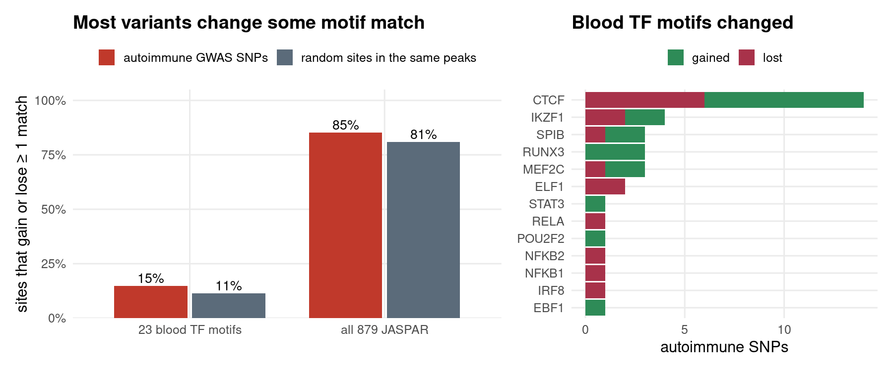{width="95%" fig-align="center"}

- 211 autoimmune GWAS SNPs in GM12878 ATAC peaks, against 879 JASPAR motifs (p < 10⁻⁴): **85%** gain or lose at least one match. Random positions in the same peaks: **81%**.
- With 23 blood TF motifs: 15% vs 11% (not significantly different). Farh et al.: only 10–20% of fine-mapped causal variants change a recognisable motif.

::: notes
The left panel is the sobering control. A single base change in a 50-bp neighbourhood will almost always create or destroy a match for some of 879 motifs, many of them similar (TF families share motifs). So "the risk allele disrupts a motif for X" means little unless X is expressed and bound in the relevant cells, the change is large, and there is evidence that the variant changes binding or accessibility (the QTL and allelic data of the next slides). Restricting to TFs that matter in B cells (ETS, IRF, NF-κB, RUNX, EBF1, POU2F2, CTCF...) gives smaller numbers, but still no clear excess over random sites with this sample size. The right panel lists the blood-TF changes; CTCF dominates because its long motif has many near-matches. Note that the lead SNPs are tags: with credible sets instead of lead SNPs, the picture would be cleaner.
:::

## Chromatin QTLs {.smaller}

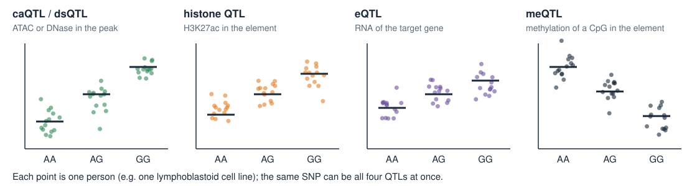{width="95%" fig-align="center"}

- Measure a molecular trait in many genotyped people and test each nearby SNP: **caQTL/dsQTL** (accessibility), **hQTL** (histone marks), **meQTL** (DNA methylation), **eQTL** (expression).
- Degner et al. 2012: 8902 dsQTLs in 70 lymphoblastoid cell lines; 16% are also eQTLs, and up to 55% of eQTL SNPs are dsQTLs.

::: notes
A chromatin QTL turns "the variant might change binding" into a measurement: across people, those with the GG genotype have a more open element. Lymphoblastoid cell lines like GM12878 were the workhorse because hundreds of genotyped lines exist (1000 Genomes, HapMap). Degner et al. measured DNase-seq in 70 Yoruba LCLs; dsQTLs were enriched in TF binding sites and often showed allele-specific binding, and many eQTLs could be explained by a change in accessibility. Kumasaka et al. 2016 did the same with ATAC-seq (2707 caQTLs from a modest sample) and introduced RASQUAL, which combines differences between people with allelic imbalance within people. meQTLs are common too, and methylation often follows accessibility (a TF that cannot bind no longer protects its site from methylation); the methylation units return to this. QTLs are correlational at the level of the variant, LD again blurs which SNP is causal.
:::

## Allele-specific accessibility in one person {.smaller}

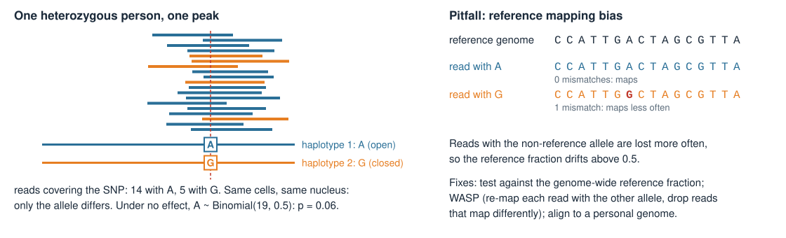{width="95%" fig-align="center"}

- At a heterozygous SNP in a peak, reads from the two haplotypes are counted in **one** sample: same cells, same nucleus, only the allele differs. Imbalance → a *cis* effect.
- Test against 0.5 (binomial), but beware **reference mapping bias**: reads carrying the non-reference allele map less well.

::: notes
Allelic imbalance is the within-person version of a QTL, and it controls for everything that differs between people (environment, cell composition, batch). It needs only one heterozygous individual, which is why GM12878, with its high-quality phased genome (NA12878, Genome in a Bottle), is ideal. The pitfall is technical: a read that carries the alternative allele has one mismatch to the reference genome, so it is somewhat more likely to fail alignment or be filtered for low MAPQ, especially if another variant lies nearby. The result is a genome-wide excess of reference reads. WASP (van de Geijn et al. 2015) re-maps each read with the allele flipped and discards reads that do not map to the same place; a personal diploid genome can reduce reference mismatches but still needs checks for unequal allelic mappability. Copy-number changes and imprinting also cause imbalance unrelated to the variant.
:::

## Real data: allelic imbalance in GM12878 {.smaller}

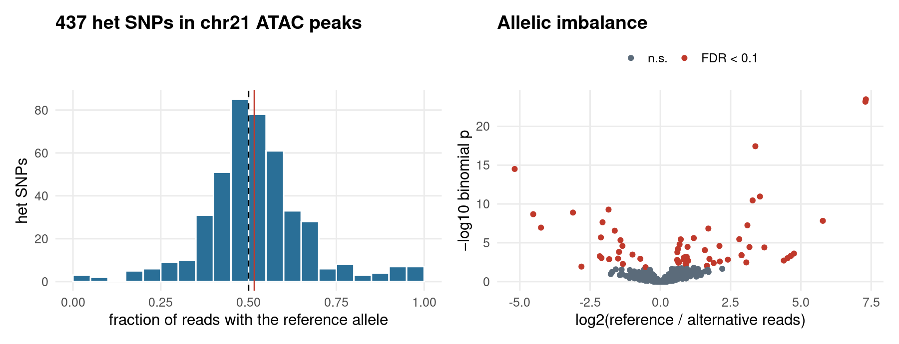{width="92%" fig-align="center"}

- 437 heterozygous SNPs (GIAB) in chr21 ATAC peaks with ≥ 10 reads, from the replicates you aligned in *ATAC-seq processing*. Pooled reference fraction **0.516**: mapping bias.
- **62** SNPs at FDR < 10%. Neighbouring SNPs in the same peak agree (e.g. 3 SNPs at 42.1 Mb, all reference-biased), as expected for a haplotype-level effect.

::: notes
The histogram is centred slightly above 0.5 (red line, 0.516), the signature of reference bias; with WASP it would move back towards 0.5. A test against the pooled fraction instead of 0.5 is a quick correction. Sixty-two significant SNPs is many for 437: some are real cis effects on accessibility, but several are complete (79 reference reads, 0 alternative at 44.196 Mb): that pattern suggests a deletion or loss of one haplotype in this cell line, or a genotyping error, rather than a regulatory variant. Lymphoblastoid lines are EBV-transformed and can carry copy-number changes, so check neighbouring SNPs and copy number before claiming a regulatory variant. The exercise reproduces these counts with bcftools and a binomial test in R.
:::

## Colocalisation {.smaller}

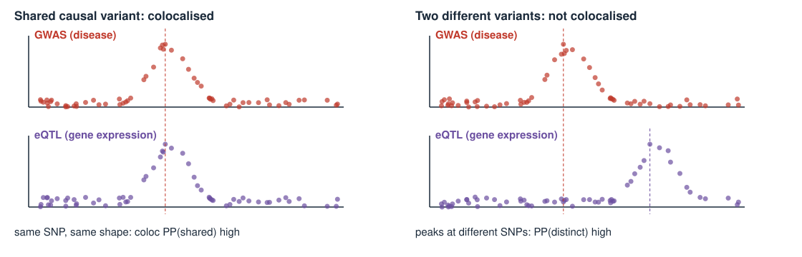{width="95%" fig-align="center"}

- A GWAS locus and an eQTL (or caQTL) for a gene in the same region: is it **one** causal variant, or two different ones in LD?
- coloc compares the association patterns and gives a posterior for "shared variant" vs "distinct variants". A shared variant links the disease signal to the gene (or element).

::: notes
Overlap of two association peaks is not enough: in a region with long LD, a disease variant and an independent eQTL variant can produce overlapping peaks by chance, and many loci contain several eQTLs for different genes. Colocalisation methods (coloc, Giambartolomei et al. 2014; eCAVIAR; SMR-HEIDI) test whether the two signals have the same shape, which they do only if one variant drives both. They need full summary statistics from both studies and the right tissue: an eQTL measured in whole blood may not exist in the relevant immune cell state. Large eQTL resources (GTEx for tissues, eQTL Catalogue, DICE and others for immune cell types) make this routine; the fraction of GWAS loci that colocalise with an eQTL is still surprisingly modest, one argument for context-specific regulation.
:::

## From variant to gene {.smaller}

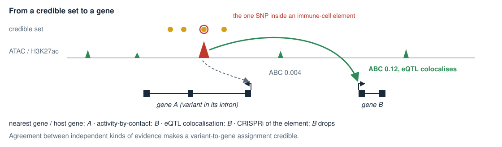{width="95%" fig-align="center"}

- The gene containing or nearest to the variant is a guess (*Linking regulatory elements to genes*: right about half the time).
- Combine: fine-mapping, overlap with an element active in the enriched cell type, enhancer–gene links (ABC), colocalised eQTL, and a perturbation.

::: notes
The figure is a composite of the kinds of evidence. Nasser et al. 2021 used ABC maps in 131 cell types to connect 5036 GWAS signals for 72 traits to genes, and showed that ABC links were more precise than nearest gene or eQTL alone for genes with known causal roles. One of their examples is an IBD risk variant in an enhancer that regulates *PPIF* in macrophages, the locus we analysed in GM12878 in the previous unit. Variant-to-gene pipelines such as Open Targets Genetics combine distance, QTLs, chromatin interactions and functional annotations into one score per gene, trained on gold-standard genes. Each line of evidence has false positives; agreement between independent ones is what makes an assignment credible.
:::

## The enrichment test in R

```r
near <- function(chr, pos, peaks, w = 1000)                       # SNP within w bp of a peak?
  overlapsAny(GRanges(chr, IRanges(pmax(pos - w, 1), pos + w)), peaks)
loci <- leads[set == "autoimmune"]                                # one lead SNP per locus
k  <- sum(near(loci$chr, loci$pos, gm_only))                      # 51 of 770
p0 <- mean(near(bg$chr, bg$pos, gm_only))                         # 0.028 for all GWAS SNPs
c(enrichment = k / nrow(loci) / p0,
  p = binom.test(k, nrow(loci), p0, alternative = "greater")$p.value)
```

- Pruning, peaks and backgrounds as in *Genomic intervals*: one `overlapsAny` per question.
- Production tools: GREGOR, GARFIELD, S-LDSC (ldsc), with LD panels and matched backgrounds.

::: notes
This is the core of the exercise (R2). The loci were pruned first: within each trait set, keep the most significant SNP and drop any SNP within 250 kb of a kept one, a crude replacement for LD clumping (plink --clump does the same with r² from a reference panel). gm_only are the GM12878 peaks absent from the K562 and HepG2 top-50 000 sets; bg are all unique SNPs in the GWAS Catalog. The binomial test asks whether 51 successes in 770 trials is surprising when the success probability is 0.028. Everything here can be done with bedtools as well (the exercise's command-line part).
:::

## Judging claims {.smaller}

- "The lead SNP lies in an enhancer, so it is the causal variant." It is a tag; check all SNPs in LD, fine-map, and look for QTL or allelic evidence.
- "Disease loci are enriched in T-cell enhancers, so the disease starts in T cells." Enrichment shows where variants act, not where the disease is initiated; other cell types and states may not have been profiled.
- "The risk allele disrupts a motif for TF X." About as many random sites do; is X expressed and bound there, and does the variant change accessibility or binding?
- "40% of our loci overlap open chromatin (vs 4% of random positions)." Compare with other GWAS SNPs and matched backgrounds, and consider the window used.
- "This allele shows 3:1 imbalance in one sample." Mapping bias, copy number and coverage first; replicate across individuals.

::: notes
These claims all appear in papers. Ask students to identify which slide of the lecture addresses each. Common thread: each piece of evidence is weak alone (LD, enrichment backgrounds, chance motif matches, technical imbalance), and convincing stories combine several independent lines, ideally ending with an experiment on the variant itself (base editing or a reporter assay of both alleles).
:::

## Summary {.smaller}

| idea | key fact |
|---|---|
| GWAS hits | ~3% coding or splice; most act through gene regulation |
| LD | the lead SNP tags a block of correlated variants; it is often not causal |
| enrichment | 2×2 against **other GWAS SNPs** (matched), not random positions |
| this data | autoimmune loci 2.3× in B-cell-specific peaks; LDL 1.8× in liver-specific; MS 5.3× in CD4 T cells |
| windows | narrow = few loci, strong enrichment; wide = more loci, diluted |
| S-LDSC | heritability enrichment from all SNPs, conditional on a baseline |
| fine-mapping | PIP = BF / Σ BF (one causal variant); functional priors sharpen credible sets |
| motifs | Δ score of two alleles; most sites change some motif by chance |
| QTLs, allelic | caQTL across people, imbalance within one person; beware mapping bias |
| variant → gene | colocalisation + enhancer–gene links + perturbation |

::: notes
Students should be able to: compute r² from haplotype frequencies; set up and evaluate an enrichment 2×2 table with an appropriate background; compute PIPs and a credible set from Bayes factors; score both alleles with a PWM; test allelic imbalance with a binomial test and recognise mapping bias; and judge claims about causal variants. The next units take a different angle on the same problem: machine-learning models that predict the effect of a variant directly from sequence (*What did the model learn? Variant effects*).
:::

## Key papers (optional further reading) {.smaller}

*Not required reading and not examined. For those who want the primary literature.*

- Musunuru et al. 2010, *Nature*. [From noncoding variant to phenotype via SORT1 at the 1p13 cholesterol locus](https://doi.org/10.1038/nature09266). A complete mechanism, from GWAS signal to C/EBP site to liver gene.
- Maurano et al. 2012, *Science*. [Systematic localization of common disease-associated variation in regulatory DNA](https://doi.org/10.1126/science.1222794). Disease variants concentrate in DNase I hypersensitive sites of relevant cells.
- Degner et al. 2012, *Nature*. [DNase I sensitivity QTLs are a major determinant of human expression variation](https://doi.org/10.1038/nature10808). Chromatin QTLs in lymphoblastoid cell lines.
- Finucane et al. 2015, *Nat Genet*. [Partitioning heritability by functional annotation using genome-wide association summary statistics](https://doi.org/10.1038/ng.3404). Stratified LD score regression.
- Farh et al. 2015, *Nature*. [Genetic and epigenetic fine mapping of causal autoimmune disease variants](https://doi.org/10.1038/nature13835). 90% non-coding, 60% in immune enhancers, few in motifs.
- Schaid, Chen & Larson 2018, *Nat Rev Genet*. [From genome-wide associations to candidate causal variants by statistical fine-mapping](https://doi.org/10.1038/s41576-018-0016-z). Review of fine-mapping methods.
