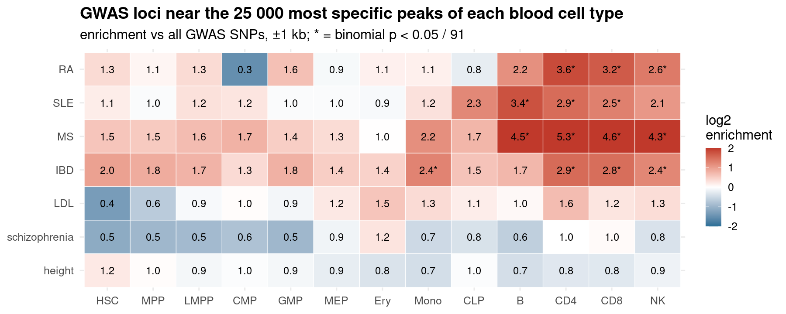

Short questions on GWAS loci, enrichment in chromatin annotations, fine-mapping, motif changes and allele-specific accessibility. Try each on paper first, then open the answer.

---

**Q1.** Only about 3% of genome-wide significant SNPs in the GWAS Catalog are coding or at a splice site. Give two reasons why this does not prove that 97% of causal variants are non-coding, and one piece of evidence that most really are.

::: {.callout-note collapse="true" title="Answer"}
(1) Reported SNPs are tags: a coding variant in LD with a non-coding lead SNP may be the cause. (2) Arrays and imputation under-represent rare coding variants, which often have larger effects. Evidence that most causal variants are non-coding: statistical fine-mapping (e.g. Farh et al. 2015, ~90% of causal autoimmune variants non-coding) and the strong enrichment of loci in cell-type-specific regulatory elements, which coding variants would not produce.
:::

---

**Q2.** Haplotype frequencies of two SNPs are AB 0.3, Ab 0.2, aB 0.2, ab 0.3. Compute $r^2$.

::: {.callout-tip collapse="true" title="Hint"}
$p_A = p_B = 0.5$; $D = p_{AB} - p_A p_B$.
:::

::: {.callout-note collapse="true" title="Answer"}
$D = 0.3 - 0.25 = 0.05$; $r^2 = 0.05^2 / (0.5^4) = 0.0025 / 0.0625 = $ **0.04**: weak LD. A causal variant at B would leave little signal at A.
:::

---

**Q3.** 200 disease loci; 30 lie within 1 kb of a T-cell-specific peak. Among all GWAS SNPs the rate is 5%. Compute the expected number and the enrichment. Why are other GWAS SNPs a better background than random genome positions?

::: {.callout-note collapse="true" title="Answer"}
Expected $200 \times 0.05 = 10$; enrichment $(30/200)/0.05 = $ **3**. GWAS SNPs of any trait sit preferentially in gene-rich, active regions and are ascertained by the same arrays; random positions would make every trait look enriched in open chromatin (in our data all GWAS SNPs were 1.8 times more often near a GM12878 peak than random positions).
:::

---

**Q4.** Why does widening the window around lead SNPs (±0 → ±20 kb) increase the number of loci near a peak but decrease the enrichment?

::: {.callout-note collapse="true" title="Answer"}
A wider window catches causal variants in LD with the lead SNP that lie further away (more true hits), but also many peaks that are nearby by chance; the background rate rises quickly because peaks are common (a third of all GWAS SNPs have a GM12878-specific peak within 20 kb). The ratio therefore falls towards 1 (here from 3.4 to 1.4), while the p-value can still improve because there are more loci. Proper analyses use LD proxies or fine-mapped credible sets instead of a window.
:::

---

**Q5.** Three SNPs at a locus have Bayes factors 60, 30 and 10. Assuming one causal variant and equal priors, give the PIPs and the 95% credible set. What changes if SNP 3 gets a 10-fold higher prior because it lies in an enhancer?

::: {.callout-note collapse="true" title="Answer"}
Equal priors: 0.6, 0.3, 0.1; the 95% set needs all three (0.6 + 0.3 = 0.9 < 0.95). With prior ×10 for SNP 3: 60, 30, 100 → 0.32, 0.16, 0.53; the set still needs all three (0.53 + 0.32 = 0.85), but SNP 3 is now the most likely. The prior changes the ranking; it must be justified independently of this locus.
:::

---

**Q6.** A PWM gives the reference allele a best score of 9.0 bits and the alternative allele 5.5 bits at a site. By how much does the match change? Why is "the risk allele disrupts a TF motif" weak evidence on its own?

::: {.callout-note collapse="true" title="Answer"}
Δ = −3.5 bits: $2^{3.5} \approx 11$-fold weaker in odds. Weak evidence because almost every position in open chromatin changes some motif match when mutated (in our data 81% of random positions in GM12878 peaks gained or lost a JASPAR match at p < 10⁻⁴, vs 85% of autoimmune SNPs), and the TF may not be expressed or bound there. Add binding data, allelic imbalance or a QTL, and an experiment.
:::

---

**Q7.** What is the difference between a caQTL and allele-specific accessibility? Name one advantage of each.

::: {.callout-note collapse="true" title="Answer"}
A caQTL compares accessibility **between people** with different genotypes (many genotyped samples); allele-specific accessibility compares the two alleles **within** one heterozygous person (read counts per allele at a heterozygous SNP). caQTL: covers all genotypes and gives population effect sizes, works for homozygous effects too. Allelic analysis: controls for everything that differs between people (environment, cell composition, batch) and needs only one individual; but needs a heterozygous SNP in the reads and enough depth.
:::

---

**Q8.** In GM12878 ATAC-seq, 51.6% of reads at heterozygous SNPs carry the reference allele. Explain why, and what it does to a binomial test against 0.5.

::: {.callout-note collapse="true" title="Answer"}
Reference mapping bias: reads carrying the non-reference allele have one more mismatch to the reference genome and are lost slightly more often in alignment or MAPQ filtering. A test against 0.5 then finds spurious reference-biased "imbalance", especially at deeply covered sites (the bias is constant, the standard error shrinks with depth). Test against the genome-wide reference fraction, or remove the bias with WASP or alignment to a personal genome.
:::

---

**Q9.** Read the heatmap: which blood cell types show the strongest enrichment of multiple sclerosis loci? Does this mean MS is a T-cell disease?

{width="100%"}

::: {.callout-note collapse="true" title="Answer"}
CD4 T cells (5.3×), then CD8 T cells, B cells and NK cells (4.3–4.6×). It means MS risk variants are concentrated in regulatory elements specific to lymphocytes, so they likely act there. It does not show where the disease starts or exclude other cells: microglia, other immune states (activated T cells) and cell types not profiled could matter too; B cells are also strongly enriched, consistent with the efficacy of B-cell depletion.
:::

---

**Q10.** A GWAS locus and an eQTL for gene X both peak in the same 100-kb region. Is X the causal gene? What would colocalisation add, and what else would you look for?

::: {.callout-note collapse="true" title="Answer"}
Not necessarily: with long LD and many eQTLs in the genome, two independent signals can overlap by chance. Colocalisation tests whether the two association patterns are explained by one shared variant (high posterior for "shared") rather than two. Also look for: the eQTL in the relevant cell type and state, an enhancer–gene link from the fine-mapped variant's element to X (ABC, contacts), allelic or QTL evidence at the element, and a perturbation of the element or the variant that changes X.
:::
